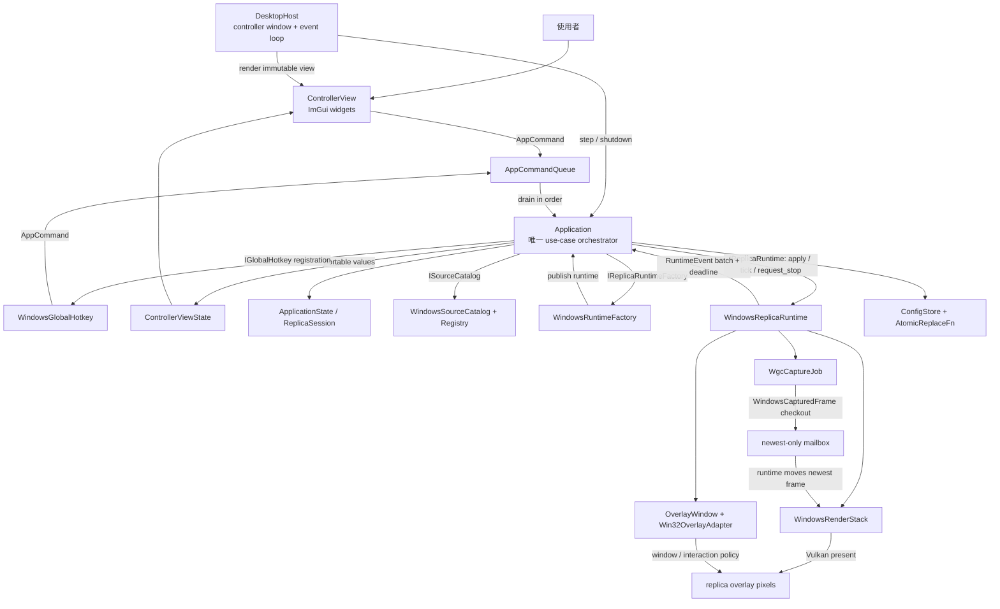
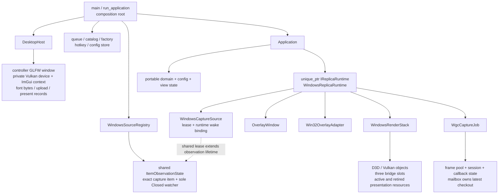
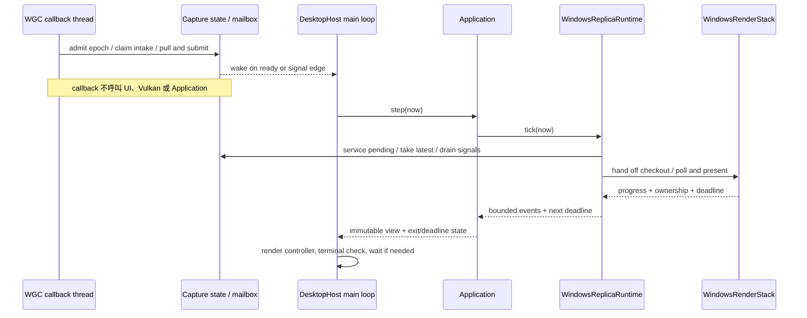

# Airelinna 架構導讀

Airelinna 的控制面與影像資料路徑是分開的：UI 只送出 `AppCommand`，`Application` 決定何時呼叫 runtime；擷取到的畫面則留在 Windows capture 與 renderer 之間，完全不經過 UI view state。

本目錄描述 **目前 working tree 的實作**，不是未來功能提案，也不是 release 驗收證明。分層準則以 `docs/superpowers/specs/2026-08-24-airelinna-design.md` 為準；實作待辦仍在 `docs/superpowers/plans/2026-08-24-airelinna-v1.md`。需要 IDE 跳轉與 include 診斷，先看 [clangd 設定](../development/clangd.md)。

本文件集隨程式碼提交；plan／spec、tests、驗收紀錄與 publish 專用檔案目前仍留在開發者的 working tree。這些資料以下以 repo-relative 路徑標示，不作為新 checkout 的必要輸入；production build／clangd 設定見上述開發指引。

## 1. Big picture：控制面與畫面資料路徑

下圖箭頭表示**執行期間的呼叫或資料傳遞**，不是 CMake link dependency，也不代表箭頭起點擁有終點。

`AppCommand` 是控制值，不帶原生 handle。`RuntimeEvent` 是結果與狀態候選，不帶 pixels。`ControllerViewState` 是文字、識別碼、設定與 enabled 狀態的 snapshot，不是通往 runtime 的物件圖。

原始碼入口：[main.cpp](../../main.cpp)、[Application](../../include/airelinna/app/application.hpp)、[ports](../../include/airelinna/app/ports.hpp)、[ControllerView](../../include/airelinna/ui/controller_view.hpp)。

## 2. 誰擁有什麼

這張圖只表示**canonical ownership**。借用的 port reference、callback 以及跨 API 的同步依賴不畫成擁有關係。

有兩套呈現資源：`DesktopHost` 畫 controller；`WindowsRenderStack` 畫 replica。兩者共用的是 Vulkan result 分類等純 policy，不是同一個 device、swapchain、frame ring 或資源 owner。

`WindowsCapturedFrame` 是 move-only 的 WGC checkout。mailbox 或 bridge slot 持有它時，frame-pool 的生命週期不能先結束。反之，完成 copy 並退休後留存的 renderer image 可以重畫，不需要永久扣住 WGC checkout。

## 3. 執行緒與喚醒

callback 內的 intake gate 序列化「原生 pull → metadata → mailbox publication」。競爭者不等待目前 owner 完成，而是記錄 pending，再交由後續 callback 或 main-loop service 處理。UI、domain mutation、overlay policy 與 Vulkan presentation 都在 main thread。

## 4. 子單元索引

| 導讀 | 內部圖與重點 | 主要原始碼 |
|---|---|---|
| [Core](core.md) | types、session/state、scheduler、mailbox、typed hotkey | `include/airelinna/core`、`src/core` |
| [Application 與 UI](application-ui.md) | command queue、ports、orchestrator、config、projection、widgets | `include/airelinna/app`、`src/app`、`src/ui` |
| [Windows capture](windows-capture.md) | catalog/registry/item identity、source lease、callback gate、WGC checkout | `platform/windows` 的 source/capture/job 與 `detail` |
| [Windows runtime 與 overlay](windows-runtime-overlay.md) | factory publication、aggregate drain、overlay transactions、hotkey/system adapters | `platform/windows` 的 runtime/factory/overlay/Win32 adapters |
| [Renderer](renderer.md) | policies、CPU/GPU bridge、slots、shaders、WSI retirement/recovery | `render`、`shaders` |
| [Desktop host](desktop-host.md) | controller-only graphics、font upload、event loop、composition/exit | `src/desktop`、`include/airelinna/desktop`、`main.cpp` |
| [Build 與驗證](build-and-validation.md) | CMake targets、dependency patches、generated shaders、boundary/test gates | `CMakeLists.txt`、`src/CMakeLists.txt`、`cmake`、`tests` |

## 5. 修改功能時應該去哪裡

- **新增使用者操作**：先確認 command 與 `Application` 的 use-case，再補 projection/widget；不要讓 widget 自己找 native object。
- **改原生視窗互動**：GLFW decoration 由 `OverlayWindow` 管；Win32 subclass、input transparency 與 hit-test 由 `Win32OverlayAdapter` 管。
- **改 capture callback**：留在 capture state/job，維持 no-throw、epoch、pending、quiescence 與 checkout lifetime 契約。
- **改複製／呈現**：留在 renderer，先區分 D3D copy completion、Vulkan submission completion 與 presentation completion。
- **改跨 native owner 的順序**：由 runtime/factory 協調；portable `Application` 不介入單一 texture 或 HWND。
- **加測試**：優先併入現有 15 cases 的相關情境，不為每個方法加介面或建立新的 test matrix。

Mermaid 原始碼直接保留在 Markdown fenced blocks，方便隨實作更新。圖上的 class/function 名稱應能在 clangd 找到對應符號；導讀不能取代原始碼中的細部錯誤處理契約。
