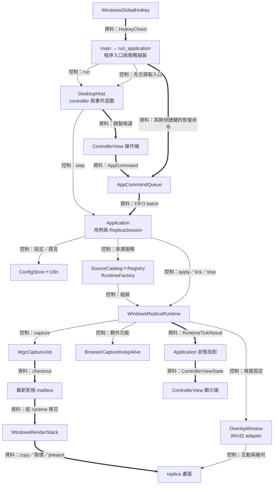
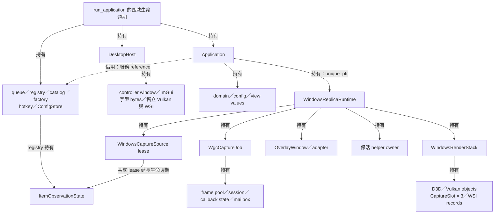
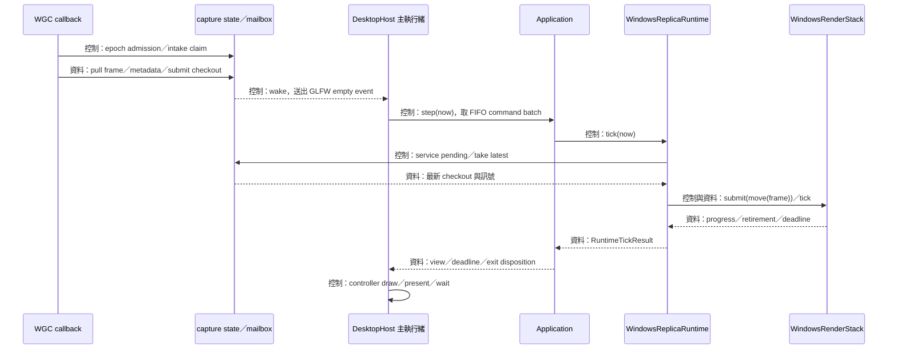
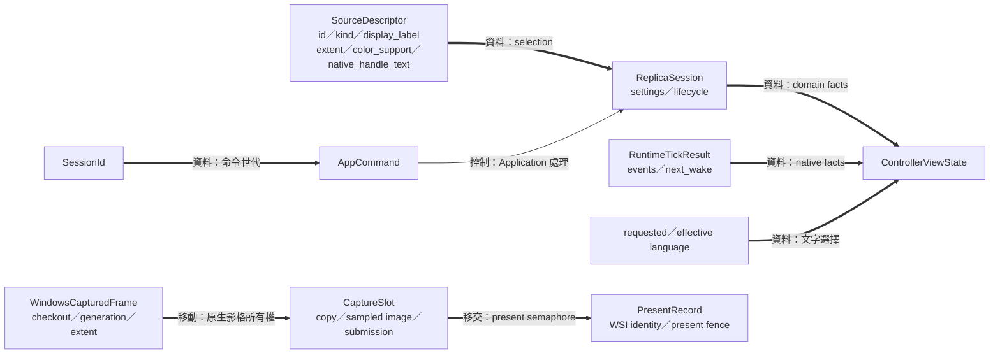
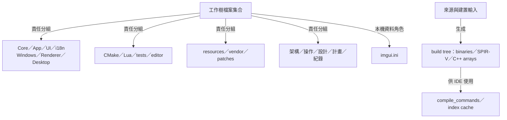

# avb0795 架構總覽

為了將使用者選取的視窗或顯示器持續呈現在副本視窗，專案需要協調操作意圖、來源生命週期、影格運送與畫面呈現。 avb0795 將這些需求交給各自的元件：桌面宿主以 `DesktopHost` 推進事件迴圈，應用程式以 `Application` 處理用例，Windows runtime 組裝原生擷取與視窗服務，算繪器（renderer）完成影格複製及呈現

上圖由 [main.cpp](../../main.cpp) 開始，呈現執行期間的主路徑。 ControllerView 的操作端與顯示端分別呈現命令輸入及投影輸出，兩端由同一份 view 實作連接。 細實線箭頭標示控制呼叫，粗實線標示資料傳遞，後續所有權圖用「持有」與「借用」標籤表達生命週期。 圖中的每個資料值都有接收者，每個原生效果都有具體 owner。 這份導讀以目前 working tree 的程式為閱讀對象，驗證結果則保存於各份 verification 紀錄

為了讀懂一張影格如何到達螢幕，可以先沿三條路線閱讀：

- 操作路線：`ControllerView` → `AppCommandQueue` → `Application` → `IReplicaRuntime`
- 影像路線：WGC callback → `WindowsCapturedFrame` → mailbox → runtime 移交 → `WindowsRenderStack` → Vulkan present
- 狀態路線：`RuntimeTickResult` → `ReplicaSession` 與狀態值 → `ControllerViewState` → UI 文字及操作能力

## 入口、組裝與所有權

為了讓 callback、借用參照與原生資源有足夠長的生命週期，程序入口需要依借用關係安排服務的建立順序。 `main()` 依序設定 Per-Monitor V2 DPI、初始化 COM 與 GLFW，接著進入 `run_application()`。 這個函式依序建立命令 queue、字型資料、DesktopHost、來源 registry／catalog、runtime factory、全域快捷鍵、設定儲存服務與 Application

`Application` 借用 queue、catalog、factory、hotkey 與 ConfigStore，並持有 domain、設定偏好與目前 view。 Factory 成功回傳的 `std::unique_ptr<IReplicaRuntime>` 交給 Application 保存。 Runtime 再持有 source lease、capture job、overlay、算繪器與額外保活功能

為了分別管理 controller 與 replica 的圖形生命週期，兩個視窗各需要一組圖形 owner。 DesktopHost 持有 controller 的 Vulkan device、swapchain、ImGui context 及字型資源，WindowsRenderStack 持有 replica 的 D3D／Vulkan 資源。 共用的錯誤分類與重試政策以值運算提供決策，各個 owner 自行保存其 native handles、records 與完成證據

一般退出會沿建立順序反向釋放。 若某個原生使用者的完成狀態仍待證明，owner 持續保留相關資源，host 透過 `HostRunResult::abandon_process` 選擇程序級結束，`main` 使用 `std::_Exit` 完成退出。 詳細條件見 [Desktop host](desktop-host.md)、[Application](application-ui.md) 及 [Runtime](windows-runtime-overlay.md)

## 執行緒、控制與資料交接

為了在來源更新與畫面呈現的節奏間保持協調，需要一個短的 callback 接收路徑，以及一個統一的主執行緒控制路徑。 WGC callback 負責接收影格、抽取 metadata、更新 mailbox 與喚醒事件迴圈。 主執行緒負責 Application 狀態、UI、runtime、overlay 及 Vulkan 呈現

`WindowsCapturedFrame` 是 WGC 借出的影格 checkout，其移動會交接這筆原生借用。 Mailbox 持有待取出的最新 checkout，runtime 取得後再交給算繪器的 slot。 D3D copy 使用 WGC buffer 的期間，slot 持續保存 checkout，觀察到 copy completion 後釋放。 已完成複製的算繪器 image 接著依 Vulkan submission 與 presentation 各自的完成時點退休

為了限制累積延遲，影格 mailbox 的容量是一筆，新的影格會取代待處理值。 操作命令則保留 FIFO 順序，讓「修改設定、開始、停止」沿提交順序處理。 這兩種資料的時間意義，決定了 [mailbox 與排程](core.md)和 [command queue](application-ui.md) 採用各自的容器契約

為了決定下一次主迴圈的觀察時間，需要彙整排程與原生工作 deadlines。 Runtime 回傳自己的最早需求，Application 再加上立即處理需求，host 最後結合 controller graphics deadline。 Callback 的 wake 提供事件驅動入口，deadline 提供計時入口。 各元件的內部路徑見 [Capture](windows-capture.md)、[Renderer](renderer.md) 與 [Desktop host](desktop-host.md)

## 重要資料結構與閱讀路線

為了在各層之間傳遞足夠的事實，需要讓識別、意圖、狀態與像素的角色各自明確。 `SourceDescriptor` 保存一次來源列舉的快照，`SessionId` 標記 domain 世代，`AppCommand` 保存操作意圖。 Application 以這些值檢查命令條件，並將接受後的結果投影成 `ControllerViewState`

為了證明一筆原生工作何時可以退休，圖形路徑需要記住使用中的來源與完成物件。 `WindowsCapturedFrame` 連接 WGC checkout，`CaptureSlot` 保存 transport 與 submission 工作，`PresentRecord` 保存 presentation 的關聯。 每種記錄都把「資料」與「使用它的工作」連在一起，完整推進順序見 [Renderer](renderer.md)

| 元件教材 | 閱讀目的 |
| --- | --- |
| [Core](core.md) | 從值與狀態理解 session、deadline grid、最新值交接與快捷鍵解析 |
| [Application 與 UI](application-ui.md) | 從操作意圖追蹤服務呼叫、設定交易及介面投影 |
| [在地化](localization.md) | 從系統語言與使用者偏好追蹤文字選擇與命令 |
| [Windows capture](windows-capture.md) | 從來源識別碼追蹤原生 item、callback、影格 checkout 與 resize |
| [Windows runtime 與 overlay](windows-runtime-overlay.md) | 理解資源組裝、設定套用、復原與清理，以及視窗互動 |
| [瀏覽器保活](browser-capture-keep-alive.md) | 理解額外功能的資格政策、helper owner、啟用與退休 |
| [Renderer](renderer.md) | 理解 CPU／GPU transport、UV 映射、雙線性取樣及完成證據 |
| [Desktop host](desktop-host.md) | 理解程序入口、controller graphics、字型與事件迴圈 |
| [建置與驗證](build-and-validation.md) | 理解 CMake targets、依賴 patches、shader 與資源生成 |
| [Lua 工具](lua-tooling.md) | 理解清單 metadata 的解碼、profile 比對與雙端結果 |
| [clangd 操作](../development/clangd.md) | 建立 declaration／definition 導覽及 include 診斷 |
| [註解維護](../development/source-comments.md) | 閱讀與維護契約、原因及生命週期說明 |

## 逐檔責任索引

為了讓讀者從檔名找到責任，需要一份與工作樹集合一致的索引。 下表依元件分組，每列對應一個實際檔案，連結以本文件所在目錄為基準。 2026-09-09 的交付快照包含 **173 個檔案**，集合來自 `git ls-files --cached --others --exclude-standard` 去重並確認存在後的結果，涵蓋產品、測試、工具、資源及工作文件

生成的二進位檔案、下載依賴、SPIR-V、編譯資料庫與索引快取依建置流程保存在 build／cache 目錄。 本機 `imgui.ini` 以檔名及偏好資料角色登記，內容由使用者保管。 設計、計畫、issue 與 verification 檔案在最後的工作文件分組呈現用途，持續維護的架構詳解則由上方閱讀路線提供

### Core

| 檔案 | 責任 | 詳解 |
| --- | --- | --- |
| [include/avb/core/application_state.hpp](../../include/avb/core/application_state.hpp) | session 值持有與 SessionId 世代檢查 | [元件文件](core.md) |
| [include/avb/core/frame_scheduler.hpp](../../include/avb/core/frame_scheduler.hpp) | 依 deadline grid 合併影格與重畫需求 | [元件文件](core.md) |
| [include/avb/core/hotkey.hpp](../../include/avb/core/hotkey.hpp) | 快捷鍵字串解析、值型態與固定順序序列化 | [元件文件](core.md) |
| [include/avb/core/latest_value_mailbox.hpp](../../include/avb/core/latest_value_mailbox.hpp) | 以單槽保存最新值並交接所有權 | [元件文件](core.md) |
| [include/avb/core/replica_session.hpp](../../include/avb/core/replica_session.hpp) | 來源、設定與 lifecycle 狀態轉移 | [元件文件](core.md) |
| [include/avb/core/types.hpp](../../include/avb/core/types.hpp) | 值型態、識別、色彩與錯誤契約 | [元件文件](core.md) |
| [src/core/application_state.cpp](../../src/core/application_state.cpp) | session 值持有與 SessionId 世代檢查 | [元件文件](core.md) |
| [src/core/frame_scheduler.cpp](../../src/core/frame_scheduler.cpp) | 依 deadline grid 合併影格與重畫需求 | [元件文件](core.md) |
| [src/core/hotkey.cpp](../../src/core/hotkey.cpp) | 快捷鍵字串解析、值型態與固定順序序列化 | [元件文件](core.md) |
| [src/core/replica_session.cpp](../../src/core/replica_session.cpp) | 來源、設定與 lifecycle 狀態轉移 | [元件文件](core.md) |
| [src/core/types.cpp](../../src/core/types.cpp) | 值型態、識別、色彩與錯誤契約 | [元件文件](core.md) |

### Application 與 UI

| 檔案 | 責任 | 詳解 |
| --- | --- | --- |
| [include/avb/app/app_command_queue.hpp](../../include/avb/app/app_command_queue.hpp) | FIFO 命令儲存、批次取出與 admission 關閉 | [元件文件](application-ui.md) |
| [include/avb/app/application.hpp](../../include/avb/app/application.hpp) | 用例協調、domain 狀態與 runtime 所有權 | [元件文件](application-ui.md) |
| [include/avb/app/commands.hpp](../../include/avb/app/commands.hpp) | 使用者意圖的 AppCommand alternatives 與 session token | [元件文件](application-ui.md) |
| [include/avb/app/config_store.hpp](../../include/avb/app/config_store.hpp) | Config V1 驗證、JSON 讀寫與原子替換呼叫 | [元件文件](application-ui.md) |
| [include/avb/app/controller_view_state.hpp](../../include/avb/app/controller_view_state.hpp) | 將 domain、設定及狀態投影成介面資料與操作能力 | [元件文件](application-ui.md) |
| [include/avb/app/ports.hpp](../../include/avb/app/ports.hpp) | catalog、runtime、factory、hotkey 介面及 RuntimeTickResult | [元件文件](application-ui.md) |
| [include/avb/ui/controller_view.hpp](../../include/avb/ui/controller_view.hpp) | 依 view snapshot 繪製 ImGui 控制項與送出命令 | [元件文件](application-ui.md) |
| [src/app/app_command_queue.cpp](../../src/app/app_command_queue.cpp) | FIFO 命令儲存、批次取出與 admission 關閉 | [元件文件](application-ui.md) |
| [src/app/application.cpp](../../src/app/application.cpp) | 用例協調、domain 狀態與 runtime 所有權 | [元件文件](application-ui.md) |
| [src/app/config_store.cpp](../../src/app/config_store.cpp) | Config V1 驗證、JSON 讀寫與原子替換呼叫 | [元件文件](application-ui.md) |
| [src/app/controller_view_state.cpp](../../src/app/controller_view_state.cpp) | 將 domain、設定及狀態投影成介面資料與操作能力 | [元件文件](application-ui.md) |
| [src/ui/controller_view.cpp](../../src/ui/controller_view.cpp) | 依 view snapshot 繪製 ImGui 控制項與送出命令 | [元件文件](application-ui.md) |

### 在地化

| 檔案 | 責任 | 詳解 |
| --- | --- | --- |
| [include/avb/app/localized_presentation.hpp](../../include/avb/app/localized_presentation.hpp) | typed facts 對應至 catalog 靜態文字 | [元件文件](localization.md) |
| [include/avb/i18n/catalog.hpp](../../include/avb/i18n/catalog.hpp) | TextId 及三語靜態文字表 | [元件文件](localization.md) |
| [include/avb/i18n/language.hpp](../../include/avb/i18n/language.hpp) | 語言值、偏好 token 與語言標籤解析 | [元件文件](localization.md) |
| [platform/windows/detail/ui_language_query.hpp](../../platform/windows/detail/ui_language_query.hpp) | 語言清單讀取的邊界與有序選擇政策 | [元件文件](localization.md) |
| [platform/windows/windows_ui_language.cpp](../../platform/windows/windows_ui_language.cpp) | Windows 偏好語言查詢與 Language 值回傳 | [元件文件](localization.md) |
| [platform/windows/windows_ui_language.hpp](../../platform/windows/windows_ui_language.hpp) | Windows 偏好語言查詢與 Language 值回傳 | [元件文件](localization.md) |
| [src/app/application_language.cpp](../../src/app/application_language.cpp) | requested／effective 語言解析、查詢時機與語言命令處理 | [元件文件](localization.md) |
| [src/app/localized_presentation.cpp](../../src/app/localized_presentation.cpp) | typed facts 對應至 catalog 靜態文字 | [元件文件](localization.md) |
| [src/i18n/catalog.cpp](../../src/i18n/catalog.cpp) | TextId 及三語靜態文字表 | [元件文件](localization.md) |
| [src/i18n/language.cpp](../../src/i18n/language.cpp) | 語言值、偏好 token 與語言標籤解析 | [元件文件](localization.md) |
| [src/ui/language_selector.cpp](../../src/ui/language_selector.cpp) | 語言選單與 SetLanguage 命令組裝 | [元件文件](localization.md) |
| [src/ui/language_selector.hpp](../../src/ui/language_selector.hpp) | 語言選單與 SetLanguage 命令組裝 | [元件文件](localization.md) |

### Desktop host

| 檔案 | 責任 | 詳解 |
| --- | --- | --- |
| [include/avb/desktop/controller_window_interaction.hpp](../../include/avb/desktop/controller_window_interaction.hpp) | 標題拖曳比例與 window-owner 生命週期的可攜介面 | [元件文件](desktop-host.md) |
| [include/avb/desktop/desktop_host.hpp](../../include/avb/desktop/desktop_host.hpp) | controller 視窗、圖形資源、事件迴圈與退出結果 | [元件文件](desktop-host.md) |
| [main.cpp](../../main.cpp) | 程序前提、服務建立與依賴注入，以及 HostRunResult 的退出選擇 | [元件文件](desktop-host.md) |
| [platform/windows/controller_font.cpp](../../platform/windows/controller_font.cpp) | 有界讀取 Microsoft JhengHei 字型並回傳擁有的 bytes | [元件文件](desktop-host.md) |
| [platform/windows/controller_font.hpp](../../platform/windows/controller_font.hpp) | Windows 系統字型載入介面與 byte ownership 契約 | [元件文件](desktop-host.md) |
| [src/desktop/controller_font.hpp](../../src/desktop/controller_font.hpp) | 設定 ImGui 字型、固定 glyph ranges 與 atlas 借用關係 | [元件文件](desktop-host.md) |
| [src/desktop/desktop_host.cpp](../../src/desktop/desktop_host.cpp) | controller 視窗、圖形資源、事件迴圈與退出結果 | [元件文件](desktop-host.md) |

### Windows 擷取

| 檔案 | 責任 | 詳解 |
| --- | --- | --- |
| [platform/windows/detail/frame_intake_gate.hpp](../../platform/windows/detail/frame_intake_gate.hpp) | intake 接收權互斥、pending 合併與接收權釋放 | [元件文件](windows-capture.md) |
| [platform/windows/detail/item_observation_state.hpp](../../platform/windows/detail/item_observation_state.hpp) | capture item Closed 觀察、source-lost 訊號與 wake quiescence | [元件文件](windows-capture.md) |
| [platform/windows/detail/srw_lock.hpp](../../platform/windows/detail/srw_lock.hpp) | SRW lock 的區域持有與釋放包裝 | [元件文件](windows-capture.md) |
| [platform/windows/detail/wgc_capture_state.cpp](../../platform/windows/detail/wgc_capture_state.cpp) | 影格接收、metadata、mailbox 與擷取訊號 | [元件文件](windows-capture.md) |
| [platform/windows/detail/wgc_capture_state.hpp](../../platform/windows/detail/wgc_capture_state.hpp) | 影格接收、metadata、mailbox 與擷取訊號 | [元件文件](windows-capture.md) |
| [platform/windows/wgc_capture_job.cpp](../../platform/windows/wgc_capture_job.cpp) | frame pool／session／callback 註冊、尺寸服務與 drain | [元件文件](windows-capture.md) |
| [platform/windows/wgc_capture_job.hpp](../../platform/windows/wgc_capture_job.hpp) | frame pool／session／callback 註冊、尺寸服務與 drain | [元件文件](windows-capture.md) |
| [platform/windows/windows_capture_source.cpp](../../platform/windows/windows_capture_source.cpp) | source lease、原生來源驗證與 wake 綁定 | [元件文件](windows-capture.md) |
| [platform/windows/windows_capture_source.hpp](../../platform/windows/windows_capture_source.hpp) | source lease、原生來源驗證與 wake 綁定 | [元件文件](windows-capture.md) |
| [platform/windows/windows_captured_frame.cpp](../../platform/windows/windows_captured_frame.cpp) | WGC checkout、紋理參照與 capture metadata 的移動式持有者 | [元件文件](windows-capture.md) |
| [platform/windows/windows_captured_frame.hpp](../../platform/windows/windows_captured_frame.hpp) | WGC checkout、紋理參照與 capture metadata 的移動式持有者 | [元件文件](windows-capture.md) |
| [platform/windows/windows_source_catalog.cpp](../../platform/windows/windows_source_catalog.cpp) | 列舉顯示器與視窗，產生來源快照並更新 registry | [元件文件](windows-capture.md) |
| [platform/windows/windows_source_catalog.hpp](../../platform/windows/windows_source_catalog.hpp) | 列舉顯示器與視窗，產生來源快照並更新 registry | [元件文件](windows-capture.md) |
| [platform/windows/windows_source_registry.cpp](../../platform/windows/windows_source_registry.cpp) | 來源識別碼、原生來源識別與 capture item 觀察生命週期 | [元件文件](windows-capture.md) |
| [platform/windows/windows_source_registry.hpp](../../platform/windows/windows_source_registry.hpp) | 來源識別碼、原生來源識別與 capture item 觀察生命週期 | [元件文件](windows-capture.md) |

### Windows runtime 與 overlay

| 檔案 | 責任 | 詳解 |
| --- | --- | --- |
| [platform/windows/detail/overlay_callback.hpp](../../platform/windows/detail/overlay_callback.hpp) | 原生 overlay callback 的例外邊界 | [元件文件](windows-runtime-overlay.md) |
| [platform/windows/detail/overlay_policy.cpp](../../platform/windows/detail/overlay_policy.cpp) | overlay 邊框、互動模式、幾何與 hit-test 政策 | [元件文件](windows-runtime-overlay.md) |
| [platform/windows/detail/overlay_policy.hpp](../../platform/windows/detail/overlay_policy.hpp) | overlay 邊框、互動模式、幾何與 hit-test 政策 | [元件文件](windows-runtime-overlay.md) |
| [platform/windows/detail/overlay_transactions.hpp](../../platform/windows/detail/overlay_transactions.hpp) | 設定交易及 rollback 結果協調 | [元件文件](windows-runtime-overlay.md) |
| [platform/windows/detail/windows_runtime_policy.hpp](../../platform/windows/detail/windows_runtime_policy.hpp) | runtime 事件及復原順序的值型態政策 | [元件文件](windows-runtime-overlay.md) |
| [platform/windows/overlay_window.cpp](../../platform/windows/overlay_window.cpp) | replica GLFW 視窗、尺寸與 decoration 所有權 | [元件文件](windows-runtime-overlay.md) |
| [platform/windows/overlay_window.hpp](../../platform/windows/overlay_window.hpp) | replica GLFW 視窗、尺寸與 decoration 所有權 | [元件文件](windows-runtime-overlay.md) |
| [platform/windows/win32_overlay_adapter.cpp](../../platform/windows/win32_overlay_adapter.cpp) | Win32 subclass、hit-test、輸入穿透與互動模式套用 | [元件文件](windows-runtime-overlay.md) |
| [platform/windows/win32_overlay_adapter.hpp](../../platform/windows/win32_overlay_adapter.hpp) | Win32 subclass、hit-test、輸入穿透與互動模式套用 | [元件文件](windows-runtime-overlay.md) |
| [platform/windows/windows_replica_runtime.cpp](../../platform/windows/windows_replica_runtime.cpp) | 每輪 tick、設定交易、重建及 aggregate drain 協調 | [元件文件](windows-runtime-overlay.md) |
| [platform/windows/windows_replica_runtime.hpp](../../platform/windows/windows_replica_runtime.hpp) | 每輪 tick、設定交易、重建及 aggregate drain 協調 | [元件文件](windows-runtime-overlay.md) |
| [platform/windows/windows_runtime_factory.cpp](../../platform/windows/windows_runtime_factory.cpp) | 依來源與設定組裝完整原生資源並發布 runtime | [元件文件](windows-runtime-overlay.md) |
| [platform/windows/windows_runtime_factory.hpp](../../platform/windows/windows_runtime_factory.hpp) | 依來源與設定組裝完整原生資源並發布 runtime | [元件文件](windows-runtime-overlay.md) |

### Windows 系統轉接器

| 檔案 | 責任 | 詳解 |
| --- | --- | --- |
| [platform/windows/capture_exclusion.cpp](../../platform/windows/capture_exclusion.cpp) | 產品視窗 class 檢查、擷取排除套用與結果值 | [元件文件](windows-runtime-overlay.md) |
| [platform/windows/capture_exclusion.hpp](../../platform/windows/capture_exclusion.hpp) | 產品視窗 class 檢查、擷取排除套用與結果值 | [元件文件](windows-runtime-overlay.md) |
| [platform/windows/windows_controller_window.hpp](../../platform/windows/windows_controller_window.hpp) | Controller native adapter 的建立、借用與固定身分契約 | [元件文件](windows-runtime-overlay.md) |
| [platform/windows/windows_controller_window.cpp](../../platform/windows/windows_controller_window.cpp) | 全 client frame、DPI hit-test、最小尺寸與 subclass 退休 | [元件文件](windows-runtime-overlay.md) |
| [platform/windows/process_dpi_awareness.cpp](../../platform/windows/process_dpi_awareness.cpp) | 建立及驗證 Per-Monitor V2 DPI 前提 | [元件文件](windows-runtime-overlay.md) |
| [platform/windows/process_dpi_awareness.hpp](../../platform/windows/process_dpi_awareness.hpp) | 建立及驗證 Per-Monitor V2 DPI 前提 | [元件文件](windows-runtime-overlay.md) |
| [platform/windows/windows_atomic_replace.cpp](../../platform/windows/windows_atomic_replace.cpp) | 設定暫存檔的 Windows 原子替換 | [元件文件](windows-runtime-overlay.md) |
| [platform/windows/windows_atomic_replace.hpp](../../platform/windows/windows_atomic_replace.hpp) | 設定暫存檔的 Windows 原子替換 | [元件文件](windows-runtime-overlay.md) |
| [platform/windows/windows_global_hotkey.cpp](../../platform/windows/windows_global_hotkey.cpp) | OS 快捷鍵註冊交易及全域命令傳送 | [元件文件](windows-runtime-overlay.md) |
| [platform/windows/windows_global_hotkey.hpp](../../platform/windows/windows_global_hotkey.hpp) | OS 快捷鍵註冊交易及全域命令傳送 | [元件文件](windows-runtime-overlay.md) |

### 瀏覽器保活

| 檔案 | 責任 | 詳解 |
| --- | --- | --- |
| [platform/windows/features/browser_capture_keep_alive.cpp](../../platform/windows/features/browser_capture_keep_alive.cpp) | 透明 helper HWND／class owner 的建立、可見性與退休 | [元件文件](browser-capture-keep-alive.md) |
| [platform/windows/features/browser_capture_keep_alive.hpp](../../platform/windows/features/browser_capture_keep_alive.hpp) | 透明 helper HWND／class owner 的建立、可見性與退休 | [元件文件](browser-capture-keep-alive.md) |
| [platform/windows/features/detail/browser_capture_keep_alive_policy.hpp](../../platform/windows/features/detail/browser_capture_keep_alive_policy.hpp) | 來源資格、啟用條件與 helper 退休政策 | [元件文件](browser-capture-keep-alive.md) |

### Replica 算繪器

| 檔案 | 責任 | 詳解 |
| --- | --- | --- |
| [render/bridge_policy.cpp](../../render/bridge_policy.cpp) | 由裝置能力選擇 GPU interop／CPU copy 與原因 | [元件文件](renderer.md) |
| [render/bridge_policy.hpp](../../render/bridge_policy.hpp) | 由裝置能力選擇 GPU interop／CPU copy 與原因 | [元件文件](renderer.md) |
| [render/graphics_retry_policy.cpp](../../render/graphics_retry_policy.cpp) | Vulkan 結果分類、重試節奏與 drain 進展期限 | [元件文件](renderer.md) |
| [render/graphics_retry_policy.hpp](../../render/graphics_retry_policy.hpp) | Vulkan 結果分類、重試節奏與 drain 進展期限 | [元件文件](renderer.md) |
| [render/render_math.cpp](../../render/render_math.cpp) | 整數 aspect-fit、present mode 與 SDR surface format 選擇 | [元件文件](renderer.md) |
| [render/render_math.hpp](../../render/render_math.hpp) | 整數 aspect-fit、present mode 與 SDR surface format 選擇 | [元件文件](renderer.md) |
| [render/windows_render_stack.cpp](../../render/windows_render_stack.cpp) | D3D／Vulkan 裝置、三槽 transport、present 與資源回收 | [元件文件](renderer.md) |
| [render/windows_render_stack.hpp](../../render/windows_render_stack.hpp) | D3D／Vulkan 裝置、三槽 transport、present 與資源回收 | [元件文件](renderer.md) |
| [shaders/replica.frag](../../shaders/replica.frag) | 取樣影格紋理並傳遞 SDR 四通道值 | [元件文件](renderer.md) |
| [shaders/replica.vert](../../shaders/replica.vert) | 以超大三角形生成位置及 allocation-normalized UV | [元件文件](renderer.md) |

### 建置與編輯器

| 檔案 | 責任 | 詳解 |
| --- | --- | --- |
| [.clang-format](../../.clang-format) | C++ 原始程式碼的排版規則 | [元件文件](build-and-validation.md) |
| [.clangd](../../.clangd) | 編譯資料庫位置、背景索引與 include 診斷規則 | [元件文件](build-and-validation.md) |
| [.gitattributes](../../.gitattributes) | 指定 vendored dkjson 的位元組保留策略 | [元件文件](build-and-validation.md) |
| [.gitignore](../../.gitignore) | 宣告 build、cache、編譯資料庫與本機 presets 的忽略路徑 | [元件文件](build-and-validation.md) |
| [cmake/Dependencies.cmake](../../cmake/Dependencies.cmake) | 固定依賴版本、來源摘要、patch 準備及驗證 | [元件文件](build-and-validation.md) |
| [cmake/EmbedSpirv.cmake](../../cmake/EmbedSpirv.cmake) | 驗證 SPIR-V 位元組並產生 C++ arrays 與 span API | [元件文件](build-and-validation.md) |
| [cmake/Packaging.cmake](../../cmake/Packaging.cmake) | Windows RC、build metadata、install 與 CPack 定義 | [元件文件](build-and-validation.md) |
| [cmake/VerifyGlfwPatch.cmake](../../cmake/VerifyGlfwPatch.cmake) | 核對 GLFW 主要視窗 class 修改及 helper class 結構 | [元件文件](build-and-validation.md) |
| [cmake/VerifySourceBoundaries.cmake](../../cmake/VerifySourceBoundaries.cmake) | target source／link allowlists 與來源文字邊界掃描 | [元件文件](build-and-validation.md) |
| [CMakeLists.txt](../../CMakeLists.txt) | 專案選項、子目錄組裝與分層／測試閘門順序 | [元件文件](build-and-validation.md) |
| [CMakePresets.json](../../CMakePresets.json) | Windows clangd configure 與 shader generation presets | [元件文件](build-and-validation.md) |
| [shaders/CMakeLists.txt](../../shaders/CMakeLists.txt) | GLSL 編譯、SPIR-V 嵌入與生成 target | [元件文件](build-and-validation.md) |
| [src/CMakeLists.txt](../../src/CMakeLists.txt) | 產品 targets 的 sources、include roots 與直接連結 | [元件文件](build-and-validation.md) |
| [tests/CMakeLists.txt](../../tests/CMakeLists.txt) | 測試 executables、Catch2 discovery 與 hardware options | [元件文件](build-and-validation.md) |

### Lua 開發工具

| 檔案 | 責任 | 詳解 |
| --- | --- | --- |
| [cmake/VerifyTestInventory.cmake](../../cmake/VerifyTestInventory.cmake) | 原生路徑、工具版本與 CTest → Lua 聯合結果入口 | [元件文件](lua-tooling.md) |
| [tools/lib/inventory_profiles.lua](../../tools/lib/inventory_profiles.lua) | 三種可信 profile 的 IDs、hardware 集合與必要 label | [元件文件](lua-tooling.md) |
| [tools/lib/test_inventory.lua](../../tools/lib/test_inventory.lua) | 驗證 envelope、case IDs、commands 與 labels，依序回傳診斷 | [元件文件](lua-tooling.md) |
| [tools/verify_test_inventory.lua](../../tools/verify_test_inventory.lua) | CLI options、文字大小與 JSON 解碼、診斷及 exit codes | [元件文件](lua-tooling.md) |

### Windows 資源

| 檔案 | 責任 | 詳解 |
| --- | --- | --- |
| [resources/windows/avb0795.png](../../resources/windows/avb0795.png) | 產品圖示的 PNG 原始圖像；Windows ICO 由此圖轉換 | [元件文件](build-and-validation.md) |
| [resources/windows/avb0795.ico](../../resources/windows/avb0795.ico) | RC 引用的 Windows 圖示資產 | [元件文件](build-and-validation.md) |
| [resources/windows/avb0795.manifest](../../resources/windows/avb0795.manifest) | 嵌入產品的 Windows 程序 manifest | [元件文件](build-and-validation.md) |
| [resources/windows/avb0795.rc](../../resources/windows/avb0795.rc) | 版本資訊、ICO 與 manifest 的資源編譯入口 | [元件文件](build-and-validation.md) |

### 第三方來源與 Patches

| 檔案 | 責任 | 詳解 |
| --- | --- | --- |
| [third_party/patches/glfw-3.4-win32-no-own-dc.patch](../../third_party/patches/glfw-3.4-win32-no-own-dc.patch) | 調整 GLFW Win32 主要視窗 class 的 DC style | [元件文件](build-and-validation.md) |
| [third_party/patches/imgui-1.92.9-vulkan-safe-failure.patch](../../third_party/patches/imgui-1.92.9-vulkan-safe-failure.patch) | 補充 ImGui Vulkan backend 的失敗處理與資源契約 | [元件文件](build-and-validation.md) |
| [tools/vendor/dkjson.lua](../../tools/vendor/dkjson.lua) | vendored 純 Lua JSON decoder／encoder 與容器形狀標記 | [元件文件](lua-tooling.md) |
| [tools/vendor/README.md](../../tools/vendor/README.md) | dkjson 來源、授權及檔案完整性說明 | [元件文件](lua-tooling.md) |

### 測試與 Harness

| 檔案 | 責任 | 詳解 |
| --- | --- | --- |
| [tests/app/application_contract_test.cpp](../../tests/app/application_contract_test.cpp) | Application 用例、runtime events、drain 與語言政策契約 | [元件文件](application-ui.md) |
| [tests/app/config_store_test.cpp](../../tests/app/config_store_test.cpp) | 設定 schema、原子寫入、語言及 extensions round trip | [元件文件](application-ui.md) |
| [tests/app/controller_contract_test.cpp](../../tests/app/controller_contract_test.cpp) | view projection、UI 命令、控制項與在地化文字契約 | [元件文件](application-ui.md) |
| [tests/core/frame_scheduler_test.cpp](../../tests/core/frame_scheduler_test.cpp) | FPS deadline、demand latch 與跳格排程 | [元件文件](core.md) |
| [tests/core/hotkey_test.cpp](../../tests/core/hotkey_test.cpp) | 快捷鍵 grammar、canonical 序列化與值型態 | [元件文件](core.md) |
| [tests/core/latest_value_mailbox_test.cpp](../../tests/core/latest_value_mailbox_test.cpp) | 最新值替換、take、close 與 owner 交接 | [元件文件](core.md) |
| [tests/render/render_policy_test.cpp](../../tests/render/render_policy_test.cpp) | viewport、bridge、retry、frame selection 與呈現政策 | [元件文件](renderer.md) |
| [tests/tooling/emit_inventory.lua](../../tests/tooling/emit_inventory.lua) | 輸出 CLI 所需 JSON／文字測試情境 | [元件文件](lua-tooling.md) |
| [tests/tooling/inventory_fixtures.lua](../../tests/tooling/inventory_fixtures.lua) | 建立帶 object／array 標記的 profile fixtures | [元件文件](lua-tooling.md) |
| [tests/tooling/policy_test.lua](../../tests/tooling/policy_test.lua) | 七組 pure inventory policy 測試 | [元件文件](lua-tooling.md) |
| [tests/tooling/run_tooling_tests.cmake](../../tests/tooling/run_tooling_tests.cmake) | 組裝十二組 policy、CLI、launcher 與 pipeline 檢查 | [元件文件](lua-tooling.md) |
| [tests/windows/overlay_policy_test.cpp](../../tests/windows/overlay_policy_test.cpp) | 互動、邊框、hit-test 與 overlay 交易政策 | [元件文件](windows-runtime-overlay.md) |
| [tests/windows/wgc_hardware_test.cpp](../../tests/windows/wgc_hardware_test.cpp) | 同意閘門下的原生 WGC 擷取與影格驗證 | [元件文件](windows-capture.md) |
| [tests/windows/windows_graphics_hardware_test.cpp](../../tests/windows/windows_graphics_hardware_test.cpp) | 同意閘門下的 CPU／GPU transport 與呈現驗證 | [元件文件](renderer.md) |
| [tests/windows/windows_policy_test.cpp](../../tests/windows/windows_policy_test.cpp) | 來源／WGC／runtime／保活／系統轉接器的政策契約 | [元件文件](windows-runtime-overlay.md) |

### 架構與操作文件

| 檔案 | 責任 | 詳解 |
| --- | --- | --- |
| [docs/architecture/application-ui.md](../../docs/architecture/application-ui.md) | 用例、設定交易與介面投影教材 | [元件文件](application-ui.md) |
| [docs/architecture/browser-capture-keep-alive.md](../../docs/architecture/browser-capture-keep-alive.md) | 保活政策、helper owner 與退休教材 | [元件文件](browser-capture-keep-alive.md) |
| [docs/architecture/build-and-validation.md](../../docs/architecture/build-and-validation.md) | 編譯 target、依賴、生成與驗證教材 | [元件文件](build-and-validation.md) |
| [docs/architecture/core.md](../../docs/architecture/core.md) | 值、狀態、排程、mailbox 與快捷鍵教材 | [元件文件](core.md) |
| [docs/architecture/desktop-host.md](../../docs/architecture/desktop-host.md) | 程序組裝、controller graphics、字型與事件迴圈教材 | [元件文件](desktop-host.md) |
| [docs/architecture/localization.md](../../docs/architecture/localization.md) | 語言解析、偏好、catalog 與選單教材 | [元件文件](localization.md) |
| [docs/architecture/lua-tooling.md](../../docs/architecture/lua-tooling.md) | Lua 清單工具的輸入、規則與管線教材 | [元件文件](lua-tooling.md) |
| [docs/architecture/README.md](../../docs/architecture/README.md) | 入口、資料／控制／所有權圖與完整檔案索引 | [元件文件](README.md) |
| [docs/architecture/renderer.md](../../docs/architecture/renderer.md) | 影格橋接、UV／取樣數學與呈現生命週期教材 | [元件文件](renderer.md) |
| [docs/architecture/windows-capture.md](../../docs/architecture/windows-capture.md) | 來源、WGC callback、checkout 與尺寸流程教材 | [元件文件](windows-capture.md) |
| [docs/architecture/windows-runtime-overlay.md](../../docs/architecture/windows-runtime-overlay.md) | 原生組裝、tick、復原、drain 與 overlay 教材 | [元件文件](windows-runtime-overlay.md) |
| [docs/development/clangd.md](../../docs/development/clangd.md) | clangd 環境、編譯資料庫與 include 診斷操作 | [元件文件](../development/clangd.md) |
| [docs/development/lua-tooling.md](../../docs/development/lua-tooling.md) | Lua 工具的版本、執行命令與 profile 操作 | [元件文件](../development/lua-tooling.md) |
| [docs/development/source-comments.md](../../docs/development/source-comments.md) | Doxygen 註解的契約、原因與維護準則 | [元件文件](../development/source-comments.md) |

### 使用與維護文件

| 檔案 | 責任 | 詳解 |
| --- | --- | --- |
| [README.md](../../README.md) | 產品用途、操作說明與架構／開發文件入口 | [元件文件](README.md) |
| [RELEASE_NOTES.md](../../RELEASE_NOTES.md) | 版本功能與發行資訊 | [元件文件](build-and-validation.md) |
| [SECURITY.md](../../SECURITY.md) | 安全界線、支援範圍與安全問題回報指引 | [元件文件](build-and-validation.md) |
| [THIRD_PARTY_NOTICES.md](../../THIRD_PARTY_NOTICES.md) | 第三方授權、固定版本與修改說明 | [元件文件](build-and-validation.md) |

### 設計、計畫與驗證紀錄

| 檔案 | 責任 | 詳解 |
| --- | --- | --- |
| [docs/superpowers/plans/2026-08-24-airelinna-v1-application-release.md](../../docs/superpowers/plans/2026-08-24-airelinna-v1-application-release.md) | P4 Application／Release的工作順序與驗收計畫 | [元件文件](README.md) |
| [docs/superpowers/plans/2026-08-24-airelinna-v1-foundation.md](../../docs/superpowers/plans/2026-08-24-airelinna-v1-foundation.md) | P1 Foundation的工作順序與驗收計畫 | [元件文件](README.md) |
| [docs/superpowers/plans/2026-08-24-airelinna-v1-overlay-renderer.md](../../docs/superpowers/plans/2026-08-24-airelinna-v1-overlay-renderer.md) | P3 Overlay／Renderer的工作順序與驗收計畫 | [元件文件](README.md) |
| [docs/superpowers/plans/2026-08-24-airelinna-v1-windows-capture.md](../../docs/superpowers/plans/2026-08-24-airelinna-v1-windows-capture.md) | P2 Windows Capture的工作順序與驗收計畫 | [元件文件](README.md) |
| [docs/superpowers/plans/2026-08-24-airelinna-v1.md](../../docs/superpowers/plans/2026-08-24-airelinna-v1.md) | V1 階段總目錄的工作順序與驗收計畫 | [元件文件](README.md) |
| [docs/superpowers/plans/2026-09-05-clangd-and-architecture-guide.md](../../docs/superpowers/plans/2026-09-05-clangd-and-architecture-guide.md) | clangd 與架構導讀的工作順序與驗收計畫 | [元件文件](README.md) |
| [docs/superpowers/plans/2026-09-07-browser-capture-keep-alive.md](../../docs/superpowers/plans/2026-09-07-browser-capture-keep-alive.md) | 瀏覽器保活的工作順序與驗收計畫 | [元件文件](README.md) |
| [docs/superpowers/plans/2026-09-07-i18n.md](../../docs/superpowers/plans/2026-09-07-i18n.md) | 在地化的工作順序與驗收計畫 | [元件文件](README.md) |
| [docs/superpowers/plans/2026-09-08-lua-tooling.md](../../docs/superpowers/plans/2026-09-08-lua-tooling.md) | Lua 開發工具的工作順序與驗收計畫 | [元件文件](README.md) |
| [docs/superpowers/plans/2026-09-09-architecture-handbook.md](../../docs/superpowers/plans/2026-09-09-architecture-handbook.md) | 架構教材的工作順序與驗收計畫 | [元件文件](README.md) |
| [docs/superpowers/plans/2026-09-09-source-comment-contracts.md](../../docs/superpowers/plans/2026-09-09-source-comment-contracts.md) | 來源註解契約的工作順序與驗收計畫 | [元件文件](README.md) |
| [docs/superpowers/specs/2026-08-24-airelinna-design.md](../../docs/superpowers/specs/2026-08-24-airelinna-design.md) | avb0795 整體架構的設計規格 | [元件文件](README.md) |
| [docs/superpowers/specs/2026-09-07-browser-capture-keep-alive-design.md](../../docs/superpowers/specs/2026-09-07-browser-capture-keep-alive-design.md) | 瀏覽器保活的設計規格 | [元件文件](README.md) |
| [docs/superpowers/specs/2026-09-07-i18n-design.md](../../docs/superpowers/specs/2026-09-07-i18n-design.md) | 在地化的設計規格 | [元件文件](README.md) |
| [docs/superpowers/specs/2026-09-08-lua-tooling-design.md](../../docs/superpowers/specs/2026-09-08-lua-tooling-design.md) | Lua 開發工具的設計規格 | [元件文件](README.md) |
| [docs/superpowers/specs/2026-09-09-architecture-handbook-design.md](../../docs/superpowers/specs/2026-09-09-architecture-handbook-design.md) | 架構教材的設計規格 | [元件文件](README.md) |
| [docs/superpowers/specs/2026-09-09-source-comment-contracts-design.md](../../docs/superpowers/specs/2026-09-09-source-comment-contracts-design.md) | 來源註解契約的設計規格 | [元件文件](README.md) |
| [docs/verification/2026-09-08-lua-tooling-implementation.md](../../docs/verification/2026-09-08-lua-tooling-implementation.md) | Lua 開發工具的驗證步驟、結果與審查證據 | [元件文件](README.md) |
| [docs/verification/2026-09-09-architecture-handbook.md](../../docs/verification/2026-09-09-architecture-handbook.md) | 架構教材的驗證步驟、結果與審查證據 | [元件文件](README.md) |
| [docs/verification/2026-09-09-source-comments.md](../../docs/verification/2026-09-09-source-comments.md) | 來源註解的驗證步驟、結果與審查證據 | [元件文件](README.md) |
| [docs/verification/browser-capture-keep-alive.md](../../docs/verification/browser-capture-keep-alive.md) | 瀏覽器保活的驗證步驟、結果與審查證據 | [元件文件](README.md) |
| [docs/verification/windows-v1-checklist.md](../../docs/verification/windows-v1-checklist.md) | Windows V1的驗證步驟、結果與審查證據 | [元件文件](README.md) |
| [other-issue.md](../../other-issue.md) | 待追蹤 issue 與後續處理記錄 | [元件文件](README.md) |

### 本機偏好

| 檔案 | 責任 | 詳解 |
| --- | --- | --- |
| [imgui.ini](../../imgui.ini) | 本機 ImGui 視窗偏好資料，登記檔名與角色 | [元件文件](desktop-host.md) |
