# Application 與 UI：命令、交易與畫面快照

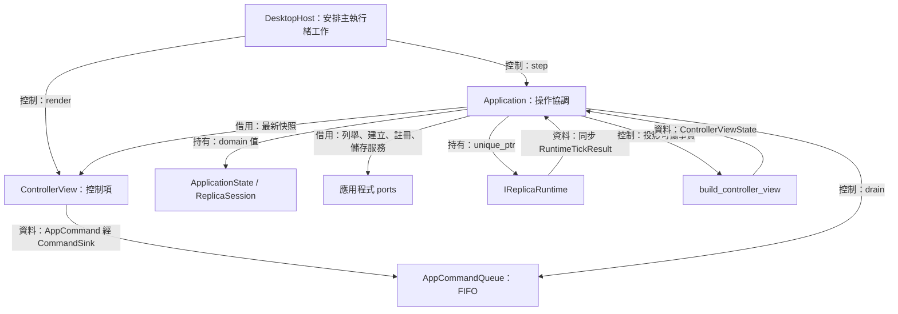

[架構入口](README.md) · [Core](core.md) · [在地化](localization.md) · [Desktop host](desktop-host.md)

使用者按下 Start 後，控制器會送出 `Start{session_id}`，主執行緒再依序確認來源、進入 Starting、建立 runtime 並發布 Capturing 快照。 同一條路徑也承接 Stop、設定交易、圖形修復與來源中斷，讓每次操作都能對應到明確的狀態及所有權變化

為了讓 UI 根據已接受的狀態呈現畫面，`Application` 集中持有 domain、設定、runtime owner、執行結果及最新 `ControllerViewState`。 UI 借用快照並送出命令值，服務介面提供同步結果，host 決定何時再呼叫 `step()`。 這些合作關係的公開契約位於 [application.hpp](../../include/avb/app/application.hpp) 與 [ports.hpp](../../include/avb/app/ports.hpp)

## AppCommandQueue：保存操作順序

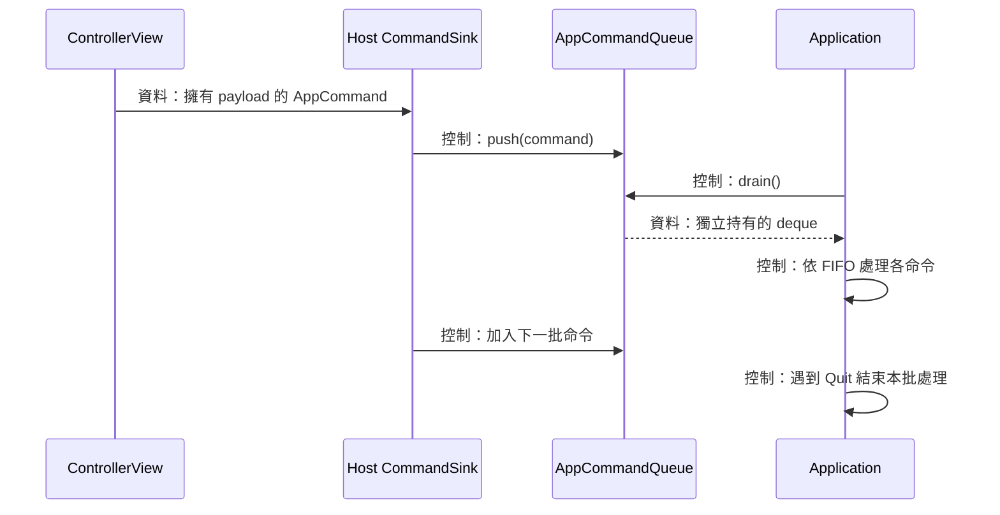

Start 後接 Stop，以及改設定後接 Quit，都需要保留使用者的操作順序。 `AppCommandQueue` 使用 `std::deque<AppCommand>` 保存每筆命令，producer 與 consumer 都在主執行緒執行，host 負責為新命令安排下一次步進

`push()` 移入命令並回傳佇列是否接收。 `drain()` 將整個 deque 與局部空 deque 交換，把目前批次的所有權交給 Application。 交換後的新 push 進入下一批，已取出的命令仍由本次 `step()` 處理。 `close()` 永久關閉接收並清空佇列內的命令，本次已取出的批次則由 Application 在 Quit 後結束迭代

```cpp
std::deque<AppCommand> AppCommandQueue::drain()
{
  std::deque<AppCommand> drained;
  // Isolate this step's batch. Reentrant/later producers target the next batch.
  drained.swap(commands_);
  return drained;
}
```

每筆命令持有其 payload，widget 返回後仍能稍後處理。 帶世代的命令從產生它的 `ControllerViewState` 複製 `SessionId`，Application 處理時重新驗證世代、生命週期及能力。 來源 ID 找到對應 row 後，應用程式複製該 row 的完整描述值到 session

| 命令群 | 攜帶資料 | 執行責任 |
| --- | --- | --- |
| `SelectSource`、`Start`、`Stop` | `SessionId`，選取另帶 `SourceId` | 選取、建構、停止或替換 |
| `SetMode`、`SetBorder`、`SetFps`、`SetExtensions` | `SessionId` 與 typed 候選值 | 套用交易與接受設定 |
| `ReplaceHotkey` | `SessionId` 與 `HotkeyChord` | 註冊成功後提交偏好 |
| `RefreshSources` | 空 payload | 在允許的閒置階段重新列舉 |
| `SetAutoRefresh` | `enabled` | 設定本次執行的來源更新排程 |
| `RestoreActiveReplicaEditable` | 空 payload | 對目前活動 runtime 恢復 Editable |
| `SetLanguage` | `LanguagePreference` | 依目前應用程式狀態接受顯示偏好 |
| `Quit` | 空 payload | 關閉命令接收並開始退出 |

全域熱鍵使用 `RestoreActiveReplicaEditable`，讓觸發時的目前 runtime 成為操作對象。 當 owner 為空或停止已開始，handler 直接結束。 影格回呼透過 [Core 信箱](core.md)交接資料，這個 FIFO 由主執行緒的 UI 與 host 回呼使用

來源：[commands.hpp](../../include/avb/app/commands.hpp)、[app_command_queue.hpp](../../include/avb/app/app_command_queue.hpp) 與 [app_command_queue.cpp](../../src/app/app_command_queue.cpp)

## Application 與服務介面：發布與替換 runtime

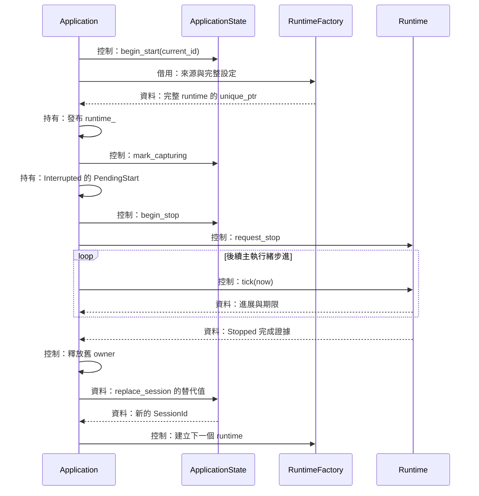

一次 Start 需要列舉來源、建立原生資源及更新可見狀態。 這些工作由 `Application` 協調，平台實作經服務介面提供結果。 Application 借用 queue、catalog、factory、hotkey 與 `ConfigStore`，這些服務的生命週期涵蓋 Application。 設定路徑、系統語言 callable、domain 與發布後的 runtime 則由 Application 自行持有

`ISourceCatalog::enumerate()` 回傳自有來源快照。 `IReplicaRuntimeFactory::create()` 在呼叫期間借用來源與設定，成功後移交一個已完成建構的 runtime，持續需要的來源 lease 與設定由該 runtime 自行持有。 factory 的失敗路徑完成局部資源清理後回傳 `AppError`

`IReplicaRuntime` 提供三項控制。 `apply()` 套用完整設定候選，`tick()` 推進原生工作並回傳一批事實，`request_stop()` 啟動可重複呼叫的清理流程。 runtime 從發布開始一直由 `runtime_` 的 `unique_ptr` 持有，釋放時間由 `Stopped` 證據決定

### 初始化、來源選取與 Start

建構 Application 時，`initialize()` 先讀取設定並解析語言。 初始 session 會取得持久的 FPS、邊框與額外功能，接著列舉來源、嘗試註冊全域熱鍵並建立畫面快照。 初始輸入模式為 `Editable`，來源保持待選，擷取由後續 Start 開始。 具型態的服務失敗會形成 notice，其他可用資料繼續建立

重新列舉的接納條件是 runtime 為空、停止旗標為 false，且 session 處於 Idle 或 Error。 成功的快照會依 ID 更新已選取描述值，選取 ID 離開新清單時清除選取。 列舉失敗保留舊快照並更新 `SourceRefresh` notice

Start 先驗證 token、停止旗標、已選取來源與來源能力。 runtime 為空的 Idle／Error 會走 `start_current()`：先進入 Starting，再呼叫 factory。 成功結果移入 `runtime_`，清空先前 runtime 回饋，接著標記 Capturing。 factory 錯誤或空 `unique_ptr` 會形成命令 notice 並標記 Error

### Interrupted replacement 與清理後分流

來源中斷後，runtime 仍持有原生資源，選取另一個來源與按 Start 可以排入替換。 `PendingStart` 複製當時的來源與完整設定，session 進入 Stopping，舊 runtime 收到停止請求。 下一個 Stop 會清除 PendingStart 並維持既有清理，Quit 也會清除替換意圖

收到 `Stopped` 後，`handle_stopped()` 先釋放 runtime、清理舊期限及 runtime 回饋，再依下列順序完成操作：

1. Quit 已成立時，設定 `ExitDisposition::Clean`
2. PendingStart 已存在時，建立替代 session、增加世代並啟動新 runtime
3. 目前為 Error 時，保留終止錯誤供畫面呈現
4. 一般停止透過 `complete_stop()` 回到 Idle，保留選取與設定

若替換碰到世代上限，`replace_session()` 回傳 `InvalidValue`，Application 完成原 session 的停止並留下 notice。 新 runtime 若在本次 runtime tick 的結果處理中建立，Application 會要求立即再步進，讓新 owner 取得自己的第一次 tick

`shutdown()` 關閉 queue、清除熱鍵、保存帶 dirty 狀態的設定通知，並開始停止流程。 host 持續步進至 Clean。 若清理回報 Stalled，owner 繼續保留。 Quit 意圖與 Stalled 同時成立時，Application 指示 `AbandonProcess`，由 [Desktop host](desktop-host.md) 使用直接終止行程的路徑處理資源

來源：[ports.hpp](../../include/avb/app/ports.hpp)、[application.hpp](../../include/avb/app/application.hpp) 與 [application.cpp](../../src/app/application.cpp)

## RuntimeTickResult：同步事實與事件優先序

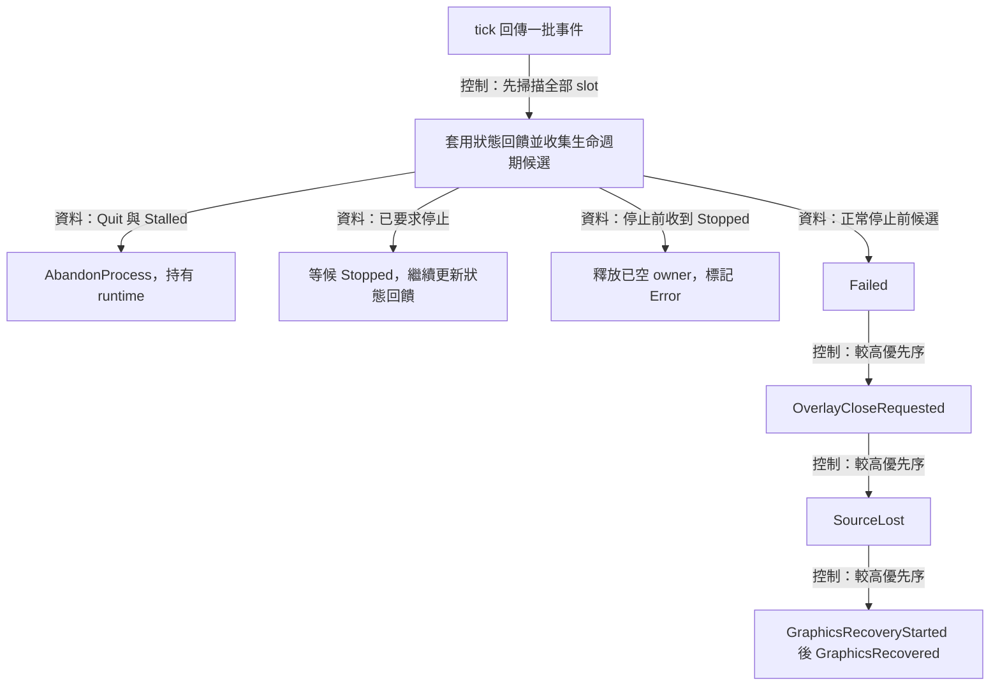

同一次 native tick 可能同時觀察到來源中斷、overlay 關閉或圖形修復。 為了讓結果取決於操作規則，`RuntimeTickResult` 保存這次同步觀察到的事實，Application 先收集完整批次，再按固定優先序決定 domain 轉移

結果包含 `std::array<std::optional<RuntimeEvent>, 10>` 與選用的 `next_wake`。 十個位置容納三種狀態邊緣、五種停止前候選，以及來源呈現尺寸與選區完成兩種事實，空 slot 可位於任意位置。 Application 消化本次結果後進入下一次 tick。 `AppError`、事件 variant 與整批結果都有 `nothrow` 複製／移動的編譯期檢查

三種狀態邊緣是 `BridgeModeChanged`、`OverlayCaptureExclusionChanged` 與 `RuntimeDrainStatusChanged`。 Application 掃描時立即把它們更新到 `runtime_feedback_`，其他事件則記成區域旗標或錯誤值。 bridge 的模式與原因因此來自實際 runtime，controller 的擷取排除結果則維持行程層級的獨立值

停止意圖的判斷先於一般候選。 `quit_intent_` 與清理 Stalled 相遇時直接選擇 `AbandonProcess`。 `stop_requested_` 成立時，生命週期處理集中在 `Stopped`，狀態回饋持續更新。 停止前收到 `Stopped` 則視為協定錯誤，仍依完成證據釋放已空 owner，並保留 Error

合法的停止前候選依 `Failed > OverlayCloseRequested > SourceLost > recovery` 排序。 `Failed{RuntimeStateLost}` 會取消 PendingStart、標記 Error 並開始保留 Error 的清理。 Failed 帶其他 error code 時會觸發 `emergency_abandon()`。 overlay 關閉會開始一般停止，來源中斷會標記 Interrupted

當 recovery 成為本批候選，Application 先套用 `GraphicsRecoveryStarted`，再套用 `GraphicsRecovered`。 同批同時出現兩者時，因果順序仍成立，Capturing 可在這次步進完成修復往返。 Interrupted 則依 [ReplicaSession](core.md) 的自迴圈保留來源中斷事實

### 一次步進與下一次期限

`step()` 清除先前的立即期限，處理一批命令，再對目前 owner 呼叫一次 tick，接著推進來源更新排程並重建畫面。 Quit 會結束命令批次。 已接受的前面幾筆命令逐筆生效，步進中若有例外逸出，`catch (...)` 會選擇緊急退出並保留 runtime owner

`next_deadline()` 取 `runtime_deadline_`、`immediate_deadline_` 與 `source_refresh_deadline_` 中最早的有效期限。 在 tick 後要求停止或建立替代 runtime 時，`request_immediate(now)` 讓 host 再推進一次，接續新工作。 空期限表示接下來依賴外部事件喚醒，owner 及回呼的完成程度仍由各自的證據表達

### 來源自動更新的期限與暫停

為了讓來源清單定期反映桌面變化，同時保留已選來源的世代，排程需要辨認瀏覽、選取及使用階段。 `SetAutoRefresh{enabled}` 改變 `UserConfig.auto_refresh_enabled` 的偏好並保存，`Application::update_source_refresh()` 使用 steady clock 安排每 5 秒一次的列舉

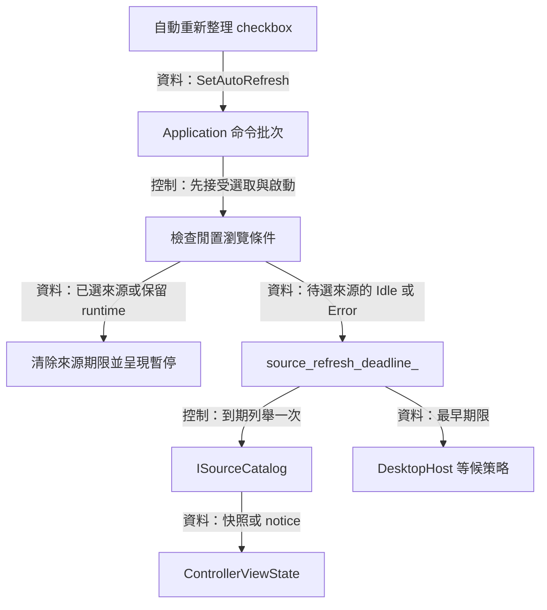

自動更新的條件與時序如下：

- 偏好預設為關閉，使用者勾選後建立完整的 5 秒間隔
- runtime 為空、來源待選、session 位於 Idle 或 Error，且應用程式持續運作時進行更新
- 選取、擷取與清理期間清除更新期限，畫面呈現暫停說明
- 同輪命令先處理選取，更新排程接著依新狀態判斷
- 手動重新整理每次嘗試後重排完整間隔。 回報失敗時保留舊清單與單一 notice
- 長時間休眠後，每次 step 至多執行一次自動列舉，下次期限取 `now + 5s`
- 取消勾選或關閉程式時清除來源期限

Application 在初始化讀回勾選偏好，第一個 step 依目前瀏覽條件安排完整的 5 秒間隔。 偏好值由 `config_.auto_refresh_enabled` 集中提供，deadline 屬於本次執行的排程狀態。 UI 顯示 `auto_refresh_enabled` 與 `auto_refresh_paused`，Windows catalog 繼續負責原生列舉及 registry 世代提交

來源：[ports.hpp](../../include/avb/app/ports.hpp) 與 [application.cpp](../../src/app/application.cpp)

## 設定交易與熱鍵確認

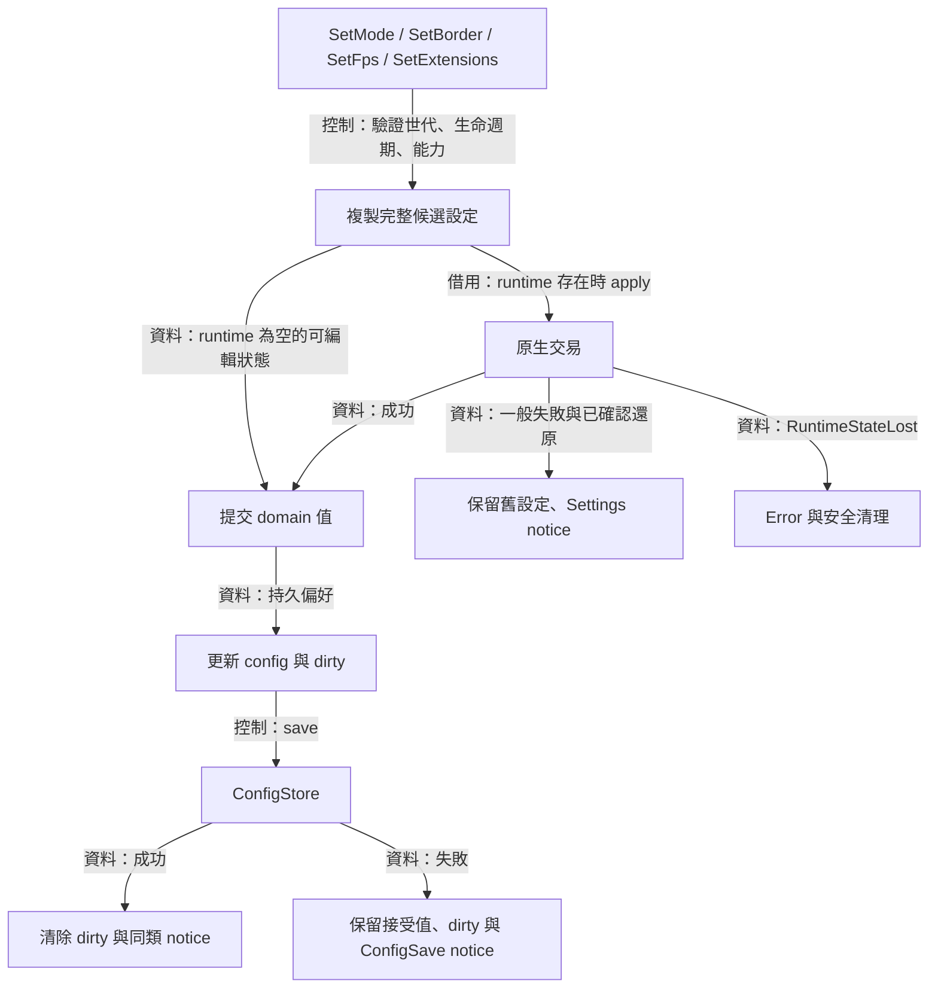

使用者修改設定時，畫面需要反映 runtime 已接受的結果，也要保留存檔失敗後仍然生效的偏好。 因此每個設定 handler 先複製 `ReplicaSettings`，更改目標欄位，再把整份 candidate 交給 `apply_settings()`，成功後提交 domain

當 runtime 為空，Idle／Error 的候選直接進入值提交。 runtime 存在時，`apply()` 成功表示原生設定已接受。 一般失敗的 port 契約提供已確認的舊設定還原結果，Application 保留舊 domain 並顯示 `Settings` notice。 `RuntimeStateLost` 表示原生狀態已失去可用保證，Application 取消替換意圖、標記 Error 並啟動清理

Mode、border、FPS 與 extensions 接受後，handler 更新 `config_` 並透過 dirty 狀態安排 `persist_config()`。 存檔成功清除 dirty，失敗保存 ConfigSave notice，記憶體與 runtime 繼續使用已接受值。 後續已接受的持久設定命令會再次嘗試整份設定存檔。 初始化從 config 還原期望模式；pass-through 能力缺席的平台使用 Editable 作為有效 session 模式，config 持續保留使用者期望值

語言採獨立的顯示偏好交易：`SetLanguage` 驗證 enum 後更新 requested preference、解析 effective language，並依 dirty 狀態儲存。 同一偏好再次送出也能重試先前的存檔，clean 且相同的偏好直接完成。 System 再次選取會重新查詢系統，詳細路徑見[在地化](localization.md)

### 熱鍵的 desired value 與確認證據

`ReplaceHotkey` 通過世代、設定階段與能力檢查後呼叫 `IGlobalHotkey::replace()`。 成功後更新 `config_.hotkey`、設定 `hotkey_binding_confirmed_=true`，再儲存。 `HotkeyConflict` 與 `HotkeyCleanupFailure` 保留原值及原確認狀態，`HotkeyRegistrationLost` 把確認狀態清成 false

初始確認值是 false，初始化的註冊成功後設為 true，shutdown 則清成 false。 當這個值為 true，已確認的 OS binding 正是目前記憶體中的 `config_.hotkey`。 UI 分開顯示目前設定、確認結果與錄製候選，使用者在錄製面板確認候選後要求註冊

`RestoreActiveReplicaEditable` 將使用者的恢復操作交給目前 runtime；套用成功後，session 與持久偏好同步為 Editable。 框選期間原生模式與 alpha 的暫時 override 由 runtime 擁有，config 保存期望模式與不透明度。

### Notice 的保存規則

Application 持有一個 `PendingNotice{operation, error}`。 新 notice 取代舊 notice，`clear_notice(operation)` 在 operation 相符時清除。 因此一次設定套用成功會清除 Settings 類通知，ConfigSave 的結果則由自己的成功操作更新。 session 的 Error 另外產生通用錯誤文字，domain 保存生命週期，Application 保存目前的操作診斷

來源：[application.cpp](../../src/app/application.cpp)、[application_language.cpp](../../src/app/application_language.cpp) 與 [ports.hpp](../../include/avb/app/ports.hpp)

## 不透明度與來源選區的設定流程

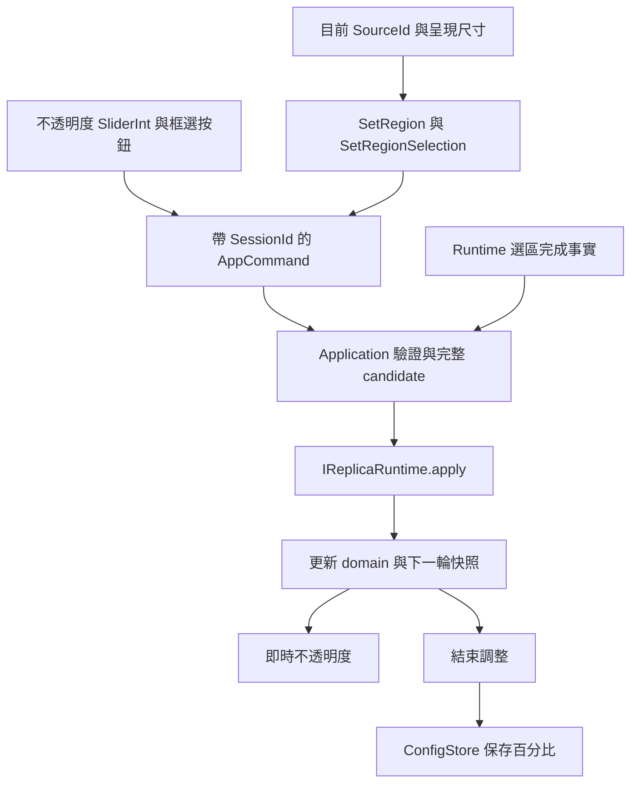

為了讓連續調整兼具即時回饋與穩定保存，Application 需要區分預覽與手勢完成。 `SetOpacity{session_id, percent, commit}` 的預覽先套用完整 runtime candidate，成功後更新已接受百分比與設定 dirty 狀態。 結束手勢時，commit 保存目前接受的數值。 Controller 的 `SliderInt` 提供可見拉桿與 Ctrl-click 數字輸入，並使用穩定 widget ID 與操作起始 session。

為了把選區交給正確來源，`SetRegion` 與 `SetRegionSelection` 同時攜帶 SessionId、SourceId。 開始、套用與還原命令需要 Capturing、目前來源身分與實際呈現尺寸。 控制面板提供框選、取消和還原入口；來源、session 或尺寸更換時更新 widget scope。 原生框選結果沿 runtime event 交由 Application 驗證與套用。

來源像素矩形由 `PixelRegion{x, y, width, height}` 表達。 Application 驗證正尺寸與來源範圍，經過 `IReplicaRuntime::apply()` 成功後再更新 domain。 `SetRegion` 的空矩形選用值代表全畫面；`RegionSelectionCompleted` 的空值代表取消，原選區持續保留。

選區屬於目前 session：停止後重新啟動同一來源會保留選區，選擇來源或建立替代 session 會回到全畫面。 來源尺寸改變時對選區求交集，空交集回到全畫面。 Mode、border、opacity 與 FPS 的偏好各自更新；框選期間的原生有效模式與 alpha 由 runtime 暫時覆蓋。

在 runtime tick 之後接受完成結果或新尺寸時，Application 會要求一次 immediate step，讓剛產生的 retained redraw 或清理工作接上主迴圈。 儲存 schema 的擴充與跨次啟動復原另沿用下一節的 ConfigStore。

## ConfigStore：V1 schema 與原子替換

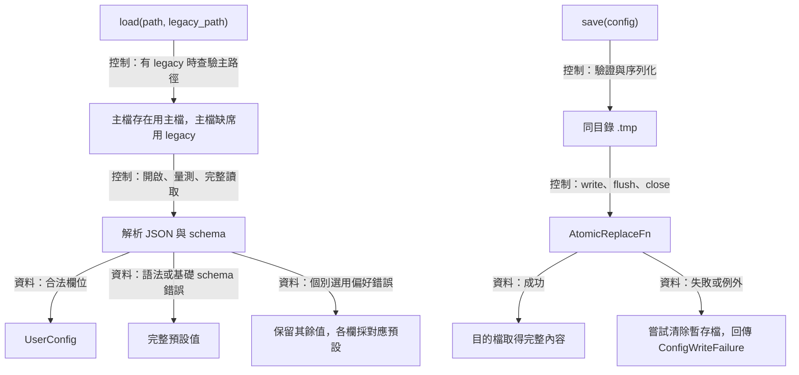

偏好需要在下次啟動恢復，儲存過程也需要讓目的檔在提交時取得完整內容。 `ConfigStore` 因此同步解析 V1 JSON，並在儲存時先完成同目錄暫存檔，再透過注入的 `AtomicReplaceFn` 提交。 已接受設定與 dirty bit 由 Application 持有，store 每次收取完整值

### 必要鍵與選用鍵

root 必須是 JSON object，恰好包含四個必要鍵，並可加入 `extensions`、`language`、`opacity_percent`、`mode` 與 `auto_refresh_enabled`。 程式以「4 加上實際出現的五個選用鍵數量」檢查 root size，讓鍵集合保持明確

| 鍵 | 接受值 | 缺項或格式錯誤的結果 |
| --- | --- | --- |
| `version` | 整數 `1` | 整份回到預設值 |
| `hotkey` | 通過 Core parser 的字串 | 整份回到預設值 |
| `fps_cap` | 字串 `30`、`60`、`144`、`unlimited` | 整份回到預設值 |
| `border` | 字串 `bordered` 或 `borderless` | 整份回到預設值 |
| `extensions` | object，恰有 boolean `browser_capture_keep_alive` | 缺項採 false，格式錯誤讓整份回到預設值 |
| `language` | 字串 `system`、`en`、`zh-TW`、`ja` | 缺項、陌生 token 或型態錯誤讓該欄回到 System |
| `opacity_percent` | 0–100 的整數 | 缺項、越界或型態錯誤讓該欄回到 100 |
| `mode` | 字串 `editable` 或 `pass_through` | 缺項、陌生 token 或型態錯誤讓該欄回到 Editable |
| `auto_refresh_enabled` | boolean | 缺項或型態錯誤讓該欄回到 false |

序列化一律輸出五個選用欄位。 下列為預設值的等價 JSON 示例，object 鍵的顯示順序由 JSON serializer 決定：

```json
{
  "version": 1,
  "hotkey": "Ctrl+Alt+R",
  "fps_cap": "60",
  "border": "bordered",
  "extensions": {"browser_capture_keep_alive": false},
  "language": "system",
  "opacity_percent": 100,
  "mode": "editable",
  "auto_refresh_enabled": false
}
```

此 schema 保存通用偏好。 來源 ID、視窗名稱、像素、選區、視窗位置與框選 override 留在各自的執行期 owner。 V1 的讀取相容性涵蓋目前 reader 對五個選用欄位的處理，舊版 binary 的讀取能力依其自身 schema 實作決定

### 讀取、失敗與預設恢復

為了保留更名前的偏好，`main` 提供執行檔旁的 `avb0795.config` 與 `airelinna.json`。 `load(path, legacy_path)` 在有指定 legacy 時先查主路徑；主檔存在時以主檔結果為準，確認主檔缺席時使用 legacy 單檔讀取。 後續 save 固定寫入新路徑，舊檔維持原內容。 主檔語法錯誤或未知版本使用主檔的預設復原流程

單檔 `load()` 開檔失敗時會查驗路徑是否存在。 路徑缺席且查驗成功表示首次使用，回傳 `UserConfig{}`。 已存在但開啟失敗、路徑查驗錯誤、尺寸取得失敗與可觀察的讀取異動都回傳 `ConfigReadFailure`

開檔後先取得 file size，確認它能裝進 `size_t` 與 `streamsize`，配置對應長度的字串並讀取相同位元組數。 接著再嘗試讀一個 byte，確認 EOF。 短讀與尺寸增加會進入讀取錯誤路徑。 相同長度的並行改寫仍需呼叫者協調 writer

JSON 語法、基礎 schema、版本、必要值或 extensions 格式錯誤會回到完整預設值。 language、opacity_percent、mode 與 auto_refresh_enabled 各有獨立的欄位恢復政策，因此其餘合法偏好仍可沿用。 `load()` 完成後將值交給 Application，原檔持續保存原內容，後續已接受的設定命令再觸發寫入

### 寫入順序與暫存檔生命週期

`save()` 在 I/O 前檢查 version、language／mode enum 與 opacity_percent 的 0–100 範圍，驗證失敗回傳 `InvalidValue`。 其他 typed 欄位由呼叫者提供支援值。 serializer 先生成縮排為 2 的完整字串並附加換行，再以 `destination + ".tmp"` 開啟暫存檔。 接著依序寫入、flush 與 close，最後呼叫 replacement callable

序列化、寫入、flush、close 或 replacement 的已處理失敗會回傳 `ConfigWriteFailure`。 replacement 的數值診斷可保存在 `native_detail`，暫存檔清理會以 `std::error_code` 嘗試執行。 目的檔取得新內容的可見性及耐久性由平台 replacement 實作提供

固定的 `.tmp` 路徑需要呼叫者協調所有 writer，包含多個 store instance。 父目錄應事先存在。 路徑組合、串流建立或配置仍可能拋出例外，Application 的步進例外邊界會處理逸出情況。 shutdown 保留 dirty notice 並推進 native 清理，設定儲存集中在命令處理階段

來源：[config_store.hpp](../../include/avb/app/config_store.hpp) 與 [config_store.cpp](../../src/app/config_store.cpp)

## ControllerViewState：狀態投影與控制項接納

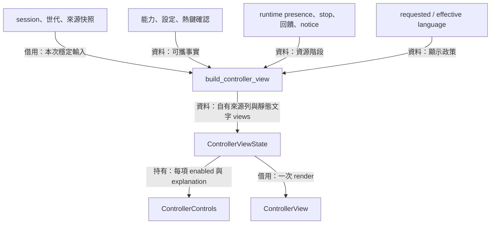

控制器需要把同一次操作結果呈現成一致畫面，也需要在使用者點擊前說明接納條件。 `build_controller_view()` 接收 Application 提供的可攜事實，產生自有來源列、文字與 `ControlState`。 輸入參考在本次同步呼叫期間保持穩定，結果的動態字串與 ID 都由新快照持有

`stop_or_drain` 在停止旗標成立、生命週期為 Stopping，或 Error 搭配 retained runtime 時成立。 這讓建構失敗後的 Error 可以重新操作，也讓 terminal Error 的資源清理得到相應的控制項說明。 replica 控制項依「清理 → 生命週期 → 能力 → 來源選取」的順序挑出第一項停用原因

為便於閱讀接納條件，下表使用三組情境：閒置表示 runtime 為空且生命週期為 Idle／Error。 活動表示 runtime 存在且為 Capturing／Interrupted／RecoveringGraphics。 中斷表示 runtime 存在且為 Interrupted。 表中 replica 操作都需通過 `stop_or_drain` 檢查

| 控制項 | 可用情境 | 額外條件 |
| --- | --- | --- |
| `refresh` | 閒置 | 重新列舉目前來源 |
| 每列 `select` | 閒置或中斷 | row 的來源種類能力可用 |
| `start` | 閒置或中斷 | 已選來源且對應種類能力可用 |
| `stop` | 活動 | 開始一般停止 |
| `editable`、`fps`、`bordered` | 閒置或活動 | 採各自候選值 |
| `pass_through` | 閒置或活動 | `capabilities.pass_through` |
| `borderless` | 閒置或活動 | `capabilities.borderless_resize` |
| `replace_hotkey` | 閒置或活動 | `capabilities.global_hotkey`，widget 再檢查語法 |
| `browser_capture_keep_alive` | 閒置或活動 | `capabilities.browser_capture_keep_alive` |
| `language` | Application 接受顯示偏好期間 | 普通 replica 清理仍可使用，shutdown 關閉 |
| Quit 按鈕 | controller render 期間 | widget 固定提供 enabled，Application 接納由 queue／退出狀態決定 |

停止中的 Stop handler 仍接受相符世代的既有命令，以便取消 PendingStart。 畫面則依清理條件停用 Stop 按鈕。 控制項是本次快照的提示，真正接收命令時，Application 會依當時狀態再次檢查

來源列自有 `id` 與 `label`，`kind_glyph`、狀態及警告文字借用 static catalog。 runtime feedback 在發布與釋放時重設，bridge、overlay 排除及清理警告隨 owner 顯示。 controller 的排除結果跨越 replica replacement 保留。 色彩警告依已選取描述值的觀測產生

`view_state()` 借出 Application 持有的最新投影，下一次 `step()` 會替換投影，`shutdown()` 也可能就地更新部分欄位。 host 在一次 render 期間借用它，跨步進保留資料時應複製所需值

來源：[controller_view_state.hpp](../../include/avb/app/controller_view_state.hpp) 與 [controller_view_state.cpp](../../src/app/controller_view_state.cpp)

## ControllerView：控制項、文字與局部編輯

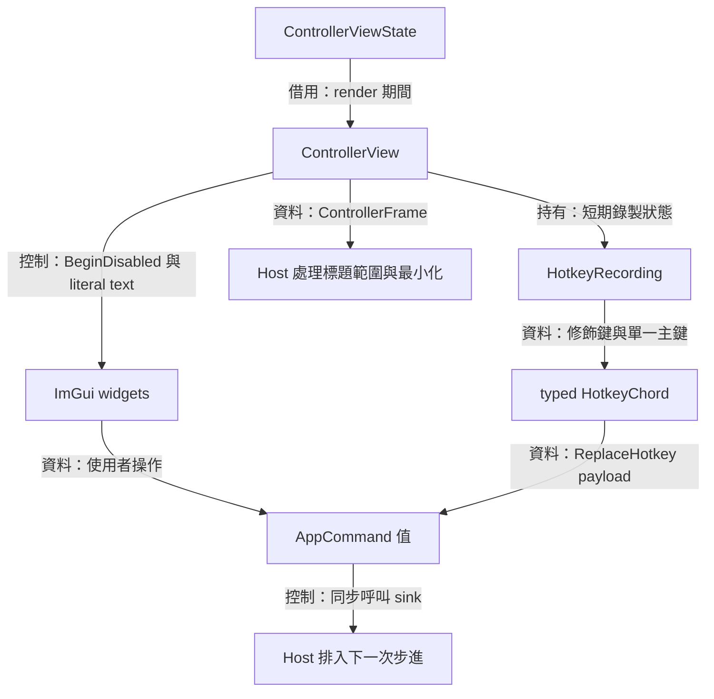

畫面每次重建時，控制器需要保持編輯進度與 widget 身分，同時依新快照呈現接受結果。 `ControllerView::render()` 因此借用一份快照及 host 提供的 `CommandSink`，用 `BeginDisabled()` 套用控制項狀態，並在使用者操作時送出自有命令值

翻譯文字會改變可見標題，widget 以 `caption + "###" + identity` 保存穩定 ID。 主視窗沿用 `avb0795 Controller`，Start、FPS 與邊框等各有固定 suffix。 root 每輪以 main viewport 的位置與大小填滿 client，內容受裁切時，`ImGui::Begin()` 的返回路徑仍對應 `ImGui::End()`

### 固定標題列與捲動內容

為了在調整視窗大小和瀏覽長內容時保持操作入口可見，介面需要一列固定標題，以及具有獨立捲動狀態的內容區域。 `render()` 建立全 client root，繪製標題、最小化與關閉按鈕，再由 `controller_content` child 呼叫 `render_contents()` 呈現既有設定。 root 的位置、大小、零圓角與零邊框隨每輪布局更新，child 持有內容的捲動位置

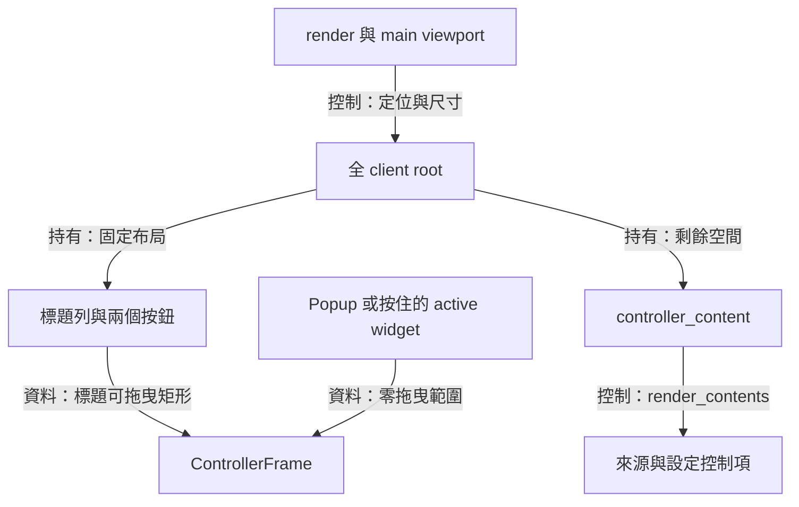

`ControllerFrame` 是本輪布局結果。 拖曳矩形的右界位於按鈕之前，下界位於標題列之後，原生邊緣調整大小具有較高命中優先序。 popup 存在，或 active widget 正處於左鍵按住狀態時，view 回傳零拖曳範圍，把該輪輸入留給 ImGui。 host 提供的 `resize_margin` 決定至少 8 units 的內距，維持控制項的可點擊空間

最小化按鈕回傳單輪 `minimize_requested`，關閉按鈕透過 `CommandSink` 傳送既有 `app::Quit`。 文字裁切、tooltip 與穩定 widget ID 由 UI 管理，原生視窗動作由 [DesktopHost](desktop-host.md) 接手

為了讓最小化與關閉圖示融入標題列，控制項需要共用背景，並在游標停留與按下時提供回饋。 `title_button()` 將常態底色設為透明、框線寬度設為零，再以 `AddLine()` 繪製置中的橫線或叉號。 圖示尺寸跟隨目前字型大小，位置取自控制項矩形的中心

`ImGui::Button()` 持續管理點擊、焦點與鍵盤導覽，hover 與 active 底色沿用目前主題。 helper 建立單一 item 並恢復區域 style 設定，讓既有 tooltip、拖曳排除範圍及內容區按鈕保有原本的互動與外觀契約

外部來源名稱以 `TextUnformatted()` 顯示。 每列先 `PushID(source.id.value.c_str())`，以固定 `##source` 建立可選取範圍，再把來源名稱當字面文字畫上去。 名稱中的 `%`、`##` 或 `###` 保持原有可見內容，互動識別由獨立 ID 承擔

### 來源的分欄、配色與識別

為了快速分辨來源種類與名稱，清單需要固定的欄位、類型配色與整列選取回饋。 `sources_table` 以三欄呈現類型、名稱及 HWND，內側直線與列底色提供視覺分隔。 視窗類型採粉紅色，顯示器類型採藍紫色。 名稱沿用主題的一般文字色，視窗 HWND 採綠色，顯示器的空值以灰色 `—` 呈現

`ControllerSourceRow` 持有 `kind` 與 `native_handle_text`，投影時複製 catalog 的值。 Windows 層將 HWND 轉成十六進位文字，UI 讀取這份診斷字串。 整列 Selectable 的命令仍是 `SelectSource{session_id, source.id}`，原生項目的解析持續由 registry 負責

長名稱在欄位內裁切，停留於來源列時可透過 tooltip 閱讀完整字面文字。 停用項目的三欄都採灰色，選取背景繼續標示目前來源。 每列停用回饋集中於視覺狀態。 關閉入口集中於固定標題列的叉號，沿用 Quit 與正常清理流程

### 額外功能與說明文字

瀏覽器保活 checkbox 每次從 `state.settings.extensions` 複製局部值，變更後送出 `SetExtensions`。 下一次畫面的勾選狀態由已接受設定投影。 Idle、Interrupted 與 Display 的情境都能編輯偏好，runtime 根據 Window 擷取範圍決定實際 helper 行為，詳見[瀏覽器保活](browser-capture-keep-alive.md)

`(?)` 說明標記位於 disabled scope 之後，滑鼠可在 checkbox 停用時停留閱讀 tooltip。 說明使用 `TextUnformatted()` 與換行寬度，停用原因及擷取範圍另行顯示。 偏好接受證明 runtime 已接受設定，瀏覽器的新影格產生行為則由擷取觀察呈現

### 快捷鍵錄製的生命週期

為了讓使用者直接按出快捷鍵，錄製流程需要保存候選、辨認操作起始的按鍵釋放，並在確認時提交。 `HotkeyRecording` 保存開啟面板時的 `SessionId`、選用的 `HotkeyChord` 候選，以及開啟和等待釋放旗標。 modal 由固定 root 管理，內容區的捲動與 modal 的生命週期各自維持

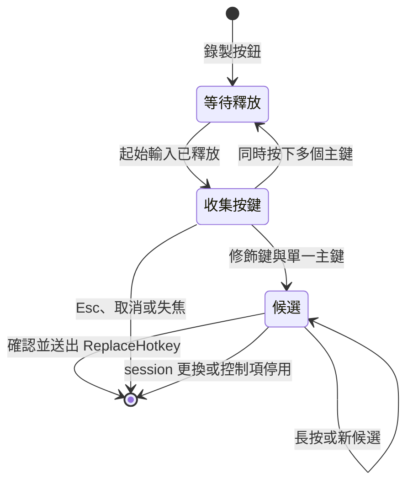

主鍵使用 A-Z、0-9 與 F1-F12 三段連續列舉，`portable_key()` 將 ImGui key 轉成 Core key。 主鍵首次按下時讀取 Ctrl、Alt、Shift 與 Meta 狀態，長按保留目前候選。 多主鍵手勢清除候選並回到等待釋放，讓下一次錄製具有明確的起點

錄製的取消條件涵蓋 Esc 與取消操作、控制面板失焦，以及 session 更換或控制項停用。 host 在失焦事件當下呼叫 `cancel_hotkey_recording()`，涵蓋同一批事件內快速切回焦點的情境。 確認按鈕送出 `ReplaceHotkey{recording.session_id, candidate}`。 註冊結果、衝突 notice 與實際確認狀態由後續 Application 快照呈現

錄製既有全域快捷鍵時，composition root 將已驗證 chord 先交給 host。 `try_record_hotkey()` 在有效錄製期間接收這份值，其他事件轉成恢復可編輯命令。 原有 OS 註冊在整個錄製期間持續有效，原生焦點與 callback 生命週期的接線見 [Desktop host](desktop-host.md)

CommandSink 在 render 內同步接收命令，host 通常將命令排入 queue，待後續 Application step 處理。 sink 的呼叫期間需要維持快照及目前 ImGui 呼叫的有效性。 ImGui 與 sink 的例外由 host 邊界處理，相關主迴圈安排見 [Desktop host](desktop-host.md)。 語言選單的 requested／effective 顯示及再次選取 System 見[在地化](localization.md)

來源：[controller_view.hpp](../../include/avb/ui/controller_view.hpp)、[controller_view.cpp](../../src/ui/controller_view.cpp) 與 [language_selector.cpp](../../src/ui/language_selector.cpp)
