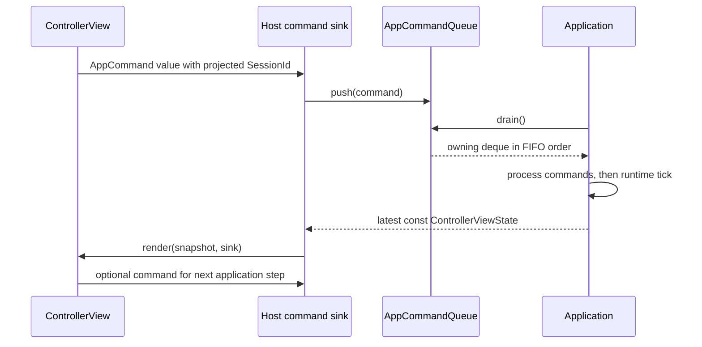
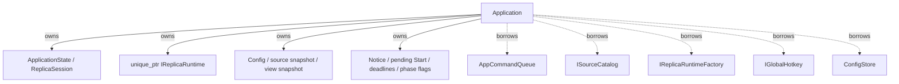
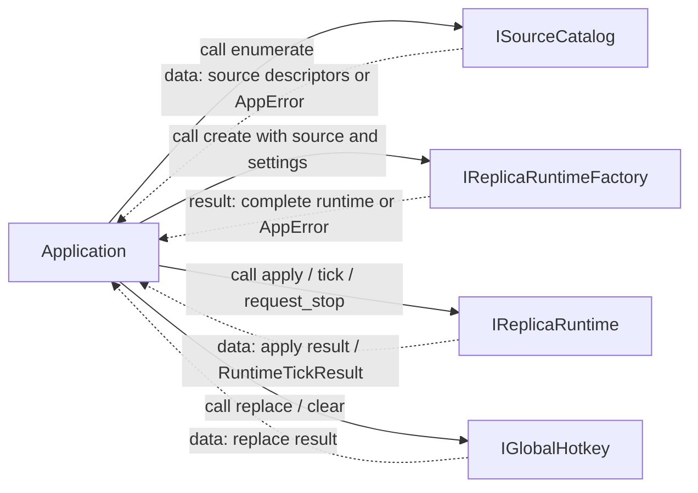
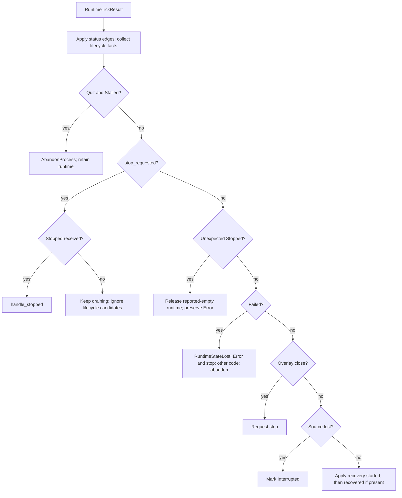
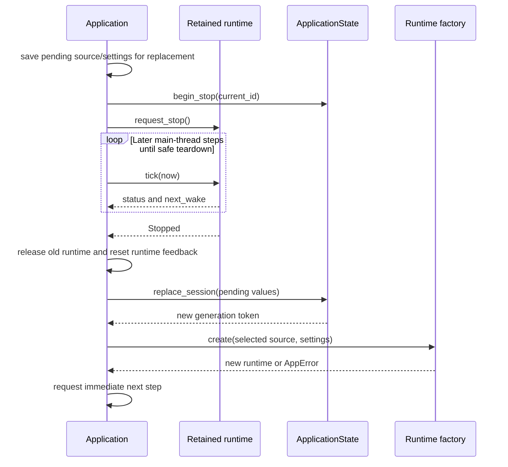
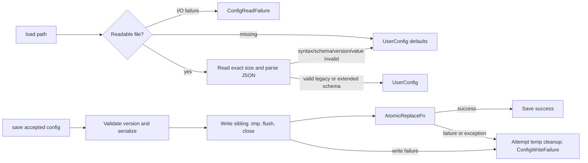
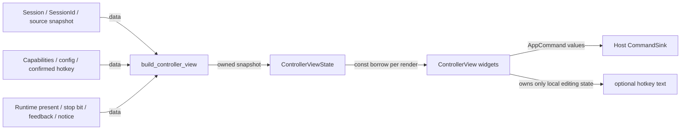

# Application 與 UI：命令、snapshot 與資源協調

[回架構索引](README.md) · [Core](core.md) · [Desktop host](desktop-host.md)

按下 Start 後，UI 只送出 `Start{session_id}`。主執行緒上的 `Application::step()` 從 queue 取出命令，檢查選取來源與 lifecycle，呼叫 factory，取得完整 runtime 後才將 session 標成 Capturing。Controller 直到下一份 snapshot 才讀到結果；它沒有 runtime 或 native window 的 reference。

## 命令與 AppCommandQueue

[commands.hpp](../../include/airelinna/app/commands.hpp) 定義十一種 `AppCommand` alternatives。[app_command_queue.hpp](../../include/airelinna/app/app_command_queue.hpp)／[app_command_queue.cpp](../../src/app/app_command_queue.cpp) 是沒有 mutex 的主執行緒 FIFO。主執行緒的 UI／host callbacks 可加入 command；WGC background callback 不可使用這個 queue。

`drain()` 以 swap 取走當前 deque；後續 push 留給下一次 step。`close()` 永久拒收新命令並清空仍在 queue 內的值；Application 在 Quit 後另行停止遍歷已取出的 batch。`push()` 可因 allocation 失敗丟出例外，queue 本身不是 no-throw callback firewall。

| 命令 | Application 的語意 |
| --- | --- |
| `RefreshSources` | 只有無 retained runtime 的 Idle／Error 可重新列舉 |
| `SelectSource` | 從目前 snapshot 找 ID，再複製 descriptor；不開始擷取 |
| `Start` | 開始選取的來源；Interrupted 有 runtime 時，保留一份 replacement request 後開始 drain |
| `Stop` | 非同步 stop；已在 drain 時取消 pending replacement |
| `SetMode` | 將 mode transaction 套用 runtime 後更新 domain；不寫 config |
| `SetBorder`、`SetFps` | 成功套用後更新 domain／config，設定 dirty bit，再嘗試 save |
| `SetExtensions` | 先讓 runtime 驗證整份 `ReplicaSettings` candidate；接受後更新 domain／config 與 dirty bit，再嘗試 save。checkbox 接受與儲存成功是兩個不同結果 |
| `ReplaceHotkey` | OS replace 成功後更新 desired chord、confirmed bit 與 config |
| `RestoreActiveReplicaEditable` | 不帶 SessionId；在處理當下解析目前 runtime，drain 中為 no-op |
| `Quit` | 關閉 command admission、清除 hotkey，再開始非同步 shutdown |

除了 Refresh、Restore 與 Quit，其餘命令都帶 `SessionId`。UI 使用 snapshot 的 token；Application／`ApplicationState` 拒絕 stale token。disabled control 是使用者提示，後端 guard 仍會獨立驗證。

## Application 的所有權與 ports

[application.hpp](../../include/airelinna/app/application.hpp)／[application.cpp](../../src/app/application.cpp) 是唯一 use-case orchestrator。[ports.hpp](../../include/airelinna/app/ports.hpp) 定義 source discovery、runtime construction／control、global hotkey 的 native-free 邊界；`ConfigStore` 是具體類別，沒有額外 filesystem service hierarchy。

以下只表示所有權：實線是擁有，虛線是借用且被借用物件必須活得更久。

以下改為控制呼叫與回傳資料，不表示 ownership。runtime `create()` 成功回傳的 `unique_ptr` 會轉移 ownership 給 Application；其他回傳的 descriptor、event、error 是 portable 值。

Application 建構時載入 config，套用 FPS／border／extensions 到初始 session，列舉來源並嘗試 hotkey registration，再建立第一份 view。它不自動選取來源或開始 capture。controller exclusion 是建構前由 host／platform 提供的 process-scoped 值；overlay exclusion、bridge、drain 是當前 runtime 的 feedback。

`IReplicaRuntime::apply()`、`tick()`、`request_stop()` 是 no-throw 邊界。`create()`／`enumerate()`／hotkey replace 與 view projection 不全是 `noexcept`；`step()` 包住其執行，遇到未預期例外時保留 runtime，選擇 `AbandonProcess`。這要求 [DesktopHost 與 composition root](desktop-host.md) 接續非展開堆疊的退出路徑，不能因讀到 disposition 就一般解構 Application。

## 一次 step 與事件仲裁

`step(now)` 先清掉上一輪 immediate deadline、依序處理已 drain 的 commands，接著 tick 目前 retained runtime 一次，最後重建 snapshot。runtime 不保留 Application callback，也沒有 application runtime-event queue；WGC callback 的 handoff 留在 native job 內，tick 才同步帶回 portable facts。

`RuntimeTickResult` 有八個固定 optional event slots 與一個 optional deadline。三種 status 是 bridge、overlay exclusion、drain；其餘五個 pre-stop candidates 是 failure、overlay close、source lost、recovery started、recovered。`Stopped` 是 stop 後的安全完成訊號。`AppError`、event 與整個 batch 都有 nothrow copy／move 的 static assertions，batch 不配置動態 event 容器。

合法 pre-stop lifecycle 優先序是 `Failed > OverlayCloseRequested > SourceLost > recovery`，不依 event slot 的順序。若同一 batch 的 winning recovery 同時有 started／completed，兩者依因果順序都會套用。`Interrupted` 的 recovery 邊維持 Interrupted，詳見 [core 狀態圖](core.md)。

一旦 `stop_requested_` 為真，Application 不再接受一般 lifecycle candidates；status 仍可更新，安全 `Stopped` 才能釋放 owner。runtime 發出非 `RuntimeStateLost` 的 `Failed` 被視為 protocol violation，走保留資源的 emergency abandon。

`next_deadline()` 取 runtime deadline 與 application immediate deadline 較早者。event 處理在 tick 之後才要求 stop，或 `Stopped` 後發布 replacement，都要安排 immediate step；否則舊 runtime 回傳的空 deadline 可能讓新工作沒有下一次 tick。host 在 UI render 時收到新 command 的免等待安排由 [DesktopHost](desktop-host.md) 負責。

## Stop、replacement 與 Error drain

可見 lifecycle 和 resource phase 分開保存：terminal failure 進 Error，同時 `stop_requested_ = true`，runtime owner 仍存在。一般 Stop 進 Stopping。兩者都不會因 `request_stop()` 返回而釋放 runtime。

replacement 僅在 Interrupted 且已有 runtime 時接受。它擁有一份 source/settings 值，等待舊 runtime 空掉後才建立新 runtime；新的 `SessionId` 使舊 UI 命令失效。另一個 Stop 或 Quit 會取消 pending replacement。

`handle_stopped()` 的後續順序是：Quit → `Clean`；有 pending Start → replace／start；原本是 Error → 保留 Error；其他一般 Stop → Idle。runtime feedback 在 publication／release 時重設，但 controller exclusion 不重設。未請求 stop 就收到 `Stopped` 仍表示 owner 已空，可釋放，但 domain 會顯示 Error。

`shutdown()` 是開始關閉，不是等待完成。它關 command queue、清 hotkey、保留尚未寫入設定的 notice，接著 request stop 並安排 immediate step。`RuntimeDrainStatus::Stalled` 本身不是 destruction permission；如果已經有 Quit intent，無論 Stalled 是先前保留值或後來新 edge，都選擇 `AbandonProcess` 並保留 owner。一般 operation 的 Stalled 仍顯示警告與 retained runtime，讓 host／使用者有機會提出 shutdown。

## Settings、hotkey 與 notice

設定 handler 先取得目前 `ReplicaSettings` 的 copy，再只變動目標欄位。若有 runtime，整個 candidate 經 `apply()` 成功才 commit 到 domain；沒有 runtime 的可編輯 Idle／Error 則只更新 portable 值。

Extensions 也遵循這個 accepted-before-save 邊界：runtime 接受後 checkbox 對應的新 preference 立即成為目前值，之後的 config save 是另一個可能失敗的步驟。

| 結果 | Domain／runtime settings | 後續動作 |
| --- | --- | --- |
| apply 成功 | commit candidate | mode 到此完成；border／FPS／extensions 另更新 config 並 save |
| ordinary apply failure | 保留已接受的舊值；port 契約要求 native rollback 已驗證 | 顯示 Settings notice |
| `RuntimeStateLost` | 不宣稱舊 native settings 仍有效 | 進入 Error、清 pending Start，並要求既有的安全 stop／drain |
| save 失敗 | 已接受的新值繼續有效 | 保留 `config_dirty_` 與 ConfigSave notice，供後續 accepted command 重試 |

`hotkey_binding_confirmed_` 與 desired chord 分開。初始值 false，OS registration／replacement 成功才 true；HotkeyConflict 或 HotkeyCleanupFailure 不改原值，HotkeyRegistrationLost 清為 false，shutdown 也清為 false。當它為 true，confirmed binding 就是目前記憶體內的 `config_.hotkey`。UI 不自行查 OS binding。

Application 只有一個 `PendingNotice{operation, error}`。新 notice 可取代舊 notice；`clear_notice(operation)` 只清除同 operation 的 notice，避免 unrelated success 擦掉目前錯誤。session 的 Error lifecycle 另投影一般失敗文字，並沒有一個偽裝成 per-session 的 native error store。

## ConfigStore：四個必要 keys 與一個 optional extensions object

[config_store.hpp](../../include/airelinna/app/config_store.hpp)／[config_store.cpp](../../src/app/config_store.cpp) 接受 version 1 的四個必要 keys：`version`、`hotkey`、`fps_cap`、`border`，以及 optional 第五個 `extensions` object。Legacy 文件沒有 `extensions` 時，`browser_capture_keep_alive` 採 false，其他四個有效值保持不變。若 `extensions` 存在，它必須是 exact object，只能含有唯一的必要 boolean 成員 `browser_capture_keep_alive`。

任何未知 key、遺漏必要 key、型態錯誤或 malformed value 都使整份文件無效並回 defaults。Serializer 一律寫出第五個 object，但不保證舊版 binary 能 forward-read 新文件。預設為 `Ctrl+Alt+R`、60 FPS、Bordered，extension 關閉。Source ID／title、pixels、window position、mode 與其他 capture 細節都不進檔案。

讀取時先取 file size，再要求完整讀取且 EOF 沒有額外 bytes，避免接受明顯變動中的部分檔案。缺檔和 malformed／unsupported config 回 defaults；開檔、size 或 read 問題回 `ConfigReadFailure`。這個區別是目前實作，不能把所有無效設定都描述成 read error。

save 在同目錄的固定 `.tmp` sibling 寫入、flush、close，才呼叫 platform 注入的 `AtomicReplaceFn`。unsupported version 回 `InvalidValue`；被處理的 write／replace failure 轉為 `ConfigWriteFailure`，保留可用的 numeric detail 並嘗試清 temporary file。固定 temporary path 不提供 concurrent writer 協調。

dirty bit 屬於 Application。每個 accepted config-backed command 都先設為 true，save 成功才清除；下個 accepted command 可重試儲存。shutdown 不再同步 save，以免在 native drain 開始前增加磁碟 I/O；它保留未儲存 notice。這不是背景 autosave 或保證斷電耐久性的宣告。

## ControllerViewState 與 ControllerView

[controller_view_state.hpp](../../include/airelinna/app/controller_view_state.hpp)／[controller_view_state.cpp](../../src/app/controller_view_state.cpp) 把 Application 明確提供的 portable facts 轉成 UI 所需的 owned labels、static text、warnings 和 `ControlState`。projection 不拿 runtime／service pointer。

`runtime_present` 與 `stop_requested` 是必要輸入：相同 Error lifecycle，在 construction failure 沒有 runtime 時可以重試，在 terminal drain 有 runtime 時必須停用 mutation。控制項停用原因依序取 drain、lifecycle、capability、missing source。來源 row 複製 ID／label，回傳 snapshot 不依賴來源 span 的 lifetime；訊息 `string_view` 則指向 static text。

[controller_view.hpp](../../include/airelinna/ui/controller_view.hpp)／[controller_view.cpp](../../src/ui/controller_view.cpp) 只管理 ImGui widgets 與 hotkey edit buffer。它依 snapshot 的 `ControlState` 畫 disabled controls，使用每次 render 的 `SessionId` 組 command，對 source labels 使用 literal text 與獨立 ImGui ID，因此來源名稱裡的 `##`／`###` 不會被當成 label metadata。

hotkey buffer 在未送出前保留使用者輸入，不會每次 snapshot 更新就覆寫。parser 先阻止語法無效的 Replace command，OS registration 成敗仍由 Application 處理。command 送出後 buffer reset；介面顯示的 binding confirmed／unconfirmed 取自 snapshot，不從編輯文字推測。

Browser capture keep-alive 控制項在 capability unsupported 時必須停用並顯示原因。Idle、Interrupted 與 Display capture／source 都可以編輯 preference。Display 絕不啟動 helper module，只有 capture scope 為 `Window` 時才可能啟用它（Window captures only）。

說明 marker 畫在 disabled box 外，停用 checkbox 時仍可查看功能說明 tooltip。Disabled explanation 另行顯示。Checkbox 已接受只證明 preference 已進入目前 settings，不證明 browser 已恢復產生新 frames。

本頁的圖與說明描述目前 C++ 控制／資料／所有權邊界；實際視窗互動、擷取及 GPU 路徑仍需要相應的 [驗證 gates](build-and-validation.md)。
