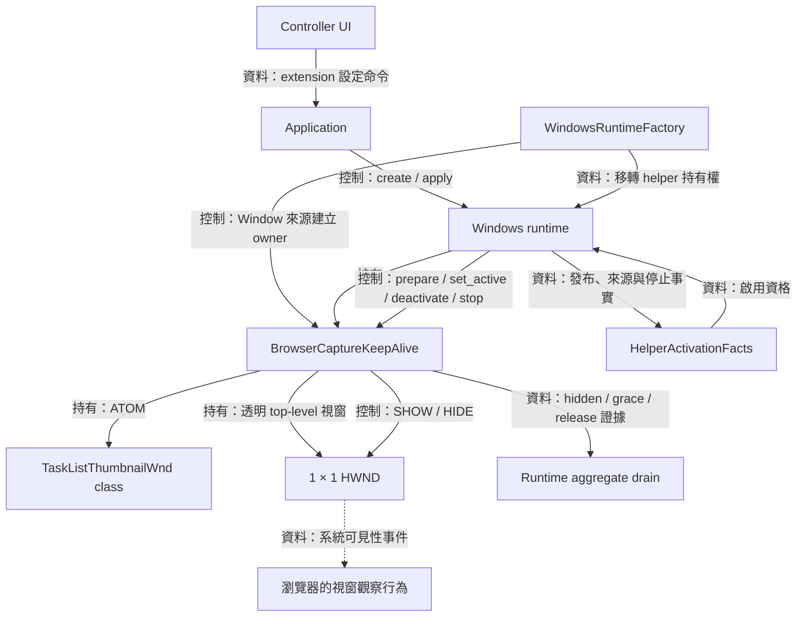
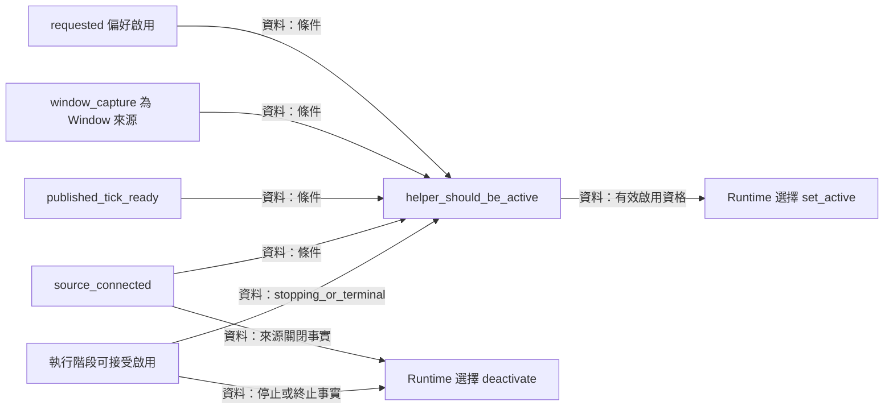
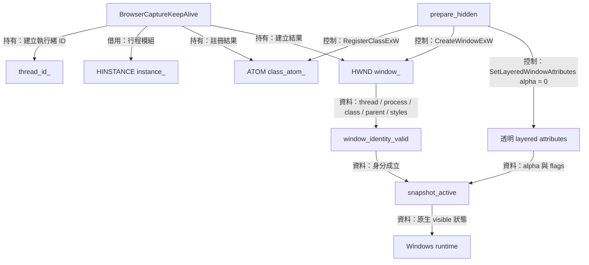
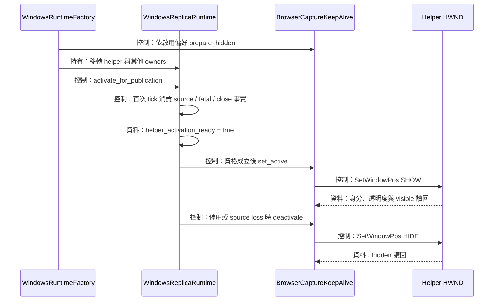
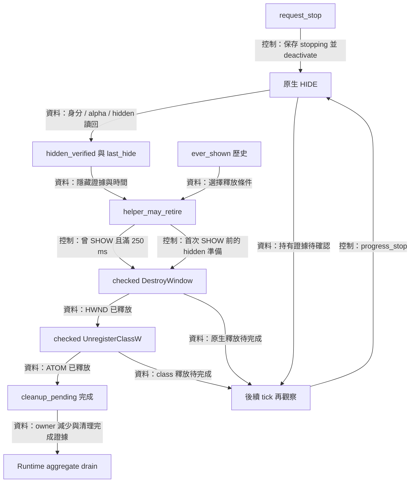

# Browser capture keep-alive：透明輔助視窗與延後釋放



這項延伸功能藉由透明輔助視窗的可見性，嘗試維持瀏覽器來源的影格產出。 實作需要一個由本行程建立、類別名稱為 `TaskListThumbnailWnd` 的 top-level 視窗，以及與 runtime 一起開始和結束的持有期。 [BrowserCaptureKeepAlive](../../platform/windows/features/browser_capture_keep_alive.cpp) 集中管理原生 class、HWND、可見性交易與延後釋放，呼叫端位於 [runtime factory](../../platform/windows/windows_runtime_factory.cpp) 及 [runtime](../../platform/windows/windows_replica_runtime.cpp)

程式可驗證 helper 的身分、透明度、可見性與釋放結果。 瀏覽器接收系統事件及繼續產出影格的效果，則屬於實際瀏覽器與桌面操作的觀察。 本頁依現行程式說明前者，並在資格說明中列明來源最小化與瀏覽器效果的驗證範圍

[擷取頁](windows-capture.md)說明來源身分，[runtime 頁](windows-runtime-overlay.md)說明發布與聚合停止，[application-ui](application-ui.md) 說明設定命令與保存。 [回架構總覽](README.md)

## HelperActivationFacts 與來源資格



Helper 要在有持續 tick 的 owner 下運作，因此啟用同時需要使用者偏好、Window 來源、完成發布的 tick 階段、連線中的來源與可執行狀態。 [HelperActivationFacts](../../platform/windows/features/detail/browser_capture_keep_alive_policy.hpp) 把這些條件組成值政策，實際事實由 [helper_activation_allowed()](../../platform/windows/windows_replica_runtime.cpp) 從 runtime 狀態取得

### 偏好與實際活動各自保存

`ReplicaSettings::extensions.browser_capture_keep_alive` 保存使用者選擇。 `snapshot_active()` 則查閱原生 helper 的可見性。 Runtime apply 的 snapshot 包含實際活動狀態，讓候選設定的驗證與恢復有具體依據

政策的核心條件直接來自原始程式：

```cpp
return facts.requested && facts.window_capture && facts.published_tick_ready &&
       facts.source_connected && !facts.stopping_or_terminal;
```

`window_capture` 由 factory 建立 helper owner 的條件決定。 現行 factory 對 `SourceKind::Window` 建立這個物件，來源資格以視窗擷取種類為範圍。 瀏覽器 executable、標題或品牌的辨識屬於來源應用程式資訊，這個判斷式使用的輸入為上述五項 runtime 事實

### 來源關閉與最小化

`source_connected` 需要來源 owner 存活、`is_closed()` 保持開啟狀態，且 runtime 的 `source_disconnected_` 保持連線狀態。 WGC `Closed` 會保存持續有效的關閉事實，runtime 在下一輪 tick 取得後隱藏 helper。 Source lease 仍由 runtime 持有到清理完成，詳見[來源觀察](windows-capture.md)

最小化與 WGC source closure 是兩項獨立觀察。 來源最小化時，helper 政策仍依 `source_connected` 及其餘四項 runtime 事實判斷資格。 目前 helper 的契約證明本地視窗狀態，最小化來源的影格產出、工作列與 Alt+Tab 操作後的瀏覽器反應，仍需要實際操作與影格結果一起驗證

Source catalog 的列舉資格另有可見性、cloaking、面積及標籤要求。 清單資格決定使用者能選到的來源，helper 資格則決定已發布 runtime 何時顯示輔助視窗。 兩個階段使用各自的資料與 owner

## BrowserCaptureKeepAlive 的原生持有者



透明 helper 需要可辨識且可安全銷毀的原生資源，因此 [BrowserCaptureKeepAlive](../../platform/windows/features/browser_capture_keep_alive.hpp) 保存建立執行緒、行程 module instance、註冊得到的 `ATOM` 與建立得到的 `HWND`。 [prepare_hidden()](../../platform/windows/features/browser_capture_keep_alive.cpp) 完成 class 註冊、視窗建立與透明屬性的讀回驗證

### Class、視窗樣式與透明度

Class 使用名稱 `TaskListThumbnailWnd` 與 `DefWindowProcW`。 視窗採 `WS_POPUP`，位置為 `(0, 0)`，尺寸為 `1 × 1`，parent 為 `nullptr`。 Extended style 的原始值如下：

```cpp
constexpr DWORD helper_extended_style =
  WS_EX_TOOLWINDOW | WS_EX_NOACTIVATE | WS_EX_LAYERED | WS_EX_TRANSPARENT;
```

建立後透過 `SetLayeredWindowAttributes(window_, 0, 0, LWA_ALPHA)` 設定零 alpha。 可見性使用 SHOW／HIDE 切換，像素仍由零 alpha 保持透明。 Native owner 包含註冊 class 與 HWND，graphics surface、capture item 與 replica overlay 的持有權各自留在原有元件

Class 名稱在本行程註冊，成功得到的 atom 記入 owner。 名稱碰撞時 `RegisterClassExW()` 的失敗結果回傳呼叫者，讓同名既有 class 維持原先的持有關係。 預備階段建立成功的資源則由目前 helper 的 cleanup 負責收束

### 身分讀回涵蓋 HWND 重用

`window_identity_valid()` 要求目前執行緒等於建立執行緒，HWND 的 thread／process 相符，類別名稱與 atom 相符，instance 相符，parent 為零，style 的 popup／child 位元符合 `WS_POPUP`，且 extended style 完整等於預期值

`snapshot_active()` 在上述身分證據成立後，讀取 layered attributes，要求 `alpha == 0` 與 `flags == LWA_ALPHA`，最後以 `IsWindowVisible()` 取得活動狀態。 這裡的資料契約把可見性建立在本地持有身分及透明屬性之上

身分或屬性讀取失敗時回傳 `RuntimeStateLost`，並由操作端保留清理待確認狀態。 後續隱藏仍可持續嘗試，啟用則需要正常的 owner 狀態。 HWND 值相同的情況也必須完成同一組身分驗證

## Runtime 呼叫端與可見性交易



Factory 預備 helper 的目的是讓所有配置工作在發布前完成。 [WindowsRuntimeFactory](../../platform/windows/windows_runtime_factory.cpp) 對 Window 來源建立 owner，偏好啟用時呼叫 `prepare_hidden()`。 真正 SHOW 由 [runtime tick](../../platform/windows/windows_replica_runtime.cpp) 在已發布且消費完來源、fatal 與關閉事實後決定

### 第一個可啟用 tick

`helper_activation_ready_` 初始保持預備狀態。 Tick 先處理 capture 與 renderer，確認本輪事件候選，再讓 helper 進入可啟用階段。 `helper_activation_allowed()` 還檢查來源連線、停止狀態、pending failure、overlay close 及原生關閉旗標

第一個有效 tick 完成資格檢查後，依保存的偏好呼叫 `set_active()`。 每個後續 tick 也會檢查資格與目標狀態。 `write_active()` 發現目前 visible 已等於目標且相應證據成立時直接返回，讓重複觀察沿用已驗證的狀態

### 設定套用、恢復與單向隱藏

一般可見性變更使用 [set_helper_active()](../../platform/windows/features/detail/browser_capture_keep_alive_policy.hpp)：先 snapshot 活動狀態，啟用時確認 hidden helper 已備妥，寫入目標狀態並讀回。 套用失敗後會嘗試恢復原活動狀態，恢復驗證成立時回傳 `PlatformOperationFailure`，其餘結果回傳 `RuntimeStateLost`

來源關閉、停止或啟用資格結束時，runtime 呼叫 `deactivate()`。 [deactivate_helper()](../../platform/windows/features/detail/browser_capture_keep_alive_policy.hpp) 沿隱藏方向寫入與驗證。 讀回失敗時保存 `RuntimeStateLost` 及 cleanup uncertainty，讓 owner 繼續存活並等待後續隱藏或釋放證據

Runtime 的完整設定交易先記錄 helper 是否實際 active，再套用 mode、border、geometry 與 extension。 若來源在交易期間關閉，rollback 重新檢查資格並保留隱藏狀態。 原 snapshot 的 active 狀態需要來源資格一起成立，交易據此決定恢復證據與錯誤分類

停用偏好及來源消失會保留已隱藏的 HWND 與 class。 同一個連線正常的 runtime 日後重新啟用時，可使用原本的 helper。 整體 runtime 停止則進入下節的 delayed retirement，依本地完成證據釋放原生資源

## HelperRetirementState 與延後釋放



系統可見性事件與 helper 銷毀各有自己的時序，因此停止採「隱藏、保留一段時間、釋放」的流程。 [HelperRetirementState](../../platform/windows/features/detail/browser_capture_keep_alive_policy.hpp) 保存顯示歷史及隱藏證據，[BrowserCaptureKeepAlive::progress_stop()](../../platform/windows/features/browser_capture_keep_alive.cpp) 在 runtime tick 中執行 checked native release

### Grace 從驗證隱藏之後起算

`ever_shown` 記錄曾經發出 SHOW 或觀察到 visible 的歷史。 送出 SHOW 前就更新這項歷史，讓隨後讀回失敗的情況也進入完整的隱藏與等待路徑。 隱藏時先呼叫 `SetWindowPos()`，接著驗證身分、layered attributes 及 visible 狀態，再記錄時間：

```cpp
if (!active) {
  retirement_.last_hide = Clock::now();
  retirement_.hidden_verified = true;
}
```

等待區間（grace interval）設為 `std::chrono::milliseconds{250}`，其終點為 `last_hide + helper_retirement_grace`。 重複呼叫發現已驗證 hidden 時沿用原時間。 隱藏證據再次需要確認時，helper 保留 owner 並重新嘗試隱藏，以最新驗證結果建立可用證據

推導示例：helper 於 `t = 1000 ms` 完成 HIDE 及讀回，釋放資格從 `1250 ms` 起成立。 `request_stop()` 若在 `990 ms` 呼叫，計時仍依實際隱藏完成時間起算。 預備階段就結束且顯示歷史保持初始值時，已驗證 hidden 可直接進入原生釋放

### Checked destruction 與部分進展

`progress_helper_retirement()` 先驗證 hidden 與 grace 條件，再記錄當下 resource count。 接著嘗試 `destroy_window()`，成功後清除 `window_`，再嘗試 `unregister_class()`，成功後清除 `class_atom_`。 後者以 HWND 已釋放為前提

原生釋放失敗時，相應欄位繼續持有資源，並保存 `ownership_uncertain`。 已成功銷毀 HWND 但 class 清理待完成時，resource count 從 2 減為 1，這是可記錄的進展。 後續 tick 接續 class cleanup，直到兩個原生 owner 都釋放

銷毀 HWND 前還會驗證建立執行緒、完整身分及目前 hidden。 若再次觀察到 visible，helper 更新顯示歷史並回到隱藏證據建立流程。 解構函式則要求 published helper 已完成 retained-owner stop，預備階段的 hidden partial 可嘗試即時收束

### 接回聚合停止與主迴圈

`request_stop()` 開始隱藏時，capture 與 graphics 的 drain 也各自前進。 Helper 的 `progress_stop()` 在每輪 tick 取得執行機會，實際 resource count 減少會回報進展。 `next_wake()` 提供有效 hidden grace 的後續期限，runtime 再與一般 drain 觀察期限取最早值

Helper 的期限代表下次可觀察的本地時間。 Browser 是否處理 SHOW／HIDE、來源是否繼續產生影格，仍依瀏覽器與 capture 的實際觀察判定。 Helper 保留期間的資源釋放證據由本模組提供，GPU 使用完成證據由 [renderer](renderer.md) 提供

Runtime 收齊 capture、graphics、adapter、overlay、source 與 helper 的釋放結果後，回傳單一 `Stopped`。 Application 接收後結束 published runtime 的持有期，host 再依自己的生命週期收束，完整順序見 [runtime drain](windows-runtime-overlay.md) 與 [DesktopHost](desktop-host.md)
