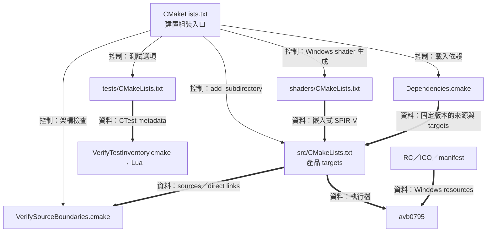
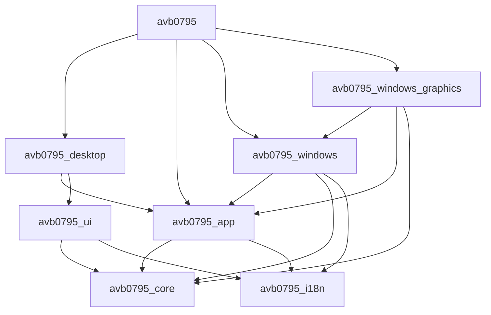
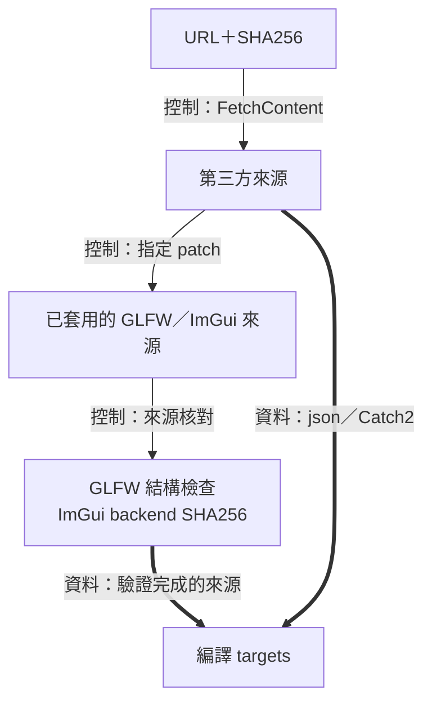
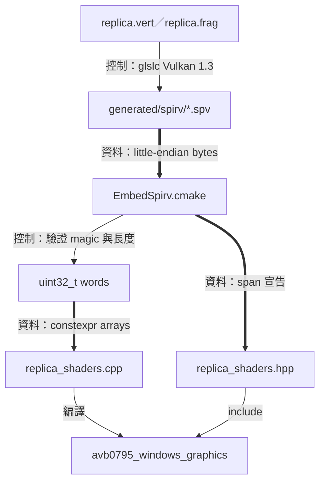
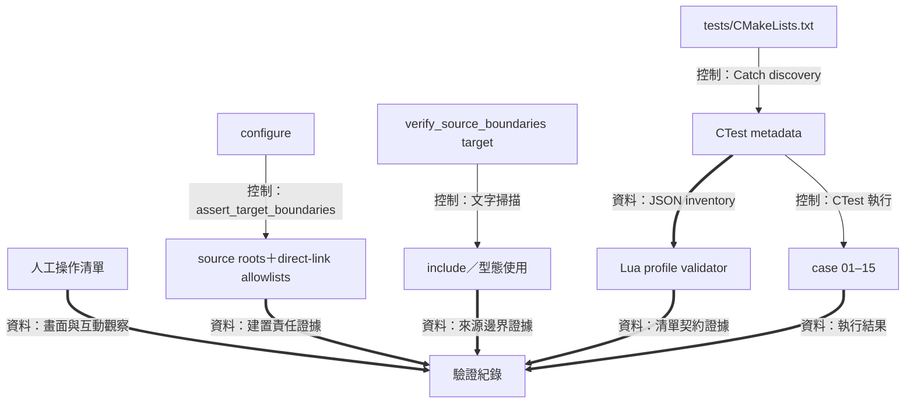
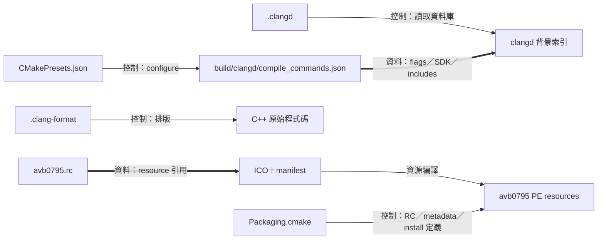

# 建置、依賴與驗證



為了把原始程式碼組成可執行產品，建置流程需要管理編譯責任、第三方輸入、shader 生成與驗證入口。 CMake 以 target 表達編譯單元及其連結關係，並將產物放進各自的 build tree。 開發工具與測試接著讀取這些明確產物，形成從來源到驗證證據的路線

入口是 [CMakeLists.txt](../../CMakeLists.txt)，產品 target 定義集中在 [src/CMakeLists.txt](../../src/CMakeLists.txt)。 Windows 建置包含原生擷取、算繪與桌面主程式，其他平台可建立可攜的 Core、Application、UI 與在地化 targets。 [架構總覽](README.md)描述執行期間的呼叫，本頁描述編譯與工具執行順序

## Target 與編譯責任



為了讓每份程式碼具有明確的編譯歸屬，需要把來源清單及直接依賴寫成可檢查的資料。 `add_library` 建立責任單位，`target_sources`／來源列舉決定其編譯內容，`target_link_libraries` 表達所需的能力。 上圖每支箭頭表示直接連結，展開專案內主要依賴，外部依賴與系統 libraries 的完整清單位於 [src/CMakeLists.txt](../../src/CMakeLists.txt)

- `avb0795_core` 提供 domain 值、狀態與排程
- `avb0795_i18n` 提供語言值與靜態文字表
- `avb0795_app` 使用 Core 與在地化，並透過 nlohmann/json 處理設定
- `avb0795_ui` 以 Core、在地化及 ImGui 呈現 command／view 契約
- `avb0795_windows` 提供原生來源、擷取、保活與系統轉接器
- `avb0795_windows_graphics` 組裝 renderer、runtime 與 overlay，連接 D3D、Vulkan、GLFW 與 Windows services
- `avb0795_desktop` 持有 controller graphics，使用 Application、UI、GLFW、Vulkan 與 ImGui
- `avb0795` 在 `main.cpp` 建立具體實例及注入關係

為了讓介面程式碼能建立命令及讀取投影，UI 需要 App 層公開的值契約。 分層 allowlist 准許其使用 `commands.hpp` 與 `controller_view_state.hpp`，編譯連結則落在 Core、在地化及 ImGui。 這讓命令資料與實際 use-case owner 在建置圖上各有清楚位置。 責任檢查實作見 [VerifySourceBoundaries.cmake](../../cmake/VerifySourceBoundaries.cmake)

## 第三方來源與 Patch 驗證



為了重現第三方程式的行為，需要同時確定上游版本與 avb0795 使用的修改內容。 [Dependencies.cmake](../../cmake/Dependencies.cmake) 記錄下載 URL 與 SHA256，並以 FetchContent 管理來源準備。 固定輸入包括 nlohmann/json 3.12.0、Dear ImGui 1.92.9、GLFW 3.4，以及啟用測試時使用的 Catch2 3.8.1

Windows 的兩份 patch 各自服務一個原生契約：

- [GLFW patch](../../third_party/patches/glfw-3.4-win32-no-own-dc.patch) 調整主要視窗 class 的 DC style，讓產品視窗具備分層視窗與滑鼠穿透所需的 class 相容性
- [ImGui patch](../../third_party/patches/imgui-1.92.9-vulkan-safe-failure.patch) 補充 Vulkan backend 的失敗處理，讓 DesktopHost 能依自己的提交與退休契約保留資源

為了讓離線來源覆寫也遵守同一份契約，建置在來源準備後繼續核對結果。 ImGui backend 使用預期的完整檔案 SHA256，GLFW 使用 [VerifyGlfwPatch.cmake](../../cmake/VerifyGlfwPatch.cmake) 檢查特定 class 片段與 helper class 結構。 原始下載摘要、patch 內容與修改後檢查共同構成依賴輸入證據

本機以 `FETCHCONTENT_SOURCE_DIR_*` 指定來源時，分層檢查會依路徑判斷 target 所屬。 專案外的來源，以及當次 build tree 裡的 `_deps`／`_offline-src`，各自落在外部依賴範圍。 這些目錄關係影響 configure-time target 掃描，操作例子見 [clangd 指南](../development/clangd.md)

## Shader 編譯與位元組嵌入



為了在執行檔中攜帶 shader，建置需要把 GLSL 編譯成 GPU 指令表示，再將指令位元組轉成 C++ 靜態資料。 [shaders/CMakeLists.txt](../../shaders/CMakeLists.txt) 先以 `Vulkan::glslc` 產生 SPIR-V，接著呼叫 [EmbedSpirv.cmake](../../cmake/EmbedSpirv.cmake)。 每一步都有 OUTPUT 與 DEPENDS，CMake 因而能根據輸入變更安排更新

`_avb0795_spirv_words` 要求：

- 輸入檔案存在
- 位元組數至少為 4，且為 4 的倍數
- 開頭四個位元組為 `03 02 23 07`

為了讓數值解讀跟隨輸入格式，需要明確重組各個 word。 對四個 little-endian 位元組 `b0`、`b1`、`b2` 與 `b3`，產生值為：

$$
w=b_0+2^8b_1+2^{16}b_2+2^{24}b_3
$$

CMake 以十六進位文字排列達成相同結果，這段是實際的 word 組裝：

```cmake
list(APPEND words "0x${byte_3}${byte_2}${byte_1}${byte_0}u")
```

因此 `03 02 23 07` 會成為 `0x07230203u`。 產生的 `constexpr std::array<std::uint32_t, N>` 擁有指令值，`replica_vertex_shader()`／`replica_fragment_shader()` 傳回 `std::span<const std::uint32_t>` 供 renderer 借用。 陣列具有靜態生命週期，借用 span 可直接用於建立 shader module

`avb0795_replica_shaders` 是這條生成路線的命名 target。 clangd 要解析生成的宣告時，可以執行 `clangd-generated` build preset，產物位於 `build/clangd/generated`。 實際 shader 的座標與取樣演算法見 [Renderer](renderer.md)

## 架構與測試驗證入口



為了分別驗證編譯責任、文字依賴與執行結果，需要各種檢查使用明確的輸入。 [VerifySourceBoundaries.cmake](../../cmake/VerifySourceBoundaries.cmake) 在 configure 階段走訪專案 targets，核對 source roots 與直接連結 allowlists。 專案根目錄在加入 tests 子目錄前執行這項檢查，讓產品責任圖保持獨立

同檔案也提供 `verify_source_boundaries` target。 這條路徑逐檔掃描文字，包含 include、受限型態、註解與前置處理器分支。 若要描述跨層合作，架構文件可以保留完整型態名稱，原始程式註解則配合各層的責任詞彙。 註解維護方法見 [source comments 指南](../development/source-comments.md)

[Test CMake](../../tests/CMakeLists.txt) 以 Catch2 discovery 建立 CTest 清單。 範圍分成：

| 集合 | 內容與執行前提 |
| --- | --- |
| 可攜契約 cases 01、02、03、04、05、07 | queue、application、config、controller、scheduler、mailbox、hotkey 與在地化相關契約 |
| Windows policy cases 06、08、09、10、11、12 | 算繪政策、overlay、來源／runtime 原生轉接器的純政策 |
| Windows hardware cases 13–15 | 啟用 integration 後登記，執行時依明確同意與機器條件進行 WGC／graphics 驗證 |
| Lua tooling groups 1–12 | inventory policy、CLI、launcher、pipeline 與路徑處理 |

`AVB0795_BUILD_TESTS` 控制測試建置，`AVB0795_ENABLE_WINDOWS_INTEGRATION` 控制 hardware targets。 Hardware harness 的同意檢查與退出狀態屬於測試程式，實際執行證據寫入 verification。 [Lua 元件](lua-tooling.md)的 inventory 驗證用 test 名稱、labels 與 command metadata 證明集合符合 profile，CTest 執行結果與人工圖像觀察各自有自己的紀錄

## 編輯器設定與 Windows 資源



為了讓 IDE 依照實際編譯環境找到宣告與定義，需要編譯指令資料庫提供 include 路徑、defines、SDK 與 C++23 模式。 [CMakePresets.json](../../CMakePresets.json) 定義 `windows-clangd`，輸出到 `build/clangd`，搭配 [.clangd](../../.clangd) 的背景索引與 include 診斷。 [.clang-format](../../.clang-format) 則提供原始程式碼排版規則。 操作步驟見 [clangd 指南](../development/clangd.md)

為了讓 Windows 取得圖示、版本與程序 manifest，需要資源編譯器將這些資料嵌入 PE 檔案。 [avb0795.rc](../../resources/windows/avb0795.rc) 引用 ICO 與 manifest，[Packaging.cmake](../../cmake/Packaging.cmake) 將 RC 加到產品 target。 PNG 留作圖示資產，RC 的實際輸入是 ICO 與 manifest

同一個 CMake 模組也產生每個 configuration 的 `BUILD_ENVIRONMENT.txt`，記錄 compiler、SDK、CMake 與依賴版本，並定義 install／CPack ZIP 路線。 這條路線的圖表用途是說明檔案與產物歸屬，發行作業依其獨立流程執行。 [THIRD_PARTY_NOTICES.md](../../THIRD_PARTY_NOTICES.md) 提供依賴授權與修改說明
