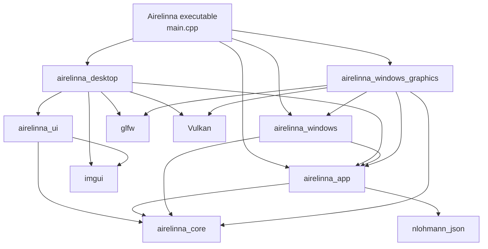
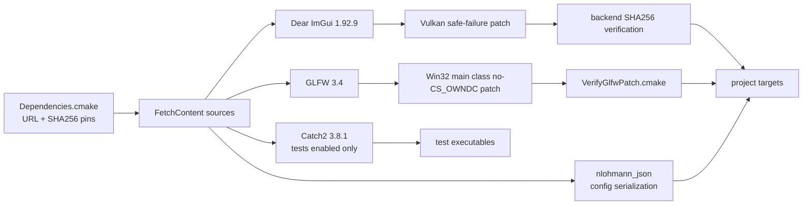
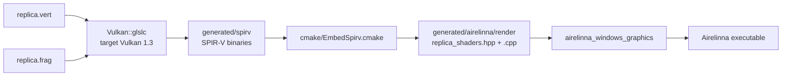
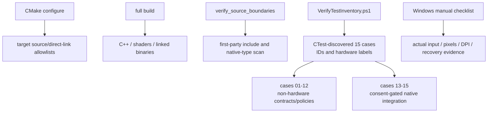

# Build、依賴與驗證架構

[回到架構總覽](README.md) · [clangd 操作指南](../development/clangd.md)

目前提交包含 production build 與本文件集；測試、驗收紀錄及 publish 專用檔案不包含在內。以下測試／封裝章節描述本機 working tree 的對應工具，不代表 checkout 後即可執行；一般開發請使用 `windows-clangd` preset，或明確設定 `AIRELINNA_BUILD_TESTS=OFF`。

## 1. CMake target 是編譯邊界

箭頭表示專案 target 的主要**直接 link dependency**；不是 runtime 呼叫順序。標準函式庫與 Windows system libraries 未全部展開，精確清單以 [src/CMakeLists.txt](../../src/CMakeLists.txt) 為準。

`airelinna_ui` 不 link `airelinna_app`；它透過被允許的 header-only command/view declarations 使用 portable 值。`airelinna_desktop` 雖然有 controller 的 Vulkan backend，也不 link replica graphics/runtime target。

## 2. Dependency 輸入與 patch gate

[Dependencies.cmake](../../cmake/Dependencies.cmake) 管來源、版本、patch 與 native prerequisites，不把抓取依賴的工作交給 UI 或 executable runtime。GLFW patch 只改預期的 Win32 main-window class；helper class 的不變性也有檢查。ImGui patch 由 host 的失敗／退休策略使用，不代表 UI widgets 擁有 GPU cleanup。

本機使用 `FETCHCONTENT_SOURCE_DIR_*` 重用 dependencies，且來源位於此 repo 內時，應放在該 build tree 的 `_offline-src` 等目錄內；否則目前 source-boundary gate 會把位於專案內但不在本 build tree 的 dependency target 視為未申報的 production target。repo 外的 dependency sources 不受這個路徑辨識問題影響。不要為了 editor 設定放寬此閘門。

## 3. Shader 產生流程

[shaders/CMakeLists.txt](../../shaders/CMakeLists.txt) 建立 `airelinna_replica_shaders` 產生目標；[EmbedSpirv.cmake](../../cmake/EmbedSpirv.cmake) 把編譯結果轉成 C++ arrays。clangd 需要 generated header 真正存在，因此只有 configure 還不夠；tooling preset 有專門的 shader generation build step。

## 4. 驗證閘門的分工

| 閘門 | 能證明的事 | 不能代替的事 |
|---|---|---|
| CMake target gate | target source owner 與直接 link 符合 allowlist | 行為正確、動態生命週期 |
| Source scan | portable 層未直接帶入被禁止的 native/UI headers 或 types | 所有可能的跨層語意錯誤 |
| Full build | 此 toolchain 下可編譯與 link | 硬體行為驗收 |
| Cases 01–12 | 狀態、policy、queue、錯誤與所有權契約 | 真實 WGC/driver/compositor 行為 |
| Cases 13–15 | 在有 consent 與 prerequisites 的機器上跑 native capture/present | 所有硬體、DPI 與人工互動情境 |
| Manual checklist | 有紀錄的實際畫面／輸入／恢復行為 | 未執行的情境或其他硬體組合 |

[VerifySourceBoundaries.cmake](../../cmake/VerifySourceBoundaries.cmake)、`tests/CMakeLists.txt`、`cmake/VerifyTestInventory.ps1` 是實際 gate 入口。測試總數固定為 15；Mermaid 驗證、clangd audit 與這次的 comment-only 比對不新增 Catch2 cases。

目前 source scan 對檔案全文做文字比對，包含註解；它不是 C++ AST dependency analyzer。受限層的註解使用責任名稱（例如 use-case orchestrator），具體跨層型別關係放在本文件集，避免說明文字被判成禁止的 owner 存取。

## 5. Tooling 與 package 不進 runtime

`.clangd` 與 [CMakePresets.json](../../CMakePresets.json) 只服務編輯器。`compile_commands.json`、index cache 與工具 audit 產物留在本機 build/cache 目錄，不是 runtime metadata。

`cmake/Packaging.cmake`、`resources/windows/airelinna.manifest` 與 [THIRD_PARTY_NOTICES.md](../../THIRD_PARTY_NOTICES.md) 描述安裝／平台／依賴資訊。它們沒有反向呼叫 `Application` 或原生 graphics owner。本導讀只記錄連接方式；本次未執行 package、簽章或 release 發佈。
