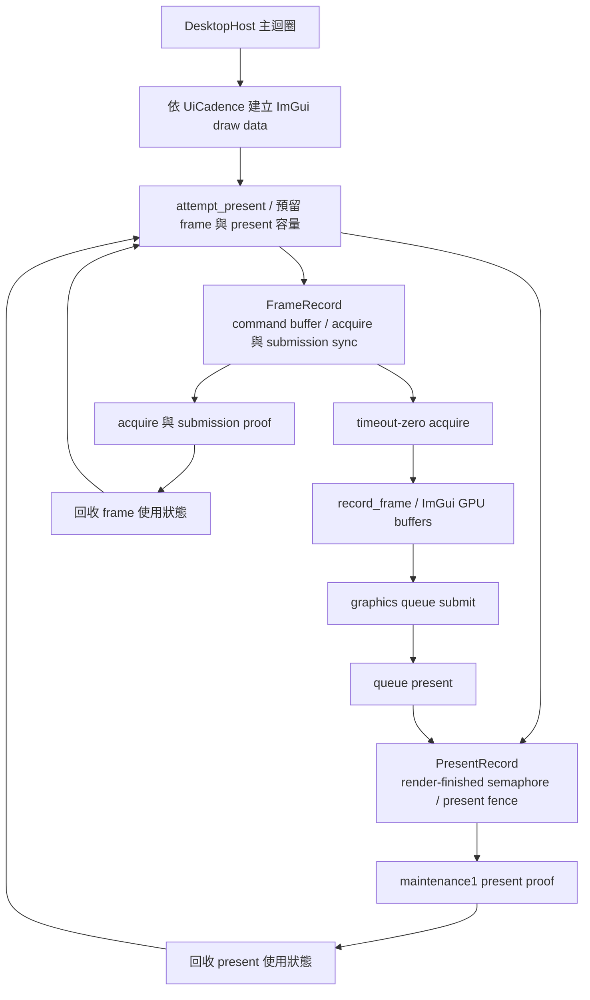
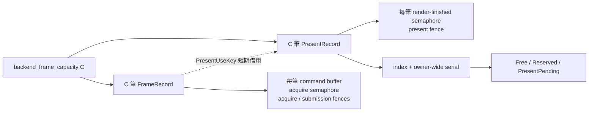
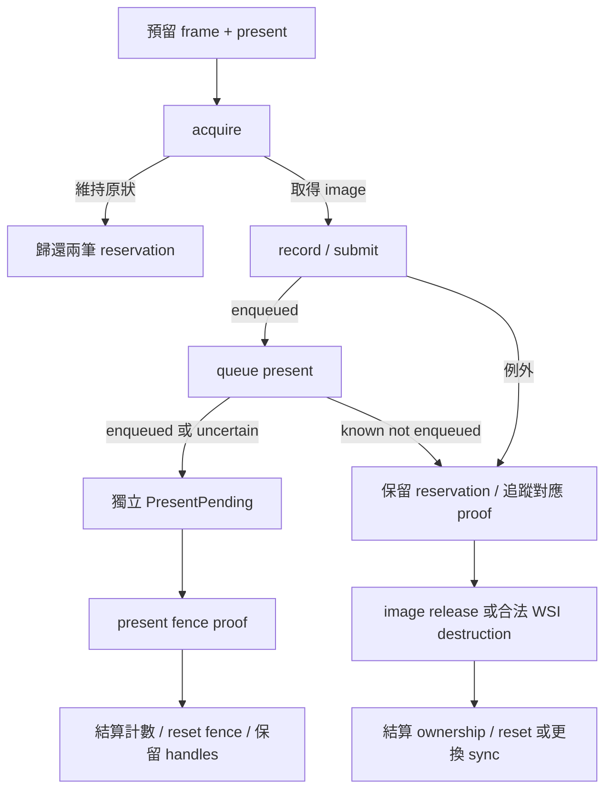

# Controller Vulkan：有界資源與獨立完成證據

為了讓 controller 持續處理輸入，同時降低 native allocation 成本，桌面層需要分開管理 UI 更新頻率、GPU admission 與資源退休。入口位於 [`DesktopHost::Impl`](../../src/desktop/desktop_host.cpp)。Host 依 `UiCadence` 建立 widgets 與 draw data，再由自己的 Vulkan owner 判斷此次呈現容量；Application step、commands 與完成觀察沿既有主迴圈持續前進。

Controller 與 replica 各自持有 device、queues、swapchain 和資源容器。兩者透過 [`graphics_retry_policy.hpp`](../../render/graphics_retry_policy.hpp) 共用結果分類與 present-use 身分規則；每個 owner 根據自己觀察到的 native proof 執行 handle 操作。Replica 的對應流程見 [shared Vulkan renderer](shared-vulkan-renderer.md)。

## Frame 與 present 的責任分配

為了限制同時存在的 native obligations，host 以 `backend_frame_capacity_` 作為 frame 與 present 兩個容器的共同容量。每次 draw 先預留兩邊容量，再進入 acquire。Frame 保存 acquire image、command buffer 與 font-upload 關係；present record 保存呈現所需的 semaphore、獨立 fence 與 swapchain 身分。

`PresentUseKey` 讓 frame 精確指向本次 reservation。Index 定位容器元素，serial 辨識該元素的使用次序；轉移操作會檢查目前 phase、serial 與實際 owner index。Present enqueue 後，由 present record 獨立承接呈現期間的 native lifetime。

容量為 `C` 時，host 自有的穩定 frame／present pools 合計持有：

- `C` 個 command buffers。
- `3C` 個 fences：每個 frame 的 acquire、submission，加每個 present record 的 completion fence。
- `2C` 個 binary semaphores：每個 frame 的 acquire 與每個 present record 的 render-finished。

Font atlas、ImGui backend buffers 與 WSI resources 依各自 owner 的生命週期管理。Diagnostics 在真正的 native create／destroy 呼叫點累積計數，並另外觀察使用中的 frame／present 容量。

## Admission 與退休

為了保護 ImGui 正在使用的 GPU vertex／index buffers，admission 需要把使用中的 frame 數維持在 backend capacity 內。ImGui 依呼叫次序輪替 GPU buffers；host 的 frame index 用於定位自己的 native records。所有 controller draws 依序提交至同一個 graphics queue，後續 submission 的完成證據同時涵蓋其先前的 command work，因而支持既有容量限制與 buffer 輪替的配合。

Frame retirement 先觀察對應 submission fence，再觀察 acquire fence；command recording／known-not-enqueued submit 則由 acquire proof 驅動 image release。Present retirement 觀察 maintenance1 fence，支持 render-finished semaphore 與 present fence 的後續使用。

例外路徑保留其應有的證據與容量。`ReleaseRetained` 保存 acquired image 的 swapchain 關係，直到合法 WSI destruction；完成且仍待消費的 semaphore signal 依 release policy 更換。已證明完成的 ownership 先結算，再呼叫可能失敗的 reset／replacement；錯誤進入既有 fatal containment，其他 pending work 持續沿 drain 處理。

本階段保留啟動時選定的 backend capacity。相同容量的 swapchain resize 保留 frame／present handles；image-count 變更的 backend／pool migration 由下一階段接入。
