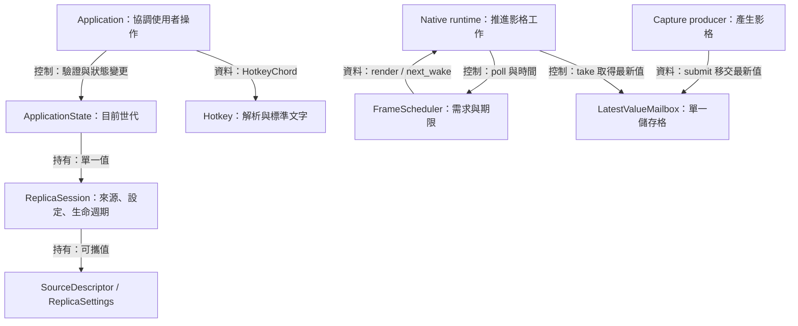
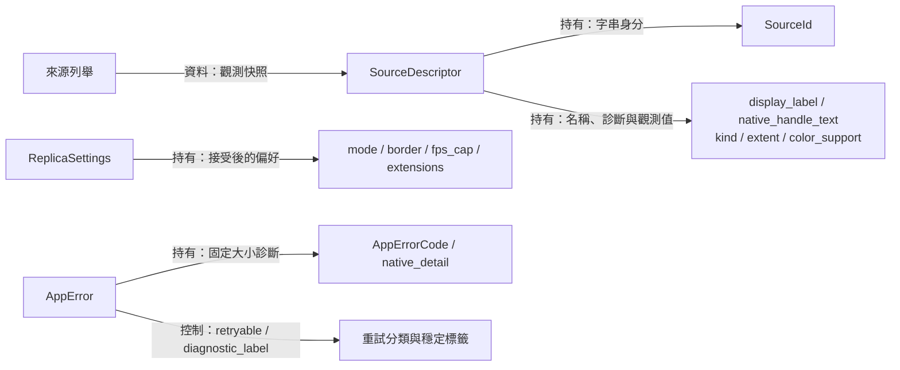
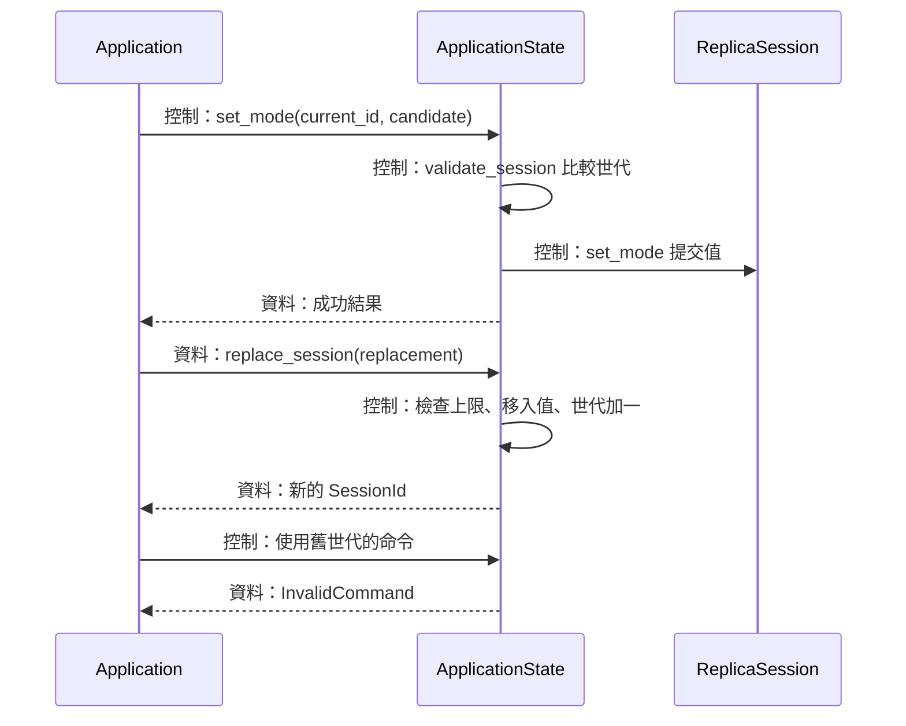
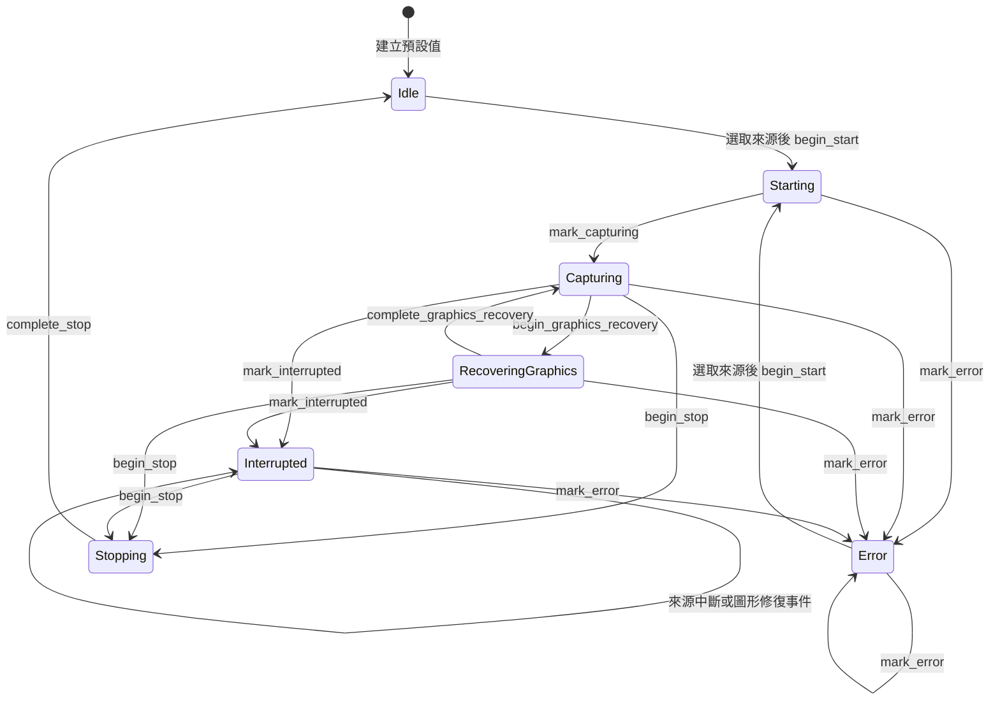
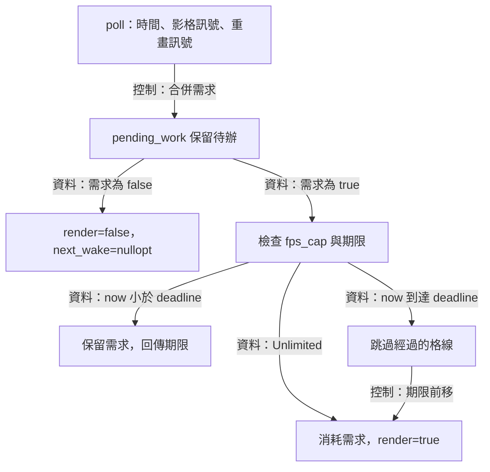
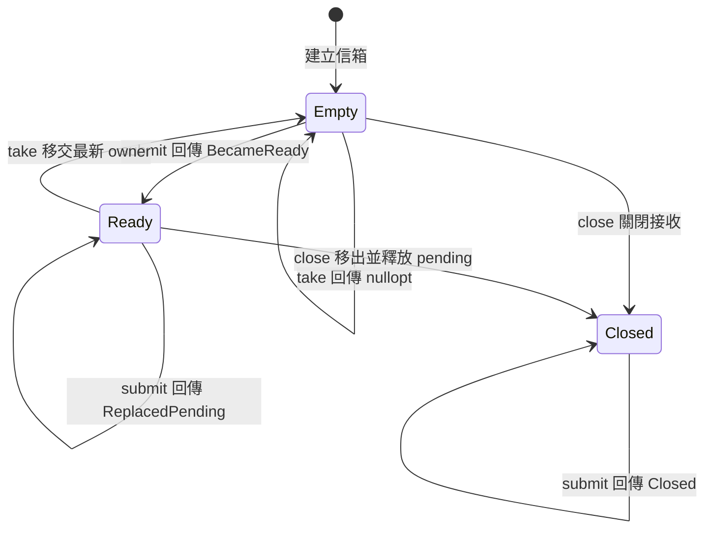
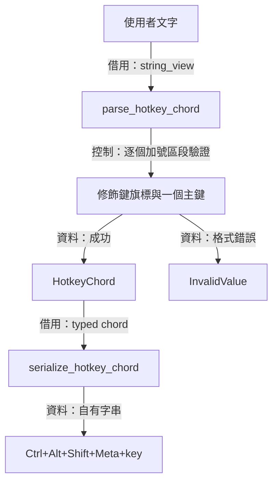

# Core：身分、工作階段與影格排程



[架構入口](README.md) · [Application 與 UI](application-ui.md) · [Windows capture](windows-capture.md)

Core 讓應用程式以可攜的值描述來源、接受設定及決定下一次影格工作。 使用者命令需要辨認目前工作階段，背景影格需要移交所有權，主執行緒需要取得下一個期限。 這三種需求分別落在工作階段世代、最新值信箱及影格排程器

`Application` 在主執行緒依序操作 domain state，native runtime 使用排程器與信箱串接影格。 Core 的公開邊界由 C++ 值、`std::expected`、`std::optional` 及 `steady_clock` 組成。 平台控制代碼與圖形資源由 [Windows capture](windows-capture.md)、[runtime](windows-runtime-overlay.md) 及 [renderer](renderer.md) 的 owner 持有

圖中的「持有」表示成員或容器承擔值的生命週期，「借用」表示呼叫期間使用參考，「資料」表示值傳遞，「控制」表示呼叫或操作。 主要型態宣告位於 [types.hpp](../../include/avb/core/types.hpp)

## 可攜型態與來源身分



選單要在列舉結束後繼續顯示來源，命令也要攜帶可比較的身分。 因此 `SourceDescriptor` 自行持有 `SourceId` 的字串、顯示名稱、`native_handle_text` 診斷字串及當次觀測的尺寸與色彩狀態。 診斷字串由平台格式化，選取仍依 `SourceId` 進行。 選取描述值之後，擷取端依自己的 registry 與 lease 流程確認來源當下的有效性。 值的複製延長字串生命週期，來源視窗的生命週期由作業系統管理

來源與工作階段各有一種身分。 `SourceId` 用字串相等性在來源快照中查找項目。 `SessionId` 的 `std::uint64_t value` 用於比較工作階段世代，UI 從當次畫面快照取得 token。 預設 `SessionId{}` 的值是 `0`，`ApplicationState` 的初始世代是 `1`

`Extent` 以兩個 `std::uint32_t` 保存像素寬高，零值的意義交由使用端判斷。 `SourceKind` 區分 `Display` 與 `Window`。 `ColorSupport::Sdr`、`HdrDetectedUnsupported` 與 `UnknownAssumeSdr` 表示列舉時的色彩觀測，投影層依這些值選擇 SDR、HDR 限制或推定 SDR 的說明。 後續影格的實際尺寸與圖形資源經擷取路徑確認

一次套用所需的設定集中在 `ReplicaSettings` 候選值中。 `mode` 的預設值是 `Editable`，`border` 是 `Bordered`，`fps_cap` 是 `Fps60`，`extensions.browser_capture_keep_alive` 是 `false`。 `Application` 負責接受候選值，runtime 負責執行平台交易。 Core 保存目前 session 的值；Application 透過 `UserConfig` 持久化 mode、border、FPS、額外功能與不透明度，並另外保存語言、快捷鍵與自動更新偏好

| 型態 | 提供給上層的事實 | 使用時機 |
| --- | --- | --- |
| `PlatformCapabilities` | 螢幕／視窗擷取、穿透、邊框調整、熱鍵、擷取排除與瀏覽器保活能力 | 建立 runtime 前的命令接納與控制項投影 |
| `BridgeMode`、`BridgeReason` | 已建構 runtime 實際選擇的 CPU／GPU 傳送路徑及原因 | 接收 runtime 狀態事件後 |
| `CaptureExclusionStatus` | `NotAttempted`、`Excluded`、`Unsupported` 或 `Failed` | 分別呈現 controller 與 overlay 的排除結果 |
| `RuntimeDrainStatus` | 清理進展為 `Normal` 或 `Stalled` | 持續持有 runtime 期間 |
| `ExitDisposition` | host 應繼續、正常退出或執行 `AbandonProcess` | 主迴圈決定等待與終止方式時 |

錯誤跨越元件時，`AppError` 攜帶 canonical `AppErrorCode` 與選用的數值 `native_detail`。 `retryable()` 由 code 推導重試分類，例如設定讀寫、列舉、來源可用性、熱鍵及平台操作錯誤屬於可重試類。 `RuntimeStateLost`、值驗證與支援範圍錯誤則導向對應修復流程。 重試的接納仍取決於工作階段及資源狀態

`diagnostic_label()` 回傳具有程式生命週期的診斷字串，UI 文字由[在地化投影](localization.md)根據 code 選取。 這讓診斷識別、平台數值及使用者顯示各自保有用途

來源：[types.hpp](../../include/avb/core/types.hpp) 與 [types.cpp](../../src/core/types.cpp)

## ApplicationState：工作階段世代



畫面產生的命令可能在工作階段替換後送達，應用程式需要把命令對回產生它的世代。 `ApplicationState` 因此持有一個 `ReplicaSession` 與一個從 `1` 起算的 `SessionId`，每個帶 token 的操作先呼叫 `validate_session()`

相符的 token 會把操作轉交目前 session。 過期 token 會取得 `InvalidCommand`，目前的來源、設定及生命週期持續保留。 身分驗證之後，生命週期轉移由 `ReplicaSession` 檢查，能力及平台交易則由 `Application` 判斷

`replace_session()` 先檢查世代上限，再移入完整替代值並增加 token。 達到 `std::numeric_limits<std::uint64_t>::max()` 時，它回傳 `InvalidValue` 並保留目前 session，讓歷史 token 保持過期。 替換時即使來源與設定相同，新 token 仍代表新的工作階段

實際替換由 `Application` 安排：中斷的 runtime 收到停止請求、完成清理並回報 `Stopped` 後，應用程式釋放舊 owner，再呼叫 `replace_session()`。 一般 Stop 後再次 Start 會沿用原世代。 這使 token 對應 domain replacement，而 native runtime 的建立與清理依自己的完成證據前進

`current_session()` 回傳目前成員的 `const` 參考。 同一個參考會觀察到後續的設定更新或替代值，內部字串與選取來源的借用範圍應截至下一次 mutation。 UI 使用的是 [ControllerViewState](application-ui.md) 的自有快照

來源：[application_state.hpp](../../include/avb/core/application_state.hpp) 與 [application_state.cpp](../../src/core/application_state.cpp)

## ReplicaSession：可見生命週期



控制器要呈現「開始中、擷取中、圖形修復、中斷、停止中」等操作階段，也要在停止後保留來源與偏好。 `ReplicaSession` 因此把 `selected_source_`、`settings_` 與 `lifecycle_` 存成三組值，透過明確的方法描述每條允許的轉移

`begin_start()` 的必要條件是已有選取來源，而且生命週期為 `Idle` 或 `Error`。 成功後進入 `Starting`，runtime factory 的成功結果再由 `mark_capturing()` 投影成 `Capturing`。 建構失敗則由 `mark_error()` 投影成 `Error`。 來源描述值的有效性與平台建立結果在 Application／factory 的路徑處理

正在擷取的 session 收到 `begin_graphics_recovery()` 會進入 `RecoveringGraphics`，修復完成再回到 `Capturing`。 已中斷的 session 收到這兩個方法時都維持 `Interrupted`，因為圖形修復的完成證據涵蓋圖形資源，來源重接則需要另外的擷取證據。 `mark_interrupted()` 對 `Capturing`、`RecoveringGraphics` 與 `Interrupted` 都能記錄中斷

一般停止接受 `Capturing`、`RecoveringGraphics` 與 `Interrupted`，先進入 `Stopping`，再透過 `complete_stop()` 回到 `Idle`。 每條成功轉移都保留來源與設定。 設定 setter 的責任是提交已接受的值，runtime 套用與命令接納由上層完成

`transition_to(target, allowed)` 在 `allowed` 成立時設定目標生命週期，另一條路徑回傳 `InvalidCommand` 並維持既有值。 `mark_error()` 接受 Starting、三種活動／中斷狀態及 Error。 Idle 與 Stopping 的錯誤轉移會取得命令拒絕結果

`Error` 可能搭配建構失敗後的空 runtime，也可能搭配仍在清理的 runtime。 `Application` 以獨立的 owner 與 `stop_requested_` 判斷資源階段，終止錯誤完成清理後仍保留 Error 供使用者閱讀。 [Application 與 UI](application-ui.md) 依這些事實投影控制項

來源：[replica_session.hpp](../../include/avb/core/replica_session.hpp) 與 [replica_session.cpp](../../src/core/replica_session.cpp)

## FrameScheduler：固定期限格線



影格到達與視窗重畫各會產生一次工作需求，主執行緒也可能延遲執行。 為了把等待期間的需求合併，並持續使用建構時的時基，`FrameScheduler` 保存一個需求位元與下一條期限格線。 呼叫端供應單調前進的 `steady_clock::time_point`，接著依 `FrameSchedule` 執行 render 或等待

`poll()` 先執行 `pending_work_ = pending_work_ || has_new_frame || redraw_requested`。 即使下一次 poll 的兩個輸入都是 `false`，先前已接收的需求仍留在位元中。 當需求為 `false`，結果是預設的 `render=false` 與空期限。 `Unlimited` 收到需求則立即允許一次工作並清除位元

有 FPS 上限時，建構子將建構時間存入 `next_deadline_`，因此第一份需求可立即接受。 `period_for()` 將 `1.0 / frames_per_second` 的秒數經 `duration_cast<Clock::duration>` 轉成時鐘刻度，支援 30、60 與 144 FPS。 呼叫者以支援的列舉值建立排程器，調整 FPS 時由 runtime 重建排程器

### 跳過經過期限的推導

以下是 [poll()](../../src/core/frame_scheduler.cpp) 的實際運算：

```cpp
const auto missed_periods = ((now - *next_deadline_) / period_) + 1;
*next_deadline_ += period_ * missed_periods;
pending_work_ = false;

return {.render = true, .next_wake = std::nullopt};
```

令 $d$ 表示目前期限，$t$ 表示目前時間，$P$ 表示時鐘刻度下的週期。 這段程式在 $t\ge d$ 時執行，整數除法決定跨過的格數：

$$
k=\left\lfloor\frac{t-d}{P}\right\rfloor+1,
\qquad d'=d+kP,
\qquad t<d'\le t+P.
$$

加一把新期限推到目前時間之後。 一次 poll 會准許一份合併後的工作，已經過的格子由這次加法跨過。 新期限繼續落在原本的時基上

以 60 FPS、建構時間為 `0 ms` 為推導示例，先採 $P\approx16.667\text{ ms}$ 的十進位近似。 `0 ms` 接受第一份工作後，期限約為 `16.667 ms`。 下一次有需求的 poll 延至 `49 ms`，計算 $k=\lfloor(49-16.667)/16.667\rfloor+1=2$，接受一次工作並把期限推到約 `50 ms`

假設另一份新需求在 `50.1 ms` 到達，它又跨過約 `50 ms` 的格線，因此可立即接受。 這兩次接受相隔約 `1.1 ms`，格線仍依 `0、16.667、33.333、50、66.667 ms` 前進。 實際數值以 `Clock::duration` 的截斷精度為準。 這個例子呈現固定格線上的准入政策，每格累積的需求合成一份最新工作

### 期限與呼叫端合作

`now < deadline` 時，排程器回傳該期限並保留需求。 render 獲准後，回傳的 `next_wake` 是 `nullopt`，後續新影格或重畫事件再建立下一份需求。 native runtime 另外合併 GPU 退休、擷取與清理期限，host 負責等待與喚醒。 `render=true` 提供工作准入，畫面完成則由 renderer 的提交與呈現證據判定

來源：[frame_scheduler.hpp](../../include/avb/core/frame_scheduler.hpp) 與 [frame_scheduler.cpp](../../src/core/frame_scheduler.cpp)

## LatestValueMailbox：最新值交接



擷取執行緒可能比呈現端更快產生影格，呈現端需要取得最新影格並限制待辦資料量。 `LatestValueMailbox<T>` 因此用一個 `std::optional<T>` 保存待取值，透過 mutex 保護提交、取出、關閉與計數器。 新值取代仍在儲存格中的舊值，消費者已取出的值則由消費者自行持有

`submit(T value)` 以傳值參數接收 owner。 開放且空的信箱回傳 `BecameReady`，已有待取值時回傳 `ReplacedPending`。 這是持鎖當下觀察到的接收邊緣，producer 可在 `BecameReady` 時喚醒消費者，後續替換沿用既有喚醒。 消費者或舊值的最終釋放動作可能在 `submit()` 返回前取空儲存格，因此此結果描述的是那次邊緣

### 鎖內移動與鎖外最終釋放

`submit()` 的實際儲存結構如下：

```cpp
std::optional<T> replaced;
SubmitResult result{SubmitResult::Closed};

{
  const std::lock_guard lock{mutex_};
  if (!closed_) {
    ++counters_.submitted;
    if (pending_) {
      replaced.emplace(std::move(*pending_));
      pending_.reset();
      ++counters_.replaced;
      result = SubmitResult::ReplacedPending;
    }
    else {
      result = SubmitResult::BecameReady;
    }
    pending_.emplace(std::move(value));
  }
}

return result;
```

外層的 `replaced` 接住舊 owner，內層 scope 先結束 `lock_guard` 的生命週期。 接著 `replaced` 的解構釋放舊 payload，這個最終釋放可以重新進入信箱。 鎖內仍會執行 payload 的移動，以及 `pending_.reset()` 對移後物件的解構。 因此 payload 的 move 與移後解構需以局部操作完成，重新進入信箱的釋放行為應放在鎖外 owner 的最終解構

`take()` 同樣先在鎖內把 pending 移入局部 `optional<T>`，清空儲存格並增加 `taken`，再把值交回呼叫者。 空結果表示此次持鎖邊界看到空儲存格，開放且空或已關閉都能產生這個結果。 後續 submit 針對的是新的待取儲存格

`close()` 在鎖內設定 `closed_=true`，把待取 owner 移到外層局部值，並在解鎖後釋放它。 關閉後的 submit 回傳 `Closed`，傳值參數仍在函式返回時結束生命週期。 關閉接收之後，上層 owner 繼續等候所有 producer、consumer 與 callback 操作完成，再解構信箱本身

### 計數與例外契約

`submitted` 在準備插入 payload 前增加，`replaced` 在舊 pending 已移出後增加，`taken` 在成功取出後增加。 已關閉的拒絕結果維持計數器原值。 `counters()` 在鎖內複製三個數值，提供同一時刻的統計快照

若 `T` 的 move 拋出例外，slot 與計數器可能已經前進，呼叫者會收到該例外。 使用這個泛型容器時，payload 的移動、移後解構及最終釋放都屬於契約的一部分。 WGC 影格的具體 owner 與 checkout 生命週期見 [Windows capture](windows-capture.md)

來源：[latest_value_mailbox.hpp](../../include/avb/core/latest_value_mailbox.hpp)

## Hotkey：文字解析與標準拼寫



同一個快捷鍵會穿過錄製面板、設定檔與 OS 註冊介面，因此程式需要一種固定的語法與可比較的值。 錄製面板由按鍵事件直接建立 `HotkeyChord`。 設定檔的 `parse_hotkey_chord()` 用 `+` 切分字串，辨認各修飾鍵及一個主鍵。 `serialize_hotkey_chord()` 再依固定順序產生標準文字

語法以 ASCII 大小寫摺疊比較 `Ctrl`、`Alt`、`Shift` 與 `Meta`，主鍵支援 A 至 Z、數字 0 至 9、F1 至 F12。 修飾鍵各出現零次或一次，主鍵恰好一次。 所有 token 都依原字串範圍解析，空白會進入 token 驗證，空 token、重複修飾鍵、額外主鍵及格式錯誤都取得 `InvalidValue`

輸入順序可以讓主鍵位於修飾鍵之前，例如 `r+alt+ctrl` 會形成 control、alt 為 true 且 key 為 `R` 的值，再序列化為 `Ctrl+Alt+R`。 F 鍵解析採二至三字元、逐位十進位數字與 1 至 12 的範圍，因此 `F01` 也會解析成 `F1`，後續輸出為標準拼寫 `F1`

parser 使用借用的 `string_view` 與局部固定欄位完成驗證，結果自行持有 typed value。 序列化則建立自有 `std::string`，依 `Ctrl`、`Alt`、`Shift`、`Meta`、主鍵的順序附加文字。 `hotkey_display_text()` 使用同一個序列化函式，讓設定檔與顯示保持相同拼寫

語法通過後，OS 註冊由 `IGlobalHotkey::replace()` 執行。 `Application` 以 `hotkey_binding_confirmed_` 保存註冊證據，衝突、清理失敗與註冊遺失各走對應結果。 詳細的接受與儲存順序見 [Application 與 UI](application-ui.md)

來源：[hotkey.hpp](../../include/avb/core/hotkey.hpp) 與 [hotkey.cpp](../../src/core/hotkey.cpp)
