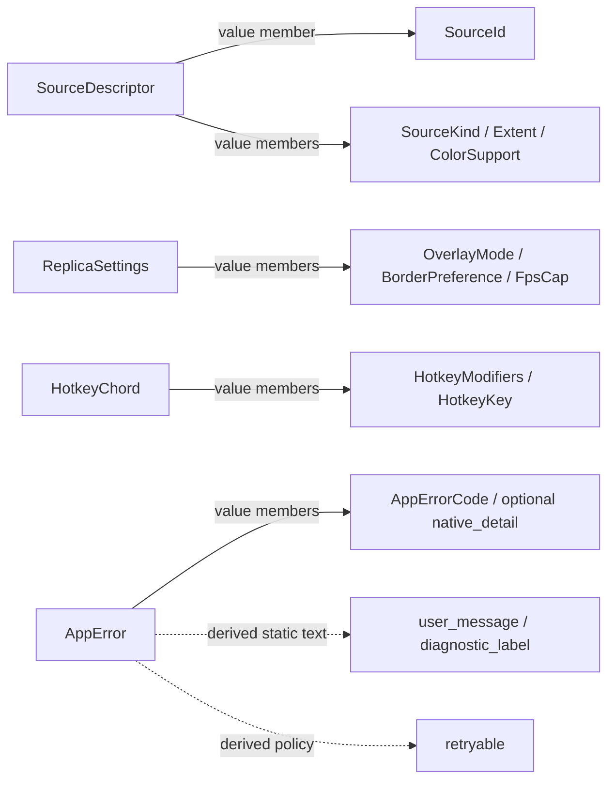
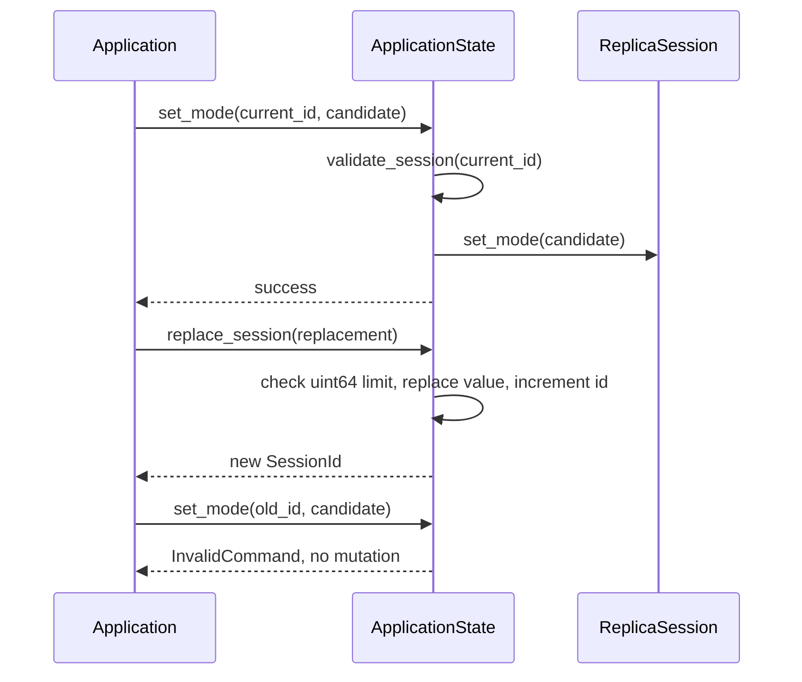
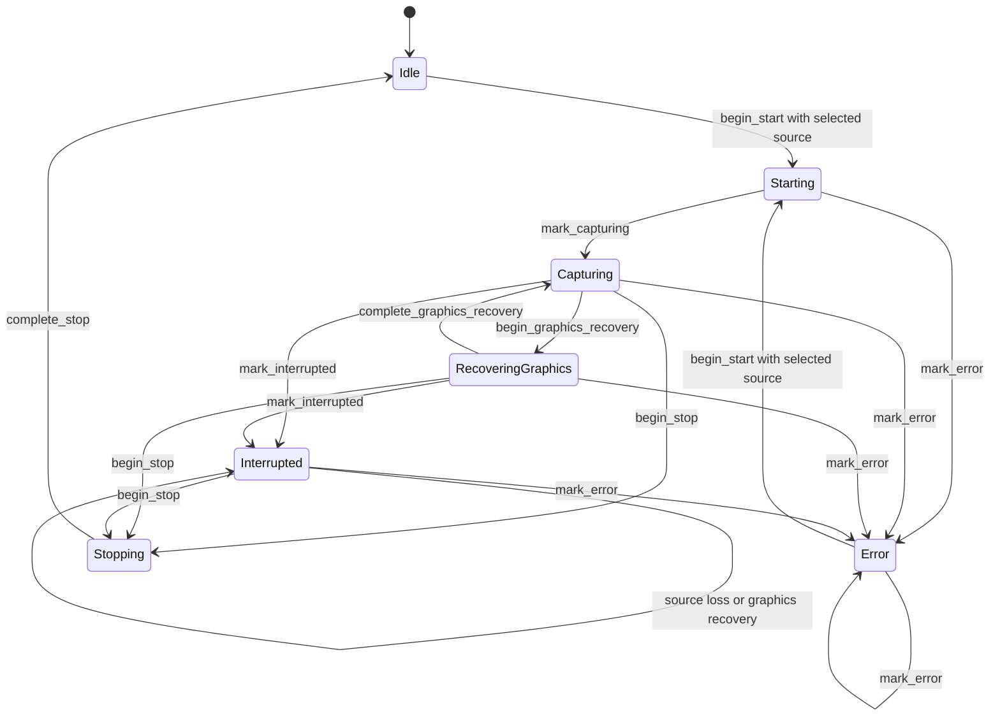
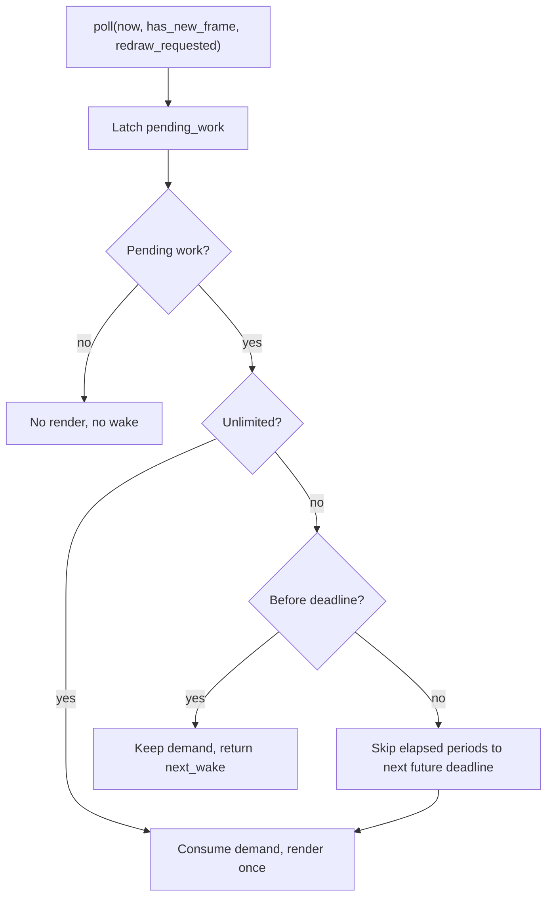
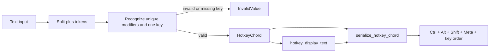

# Core：值、狀態與排程政策

[回架構索引](README.md) · [Application 與 UI](application-ui.md)

`core` 提供 `ReplicaSession`、世代檢查、FPS 排程、單槽 mailbox 與 typed hotkey。除 mailbox 自己的 mutex 外，這些元件不管理執行緒；session 的操作由主執行緒上的 `Application` 排序。此層沒有 Win32、WGC、D3D、Vulkan 或 GLFW handle，也不負責啟動或停止 native capture。

以下關係圖各自註明用途。`owns` 是 C++ 值／容器的所有權；`data` 是值的傳遞或組成；呼叫和狀態轉移不代表資源所有權。

## 型別與跨層資料

[types.hpp](../../include/airelinna/core/types.hpp) 定義共用值，[types.cpp](../../src/core/types.cpp) 將 `AppErrorCode` 對應至靜態使用者訊息與診斷名稱。

`SourceId` 是 opaque string。它不包含可讓上層重新解析或保留 native item 的 API；其有效性由 catalog／registry 決定。`SessionId` 則是 `uint64_t` 世代 token，用來判斷命令是否屬於目前 session，兩者不能互換。

`SourceDescriptor` 擁有來源名稱與當次列舉取得的尺寸、色彩分類；它是 snapshot，不能證明來源現在仍開啟。`ColorSupport::HdrDetectedUnsupported` 與 `UnknownAssumeSdr` 分別表示偵測到不支援的 HDR，以及偵測不足而假設 SDR。UI 使用這些值呈現警告，不會透過它們查詢顯示器。

| 型別組 | 表達的事實 | 不表達的事實 |
| --- | --- | --- |
| `PlatformCapabilities` | 啟動前可呈現的 capture／input／border／hotkey 能力 | 已建立 runtime 的 GPU interop 結果 |
| `BridgeMode`、`BridgeReason` | runtime 實際 transfer path 與原因 | lifecycle 或 callback 所有權 |
| `CaptureExclusionStatus` | 單一產品視窗的 best-effort 排除結果 | 必然不會被擷取的保證 |
| `RuntimeDrainStatus` | native cleanup 的進度回報 | `Stalled` 不等於可釋放資源 |
| `ExitDisposition` | Application 給 host 的繼續／乾淨退出／放棄程序指示 | session lifecycle |
| `AppError` | canonical code 與可選數值 native detail | 動態來源名稱、pixels 或例外字串 |

`AppError::retryable()` 只有一份共用 code mapping。它表示重試「可能有用」，不會自行安排重試，也不會跳過當下 lifecycle 或 drain 的限制。

## ApplicationState：一個 session 與一個世代

[application_state.hpp](../../include/airelinna/core/application_state.hpp)／[application_state.cpp](../../src/core/application_state.cpp) 擁有一個 `ReplicaSession` 與初值為 `1` 的 `SessionId`。所有帶 `SessionId` 的 mutation 先呼叫 `validate_session()`，才委派給 session；不符時回傳 `InvalidCommand`。

`replace_session()` 不是 runtime stop API，也不檢查 native owner。它只替換 domain 值，並在 token 到達 `uint64_t` 上限時回傳 `InvalidValue`，避免 wraparound 使很舊的命令重新有效。目前 Application 在中斷後替換來源的路徑中，等舊 runtime 回報 `Stopped` 才呼叫它；一般 Stop 後再次 Start 不會自動增加 token。

`current_session()` 回傳唯讀 reference。這是讀取目前值的介面，不是跨次 replacement 的穩定 session identity。與 native runtime 有關的限制、持久化、錯誤 notice 都在 Application。

## ReplicaSession：可見 lifecycle

[replica_session.hpp](../../include/airelinna/core/replica_session.hpp)／[replica_session.cpp](../../src/core/replica_session.cpp) 保存選取來源、settings 和可見 lifecycle。以下是此類別實作的狀態邊；圖中的 error／stop 只是 domain transition，沒有建立或釋放 native resources。

`transition_to(target, allowed)` 在 guard 不成立時回傳 `InvalidCommand`，保留原狀態。`begin_start()` 需要已選取來源，且只能從 Idle 或 Error 出發。選取來源本身不會 Start，設定 mode／border／FPS 也不會切換 lifecycle。

`Interrupted` 保留在圖形復原的開始與完成邊上：native graphics 可以完成修復，但這不能證明已失去的 capture source 回來了。`complete_stop()` 只接受 Stopping → Idle，並保留原先 selection／settings。terminal Error 的 runtime drain 完成時，Application 保留 Error，故不會經過這個一般停止邊。

這個類別不驗證 UI control availability，也不保存「最後一次 native error」。runtime 設定交易與失敗 notice 由 [Application](application-ui.md) 負責，避免 domain 內的 settings 被誤當成 native 操作已成功的證據。

## FrameScheduler：先累積需求，再決定是否渲染

[frame_scheduler.hpp](../../include/airelinna/core/frame_scheduler.hpp)／[frame_scheduler.cpp](../../src/core/frame_scheduler.cpp) 接受外部提供的 `steady_clock::time_point`。它不 sleep、不呈現影像，也不擁有 frame；`FrameSchedule` 只回傳 `render` 與可選的 `next_wake`。

30／60／144 FPS 以對應週期建立 deadline grid，建構時的 `now` 可立即接受第一份工作。晚到的 tick 計算 `((now - deadline) / period) + 1`，直接跳過所有過期區間；一次只接受一個 render，不補畫錯過的 frame。

新 frame 或 redraw 是 latch：某次 poll 看見需求後，即使之後的 poll 都沒有新 frame，也不會丟失尚未到期的工作。成功接受 render 後 `next_wake` 為空，因為 scheduler 不會為沒有需求的下一個週期安排喚醒。Unlimited 也必須有需求才渲染；其他 native retirement deadlines 由 runtime 合併。

## LatestValueMailbox：一份待處理值的所有權

```mermaid
stateDiagram-v2
    [*] --> Empty
    Empty --> Ready: submit / BecameReady
    Ready --> Ready: submit / ReplacedPending
    Ready --> Empty: take / transfer newest owner
    Empty --> Empty: take / nullopt
    Empty --> Closed: close
    Ready --> Closed: close / release pending owner
    Closed --> Closed: submit / Closed; take / nullopt
```

[latest_value_mailbox.hpp](../../include/airelinna/core/latest_value_mailbox.hpp) 是 header-only template。它包含 `optional<T> pending_`、mutex、計數器與永久 `closed_` flag。相較於按順序執行命令的 `AppCommandQueue`，此 mailbox 刻意覆蓋尚未取走的舊值，限制待處理 payload 為一份。

`submit(T value)` 以值接收 ownership。slot 空時回傳 `BecameReady`，producer 可用此 edge 喚醒 consumer；slot 已滿時回傳 `ReplacedPending`，避免每次 newest-frame replacement 都打斷 capped scheduler。關閉後仍會消耗傳入值，但不增加 accepted submission counter。

覆蓋與 `close()` 先在鎖內把原 payload move 到區域 `optional<T>`，再在鎖外讓該 owner 解構。鎖內仍會 reset moved-from `T`，因此 payload 的 move／moved-from destructor 行為仍是其契約的一部分。template 沒有對任意 `T` 宣告 `noexcept` 或 lock-free 保證。

`take()` 把最新值交給 consumer；接收方之後持有的 payload 不再由 mailbox 管理。`close()` 不等待 producer、callback 或 GPU completion，也不證明可以解構 mailbox。外層 owner 必須確保沒有 operation 仍會存取此物件。native frame checkout 的實際使用方式見 [Windows capture](windows-capture.md)。

## Hotkey：文字到 typed chord

[hotkey.hpp](../../include/airelinna/core/hotkey.hpp)／[hotkey.cpp](../../src/core/hotkey.cpp) 使用 ASCII、不分大小寫的 `+` token grammar。支援 `Ctrl`／`Alt`／`Shift`／`Meta` 與恰好一個 A–Z、0–9、F1–F12 key；modifier 並非必要，且 parser 不去除空白。

空字串、連續／尾端 `+`、重複 modifier、兩個 key 或不支援的 key 都回傳 `InvalidValue`。key 與 modifier 的輸入順序不受限制；serialization 將支援的 typed 值轉成固定順序的文字，例如 `r+alt+ctrl` 會成為 `Ctrl+Alt+R`。parse 本身使用 `string_view` 與固定值，不為 token 配置字串。

這只證明語法可表達。是否與 OS 現有 binding 衝突、替換失敗後舊 binding 是否還存在，由 `IGlobalHotkey` 與 Application 的 confirmed-binding 狀態處理，詳見 [Application 與 UI](application-ui.md)。

## 閱讀與驗證邊界

追蹤一個新 command 時，先看 `ApplicationState` 的 token guard，再看 `ReplicaSession` 的 transition；資源能否釋放必須繼續追蹤 Application／runtime。調查卡住的 render 時，區分 scheduler 未到期、mailbox 沒有新值，以及 native retirement 尚未完成。

本頁描述目前 source 的結構與分支，不把 source review 當作硬體驗證。相關自動測試 inventory 與 hardware gates 集中於 [Build 與驗證](build-and-validation.md)。
