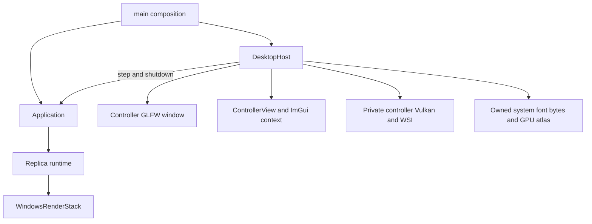
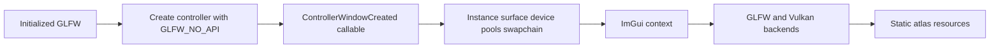
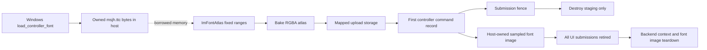
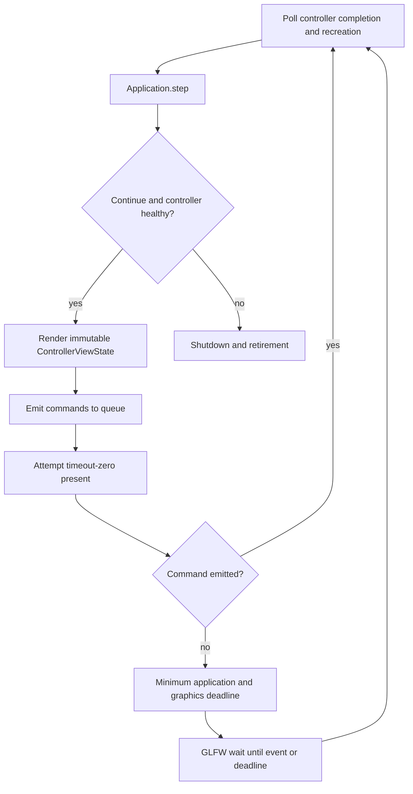
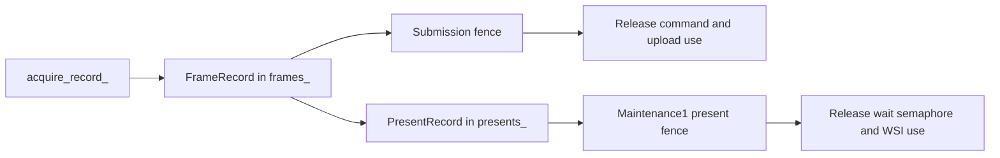
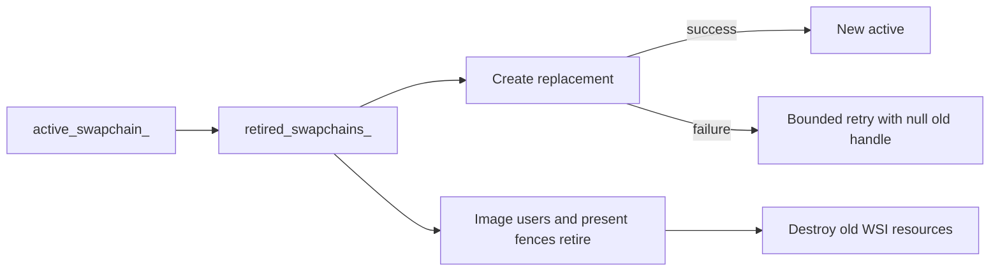
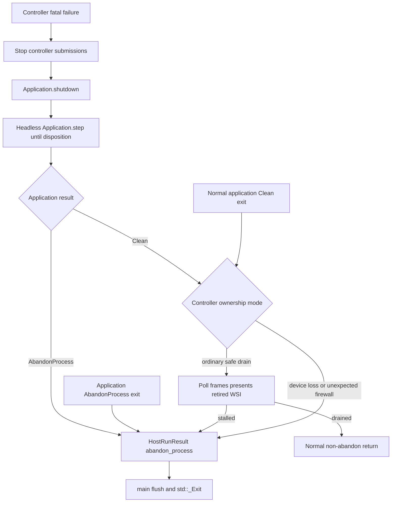
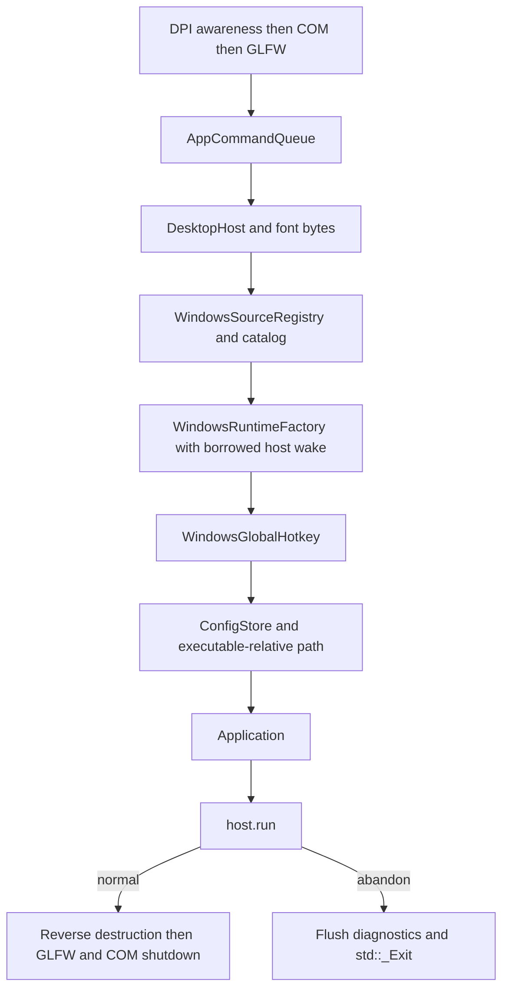

# Desktop host 與 composition root

[回架構索引](README.md)

`DesktopHost` 擁有 controller window、Dear ImGui、font bytes 和 controller 的私有 Vulkan context。它每輪呼叫 `Application::step()`，把 immutable view state 交給 UI，再把 UI command 放回 queue。replica 的 capture／graphics resources 不由 host 取得或操作。

入口可從 [desktop_host.hpp](../../include/airelinna/desktop/desktop_host.hpp)、[desktop_host.cpp](../../src/desktop/desktop_host.cpp) 與 [main.cpp](../../main.cpp) 開始。replica graphics 的獨立生命週期見 [renderer.md](renderer.md)。

## 1. 兩個獨立 graphics owner

host 使用的 Application surface 只有 host 所需的 operation／projection：`step()`、`shutdown()`、`view_state()`、`next_deadline()`、`exit_disposition()`。它沒有 source catalog、runtime factory、global hotkey 或 config store 的使用權；這些 concrete adapters 由 composition root 建立，再注入 Application。

controller Vulkan context 不與 replica 共用 device、queues、surface 或 swapchain。controller device／surface 的 terminal failure 是 host shutdown 事件；replica 的 surface／device recovery 則由自己的 stack 與 runtime 處理。

## 2. Controller window 與 backend startup

`DesktopHost::create()` 在主執行緒建立 window，並先呼叫 composition-supplied `ControllerWindowCreated`。目前該 callable 由 Windows adapter 驗證 patched GLFW class，並回傳 best-effort capture exclusion 結果。host 只保留 portable status，讓 Application 投影 warning。

`Impl` 接著建立 controller 自己的 Vulkan instance、surface、physical device、logical device、pools 與 swapchain。device 必須具備 maintenance1 present-fence 功能。Dear ImGui Vulkan backend 使用 host 的 device／descriptor pool／render pass；backend 自己持有 draw buffer 等內部資源，整體 lifetime 則由 host 包住。

startup 尚未提交 native work，所以 partial failure 可以逆序釋放已建立資源。完成 construction 後，destructor 會要求所有可能執行中的 native work 已安全結束；它不以同步等待補做 drain。

## 3. Font bytes、atlas 與第一筆 upload

Windows 檔案載入位於 [controller_font.cpp](../../platform/windows/controller_font.cpp)。main 把 owning byte vector move 給 host；[configure_controller_font](../../src/desktop/controller_font.hpp) 設定 `FontDataOwnedByAtlas = false`，因此 font bytes 必須活到 ImGui context／atlas 被銷毀。

glyph 範圍在 startup 固定，包含 Latin、punctuation、kana、bopomofo 與 BMP CJK。`create_font_texture()` 呼叫 atlas bake，配置 upload storage、GPU image、view 和 descriptor。它不在 setup 直接提交一個額外的 blocking upload；第一筆 controller draw command 會先完成 atlas copy／layout transition，再繪製 UI。

`FrameRecord::uploads_font` 與 `FontTexture::upload_in_flight` 記住 upload 的證據。submission fence 完成後才銷毀 staging；sampled image 與 descriptor 則保留到所有 UI submissions 結束。

host 清除 `ImGuiBackendFlags_RendererHasTextures`，避免 pinned backend 的動態 texture upload 另走 `vkQueueWaitIdle`。固定 atlas 的 texture ID 由 host 安裝，後續 frame 使用同一張 image。這是目前的明確 lifetime 選擇；加入動態 glyph／texture 功能時，需要重新設計其提交與回收契約。

## 4. 主迴圈與 command 的下一步

`progress()` 先觀察先前的 native work，`render_controller()` 再呼叫 Application step 並建立新的 ImGui frame。UI 產生的 commands 因而是在本輪 application step 之後才入列。`command_emitted_` 會跳過接下來的 wait，讓下一輪立即處理它們。

主迴圈結合 `Application::next_deadline()` 與 `graphics_deadline_`。若 deadline 已到期，`wait_until()` 直接返回；沒有 deadline 才等待外部事件。每次可能改變 exit／fatal 狀態的 step 後都重新檢查終止條件，避免已經完成 shutdown 卻仍進入無限等待。

`wake()` 使用 GLFW 的 thread-safe empty event。capture／source adapter 可以跨執行緒呼叫這個窄 operation，但其 admission／quiescence contract 必須保證 borrowed host 仍活著。一般 UI、native window 操作及 graphics 都在主執行緒。

## 5. Controller presentation 的兩種 record

`FrameRecord` 持有 command buffer、acquire sync、submission fence，以及尚未交給 present 的 render-finished semaphore。`PresentRecord` 則持有 present fence、被消耗的 wait semaphore 與 swapchain identity。當 present enqueued，semaphore ownership 由前者移到後者。

`attempt_present()` 限制尚未退休的 frame record 數量，避免 Dear ImGui backend 輪替 draw buffers 時覆寫仍在使用的內容。acquire timeout 固定為零；not-ready 回到 event-loop deadline，不在呼叫內等待。

`progress_frames()` 依 `FramePhase` 選擇 acquire 或 submission fence；`progress_presents()` 只根據 present fence 退休 presentation。未 enqueue 的 submit／present 仍可能留下 acquired image，必須先取得對應 proof，再呼叫 maintenance1 release。非成功 release 不會憑空清除 image ownership。

### Active 與 retired controller WSI

同 surface replacement 先停止新 acquire，再確認 image-use／release 條件。active owner 在 `vkCreateSwapchainKHR` 之前就移入 retired set，即使 create 失敗也不重新啟用舊 handle。compatible render pass 與相同 format 讓既有 ImGui pipeline 可以使用 replacement framebuffers。

controller 的 recovery episode 使用 0／100／500 ms 的三次 construction 時點；只有 replacement 的成功 present 退休才重設 budget。framebuffer 為零時暫停呈現；回復可見尺寸後才進行需要的 WSI 工作。

## 6. Fatal shutdown 與不展開堆疊的出口

controller terminal graphics failure 先停止提交，然後經由 Application 的公開 shutdown surface 要求 replica 走自己的非阻塞 drain。即使 controller 無法再畫 UI，host 仍繼續 headless application ticks，直到 `Clean` 或 `AbandonProcess`。一般 Quit 則先由 application command path 開始 shutdown，controller 可繼續顯示 draining 狀態，直到 Application 的 exit disposition 不再是 `Continue`。

健康 device 下的 WSI／terminal path 可以輪詢自身 frame、present 和 retired swapchain，全部退休後正常返回。controller 的 device loss 或 unexpected exception 則採既有 firewall：保留 controller owners，完成可行的 application shutdown 後回傳 `abandon_process = true`。這與 replica runtime 可以重建 device 的政策不同。

一般 controller drain 若十秒沒有 ownership retirement，也回傳 abandon。poll 或 warning 本身不算進展。`HostRunResult::exit_code` 用來表示程序結果，`abandon_process` 才是「不可展開 native owner stack」的明確指示。

## 7. `main` 的建立與釋放順序

main 在任何 window 建立前確認 DPI awareness，接著初始化 COM MTA 與 GLFW。設定檔路徑取自 executable 所在目錄，不依賴呼叫程式的 current directory。系統 font bytes、controller window setup、native adapters 與 portable application 的接線集中在這裡；session transition 不放在 main。

正常返回時，Application 已完成 runtime drain 並釋放 runtime；反向 stack destruction 再釋放 hotkey／factory／catalog／registry observations，最後才銷毀 host 的 ImGui、Vulkan、window 與 font bytes。GLFW termination 與 COM uninitialization 在它們之後。

abandon 路徑刻意在這些 owners 仍存活時呼叫 `std::_Exit`。讓一般 destructor 展開會違反仍有 uncertain native work 的 invariant，因此這個出口由 composition root 唯一執行。

閱讀 controller 的正常幀流程可從 `run()` → `render_controller()` → `attempt_present()` → `progress_frames()`／`progress_presents()` 開始；閱讀失敗路徑則從 `enter_fatal()` → `drive_application_shutdown()` → `HostRunResult` → main 的 exit 分支開始。
