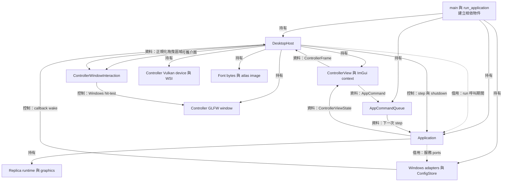
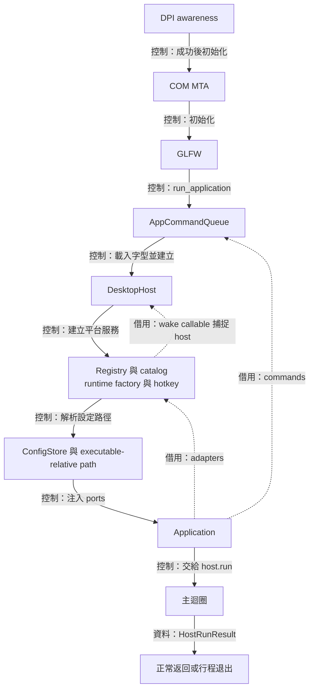
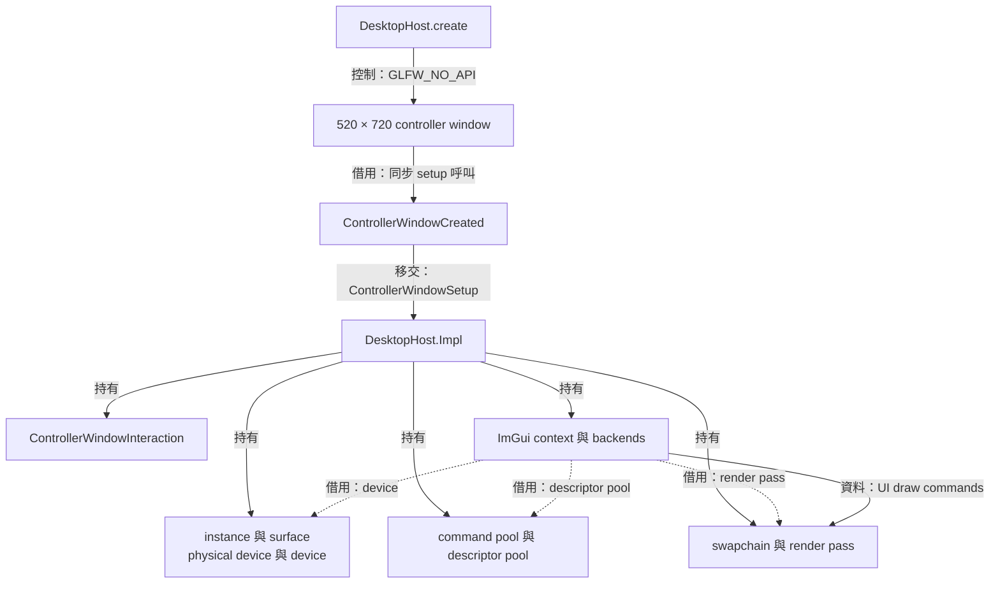
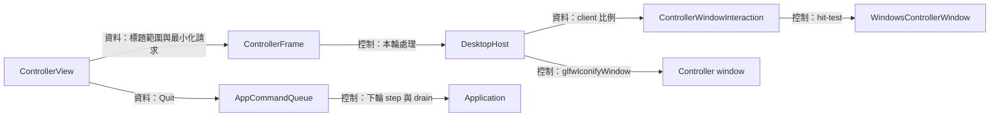
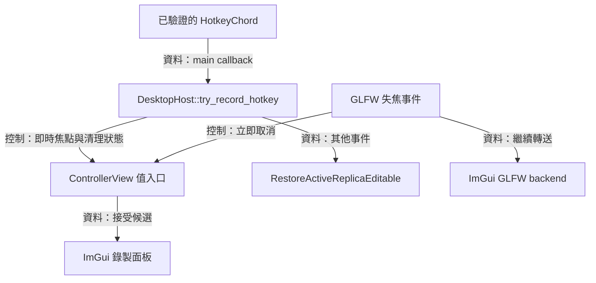
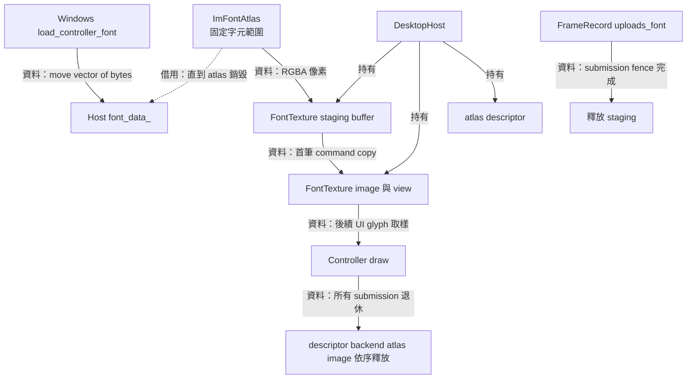
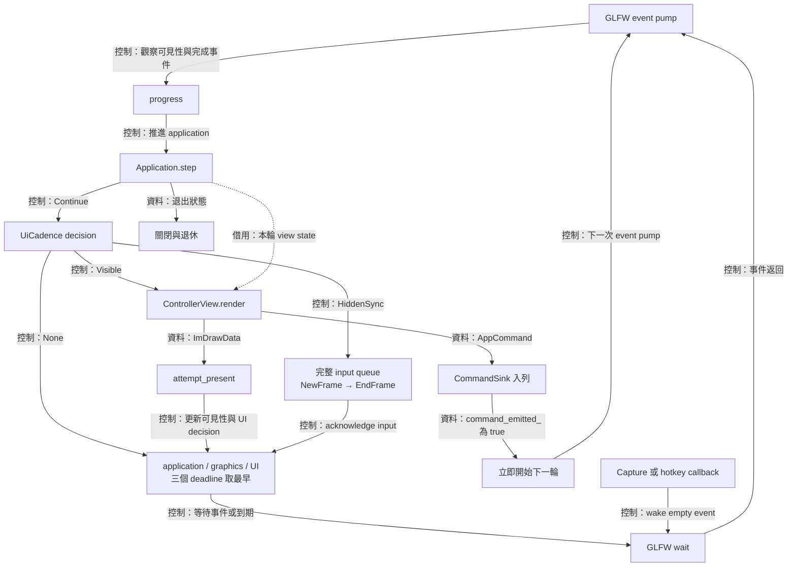
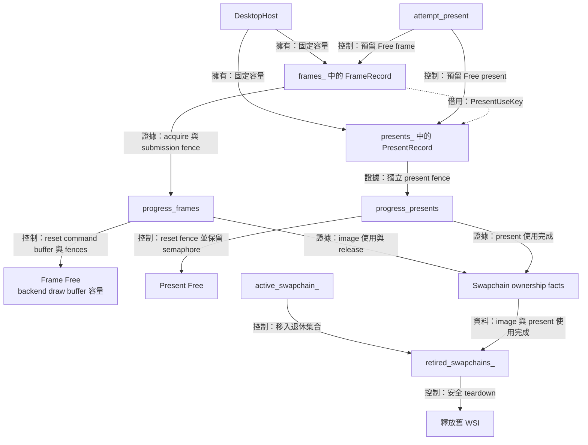
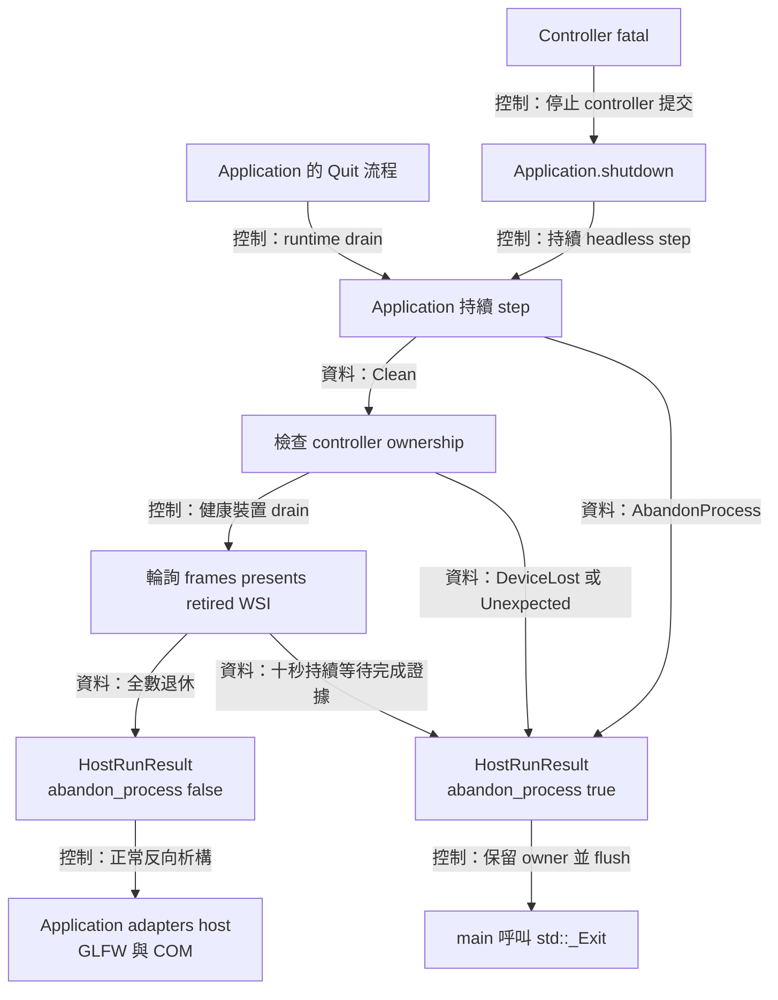

# Desktop host：桌面組裝、事件迴圈與退出



為了讓視窗事件、application 狀態與 UI 呈現在同一條主執行緒上前進，桌面層需要組裝平台服務、管理 controller 圖形資源，並決定何時等待下一個事件。 `main` 建立相依物件，`DesktopHost` 驅動事件迴圈，`Application` 處理使用案例與 replica runtime。 三者以 commands、view state、deadline 與退出結果交換值

主要入口是 [main.cpp](../../main.cpp)、[desktop_host.hpp](../../include/avb/desktop/desktop_host.hpp) 與 [desktop_host.cpp](../../src/desktop/desktop_host.cpp)。 controller 的 Vulkan device、queue、surface 與 swapchain 由 host 持有，replica 的對應資源則由 [Windows runtime](windows-runtime-overlay.md) 持有。 共用的圖形結果政策提供分類規則，各 owner 依自己的完成紀錄處理清理

## 程式組裝與啟動順序

### Linux composition

[Linux entry](../../platform/linux/main.cpp) 在任何設定保存前建立 `umask(0077)`，於 GLFW init 前選定 X11。 Command queue、Fontconfig owning bytes／face index 與 source catalog 先建立；catalog 先於 host，存活到所有 controller／runtime exclusions 退休。 Host 建立後再組裝 XDG preferences／writer lock、factory、disabled hotkey 與共用 Application。 Linux metadata 由 composition 提供

Controller setup 注入 [X11ControllerWindow](../../platform/linux/x11_controller_window.hpp)，factory 使用 [X11OverlayAdapter](../../platform/linux/x11_overlay_adapter.hpp)、inactive X11 capture 與共用 renderer。 在 hidden window 階段登記 exact owned drawable，互動 probe 只提供穿透、resize、置頂及 opacity，來源 catalog 決定 discovery 能力。 ImGui 發出 Refresh／Select／Start；Application 仲裁 session，Start 才由 factory 在完整 preparation／exact ring ACK／同一 source identity 再驗證後啟動 worker。 沒有 Portal acquisition 或額外系統選取步驟

Quit 持續 tick 至 runtime Stopped，取得 producer worker／callback／wake 及獨立 GPU retirement，controller host 另提供自己的 graphics 退休證據。 任一 owner 停滯沿用 `HostRunResult::abandon_process`，entry 在 owners 仍存在時直接退出，不能以普通析構代替清理。 Wayland session 中的 GLFW 視窗透過 XWayland；來源只限同 server 的 X 視窗。 實機範圍見 [Linux 指南](../development/linux.md)

### Windows composition

以下 DPI、COM、Windows services 與 executable-relative 設定路徑描述 Windows entry。 Controller Vulkan、字型 atlas 與事件迴圈由共用 host 持有，平台字型查詢與視窗互動由各自 adapter 注入



為了讓所有 callback 的借用對象活得夠久，組裝階段需要先建立被借用的 queue 與 host，再建立會捕捉它們的服務。 [main.cpp](../../main.cpp) 的 `run_application()` 用區域物件的建立順序表達這項契約。 host 接受的 callable 型態及作用範圍則定義在 [desktop_host.hpp](../../include/avb/desktop/desktop_host.hpp)

### 行程前置條件

`main()` 先建立 per-monitor-v2 DPI awareness，讓後續視窗幾何有一致的 DPI 語義。 接著初始化 COM MTA 與 GLFW，最後呼叫 `run_application()`。 這三步的失敗各有固定的診斷與退出路徑，COM 與 GLFW 的有效期包住後續正常執行及反向釋放

`run_application()` 先建立 `AppCommandQueue`，載入 Windows 字型 bytes，再呼叫 `DesktopHost::create()`。 傳入的 `CommandSink` 捕捉 queue，接受 owning `AppCommand` 值，回傳 queue 接納結果。 queue 的生命週期覆蓋整個 host，因此 host 保存該 callable 期間，其借用參考維持有效

### 平台服務的接線

host 建立成功後，依序建立 `WindowsSourceRegistry`、`WindowsSourceCatalog`、`WindowsRuntimeFactory` 與 `WindowsGlobalHotkey`。 runtime factory 捕捉 host 的 wake operation，hotkey callback 則先把 command 入列，成功後呼叫 `host.wake()`。 服務的正常析構順序先於 host，callback 的 admission 與 quiescence 另由各服務的生命週期協定管理

為了讓捷徑與 shell 啟動使用同一份偏好檔，`executable_config_path()` 以 `GetModuleFileNameW()` 取得執行檔位置，檢查長度，再組成同目錄的 `avb0795.config`。 `main` 另提供相鄰的 `airelinna.json` 作為 legacy 讀取路徑。 `ConfigStore` 接受 Windows atomic replacement 函式，設定的讀取、驗證與儲存流程由 [Application](application-ui.md) 負責

最後建立 `Application`，注入 commands、catalog、runtime factory、hotkey、config store、設定檔路徑、平台能力、controller 擷取排除結果、系統語言查詢與 legacy 路徑。 初始化讀取一次偏好，legacy 路徑的借用截至建構完成，Application 自行持有之後保存所需的新路徑。 這些相依物件提供具體服務，session 的轉移與使用案例則集中於 application。 `host.run(application)` 的借用涵蓋整次主迴圈

## Controller 視窗與圖形資源



為了呈現 controller 的設定介面，host 需要自己的原生視窗與 Vulkan 目標，並把 Dear ImGui 的繪圖結果錄進該目標。 `DesktopHost::create()` 先完成視窗 setup，再建立 `Impl` 的圖形與 UI 資源

呼叫契約在 [desktop_host.hpp](../../include/avb/desktop/desktop_host.hpp)，具體順序在 [desktop_host.cpp](../../src/desktop/desktop_host.cpp)。 Windows 的初始視窗設定由 [main.cpp](../../main.cpp) 接上 [capture_exclusion.cpp](../../platform/windows/capture_exclusion.cpp)

### 視窗 setup 的借用期間

`create()` 驗證兩個 callable，設定 `GLFW_CLIENT_API = GLFW_NO_API`、可調整大小、隱藏、一般堆疊順序與全 client 外觀，建立初始 `520 × 720` controller。 建立後立即把 `GLFW_VISIBLE` 提示恢復為 true，讓後續 replica 建立沿用其可見性設定。 它接著同步呼叫 `ControllerWindowCreated`，由 composition root 提供的 Windows adapter 驗證 patched GLFW window class，並保留新視窗預設的可截圖狀態

setup callable 的視窗參考在該次呼叫內有效。 main 完成驗證與原生互動設定後，返回 `ControllerWindowSetup`：`exclusion` 保存 `CaptureExclusionStatus::NotAttempted`，`interaction` 以 `unique_ptr` 把原生互動 adapter 移交給 host。 host 在圖形初始化前接手 owner，初始化完成後顯示視窗。 回傳 `unexpected<AppError>` 時，`create()` 釋放剛建立的視窗並把錯誤交回啟動端

### 全 client 介面的操作接線



為了讓 ImGui 呈現完整控制器，同時保留 Windows 的移動與調整大小操作，介面需要描述標題範圍，host 需要把該範圍對齊原生 client。 `ControllerFrame` 提供以 ImGui display 座標表示的 `drag_right`、`drag_bottom` 與本輪 `minimize_requested`。 host 將前兩者除以 `DisplaySize`，經 [ControllerWindowInteraction](../../include/avb/desktop/controller_window_interaction.hpp) 傳遞左上角起算的比例矩形。 零尺寸會產生零比例

host 依 GLFW content scale 提供至少 8 display units 的 UI 邊距，使控制項與原生 resize band 保持間隔。 原生 adapter 依目前 client 大小還原拖曳範圍。 最小化請求在本輪呈現處理後交給 `glfwIconifyWindow()`，關閉按鈕沿用 `Quit`、queue、Application shutdown 與 GPU 退休流程

### 快捷鍵錄製與焦點事件



為了讓錄製使用目前繫結，同時保有全域恢復操作，host 需要在事件當下決定錄製是否有效。 `try_record_hotkey()` 檢查完整建構、有效的 ImGui backend、控制器原生焦點，以及正常運作狀態。 成立時將 chord 值交給 UI，其他情況清除錄製狀態並回傳 false。 main 根據回傳值決定是否排入恢復命令，OS 註冊持續由原生 hotkey 服務持有

快速切換焦點可能在一批事件中同時包含失焦與回焦，因此 host 在 backend 初始化完成後安裝 `window_focus_callback()`。 失焦邊緣立即呼叫 UI 的 context-free 取消入口，再轉送 `ImGui_ImplGlfw_WindowFocusCallback()`。 backend 關閉時恢復初始化前保存的 focus callback，使 wrapper 的有效期間涵蓋可用的 ImGui context。 已入列的 Quit 同時設定既有 close flag，後續快捷鍵依關閉狀態處理

### Vulkan 與 Dear ImGui 的相依關係

`Impl` 依序建立 instance、surface、physical device、logical device、command pool、descriptor pool 與 swapchain。 device 需要 Vulkan 1.3 與 maintenance1 的 present-fence 功能。 swapchain 持有 views、framebuffers 與 render pass，image handles 借自 swapchain。 這些資源服務 controller 的 draw，replica 的擷取與畫面則由 [renderer](renderer.md) 描述

ImGui 初始化先建立 context 並設定字型，再建立 GLFW 與 Vulkan backend。 Vulkan backend 取得 host 的 device、graphics queue、descriptor pool、render pass 及 image count，並持有自己的 draw buffers 與 pipeline。 `backend_frame_capacity_` 與目前 swapchain 的實際 image count 對齊，同時界定 frame pool、present pool 與 backend draw buffers 的容量；image count 改變時，host 經完成證據保護的 migration 更新三者。

啟動期間進行配置與資料準備，第一筆 GPU submission 由主迴圈發出。 因此 partial construction failure 可依已建立的相依順序逆向釋放。 執行過程的析構則要求完整退休證據，`unsafe_controller_work()` 成立時觸發 destructor invariant，主迴圈負責在返回前決定安全清理或保留 owner 的行程出口

## 字型資料、圖集與首筆上傳



為了讓 controller 的各個支援語言共用穩定的字型資源，host 需要持有字型原始 bytes、預先準備字元範圍，並把圖集上傳納入自己的 submission 證據。 字型圖集（font atlas）把各字元的點陣圖集合到一張 image，UI draw 以材質座標讀取字形。 檔案讀取在 [controller_font.cpp](../../platform/windows/controller_font.cpp)，註冊設定在 [controller_font.hpp](../../src/desktop/controller_font.hpp)，GPU upload 與回收在 [desktop_host.cpp](../../src/desktop/desktop_host.cpp)

### 原始 bytes 的擁有者

`load_controller_font()` 用 `GetWindowsDirectoryW()` 找到 Windows 目錄，讀取 `Fonts/msjh.ttc`。 它要求檔案長度為正且至多 64 MiB，再完整讀入 `std::vector<std::byte>`。 成功後關閉檔案，bytes 經 `main` 移給 host 的 `font_data_`。 啟動端收到檔案或配置錯誤時回報 `RuntimeConstructionFailure`

註冊字型需要在 atlas 後續處理時保留原始 bytes，因此 `configure_controller_font()` 設定 `FontDataOwnedByAtlas = false`，atlas 借用 host storage 直到 context 銷毀。 helper 接受的 `std::span<std::byte>` 表達連續範圍，實際所有權持續由 vector 維持

以下是固定字形範圍與大小的實際設定：

```cpp
ImFontConfig config;
config.FontDataOwnedByAtlas = false;
config.OversampleH = 1;
config.OversampleV = 1;
```

```cpp
static constexpr ImWchar ranges[]{
  0x0020, 0x00FF, 0x2000, 0x206F, 0x3000, 0x9FFF,
  0xF900, 0xFAFF, 0xFF00, 0xFFEF, 0};
atlas.TexMinWidth = 2048;
```

`AddFontFromMemoryTTF()` 的字型大小為 `18.0F`。 範圍涵蓋 Latin、標點、假名、注音、BMP CJK、相容漢字及全形字元，實際字形依系統字型提供。 語言切換共用同一組範圍，atlas 的資源生命週期因此可以跟隨 host 啟動與關閉

### Bake、staging 與 image

`create_font_texture()` 呼叫 `GetTexDataAsRGBA32()`，取得像素、寬高與每像素 4 bytes 的格式。 它先用 64 位元乘法與上限檢查求出 upload size，再配置 `VK_FORMAT_R8G8B8A8_UNORM` image、device-local memory、image view、host-visible staging buffer 與 descriptor

staging memory 映射後接收 atlas pixels，依 coherent 屬性決定 flush，再結束映射。 `FontTexture::upload_pending` 記錄上傳需求。 這時 image 與 bytes 的 owner 都已存在，第一筆 `record_frame()` 會錄製 host-write 到 transfer-read barrier、image layout transition、buffer-to-image copy，以及 transfer-write 到 shader-read barrier

該筆 `FrameRecord::uploads_font` 保存上傳紀錄。 submit 成功或分類為 `Uncertain` 時，`upload_in_flight` 進入 true，完成證據由該筆 submission fence 承擔。 `progress_frames()` 觀察 fence 成功後，清除在途旗標並呼叫 `destroy_font_staging()`。 atlas image、view 與 descriptor 則持續供後續 UI submissions 使用

### 固定圖集與 backend 契約

為了讓字型 GPU 工作沿 host 的 fence 流程回收，程式清除 `ImGuiBackendFlags_RendererHasTextures`，再把 host 建立的 descriptor 安裝為 atlas texture ID。 pinned Dear ImGui backend 的動態 texture 路徑包含 `vkQueueWaitIdle`，固定圖集選擇讓目前的上傳統一由 `FrameRecord` 追蹤

加入動態 glyph 或其他 UI texture 時，設計需要涵蓋 texture 更新的提交、舊 descriptor 使用者與 staging 回收條件。 現有固定圖集在所有 UI submissions 退休後，依 atlas descriptor、backend、context 與 font image 的順序釋放，host bytes 的有效期覆蓋 atlas 的最後使用

## 主迴圈、command 與喚醒



為了讓 commands、影格與關閉需求都有及時的處理時點，host 需要在每輪先 pump 視窗事件、觀察可見性與 controller 完成事件，再推進 application，接著依 UI deadline 決定畫面工作，最後選擇等待期限。 `run()`、`render_controller()` 與 `wait_until()` 的執行順序見 [desktop_host.cpp](../../src/desktop/desktop_host.cpp)，cadence 與合併期限的值政策見 [ui_cadence.hpp](../../src/desktop/ui_cadence.hpp)，跨執行緒 `wake()` 的借用契約見 [desktop_host.hpp](../../include/avb/desktop/desktop_host.hpp)。

### 一輪狀態與 UI 資料

`run()` 每輪呼叫 `glfwPollEvents()`、觀察 controller visibility，再由 `progress()` 輪詢既有 frames、presents 與 WSI 重建。 fatal 狀態保持健康時，直接呼叫 `application.step(now)` 並確認 `ExitDisposition`，接著取得 `UiCadence::decision()`。

`Visible` 執行 backend NewFrame、widgets、Render 與 present attempt；`application.view_state()` 的借用涵蓋本輪 `ControllerView::render()`，UI command 以值進入 queue。`HiddenSync` 完整消化累積的 input queue，執行 NewFrame／EndFrame；`None` 保留已完成的 application 與 graphics progress，進入期限計算。初次顯示與還原立即 build；可見且互動中的 build 完成後間隔至少 16.667 ms，閒置時為 100 ms。輸入延續 500 ms 的 active grace，held input、editing、popup 與快捷鍵錄製也參與 active 判斷。

這個順序讓 UI 看見 application 完成本輪 step 後的投影。 UI command 在該 step 之後入列，因此 `command_emitted_` 會讓 `run()` 直接開始下一輪。 例如使用者切換語言時，本輪 UI 發出選擇值，下一輪 application 消耗 command，更新語言投影後，再由 UI 讀取新文字。 使用案例細節見 [Application 與 UI](application-ui.md)

最小化或 framebuffer 任一維度為 0 時，application step 與 graphics progress 持續執行；隱藏轉換及後續 input 觸發一次 `HiddenSync`，同步後等待 Application／graphics deadline 或 native event。UI 操作可能同步最小化視窗，因此 host 在 build 後重新觀察可見性與 UI decision，讓新收到的 input 進入下一輪同步。每次 application step 與 graphics 操作後，主迴圈檢查退出與 fatal 狀態，再選擇下一輪或關閉流程。

### 最早 deadline 的選擇

為了同時服務 application 排程、controller GPU 完成與 UI 更新，`choose_host_wait()` 收集 `Application::next_deadline()`、`graphics_deadline_` 與 `UiDecision::next_deadline`。設三者存在的時間點集合為 $D$，等待期限為 $\min D$；已入列的 UI command 優先要求立即進入下一輪 event pump。集合為空時，`glfwWaitEvents()` 等待外部事件。到期時間已經抵達時，直接進入下一輪；期限在將來時，`glfwWaitEventsTimeout()` 使用距離期限的秒數。

例如 application 下一次工作在目前時間後 16 ms，controller fence 輪詢在 2 ms，host 等待至 2 ms 或較早的視窗事件。 controller 活動中的輪詢間隔為 2 ms，drain 間隔為 50 ms。 實際有 ownership 退休時，`note_progress()` 更新進展起點，後續 stalled 判斷使用這個時間

### Callback 喚醒與借用有效期

為了讓背景擷取或全域熱鍵喚醒主執行緒，`DesktopHost::wake()` 使用 GLFW 的 thread-safe empty event。 callback 呼叫端持續保留 host，直到已接納的 wake 呼叫全部返回。 這個條件由先建 host、後建 callback owners 的組裝順序，以及各服務的 quiescence 協定共同維持

一般視窗操作、ImGui 與 controller graphics 都由 GLFW 主執行緒執行。 `DesktopHost` wrapper 的 move 保持 `Impl` 地址穩定，move 或析構時仍需要先完成同時進入 wrapper 方法的呼叫，move assignment 還要先具備舊 implementation 的安全退休條件

## 完成紀錄與 controller WSI



為了讓 controller 畫面更新與桌面呈現各自保存完成證據，host 需要分開記錄 command 使用與 presentation 使用。 `FrameRecord` 保存 acquire、command buffer、submission fence 與 image 關聯，`PresentRecord` 保存 present fence、wait semaphore 與 swapchain identity。 兩種紀錄及 WSI 所有權計算在 [desktop_host.cpp](../../src/desktop/desktop_host.cpp)，結果政策共用 [graphics_retry_policy.hpp](../../render/graphics_retry_policy.hpp)

### FrameRecord 與 PresentRecord 的分工

`create_frame_resources()` 依 `backend_frame_capacity_` 建立等容量的 `frames_` 與 `presents_`，各 record 保存可重用的 native handles。`attempt_present()` 要求 active swapchain 可用、正值尺寸與相符的實際 image count，再各預留一筆 `Free` frame 與 present record。任一 pool 滿時安排後續輪詢；到期的 UI build 與每輪 application step 依 cadence 繼續。這個容量上限也保護 Dear ImGui backend 的輪替 draw buffers。Acquire timeout 固定為 0，等待結果回到事件迴圈的 deadline。

預留的 `FrameRecord` 保存 `PresentUseKey`；acquire 成功後在同一筆 record 記下 image、swapchain、acquired flag 與 `AcquireProofPending`，接著錄製 command 並呼叫 native submit。這個發布順序讓 submit 回傳任何分類時，都有一筆完整的資源紀錄可供 drain 推進。Present record 的 semaphore 與 fence 持續由該 pool 擁有；成功 enqueue 或 uncertain 結果將本次使用轉成獨立的 `PresentPending`。

| 階段或結果 | FrameRecord 保存的證據 | 後續操作 |
| --- | --- | --- |
| acquire 完成後錄製失敗 | `AcquireProofPending` 與 acquire fence | fence 完成後 release image |
| submit 為 `NotEnqueued` | `AcquireProofPending` 與 acquired image | 觀察 acquire proof 並歸還 image |
| submit 為 `Enqueued` | `Submitted` 與 submission fence | 繼續 present，之後回收 command 使用 |
| submit 為 `Uncertain` | `SubmitUncertain` 與 submission fence | 保存可能已執行的 font upload 與 draw 使用 |
| present 為 `NotEnqueued` | `PresentNotEnqueued` 與 acquired image | submission 完成後 release image |
| present 排入或結果待確認 | 清除 frame 的 `present_use`，PresentRecord 接手本次使用 | 各自輪詢 frame proof 與 present fence |

`progress_frames()` 對 acquire-only record 觀察 acquire fence；對已提交或可能已提交的 record 先觀察 submission fence，再確認 acquire fence。兩項證據共同保護 frame 的 reset/reuse，已完成的 font upload 也在此釋放 staging。有 acquired image 的紀錄接著呼叫 maintenance1 release，成功時清除 ownership；其他 release 結果保存 `ReleaseRetained`，依 surface 或 terminal 路徑處理。`recycle_frame()` 清除本次使用，reset command buffer 與 fences，保留 handles 供下一次 admission。

`progress_presents()` 獨立觀察 present fence，完成後結算本次使用與 WSI 關聯、reset fence 並保留 wait semaphore。Known-not-enqueued 路徑依 acquire／submission 與 image release 證據回收 reservation；仍待消費的 binary signal 按 release policy 更換 semaphore。Frame 與 present 的正常重用各自依據對應 proof。

為了在實際 swapchain image count 改變後維持 backend buffer 與 pool 容量一致，`progress_backend_capacity()` 等待全部舊 frame 與 present users 退休，再 shutdown Vulkan backend、銷毀舊 pools、reset descriptor pool、重建 backend 與等容量 pools，最後重新綁定 font descriptor 並發布新 capacity。等待期間舊 backend 供 NewFrame 使用，native admission 等待 capacity 對齊；font image、upload state 與 ImGui context 由 host 持續保存。相同 image count 的 resize 沿用既有 pools。詳細 ownership 見 [Controller Vulkan resources](controller-vulkan-resources.md)。

### Active、retired 與三次重建

為了在 resize 後建立相容的呈現目標，host 先暫停新 acquire，確認 image 使用與 release 條件，再把 active 移入 retired 集合。 舊 handle 接著作為本次 `oldSwapchain`。 建立成功後安裝 replacement，失敗後的下一次嘗試以空 old handle 開始，舊呈現工作仍有 retired owner 保存

Replacement 維持 ImGui 所用的 format 與 render-pass 相容性；實際 image count 與既有 capacity 相同時沿用 backend pipeline。Image count 改變時，前述 capacity migration 在舊 users 退休後重建 Vulkan backend 與 pipeline。Controller recovery episode 記錄起點後 0、100 與 500 ms 三次建構時點。

`PresentRecord::confirms_recovery` 記錄目前 episode 的 replacement 歸屬，`counts_as_presented` 另記錄 present 是否回傳 `VK_SUCCESS` 或 `VK_SUBOPTIMAL_KHR`。 `progress_presents()` 只有在兩項事實成立、獨立 present fence 已退休且該 episode 仍存在時，才重設 episode 與次數。 建構成功或失敗操作的 fence 退休皆不足以確認復原

成功重設時，host 清除其他 outstanding present records 的 confirmation 與 active／retired swapchains 的 candidate 標記，保留每筆 native use、serial、fence、wait semaphore 與 WSI ownership。 舊 episode 的成功 present 若較晚退休，仍正常回收本身使用，但不能重設後來的 episode

`VK_ERROR_OUT_OF_DATE_KHR` 與 `VK_ERROR_SURFACE_LOST_KHR` 的 `Enqueued` 紀錄同樣等待獨立退休證據，不能因此更新成功呈現計數或重設 retry budget。 零尺寸 framebuffer 的呈現暫停期間，完成紀錄持續由主迴圈推進

controller 的 surface loss 轉入 host shutdown，裝置失效也由 host 的退出政策接手。 replica runtime 的 surface 與 device recovery 則有自己的資源世代。 此處共用的結果分類讓兩個 owner 使用相同事實語義，各自採用適合其責任的後續動作

## 關閉、退休與行程出口



為了在關閉時保護仍有原生使用者的資源，host 需要先完成 application 的 replica drain，再根據 controller 的完成證據決定退出方式。 `HostRunResult` 用 `exit_code` 表達執行結果，以 `abandon_process` 表達 owner 應保留至行程退出的條件。 型態與呼叫端義務在 [desktop_host.hpp](../../include/avb/desktop/desktop_host.hpp)，狀態推進在 [desktop_host.cpp](../../src/desktop/desktop_host.cpp)，最終出口在 [main.cpp](../../main.cpp)

### 先完成 application 的關閉

一般 Quit 經 application command path 開始 shutdown，controller 繼續呈現 draining 狀態。 Application 回傳 `Clean` 後，host 停止 controller submissions，開始收束自身的 frames、presents 與 swapchains。 Application 回傳 `AbandonProcess` 時，host 將同一個保留 owner 的要求交給 main

controller fatal 先由 `enter_fatal()` 設定 `stopping_controller_`，再由 `drive_application_shutdown()` 呼叫 `application.shutdown()`。 即使 controller 圖形呈現已停止，application 仍持續取得 headless step，直到 `ExitDisposition` 提供 `Clean` 或 `AbandonProcess`。 replica 的 callback、capture 與 graphics 退休因而保持原有呼叫端

`DeviceLost` 與 `Unexpected` 使用 controller firewall，保留 controller owners 並讓 application shutdown 獨立前進。 健康 controller device 上的 surface 或 terminal failure 則可繼續輪詢自身完成紀錄，退休完成後正常返回。 預期外 backend 例外也進入 firewall，讓可能被原生工作引用的物件保留到行程出口

### Drain 的進展與結果

`controller_drained()` 要求固定 pools 的 frame 與 present uses 全數歸還、active 與 retired swapchains 已收束，並保有健康 Vulkan device 的條件。Pool handles 保留至正常 teardown。一般 drain 每 50 ms 觀察完成；ownership 確實退休時更新 `no_progress_since_`，相同 owner 持續等待完成證據達 10 秒時，`drain_stalled()` 選擇 abandon。

| 最終條件 | `exit_code` | `abandon_process` | main 的動作 |
| --- | --- | --- | --- |
| Application 與 controller 正常退休 | 0 | false | 正常返回並反向析構 |
| controller failure 後安全退休 | 2 | false | 回傳失敗碼並反向析構 |
| Application abandon、controller firewall 或 stalled drain | 3 | true | 保存 owner，flush 後呼叫 `std::_Exit` |

main 在全部區域 owners 仍存活時檢查 `abandon_process`。 實際出口節錄如下：

```cpp
std::fflush(nullptr);
std::_Exit(result.exit_code != 0 ? result.exit_code : 7);
```

正常路徑按建立的反向順序釋放 application、設定服務、hotkey、factory、catalog 與 registry，再釋放 host。 host 先移除 atlas descriptor，關閉 ImGui backends 與 context，再釋放字型 image 與 Vulkan 資源，接著釋放互動 adapter，最後銷毀 GLFW window

ImGui GLFW backend 會保存先前的 window procedure，因此 `backend shutdown → adapter detach → window destroy` 的順序維持 callback 鏈的有效性，建構例外也依同一順序清理。 `font_data_` 覆蓋 atlas 全部使用期，GLFW termination 與 COM uninitialization 則由 `main()` 收尾

沿[架構索引](README.md)可回到整個物件圖。 若要追一個按鈕的效果，從 [Application 與 UI](application-ui.md) 的 command 處理接續。 若要追一個完成 deadline，則從 [renderer](renderer.md) 的 submission 與 present 紀錄接續
