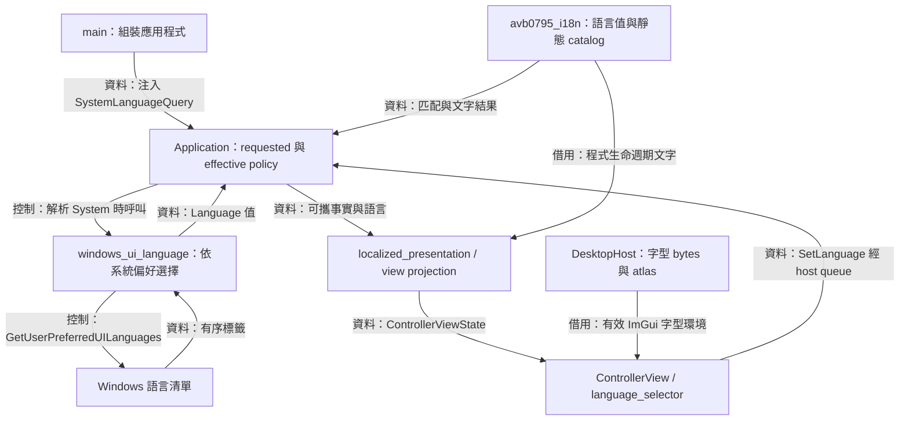
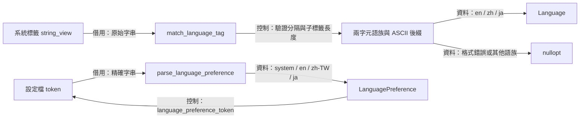
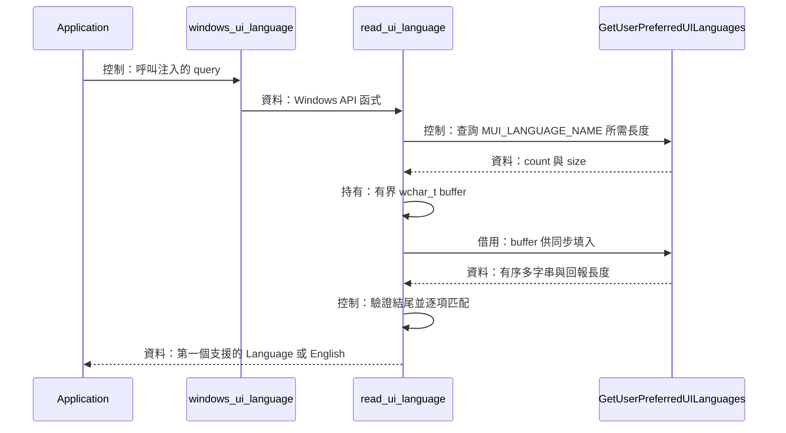
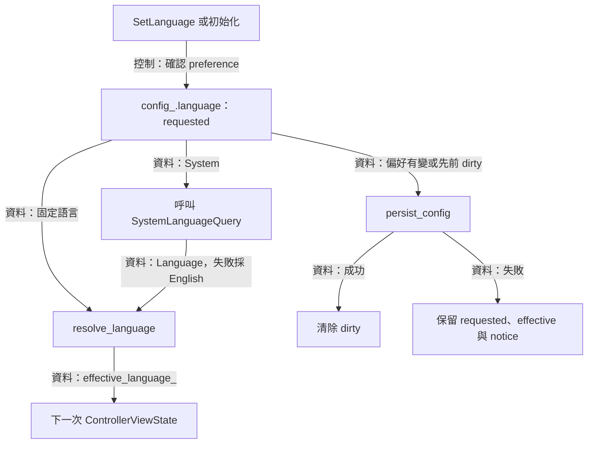
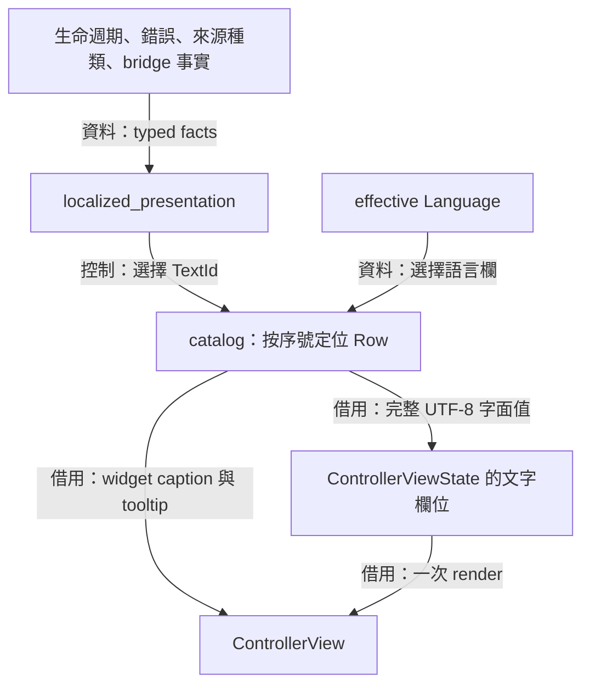
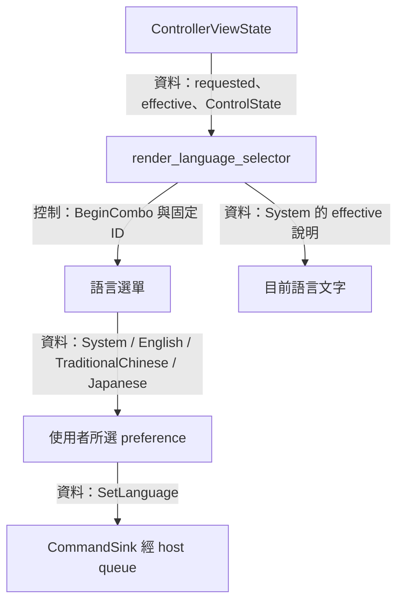

# 在地化：語言選擇、文字目錄與畫面呈現



[架構入口](README.md) · [Application 與 UI](application-ui.md) · [Core](core.md) · [Desktop host](desktop-host.md)

使用者可以固定選擇 English、繁體中文或日本語，也可以讓控制器跟隨系統偏好。 為了在存檔後保留「跟隨」的選擇，程式分別保存使用者要求及目前顯示語言，再將同一份擷取狀態投影成對應文字

語言值、標籤匹配及靜態文字構成 `avb0795_i18n`。 Application 決定何時查詢系統與更新偏好，Windows adapter 把系統清單縮成可攜語言值，UI 消費畫面快照。 字型位元組與 atlas 的生命週期由 [DesktopHost](desktop-host.md) 管理，語言控制採用既有的字型環境

上述關係可由 [language.hpp](../../include/avb/i18n/language.hpp)、[application_language.cpp](../../src/app/application_language.cpp) 與 [language_selector.cpp](../../src/ui/language_selector.cpp) 對照

## 語言值與標籤匹配



Windows 提供的語言標籤可能包含地區與文字系統後綴，設定檔則需要穩定拼寫。 為了各自處理這兩種輸入，i18n 提供語族匹配與偏好 token 解析兩條入口，兩者都借用 `std::string_view` 並回傳可攜值

`Language` 有 `English`、`TraditionalChinese` 與 `Japanese` 三個顯示語言。 `LanguagePreference` 另外加入 `System`，保存使用者的要求。 顯示時必須選出一個 catalog 欄位，存檔時則保留原本 preference

### 小型標籤語法

`match_language_tag()` 先驗證整個字串的形狀，再比較前兩個字元。 長度至少為 2，超過兩字元時第三個字元須為 `-`。 每個後續子標籤的長度介於 1 至 8，內容採 ASCII 英文字母或數字，各段以 `-` 分隔

```cpp
if (tag.size() < 2 || (tag.size() > 2 && tag[2] != '-')) {
  return std::nullopt;
}
```

後綴通過驗證後，前兩字元經 ASCII 小寫摺疊再辨認 `en`、`zh` 與 `ja`。 `en` 語族對應 English，`ja` 對應 Japanese，所有接受的 `zh` 標籤都對應產品的繁體中文 catalog。 這個 matcher 處理分隔、長度與字元範圍，語族後面的地區／script 保持輸入標籤的一部分

| 輸入示例 | 結果 | 推導 |
| --- | --- | --- |
| `EN-us` | `Language::English` | 前綴經大小寫摺疊，`us` 為合法子標籤 |
| `zh-Hant-TW` | `Language::TraditionalChinese` | `Hant` 與 `TW` 通過後綴驗證 |
| `zh-CN` | `Language::TraditionalChinese` | 產品以整個 zh 語族選取繁體中文欄 |
| `ja-JP` | `Language::Japanese` | 語族匹配後選取日本語 |
| `en--US`、`en-`、`en_US` | `nullopt` | 空子標籤或第三字元格式錯誤 |
| `fr-FR` | `nullopt` | 此語族交由呼叫端繼續尋找候選 |

每次匹配都使用原字串的借用範圍，結果以 enum 或 `nullopt` 傳回。 系統清單順序及最終 fallback 由呼叫端決定，因此 matcher 可作為獨立的小型政策函式測試

### 設定檔的精確 token

`parse_language_preference()` 逐項比較 `language_preference_token()` 的結果，接受精確的 `system`、`en`、`zh-TW` 與 `ja`。 大小寫與空白都參與比較，例如 `EN` 或 ` en` 回傳 `nullopt`，ConfigStore 接著讓 language 欄位恢復 System

`language_preference_token()` 回傳具有程式生命週期的標準拼寫，超出列舉範圍的值回傳空 view。 Application 與 ConfigStore 用這個空值在副作用之前回覆 `InvalidValue`。 詳細 schema 與欄位恢復規則見 [Application 與 UI](application-ui.md)

來源：[language.hpp](../../include/avb/i18n/language.hpp) 與 [language.cpp](../../src/i18n/language.cpp)

## Windows 語言查詢：依偏好順序選取



「跟隨系統」需要尊重使用者設定的偏好順序，並在 API 回傳後保有簡單的顯示語言值。 `windows_ui_language()` 因此把 `GetUserPreferredUILanguages` 交給 `detail::read_ui_language()`，後者在同一次呼叫完成緩衝區配置、解析與選取

查詢分成長度探測與資料填入兩次呼叫，兩次都帶 `MUI_LANGUAGE_NAME`。 第一次回傳的 `size` 需介於 `2` 與 `32'768`，程式據此配置 `std::vector<wchar_t>`。 第二次需成功、回報長度至少為 2 且涵蓋在已配置範圍內，最後兩個字元都須是 `L'\0'`

```cpp
if (!query(MUI_LANGUAGE_NAME, &count, buffer.data(), &size) || size < 2 ||
    size > buffer.size() || buffer[size - 1] != L'\0' ||
    buffer[size - 2] != L'\0') {
  return fallback;
}
```

清單以多字串格式保存：每個標籤以 NUL 結束，清單以雙 NUL 結束。 parser 以回報的 `size` 作為邊界，用 `std::find` 尋找每個標籤的終止符。 字元都落在 ASCII 範圍時，組成暫存 `std::string` 並呼叫 `match_language_tag()`

匹配成功就立即回傳，其他語族或含擴展字元的標籤則繼續下一項。 例如偏好清單依序為 `fr-FR`、`ja-JP` 與 `en-US`，結果會選 Japanese。 清單前方若有 `zh-CN`，該項會依產品政策選 TraditionalChinese，後續項目保持較低優先序

`count` 由 API 填入，走訪邊界以 `size` 與 NUL 終止符決定。 查詢失敗、長度或結尾錯誤、配置或解析例外，以及走完清單的情況，都回到 `Language::English`。 緩衝區在函式返回時結束生命週期，Application 得到的是 enum 值

系統偏好在兩次呼叫之間可能變動，填入結果因此重新接受範圍檢查。 再次查詢由下一次 System 解析觸發。 原生 API 的使用集中在 Windows adapter，UI 透過 Application 的命令路徑取得新結果

來源：[windows_ui_language.hpp](../../platform/windows/windows_ui_language.hpp)、[windows_ui_language.cpp](../../platform/windows/windows_ui_language.cpp) 與 [ui_language_query.hpp](../../platform/windows/detail/ui_language_query.hpp)

## Application 語言政策：requested 與 effective



使用者選擇 System 後，下次啟動仍應依當時系統語言顯示。 為了保留這個意圖，Application 把 requested preference 存在 `config_.language`，把解析後的文字語言存在 `effective_language_`，設定檔序列化 requested 的標準 token

組裝入口注入 `SystemLanguageQuery` callable，Application 持有 callable 並決定呼叫時間。 初始化若讀到 System 就查詢一次。 接受的 `SetLanguage{System}` 每次重新查詢，包含目前已選 System 的情況。 一般 `step()` 使用既有 effective value，系統偏好更新由下一次 System 指令重新取樣

`refresh_language()` 先以 English 初始化暫存系統語言，System 且 callable 存在時嘗試呼叫。 callable 拋出例外時回到 English。 固定語言則直接由 `resolve_language()` 選取對應欄位。 `resolve_language(System, supplied)` 接受支援的 supplied enum，超出範圍的 relevant enum 以 English 完成解析

### 接受與存檔的順序

以下為 `SetLanguage` handler 中完成驗證後的實際流程：

```cpp
const bool changed = config_.language != command.preference;
config_.language = command.preference;
refresh_language();
config_dirty_ = config_dirty_ || changed;
// An unchanged request can still retry an earlier failed whole-config save.
// Save failure leaves this accepted language in effect for the next projection.
if (config_dirty_) {
  persist_config();
}
```

偏好先成為記憶體中的接受值，再更新 effective language，最後依 dirty 狀態存檔。 保存失敗時，下一份畫面仍使用已接受語言並顯示 ConfigSave notice。 相同偏好再次送出可重試 dirty 設定，clean 且相同的固定偏好直接完成

語言命令的 payload 是 `LanguagePreference`，以應用程式目前狀態接收。 所有 session 生命週期與普通 runtime drain 期間都能變更顯示語言。 shutdown 關閉 command admission 並停用語言控制，該時刻的 effective language 繼續供退出診斷使用

這條交易更新的是 controller 顯示與持久偏好，擷取來源、ReplicaSettings、排程器、熱鍵確認及圖形資源維持各自的操作生命週期。 字型則沿用 host 在啟動時建立的 atlas，詳見 [Desktop host](desktop-host.md)

來源：[application.hpp](../../include/avb/app/application.hpp)、[application_language.cpp](../../src/app/application_language.cpp) 與 [application.cpp](../../src/app/application.cpp)

## Catalog 與在地化投影



控制器每次投影都需要取得狀態、提示及按鈕文字，這些文字的生命週期要涵蓋整個畫面。 `catalog.cpp` 因此將三種語言編入靜態表格，每個 `TextId` 對應一列 `Row`，每列持有 English、Traditional Chinese 與 Japanese 的完整 UTF-8 字面值 views

`text_count` 由 `TextId::Count` 轉成 `size_t`。 編譯期檢查逐列確認 `row.id` 與索引相符，並確認三個翻譯欄位皆有內容。 新增文字時，enum 與 table row 的順序共同決定查表位置，編譯器檢查兩者對齊

```cpp
const auto index = static_cast<std::size_t>(id);
if (index >= rows.size()) {
  return "Unknown text";
}

const auto &row = rows[index];
```

`text()` 先檢查 ID 範圍，再依語言選欄。 超出範圍的 ID，包含 `Count`，回傳英文 fallback `"Unknown text"`。 語言 enum 超出範圍時則回傳該列的 English。 每個 view 都指向完整且帶結尾 NUL 的字面值，長度感知的呼叫者可使用 view，C 字串介面可使用 `.data()`

### 由可攜事實選擇文字

`localized_presentation.cpp` 把 `AppErrorCode`、`SessionLifecycle` 與 `SourceKind` 對應到 TextId。 `error_text()` 為各 canonical code 選取說明，`lifecycle_text()` 呈現 domain 生命週期，來源種類文字則成為每列的 glyph／標籤。 數值 `native_detail` 留在診斷值內，使用者文字依 error code 決定

`bridge_text()` 先依 `BridgeReason` 選擇具體原因。 `BridgeReason::None` 再根據 `BridgeMode` 選 CPU copy 或 GPU interop 的一般說明。 例如 adapter 身分、外部影像或共享同步條件的結果各有對應文字，UI 可直接顯示目前 runtime 回傳的選路理由

警告以 `optional<string_view>` 表達存在性。 `color_warning(Sdr)` 回傳空值，HDR 限制與推定 SDR 各回傳對應提示。 `exclusion_warning()` 在 Unsupported 或 Failed 時選取呼叫者提供的文字，NotAttempted／Excluded 回傳空值，因此 controller 與 overlay 能沿用相同政策並呈現各自的對象

`build_controller_view()` 同時保留 `language_preference` 與 `effective_language`，動態來源名稱與熱鍵文字則自有儲存。 catalog 文字由程式生命週期涵蓋，投影保持即時的可攜事實與所選語言。 控制項接納順序詳見 [Application 與 UI](application-ui.md)

來源：[catalog.hpp](../../include/avb/i18n/catalog.hpp)、[catalog.cpp](../../src/i18n/catalog.cpp)、[localized_presentation.hpp](../../include/avb/app/localized_presentation.hpp)、[localized_presentation.cpp](../../src/app/localized_presentation.cpp) 與 [controller_view_state.cpp](../../src/app/controller_view_state.cpp)

## Language selector：穩定身分與再次選取



使用者需要看到原本的偏好，並在 System 已選取時要求重新解析系統。 `render_language_selector()` 因此以 requested preference 作為 combo 預覽與 selected 判斷，再以 effective language 翻譯當次標題。 System 模式額外顯示目前實際採用的語言

選單順序固定為 System、English、TraditionalChinese 與 Japanese。 每個選項先用 enum 的整數值 `PushID()`，再附上固定的 `###language_option` suffix。 combo 本身使用 `###language`，讓翻譯改變顯示文字時，widget 的身分與焦點持續對應相同控制項

已選取項目仍會送出 `SetLanguage{preference}`，因此 System 可以再次觸發查詢。 `SetItemDefaultFocus()` 讓開啟選單時的焦點落在已選項。 三種語言名稱以各語言的自稱呈現：`English`、`繁體中文` 與 `日本語`，其他標題則由當次 effective language 決定

可用性完全採用 `state.controls.language`，shutdown 時，選單下方會顯示停用原因。 helper 在一次 render 期間借用 snapshot 與 sink，命令值交給 host 後由 Application 的下一次步進接受。 字型 bytes、glyph 範圍及 atlas 上傳的持有路徑見 [Desktop host](desktop-host.md)

來源：[language_selector.hpp](../../src/ui/language_selector.hpp)、[language_selector.cpp](../../src/ui/language_selector.cpp) 與 [controller_view.cpp](../../src/ui/controller_view.cpp)
