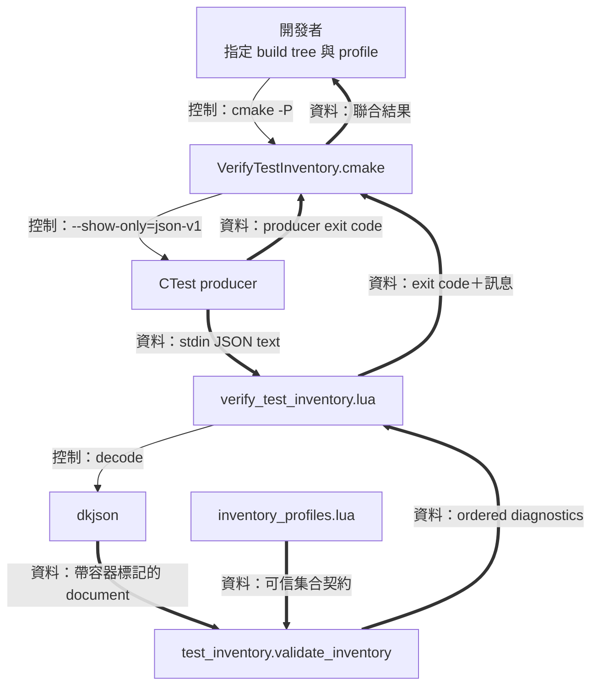
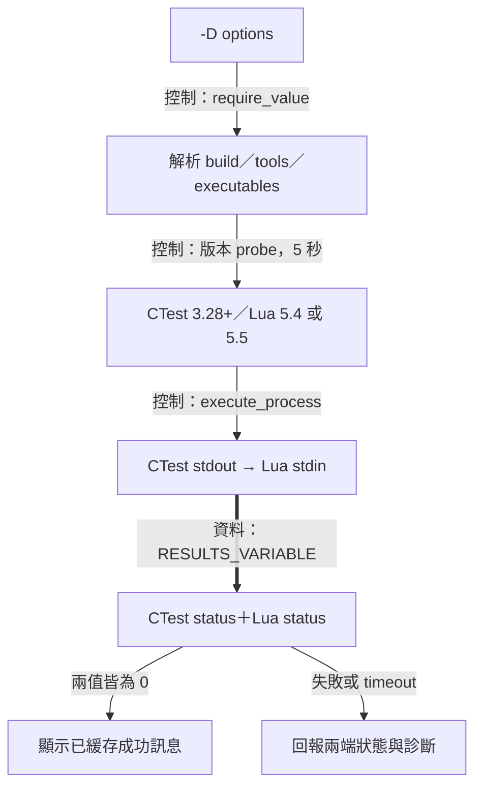
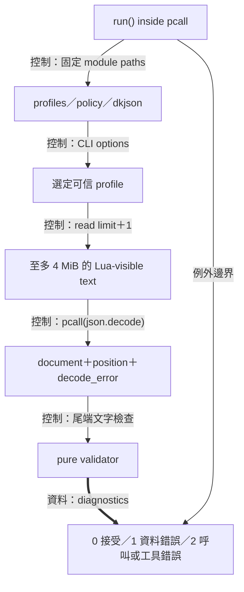
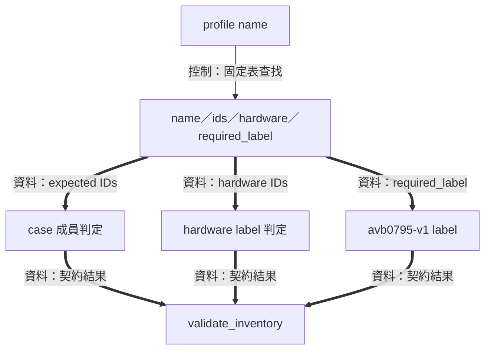
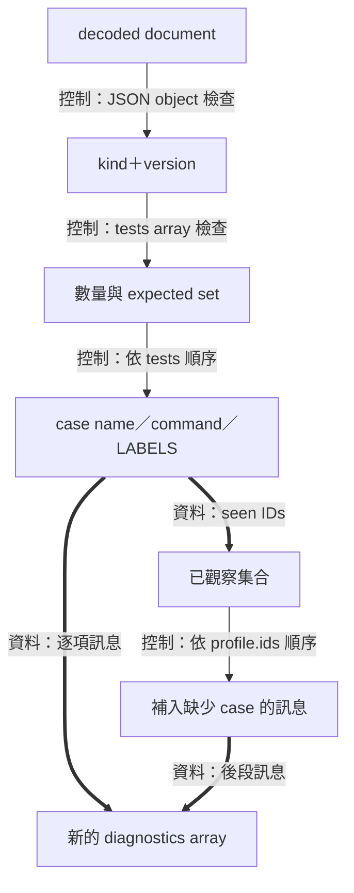
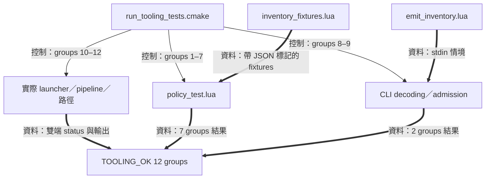

# Lua 清單工具



為了確認建置樹登記了預期測試，開發流程需要取得 CTest 的清單、辨識各個 case，並核對 labels 與 command metadata。 這套工具以 CMake 管理原生路徑和子行程，Lua 管理資料解碼與規則，最後由公開 launcher 合併兩端結果。 開發者因而可以用同一份驗證政策檢查 Windows 與其他平台上的清單資料

公開入口是 [VerifyTestInventory.cmake](../../cmake/VerifyTestInventory.cmake)。 Lua 是這條開發工具路徑的執行環境，產品執行入口仍由 [main.cpp](../../main.cpp) 與 [DesktopHost](desktop-host.md) 構成。 [操作指南](../development/lua-tooling.md)提供工具版本、命令、profile 與本機環境注意事項，本頁展開內部責任

## CMake Launcher：路徑與子行程組裝



為了讓包含空格與 Unicode 的路徑能可靠傳到各個工具，需要路徑解析與參數邊界由一個 owner 統一處理。 Launcher 接受 `BUILD_DIRECTORY`，以呼叫端的工作目錄轉成絕對路徑，確認 `CTestTestfile.cmake` 後取得實體路徑。 它用 CMake 的參數陣列建立原生 pipeline，讓 CTest 的標準輸出直接成為 Lua 的標準輸入

選項的處理順序為：

1. `BUILD_DIRECTORY` 指向既有、可信的建置樹
2. 顯式提供的 `CONFIGURATION` 與 `INVENTORY_PROFILE` 經值檢查後傳入對應工具
3. 顯式 `LUA_EXECUTABLE`／`CTEST_EXECUTABLE` 使用絕對原生路徑。 自動查找 Lua 的次序為 `lua`、`lua5.5`、`lua5.4`，CTest 優先採用 CMake 同目錄的程式，再查 PATH
4. 每個選定程式接受 5 秒版本 probe
5. 整條清單 pipeline 接受 30 秒 timeout

`require_value` 接受有內容且符合 CMake 單參數條件的值，對分號、CR／LF 與空白選項回報輸入錯誤。 Windows 額外驗證 executable 的 `.exe`／`.com` 副檔名。 平台差異集中在此原生工具邊界，Lua validator 使用同一份資料政策

為了將 producer 與 validator 的結果合成一次完整判定，需要保存兩個 exit status。 實作的 `execute_process` 以 `RESULTS_VARIABLE` 取得順序結果，`"0;0"` 代表兩端皆正常完成。 Lua 的成功輸出先緩存在 `_success`，launcher 接受聯合結果後再顯示。 因而結果具備「producer 完成＋選定 profile 合格」兩項證據。 實際入口與 pipeline 定義見 [launcher](../../cmake/VerifyTestInventory.cmake)

CTest 會解讀建置樹的 metadata 及 discovery 描述，這使建置樹的可信來源成為執行前提。 清單的新鮮度則由開發者建立及選取 fresh build tree 的流程提供

## Lua CLI：模組載入、解碼與退出分類



為了把外部文字轉成規則可處理的資料，需要對輸入大小、解碼結果、尾端內容與工具失敗建立明確分類。 [verify_test_inventory.lua](../../tools/verify_test_inventory.lua) 以 `run()` 包住載入、解析及輸出，再以外層 `pcall` 捕捉工具層例外。 呼叫目錄由 launcher 設成 `tools/`，Lua 以 `-E` 啟動

模組位置在 `run()` 裡固定為：

```lua
package.path = './lib/?.lua;./vendor/?.lua'
package.cpath = ''
```

這兩個設定把純 Lua 模組解析集中到 repository 的 `lib` 與 `vendor`。 這些路徑下的 profile 與規則是開發工具的可信輸入

### 文字大小與尾端驗證

為了辨識超過上限的資料，CLI 需要比上限多讀一個位元組：

```lua
local limit = 4 * 1024 * 1024
local text, read_error = io.read(limit + 1)
```

長度超過 limit 時回報資料錯誤，讀取失敗則回報工具錯誤。 解碼使用 `pcall(json.decode, text, 1, json.null)`，並檢查回傳 position 為 `1` 到 `#text + 1` 間的整數。 解碼後的尾端接受空格、tab、CR 與 LF

這裡的長度與 position 以 Lua 實際收到字串的位元組計算。 Windows CRT 對 text-mode stdin 進行 CRLF 轉換，並將 Ctrl-Z 解讀為結尾標記。 可信的 CTest JSON producer 以 escape 表達控制字元，讓公開 pipeline 使用一致的文字契約

### 結果如何回到 Launcher

| CLI code | 分類 | 輸出 |
| --- | --- | --- |
| `0` | help 完成，或選定 inventory profile 接受資料 | stdout，包含 profile 摘要 |
| `1` | JSON、envelope 或清單政策發現資料問題 | stderr，包含具體診斷 |
| `2` | CLI options、runtime 版本、模組、I/O 或工具內部問題 | stderr，包含呼叫或工具資訊 |

為了將成功輸出的完成狀態也納入判定，CLI 對 `io.write` 與 `io.flush` 使用 `assert`。 外層例外邊界將失敗轉成 code 2，並保留最多 300 位元組的工具錯誤描述。 公開 launcher 再把這個 code 與 CTest status 合併

## Profiles：可信的測試集合契約



為了讓清單驗證有一份穩定的預期值，需要將測試集合放在工具控制的資料表。 [inventory_profiles.lua](../../tools/lib/inventory_profiles.lua) 以 profile 名稱索引一筆契約，包含 case IDs、hardware IDs 與必要 label。 CLI 選定契約，validator 借用這份表進行比對

| Profile | 必要 case IDs | Hardware 集合 |
| --- | --- | --- |
| `windows-v1-full` | 01–15 | 13–15 |
| `windows-policy` | 01–12 | 空集合 |
| `portable-core` | 01、02、03、04、05、07 | 空集合 |

三種 profile 都要求 `avb0795-v1` label。 預設選擇 `windows-v1-full`，開發者可透過 `INVENTORY_PROFILE` 顯式指定較小集合。 查找失敗的名稱在程式中對應 CLI code 2。 Full profile 的結果描述完整 Windows V1 清單，另外兩種結果各自帶上選定集合的名稱與大小

為了跨平台重用同一份政策，profile 保存的是 case IDs 與 labels。 平台上的 executable 選擇、路徑語義與版本查詢，由前述 CMake launcher 負責。 新的集合需求可以從這份契約的用途與成員開始審視，實際現行集合維持上述三種

## Pure Validator：結構、識別與診斷順序



為了在一份輸入中解釋多個獨立問題，需要 validator 保留結構資訊並以固定順序累積結果。 [test_inventory.lua](../../tools/lib/test_inventory.lua) 提供 `validate_inventory(document, profile)`，輸入是解碼後的文件與可信 profile，輸出是一份新建立的 diagnostics 陣列

### JSON 容器身分

為了保留 JSON 的 object、array 與 null，需要 decoder 替 Lua table 附上形狀資訊。 Vendored [dkjson](../../tools/vendor/dkjson.lua) 透過 metatable 的 `__jsontype` 表達 object／array，`json.null` 則提供 null sentinel。 Validator 透過 `has_json_type` 檢查這些標記。 這使 `{}` 與 `[]` 即使同樣為空，也能沿各自的規則接受判定

Envelope 接受 `kind == 'ctestInfo'`、`version.major == 1` 及大於等於零的整數 minor。 `tests` 的 array 形狀成立後，validator 接著核對數量及每個元素

### Case ID 與重複／缺項演算法

為了將 case 名稱連接到 profile 成員，需要從名字中取得穩定的數字 ID。 解析會先做 ASCII lowercase，再套用：

```lua
local digits = ascii_lower(test.name):match('^avb0795 v1 case ([0-9][0-9]): .+$')
```

名稱中的兩位數字轉為 ID，`expected` 記錄 profile 成員，`seen` 記錄走訪到的成員。 重複 ID 立即加入診斷，集合外 ID 加入名稱錯誤。 每個 case 也分別驗證 command array、參數字串、唯一 LABELS property、必要 label 與 hardware label

為了讓多次執行具有穩定的訊息閱讀順序，程式先以 `ipairs(tests)` 處理輸入，再依 profile 順序補上缺項：

```lua
for _, id in ipairs(profile.ids) do
  if not seen[id] then
    append(errors, string.format('Missing case ID %02d', id))
  end
end
```

例如 portable profile 期待 `1,2,3,4,5,7`，若輸入 IDs 為 `1,2,2,4,5,7`，走訪第三筆時記錄重複 2，最後的 profile 掃描再記錄缺少 3。 清單長度仍為 6，成員證據則能指出這兩個問題

Command 檢查的目的是確認 metadata 有一個以上且帶內容的參數字串。 它以六種 ASCII whitespace 判斷字串是否有內容，保留其他字元作為 opaque 資料。 真正的測試啟動交由 CTest 的測試執行流程，清單工具的結果聚焦於結構、IDs、labels 與參數資料

## Tooling Harness：政策與管線的分層驗證



為了定位工具的錯誤責任，需要把純資料政策、CLI 邊界與原生子行程分成可辨識的測試群組。 [run_tooling_tests.cmake](../../tests/tooling/run_tooling_tests.cmake) 負責組裝這些測試，對照 expected exit status 及訊息

- [inventory_fixtures.lua](../../tests/tooling/inventory_fixtures.lua) 建立具備 object／array 標記的測試文件
- [policy_test.lua](../../tests/tooling/policy_test.lua) 以七組情境測試 envelope、profile、IDs、commands、labels 與輸入保留
- [emit_inventory.lua](../../tests/tooling/emit_inventory.lua) 提供 CLI 的 JSON／文字輸入情境
- CMake harness 的第 8 至 9 組涵蓋 decoding、options、模組與例外邊界
- 第 10 至 12 組涵蓋 prerequisites、profiles、producer／consumer pipeline failure、timeout、Unicode 路徑與 configuration

完整 harness 以 `RUN_LAUNCHER=ON` 啟用最後三組，完成時產生 `TOOLING_OK 12 groups`。 每次執行建立獨立 scratch tree，保留情境資料作為檢查證據。 這十二組工具測試與產品的十五個 Catch2 cases 分別登記及報告，對應關係見[建置與驗證](build-and-validation.md)
