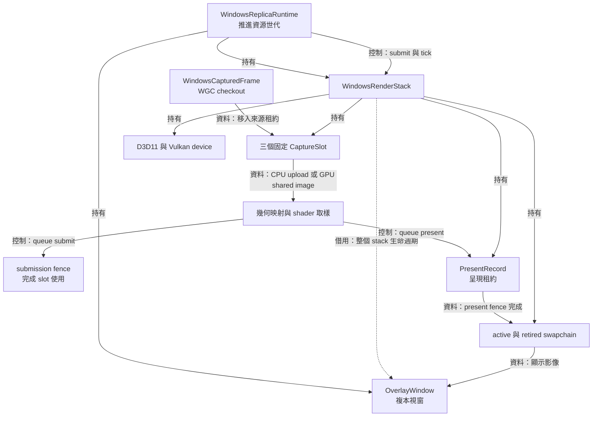
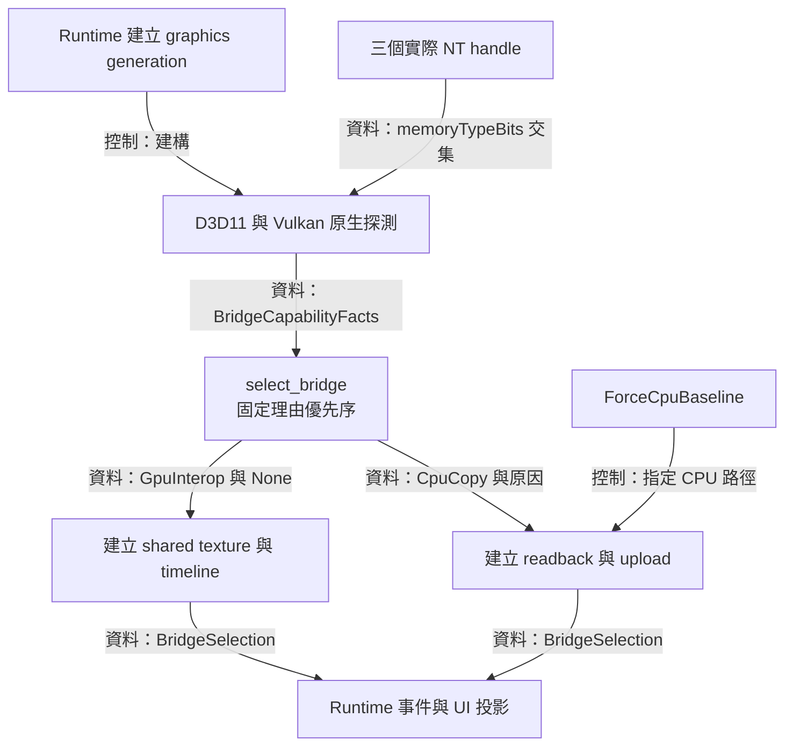
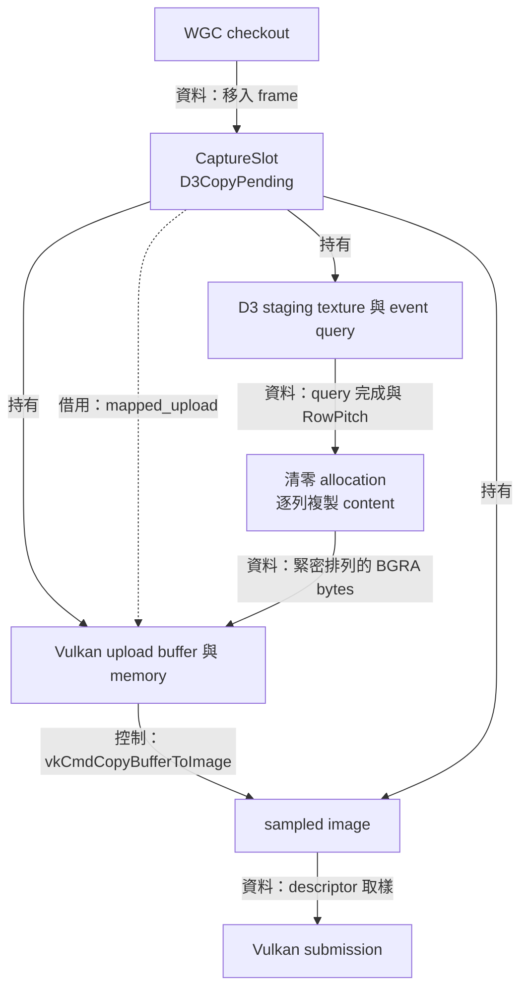
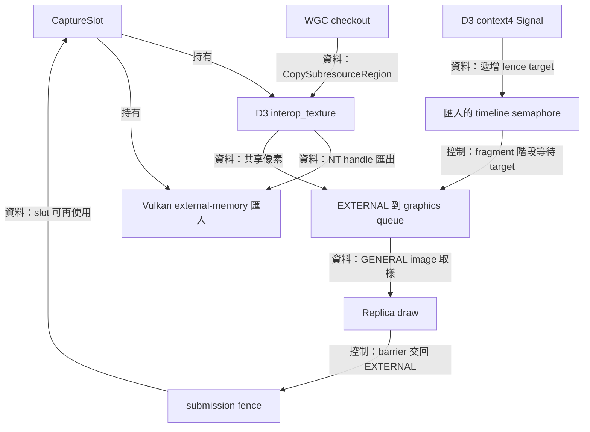
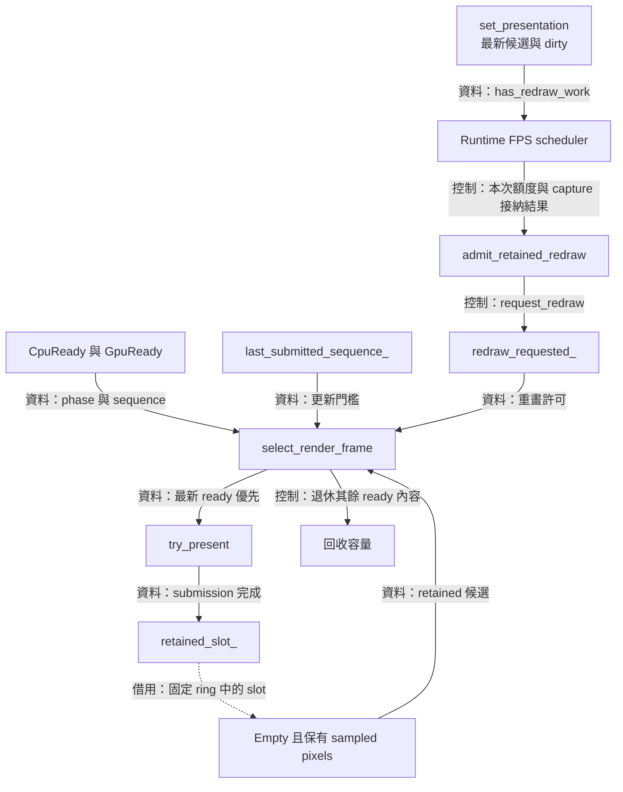
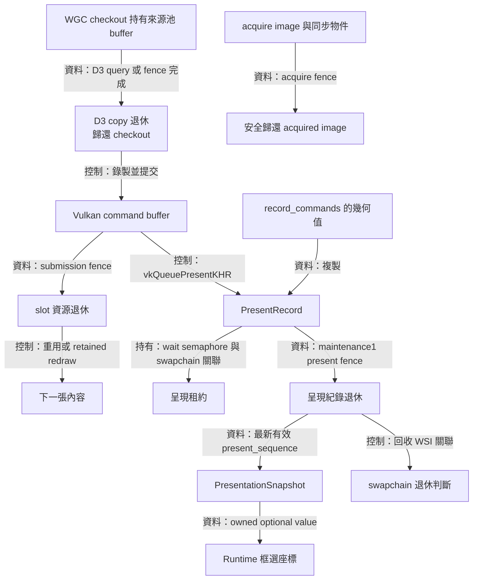
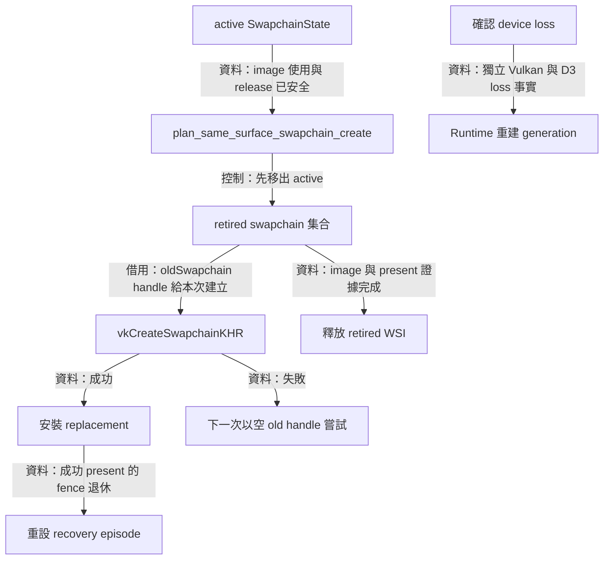
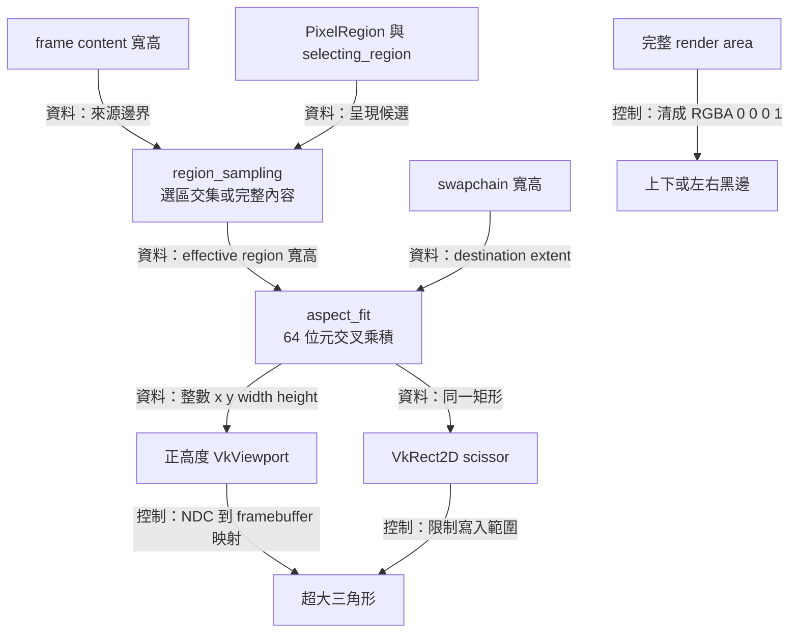
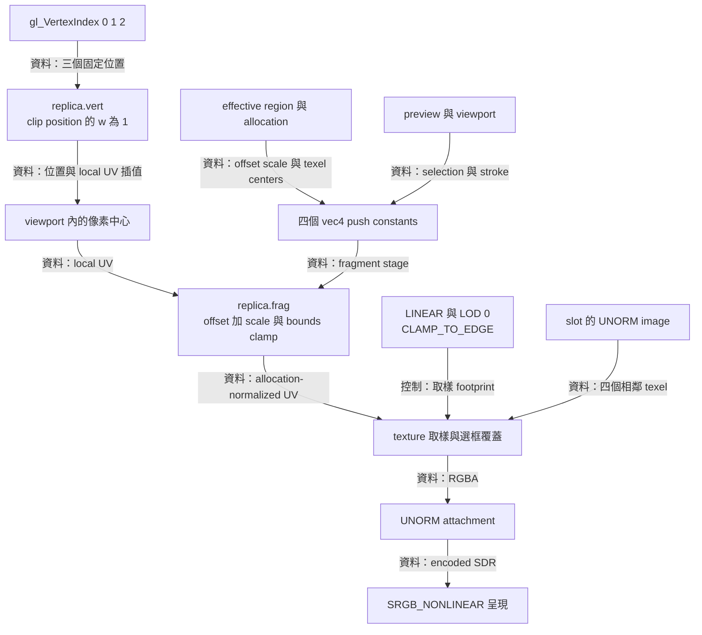

# Replica renderer：影格運送、呈現與取樣



為了把擷取的視窗影像與選定區域持續畫到複本視窗，renderer 需要運送像素、選擇最新內容、映射來源與目的尺寸，並追蹤每個原生使用者的完成時點。 `WindowsRenderStack` 把這些工作集中在一個由主執行緒推進的擁有者，透過三個固定 `CaptureSlot` 接住影格，再以獨立的 `PresentRecord` 保存呈現租約與該次繪圖的幾何快照

入口是 [windows_render_stack.hpp](../../render/windows_render_stack.hpp)，實作位於 [windows_render_stack.cpp](../../render/windows_render_stack.cpp)

[Windows runtime](windows-runtime-overlay.md) 持有 stack 與 overlay。 Factory 先建立 stack 與 device，再把 `capture_device()` 的借用參考交給 inactive WGC job 建立影格池，接著依 job 的 `initial_allocation()` 建立相符的 slots。 這個順序讓 slots 使用影格池實際採用的尺寸

呼叫端維持 overlay、capture device 與已接納 callback 的生命週期，直到 drain 提供完整退休證據。 [Desktop host](desktop-host.md) 另有 controller 的圖形資源

## 能力探測與橋接政策



為了讓同一套呈現流程適用於各種 Windows 圖形組態，renderer 需要先找出可共同存取影像的裝置與記憶體，再選擇運送方式。 橋接（bridge）負責將 D3D11 擷取結果交給 Vulkan，`BridgeCapabilityFacts` 記錄查詢結果，`select_bridge()` 把結果轉成 `BridgeSelection`。 來源是 [bridge_policy.hpp](../../render/bridge_policy.hpp)、[bridge_policy.cpp](../../render/bridge_policy.cpp) 與原生探測所在的 [windows_render_stack.cpp](../../render/windows_render_stack.cpp)

### 先建立呈現能力，再選擇運送方式

stack 建立 D3D11 device、Vulkan 1.3 instance、surface、physical device 與 logical device。 挑選 Vulkan device 時優先匹配 D3 adapter 的 LUID，並檢查 graphics queue、present queue、swapchain 及 maintenance1 的呈現 fence 能力。 maintenance1 提供 CPU 可輪詢的呈現完成證據，是兩條運送路徑共同的呈現需求

`select_bridge()` 依下列次序評估條件。 所有條件成立時回傳 `GpuInterop` 與 `BridgeReason::None`。 任一條件回傳 false 時，對應原因成為 CPU 路徑的可見說明，後續條件沿用該優先序

| 次序 | GPU 互通需要的條件 | `BridgeReason` 對應值 |
| --- | --- | --- |
| 1 | D3 adapter LUID 與 Vulkan device LUID 相同 | `AdapterLuidUnavailableOrMismatch` |
| 2 | BGRA8 external image 支援匯入與取樣 | `ExternalImageUnsupported` |
| 3 | D3D11 的 device/context 進階介面齊備 | `RequiredD3d11InterfacesUnavailable` |
| 4 | shared fence 與 Vulkan timeline 能力齊備 | `SharedFenceOrTimelineSemaphoreUnavailable` |
| 5 | D3 fence 可作為 timeline semaphore 匯入 | `TimelineFenceImportUnavailable` |
| 6 | Win32 匯入函式入口可呼叫 | `Win32ImportProcedureUnavailable` |
| 7 | 每個實際共享配置都有可用記憶體型態 | `CompatibleMemoryTypeUnavailable` |

最後一項由 `query_interop_slot()` 對實際 NT handle 查詢。 它計算 Vulkan image 與 handle 兩組 `memoryTypeBits` 的位元交集，再挑選其中可用的型態。 裝置層的格式支援與實際資源的可匯入性各有一份查詢證據。 `finish_interop_slot()` 接續配置、繫結、建立 image view 與 descriptor，成功後發布整個 ring 的選擇

`ForceCpuBaseline` 讓既有硬體案例走完整 CPU 路徑。 某個 generation 已選 CPU fallback 時，同 generation 的 allocation 重建沿用該選擇。 generation 更新且前置能力成立時，`should_probe_interop_generation()` 允許新一輪實際 handle 探測。 這項政策把探測成本與資源世代綁在一起，UI 透過 `take_bridge_mode_change()` 取得單筆待投影的值

## CPU 複製與三個影格槽



為了經由 CPU 在兩個圖形 API 之間搬運影像，renderer 需要一份 D3 可讀 staging、一份 Vulkan 可映射 upload，以及可由 shader 取樣的 image。 每個 `CaptureSlot` 持有這組資源，固定的 `std::array<CaptureSlot, 3>` 提供有界的在途容量與穩定位址。 主要入口是 [windows_render_stack.cpp](../../render/windows_render_stack.cpp) 的 `create_capture_slot()`、`submit()`、`progress_d3_copy()` 與 `record_commands()`，呼叫契約見 [windows_render_stack.hpp](../../render/windows_render_stack.hpp)

### 交付 checkout 與完成 D3 複製

runtime 先觀察 `ready_for_frame()`，再把 `WindowsCapturedFrame` 移給 `submit()`。 該觀察提供當下的 admission 與空槽容量。 `submit()` 接著驗證 generation、allocation、BGRA 格式、正值 content extent、content 範圍與來源 D3 device 身分。 驗證成立後，`slot.frame.emplace(std::move(frame))` 接手 WGC checkout

checkout 讓 WGC 影格池保留來源 buffer，D3 texture 的 COM 參考則讓 texture 介面保持有效。 這兩個生命週期共同支撐 `CopySubresourceRegion()`。 複製範圍由原點到 content 的右下角，命令之後接 `D3D11_QUERY_EVENT`，再以 `Flush()` 推送已排入的 D3 工作

`progress_d3_copy()` 用 `GetData(..., D3D11_ASYNC_GETDATA_DONOTFLUSH)` 觀察 event query。 `S_OK` 與完成值成立時，slot 歸還 WGC checkout。 `S_FALSE` 或持續繪製的結果安排下一次正值 deadline。 後續 `Map()` 使用 `D3D11_MAP_FLAG_DO_NOT_WAIT`，`DXGI_ERROR_WAS_STILL_DRAWING` 也回到主迴圈等待下一次觀察

### 從 RowPitch 轉成 Vulkan buffer 排列

CPU 路徑每個像素占 4 bytes。 若 content 為 $C_w\times C_h$、allocation 為 $A_w\times A_h$，一列有效資料為 $4C_w$ bytes，目的列距為 $4A_w$ bytes，來源列距由 D3 回傳的 `RowPitch` 決定。 Vulkan 的 `bufferRowLength = 0` 與完整 allocation copy 搭配，因此 CPU 準備的緊密排列必須以 allocation 寬度為準

以下節錄保留實際的清零與逐列複製操作：

```cpp
std::memset(slot.mapped_upload, 0, static_cast<std::size_t>(*byte_count));
auto *const destination = static_cast<std::byte *>(slot.mapped_upload);
const auto *const source = static_cast<const std::byte *>(mapped.pData);
const auto destination_pitch =
  static_cast<std::size_t>(capture_allocation_.width) * bytes_per_pixel;
for (std::uint32_t row = 0; row < slot.content.height; ++row) {
  std::memcpy(destination + static_cast<std::size_t>(row) * destination_pitch,
              source + static_cast<std::size_t>(row) * mapped.RowPitch,
              row_bytes);
}
```

例如 content 寬 3、allocation 寬 4、D3 `RowPitch = 32` 時，每列從來源位置 `32 * row` 取 12 bytes，寫入目的位置 `16 * row`。 每列末尾 4 bytes 與 content 下方的列維持零值。 這些補齊區域稍後也會進入 sampled image，取樣邊界的算例會用到這項事實

upload memory 具有 host coherent 屬性時，寫入直接沿該記憶體契約可見。 其他 memory type 透過 `vkFlushMappedMemoryRanges()` 發布 CPU 寫入，範圍依 `nonCoherentAtomSize` 向上取整，配置邊界或數值上限由 `VK_WHOLE_SIZE` 收束。 資料準備成功後，phase 進入 `CpuReady`

### GPU 命令使用與生命週期

首次 upload 以 `UNDEFINED → TRANSFER_DST_OPTIMAL` 開始，重用 image 則以 `SHADER_READ_ONLY_OPTIMAL → TRANSFER_DST_OPTIMAL` 開始。 `vkCmdCopyBufferToImage()` 複製完整 allocation，接著用 transfer-write 到 fragment-read barrier 轉成 `SHADER_READ_ONLY_OPTIMAL`。 submission fence 完成後，slot 的 upload、descriptor、sampled image 與 command buffer 可以進入下一次使用

三槽提供三份獨立 D3 複製與 Vulkan 使用紀錄。 全部槽位忙碌時，runtime 的下一輪再觀察容量，最新值 mailbox 的政策見[可攜核心](core.md)。 CPU 路徑的具體成本來自 staging 讀取、整個 allocation 清零、有效列 memcpy 與 upload copy，效能評估可以沿這四個操作定位

## GPU 互通與共享資源



為了讓 D3 與 Vulkan 使用同一份影像配置，GPU 互通需要共享 texture、可匯入的 NT handle，以及能排序兩個 API 存取的同步物件。 `query_interop_slot()` 建立 `D3D11_RESOURCE_MISC_SHARED | D3D11_RESOURCE_MISC_SHARED_NTHANDLE` texture，`finish_interop_slot()` 完成 Vulkan memory import。 實作與同步命令集中在 [windows_render_stack.cpp](../../render/windows_render_stack.cpp)，fallback 的條件決策在 [bridge_policy.cpp](../../render/bridge_policy.cpp)

### 配置所有權與跨 API 排序

`UniqueWin32Handle` 持有匯出的 NT handle。 `vkAllocateMemory()` 成功時，Vulkan allocation 建立自己的共享配置參考。 呼叫返回後，wrapper 關閉暫時的 NT handle，slot 繼續持有 D3 texture、Vulkan image、memory 與 view。 若 external image 要求 dedicated allocation，匯入鏈附上 `VkMemoryDedicatedAllocateInfo`

每次 `submit()` 為 D3 複製配置遞增的 `d3_fence_target`，在 `CopySubresourceRegion()` 之後以 `ID3D11DeviceContext4::Signal()` 發布 target。 主執行緒觀察 `GetCompletedValue()`，完成值到達 target 後歸還 checkout，phase 進入 `GpuReady`。 若 `Signal()` 失敗且 D3 device 健康，程式追加 event query，保存已發出的 copy 與 checkout，再啟動 fallback

Vulkan 提交同時等待 swapchain acquire semaphore 與匯入的 timeline semaphore。 acquire 等待位於 `COLOR_ATTACHMENT_OUTPUT`，保護目的 attachment。 timeline 等待位於 `FRAGMENT_SHADER`，保護來源像素。 此時 target 已由主執行緒觀察為完成，GPU submission 的外部等待已有可用證據

image 的 queue-family barrier 在取樣前從 `VK_QUEUE_FAMILY_EXTERNAL` 取得所有權，在取樣後交回 `EXTERNAL`，layout 維持 `GENERAL`。 timeline 排序資料完成，barrier 宣告 image 使用權的交接。 下一次覆寫該 slot 的前提是先前 submission fence 已完成，D3 因而取得上一輪 Vulkan 使用結束的證據

### Fallback 的替換時點

為了從互通操作失敗回到 CPU 路徑，renderer 先以 `request_interop_fallback()` 關閉 frame admission。 `progress_interop_fallback()` 丟棄已完成的 `GpuReady` 內容，持續推進 D3 copy、submission 與 presentation。 `slots_in_flight() == 0` 且 `presentations_in_flight() == 0` 時，政策回傳 `RuntimeWorkRetired`，接著釋放互通資源並建立 CPU ring

這次替換保留 resource generation，變更橋接選擇與可見原因。 起始建構階段的 `PreSubmitSetupFailure` 也可直接改建 CPU ring，因為該階段的資源使用者仍由建構函式控制。 健康裝置上的待完成工作則持續保留原 owner，後續 tick 累積各自的完成證據

GPU 路徑在本程式中把像素運送留在 D3 copy 與共享 GPU 配置，CPU 負責命令與完成值觀察。 它的每次 copy 覆蓋完整 content rectangle，CPU 路徑也沿用完整影格的運送方式。 裁切在 fragment 取樣階段生效，兩條路徑共用選區 texel-center 邊界，讓取樣權重落在目前有效內容內

## 最新內容與保留影像的選擇



為了讓較晚完成的舊影格保持正確時間順序，renderer 需要一個與接納先後相同的序號，以及上次成功提交的門檻。 `submit()` 以累計接納數配置 `content_sequence`，`select_render_frame()` 在固定 ring 的候選值中挑選最新內容。 決策演算法在 [graphics_retry_policy.hpp](../../render/graphics_retry_policy.hpp)，原生 slot 的選取與重畫在 [windows_render_stack.cpp](../../render/windows_render_stack.cpp)

### 最新值選擇與完成後保留

第一輪掃描接受 `CpuReady` 或 `GpuReady`，並要求 `sequence > last_submitted_sequence`，再取最大 sequence。 序號相等時沿用較早的陣列位置。 例如最後提交序號為 41，三槽內容是 `GpuReady(43)`、`D3CopyPending(44)` 與 `CpuReady(42)`，本次選 43。 序號 44 在 D3 完成後參加後續選擇，42 則轉回 `Empty` 並計入 dropped

為了在視窗 resize、裁切或選框更新後重畫上一張內容，renderer 另保存 `retained_slot_`。 它借用固定 ring 的位址，sampled pixels 持續由 slot 擁有。 `Empty` 在此表達該槽的原生使用已退休，image 內容可以繼續保留。 空槽選擇先使用其他位置，容量需要時也可選 retained slot，`submit()` 會先清除其 retained 指標再覆寫

第二輪掃描由 `redraw_requested_` 啟用，接受 `retained`、`Empty` 與 `sequence >= last_submitted_sequence` 的候選。 CPU replay 使用既有 sampled image，GPU replay 再執行 external ownership 的取得與歸還，並等待原有且已完成的 D3 target。 成功或 suboptimal 的 present 排入時清除 redraw request，present fence 的退休則負責呈現計數與 recovery 完成

### 靜態來源的設定更新與 FPS 額度

為了讓靜態來源也呈現裁切與拖曳預覽，renderer 需要保存最新呈現候選與尚待繪製的需求。 `ReplicaPresentation` 包含來源 `region`、`selecting_region` 與來源像素座標的 `selection_preview`。 `set_presentation()` 在值改變時複製候選並設定 `presentation_dirty_`，連續設定更新合併到同一份值

`has_redraw_work()` 在 dirty、retained image 存在、裝置健康、framebuffer 有效且正常運作時回報需求。 runtime 以 `scheduler_.poll(now, has_frame, has_redraw_work())` 取得 FPS 額度，再依本次 capture 接納結果呼叫 [windows_runtime_policy.hpp](../../platform/windows/detail/windows_runtime_policy.hpp) 的 `admit_retained_redraw(dirty, submitted_capture)`：已接納的新影格在 copy 完成後以最新設定繪圖；其餘 dirty 需求取得 `request_redraw()` 許可，使用 retained image。 例如新影格 42 還在 D3 copy 時，本次額度由 42 持有，ready 後接續呈現

命令錄製與 present 排入都在主執行緒同步完成，因此成功排入的 draw 已包含當時最新候選，renderer 隨即清除 dirty。 後續 setter 再次設定 dirty，既有 in-flight draw 保有自己的值。 GPU 與 WSI 退休每 tick 持續推進；若退休後才出現可用 retained image，runtime 安排下一次 scheduler 觀察。 相同 FPS cap 的設定更新沿用原本的 deadline 節奏

WSI replacement 建構成功時，renderer 自行要求一次 retained redraw，讓靜態內容提供 recovery 的呈現完成證據。 這項恢復工作沿用既有 WSI 流程

### Allocation 重建的外部條件

來源 allocation 改變時，runtime 先關閉擷取 admission，推進 callback quiescence、歸還 checkout 並清理 mailbox，再觀察 `render_allocation_idle()`。 該 predicate 接受 `Empty`、`CpuReady` 與 `GpuReady`，因為這些 phase 的來源複製與 Vulkan slot 使用均已完成。 獨立的 present record 可繼續持有 swapchain 租約

`rebuild_capture_slots()` 釋放舊 ring 後建立新 ring，全部槽位成功時更新 generation。 建構回傳錯誤時，呼叫端維持 capture barrier，轉入安全的 recovery 流程。 ring 的替換證據處理 allocation-local resources，完整 stack drain 另涵蓋 presentation 與所有健康裝置的原生工作

## 提交與呈現的完成紀錄



為了在來源池、D3、Vulkan queue 與呈現引擎之間正確回收資源，renderer 需要分開保存每個使用者的證據

checkout 表達來源池的租約，D3 query 或 fence 表達複製完成，submission fence 表達 command buffer 完成，maintenance1 present fence 表達呈現租約退休。 acquire fence 則處理取得目的 image 後的回復路徑

來源是 [windows_render_stack.cpp](../../render/windows_render_stack.cpp) 的 `try_present()`、`progress_submission()`、`progress_present_records()` 與 [graphics_retry_policy.hpp](../../render/graphics_retry_policy.hpp) 的結果分類

### 各完成證據允許的操作

| 證據或持有物 | 涵蓋的使用 | 後續可執行的操作 |
| --- | --- | --- |
| `WindowsCapturedFrame` checkout | WGC 來源池 buffer 的租約 | 持有到 D3 copy 完成或 D3 removal 證據成立 |
| D3 event query 或 shared fence target | 來源 texture 到 slot 的複製 | 歸還 checkout，準備 CPU 讀取或 GPU ready |
| acquire fence | 取得 swapchain image 的操作 | 在對應分支歸還 acquired image |
| submission fence | command buffer、upload、sampled image 與 descriptor 使用 | 回收 slot 的使用，保留或更新 sampled pixels |
| present fence | 呈現引擎的 wait semaphore 與 swapchain 租約 | 銷毀 present record，更新 presented 計數 |

`vkQueueSubmit()` 成功後，slot 記錄 `Submitted`。 `vkQueuePresentKHR()` 排入時，`render_finished_semaphore` 從 slot 移交 `PresentRecord`。 因此 submission 完成可讓 slot 先回收，present record 繼續維持呈現所需的同步物件與 swapchain identity。 `presented_frames` 於成功或 suboptimal present 的 fence 退休時增加

### 呈現快照與互動座標

為了讓框選沿著已呈現畫面的幾何映射，runtime 需要來源尺寸、目的 framebuffer 與實際 viewport 的同一份紀錄。 `record_commands()` 將 content、framebuffer、viewport、effective region 與 `selection_full_view` 複製至 slot 的 `recorded_presentation`。 成功或 suboptimal present 排入後，`PresentRecord` 取得這份值與遞增的 `present_sequence`

`progress_present_records()` 在成功 present 的 fence 退休後發布 `PresentationSnapshot`。 發布條件是該 record 屬於目前 active swapchain、序號達到 `first_valid_present_sequence_`，且比已發布值更新。 因此序號 8 先退休、序號 7 稍後退休時，runtime 持續取得序號 8 的幾何。 slot 重用與後續設定更新各自保留既有 record 的內容

framebuffer 變更、capture ring 重建、進出框選、drain、裝置失效與待處理的 WSI recovery 都會清除 mapping，並把有效序號下限推進到 `next_present_sequence_`。 零尺寸 framebuffer 期間持續保持這項失效狀態。 新的有效 draw 成功退休後，`RenderTickResult::presentation` 再次回傳由 renderer 擁有的 optional 值；runtime 以該值搭配 client/framebuffer 比例轉換滑鼠座標

### Acquire、submit 與 present 的回復分支

`vkAcquireNextImageKHR()` 的 timeout 是 0。 `VK_TIMEOUT` 與 `VK_NOT_READY` 安排後續 deadline，成功或 suboptimal 回傳則立刻保存 image index 與擁有它的 swapchain。 後續命令錄製、提交及呈現各自依結果轉換 phase

| 回傳分類 | 保留的狀態 | 完成條件與下一步 |
| --- | --- | --- |
| acquire 成功後錄製失敗 | `AcquireProofPending` | acquire fence 完成後執行 maintenance1 release |
| submit 為 `NotEnqueued` | acquired image 與 acquire proof | 觀察 acquire fence，再歸還 image |
| submit 為 `Uncertain` | `SubmitUncertain` 與 submission fence | 以 fence 或確認的 Vulkan loss 推進 |
| present 為 `NotEnqueued` | `PresentNotEnqueued` 與 acquired image | submission fence 完成後歸還 image |
| present 為 `Enqueued` 或 `Uncertain` | present fence、wait semaphore 與 swapchain identity | 持續輪詢 present fence |
| release 成功 | `Released` | 清除 image ownership 並回收同步物件 |
| release 回傳其他結果 | `ReleaseRetained` | 保留 image 關聯，依 surface 或 terminal 路徑退休 WSI |

例如記憶體耗盡的 submit/present 回傳可由政策分類為 `NotEnqueued`，但 acquire 已建立的租約仍保存於紀錄。 每條回復路徑都根據自己選定的 fence 推進。 已發出訊號而仍待消耗的 binary semaphore 在安全回收時銷毀並重建，新的使用取得初始狀態的同步物件

## WSI 重建與裝置恢復



為了配合視窗尺寸與 surface 狀態變更，renderer 需要保留仍有使用者的舊 swapchain，同時建構新的呈現目標。 視窗系統整合（WSI）由 active 與 retired `SwapchainState` 分別承擔目前 acquire 與舊資源退休。 政策在 [graphics_retry_policy.hpp](../../render/graphics_retry_policy.hpp)、[graphics_retry_policy.cpp](../../render/graphics_retry_policy.cpp)，owner 與重建在 [windows_render_stack.cpp](../../render/windows_render_stack.cpp)

### 先退休 active，再傳入 oldSwapchain

同 surface replacement 的條件是該 swapchain 的 native image 使用完成且 acquired image 已妥善歸還。 舊 present fence 可以繼續在 retired 集合等待。 `plan_same_surface_swapchain_create()` 回傳建立計畫後，owner 先把 active 移入 retired，再把舊 handle 傳給 `vkCreateSwapchainKHR()`

建構成功後，新 owner 成為 active。 建構失敗則保留 retired 的原生資源，下一次嘗試使用 `VK_NULL_HANDLE` 作為 old handle。 retired 的銷毀條件包含 image 使用與 present fence 都已退休，`ReleaseRetained` 的 image 關聯可隨合法的 swapchain teardown 一起結束

### Recovery episode 與範圍

為了讓暫時性建構失敗有明確重試上限，owner 保存一段 recovery episode 的起點與已使用次數。 三次建構時點是起點後 0、100、500 ms。 `evaluate()` 計算下一次動作與剩餘延遲，owner 在實際嘗試時更新次數。 replacement 成功 present 的 fence 退休後，episode 重設，單次建構成功則維持目前預算

swapchain recovery 更新 swapchain，surface recovery 更新 surface 與 swapchain。 這些 WSI 路徑沿用 capture job、D3 device、slot ring 與 resource generation。 framebuffer 的任一維度為 0 時，呈現暫停，tick 持續推進先前工作的完成與回收。 尺寸恢復正值後接續 WSI 建構

| 確認的裝置事實 | 依該事實處理的工作 | 仍由健康裝置完成證據處理的工作 |
| --- | --- | --- |
| Vulkan device loss | 該 Vulkan device 的提交與呈現資源依 loss 規則退休 | D3 copy 與它持有的 WGC checkout |
| D3 device removal | D3 copy 與來源 checkout 依 removal 規則退休 | 已交給健康 Vulkan device 的 submission 與 present |
| 一般 stop 或 terminal error | 關閉接納並丟棄可安全退休的 ready 內容 | 全部已接納的原生使用者 |

裝置重建由 runtime 統合擷取 callback、job、overlay 與 stack 的所有權。 `begin_device_recovery_drain()` 記錄獨立的 loss 事實，`tick()` 回傳 `RenderTickResult` 的進度、計數、cleanup 狀態與下次 deadline。 完整 drain 成立後，runtime 接續新 generation 的建構。 其 aggregate 進展期限與 `Stalled` 處理見 [Windows runtime](windows-runtime-overlay.md)

## 等比例置中與 viewport 幾何



為了在複本視窗中完整呈現選區比例，renderer 需要先求出當前 frame 的有效選區，再把該矩形等比例放入目的範圍。 `region_sampling()` 以 effective region 的寬高呼叫 `aspect_fit()`，後者使用整數輸入與 64 位元交叉乘積決定限制軸，回傳置中的 `Viewport`。 原始運算在 [render_math.cpp](../../render/render_math.cpp)，型態在 [render_math.hpp](../../render/render_math.hpp)，Vulkan 設定在 [windows_render_stack.cpp](../../render/windows_render_stack.cpp) 的 `record_commands()`

### 來源像素選區與當前內容

`PixelRegion{x, y, width, height}` 以來源影像左上角為原點，表示半開矩形 $[x,x+width)\times[y,y+height)$。 [types.cpp](../../src/core/types.cpp) 的 `valid_region()` 先確認正寬高與起點在 content 內，再以 `width <= content.width - x` 及高度的對應條件驗證完整四元組。 `intersect_region()` 同樣使用剩餘寬高截短邊界，減法的先決條件讓 `uint32_t` 輸入保持可表示

每張 frame 依 `slot.content` 求交集，選區缺省或交集為空時採用完整 content。 框選期間 `selecting_region` 使 renderer 顯示完整來源，preview 另作框線使用。 content 必須為正且落在 allocation 內；零尺寸目的 framebuffer 回傳空結果。 這些條件把來源像素、capture allocation 與目的幾何分別交給明確的輸入值

### 交叉乘積決定限制軸

令來源尺寸為 $S_w,S_h$，目的尺寸為 $D_w,D_h$，四值皆大於 0。 比較 $D_w/S_w$ 與 $D_h/S_h$ 可找出能容納整張影像的比例，程式以交叉乘積執行同一判斷：

$$
P=D_wS_h,\qquad Q=D_hS_w.
$$

以下是決定限制軸的實際運算式：

```cpp
const auto destination_by_source_height =
  static_cast<std::uint64_t>(destination.width) * source.height;
const auto destination_by_source_width =
  static_cast<std::uint64_t>(destination.height) * source.width;

std::uint32_t width{};
std::uint32_t height{};
if (destination_by_source_height <= destination_by_source_width) {
  width = destination.width;
  height = std::max<std::uint32_t>(
    1, static_cast<std::uint32_t>(destination_by_source_height /
                                  source.width));
}
else {
  height = destination.height;
  width = std::max<std::uint32_t>(
    1, static_cast<std::uint32_t>(destination_by_source_width /
                                  source.height));
}
```

$P\le Q$ 時寬度限制縮放，取 $W=D_w$ 與 $H=\max(1,\lfloor P/S_w\rfloor)$。 另一分支由高度限制縮放，取 $H=D_h$ 與 $W=\max(1,\lfloor Q/S_h\rfloor)$。 `uint32_t` 最大值的兩數乘積為 $(2^{32}-1)^2$，可由 `uint64_t` 容納，因此乘法先轉 64 位元保存完整比較值

置中位置接著計算為：

$$
X=\left\lfloor\frac{D_w-W}{2}\right\rfloor,\qquad
Y=\left\lfloor\frac{D_h-H}{2}\right\rfloor.
$$

例如來源 `1920 × 1080`、目的 `1000 × 800`，$P=1,080,000$、$Q=1,536,000$，寬度分支得到 `W = 1000`、`H = 562`、`X = 0`、`Y = 119`。 理想高度 562.5 經整數除法截成 562。 若目的高度改為 801，上下邊界各為 119 與 120 pixels，矩形仍完整落在目的範圍內

### 黑邊與目的座標

`record_commands()` 先在整個 swapchain extent 開始 render pass，以 `{{0.0F, 0.0F, 0.0F, 1.0F}}` 清除 attachment。 接著用 fitted 矩形設定 viewport 與 scissor，黑邊維持原先清除值。 viewport 控制座標映射，scissor 控制可寫入區域，二者使用同一組整數幾何

對正高度 viewport，令裁切後的標準化裝置座標為 $(x_n,y_n)$，其 framebuffer 座標為 $x_f=X+W(x_n+1)/2$、$y_f=Y+H(y_n+1)/2$。 因此 $y_n=-1$ 對應 viewport 上緣，$y_n=1$ 對應下緣。 [Vulkan 座標轉換規格](https://docs.vulkan.org/spec/latest/chapters/vertexpostproc.html#vertexpostproc-coord-transform)定義這個映射，下一節會把它與 shader 的 UV 連接

### 從滑鼠拖曳回到來源像素

為了把 replica 上的拖曳保存成穩定的來源像素範圍，runtime 先依 client 與 framebuffer 的實際尺寸比換算座標，再把完整來源的呈現快照交給 `selection_region()`。 設完整來源為 $C_w\times C_h$、viewport 為 $(X,Y,W,H)$，framebuffer 點 $(x_f,y_f)$ 對應：

$$
x_s=\operatorname{clamp}\left(\frac{x_f-X}{W}C_w,0,C_w\right),\qquad
y_s=\operatorname{clamp}\left(\frac{y_f-Y}{H}C_h,0,C_h\right).
$$

拖曳起點必須落在 viewport 的半開範圍內，終點可延伸到邊界外再夾回內容。 函式先依兩點的 min/max 正規化方向，再把左上取 floor、右下取 ceil，得到覆蓋所觸及來源像素的整數矩形。 零面積拖曳、非有限座標或起點落在 letterbox 時回傳空值

例如完整來源 `200 × 100` 放入 `400 × 400` framebuffer，viewport 為 `(0, 100, 400, 200)`。 拖曳 `(100, 150) → (300, 250)` 對應來源 `(50, 25) → (150, 75)`，結果是 `PixelRegion{50, 25, 100, 50}`。 反向拖曳得到相同範圍。 手勢期間維持同一份映射，來源或目的幾何變更則由 runtime 取消當次手勢

## 三角形、材質座標與雙線性取樣



為了把選區矩形映射到 shader，renderer 需要覆蓋整個 viewport 的幾何，以及把來源選區對齊 allocation 的材質座標。 `replica.vert` 以三個常數頂點產生覆蓋範圍與 local UV，`replica.frag` 依本次裁切參數換算 UV、限制取樣邊界，再使用 slot 的 combined image sampler 讀取像素。 來源是 [replica.vert](../../shaders/replica.vert)、[replica.frag](../../shaders/replica.frag) 與 [windows_render_stack.cpp](../../render/windows_render_stack.cpp) 的 sampler、pipeline 及 `record_commands()`

### 三個頂點覆蓋整個 viewport

頂點著色器（vertex shader）為每個輸入頂點建立裁切空間位置及材質座標。 這裡需要的頂點資料可由索引直接取得，因此位置與座標寫成 shader 常數陣列：

```glsl
layout(location = 0) out vec2 texture_coordinates;

const vec2 positions[3] = vec2[](
    vec2(-1.0, -1.0),
    vec2(3.0, -1.0),
    vec2(-1.0, 3.0));

const vec2 coordinates[3] = vec2[](
    vec2(0.0, 0.0),
    vec2(2.0, 0.0),
    vec2(0.0, 2.0));

void main()
{
    gl_Position = vec4(positions[gl_VertexIndex], 0.0, 1.0);
    texture_coordinates = coordinates[gl_VertexIndex];
}
```

renderer 的實際 draw 呼叫是 `vkCmdDraw(slot.command_buffer, 3, 1, 0, 0)`。 `vertexCount = 3`、`instanceCount = 1`、`firstVertex = 0` 讓 `gl_VertexIndex` 依序取 0、1、2。 三角形頂點為 $(-1,-1)$、$(3,-1)$、$(-1,3)$，斜邊滿足 $x+y=2$，標準化矩形 $[-1,1]^2$ 的每一點都落在三角形內或邊界上

裁切器將超出裁切體積的幾何裁去，viewport 內的矩形區域沿用同一個三角形的插值平面。 這個結構以 shader 陣列提供幾何，pipeline 的 vertex input 配置為空，繪圖工作由一次三頂點 draw 表達。 其可由來源證明的效果是固定的頂點數與資源配置量，實際 GPU 時間則依裝置與負載測量

### 從重心座標推導 UV

為了求每個像素位置的材質座標，光柵化器使用頂點屬性插值。 三個 `gl_Position.w` 都是 1，透視校正插值的分母 $\sum_i\lambda_i/w_i$ 等於 1，因此此處得到仿射插值。 令點 $(x_n,y_n)$ 對三頂點的重心座標為 $\lambda_0,\lambda_1,\lambda_2$，可由位置聯立求得：

$$
\lambda_1=\frac{x_n+1}{4},\qquad
\lambda_2=\frac{y_n+1}{4},\qquad
\lambda_0=1-\lambda_1-\lambda_2.
$$

原始材質座標因此為 $q_x=2\lambda_1=(x_n+1)/2$、$q_y=2\lambda_2=(y_n+1)/2$。 viewport 內的 $(q_x,q_y)$ 從左上角 $(0,0)$ 變到右下角 $(1,1)$。 正高度 viewport 讓 framebuffer 的向下方向與 texture 的 $v$ 增加方向一致

為了把來源選區對齊共享或上傳 allocation，`region_sampling()` 同時計算起點比例、寬高比例與首末 texel 中心。 令 effective region 的原點為 $O_x,O_y$、尺寸為 $S_w,S_h$，allocation 為 $A_w,A_h$，fragment 的原始座標為：

$$
u_{\mathrm{raw}}=\frac{O_x}{A_w}+q_x\frac{S_w}{A_w},\qquad
v_{\mathrm{raw}}=\frac{O_y}{A_h}+q_y\frac{S_h}{A_h}.
$$

取樣前的邊界是選區首末 texel 的中心：

$$
u_{\min}=\frac{O_x+1/2}{A_w},\quad
u_{\max}=\frac{O_x+S_w-1/2}{A_w},\qquad
v_{\min}=\frac{O_y+1/2}{A_h},\quad
v_{\max}=\frac{O_y+S_h-1/2}{A_h}.
$$

實際取樣使用 $u=\operatorname{clamp}(u_{\mathrm{raw}},u_{\min},u_{\max})$ 與 $v$ 的對應式。 `aspect_fit()` 決定目的矩形，offset、scale 與中心邊界共同決定來源矩形

例如 content 為 `200 × 100`、allocation 為 `256 × 128`、選區為 `{50, 25, 100, 50}`，offset 是 `(50/256, 25/128)`，scale 是 `(100/256, 50/128)`，min 是 `(50.5/256, 25.5/128)`，max 是 `(149.5/256, 74.5/128)`。 畫面中心取樣 `(100/256, 50/128)`；選區 `1 × 1` 時兩軸 min/max 各自相等，整個 viewport 取同一個來源 texel

### 每次繪圖的 fragment 參數

為了讓裁切與選框參數隨命令錄製固定下來，renderer 使用 16-byte 對齊的 `ReplicaPushConstants`，四個 `std::array<float, 4>` 合計 64 bytes，對應 GLSL 的四個 `vec4`：

| 區塊 | 分量的語意 |
| --- | --- |
| `transform` | `xy` 是 allocation-normalized offset，`zw` 是 scale |
| `bounds` | `xy` 是 texel-center min，`zw` 是 max |
| `selection` | 完整來源 local UV 中的左上與右下邊界 |
| `stroke` | `x` 啟用框線，`yz` 為兩軸 local UV 線寬，`w` 保留 |

`record_commands()` 先從當前 slot 求得 sampling，再填入值並傳給 fragment stage：

```cpp
ReplicaPushConstants constants{
  .transform = {sampling->texture_offset[0], sampling->texture_offset[1],
                sampling->texture_scale[0], sampling->texture_scale[1]},
  .bounds = {sampling->texture_min[0], sampling->texture_min[1],
             sampling->texture_max[0], sampling->texture_max[1]},
  .selection = {},
  .stroke = {},
};
```

selection 啟用時接續填入框線資料。 命令錄製的傳遞介面如下：

```cpp
vkCmdPushConstants(
  slot.command_buffer, pipeline_layout_, VK_SHADER_STAGE_FRAGMENT_BIT, 0,
  static_cast<std::uint32_t>(sizeof(constants)), &constants);
vkCmdDraw(slot.command_buffer, 3, 1, 0, 0);
```

pipeline layout 的 push range 同樣使用 `VK_SHADER_STAGE_FRAGMENT_BIT` 與 `sizeof(ReplicaPushConstants)`。 值隨本次 command buffer 錄製，後續 presentation 更新提供下一次繪圖的參數

### Texel 中心與四個權重

為了在放大與縮小時讓相鄰像素連續變化，sampler 需要指定單層影像內的濾波方式與影像邊界行為。 本程式的 sampler 設定如下：

```cpp
const VkSamplerCreateInfo sampler_info{
  .sType = VK_STRUCTURE_TYPE_SAMPLER_CREATE_INFO,
  .pNext = nullptr,
  .flags = 0,
  .magFilter = VK_FILTER_LINEAR,
  .minFilter = VK_FILTER_LINEAR,
  .mipmapMode = VK_SAMPLER_MIPMAP_MODE_NEAREST,
  .addressModeU = VK_SAMPLER_ADDRESS_MODE_CLAMP_TO_EDGE,
  .addressModeV = VK_SAMPLER_ADDRESS_MODE_CLAMP_TO_EDGE,
  .addressModeW = VK_SAMPLER_ADDRESS_MODE_CLAMP_TO_EDGE,
  .mipLodBias = 0.0F,
  .anisotropyEnable = VK_FALSE,
  .maxAnisotropy = 1.0F,
  .compareEnable = VK_FALSE,
  .compareOp = VK_COMPARE_OP_ALWAYS,
  .minLod = 0.0F,
  .maxLod = 0.0F,
  .borderColor = VK_BORDER_COLOR_FLOAT_OPAQUE_BLACK,
  .unnormalizedCoordinates = VK_FALSE,
};
```

`magFilter` 與 `minFilter` 都是 `VK_FILTER_LINEAR`，二維影像在選定 mip 內依鄰近四個 texel 加權。 mip 的選取方式是 `NEAREST`，`minLod = maxLod = 0` 與單一 mip level 讓取樣固定在 base mip。 影像內的濾波與 mip 層級選擇各有自己的設定

[VkFilter 官方定義](https://docs.vulkan.org/refpages/latest/refpages/source/VkFilter.html)與 [Vulkan texel filtering 規格來源](https://github.com/KhronosGroup/Vulkan-Docs/blob/main/chapters/textures.adoc#textures-texel-filtering)描述這兩個階段

對 allocation-normalized 的 $(u,v)$，將 texel 中心標成整數座標可寫成：

$$
s=uA_w-\frac12,\qquad t=vA_h-\frac12.
$$

第 $(i,j)$ 個 texel 的中心位於 $u=(i+1/2)/A_w$ 與 $v=(j+1/2)/A_h$。 令 $i=\lfloor s\rfloor$、$j=\lfloor t\rfloor$、$a=s-i$ 與 $b=t-j$，四個樣本為 $T_{i,j}$、$T_{i+1,j}$、$T_{i,j+1}$ 與 $T_{i+1,j+1}$，理想雙線性結果為：

$$
T(u,v)=(1-a)(1-b)T_{i,j}+a(1-b)T_{i+1,j}
+(1-a)bT_{i,j+1}+abT_{i+1,j+1}.
$$

以 $A_w=A_h=4$、$u=0.4375$ 與 $v=0.5$ 為推導示例，$s=1.25$ 與 $t=1.5$，所以 $i=j=1$、$a=0.25$ 與 $b=0.5$。 四個權重依序為 0.375、0.125、0.375 與 0.125，總和為 1。 若某一色彩通道的四個值為 0.2、0.4、0.6 與 0.8，結果為 0.45。 RGBA 四通道各自套用這組權重，硬體精度依 Vulkan 的 texel interpolation 規則

### Allocation 邊界與選區 texel-center 邊界

為了把取樣權重限制在選區內，fragment 先把座標夾到選區 texel centers，sampler 再依 `CLAMP_TO_EDGE` 處理 image view 的 allocation 邊界。 前者由本次來源矩形決定，後者由 image view 的範圍決定。 [VkSamplerAddressMode 官方定義](https://docs.vulkan.org/refpages/latest/refpages/source/VkSamplerAddressMode.html)描述 sampler 的邊界行為

在 viewport 寬度為 $W$ 的第 $k$ 個像素中心，$q_x=(k+1/2)/W$，所以原始 texel 座標是 $s_{\mathrm{raw}}=O_x+(k+1/2)S_w/W-1/2$。 右側最後一個中心取 $k=W-1$，再套用中心邊界，得到：

$$
s_{\mathrm{raw,last}}=O_x+S_w-\frac{S_w}{2W}-\frac12,\qquad
s_{\mathrm{last}}=\operatorname{clamp}(s_{\mathrm{raw,last}},O_x,O_x+S_w-1).
$$

以完整 content 寬 3、allocation 寬 4 與 viewport 寬 6 為例，$O_x=0$、$S_w=3$，最後一個中心的 $q_x=5.5/6$、$u_{\mathrm{raw}}=0.6875$ 與 $s_{\mathrm{raw}}=2.25$。 raw 座標的水平權重為 texel 2 的 0.75 與 padding texel 3 的 0.25。 本次中心邊界為 $[0.5/4,2.5/4]$，fragment 把 $u$ 夾為 0.625，得到 $s=2$。 雙線性公式中的 $a=0$，最後一個 content texel 因而取得完整水平權重；其色彩值為 0.8 時，結果維持 0.8

來源內部的裁切採相同規則。 例如 allocation 寬 4，選取 `x = 1, width = 2`，水平中心邊界為 $[1.5/4,2.5/4]$，取樣權重由 texel 1 與 2 承擔。 兩軸分別夾住中心座標，選區四角也沿用上述四權重推導。 CPU 清零的 padding 與 GPU allocation 的其他內容各自保留原本資料生命週期，呈現使用選區內的 texel 值

### 框選時的目的像素線寬

為了在完整來源預覽上標示目前拖曳範圍，renderer 需要把來源像素的 preview 矩形與目的線寬放到同一組 local UV。 `selection` 保存 preview 與 `slot.content` 寬高的比例，`stroke` 填入 `{1, 2/W, 2/H, 0}`。 fragment 因而在矩形內沿兩軸各畫兩個 framebuffer pixels 的粉紅框線：

```glsl
layout(push_constant) uniform ReplicaPushConstants
{
    vec4 transform;
    vec4 bounds;
    vec4 selection;
    vec4 stroke;
} replica;

void main()
{
    vec2 uv = replica.transform.xy + texture_coordinates * replica.transform.zw;
    uv = clamp(uv, replica.bounds.xy, replica.bounds.zw);
    output_color = texture(replica_texture, uv);
    vec2 edge_distance = min(texture_coordinates - replica.selection.xy,
                             replica.selection.zw - texture_coordinates);
    bool inside = all(greaterThanEqual(edge_distance, vec2(0.0)));
    bool edge = any(lessThan(edge_distance, replica.stroke.yz));
    if (replica.stroke.x > 0.5 && inside && edge) {
        output_color = vec4(1.0, 0.25, 0.60, 1.0);
    }
}
```

`edge_distance` 分別取到左右邊與上下邊的較小距離；兩軸皆非負表示位於矩形內，任一軸小於對應線寬便覆蓋框線色彩。 選區比線寬小時，框線可覆蓋整個小矩形。 preview 缺省或框選結束時，`stroke.x` 為 0，輸出保留影像取樣結果

### SDR 色彩、alpha 與呈現格式

為了把擷取的 SDR 數值一路送到桌面呈現，renderer 需要一致的取樣格式、attachment 格式與 surface color space。 捕捉資料與 image view 使用 BGRA8 UNORM，整數通道 $b$ 取樣後得到 $b/255$。 這些浮點值仍表達已編碼的 SDR 色彩，雙線性濾波也在這組數值上運算

fragment 的取樣介面如下，UV clamp 與選框運算接續前述 `main()`：

```glsl
layout(set = 0, binding = 0) uniform sampler2D replica_texture;
layout(location = 0) in vec2 texture_coordinates;
layout(location = 0) out vec4 output_color;
```

`select_sdr_surface_format()` 要求 `VK_FORMAT_B8G8R8A8_UNORM` 搭配 `VK_COLOR_SPACE_SRGB_NONLINEAR_KHR`。 UNORM attachment 儲存 shader 傳出的已編碼數值，surface 宣告接收 SDR nonlinear 色彩。 HDR 或其他轉換需求需要在這份格式與傳遞函數契約上另行設計，現行路徑的運算由取樣與 UNORM 寫入構成

pipeline 設定 `blendEnable = VK_FALSE`，`colorWriteMask` 包含 RGBA，fragment 的四通道直接寫入 attachment。 影像 alpha 隨取樣保留，選框輸出與黑邊使用 alpha 1。 swapchain 的 composite alpha 依支援情況按 `OPAQUE`、`PRE_MULTIPLIED`、`POST_MULTIPLIED`、`INHERIT` 次序選取，最終桌面合成遵循被選定的模式。 整個 replica 的不透明度由 Windows adapter 的 native alpha 設定處理，契約見 [Windows runtime](windows-runtime-overlay.md)。 影像取樣、attachment blending、swapchain composite alpha 與視窗 opacity 各有自己的設定位置

回到[架構索引](README.md)可接續 [Windows capture](windows-capture.md) 的 checkout 來源，或沿 [Windows runtime](windows-runtime-overlay.md) 追蹤本章每個 deadline 與 recovery 結果的呼叫端
