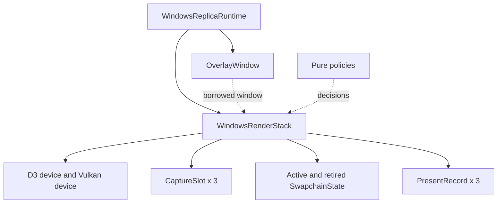
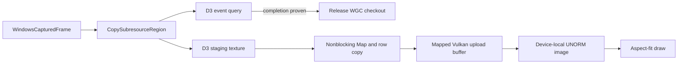
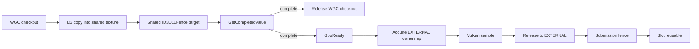
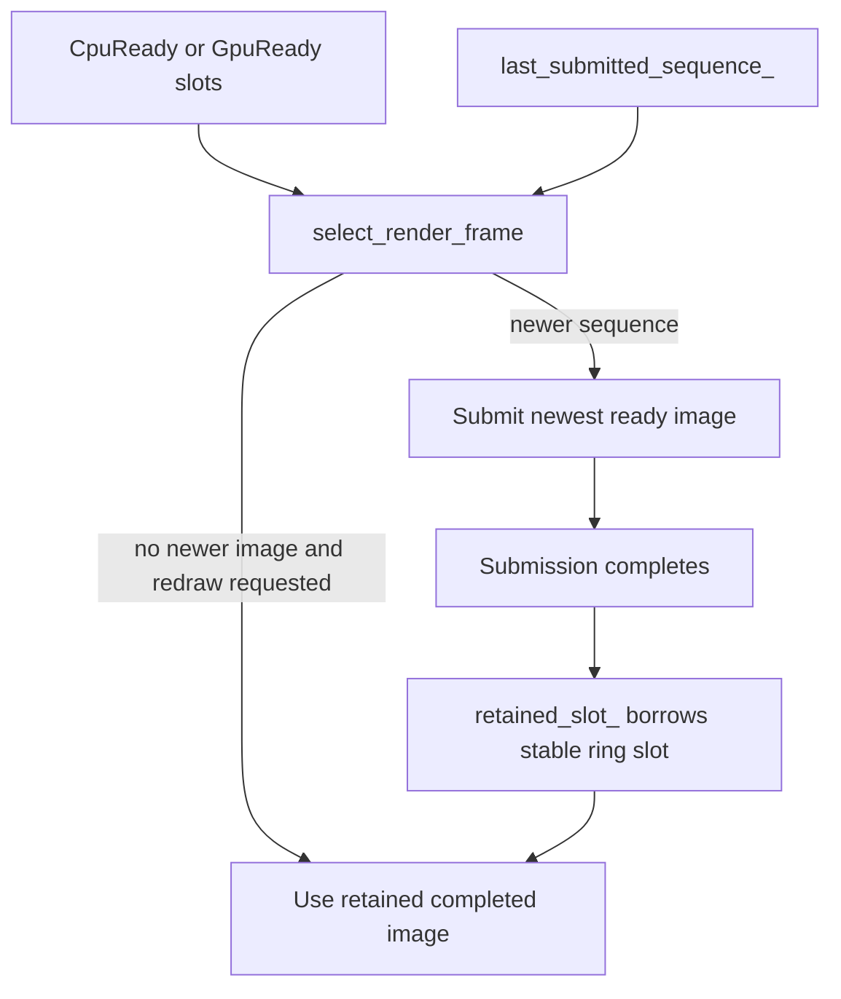
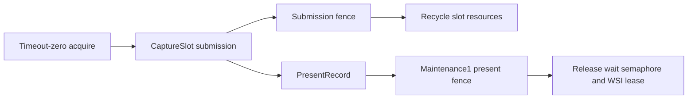
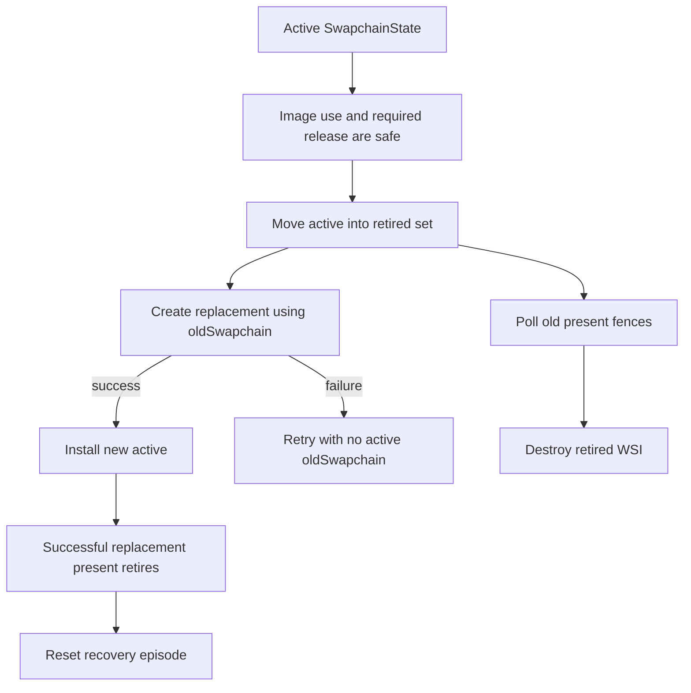
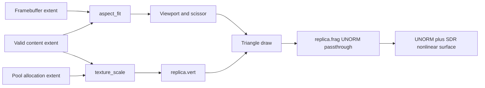

# Replica renderer

[回架構索引](README.md)

`WindowsRenderStack` 把一個 `WindowsCapturedFrame` 複製到自己的三個 slot 之一，再以 Vulkan 顯示於 replica overlay。WGC checkout、D3 copy、Vulkan submission、presentation 各有不同的結束時點；這份文件依照這些時點說明資源為何仍需保留。

主要入口是 [WindowsRenderStack](../../render/windows_render_stack.hpp)，實作位於 [windows_render_stack.cpp](../../render/windows_render_stack.cpp)。呼叫者是 [WindowsReplicaRuntime](../../platform/windows/windows_replica_runtime.cpp)；controller 另有 [DesktopHost](desktop-host.md) 的私有 Vulkan context。兩者共用值型別政策，但不共用 device、swapchain、slot 或回收集合。

## 1. 一個 replica 的 owner

`WindowsReplicaRuntime` 持有 stack，並保證 overlay 比 surface 活得更久。所有 stack 操作都在主執行緒：WGC callback 只把 owning checkout 放進 capture job 的 mailbox，沒有 renderer 的呼叫權。

| 實際單元 | 責任 | 閱讀位置 |
| --- | --- | --- |
| `WindowsRenderStack::Impl` | native owner、slot 交接、WSI、回收及本地 surface recovery | [實作](../../render/windows_render_stack.cpp) |
| `BridgeCapabilityFacts`、`BridgeSelection` | 將實際 capability facts 轉成一個 bridge mode／reason | [bridge_policy.hpp](../../render/bridge_policy.hpp)、[實作](../../render/bridge_policy.cpp) |
| acquire／submit／present／release classifiers | 分開判斷控制流程與 native ownership | [graphics_retry_policy.hpp](../../render/graphics_retry_policy.hpp) |
| `GraphicsRetryPolicy`、`RuntimeDrainPolicy` | 有界重試與無回收進展的期限 | [政策實作](../../render/graphics_retry_policy.cpp) |
| `Viewport`、`aspect_fit`、present／format selector | 幾何及 presentation 選擇 | [render_math.hpp](../../render/render_math.hpp)、[實作](../../render/render_math.cpp) |
| replica shaders | 有效區域取樣與直接 SDR 輸出 | [vertex](../../shaders/replica.vert)、[fragment](../../shaders/replica.frag) |

這些 policy 不配置 native 資源、不睡眠、不呼叫 driver。各 concrete owner 保留自己的 attempt、時間與 handles；沒有共用 presenter service。

## 2. `submit` 與三個 slot

runtime 先以 `ready_for_frame()` 確認 admission／空間，再把 mailbox 的最新 checkout move 進 `submit()`。stack 檢查 generation、allocation、有效 content、format 與 D3 device 身分，才開始 copy。`CaptureSlot::frame` 在 D3 仍可能讀取 WGC buffer 時保留 checkout；單獨持有 texture interface 無法替代這個 lease。

`cpu_slot_count` 是 3，兩條 transport 路徑都使用這個固定 ring。`present_record_count` 也為 3，但它限制的是另一組 presentation ownership。沒有逐幀擴張的 raw-frame queue。

### CPU copy

`progress_d3_copy()` 使用 `GetData(...DONOTFLUSH)` 輪詢 query，確認 copy 完成後先釋放 WGC checkout。`Map(...DO_NOT_WAIT)` 若還不能取得 staging texture，便回傳下次 deadline。取得資料後，程式依來源 `RowPitch` 搬移有效列，把 allocation 其餘區域清為零，並依記憶體 coherency 決定是否 flush Vulkan mapped range。

slot 接著進入 `CpuReady`。`record_commands()` 將 upload buffer 複製到 device-local image，再轉成 shader-readable layout。submission fence 完成之前，upload buffer、sampled image、command buffer 都不能被新一幀覆寫。

### GPU interop

`collect_bridge_capabilities()` 先查 LUID、external image import、D3D11 新介面、shared fence、timeline semaphore 和 Win32 import procedures。`query_interop_slot()` 再對每個實際 NT handle 取得 memory-type intersection。`select_bridge()` 依固定順序回報第一個不符合的 fact，而不是把所有失敗都稱為同一種 hardware error。

目前 shared texture 使用 `D3D11_RESOURCE_MISC_SHARED | D3D11_RESOURCE_MISC_SHARED_NTHANDLE`。同步由 shared `ID3D11Fence` 與匯入的 Vulkan timeline semaphore 負責。每個 slot 的 texture 匯入一次，重複 copy／sample；臨時 NT handle 在 import 後關閉，native resource owners 則保留。

`GetCompletedValue()` 的 `UINT64_MAX` 是 D3 device removal，不能當作「已完成所有 target」。只有觀察到正常 completion，stack 才把 slot 轉成 `GpuReady` 並提交 Vulkan，因此 timeline wait 在 submit 前就已可滿足。Vulkan queue-family barrier 把 image 從 `EXTERNAL` 取得，再於取樣後交回。

如果 interop 操作失敗但 device 仍健康，`request_interop_fallback()` 先關閉 copy admission。`progress_interop_fallback()` 等到舊 copy、submission 和 present 都退休，才以 CPU ring 取代舊資源。這不會在仍有使用者時釋放 shared texture。

## 3. 最新影像與 resize redraw

`content_sequence` 是 stack 接受 capture copy 時配置的順序，用來避免較早開始、較晚完成的 slot 覆蓋更新畫面。`ready_slot()` 選擇比 `last_submitted_sequence_` 新的候選者，並丟棄其他已完成 D3 copy、尚未提交的過期 ready slot。

`retained_slot_` 是指向固定 ring 的 borrowed pointer，沒有新增 native owner。`Empty` 在這裡代表沒有未完成的 native work；其 sampled image 仍可保存上一張內容。空 slot 選擇會先避開 retained slot，但需要容量時仍可覆寫它。

swapchain 重建成功會設定 `redraw_requested_`。如果來源暫時沒有新 frame，renderer 可重新呈現上一張已完成內容。CPU replay 不再次 upload；GPU replay 重新取得 external ownership，等待同一個已完成 D3 target。新的成功 present 會清除 redraw request。

source allocation 改變是另一個 barrier：runtime 先關閉 frame admission、等待 callback quiescence、清掉舊 mailbox，再等 `render_allocation_idle()`。這個 predicate 接受 `Empty`／`CpuReady`／`GpuReady`，因為 ready content 已無未完成 copy 或 submission；`rebuild_capture_slots()` 可以安全丟棄它們。

## 4. Submission 與 presentation 分開退休

`vkQueueSubmit` 成功後，submission fence 證明 command buffer 與取樣資源的使用完成；它沒有證明 presentation engine 已不再使用 swapchain。`vkQueuePresentKHR` 另附 maintenance1 present fence。當 presentation enqueued，render-finished semaphore 從 slot 移交給 `PresentRecord`，其生命週期跟著 present fence。

| 結果／階段 | 保留的證據與下一步 |
| --- | --- |
| acquire success／suboptimal | 保留 image、acquire semaphore／fence；suboptimal 於安全使用後重建 |
| acquire timeout／not-ready | 沒有取得 image；sync 狀態未改變，稍後再試 |
| submit OOM、確定未 enqueue | 等 acquire fence，再 release 未使用的 acquired image |
| submit uncertain | 保留可能已提交的資源，僅以 submission fence 或確認 device loss 推進 |
| present OOM、確定未 enqueue | 等 submission completion，再 release acquired image |
| enqueued／uncertain present | 保留 present record、wait semaphore 與 swapchain 關聯 |
| maintenance release 非 success | 不清除 image ownership；依 surface loss／terminal 路徑保留至合法 teardown |

`progress_submission()`、`progress_present_records()` 都只做 host polling，並回傳正的下次觀察期限。完成但沒有被消耗的 binary semaphore 會銷毀／重建，不會以 signaled 狀態被直接重用。

## 5. Active／retired swapchain 與 recovery

將 active handle 傳給 `oldSwapchain` 前，owner 已先把它移入 retired set。即使 creation 失敗，舊 swapchain 也不再當成可 acquire 的 active owner。後續 attempt 使用 `VK_NULL_HANDLE`，同時繼續保留舊 presentation resources。

surface loss 僅重建 surface／swapchain；WGC job、D3 device、slot ring 和 resource generation 維持原本 owner。device loss 則交由 runtime 重建整組 graphics／capture generation：

| 已確認的事實 | 可以省略的等待 | 仍必須保留的健康工作 |
| --- | --- | --- |
| Vulkan device loss | 失效 Vulkan device 的 submission／presentation completion 等待 | 未完成的 D3 source copies／WGC checkouts |
| D3 device removal | 尚未完成 D3 copy、未提交 Vulkan 的 slot | 已提交於健康 Vulkan device 的 work／presents |
| 一般 stop／terminal error | 沒有額外的 device-loss 豁免 | 所有尚未取得完成證據的 native owners |

construction attempts 使用 episode 起點後的 0／100／500 ms。成功建立 replacement 不重設 budget；成功 present 退休才重設。stack 的 pending native work 使用短的正值輪詢；runtime 另彙整 callback、job 與 graphics 的 drain 進展，最遲每 50 ms 觀察一次，十秒無退休進展時回報 `Stalled`。

## 6. 幾何、shader 與閱讀路線

`aspect_fit()` 以 64-bit cross products 選擇受限制的軸，再回傳置中的整數 viewport。shader 使用無 vertex buffer 的三角形，`texture_scale` 只取樣 allocation 內的有效 `ContentSize`。fragment 直接輸出 UNORM 取樣值；`select_sdr_surface_format()` 因此明確要求 BGRA8 UNORM＋nonlinear SDR presentation，避免額外 sRGB 編碼。

追一張 frame 可依序閱讀 `submit()` → `progress_d3_copy()` → `ready_slot()` → `try_present()` → `progress_submission()`／`progress_present_records()`。追關閉則由 `begin_drain()` → `tick()` → destructor invariant。政策與格式排序的可重現案例集中在既有 `tests/render/render_policy_test.cpp` 的 case 06／08；實際 CPU／GPU 路徑的硬體案例在 `tests/windows/windows_graphics_hardware_test.cpp`。
