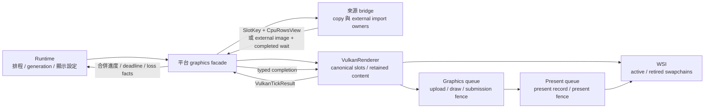
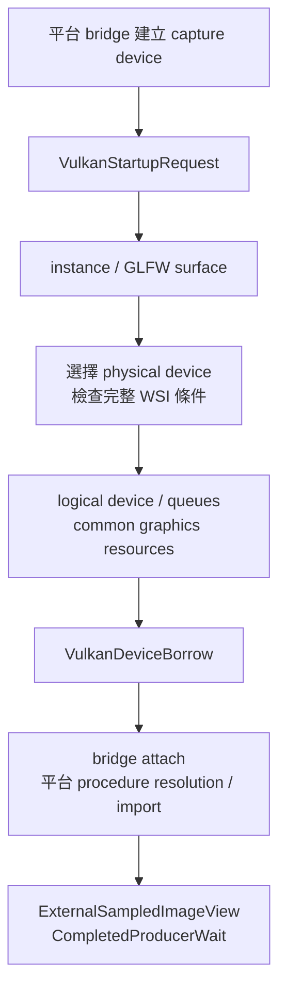
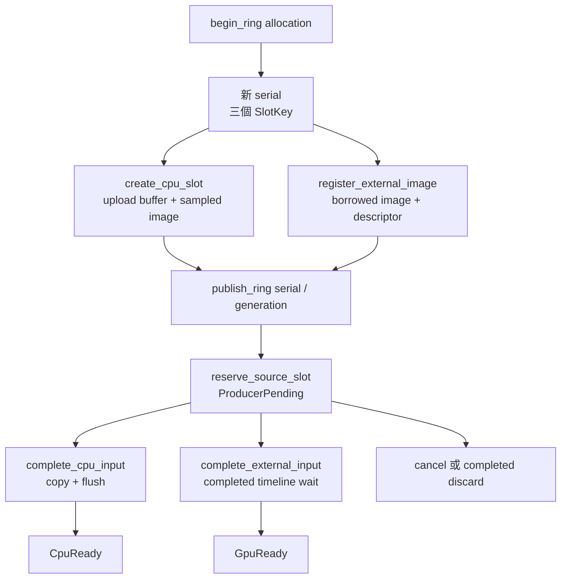
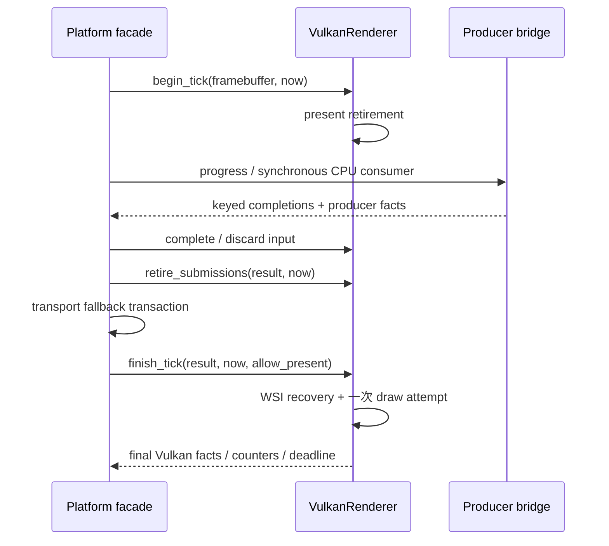
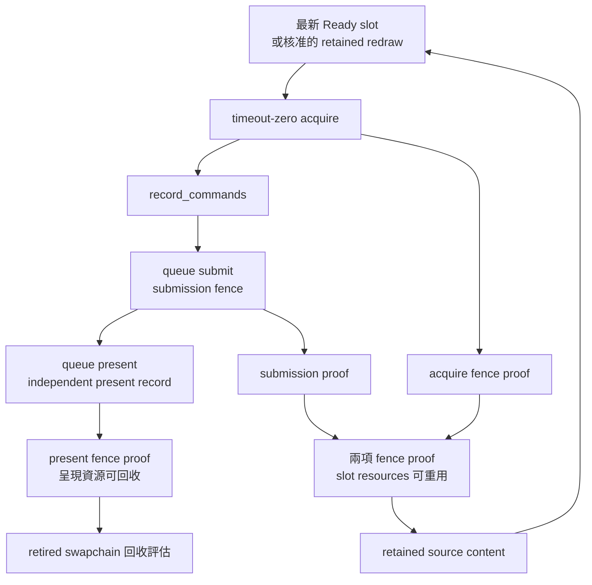
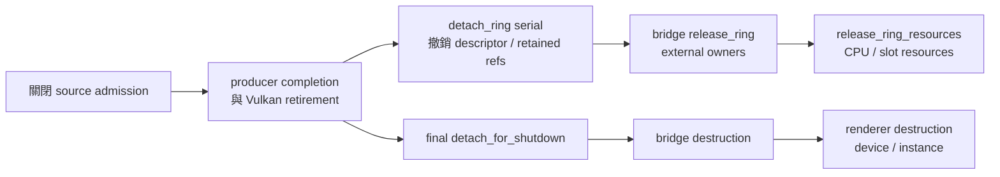

# 共用 Vulkan renderer：輸入、繪製與退休證據



為了讓各平台的來源影格共用 Vulkan 繪製流程，系統需要把來源的原生生命週期與 renderer 的繪製生命週期分別管理。`VulkanRenderer` 接收具型別的影格資料，保存三個 canonical slots，負責 Vulkan device、CPU upload、取樣影像、command buffers、WSI 與呈現退休。平台 facade 協調來源 bridge，將完成證據轉成 renderer 的 typed completion，再將兩個 owners 的狀態合併交給 runtime。

主要入口是 [`vulkan_renderer.hpp`](../../render/vulkan_renderer.hpp)。跨 owner 的資料契約位於 [`vulkan_input.hpp`](../../render/vulkan_input.hpp)，繪製實作位於 [`vulkan_renderer.cpp`](../../render/vulkan_renderer.cpp)。Windows 組合入口位於 [`windows_render_stack.hpp`](../../platform/windows/windows_render_stack.hpp)，producer 與 import ownership 見 [Windows frame bridge](windows-frame-bridge.md)。

目前 graphics dependency configuration 與原生驗證使用 Windows。`avb0795_vulkan_renderer` 擁有獨立的 source／link 邊界，連結 core、Vulkan、GLFW 與 diagnostics。Linux 的 Portal／PipeWire 接入屬於後續平台工作。

## Device bootstrap 與借用



為了讓 renderer 選用適合來源互通的裝置，bootstrap 需要 adapter 偏好與可選 feature 要求。`VulkanStartupRequest` 提供 candidate preference、optional extension group 與 timeline request，renderer 在 constructor 期間消費這些資訊。裝置選擇同時檢查 graphics／present queue、surface 與維護呈現所需的 features。

為了讓 bridge 建立與 renderer 相容的 imports，`VulkanDeviceBorrow` 提供 physical／logical device、memory properties、limits 與實際 enabled facts。Bridge 保存自己的 imported image、memory、view 與 timeline；renderer 保存其借用值及使用者。清理順序由這條相依關係決定：退休 renderer 使用者、撤銷 registration、釋放 bridge imports、釋放 renderer device。

## Ring 安裝與來源交接



為了區分同一 capture generation 內多次 allocation 安裝，renderer 需要自己的資源身分。`begin_ring` 發行遞增 serial，`SlotKey` 以 serial 與固定 index 指向當次安裝。Facade 使用相同 key 準備 producer 資源；三個 slots 的資源與 registration 就緒後，`publish_ring` 發布接納狀態與 observation generation。

CPU 路徑透過 `CpuRowsView` 借用 mapped rows。Renderer 檢查 content、allocation、pitch 與 span，完成 row copy 與 noncoherent flush 後提交 metadata 與 `CpuReady`。來源 bytes 的有效範圍為：

```text
row_bytes = content.width × 4
required_source_bytes = (content.height − 1) × row_pitch + row_bytes
```

GPU 路徑透過 `ExternalSampledImageView` 註冊 image／view、allocation、layout 與 external queue family。Bridge 觀察到 producer completion 後，facade 交付 `CompletedProducerWait`，renderer 更新 metadata 與 `GpuReady`。Queue submission 保留 timeline wait，串接 external memory dependency。

為了保存一次接納嘗試前的有效畫面，reservation 保留舊 metadata 與 retained 身分標記。Adoption 前取消使用 `cancel_source_reservation`；producer 接收影格後的安全丟棄使用 `discard_completed_source`。這兩個入口讓 retained restoration 與已接收影格的淘汰具有各自清楚的語意。

## Ordered progress 與錯誤合併



為了讓來源完成事件能在同一次主迴圈接續繪製，progress 需要在既有 native users 退休、producer delivery、fallback 與 draw 之間維持固定次序。三個 renderer 入口共用此次呼叫的 `VulkanTickResult`，facade 在兩個進度點之間插入 bridge completion 與 transport transaction。

`begin_tick` 處理 framebuffer 變更與 present fence retirement。Bridge 隨後交付已完成來源；CPU consumer 在同步 callback 內完成 copy／flush。`retire_submissions` 檢查 acquire／submission 的證據，facade 再評估 fallback。`finish_tick` 推進 WSI retirement／recovery，並依 aggregate admission 決定此次 draw。

Vulkan result 保存 renderer 本身的錯誤與 loss facts；facade 保存 producer 錯誤與獨立 loss facts。Windows 的合併結果同時保存 Vulkan loss 與 D3 removal，device recovery event 使用既有 Vulkan 優先順序。Deadline 取兩個 owners 的最早時間，供主迴圈持續推進待處理工作。

## Submission、presentation 與 retained redraw



為了在來源畫面穩定時回應 crop、opacity 與 viewport 變更，renderer 保存最新且安全的 sampled content，搭配 `FrameStamp` 記錄來源 sequence 與 intake time。Runtime 提供 redraw admission，renderer 在 ready selection 中選擇最新來源或符合條件的 retained redraw。CPU retained redraw 使用已上傳 image；GPU retained redraw 依 external layout／queue-family 契約記錄 ownership transfer。

為了分別證明影像使用與呈現完成，系統保存 submission fence 與獨立的 present fence。Submission retirement 支援 slot image 的後續重用；present record 保存 render-finished semaphore 與所屬 swapchain，直到呈現完成證據成立。WSI 回收同時檢查 image users、present records 與 release-retained 狀態。

為了安全 reset 或銷毀 acquire fence，slot retirement 還需要觀察 acquire 本身的 fence signal。Acquire 的 semaphore signal 排在 fence signal 之前；等待該 semaphore 的 rendering submission 與 acquire fence signal 各自完成。Renderer 與 controller host 先觀察 submission fence，再觀察 acquire fence，兩項證據成立後回收 frame resources。任一證據仍在處理時，主迴圈依 deadline 繼續輪詢。[Vulkan synchronization specification](https://docs.vulkan.org/spec/latest/chapters/synchronization.html)

Acquire、submit、present 與 release 的結果分類位於 [`graphics_retry_policy.hpp`](../../render/graphics_retry_policy.hpp)。分類提供 ownership facts 與後續動作，native handle 的生命週期由 renderer 維護。

## Detach、drain 與 diagnostics



為了讓 ring replacement 保留 device 與獨立 present records，`render_allocation_idle` 描述 capture allocation 的使用證據。`detach_ring` 先檢查 serial、slot identity 與完成狀態，再撤銷 references；成功後 facade 依 bridge、renderer 順序釋放該 ring。Final teardown 透過 `detach_for_shutdown` 直接銷毀 descriptor registrations，接續釋放 external owners 與整個 renderer。

為了讓量測涵蓋每個 native allocation，renderer 在實際 create／destroy 與 submit／present-retire 呼叫點更新 counters。Bridge 的 timeline create／destroy 由 facade 轉交 `observe_external_semaphore`，共同更新同一份 replica high-water ledger。`VulkanObservationContext` 提供短命的來源／transport metadata，renderer 在一次 observation 內合併 GPU、driver 與 WSI facts。完整 workflow 與固定 workload 的資料保留於本機 verification／artifacts。
