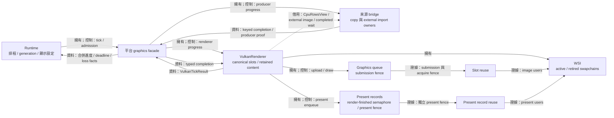
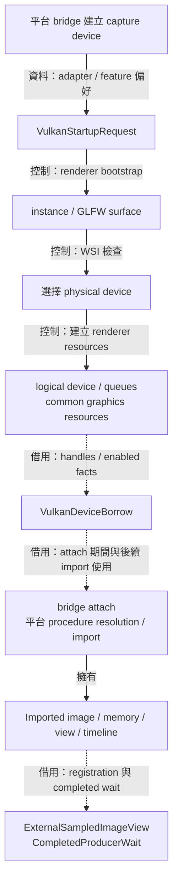
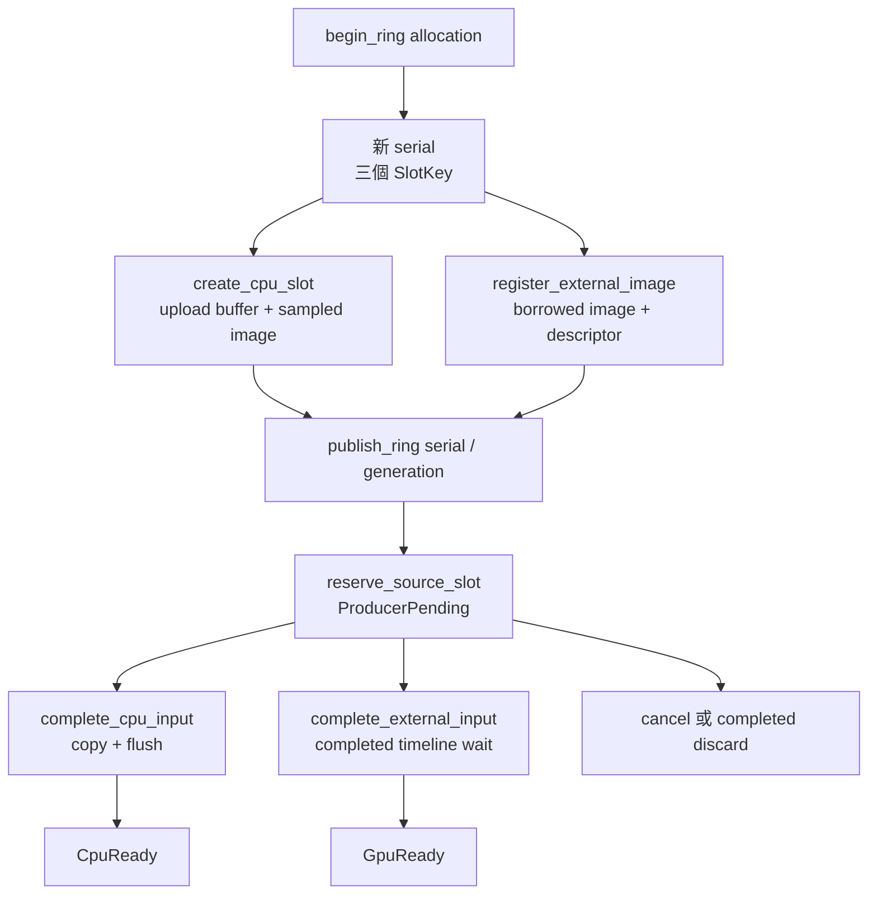
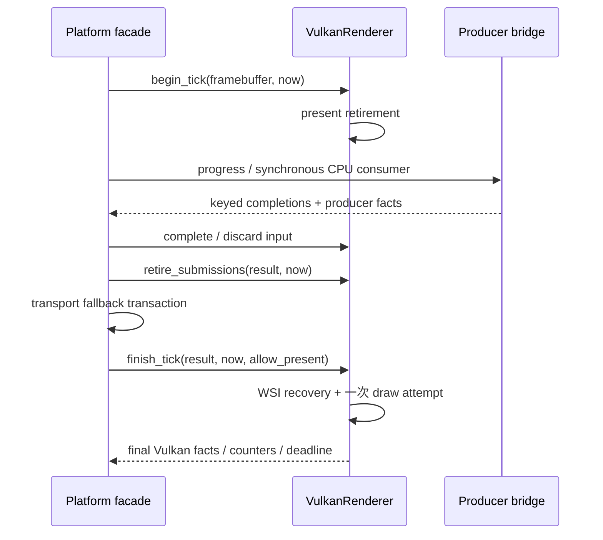
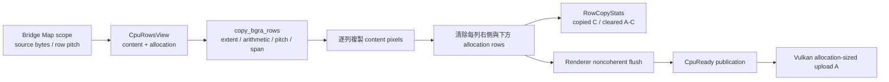
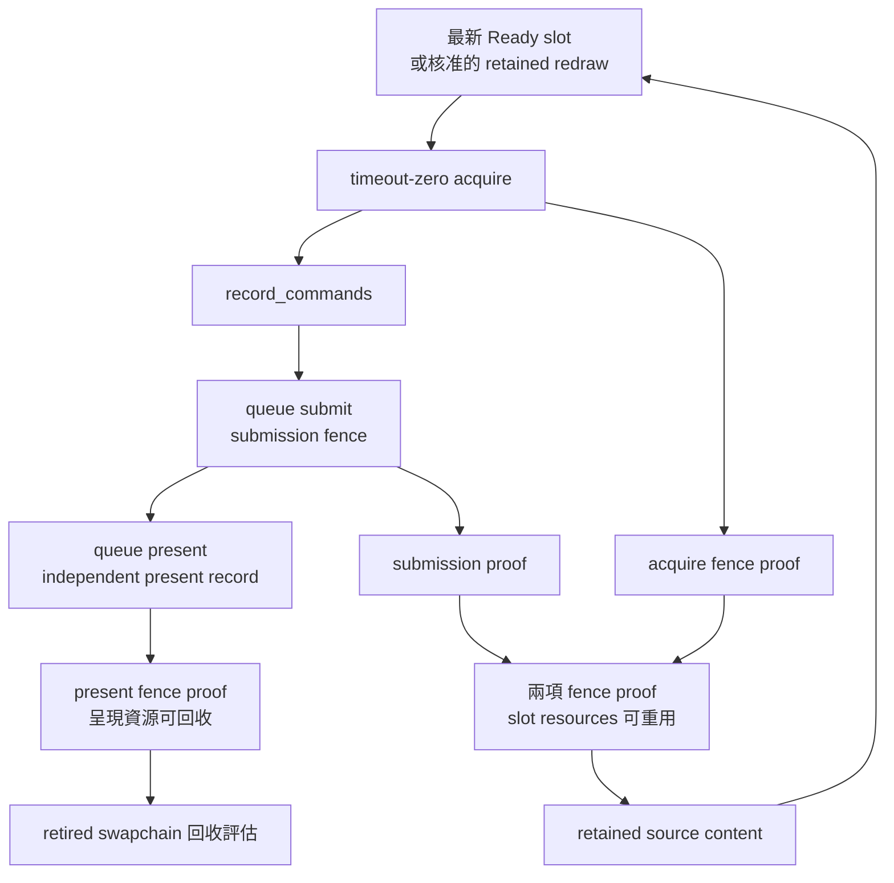
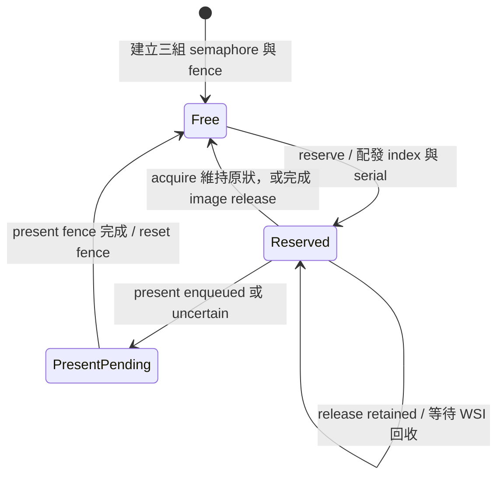
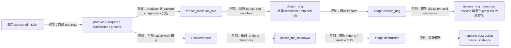

# 共用 Vulkan renderer：輸入、繪製與退休證據



為了讓各平台的來源影格共用 Vulkan 繪製流程，系統需要把來源的原生生命週期與 renderer 的繪製生命週期分別管理。`VulkanRenderer` 接收具型別的影格資料，保存三個 canonical slots，負責 Vulkan device、CPU upload、取樣影像、command buffers、WSI 與呈現退休。平台 facade 協調來源 bridge，將完成證據轉成 renderer 的 typed completion，再將兩個 owners 的狀態合併交給 runtime。

主要入口是 [`vulkan_renderer.hpp`](../../render/vulkan_renderer.hpp)。跨 owner 的資料契約位於 [`vulkan_input.hpp`](../../render/vulkan_input.hpp)，繪製實作位於 [`vulkan_renderer.cpp`](../../render/vulkan_renderer.cpp)。Windows 組合入口位於 [`windows_render_stack.hpp`](../../platform/windows/windows_render_stack.hpp)，producer 與 import ownership 見 [Windows frame bridge](windows-frame-bridge.md)。

為了依生命週期閱讀 renderer 內部實作，程式需要集中保存資源狀態，並依操作責任安排 translation units。[`vulkan_renderer_impl.hpp`](../../render/detail/vulkan_renderer_impl.hpp) 定義同一個私有 `Impl` 與其持有的資源；[`vulkan_device.cpp`](../../render/vulkan_device.cpp) 實作 instance、surface bootstrap、device 選擇、queues 與共用 graphics resources。Constructor、整體 teardown 與 canonical transitions 維持由 renderer 實作串接。

為了在 resize、surface recovery 與結束時安全處理呈現中的影像，WSI 操作需要同時檢查 slot image users 與獨立 present records。[`vulkan_wsi.cpp`](../../render/vulkan_wsi.cpp) 集中 swapchain 建立／退休、render-pass 與 framebuffer resources、present proof observation、acquired-image release 及 recovery episode。這些方法存取同一個 `Impl`，將完成證據交回 canonical transitions，並沿用共同的 error／deadline 結果。

本輪交付的 graphics dependency configuration 與原生驗證以 Windows 為範圍，目前來源契約為 BGRA8，畫面驗證使用 SDR。`avb0795_vulkan_renderer` 擁有獨立的 source／link 邊界，連結 core、Vulkan、GLFW 與 diagnostics；Windows facade／bridge 保存 WGC、D3 與 Win32 import。已實作的 UI cadence、frame／present pools、CPU padding 與 opt-in report 共同支援本輪效能觀測。Linux Portal／PipeWire runtime、ROI-sized transport、GPU early-submit 與 HDR 是後續工作；最終配對量測的狀態見 [效能觀測指南](../development/vulkan-performance.md#本階段驗證範圍)。

Controller 的 frame／present 容量由 `DesktopHost` 的獨立 Vulkan owner 管理，詳見 [Controller Vulkan resources](controller-vulkan-resources.md)。兩個 owners 共用值政策，各自根據完成證據操作自己的 native handles。

## Device bootstrap 與借用



為了讓 renderer 選用適合來源互通的裝置，bootstrap 需要 adapter 偏好與可選 feature 要求。`VulkanStartupRequest` 提供 candidate preference、optional extension group 與 timeline request，renderer 在 constructor 期間消費這些資訊。裝置選擇同時檢查 graphics／present queue、surface 與維護呈現所需的 features。

為了讓 bridge 建立與 renderer 相容的 imports，`VulkanDeviceBorrow` 提供 physical／logical device、memory properties、limits 與實際 enabled facts。Bridge 保存自己的 imported image、memory、view 與 timeline；renderer 保存其借用值及使用者。清理順序由這條相依關係決定：退休 renderer 使用者、撤銷 registration、釋放 bridge imports、釋放 renderer device。

## Ring 安裝與來源交接



為了區分同一 capture generation 內多次 allocation 安裝，renderer 需要自己的資源身分。`begin_ring` 發行遞增 serial，`SlotKey` 以 serial 與固定 index 指向當次安裝。Facade 使用相同 key 準備 producer 資源；三個 slots 的資源與 registration 就緒後，`publish_ring` 發布接納狀態與 observation generation。

CPU 路徑透過 `CpuRowsView` 借用 mapped rows。Renderer 檢查 content、allocation、pitch 與 span，完成 row copy 與 noncoherent flush 後提交 metadata 與 `CpuReady`。來源 bytes 的有效範圍為：

```text
row_bytes = content.width × 4
required_source_bytes = (content.height − 1) × row_pitch + row_bytes
```

GPU 路徑透過 `ExternalSampledImageView` 註冊 image／view、allocation、layout 與 external queue family。Bridge 觀察到 producer completion 後，facade 交付 `CompletedProducerWait`，renderer 更新 metadata 與 `GpuReady`。Queue submission 保留 timeline wait，串接 external memory dependency。

為了保存一次接納嘗試前的有效畫面，reservation 保留舊 metadata 與 retained 身分標記。Adoption 前取消使用 `cancel_source_reservation`；producer 接收影格後的安全丟棄使用 `discard_completed_source`。這兩個入口讓 retained restoration 與已接收影格的淘汰具有各自清楚的語意。

## Ordered progress 與錯誤合併



為了讓來源完成事件能在同一次主迴圈接續繪製，progress 需要在既有 native users 退休、producer delivery、fallback 與 draw 之間維持固定次序。三個 renderer 入口共用此次呼叫的 `VulkanTickResult`，facade 在兩個進度點之間插入 bridge completion 與 transport transaction。

`begin_tick` 處理 framebuffer 變更與 present fence retirement。Bridge 隨後交付已完成來源；CPU consumer 在同步 callback 內完成 copy／flush。`retire_submissions` 檢查 acquire／submission 的證據，facade 再評估 fallback。`finish_tick` 推進 WSI retirement／recovery，並依 aggregate admission 決定此次 draw。

Vulkan result 保存 renderer 本身的錯誤與 loss facts；facade 保存 producer 錯誤與獨立 loss facts。Windows 的合併結果同時保存 Vulkan loss 與 D3 removal，device recovery event 使用既有 Vulkan 優先順序。Deadline 取兩個 owners 的最早時間，供主迴圈持續推進待處理工作。

## CPU rows：內容複製與 padding 定義



為了讓整張 upload allocation 都有明確像素，CPU transport 需要同時保存本幀 content 與 allocation 的尺寸。Content 描述來源本次提供的有效矩形；allocation 描述 image 與 upload buffer 的容量。來源縮小時，右側與下方 padding 需重新填為零，讓後續 sampling 得到本幀定義的內容。

[`copy_bgra_rows`](../../render/cpu_row_copy.hpp) 接收 producer 在 Map scope 內借出的 `CpuRowsView`，以及 renderer 自有的 tight upload span。BGRA8 每 pixel 為 4 bytes。若 content 為 `w × h`、allocation 為 `W × H`、source row pitch 為 `p`，則：

- Content bytes：`C = 4wh`。
- Allocation bytes：`A = 4WH`，destination pitch 為 `4W`。
- Source 最小有效 span：`(h - 1)p + 4w`；最後一列的像素後方可接任意 producer padding。
- 此次寫入量：copy `C`、clear `A - C`，Vulkan upload 保持 `A`。

為了使 layout error 保留 destination 原值，helper 先驗證正尺寸、content containment、每個乘加的 `size_t` 可表示性、pitch 與兩個 span 的範圍，再進入寫入階段。目的端 span 精確對應 `A`；兩份 storage 由各自 owner 維持存活與獨立。核心操作為：

```cpp
// Arithmetic and span validation precede this loop.
for (std::size_t y = 0; y < content_height; ++y) {
  auto* row = destination.data() + y * destination_pitch;
  std::memcpy(row, source.bytes.data() + y * source.row_pitch, row_bytes);
  // Clear right-hand padding, followed by rows below the content rectangle.
}
```

例如 2×1 content 放入 3×2 allocation，copy 為 8 bytes，clear 為 16 bytes；兩者合計覆蓋 24-byte allocation。Full-size content 的 `C = A`，清除量為 0。相同 allocation 內的來源縮小仍會覆蓋全部 padding。

Helper 的責任是同步 packing 與 byte accounting。Bridge 的局部 Map owner 維持來源借用；renderer 保存 upload mapping，接續執行 atom-aligned noncoherent flush，成功後發布 `CpuReady`。Flush error 沿既有 typed error 與 reservation discard 路徑處理。Retained redraw 使用已上傳 image，沿用該 source content 的既有生命週期。

## Submission、presentation 與 retained redraw



為了在來源畫面穩定時回應 crop、opacity 與 viewport 變更，renderer 保存最新且安全的 sampled content，搭配 `FrameStamp` 記錄來源 sequence 與 intake time。Runtime 提供 redraw admission，renderer 在 ready selection 中選擇最新來源或符合條件的 retained redraw。CPU retained redraw 使用已上傳 image；GPU retained redraw 依 external layout／queue-family 契約記錄 ownership transfer。

為了分別證明影像使用與呈現完成，系統保存 submission fence 與獨立的 present fence。Submission retirement 支援 slot image 的後續重用；present record 保存 render-finished semaphore 與所屬 swapchain，直到呈現完成證據成立。WSI 回收同時檢查 image users、present records 與 release-retained 狀態。

為了安全 reset 或銷毀 acquire fence，slot retirement 還需要觀察 acquire 本身的 fence signal。Acquire 的 semaphore signal 排在 fence signal 之前；等待該 semaphore 的 rendering submission 與 acquire fence signal 各自完成。Renderer 與 controller host 先觀察 submission fence，再觀察 acquire fence，兩項證據成立後回收 frame resources。任一證據仍在處理時，主迴圈依 deadline 繼續輪詢。[Vulkan synchronization specification](https://docs.vulkan.org/spec/latest/chapters/synchronization.html)

Acquire、submit、present 與 release 的結果分類位於 [`graphics_retry_policy.hpp`](../../render/graphics_retry_policy.hpp)。分類提供 ownership facts 與後續動作，native handle 的生命週期由 renderer 維護。

## 固定容量的 presentation resources



為了降低持續擷取時的 native allocation 成本，renderer 需要保存可重用的呈現資源，同時分別追蹤 acquire／submission 與 presentation 的完成證據。Device bootstrap 建立三筆固定的 `PresentRecord`，每筆持有一個 binary semaphore 與一個 present fence。Capture slot 持有自己的 acquire semaphore、acquire fence、submission fence 與 command buffer；`present_use` 借用一筆已預留的 present record。

為了辨識同一筆資源的多次使用，`PresentUseKey` 將陣列 index 與 owner-wide serial 組合；每次預留推進 serial，ring／swapchain replacement 保留這個序號。`PresentUseState` 提供 `Free`、`Reserved`、`PresentPending` 三個狀態，現有共用值政策負責檢查身分與轉移前置狀態；Vulkan owner 負責觀察 native proof 與操作 handles。

一次 draw 在 acquire 前預留容量。Acquire 回報原狀時立即歸還 reservation；取得 image 後，record 跟隨該 slot 的 acquire／submission 及 image release。Present enqueue 成功或結果屬 uncertain 時，record 轉為 `PresentPending`，接續獨立追蹤 present fence。正常 retirement 將該次計數結算、清除 active metadata 並 reset fence，兩個 handles 保留供後續 draw 使用。

異常路徑依取得的完成證據處理：

- Submit／present 的 known-not-enqueued 結果保留 reservation，等待對應 acquire／submission proof 與 image release。
- 已完成且仍待消費的 binary signal 依既有 release policy 更換 semaphore。
- `ReleaseRetained` 保留容量與 swapchain 身分，合法 WSI destruction 完成後歸還 reservation。
- Native reset／replacement error 發生前先消耗已證明的 ownership，錯誤由外層 containment 關閉 admission，後續 ticks 持續處理其餘工作。

為了維持 bounded accounting，drain 與 pool occupancy 同時計入 `Reserved` 和 `PresentPending`。WSI 的 `present_fence_pending` 根據 `PresentPending` 彙整，`Reserved` 的 image ownership 則由對應 slot 提供。三個 slot 加三筆 present records 的固定配置為三個 command buffers、九個 fences 與六個 binary semaphores；GPU bridge 的 imported timeline semaphore 另依 bridge lifetime 計入 diagnostics。

## Detach、drain 與 diagnostics



為了讓 ring replacement 保留 device 與獨立 present records，`render_allocation_idle` 描述 capture allocation 的使用證據。Windows aggregate 同時要求 bridge copy／Map records 完成；renderer 的 slots 回到 `Empty`、`CpuReady` 或 `GpuReady`，表示 allocation 的 image users 已退休。Pending present 的 semaphore 與 swapchain 由獨立 record 保存，沿自己的 proof 繼續退休。`detach_ring` 驗證 serial、slot identity 與 image ownership，成功 reset descriptor pool 後撤銷 descriptor、external image 與 retained references；facade 接著依 bridge imports、renderer ring resources 的順序釋放該 allocation。

最終 teardown 需要全部 producer、frame 與 presentation obligations 已收束。`detach_for_shutdown` 檢查 renderer 的全部 native work，直接銷毀 descriptor pool 並撤銷 ring references；aggregate 接續釋放 bridge imports、timeline 與 D3 owners，最後銷毀 renderer device／instance。這個順序讓 borrowed device 與 imported image 的實際 owners 覆蓋全部使用期。

為了讓量測涵蓋每個 native allocation，renderer 在實際 create／destroy 與 submit／present-retire 呼叫點更新 counters。Bridge 的 timeline create／destroy 由 facade 轉交 `observe_external_semaphore`，共同更新同一份 replica high-water ledger。`VulkanObservationContext` 提供短命的來源／transport metadata，renderer 在一次 observation 內合併 GPU、driver 與 WSI facts。完整 workflow 與固定 workload 的資料保留於本機 verification／artifacts。
