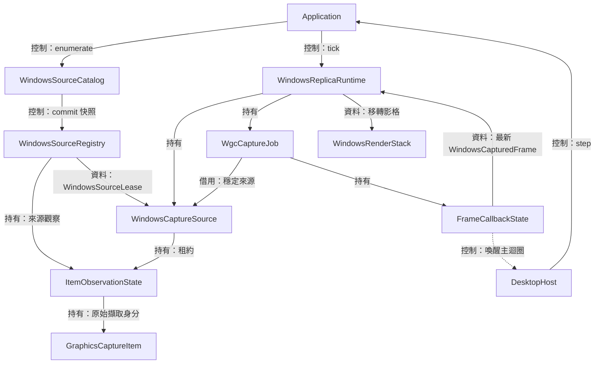
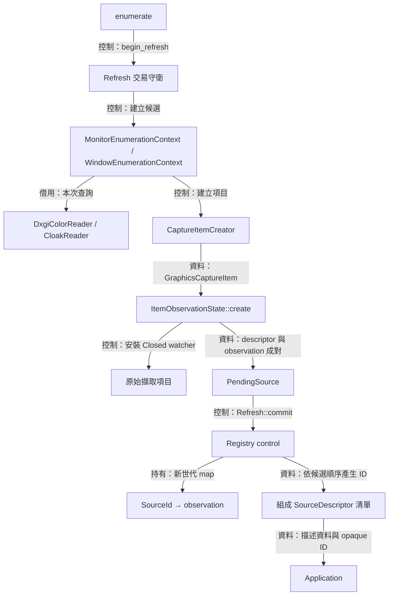
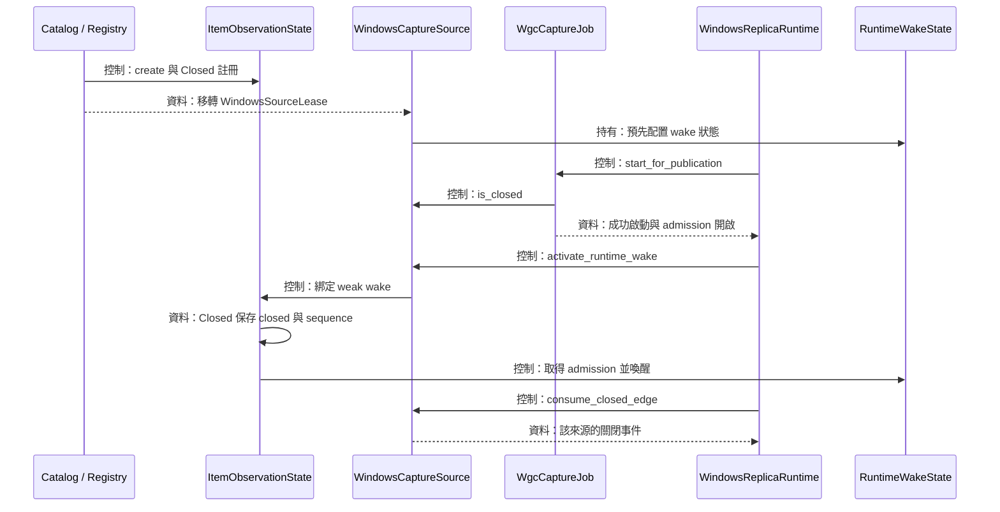
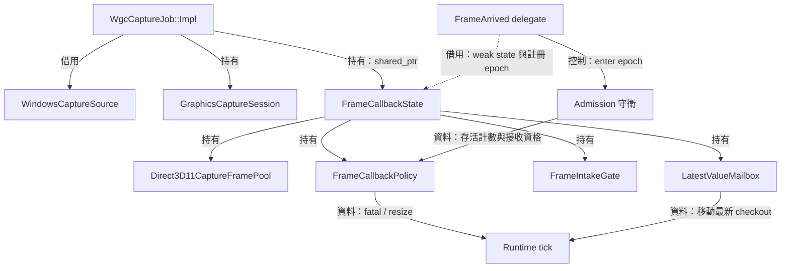
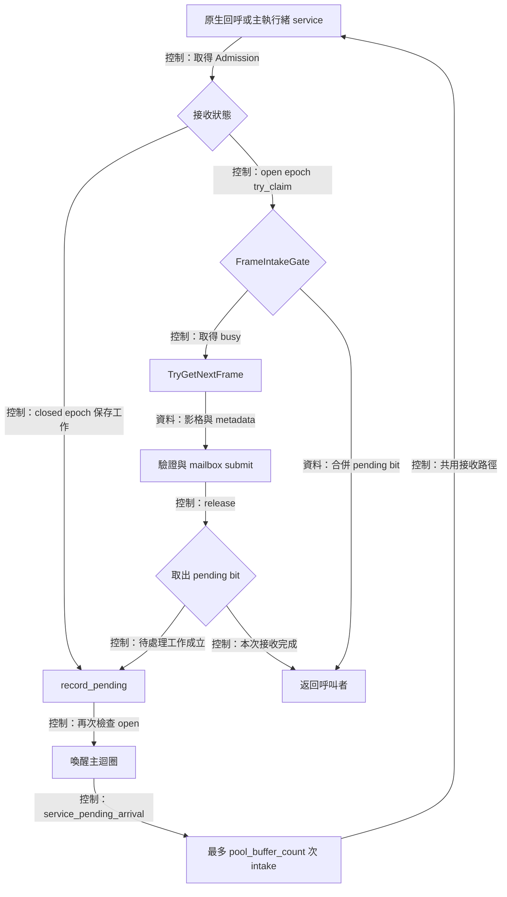
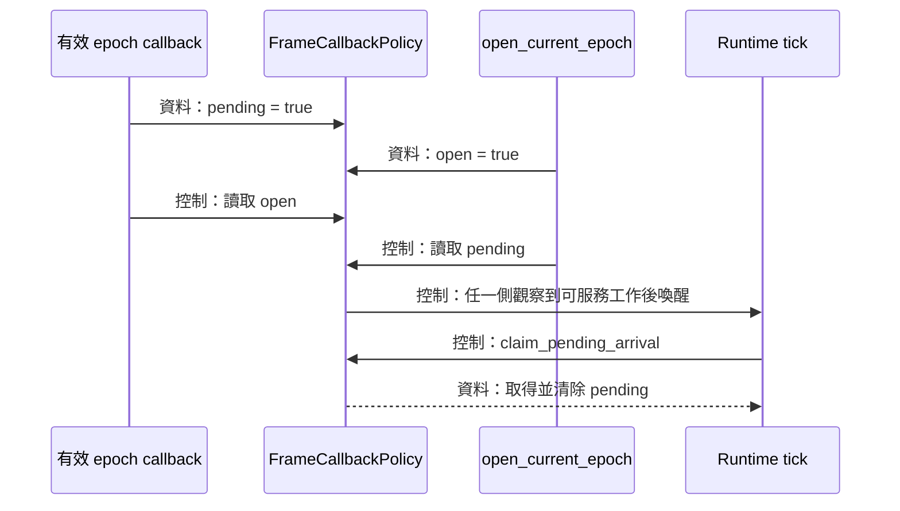
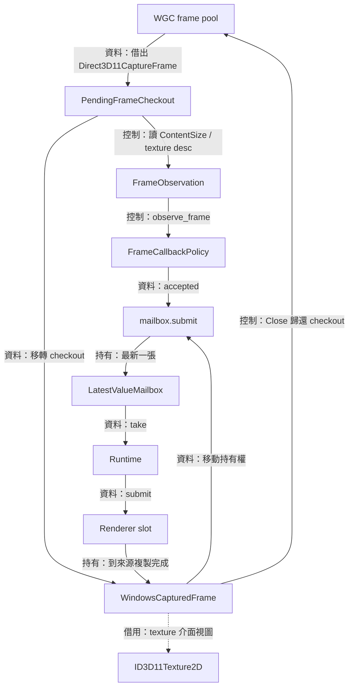
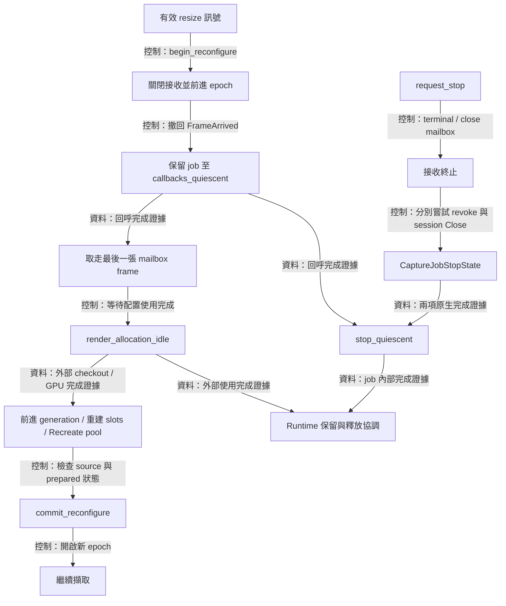

# Windows capture：來源身分、回呼與影格持有



擷取路徑要把使用者選定的來源持續送到副本視窗，因此需要保存來源身分、接收 Windows 影格，並讓每張影格活到 GPU 使用完成。 `WindowsSourceCatalog`、`WindowsCaptureSource` 與 `WgcCaptureJob` 分別負責這三個階段。 上圖依據[來源登錄](../../platform/windows/windows_source_registry.hpp)、[擷取工作](../../platform/windows/wgc_capture_job.hpp)與 [runtime](../../platform/windows/windows_replica_runtime.cpp) 的建立及呼叫關係繪製

Windows Graphics Capture（WGC）提供擷取項目、擷取工作階段與影格池。 項目回答「擷取哪個來源」，工作階段負責啟動擷取，影格池提供可輪替使用的儲存空間。 avb0795 在 Windows 層持有這些原生物件，透過[應用程式介面](../../include/avb/app/ports.hpp)向上傳遞可攜的描述資料與狀態

本頁從來源清單追到一張影格的歸還。 [Runtime 與 overlay](windows-runtime-overlay.md) 接續說明整體停止，[renderer](renderer.md) 展開 GPU 使用完成的證據，[DesktopHost](desktop-host.md) 說明喚醒後的主迴圈。 [回架構總覽](README.md)

## WindowsSourceCatalog 與 WindowsSourceRegistry



來源清單需要讓畫面上的選項對應到同一個原生項目。 [WindowsSourceCatalog](../../platform/windows/windows_source_catalog.cpp) 在列舉期間建立 `GraphicsCaptureItem`，連同標題、尺寸與色彩提示組成候選資料。 [WindowsSourceRegistry](../../platform/windows/windows_source_registry.cpp) 保存 ID 到項目的對照，使用者啟動擷取時由 factory 查回原項目

### 列舉資格與描述資料

為了讓來源列提供可辨識的原生診斷資訊，catalog 在建立視窗描述值時將 HWND 轉成十六進位字串，存入 `SourceDescriptor::native_handle_text`。 這份文字與名稱一起複製到 UI 快照，來源解析持續依 `SourceId` 及 registry 世代進行。 顯示器的診斷字串保持空值，由 UI 呈現灰色 `—`

視窗候選由 `WindowEligibilityFacts` 收集原生查詢結果。 `is_window_source_eligible()` 要求視窗可見、cloaking 查詢成功且結果為一般顯示狀態、面積大於零、由其他行程持有，以及具備可顯示的標籤。 工具視窗另以 `WS_EX_APPWINDOW` 表示可供選取的意圖。 標題以修整空白後的視窗文字為優先，類別名稱提供後備標籤

螢幕候選先取得 `MONITORINFOEXW`，以裝置名稱查對顯示介面卡的狀態旗標，再接受接到桌面的 active display。 鏡像驅動程式對應候選會在資格判斷處結束。 各候選還需要有效尺寸、可轉成 UTF-8 的名稱，以及成功建立的 WGC 項目

色彩提示來自本次重新整理建立的 DXGI output 快照。 跨螢幕視窗採與視窗矩形重疊面積最大的 output。 `RGB_FULL_G22_NONE_P709` 對應 `Sdr`，`RGB_FULL_G2084_NONE_P2020` 對應 `HdrDetectedUnsupported`，其餘查詢結果歸入 `UnknownAssumeSdr`。 這份提示隨來源快照更新，實際 SDR 像素契約見 [renderer](renderer.md)

原生列舉回呼以 `noexcept` 接住 C++ 例外，把 `exception_ptr` 留在當次 context，交由外層 `enumerate()` 轉成 `SourceCatalogFailure`。 單一候選的原生資訊查詢或 WGC 項目建立回報失敗時，該次 `visit()` 返回，列舉接著處理其他候選。 列舉本身失敗時，`Refresh` 守衛恢復前一份快照的查詢狀態

### 快照世代保護選取身分

為了辨識某個 ID 所屬的清單，registry 使用世代前綴與遞增序號。 [WindowsSourceIdGeneration](../../platform/windows/windows_source_registry.cpp) 的核心格式如下：

```cpp
prefix_ = "avb0795-source-" + std::to_string(generation_) + '-';
```

`issue()` 再以這個前綴產生 ID：

```cpp
const auto ordinal = next_ordinal_++;
return core::SourceId{prefix_ + std::to_string(ordinal)};
```

例如某次提交產生 `avb0795-source-1-0`，下次重新整理則產生第 2 代 ID。 查詢會同時驗證目前前綴及 map 項目。 標題相同或 HWND 數值再次出現時，選取仍依該世代保存的 `GraphicsCaptureItem` 決定

重新整理需要 `active_runtime_leases == 0`，且當下可取得 refresh 狀態。 `commit_refresh()` 先配置新容器與全部 ID，再撤回舊觀察的事件註冊，最後交換 map 及世代。 可能進入 WinRT 的撤回操作位於 registry mutex 外，讓鎖的保護範圍集中在快照與查詢狀態

`Refresh` 借用 registry，作用域涵蓋整次列舉與提交。 `WindowsSourceLease` 則持有共享 control 與 observation，移動時連同租約計數的責任一併移轉。 租約釋放先清除 observation 參照，再減少計數，讓下一次 refresh 看到的零計數代表原生項目租約已歸還

## WindowsCaptureSource 與來源關閉觀察



擷取重建需要保留最初選定的項目，因此 [WindowsCaptureSource](../../platform/windows/windows_capture_source.cpp) 持有 registry 租約，供每代 job 借用。 來源隨時可能關閉，catalog 建立 observation 時就註冊 `Closed`。 [ItemObservationState](../../platform/windows/detail/item_observation_state.hpp) 把關閉事實保存到 `closed_` 與 `closed_sequence_`，讓選取期間、建構期間與圖形重建期間都能查閱同一份狀態

### 關閉事實、事件游標與喚醒

持續保存的關閉事實（sticky fact）用來回答來源是否已關閉。 一次性的事件則用來通知某個 consumer 發生變化。 `consume_closed_edge()` 比較 observation 的序號與來源自己的 `closed_cursor_`，更新游標後回傳事件。 `is_closed()` 持續讀取原本的關閉事實，供啟動與重建的最後檢查使用

WGC delegate 捕捉 `weak_ptr<ItemObservationState>`。 進入時取得共享 state，完成關閉紀錄後再結束。 Runtime wake 也以 weak binding 保存在 observation 中，呼叫前在短鎖內取出共享 wake state，再於鎖外執行。 這樣可分別界定原生觀察的存活期與主迴圈的借用期

### 發布後建立主迴圈借用關係

發布（publication）的目的是讓 Application 接手一個可以持續推進並安全停止的 runtime。 為此，factory 先完成會配置或呼叫原生 API 的準備，最後執行 `StartCapture()`。 成功之後，runtime 開啟影格接收、綁定來源 wake，再透過 `unique_ptr<IReplicaRuntime>` 移交持有權。 完整建構順序見 [runtime factory](windows-runtime-overlay.md)

來源建構時先配置 `RuntimeWakeState`，其 callable 的借用關係在 `activate_runtime_wake()` 綁定後生效。 發布前的 observation 已可記錄來源關閉，首次 tick 會依序號取得這項事實。 `PublicationGate` 保存 `attempted_` 與 `started_`，讓單次啟動的成功結果成為後續生命週期的依據

停止來源 wake 時，`request_stop()` 先關閉 wake admission，再移除相符的 binding。 已取得 admission 的呼叫仍由計數追蹤。 最後一個呼叫會在完成喚醒後減少計數，`callbacks_quiescent()` 觀察到零時，runtime 可結束對 host callable 的這部分借用

## WgcCaptureJob 與 FrameCallbackPolicy



每代擷取需要把影格池、工作階段與回呼狀態一起保存。 [WgcCaptureJob](../../platform/windows/wgc_capture_job.cpp) 透過 `create_inactive()` 建立 free-threaded frame pool、capture session 及 `FrameCallbackState`，再註冊 `FrameArrived`。 初始 pool 使用來源項目當下的 `Size()` 與 `B8G8R8A8UIntNormalized` 格式，runtime 依 `initial_allocation()` 建立一致的 renderer slots

回呼可在原生執行緒上到達，因此接收規則由共享的 [FrameCallbackPolicy](../../platform/windows/detail/wgc_capture_state.cpp) 管理。 Runtime 在主執行緒讀取固定尺寸的 `CaptureSignalBatch`，回呼則保存數值型態的 fatal 與 resize 資訊，並請求主迴圈執行下一次 tick

### 三種識別值各自回答一個問題

| 識別值 | 要回答的問題 | 建立與檢查位置 |
| --- | --- | --- |
| `SourceId` 世代 | 這個選項屬於哪份來源清單？ | Registry refresh 與 `resolve()` |
| callback `epoch` | 這次回呼屬於哪次事件註冊？ | `register_arrival()` 捕捉，`enter()` 驗證 |
| `resource_generation` | 這張影格使用哪代配置？ | Runtime 指派，capture policy 與提交路徑驗證 |

例如視窗縮放後，來源租約繼續指向同一個 item，callback epoch 向前推進，影格資源世代也向前推進。 裝置重建也沿用來源租約，由穩定 runtime 提供下一代資源編號。 這些值把來源身分、事件註冊與配置相容性分成可獨立追查的條件

### Admission 保存回呼與 wake 的完整存活期

為了在重建或停止時知道何時可釋放 state，每次有效 epoch 的 handler 先取得 `Admission`。 守衛增加 `callbacks_in_flight_`，結束時歸還計數。 Handler 接著呼叫 `is_open()`，檢查當下的 epoch 與接收狀態。 這個二次檢查涵蓋「取得 admission 後，主執行緒接著開始停止」的交錯順序

`close_for_reconfigure()` 關閉接收、清除 pending 並增加 epoch。 `request_terminal_stop()` 另把 `terminal_` 保存為永久停止狀態。 舊註冊捕捉的 epoch 會走快速返回路徑，已取得守衛的回呼則繼續由計數涵蓋到結束

回呼靜止（quiescence）指所有取得 admission 的呼叫都已返回。 最後一次喚醒也列入此範圍。 Policy 在鎖內認領 final wake，在鎖外執行 callable，返回後再減少計數。 `ever_opened_` 把 final wake 的適用範圍限定到已開啟接收的工作。 主迴圈若在最後減數前醒來，runtime 的有限間隔觀察會再次查閱計數

### Fatal 與 resize 的固定訊號

`observe_frame()` 先比對資源世代、實際配置尺寸、有效內容尺寸與 surface 格式。 Metadata 合約違反會保存 `InvalidFrameMetadata`，格式違反會保存 `FormatMismatch`。 原生介面投影、配置記憶體與其他例外分別保存相應 category 及數值 detail

有效內容尺寸與配置尺寸相異時，policy 保存最新 `resize_`，並在第一個 resize edge 喚醒主迴圈。 `drain_signals()` 取走 resize 及通知 edge，同時持續回報 `fatal_active`。 Fatal 成立後，接收結果保持結束路徑，runtime 依此啟動 job 停止與整體清理

## FrameIntakeGate 與待處理到達訊號



影格接收需要維持「取得影格、驗證、發布」的順序，讓稍早取得的影格先完成發布。 [FrameIntakeGate](../../platform/windows/detail/frame_intake_gate.hpp) 因此涵蓋整段接收操作。 它以一個原子整數保存 `busy` 與 `pending`，競爭中的呼叫合併成一次後續服務機會，主執行緒再接續處理

### 用同一個原子狀態交接接收權

`try_claim()` 的關鍵運算如下。 這裡保留原始程式的型態與運算式：

```cpp
const auto available = (observed & busy) == 0;
const auto desired = available ? busy : observed | pending;
if (state_.compare_exchange_weak(observed, desired,
                                 std::memory_order_acq_rel,
                                 std::memory_order_acquire)) {
  return available;
}
```

閒置狀態的呼叫將原子值更新為 `busy`，成為本次接收者。 另一個呼叫遇到 `busy` 時設置 `pending`，隨即返回。 成功接收者完成發布後用下列操作一併釋放接收權與取得待處理標記：

```cpp
return (state_.exchange(0, std::memory_order_acq_rel) & pending) != 0;
```

例如 A 已取得 busy，B 與 C 隨後到達，兩者共同留下同一個 pending bit。 A 完成後看到 pending，就透過仍存活的 admission 執行 `record_pending()` 與 `wake_if_open()`。 Wake 的借用期因此受到回呼計數保護。 Gate 的 CAS 重試針對原子值更新，接收權仍由目前持有者一路保留到 mailbox 發布結束

### 初次開啟接收的雙向檢查

`StartCapture()` 期間可能已有回呼到達。 有效 epoch 的 callback 即使看到接收關閉，仍先保存 pending，再讀取 open。 Opener 則先寫入 open，再讀取 pending。 [FrameCallbackPolicy](../../platform/windows/detail/wgc_capture_state.cpp) 使用 `memory_order_seq_cst` 排列這四個讀寫動作



兩條路徑共同保證至少一側可看見接收已開啟且有工作待服務。 `service_pending_arrival()` 原子取走 pending 後取得目前 epoch 的 admission，每次至多執行 `pool_buffer_count()` 次 intake。 目前 factory 設為 5，提供 renderer 三個 slots 之外的接收與 mailbox 空間。 數量限制也讓持續到達的影格留給後續 tick 接手

## WindowsCapturedFrame 與最新影格信箱



影格池會重複使用儲存空間，因此 consumer 使用某張影格時，需要保留它的借出憑證（checkout）。 [WindowsCapturedFrame](../../platform/windows/windows_captured_frame.hpp) 把這項責任包成可移動物件，與 sequence、資源世代、配置範圍、有效內容範圍及擷取觀察時間一起傳遞。 影格在[擷取工作](../../platform/windows/wgc_capture_job.cpp)中先進入最新值信箱，再由 runtime 移交 renderer

### 先持有，再投影 metadata

`TryGetNextFrame()` 回傳後，`PendingFrameCheckout` 立刻接手原生影格。 接著讀取 `ContentSize()`、透過 `IDirect3DDxgiInterfaceAccess` 取得 texture，再由 `GetDesc()` 取得實際配置及格式。 這些投影操作若拋出例外，本地守衛會呼叫 `Close()`，接收路徑則保存固定的 fatal 訊號

成功時，原始 `ContentSize` 留給 resize 判斷，交給 renderer 的有效內容採兩個矩形的交集。 [copyable_content_extent](../../platform/windows/detail/wgc_capture_state.cpp) 的運算為：

```cpp
return {.width = std::min(content.width, allocation.width),
        .height = std::min(content.height, allocation.height)};
```

推導示例：影格池配置為 1280 × 720，來源剛變為 1400 × 900。 Resize 訊號保留 1400 × 900，當張 checkout 的有效內容則為 1280 × 720。 來源縮小到 1000 × 600 時，有效內容跟著縮為 1000 × 600。 Renderer 依此決定複製及取樣範圍

### 最新值取代與 Close 責任

`LatestValueMailbox<WindowsCapturedFrame>` 持有最新一張影格。 新影格替換既有值時，舊 checkout 隨物件釋放而歸還。 空信箱變成 ready 或新訊號 edge 出現時會喚醒主迴圈，已 ready 的信箱替換內容則沿用既定排程。 信箱演算法詳見 [core](core.md)

`WindowsCapturedFrame::texture()` 回傳的 `ComPtr<ID3D11Texture2D>` 保存介面參照。 Pool checkout 另由 wrapper 持有，renderer 要以來源複製完成證據決定 wrapper 的歸還時刻。 因此 slot 會跨 GPU 工作保留完整 `WindowsCapturedFrame`，再於完成觀察後釋放

移動指定先歸還目標原有的 checkout，再接手新影格。 `close_checkout()` 先以 `std::exchange(frame_, nullptr)` 清除自身持有欄位，再嘗試原生 `Close()`，讓移動與解構共用一次歸還責任。 `FrameCallbackState` 的欄位宣告讓 mailbox 早於 pool 解構，runtime 則另外等待 renderer 持有的 checkout 使用完畢

## SourceReconfiguration 與 CaptureJobStopState



來源尺寸改變時，舊影格仍可能位於回呼、信箱或 renderer。 [SourceReconfigurationPhase](../../platform/windows/detail/windows_runtime_policy.hpp) 把這些持有者依序接起來，由 [WindowsReplicaRuntime::progress_source_reconfiguration()](../../platform/windows/windows_replica_runtime.cpp) 執行具體操作。 終止擷取則由 [CaptureJobStopState](../../platform/windows/detail/wgc_capture_state.hpp) 保存原生清理的完成證據

### 尺寸重建的四個階段

`begin_reconfigure()` 先推進 epoch 並撤回舊 handler，runtime 進入 `WaitingForCallbacks`。 回呼完成後，runtime 取走最後一張舊信箱影格，進入 `WaitingForRender`。 Renderer 回報 `render_allocation_idle()` 後，runtime 增加 `resource_generation_`，依新尺寸重建 capture slots，再呼叫 job 的 `prepare_reconfigure()`

`prepare_reconfigure()` 會確認接收關閉、舊 handler 已撤回、回呼計數歸零與信箱清空，再 `Recreate()` pool 並註冊新 epoch。 完成後進入 `Prepared`。 Runtime 再次查閱來源仍開啟的事實，呼叫 `commit_reconfigure()` 開啟接收，最後更新 allocation 與 overlay 的來源長寬比

每次 tick 最多推進四個已就緒的階段。 來源關閉或捕捉到 fatal 時，runtime 轉入 job 停止，並保留已建立的資源等待清理證據。 `Recreate()` 後還有 handler 註冊等步驟，準備失敗代表 runtime 要循停止路徑整理這組部分更新的資源

### 停止的內部證據與外部證據

Terminal stop 先封閉 admission 與信箱，再分別嘗試撤回 `FrameArrived` 與關閉 capture session。 每項原生操作都有獨立的例外 containment，第一個 cleanup failure 保存為固定 category 及 detail。 重複 `request_stop()` 沿用這次結果，runtime 持續持有清理證據待確認的 job

`CaptureJobStopState::stop_quiescent()` 的實際合取條件如下：

```cpp
return requested_ && native_stop_succeeded_ && callbacks_quiescent &&
       mailbox_closed;
```

呼叫者傳入的 mailbox 條件由 `mailbox_closed_and_empty()` 取得。 上式證明 job 內部的 session、事件註冊、回呼及信箱已收束。 Renderer 另外提供外部 checkout、D3 使用與 Vulkan presentation 的完成證據。 Runtime 收齊兩組證據後依序釋放 job 與 render stack，Application 再依整體 `Stopped` 事件結束 runtime 持有權

來源關閉、回呼歸零與 GPU 完成各自有自己的觀察入口。 追查停止期間的進度時，可依序查閱 `is_closed()`、`frame_callbacks_quiescent()`、`cleanup_failure()` 及 renderer 的完成欄位。 完整聚合條件與有界觀察期限見 [runtime drain](windows-runtime-overlay.md)
