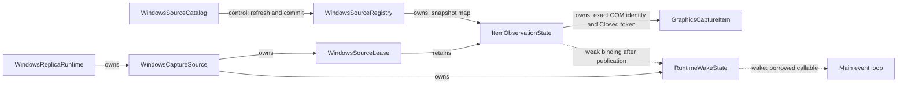
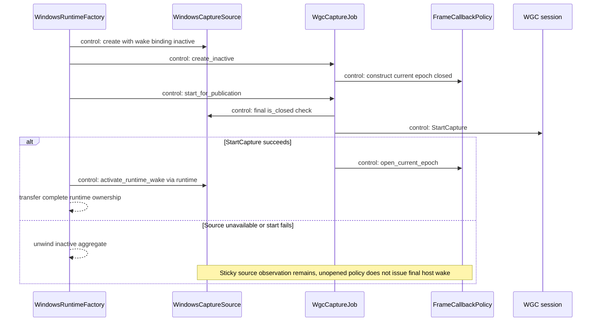
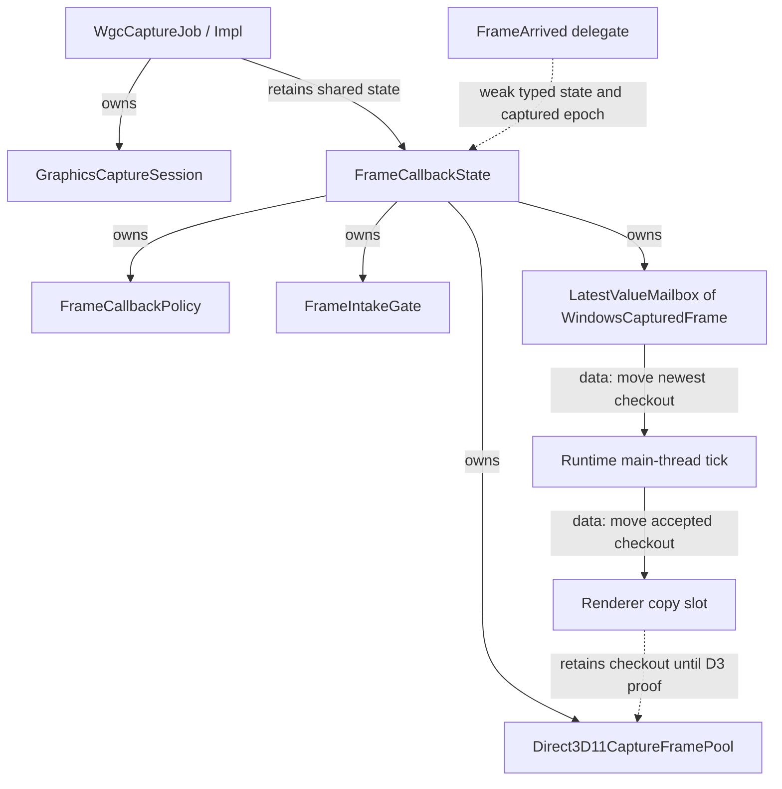
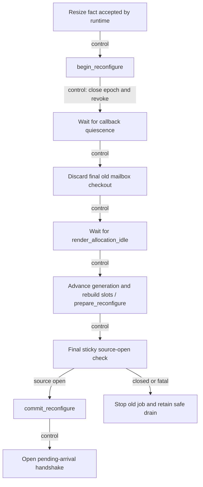

# Windows capture：來源身分、callback 與 frame ownership

[回架構總覽](README.md) · [Runtime、overlay 與系統 adapter](windows-runtime-overlay.md)

`WindowsSourceCatalog` 在列出來源時就建立真正的 `GraphicsCaptureItem`。使用者按下 Start 後，runtime 使用 registry lease 裡的同一個 item 建立 WGC job；每張影格再透過 move-only checkout 與 newest-only mailbox 交給 main-thread tick。這條路徑將「選到了哪個來源」和「目前是哪一代 capture resources」分開保存。

本章描述目前 `platform/windows` 的實作。圖中 `owns`／`retains` 表示生命週期關係，`control` 表示呼叫或狀態操作，`data` 表示資料移轉，`wake` 只表示請主迴圈再次執行；wake 不攜帶 pixels 或 application events。

## 1. 從 catalog 到穩定的來源 lease

| 子單元 | 責任與入口 | 保留的東西 |
|---|---|---|
| [WindowsSourceCatalog](../../platform/windows/windows_source_catalog.hpp) | `enumerate()`、window/display eligibility、每次 refresh 的色彩分類 | 借用 registry；候選 observation 在本次列舉中暫存 |
| `CaptureItemCreator` | `CreateForWindow`／`CreateForMonitor` | 本次列舉使用的 WinRT interop factory |
| `DxgiColorReader`、`CloakReader` | output 色彩快照、window cloaking 查詢 | 本次 refresh 的原生查詢資源 |
| [WindowsSourceRegistry](../../platform/windows/windows_source_registry.hpp) | `begin_refresh()`、`Refresh::commit()`、`resolve()` | generation 對應的 observation map |
| [ItemObservationState](../../platform/windows/detail/item_observation_state.hpp) | sole `Closed` watcher、sticky closure、weak runtime wake binding | 原始 `GraphicsCaptureItem`、event token、callback 狀態 |
| `WindowsSourceLease` | move-only runtime lease | observation 與共享 registry control |
| [WindowsCaptureSource](../../platform/windows/windows_capture_source.hpp) | `is_closed()`、`consume_closed_edge()`、runtime wake activation/stop | lease、wake state、自己的 edge cursor |

列舉首先排除不適合選取的 window，例如不可見、cloaked、沒有有效範圍／標題，以及本行程自己的 window。工具視窗是否可列出也由 `WindowEligibilityFacts` 判斷。Display 路徑確認 active desktop display，排除 mirroring driver，再建立候選 item。實際判斷與 Win32 callback 的 exception containment 位於 [windows_source_catalog.cpp](../../platform/windows/windows_source_catalog.cpp)。

候選 item 的 `Closed` watcher 先存在，descriptor 才能取得可公開的 `SourceId`。因此來源若在選取清單顯示後、Start 前關閉，後續 `is_closed()` 仍可看到 sticky fact；重新使用同一個 `HWND` 不會把舊 `SourceId` 偷換成另一個 item。

`DxgiColorReader` 只建立本次 refresh 的 output 快照。Window 使用重疊面積最大的 output；沒有 output、查詢失敗或缺少 `IDXGIOutput6` 時維持 `UnknownAssumeSdr`。這是 descriptor 的提示資料，並沒有背景色彩監控或 HDR tone mapping。

### Registry refresh 的交接順序

`begin_refresh()` 會拒絕另一個 refresh，以及仍有 runtime lease 的狀態。`commit_refresh()` 先建立下一代 ID 與替換容器，然後在 registry mutex 之外 retire 舊 observations，最後交換 map/generation。`Refresh` 若沒有完成 commit，解構會取消 refresh 狀態。

Registry mutex 保護 snapshot 與 refresh 狀態；它不包住可能重入的 WinRT token revocation。Lease 的共享 control 也讓 lease 計數不依賴 registry wrapper 的位址存活。正常應用程式流程保留 registry 到所有 runtime 都結束後，callback delegate 本身則只 weak-lock typed observation。

## 2. Publication 前後的 wake 邊界

`WindowsCaptureSource::create()` 配置好 `RuntimeWakeState`，但不立即把借用的 host wake callable 綁給 observation。`WindowsReplicaRuntime::activate_for_publication()` 在 job 的 `start_for_publication()` 成功後才呼叫 `activate_runtime_wake()`；此後剩下的是 no-throw publication／ownership transfer。

這個順序讓未發佈的 factory partial 可以直接 unwind：來源即使已關閉，也只更新 registry 的 sticky state，不會留下仍在借用 host 的 runtime wake。Activation 前已發生的 closure 仍由第一個 runtime tick 消費；activation 不會重新建立 item 或 watcher。

`PublicationGate` 只允許一次 start attempt。它將 permission/native construction failure 轉為固定的 `AppError`；成功之後才執行 concrete job 提供的 no-throw opener。`ever_opened_` 由 frame policy 的既有 admission lock 保護，讓從未開啟的 policy 在 terminal stop／guard exit 時不送出 final host wake。

## 3. Capture job 內部的 owner 層次

[WgcCaptureJob](../../platform/windows/wgc_capture_job.hpp) 擁有一代 session 與 callback state；它借用 stable source，也使用 render stack 所提供的 capture device。Source、device 與 externally retained frame checkouts 的釋放順序，由 runtime 協調。

`FrameCallbackState` 是 [wgc_capture_job.cpp](../../platform/windows/wgc_capture_job.cpp) 裡的 concrete private class，不是另一個 application port。它整合 pool、policy、intake gate、mailbox 與 sequence counter。`FramePool` 在 member declaration order 中先於 mailbox；反向 member destruction 因而先銷毀 mailbox，再釋放 pool。外部 renderer slot 所保留的 checkout 還需要 runtime 另外證明安全，不能只靠這個 member order。

### Admission 與 intake gate 是兩個不同問題

[FrameCallbackPolicy](../../platform/windows/detail/wgc_capture_state.hpp) 的 `Admission` 解決「此 epoch 能否進入、是否仍有 caller 借用 callback-visible state」。Admission 已取得時仍要 `is_open()`，因為 stop 或 reconfigure 可能剛好改變 epoch／intake 狀態。

[FrameIntakeGate](../../platform/windows/detail/frame_intake_gate.hpp) 解決「誰能從 native pull 一路做到 mailbox publication」。只把 `TryGetNextFrame()` 或 mailbox 各自鎖住，無法保證兩個 caller 之間不出現較舊影格覆蓋較新影格的順序。Gate 因而涵蓋 native acquisition、metadata validation 與 submit，並只使用 `busy`／`pending` 兩個 atomic state bits。

競爭失敗的 caller 標記 pending 後返回，不等待 claimant。Claimant 完成後 `release()`，若觀察到競爭，便透過仍存活的 admission 呼叫 `record_pending()`／`wake_if_open()`，把後續工作交回既有 bounded service。Gate 不擁有 frame，也不新增 thread、mailbox 或 service。

## 4. 從 native frame 到 newest-only mailbox

```mermaid
flowchart LR
    Arrival[FrameArrived or pending service] -->|control: enter epoch| Admission[Admission]
    Admission -->|control: try_claim| Gate[FrameIntakeGate]
    Gate -->|control: claimant only| Pull[TryGetNextFrame]
    Pull -->|data: adopt immediately| Pending[PendingFrameCheckout]
    Pending -->|data: metadata and owning frame| Validate[observe_frame]
    Validate -->|data: accepted checkout| Mailbox[Newest-only mailbox]
    Validate -->|data: fixed fatal or resize fact| Signals[Signal latches]
    Mailbox -.->|wake: empty to ready| Loop[Main event loop]
    Signals -.->|wake: new signal edge| Loop
    Loop -->|control: next tick| Tick[WindowsReplicaRuntime]
    Tick -->|control: take and drain| Mailbox
```

`PendingFrameCheckout` 在 native frame 取得後立即接手 ownership，早於 `ContentSize()`、surface projection 與 texture description 查詢。任一步驟拋出例外，都會經過本地 no-throw Close；成功後才轉為 [WindowsCapturedFrame](../../platform/windows/windows_captured_frame.hpp)。

`WindowsCapturedFrame` 保存 sequence、resource generation、實際 allocation、可拷貝的 content 範圍、expected pool format 與 host steady-clock observation time。`texture()` 回傳 `ComPtr<ID3D11Texture2D>` view；view 本身不能取代 WGC checkout 的 lifetime。Renderer 必須保留 wrapper 到來源拷貝安全後，才能讓 pool 回收這張 frame。

Policy 用原始 `ContentSize` 判斷 resize，checkout 則保存經 allocation clipping 的 copyable content。Format 固定為該 generation 的 BGRA pool format；surface format mismatch 是 fatal contract failure，不是一次 resize。Projection、allocation 或 unknown exception 會變成固定 category/native detail，不會跨出 WinRT `noexcept` trampoline。

Mailbox replacement 會釋放舊 checkout，因此 raw-frame backlog 只有 newest slot。只有 empty-to-ready 或新的 signal edge 需要 wake；單純替換已 ready 的 frame 不持續打斷 capped scheduler。

### Temporarily closed epoch 的雙向 handshake

Matching callback 發現 admission 尚未 open 時，會先 `record_pending()`，再 `wake_if_open()`；opener 則先 store open，再讀 pending，並不清除它。這讓 callback-first 和 opener-first 兩種順序都能留下可服務的工作。

`service_pending_arrival()` 才原子 claim pending，取得當前 epoch admission，並執行最多 pool buffer count 次 intake。它與 native callback 共用同一條 exception-contained intake path，所以沒有額外的未驗證 frame acquisition 路徑。Stale epoch 或 terminal callback 不會把 pending 工作重新灌回來。

## 5. Resize、stop 與 quiescence

`begin_reconfigure()` 是 main-thread barrier 的開始：close admission、advance epoch、revoke old `FrameArrived`。Runtime 之後等 callback quiescence，丟棄最後一張舊 mailbox frame，再等 renderer 所有 old-allocation users 安全。`prepare_reconfigure()` 保持新 epoch closed；runtime 最後確認 source 仍開啟，才執行 no-throw `commit_reconfigure()`。細部 coordinator 在 [windows_replica_runtime.cpp](../../platform/windows/windows_replica_runtime.cpp)。

Terminal `request_stop()` 同樣不 join：它先讓 policy terminal、close mailbox，再分別嘗試 revoke handler 與 close session。[CaptureJobStopState](../../platform/windows/detail/wgc_capture_state.hpp) 保留第一個 cleanup failure，兩個 native steps 都會嘗試，重複 stop 不會抹除已知 uncertainty。

`stop_quiescent()` 同時要求 native stop 成功、所有 admitted callbacks 結束，以及 internal mailbox closed/empty。它不包含已交給 renderer 的 checkout；runtime 還必須結合 D3／Vulkan retirement proof 才能 destroy job/pool。

最後一次 runtime wake／frame wake 也算在 callback count 內。Counter 只有在借用的 callable 返回後才歸零，且 foreign wake 不在 admission lock 內呼叫。Wake 若先讓 main loop 看見尚未 quiescent，既有 bounded drain poll 會再次觀察完成；不需要在釋放 count 後冒險再呼叫 host。

## 6. 從哪裡追一次問題

| 現象 | 優先閱讀 | 應確認的邊界 |
|---|---|---|
| Start 前來源已消失 | catalog、registry、capture source | sole watcher 是否早於 descriptor；是否使用同一個 item |
| 首張靜態影格遺失 | callback policy、`service_pending_arrival()` | callback/opener handshake 是否保留 pending |
| Frame 順序或重入問題 | intake gate、`intake_one()` | gate 是否涵蓋 acquisition 到 publication |
| Pool checkout 被提早回收 | captured frame、renderer copy slot | checkout wrapper 是否仍由來源拷貝 owner 保留 |
| Stop 永遠不完成 | job stop state、runtime drain | callback、native cleanup、mailbox、external render proof 各自是哪一項未完成 |

既有 `tests/windows/windows_policy_test.cpp` 使用 controlled adapters 與同步點檢查 publication、wake lifetime、intake 與 checkout ownership；`tests/windows/wgc_hardware_test.cpp` 才實際進入 WGC hardware capture。閱讀或更新本文件本身不會啟動擷取。
