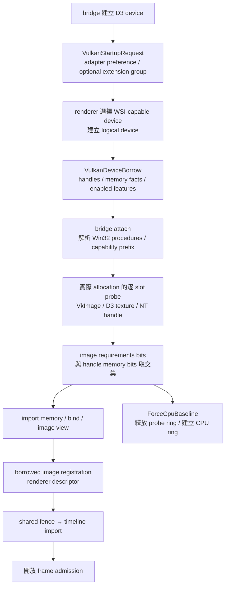
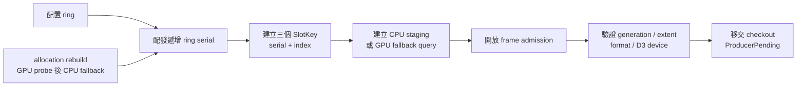
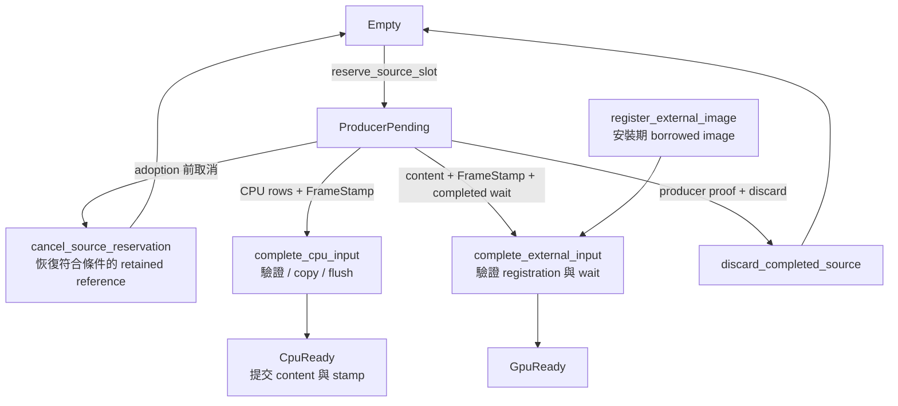
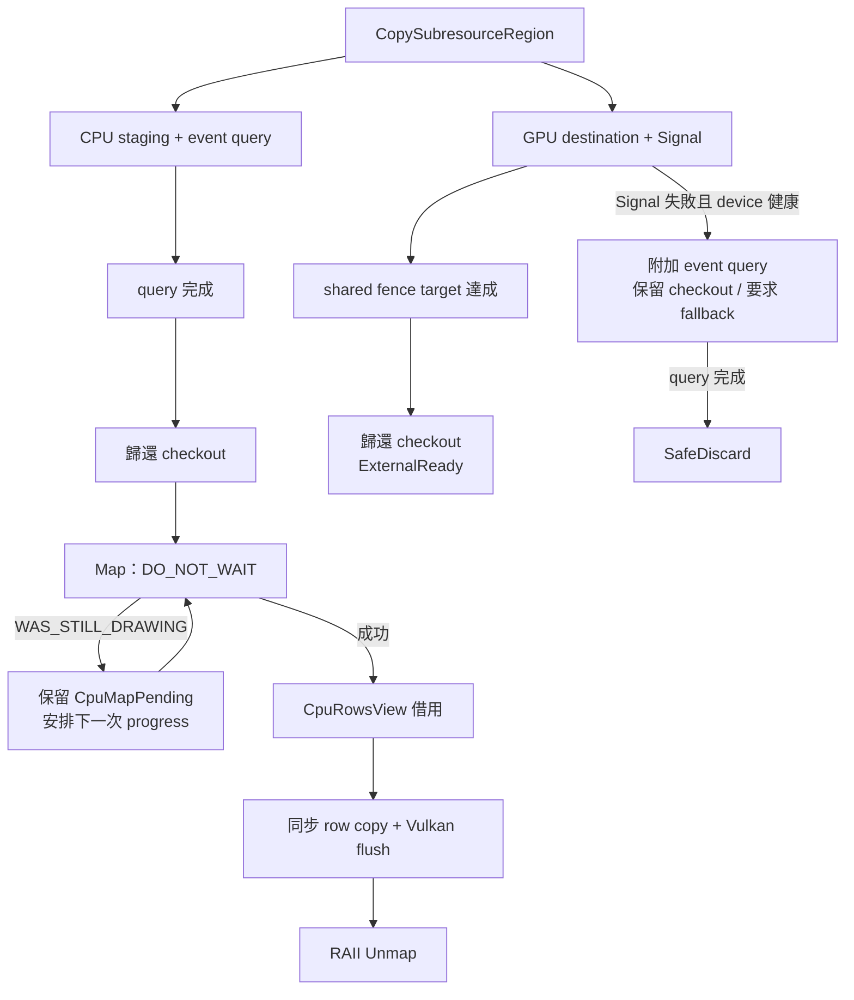
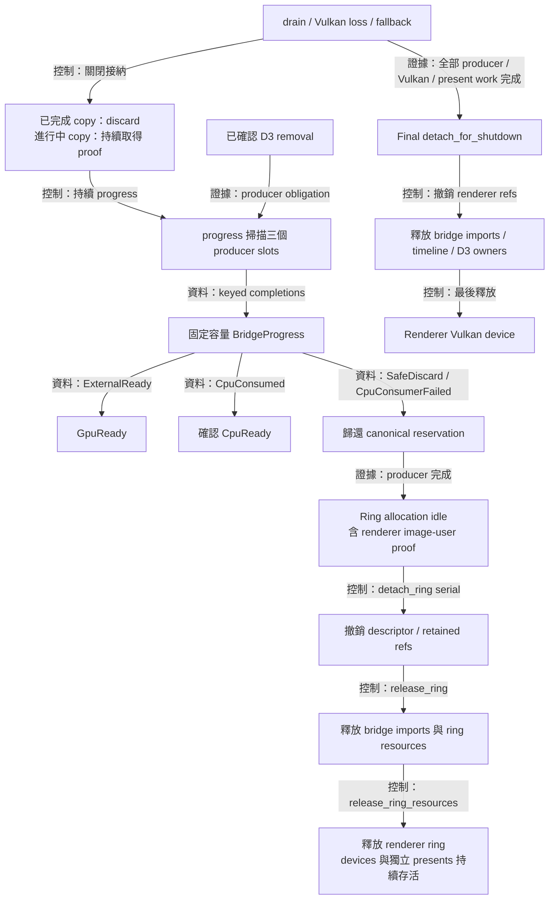
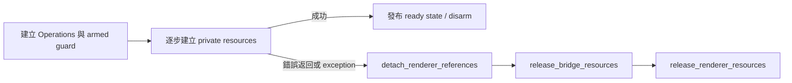

# WindowsFrameBridge：來源影格與 D3 copy 的生命週期

```mermaid
flowchart LR
  WGC[WGC checkout<br/>WindowsCapturedFrame] -->|資料：submit 移交影格| B[WindowsFrameBridge]
  F[WindowsRenderStack<br/>接納 / transport / aggregate facts] -->|擁有；資料：SlotKey / FrameStamp| B
  B -->|擁有| Imports[D3 textures / fences<br/>Vulkan imports]
  B -->|控制：發起 copy| P[D3 CopySubresourceRegion]
  P -->|證據：producer completion| Q[query / shared fence]
  Q -->|證據：copy 完成| R[歸還 WGC checkout]
  Q -->|控制：CPU delivery| C[CPU Map / CpuRowsView]
  C -.->|借用：同步 consumer| U[renderer upload<br/>row copy / flush]
  U -->|控制：返回| M[RAII Unmap]
  Q -->|資料：completed wait| G[ExternalReady]
  M -->|資料：CpuConsumed| E[BridgeProgress<br/>最多三筆 keyed completion]
  G -->|資料：keyed completion| E
  E -->|資料：completion batch| F
  F -->|擁有；資料：typed completion| VR[VulkanRenderer<br/>canonical slot phase / image users]
  VR -.->|借用：registered image / completed wait| Imports
  VR -->|控制：submit| V[Vulkan submission]
  V -->|證據：submission fence| S[submission retirement]
  VR -->|控制：present enqueue| Present[獨立 PresentRecord]
  Present -->|證據：present fence| T[presentation retirement]
```



為了讓來源擷取與 Vulkan 顯示各自維持明確的資源生命週期，系統需要分別保存 D3 copy、Vulkan submission 與 presentation 的完成證據。`WindowsFrameBridge` 管理 D3 device、immediate context、三個 producer slots、已接收的 WGC checkout，以及 D3 shared texture／fence 與對應的 Vulkan imported image／memory／view／timeline。`VulkanRenderer` 管理 canonical slot phase、Vulkan device、CPU upload 與顯示資源；`WindowsRenderStack` 協調影格接納、bridge selection、ring transaction 與兩個 owners 的進度。

Renderer 以 `ExternalSampledImageView` 保存 image registration，以 `CompletedProducerWait` 保存已完成的 producer wait。Bridge 保存對應的原生 owner；renderer 負責退休 Vulkan 使用者並撤銷 registration。共用 device／WSI／draw 與三段 progress 的責任見 [共用 Vulkan renderer](shared-vulkan-renderer.md)。

主要檔案：

- [`windows_frame_bridge.hpp`](../../platform/windows/windows_frame_bridge.hpp)：主執行緒 API、借用期間、submit 結果與 completion batch。
- [`windows_frame_bridge.cpp`](../../platform/windows/windows_frame_bridge.cpp)：D3 資源、Windows adapter／extension 偏好、逐 handle 相容性探測、Vulkan import、copy proof、Map/Unmap 與 checkout 歸還。
- [`windows_render_stack.cpp`](../../platform/windows/windows_render_stack.cpp)：配對兩個 owners 的 ring、轉交 typed completion、選擇 bridge，以及合併 deadline／loss facts。
- [`vulkan_renderer.cpp`](../../render/vulkan_renderer.cpp)：驗證 canonical slot、搬移 CPU rows，以及 Vulkan submission／presentation。
- [`vulkan_input.hpp`](../../render/vulkan_input.hpp)：`SlotKey`、`FrameStamp`、`CpuRowsView` 等跨 owner 資料契約。
- [`graphics_construction_guard.hpp`](../../platform/windows/detail/graphics_construction_guard.hpp)：建構與 ring 安裝的有序 rollback，依序撤銷引用、釋放 bridge 資源、釋放 renderer 資源。

## Device bootstrap 與 external import



為了選擇與擷取裝置相容的 Vulkan device，renderer 需要平台提供 adapter 偏好與可選 feature 要求。`VulkanStartupRequest` 提供短命的 candidate callable、extension 名稱群組與 timeline request；renderer 在建構期間消費這些值，完成完整 WSI 條件檢查，並以 `VulkanDeviceBorrow` 回傳實際啟用結果。Bridge 在 Windows implementation 內執行 LUID 比對與 Win32 procedure resolution。

為了確認實際來源 allocation 的互通能力，每個 slot 都會建立 VkImage、D3 shared texture、query 與 NT handle，再計算可用 memory types：

```text
compatible_types = image_requirements.memoryTypeBits & handle_properties.memoryTypeBits
dedicated = external_format_requires_dedicated || image_requires_dedicated
```

Memory selection 優先使用 device-local type，並容許符合必要 flags 的其他 type。`ForceCpuBaseline` 也執行真實 handle probes；其後選擇 CPU ring。自動模式接續 import／bind／view 與 timeline 建立，完成 renderer registration 後開放接納。

GPU ring replacement 保留 shared fence、timeline 與遞增 target；`release_ring` 管理 allocation-local resources，`release_interop_support` 管理跨 ring 的互通支援資源。CPU fallback 先退休相關使用者，再釋放 support。Capability facts 保存探測結果，支援新 generation 的重新評估。

`BridgeResourceObserver` 以兩種 noexcept 事件回報 timeline semaphore 的 create／destroy，aggregate 將它們加入既有 counters 與 live high-water。即使後續 import 失敗，同一次呼叫內成功 create 與隨後 destroy 的兩個事件仍各自記錄。

## Ring identity 與接納



為了辨認重建前後的資源，系統需要比 capture generation 更精確的 allocation identity。同一 generation 的 GPU probe 與 CPU fallback 都會配置新 ring，因此每次安裝使用遞增的 `ring_serial`，搭配固定的 `index` 組成 `SlotKey`。serial overflow 會關閉接納並回報 terminal error。

renderer 收到 completion 時，會一起核對 serial、index 與預期 phase。bridge 收到建立 slot 或釋放 ring 的要求時，也會先驗證 identity。舊 ring 的 key 因此具有明確的失效邊界。

Facade 先透過 `reserve_source_slot()` 取得空閒 slot，接著呼叫 bridge 的 `submit`。Bridge 完成來源尺寸、格式、generation、D3 device 與 texture projection 驗證後接收 checkout。`FrameStamp::sequence` 表示本 renderer 的接納順序，`intake_observed_at` 延續 capture 端記錄的觀察時間。

為了讓 retained redraw 能跨越一次接納嘗試，reservation 保存舊 metadata 與一個 `restore_retained_on_cancel` 標記。Adoption 前的驗證錯誤或 exception 走 `cancel_source_reservation`；當 ring、接納狀態與 sequence 仍符合 redraw 條件時，舊 retained reference 會恢復。Bridge 接收 checkout 後產生的 `SafeDiscard` 走 `discard_completed_source`，完成該次 producer reservation 的歸還。

## Typed handoff 與 readiness



為了讓 draw 消費一組一致的影格資料，renderer 需要一起提交 content extent、來源時間戳與 readiness。`complete_cpu_input` 直接核對 `CpuRowsView` 的 allocation、content、pitch 與 span，完成 row copy 與 flush 後更新 metadata，再將 phase 改成 `CpuReady`。Flush 回報 Vulkan device loss 時，renderer 同步記錄 loss 並關閉接納，completion batch 的後續工作沿用 proof／discard 路徑。

GPU 路徑透過 `register_external_image` 在安裝期間建立 borrowed image 與 descriptor 的關聯；`complete_external_input` 再核對當前 `SlotKey`、`ProducerPending`、content bounds 與 completed timeline wait，成功後提交 `GpuReady`。兩條路徑共同使用 renderer 的 canonical phase，bridge 的 records 保存 producer 原生操作的完成證據。

## Producer proof 與同步 CPU rows



為了讓 WGC 能安全重用其 buffer，bridge 會保存完整的 `WindowsCapturedFrame`，直到 D3 fence、event query 或已確認的 D3 device removal 提供歸還依據。query 完成後，CPU 路徑可先歸還 checkout；staging texture 與 `CpuMapPending` record 持續承接後續 Map 重試。

CPU consumer 透過 `CpuRowsView` 借用 mapped rows。span 的長度涵蓋最後一列有效 pixels：

```text
row_bytes = content.width × 4
source_span_bytes = (content.height − 1) × row_pitch + row_bytes
```

bridge 與 renderer 都會檢查尺寸、pitch 與位址計算的可表示範圍。renderer 在 consumer 返回前，透過 `copy_bgra_rows` 逐列複製 content，清除右側與下方 padding，再執行必要的 noncoherent flush；bridge 的 RAII guard 隨後執行 Unmap。令 allocation bytes 為 `A`、content bytes 為 `C`，每幀 copy=`C`、clear=`A-C`，Vulkan upload 維持 `A`。完整 content 的 clear 為 0，來源縮小時新增 padding 依本幀尺寸清零；詳細契約見 [CPU rows](shared-vulkan-renderer.md#cpu-rows內容複製與-padding-定義)。

consumer 的借用期間涵蓋一次 `progress` 呼叫。這段期間維持 bridge、slot 與 owning aggregate 的穩定生命週期，可讓 mapped address、context 與 texture 共同保持有效。

## Completion、錯誤與釋放順序



為了保持錯誤來源清楚，`BridgeProgress::terminal_error` 承接 native producer failure，`CpuConsumerFailed` 承接 renderer upload failure。renderer 依照這個來源判斷 Vulkan device loss，D3 completion 則持續使用自己的證據。

每次 progress 最多產生三筆完成事件。consumer 失敗後，同批剩餘 slots 轉入 proof／discard 流程。健康 D3 device 回報 query error 時，bridge 保存 checkout 與 terminal error，並提供後續 poll deadline，讓關閉流程持續嘗試取得完成證據。

為了讓來源 allocation 更換時保留獨立呈現工作，ring detach 使用 allocation-local proof：bridge 的 copy／Map records 已完成，renderer 的 image users 已退休。Aggregate 消費 keyed completion、歸還 canonical reservation，接著 `detach_ring` 驗證 installation serial 與每個 slot identity，reset descriptor pool 並撤銷 retained／image references；reset 失敗時保存 ring owners 並回報錯誤。Facade 以相同 serial 呼叫 bridge `release_ring`，釋放 imported view／image／memory、D3 texture、staging／query，再釋放 renderer ring resources。Devices 與獨立 present records 依各自生命週期持續存活。

最終 aggregate teardown 需要全部 producer 與 Vulkan native work 的完成證據，包含獨立 presentation。`detach_for_shutdown` 直接銷毀 descriptor pool、清除 ring references，接著釋放 bridge imports、timeline 與 D3 owners，最後釋放 renderer 的 Vulkan device。D3 proof、acquire／submission proof 與 present proof 各自支持對應的 obligation；Vulkan loss 也保留 producer 完成檢查。

`has_pending_inputs()` 同時涵蓋 copy-pending 與 Map-pending records。析構保留 fail-closed invariant：仍有 producer obligation 時會終止程序，以維持 checkout 與原生資源的安全生命週期。

## 建構與安裝的 rollback



為了讓 partial construction 也遵守跨 owner 的引用順序，系統需要在第一個 fallible step 前建立 cleanup 責任。`GraphicsConstructionGuard<Operations>` 保存借用的 operations，scope 結束時依序執行三個 `noexcept` cleanup 動作。`disarm()` 在交易成功時轉移 cleanup 責任；detach proof 失敗時沿用 terminate invariant，保存資源相依性的安全邊界。

Bootstrap operations 負責整個 graphics aggregate：撤銷 renderer references、釋放 bridge，再釋放 renderer native resources。Ring-install operations 綁定單次安裝的 serial，回收該 ring 的 registrations、imports、staging 與 upload allocations；兩個 devices 與獨立 present records 維持既有生命週期。Renderer 在配置前建立 private slot identities，`publish_ring` 在所有必要資源就緒後發布 ready state，接納條件因此能直接反映安裝交易的完成狀態。
