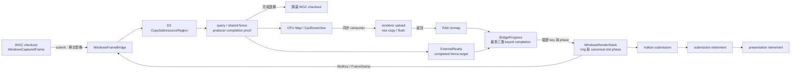
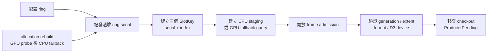
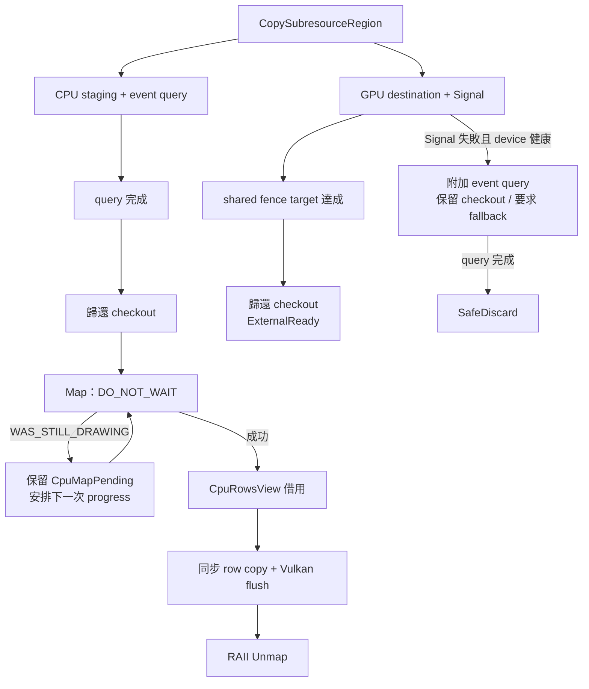
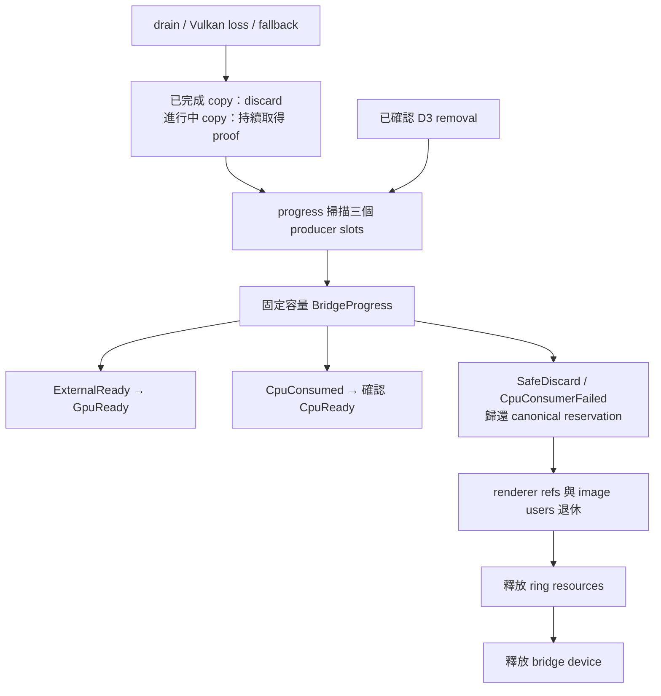

# WindowsFrameBridge：來源影格與 D3 copy 的生命週期



為了讓來源擷取與 Vulkan 顯示各自維持明確的資源生命週期，系統需要分別保存 D3 copy、Vulkan submission 與 presentation 的完成證據。`WindowsFrameBridge` 管理 D3 device、immediate context、三個 producer slots，以及已接收的 WGC checkout；`WindowsRenderStack` 管理影格接納、canonical slot phase、Vulkan upload 與顯示資源。

本文件描述目前 producer ownership 遷移階段。D3 shared texture、shared fence、Vulkan imported image 與 timeline semaphore 目前由 Windows render facade 持有；bridge 透過 `ExternalCopyBorrow` 接收單次呼叫所需的介面，並為進行中的 copy 保存 destination 與 fence 的 COM reference。後續 import owner 遷移會將這組互通資源集中到 bridge。

主要檔案：

- [`windows_frame_bridge.hpp`](../../platform/windows/windows_frame_bridge.hpp)：主執行緒 API、借用期間、submit 結果與 completion batch。
- [`windows_frame_bridge.cpp`](../../platform/windows/windows_frame_bridge.cpp)：D3 資源建立、來源驗證、copy proof、Map/Unmap 與 checkout 歸還。
- [`windows_render_stack.cpp`](../../render/windows_render_stack.cpp)：呼叫 bridge、驗證 canonical slot、搬移 CPU rows，以及 Vulkan submission／presentation。
- [`vulkan_input.hpp`](../../render/vulkan_input.hpp)：`SlotKey`、`FrameStamp`、`CpuRowsView` 等跨 owner 資料契約。

## Ring identity 與接納



為了辨認重建前後的資源，系統需要比 capture generation 更精確的 allocation identity。同一 generation 的 GPU probe 與 CPU fallback 都會配置新 ring，因此每次安裝使用遞增的 `ring_serial`，搭配固定的 `index` 組成 `SlotKey`。serial overflow 會關閉接納並回報 terminal error。

renderer 收到 completion 時，會一起核對 serial、index 與預期 phase。bridge 收到建立 slot 或釋放 ring 的要求時，也會先驗證 identity。舊 ring 的 key 因此具有明確的失效邊界。

`submit` 先完成來源尺寸、格式、generation、D3 device 與 texture projection 驗證，再接收 checkout。成功接收後，renderer 更新 retained redraw 的引用與接納計數。`FrameStamp::sequence` 表示本 renderer 的接納順序，`intake_observed_at` 延續 capture 端記錄的觀察時間。

## Producer proof 與同步 CPU rows



為了讓 WGC 能安全重用其 buffer，bridge 會保存完整的 `WindowsCapturedFrame`，直到 D3 fence、event query 或已確認的 D3 device removal 提供歸還依據。query 完成後，CPU 路徑可先歸還 checkout；staging texture 與 `CpuMapPending` record 持續承接後續 Map 重試。

CPU consumer 透過 `CpuRowsView` 借用 mapped rows。span 的長度涵蓋最後一列有效 pixels：

```text
row_bytes = content.width × 4
source_span_bytes = (content.height − 1) × row_pitch + row_bytes
```

bridge 與 renderer 都會檢查尺寸、pitch 與位址計算的可表示範圍。renderer 在 consumer 返回前完成 row copy 與必要的 noncoherent flush，bridge 的 RAII guard 隨後執行 Unmap。目前 upload 先清除完整 allocation，再逐列複製有效內容；padding 最佳化屬於後續 CPU row packing 階段。

consumer 的借用期間涵蓋一次 `progress` 呼叫。這段期間維持 bridge、slot 與 owning aggregate 的穩定生命週期，可讓 mapped address、context 與 texture 共同保持有效。

## Completion、錯誤與釋放順序



為了保持錯誤來源清楚，`BridgeProgress::terminal_error` 承接 native producer failure，`CpuConsumerFailed` 承接 renderer upload failure。renderer 依照這個來源判斷 Vulkan device loss，D3 completion 則持續使用自己的證據。

每次 progress 最多產生三筆完成事件。consumer 失敗後，同批剩餘 slots 轉入 proof／discard 流程。健康 D3 device 回報 query error 時，bridge 保存 checkout 與 terminal error，並提供後續 poll deadline，讓關閉流程持續嘗試取得完成證據。

釋放採用以下順序：

1. 關閉 frame admission，持續推進 producer、submission 與 presentation 的完成證據。
2. 消費 keyed completion，歸還對應的 canonical reservation。
3. 退休 renderer 的 image users、retained reference 與 descriptor 相關資源。
4. 以目前的 serial 呼叫 `release_ring`，釋放 staging 與 query。
5. 在 aggregate 清理階段釋放 D3 device。

`has_pending_inputs()` 同時涵蓋 copy-pending 與 Map-pending records。析構保留 fail-closed invariant：仍有 producer obligation 時會終止程序，以維持 checkout 與原生資源的安全生命週期。
