# Windows runtime、overlay 與系統轉接器

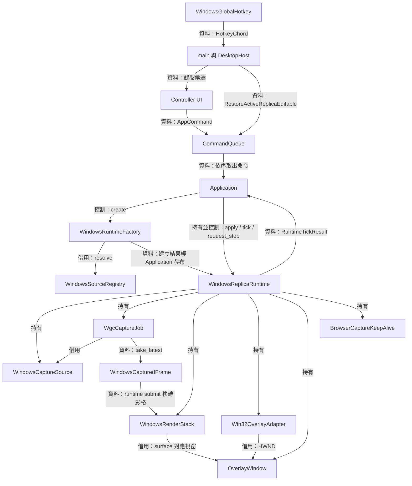

一個副本需要同時協調擷取、圖形呈現、原生視窗與使用者設定。 `WindowsReplicaRuntime` 把這些 owner 收在同一個聚合物件內，依相依關係建立、更新與釋放。 [WindowsRuntimeFactory](../../platform/windows/windows_runtime_factory.cpp) 負責建立完整聚合，[runtime 宣告](../../platform/windows/windows_replica_runtime.hpp)列出持有者，[ports.hpp](../../include/avb/app/ports.hpp) 規定 Application 持有已發布 runtime，直到 `tick()` 回報 `Stopped`

滾輪縮放的操作、幾何計算與設定交易見 [來源欄寬與副本滾輪縮放](../development/replica-wheel-zoom.md)。

前端與熱鍵先送出命令，由 Application 選定目前 session 並呼叫 runtime。 原生樣式、WGC、D3 與 Vulkan 操作則由 Windows runtime 及其具體元件執行。 原生回呼的 wake 讓 [DesktopHost](desktop-host.md) 再次執行主迴圈，資料與生命週期事件由同步 tick 回傳

[擷取頁](windows-capture.md)說明來源與影格持有，[renderer 頁](renderer.md)說明 GPU 完成證據，[保活功能頁](browser-capture-keep-alive.md)說明透明 helper 的獨立生命週期。 [回架構總覽](README.md)

## WindowsRuntimeFactory 與發布交易

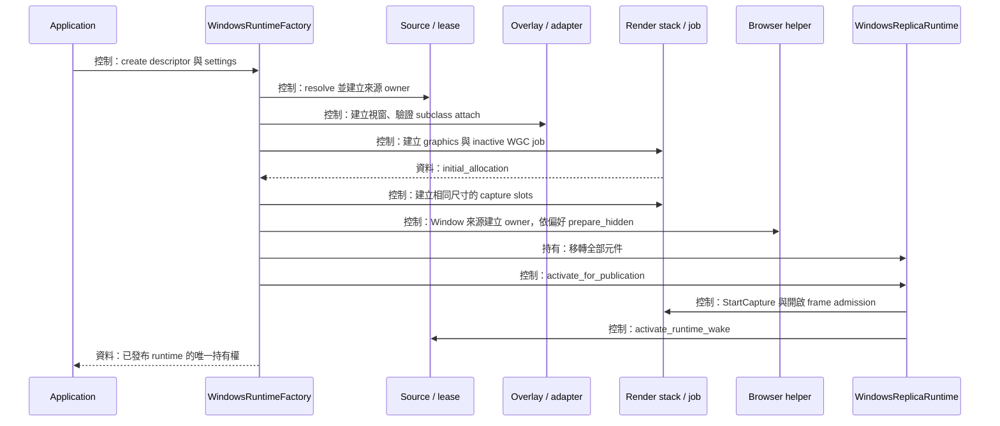

Factory 要交付一個可以立刻 tick 的完整副本，因此在啟動擷取前先完成全部原生相依物件。 [WindowsRuntimeFactory::create()](../../platform/windows/windows_runtime_factory.cpp) 以單次 `resolve()` 取得來源租約，接著建立 overlay、附加 adapter，再建立 render stack 與 inactive job。 圖中的發布階段由 [activate_for_publication()](../../platform/windows/windows_replica_runtime.cpp) 完成

### 從描述尺寸轉到實際配置

初始視窗尺寸以 descriptor 尺寸為輸入，寬度上限為 960，高度上限為 540。 這兩軸各自取最小值。 WGC job 則讀取來源項目當下的實際尺寸，回傳 `initial_allocation()`，factory 依此建立 `DXGI_FORMAT_B8G8R8A8_UNORM` 的 capture slots。 Factory 同時設定初始原生不透明度與 renderer 選區；第一張有效畫面的呈現完成後，runtime 依實際 content 與有效選區更新 adapter 的縮放長寬比

資源世代從 1 開始，影格池緩衝數為 5。 Runtime 持有這個計數與 bridge preference，裝置重建時沿用同一組配置需求。 Source descriptor 承載選取時的快照資訊，job 的實際 allocation 供本次擷取與 renderer 配對

### 最後一步啟動原生擷取

`StartCapture()` 是發布路徑最後一個可能回報失敗的原生操作。 成功後開啟 frame admission，綁定來源 runtime wake，並將 runtime 移轉為 `unique_ptr<IReplicaRuntime>`。 這段尾端透過 `noexcept` 操作與指標移轉完成，Application 接手後就進入持續 tick 與安全停止的契約

建構失敗時，factory 把來源、權限、視窗類別與圖形支援錯誤保留為指定 `AppError`，其餘建構錯誤歸入 `RuntimeConstructionFailure`。 發布前的 job 保持接收關閉，來源 observation 則繼續保存已觀察到的關閉事實

Subclass 的清理需要 adapter 存活到 callback 解除，因此 factory 使用 [FactoryOverlayAttachmentGuard](../../platform/windows/detail/overlay_transactions.hpp)。 Guard 借用 overlay 與 adapter，隨原生 attach 成功開始負責收束

Attach 的結果需要視窗銷毀時，guard 保留 adapter，先銷毀 overlay，再完成 adapter 清理。 Activation 失敗時，runtime 先釋放 job 與 render stack，讓 guard 可依序處理 HWND

## WindowsReplicaRuntime 的 tick 與事件投影

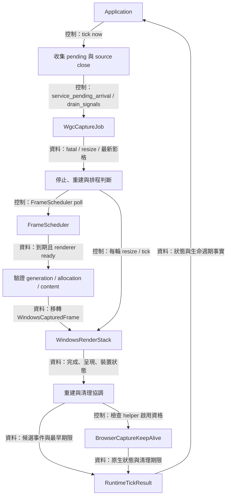

Tick 的目的是讓已持有的原生工作向下一個可觀察階段前進。 [WindowsReplicaRuntime::tick()](../../platform/windows/windows_replica_runtime.cpp) 接收單調時鐘時間，收集來源與擷取事實，再執行有界工作並回傳下一次觀察期限。 [windows_runtime_policy.hpp](../../platform/windows/detail/windows_runtime_policy.hpp) 提供事件合併、尺寸階段與清理觀察的值政策

### 先處理來源事實，再接收可提交影格

每輪先載入先前保存的事件候選，接著取得 source close edge、服務 pending arrival，並讀取 capture signal batch。 來源關閉時保存 `SourceLost`，capture fatal 時保存 `Failed`，兩者都會啟動 job 停止並隱藏 helper。 尺寸變動則需要來源連線正常、擷取有效，以及目前處於可開始重建的階段

正常提交路徑先查 `has_latest()`，交由 `FrameScheduler::poll()` 決定時間。 到期且 render stack 可接收時，runtime 取出信箱影格，再確認世代、allocation 相符且內容兩軸大於零，最後移交 renderer。 較舊世代或尺寸相異的 checkout 在此結束持有期，讓 pool 回收

每輪還會對 renderer 執行 `resize()` 與 `tick()`。 這條固定路徑推進先前提交的複製、保留影像重畫、presentation 與資源釋放。 因此新影格到達頻率與 GPU 完成觀察各自可以前進

### 同步事件的保存與提交

`RuntimeTickResult` 使用最多 10 個 optional event slots，承載 3 個狀態類事件、5 個停止前生命週期候選，以及 `CaptureContentChanged`、`RegionSelectionCompleted` 兩種選區事實。 `TickCandidates` 先保存本次事實，`add_runtime_events()` 再寫入固定陣列。 Application 依自己的生命週期優先序消費結果，詳細決策見 [application-ui](application-ui.md)

`RuntimeBridgeEventState` 分別保存上次發布值與待發布值，觀察到變更後建立 pending。 `RuntimeRecoveryEventState` 保存 started／completed 的因果關係，允許同一批包含兩個事件。 寫入結果後再提交游標，讓下次 tick 繼續接在已發布的狀態之後

停止期間可繼續回傳 bridge、capture exclusion 與 drain status。 全部 owner 釋放後，事件陣列改為單一 `Stopped`。 Application 收到這項完成證據後釋放 published runtime，對應契約位於 [IReplicaRuntime](../../include/avb/app/ports.hpp)

### 多個期限合成一次主迴圈觀察

排程器、renderer、重建重試、helper grace 與整體 drain 各自可提供期限。 Runtime 以 `earlier_deadline()` 取其中最早的一個：

```cpp
if (candidate && (!current || *candidate < *current)) {
  current = candidate;
}
```

例如 renderer 要在 10 ms 後觀察完成，helper 的 grace 尚餘 180 ms，清理政策要求 50 ms 後觀察，runtime 回傳 10 ms 的期限。 [DesktopHost](desktop-host.md) 再與 controller 和應用程式的其他期限合併，等待事件或到期後執行下一輪

## SettingsOperations 與設定交易

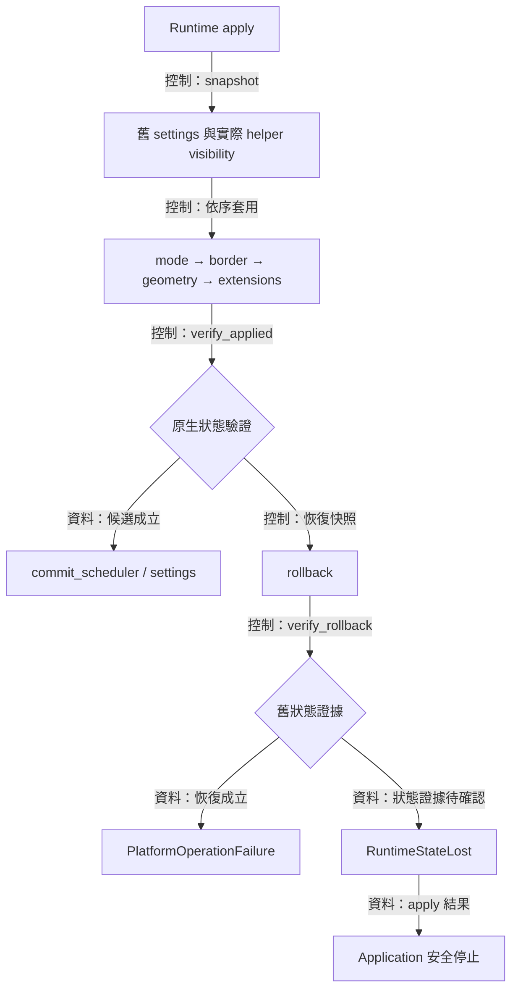

設定更新需要把視窗的互動方式、裝飾、內容位置與 helper 狀態當成一個候選。 [SettingsOperations](../../platform/windows/windows_replica_runtime.cpp) 借用 runtime 內的具體 owners，提供 [apply_settings_transaction()](../../platform/windows/detail/overlay_transactions.hpp) 所需操作。 交易驗證成立後更新 FPS scheduler 與 runtime 保存的 settings，Application 隨後提交領域設定

### Snapshot 記錄實際活動

Snapshot 保存原 settings，並透過 `snapshot_active()` 查閱 helper 的原生可見性。 Border 改變前，adapter 先將 client rectangle 保存為螢幕座標。 Overlay 改變 `GLFW_DECORATED` 後，adapter 以新 frame insets 重建外框矩形，使內容位置盡量維持原先擺放

為了配合一般邊框變更與交易回復的不同需求，`restore_client_geometry()` 接受 `GeometryRestoreBounds`。`WorkArea` 將外框限制於最近螢幕工作區，並驗證計算結果；`Exact` 驗證座標可表示性與 client／outer round-trip，保留原 snapshot 的精確位置及尺寸，供 rollback 使用。`client_geometry_matches()` 提供原生 client rect 的精確比較。

為了同步觀看範圍與視窗比例，region 或 selecting_region 變更且已呈現內容可用時，runtime 在同一筆交易保存 client snapshot，並呼叫 adapter 的 `fit_client_geometry()`。純值政策保持目前寬度，依新內容比例求高度，再以工作區可用空間等比例縮小。Border 和 region 同時改變時，fit 使用新外框厚度；rollback 以原設定和原 snapshot 精確回復。一般 opacity／FPS／步幅更新沿既有設定職責執行。

### 完整驗證與恢復

交易的主要控制鏈直接來自程式：

```cpp
const auto applied = operations.apply_mode() && operations.apply_border() &&
                     operations.apply_geometry() &&
                     operations.apply_extensions() &&
                     operations.verify_applied();
if (applied) {
  operations.commit_scheduler();
  return {};
}
```

一般套用失敗會嘗試 rollback，舊狀態驗證成立時回傳 `PlatformOperationFailure`。 恢復證據待確認時回傳 `RuntimeStateLost`。 C++ 例外路徑同樣嘗試恢復，並維持 `RuntimeStateLost` 分類，由 Application 接續停止及清理

Helper 的恢復還會重新檢查來源資格。 來源關閉後，停用沿單向路徑前進。 若快照記錄 helper 原本 active，而目前來源已關閉，交易會保留隱藏狀態並回報 `RuntimeStateLost`。 這讓來源生命週期與 native snapshot 的驗證要求一起反映到結果

## 來源選區的呈現與輸入契約

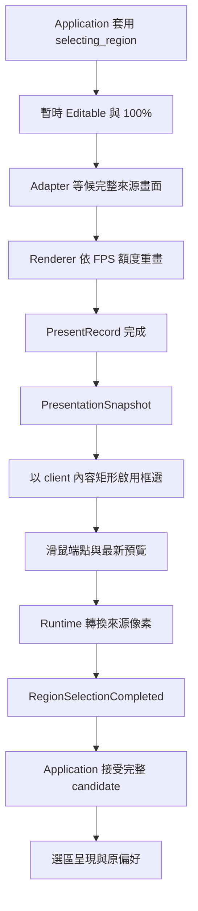

為了讓拖曳對應使用者眼前的影像，選區流程需要保存已呈現畫面的幾何，以及一個明確的輸入啟用時點。 `PresentationSnapshot` 保存來源 content、framebuffer、viewport、有效 region、完整選取畫面旗標與呈現序號。 Renderer 在成功 present fence 退休後發布這份 owned value，runtime 以它建立選區映射。

開始命令先經過完整原生設定交易，設定有效模式為 Editable、有效不透明度為 100%，並啟用待命的 adapter。 模式與不透明度的使用者偏好繼續留在 `ReplicaSettings`。 完整來源畫面呈現後，runtime 將 viewport 換成實體 client 座標的內容矩形，再讓 adapter 接受起點。

Adapter 保存一組起點與終點、一份最新預覽，以及一個完成或取消結果。 左鍵開始時取得 mouse capture，拖曳中的端點限制於影像邊界。 完成與取消先清理 gesture 狀態，再呼叫 `ReleaseCapture()`，因此同步進入的 `WM_CAPTURECHANGED` 會看見已完成的狀態。 Terminal 狀態維持到 Application 接受下一次設定交易。

Runtime 將 client 座標依 client/framebuffer 比例換算，再透過 `selection_region()` 產生左上原點、半開區間的來源像素矩形。 來源尺寸、framebuffer、viewport 或 client 尺寸變更，以及 Esc、焦點或 capture 交接，都會取消當次框選並恢復偏好。 尺寸失效以 `CaptureContentChanged{Extent{}}` 傳遞，下一張有效呈現提供新尺寸。

為了讓靜態來源也能調整選區，renderer setter 合併最新 presentation 並保存 dirty 狀態，runtime 透過既有 `FrameScheduler` 分配額度。 同次接納的新 capture 會使用最新 presentation；該次完整額度由新 frame 消費。 其餘 dirty retained 工作取得重畫許可，CPU 與 GPU 路徑沿用既有 image 與同步流程。 完成觀察與清理 deadline 持續由主迴圈推進。

Capture intake 與 retained presentation 各有其生命週期。來源關閉後，安全保留的影像仍可接收取消框選或恢復全畫面的重繪；runtime 以圖形狀態與 FPS 額度安排這份工作。退休進度首次釋出可用影像時，下一次短期觀察會重新進入排程；既有 dirty 工作則沿用 FPS deadline，完成後回到 idle。

操作說明見 [Replica 透明度與選區](../development/replica-controls.md)，座標公式與 shader 取樣見 [renderer](renderer.md)。

## Graphics recovery 與資源世代

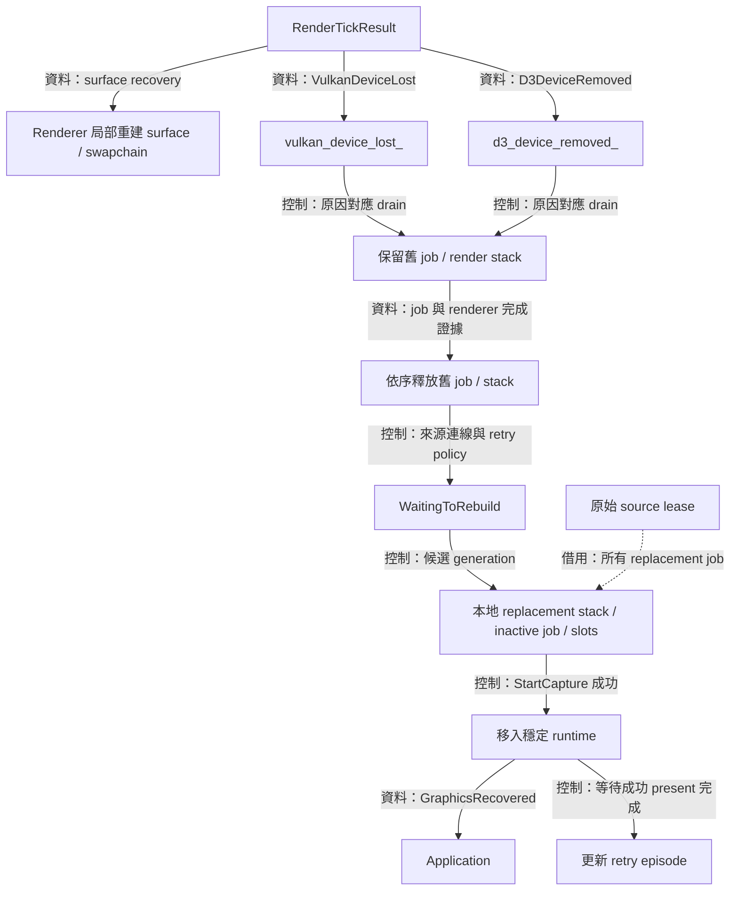

圖形恢復要讓同一個副本重新取得可工作的 graphics，同時保持來源與視窗身分。 [WindowsReplicaRuntime](../../platform/windows/windows_replica_runtime.cpp) 持有穩定的 source、overlay 與 adapter，依 [GraphicsRetryPolicy](../../render/graphics_retry_policy.hpp) 重建可替換的圖形元件。 Renderer 提供實際裝置及 presentation 完成事實，詳見 [renderer](renderer.md)

### 重建範圍依原因選擇

| 原因 | 持續持有的元件 | 重建範圍與完成條件 |
| --- | --- | --- |
| 來源 allocation 改變 | Source、overlay、adapter、graphics device | 回呼與舊配置使用完成後，重建 slots 及 WGC pool |
| Replica surface loss | Source、job、D3 device、capture slots | Renderer 清理舊 presentation，再建立 surface／swapchain |
| Vulkan device loss | Source、overlay、adapter | 取得各 API 對應證據，釋放舊 job／stack，再建立替代組合 |
| D3 device removal | Source、overlay、adapter | 使用 D3 removal 證據處理來源複製，並完成 renderer drain |

`vulkan_device_lost_` 與 `d3_device_removed_` 各自保存。 D3 的來源複製持有權依 D3 證據前進，Vulkan 的提交與呈現持有權依 Vulkan 證據前進。 `progress_device_recovery()` 同時確認 job `stop_quiescent()` 與 renderer `drain_complete`，再依序釋放舊 job 與 render stack

### 替代資源先在本地建構

`attempt_device_rebuild()` 先建立本地 `replacement_render`、`replacement_job`，再依 job 的實際初始 allocation 建立 slots。 完成 `StartCapture()` 後，這些 owners 一起移入原 runtime，更新 allocation、adapter aspect 與資源世代

資源世代由穩定 runtime 單調增加。 Resize 會在準備新 allocation 前增加計數，device retry policy 則回傳候選 generation。 世代達表示範圍上限時，runtime 回報 terminal failure 並循既有停止路徑前進。 Source lease 始終對應原 catalog item

### 重試次數與成功呈現

Policy 設定三次建構機會，基準時間為 recovery episode 開始後的 0、100 與 500 ms。 正值 delay 交回主迴圈等待，再次已到期的重試透過 `strictly_future_retry_delay()` 至少延後 1 ms。 每次開始建構時增加 attempt，這項動作由原始符號 `ConstructionAttempted` 表示

替代資源成功建構後，runtime 可發布 `GraphicsRecovered`，同時設定 `replacement_awaiting_present_`。 重試 episode 繼續保存，直到新 render result 的 `presented_frames` 顯示成功呈現完成，再以 `SuccessfulPresentRetired` 重設。 因此對外的原生修復事件與內部重試預算有各自的完成時點

## RuntimeDrainState 與聚合停止

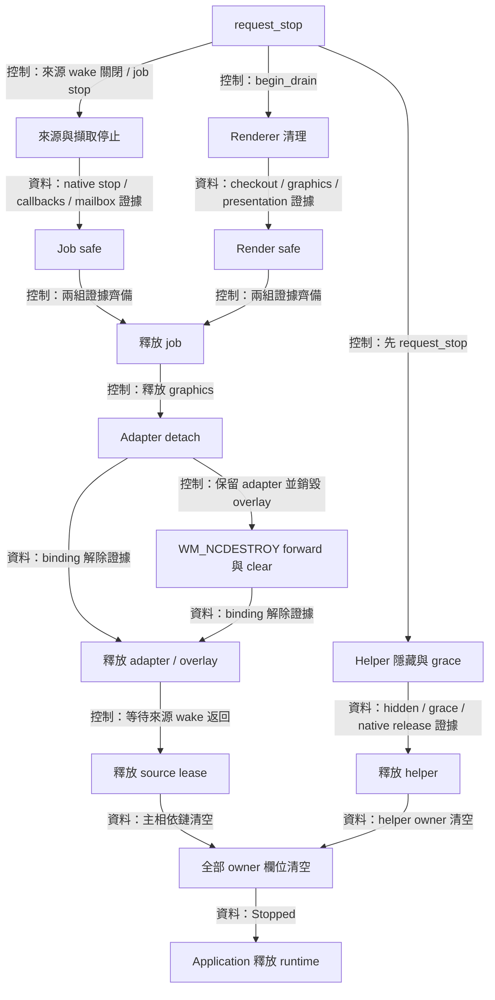

停止操作需要讓每個原生借用關係走到可釋放的狀態。 [request_stop() 與 progress_stop()](../../platform/windows/windows_replica_runtime.cpp) 分別啟動停止與完成資源釋放。 [RuntimeDrainState](../../platform/windows/detail/windows_runtime_policy.hpp) 負責保存清理狀態及下一次觀察期限。 Application 在此期間持續持有 runtime，程序組裝入口則維持 host 的生命週期，供 wake callable 借用

### 依完成證據釋放 owner

`request_stop()` 保存停止狀態，先要求 helper 隱藏，再關閉來源 wake、停止 capture job，並開始 renderer drain。 後續 tick 持續服務 callback 完成與 renderer 釋放。 Helper 使用自己的 grace 與 native release 分支，每輪可獨立前進

`progress_stop()` 先合併 job 內部與 renderer 外部的完成證據，釋放 job，接著釋放 render stack。 Adapter 成功 detach 後可釋放視窗。 Detach 回報清理需求時，runtime 保留 adapter，銷毀 overlay，讓 `WM_NCDESTROY` 先交給原 WndProc，再清除 binding

來源 lease 的釋放需要 overlay 已釋放且來源 wake 計數歸零。 Helper 需要 `cleanup_pending()` 與 `cleanup_uncertain()` 都回到清楚的完成狀態。 最後的程式條件逐一檢查全部 owner：

```cpp
if (!source_ && !overlay_ && !adapter_ && !render_stack_ && !capture_job_ &&
    !browser_keep_alive_) {
  stopped_ = true;
  candidates.stopped = true;
}
```

`SourceLost` 描述來源連線，`Stopped` 描述這組原生 owner 已全部釋放。 來源消失時仍可保留 overlay 與最後畫面，published runtime 也持續由 Application 持有到 `Stopped`。 使用者結束整個行程時的 host 政策另見 [DesktopHost](desktop-host.md)

### 清理進度與有界觀察

同一個 `no_progress_since` 涵蓋 capture cleanup、回呼、來源 wake、adapter、helper 與 graphics。 `TrackedRetirement` 或 `ProvenSafeRelease` 會重設起點。 Poll、retry 與 status edge 則沿用原起點，讓進度計時對應實際退還的持有權

[RuntimeDrainPolicy](../../render/graphics_retry_policy.hpp) 讓待處理持有權的觀察間隔維持在 50 ms 以內。 連續 10 秒維持相同完成進度時回報 `Stalled`，runtime 繼續保留相關 owners 並提供觀察期限。 清理證據待確認的狀態持續保存，直到 owner 清空且完成安全釋放觀察

Tick 的最外層 catch 會清除部分組成的 event batch，保留 owners 並停止 helper，接著排定後續 drain。 執行中例外回傳 `Failed`，停止中的例外則沿用清理狀態回報。 此處的 `noexcept` 維持原生邊界，安全解構仍依上述完成證據決定

## OverlayWindow 與 GLFW 視窗持有

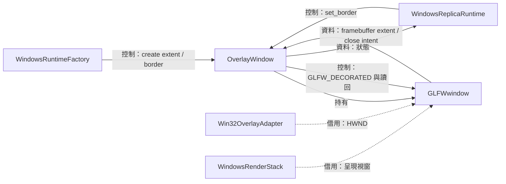

副本需要可置頂、調整大小並供 Vulkan 呈現的原生視窗。 [OverlayWindow](../../platform/windows/overlay_window.cpp) 建立 `GLFW_NO_API`、`GLFW_FLOATING` 與 `GLFW_RESIZABLE` 視窗，並持有唯一的 `GLFWwindow`。 Decoration 也由這個 owner 透過 `GLFW_DECORATED` 調整，adapter 則借用 HWND 管理輸入與幾何

### Framebuffer 與關閉意圖

`framebuffer_extent()` 使用 `glfwGetFramebufferSize()` 回傳實體像素範圍。 最小化或 drawable 暫停時，零尺寸交由 renderer 的 presentation suspension 路徑處理。 Source allocation 與 overlay framebuffer 各自有自己的尺寸，長寬比與取樣關係詳見 [renderer](renderer.md)

`close_requested()` 查閱 GLFW 的關閉旗標，tick 把它轉成 `OverlayCloseRequested`。 視窗持有者繼續存活，由 Application 決定停止，runtime 完成圖形清理後呼叫 `destroy()`。 `destroy()` 清除原生指標，讓顯式釋放與 `Impl` 解構共用一致的持有狀態

### Decoration 的原生讀回

`set_border()` 先讀取實際 `GLFW_DECORATED`，必要時修改，再讀回目標值。 快取的 `border` 在驗證成功後更新。 Native setter 與讀回錯誤保留到 `AppError`，外層 settings transaction 依此決定提交或恢復

## Win32OverlayAdapter 與樣式、幾何交易

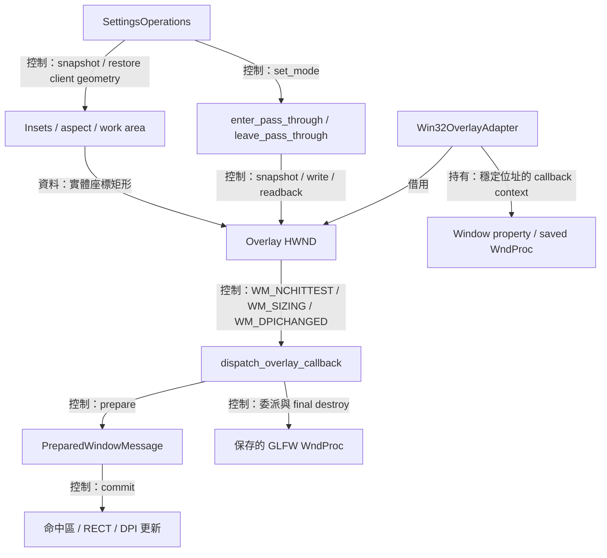

原生輸入需要把滑鼠命中、視窗樣式與螢幕座標一起考慮。 [Win32OverlayAdapter](../../platform/windows/win32_overlay_adapter.cpp) 借用 HWND，持有 subclass 綁定、原 WndProc、DPI 與幾何政策狀態。 [Overlay transactions](../../platform/windows/detail/overlay_transactions.hpp) 負責原生讀回與恢復，[overlay callback](../../platform/windows/detail/overlay_callback.hpp) 負責訊息邊界，[overlay policy](../../platform/windows/detail/overlay_policy.cpp) 負責純值幾何計算

### Subclass 的持有期

Attach 先驗證 window class style，再保存原 WndProc 與 adapter property，最後安裝自訂 WndProc。 Layered input 政策要求 class style 的 `CS_OWNDC` 與 `CS_CLASSDC` 位元為零。 專案的 GLFW patch 使主視窗類別符合這個條件，建置關係見 [build-and-validation](build-and-validation.md)

Detach 先恢復 WndProc，再移除 property，並驗證被移除的值正是目前 adapter。 結果需要更強清理時，`window_destruction_required_` 讓 runtime 保留 callback context 到 HWND 銷毀。 Adapter 的穩定位址與明確解綁順序共同保護原生訊息可到達的物件

### 模式與不透明度的原生交易

為了讓模式、邊框與不透明度各自保留使用者偏好，原生視窗需要以同一份快照套用輸入樣式與整體 alpha。 `set_presentation(mode, percent)` 接收 0–100 的整數百分比，交易先讀取完整 EXSTYLE，以及 layered 視窗的 color key、alpha、flags，再建立目標狀態

目標保留當下 EXSTYLE 中的裝飾位元，依模式決定 `WS_EX_TRANSPARENT`。 穿透模式或低於 100% 的不透明度使用 `WS_EX_LAYERED` 與 `LWA_ALPHA`，Editable 的 100% 則使用一般視窗樣式。 整數換算使用四捨五入：

$$
\alpha_{\mathrm{byte}}=\left\lfloor\frac{255p+50}{100}\right\rfloor.
$$

例如 50% 對應 alpha 128，100% 對應 255。 原生讀回成立後，adapter 更新已接受的 mode 與 percent。 失敗路徑恢復本次操作前的完整快照，讀回成立時回傳 `PlatformOperationFailure`，恢復證據待確認時回傳 `RuntimeStateLost`。 `HTTRANSPARENT` 是穿透模式對 hit test 的補充結果。 具體位元與 alpha 政策見 [overlay transactions](../../platform/windows/detail/overlay_transactions.hpp)

### 內容比例與 DPI 交易

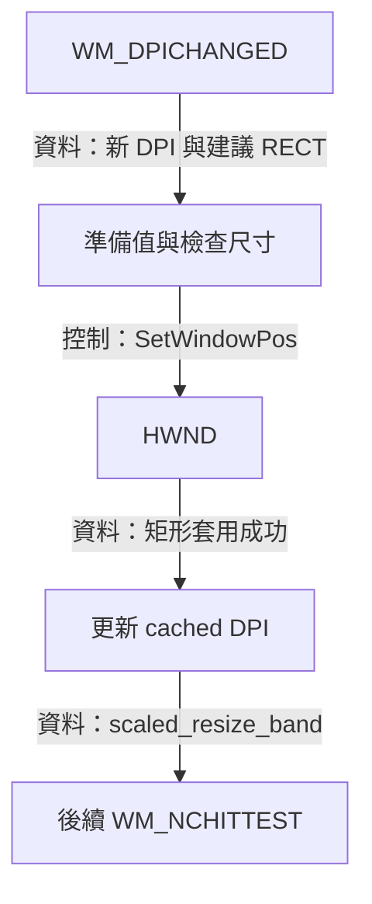

上圖對應 [apply_dpi_change_transaction()](../../platform/windows/detail/overlay_transactions.hpp) 與 adapter 的 `commit_message()`。 系統建議矩形先接受正尺寸與整數範圍檢查，`SetWindowPos()` 成功後再更新 cached DPI。 Query 或套用失敗時，訊息交回原 WndProc。 `WM_DPICHANGED` 成功提交後也會交給 GLFW 更新自身狀態

Bordered 模式的命中判斷委派 OS chrome。 Borderless Editable 使用 8 個邏輯像素的 resize band，依 DPI 換成實體像素，再區分四邊、四角與 caption 拖曳區。 `WM_SIZING` 先扣除當下的 frame insets，對內容矩形套用來源長寬比，再加回外框

比例限制讓上邊或下邊拖曳以高度為主，其餘邊與角以寬度為主，並保存拖曳對邊的錨點。 例如來源為 16:9，內容寬度改為 800 時，目標內容高度為 450，外框高度再加上頂部與底部 insets。 工作區限制另負責可放置範圍，其軸長裁切可能進一步改變矩形尺寸

`dispatch_overlay_callback()` 將 prepare 與 commit 分開。 一般訊息準備失敗時可交回保存的 WndProc，`WM_NCDESTROY` 則固定先 forward 再清除 binding，讓原生清理過程仍能存取完整 context

## WindowsGlobalHotkey 與命令派送

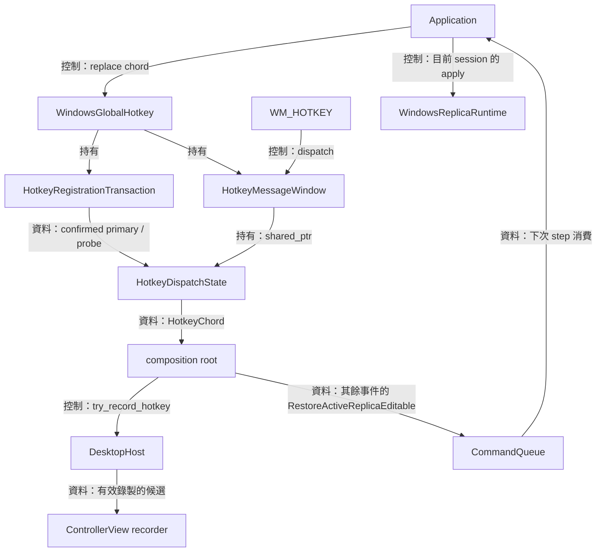

為了讓全域快捷鍵支援恢復操作及錄製目前繫結，原生 adapter 需要提供已驗證的按鍵值，再由 composition root 決定接收者。 [WindowsGlobalHotkey](../../platform/windows/windows_global_hotkey.cpp) 持有 message-only window 與 registration transaction，`HotkeyDispatchState` 驗證原生訊息後透過 `HotkeyChordSink` 傳出 `HotkeyChord`

main 先交給 host 的錄製入口，其餘事件排入 `RestoreActiveReplicaEditable`。 目前 session 的選擇由 [Application](application-ui.md) 在消費命令時完成

### 用 probe 保留替換機會

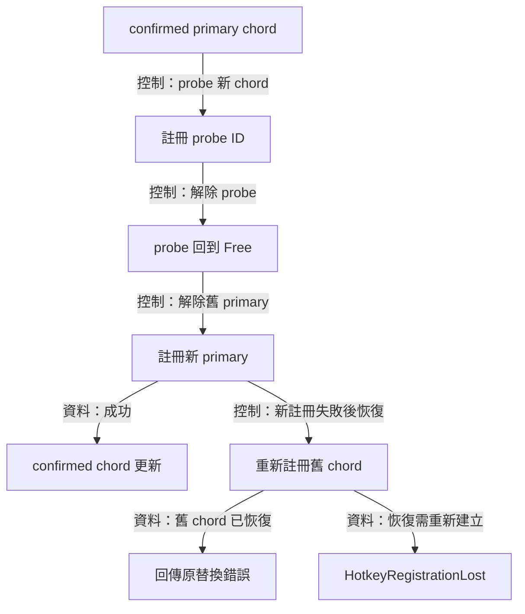

上圖對應 `HotkeyRegistrationTransaction::replace()`。 Transaction 使用固定 primary 與 probe IDs，先試用新 chord，再釋放 probe。 舊 primary 隨後解除，新 primary 註冊成功後更新 confirmed chord。 Probe 到正式註冊之間存在其他行程取得 chord 的機會，因此替換仍保留恢復舊 chord 的路徑

`Free`、`Registered` 與 `Uncertain` 分別表示可用、確認註冊及清理證據待確認。 後續 replace 先處理 uncertain cleanup，再開始新交易。 Primary 清理失敗時清除 confirmed chord，回報 `HotkeyRegistrationLost`，讓應用程式保存「偏好值」與「已註冊」兩種狀態

### 訊息身分與回呼重入

Dispatch 同時確認 primary ID、`Registered` 狀態、confirmed chord，以及訊息 payload 的 modifiers 與 virtual key。 這讓替換後留下的舊訊息走結束路徑。 呼叫 chord sink 前，WndProc 複製共享 dispatch state，涵蓋 sink 重入並銷毀 wrapper 的情況

建立、替換、清除與銷毀都依建立執行緒的契約執行。 清除先撤下 confirmed chord，再處理原生註冊。 Window 銷毀前先清除 `GWLP_USERDATA`，再釋放 callback context。 Sink 例外在 callback 邊界結束該次命令，controller UI 繼續提供獨立的恢復入口

## Windows system adapters

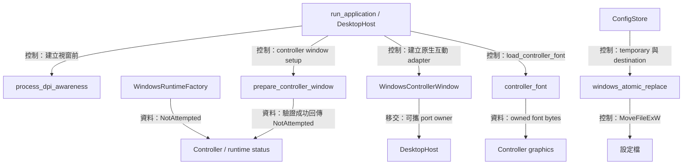

啟動與持久化需要少量直接呼叫 Windows 的操作。 [DPI 設定](../../platform/windows/process_dpi_awareness.cpp)、[視窗驗證與擷取設定](../../platform/windows/capture_exclusion.cpp)、[字型載入](../../platform/windows/controller_font.cpp)與[檔案替換](../../platform/windows/windows_atomic_replace.cpp)各自提供具體函式，讓上層保留設定流程與資源持有的責任

### Process DPI awareness

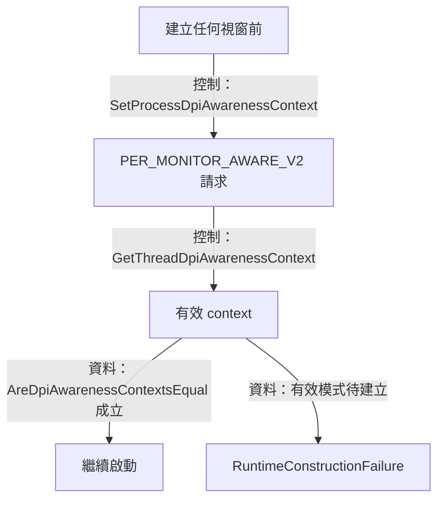

`establish_per_monitor_v2_dpi_awareness()` 先提出 process 設定，再查閱實際 thread context。 Manifest 已設定相同模式時，setter 的結果仍可由有效 context 檢查補足成功證據。 這個啟動前提讓後續視窗矩形、DPI 與 framebuffer 以一致的實體座標契約配合

### 截圖可見性與明確擷取排除

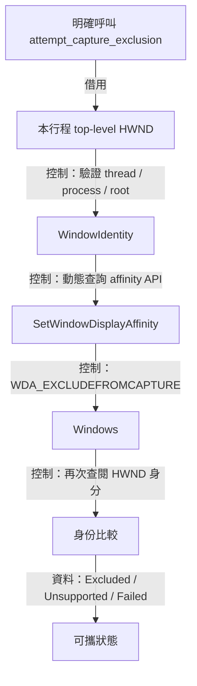

`attempt_capture_exclusion()` 在 affinity 呼叫前後驗證 HWND 的 thread、process 與 top-level 身分，再分類成 `Excluded`、`Unsupported` 或 `Failed`。 `Excluded` 表示 Windows 接受這次 affinity 要求，對外擷取工具的實際結果仍由其所使用的擷取機制決定

為了讓截圖與螢幕分享包含產品介面，controller 與 replica 都保留新視窗預設的可擷取狀態。 `prepare_controller_window()` 驗證 HWND 與 GLFW class style，合約違反時回報啟動錯誤，成功時回傳 `NotAttempted`。 `WindowsRuntimeFactory` 也以 `NotAttempted` 初始化 replica 的擷取排除狀態，runtime event 與 host 分別傳遞這兩個視窗的狀態

上圖呈現保留的明確擷取排除 API。 預設啟動流程採用上述可截圖策略。 視窗來源選單依行程身分過濾 avb0795 自身的視窗，整個顯示器來源則包含該顯示器上的可見內容。 Replica 位於擷取中的顯示器時可能形成重複鏡像，選用視窗來源或把 replica 放到另一個顯示器可避開這個回授

### 安裝字型的位元組持有

`load_controller_font()` 從 Windows 安裝目錄的 `Fonts/msjh.ttc` 讀取字型。 讀檔前要求大小大於零且至多 64 MiB，再配置 `vector<std::byte>` 並完整讀入。 呼叫者接手位元組後，檔案串流的作用域結束。 Controller 如何把這些 bytes 交給 Dear ImGui，見 [DesktopHost](desktop-host.md)

### Controller 原生互動

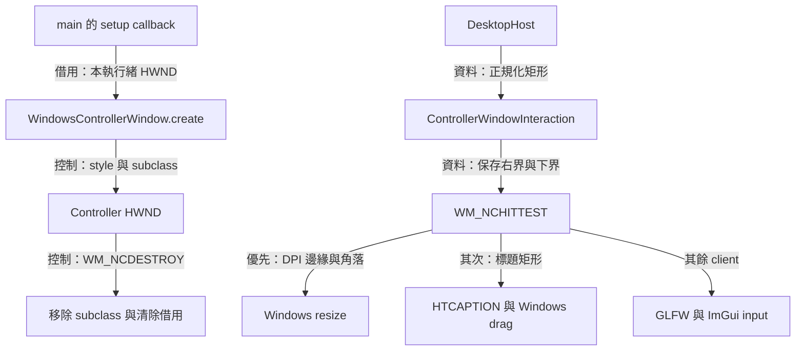

為了保留系統拖曳與調整大小的手感，原生視窗需要 resize style、client 尺寸與命中測試。 [WindowsControllerWindow](../../platform/windows/windows_controller_window.hpp) 實作 desktop 的互動 port，以 `SetWindowSubclass()` 保存穩定位址的 callback receiver

建立時驗證 HWND、行程與執行緒，保存原 style，加入 sizing、system menu 與 minimize 能力，並將標題呈現交給 client。 `WM_NCCALCSIZE` 回傳 0，讓視窗矩形作為完整 client。 API 契約見 [Microsoft WM_NCCALCSIZE](https://learn.microsoft.com/en-us/windows/win32/winmsg/wm-nccalcsize)

命中測試先以帶符號的螢幕座標取得視窗相對位置，再計算 `8 × dpi / 96` 的 resize band，並以上下或左右跨度的一半限制厚度。 這個限制讓極小尺寸仍保有對稱的邊緣分區。 四邊與四角優先回傳 resize hit，標題矩形回傳 `HTCAPTION`，其餘位置回傳 `HTCLIENT`。 拖曳比例限制於 `[0, 1]`，零值或非有限值會停用標題拖曳

`WM_GETMINMAXINFO` 設定 `320 × 240` logical units 的最小追蹤尺寸，依目前 DPI 換算。 標題雙擊由 adapter 消耗，視窗維持目前大小。 DPI、尺寸、鍵盤與關閉訊息繼續沿既有 procedure chain 傳遞

建立失敗時嘗試恢復 style，回復證據失效時回報 `RuntimeStateLost`。 正常析構在 window owner thread 移除 subclass，`WM_NCDESTROY` 同樣清除 callback 與 HWND 借用

DesktopHost 持有這個 adapter，ImGui backend shutdown 完成後將它釋放，再銷毀 controller HWND。 Replica 的 aspect、pass-through 與 capture runtime 維持由本文件前段的 overlay owners 管理

### 同磁碟區設定檔替換

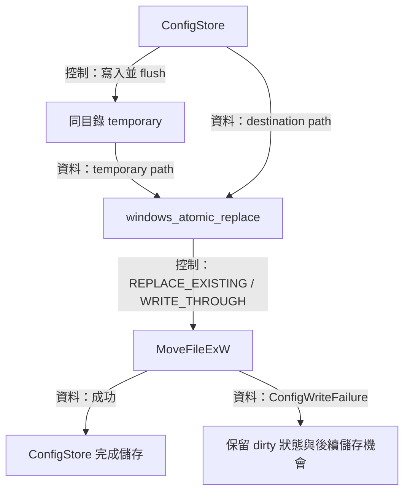

`windows_atomic_replace()` 接受 ConfigStore 準備的同目錄 temporary 與 destination，呼叫 `MoveFileExW()`，旗標為 `MOVEFILE_REPLACE_EXISTING | MOVEFILE_WRITE_THROUGH`。 同磁碟區 rename 成功後完成替換，API 拒絕時保留原 destination 並回傳數值錯誤。 Schema、temporary 的建立與清理，以及 dirty 狀態由 [ConfigStore 與 Application](application-ui.md) 管理
