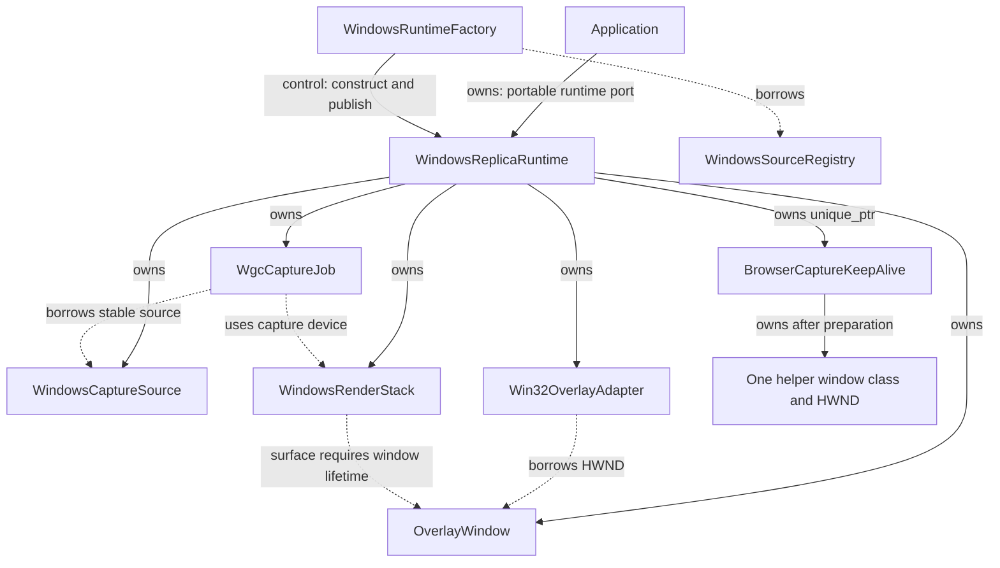
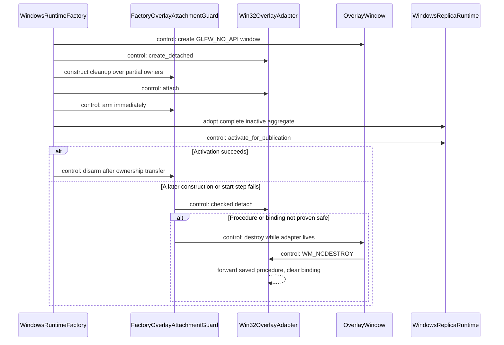
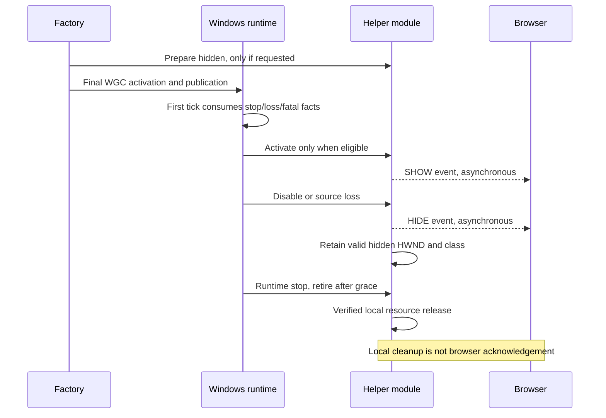
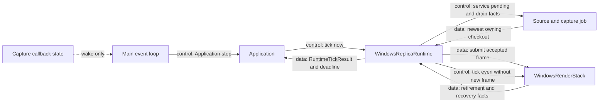
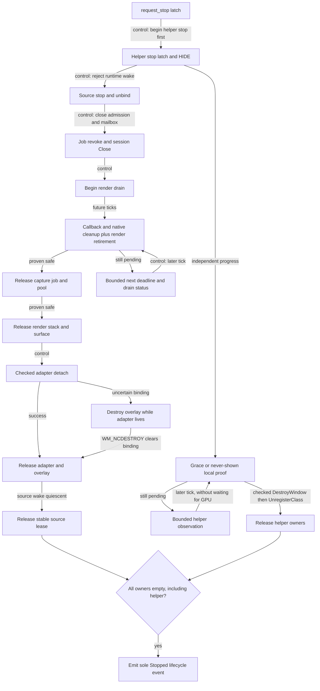
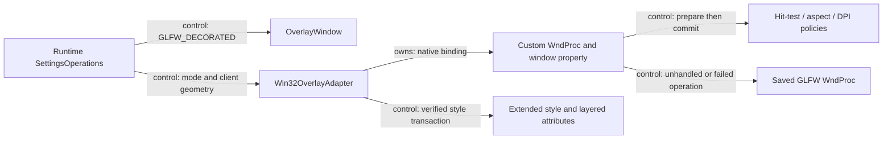
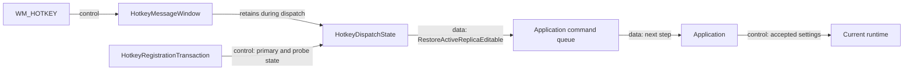

# Windows runtime、overlay 與系統 adapter

[回架構總覽](README.md) · [Windows capture 與 frame ownership](windows-capture.md)

`WindowsReplicaRuntime` 把 source、capture job、render stack、overlay window 與 Win32 subclass 收在同一個 main-thread owner 裡。Application 只呼叫 `apply()`、`tick()`、`request_stop()`；native callbacks 保存本地 facts 並 wake 主迴圈，runtime 再在下一次 tick 回傳 portable events。

本章的箭頭明確標記 `owns`／`borrows`、`control`、`data` 與 `wake`。Ownership 圖不是呼叫順序；流程圖與 sequence diagram 則另外說明何時才能移轉或釋放這些 owner。

## 1. Runtime aggregate 與 factory

| 子單元 | 主要實作 | 責任 |
|---|---|---|
| `WindowsRuntimeFactory` | [header](../../platform/windows/windows_runtime_factory.hpp)、[implementation](../../platform/windows/windows_runtime_factory.cpp) | Resolve source 一次、建立完整 inactive aggregate、保護 partial attachment、publication |
| `WindowsReplicaRuntime` | [header](../../platform/windows/windows_replica_runtime.hpp)、[implementation](../../platform/windows/windows_replica_runtime.cpp) | Settings transaction、main-thread tick、source resize barrier、device rebuild、ordered drain |
| `TickCandidates` | runtime implementation | 暫存同一次 tick 的 native facts，沒有 domain mutation |
| `SettingsOperations` | runtime implementation | 將具體 overlay/adapter/scheduler 操作接到 transaction algorithm |
| Runtime value policies | [windows_runtime_policy.hpp](../../platform/windows/detail/windows_runtime_policy.hpp) | Bridge/recovery event coalescing、reconfigure 下一步、aggregate drain observation |
| `BrowserCaptureKeepAlive` | [header](../../platform/windows/features/browser_capture_keep_alive.hpp)、[implementation](../../platform/windows/features/browser_capture_keep_alive.cpp)、[policy](../../platform/windows/features/detail/browser_capture_keep_alive_policy.hpp) | 擁有一個 module-local window class／hidden HWND，並管理啟用、隱藏與 grace retirement；不借用 source、overlay 或 graphics owner |

Runtime 的 member declaration order 依 dependency 排列：source、overlay、adapter、render、job 與獨立 helper branch。正常 teardown 仍由 explicit progress 邏輯控制；「C++ 會反向解構」本身不能證明 callback 或 GPU 已停止引用資源。Published runtime 若尚未安全 stopped 就被解構，會 fail fast，避免一般 stack unwinding 釋放仍有 native users 的 owner。

每個 Window-scope runtime 都透過 `unique_ptr` 持有一個具體 `BrowserCaptureKeepAlive` object，即使 preference 關閉也是如此。只有設定明確要求時才配置其 Win32 class／HWND。Display-scope runtime 的 helper pointer 為 null，且不會建立或啟動 module。

這條 helper ownership branch 與 source、overlay、WGC、D3 及 Vulkan chain 互不借用，feature object 也不保存 source pointer。Runtime consume native capture／lifecycle facts 並決定 helper eligibility。Application 仍是 portable lifecycle 的唯一 arbiter。

### Factory 的 publication 與失敗 unwind

Factory 先 resolve 當前 registry ID，再依序建立 source、overlay、detached adapter、render stack、inactive capture job 與 matching render slots。建立 slot 時採用 job 的 `initial_allocation()`，因為 catalog descriptor extent 可能已過時。

`FactoryOverlayAttachmentGuard` 在 adapter attach 前就已建構，attach 成功後立即 arm。後續任何 allocation、Vulkan setup 或 WGC start failure 都會先走 guard 的 attachment cleanup。正常可以恢復 saved WndProc 時先 detach；若恢復或 native binding 狀態不確定，就保持 adapter 活著，顯式 destroy overlay，讓 `WM_NCDESTROY` 完成最後的 callback binding 清理。

Factory 只在 Window-scope settings 要求 extension 時，於 StartCapture 之前 prepare hidden helper。未發佈的 runtime 絕不送出 SHOW。

StartCapture 是 publication 路徑最後的 fallible native operation。成功後 frame admission open、source runtime wake binding activation，以及 runtime ownership transfer 都走 no-throw 路徑。失敗時 source 的 registry observation 仍可記錄 closure，但尚未發佈的 source/job 不會向 host 發出最後一次 runtime wake。

第一個 eligible published tick 會先 consume 已知的 source loss、fatal 與 close facts，再決定是否啟用 helper。Capture 的詳細條件見 [publication 章節](windows-capture.md#2-publication-前後的-wake-邊界)。

## 2. 一次 tick 做什麼

Tick 先收集之前尚未發出的 fixed facts，再 consume source close edge、service pending capture arrival、drain job signals。Source loss／fatal capture 會阻止新的 capture work；resize 只有在 source 仍有效且沒有 conflicting stop/recovery phase 時才開始 barrier。

`FrameScheduler` 決定新 frame 是否到提交時機。Runtime 取出 mailbox frame 後，仍檢查 resource generation、allocation 與非零 content；通過才把 owning checkout move 給 render stack。即使沒有新 frame，render stack 仍會 `resize()`／`tick()`，以處理 retained image redraw、copy completion、presentation 與資源 retirement。

Runtime 把 scheduler、render、recovery retry 與未完成 drain 的 deadline 合成最早值。它回傳 status、source loss、overlay close、failure、recovery 等 native facts，但不決定 `Failed > OverlayCloseRequested > SourceLost > recovery` 的 portable 優先序；這個決定仍由 Application 做。

`RuntimeBridgeEventState` 用 published/pending selection 避免重複 edge。`RuntimeRecoveryEventState` 保留 started/completed 的因果順序，允許同一 batch 表達兩者。事件真正寫入結果後才 commit 這些 publication cursors。

## 3. Resize 與 graphics recovery

| 原因 | 保留的 owner | 重建範圍 | 協調位置 |
|---|---|---|---|
| Source allocation 變更 | Source、overlay、device | 等 old callbacks/checkouts/render users 結束後重建 slots 與 pool allocation | Runtime source reconfiguration |
| Replica surface loss | Source、job、D3 device、capture slots、resource generation | Surface／swapchain 與其 presentation resources | Render stack local recovery |
| Vulkan device loss | Source、overlay、adapter | Cause-specific drain 後重建 graphics stack 與 WGC job | Runtime device recovery |
| Confirmed D3 device removal | Source、overlay、adapter | 依 D3 removal proof 處理 copy ownership，再重建 stack/job | Runtime device recovery |

Resource generation 是 stable runtime 的單調 counter。Rebuild 出來的 stack/job 使用候選 generation，不會各自從 1 重新開始。新 job 的實際初始 allocation 也會同步到 runtime、render slots 與 adapter 的 source-aspect constraint。

`vulkan_device_lost_` 與 `d3_device_removed_` 是獨立 facts。一個 API 的 device loss 不自動授權丟掉另一個 API 的 pending work。Renderer 提供原因對應的 retirement proof；runtime 等 job safety 與 render drain 都成立後，才釋放舊 job／stack。

`attempt_device_rebuild()` 在 local owners 中建立 replacement。Failed partial 不會取代 stable aggregate；成功 StartCapture 後才移入 runtime。Retry episode 也不因「建構完成」就 reset，而是保留到 replacement 已產生成功 present 的觀察。既有 retry/drain constants 與 value policies 見 [graphics_retry_policy.hpp](../../render/graphics_retry_policy.hpp)。

## 4. Stop：安全證明決定釋放順序

`request_stop()` 只啟動 stop，不同步等待 callback、D3、Vulkan、presentation 或 browser behavior。Helper stop 在 GPU drain 之前開始，之後沿獨立 branch 前進，不等待 GPU proof。`progress_stop()` 同時檢查 helper 的 local proof、capture job 的內部 stop proof 與 render drain proof。

job/pool 安全後，才輪到 render stack、adapter/window，最後是 source wake state/lease。Helper 則以 checked `DestroyWindow` 後 `UnregisterClass` 的順序完成 native release。只有包括 helper 在內的所有 owners 都空了，runtime 才能發出 `Stopped`。Final source release 本身不能單獨授權 `Stopped`。

Adapter detach failure 有具體 fallback：runtime 保留 adapter/thunk，destroy GLFW overlay，使原始 WndProc 收到 forwarded `WM_NCDESTROY`，再完成 adapter 清理。這不是忽略失敗或把已知可能存活的 callback pointer 直接釋放。

`RuntimeDrainState` 的同一個 no-progress clock 涵蓋 helper uncertainty、callback/job cleanup、source wake、adapter 與 graphics ownership。Polling、retry 或 warning edge 不代表 forward progress；只有 tracked retirement／proven safe release 才能重設時鐘。`Stalled` 只回報無進展，沒有賦予 destroy permission。

正常 runtime 只有 owners 全空後才發出 `Stopped`。Application 接到這項證明後才釋放 published runtime。遇到 stalled shutdown 的 process-abandon 選擇，以及獨立 controller renderer 的 retirement，分別見 [application/UI](application-ui.md) 與 [DesktopHost](desktop-host.md)。

Tick 的 catch firewall 會停止 helper、丟棄 partial event batch、保留 owner 並排定 bounded drain observation。停止前可回報 failure；停止後不再引入 pre-stop lifecycle failure，只維持既有 drain observation/status 路徑。

## 5. OverlayWindow 與 Win32OverlayAdapter 的分工

[OverlayWindow](../../platform/windows/overlay_window.hpp) 是 floating `GLFW_NO_API` window 的唯一 owner，也是唯一切換 `GLFW_DECORATED` 的元件。它回報 physical framebuffer extent 與 close intent；close intent 不會立即 destroy runtime-owned window。

[Win32OverlayAdapter](../../platform/windows/win32_overlay_adapter.hpp) 借用 HWND，管理 WndProc subclass、extended styles、layered attributes、DPI、hit test 與 content geometry。它在 attach 時拒絕 `CS_OWNDC`／`CS_CLASSDC`，因為這些 class styles 與 layered input policy 不相容。專案 pinned GLFW 的主 window class patch 移除了 `CS_OWNDC`；原始 Win32 callback 串接仍由 adapter 明確保留。

`SettingsOperations` 先 snapshot 實際 native activity，不以 config preference 猜測 helper 是否 active。接著依序套用 mode、border、geometry 與 extensions，全部讀回驗證後才 commit candidate。

若 transaction 途中或 rollback 時新狀態已不 eligible，helper deactivation 是 one-way。Sticky source closure 後不會為了還原舊 settings 再送 SHOW。若原本確實 active 的狀態無法恢復並驗證，transaction 回報 `RuntimeStateLost`，由 Application 走既有的安全 stop／drain。

### Browser keep-alive 的隱藏與 retirement

Live disable 或 source loss 都送出 HIDE，但保留一個有效的 hidden HWND 與已註冊 class，讓相同 runtime 仍可接受後續 eligible settings。Runtime stop 的 250 ms grace 從實際 native HIDE 完成且讀回 hidden 之後才開始計時。重複觀察到已知 hidden 不會重設計時。從未 SHOW 的 helper 可立即 retire。

這些都是本地 window lifecycle proof，不承諾 browser 已收到、處理或確認任何事件。

初始實驗刻意不加入 automatic reassert hook、global WinEvent listener、busy SHOW loop 或 browser-state service。真實 taskbar／Alt+Tab 操作仍可能清掉 browser exception。若 Task 7 的 acceptance experiment 失敗，應先記錄結果，再設計有界且 module-local 的 response，不在本次工作預先實作。

現有 build、policy tests 與 headless source-boundary scan 不證明 browser behavior 或 recovery。Task 7 仍需另行授權的真實 UI／browser 實驗。

### Pass-through 不是只有 hit-test return code

`enter_pass_through()` 先 snapshot 完整 extended style；若視窗本來 layered，也必須能取得可還原的 layered attributes。接著加入 `WS_EX_LAYERED | WS_EX_TRANSPARENT` 並設定 opaque alpha 255，最後讀回確認 target state。若原始 layered state 無法讀取，就在 mutation 前回報失敗。

離開 Pass-through 時 restore 原始 snapshot。任何階段失敗都會嘗試 rollback，並把「已驗證回到先前狀態」與「無法證明 native state」分別映射為一般 platform failure 與 `RuntimeStateLost`。`HTTRANSPARENT` 只是補充 hit-test 行為；真正 style transaction 在 [overlay_transactions.hpp](../../platform/windows/detail/overlay_transactions.hpp) 與 [Win32StyleOperations](../../platform/windows/win32_overlay_adapter.cpp)。

### Border、DPI 與 callback containment

Runtime 更改 border 前，adapter snapshot client rectangle 的 screen coordinates；OverlayWindow 切換 GLFW decoration 後，再由 adapter 以新 frame insets 還原 content placement，並限制在 monitor work area。Scheduler 設定只有在 native mode/border/geometry transaction 通過後才 commit。

Bordered hit test 委派 OS chrome；borderless Editable 使用 DPI-scaled resize bands、edge/corner zones 與 caption drag。`WM_SIZING` 對 content area 套 source aspect，扣除當前 frame insets。`WM_DPICHANGED` 先接受 OS 建議 rectangle，成功後才更新 cached DPI。

[dispatch_overlay_callback](../../platform/windows/detail/overlay_callback.hpp) 將 prepare 與 commit 分開。Query 或 geometry preparation 失敗時仍可交回 saved GLFW procedure；`WM_NCDESTROY` 則固定先 forward 再 clear binding。這讓 callback 失敗清理順序可以用 value/operation policy 驗證，而不是在一般 UI code 裡散落 raw WndProc 規則。

## 6. Global hotkey 只發送 command

[WindowsGlobalHotkey](../../platform/windows/windows_global_hotkey.hpp) 擁有 hidden message window 與 registration transaction。所有 native operations 屬於 creating thread；off-owner replace 回報 platform error，clear 不執行 native mutation，違反 destruction thread invariant 則 fail fast。

`HotkeyRegistrationTransaction` 使用固定 primary/probe IDs。替換時先 probe 新 chord，再清掉 probe；接著 unregister 原 primary、register 新 primary。如果 replacement 失敗，就嘗試恢復原 chord。狀態明確區分 `Free`、`Registered` 與 `Uncertain`，cleanup diagnostic 不會被誤當成成功還原。

`HotkeyDispatchState` 只接受 confirmed primary chord，並檢查 message payload 與目前 chord 一致，以忽略舊 binding 遺留的 message。它送出的只有 session-agnostic `RestoreActiveReplicaEditable`。Application 才在 command consumption 時決定目前的 runtime/session，以及 stop/drain 期間是否忽略操作。

WndProc 在呼叫 command sink 前先複製 `shared_ptr` dispatch state，涵蓋 sink 重入並銷毀 wrapper/window 的情況。Sink exception 被 `noexcept` callback containment 接住；它只丟掉這次 restore request，不直接操作 overlay 或 domain。Destroy 時先清除 `GWLP_USERDATA`，再釋放 callback context，最後處理 native window/class。

## 7. 小型 Windows system adapters

| 元件 | 入口與 native operation | 邊界 |
|---|---|---|
| [process_dpi_awareness](../../platform/windows/process_dpi_awareness.hpp) | `establish_per_monitor_v2_dpi_awareness()` | 建立任何 window 前設定並驗證有效的 `PER_MONITOR_AWARE_V2`；manifest 已設定也可成功 |
| [capture_exclusion](../../platform/windows/capture_exclusion.hpp) | `attempt_capture_exclusion()`、`prepare_controller_window()` | 驗證 owned top-level HWND／GLFW class，動態查詢 affinity API，回傳 portable status |
| [controller_font](../../platform/windows/controller_font.hpp) | `load_controller_font()` | 讀 Windows 安裝的 `Fonts/msjh.ttc`，以大小上限限制 allocation，回傳 owned bytes |
| [windows_atomic_replace](../../platform/windows/windows_atomic_replace.hpp) | `windows_atomic_replace()` | ConfigStore 寫入／flush sibling temporary 後，以 `MoveFileExW` 完成 replacement |

Capture exclusion 是 best effort：`Excluded` 代表 Windows 接受 affinity request，不是對所有第三方 capture 機制的保證。Controller window setup 另會把 incompatible GLFW class 視為 startup error；單純 exclusion unsupported/failed 則保留成可顯示的 status。

Font adapter 不下載或重新散布字型；controller 使用它回傳的 bytes。Atomic replace adapter 不擁有 config schema、dirty flag 或 temporary-file lifecycle；那些仍由 portable ConfigStore/Application 管理。這些 adapter 都是現有 concrete functions，沒有額外的 provider/service hierarchy。

## 8. 對照程式與測試

追 native lifetime 時可從 `WindowsRuntimeFactory::create()` 進入，再看 runtime 的 `activate_for_publication()`、`tick()` 和 `progress_stop()`；追輸入樣式則從 `SettingsOperations` 到 `enter_pass_through()`／`leave_pass_through()`，最後查看 concrete Win32 operations。

既有 `tests/windows/windows_policy_test.cpp` 涵蓋來源、hotkey 與 capture contracts；overlay transaction/subclass 的受控測試及原生測試入口位於 `tests/windows`。Graphics ownership 的細節與對應 policy tests 請接著閱讀 [renderer](renderer.md)；這些閱讀入口不會執行 GUI 或 hardware capture。
