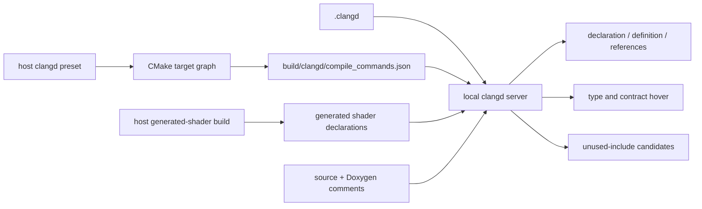

# clangd：導覽、hover 與 include 檢查

[架構總覽](../architecture/README.md) · [Build 與驗證](../architecture/build-and-validation.md)

Repo 根目錄的 [.clangd](../../.clangd) 使用 `build/clangd/compile_commands.json`，讓 server 讀取各 target 真正的 C++23、defines、SDK 與 include paths。不要把所有層的 include directories 填成一份通用 fallback flags；那會掩蓋原本不存在的 target dependency

## 1. 第一次設定

Windows：準備 LLVM（`clangd`、`clang-cl`）、Visual Studio C++ x64 build tools／Windows SDK、CMake 3.28 以上、Ninja、Git，以及含 `glslc` 的 Vulkan SDK。Git 必須在 PATH 上，供 dependency patch gate 使用。開啟 **x64 VS Developer PowerShell／Command Prompt**，切到 repo 根目錄後執行：

```powershell
clangd --version
clang-cl --version
cmake --preset windows-clangd
cmake --build --preset clangd-generated
```

兩個 preset 定義在 [CMakePresets.json](../../CMakePresets.json)。第一個建立獨立 Ninja build tree 與 compilation database；第二個只產生 shader 的 SPIR-V 與 C++ declarations，**不會啟動程式或執行 hardware tests**。首次 configure 可能下載已固定版本及 hash 的 dependencies

採用 Ninja 是因為 CMake 的 compilation database 輸出只支援 Makefile／Ninja 類 generators，不能假設既有 Visual Studio solution 會產生此檔案。[CMake 官方說明](https://cmake.org/cmake/help/latest/variable/CMAKE_EXPORT_COMPILE_COMMANDS.html)

確認輸出存在：

```powershell
Test-Path build/clangd/compile_commands.json
Test-Path build/clangd/generated/avb/render/replica_shaders.hpp
```

這份 tooling preset 預設 `AVB0795_BUILD_TESTS=OFF`，因為 tests 不在目前的提交範圍內；只有 committed sources 的 checkout 也能產生 production compilation database。不使用 preset 而直接 configure 時，也要明確傳入 `-DAVB0795_BUILD_TESTS=OFF`，因為根目錄 CMake option 的預設值仍為 ON

如果你的本機另有完整 `tests/CMakeLists.txt`，可選擇將測試加入同一份 database：

```powershell
cmake --preset windows-clangd -DAVB0795_BUILD_TESTS=ON
cmake --build --preset clangd-generated
```

`AVB0795_ENABLE_WINDOWS_INTEGRATION=ON` 在啟用本機 tests 時也提供 native integration tests 的 compile commands。這不會執行測試，也不代表獲准進行 capture／GPU 操作。重新執行沒有 `-D` override 的 preset 會回到 production-only 設定

### Linux

Linux 需要能編譯專案 C++23 標準函式庫介面的 compiler、clangd、CMake 3.28 以上、Ninja、Git，以及 Vulkan 1.3 與 `glslc`。 X11 開發檔須包含 XKB、Xrandr、Xinerama、Xcursor、Xi、Xfixes、Xext（Shape）與 XCB core／Composite／RandR；完整清單見 [Linux 指南](linux.md)。 GLFW 固定建置 X11 backend，Wayland session 的視窗呈現使用 XWayland

```bash
c++ --version
clangd --version
cmake --preset linux-clangd
cmake --build --preset linux-clangd-generated
test -f build/clangd/compile_commands.json
test -f build/clangd/generated/avb/render/replica_shaders.hpp
```

`linux-clangd` 繼承 `linux-desktop` 的 graphics 設定，將一般 tests、Linux policy tests 與 Linux integration 全部關閉，產生獨立的 production compilation database。 兩個一般建置目錄為 `build/linux-portable` 與 `build/linux-desktop`，分別由同名 preset 產生。 切換 host 時要重新 configure `build/clangd`

專案目前使用一般 translation units，`linux-clangd` 將 `CMAKE_CXX_SCAN_FOR_MODULES` 關閉，避免 GCC 的 module-scanning flags 進入 clangd 21 的命令。 此設定只用於 tooling preset

SDK 路徑、compiler 選擇與必要的本機 flags 放在環境變數、命令列或未提交的 `CMakeUserPresets.json`。 檢查 database 中實際使用的 compiler 與標準函式庫 include paths

若 clangd 無法取得 GCC 的 system headers，僅對該 compiler 的可信精確絕對路徑設定 `--query-driver`。 例如 database 使用 `/usr/bin/c++` 時，參數為 `--query-driver=/usr/bin/c++`

保留 `.clangd` 的 background index 與 include diagnostics 設定，檢查 server log 是否出現 unknown key 或 YAML 診斷。 Doxygen hover 使用來源註解，不加入 clangd 21 不支援的 `Documentation.CommentFormat` 設定。 目前 production database 應包含 direct catalog／capture／runtime／factory／Linux entry，沒有退休的 Portal／PipeWire units。 Shader build 與 clangd 導覽都不會執行 GPU capability probe

## 2. 編輯器連線

以 **repo 根目錄**開啟 workspace，使用支援 clangd 的 LSP client。VS Code 可使用官方 clangd extension；若 PATH 找不到 server，可在自己的 editor settings 指定 `clangd.path`。不要讓另一套 C++ language server 同時提供重複診斷。這次沒有變更你的全域 editor settings 或安裝 extension。[clangd 官方安裝與 editor 指引](https://clangd.llvm.org/installation)

如果 client 自訂啟動參數，保留 config 功能，例如：

```json
{
  "clangd.arguments": ["--enable-config", "--background-index"]
}
```

開啟 `.cpp`，等 background index 建立後即可使用 Go to Declaration、Go to Definition、Find References、workspace symbols 與 hover。公用型別／函式新增的 Doxygen 註解會隨 hover 顯示；header 的 compile command 通常由包含它的 translation unit 推導，並不是每個 header 都需要一筆 database entry。[clangd 設定](https://clangd.llvm.org/config)、[編譯指令的使用方式](https://clangd.llvm.org/design/compile-commands)



## 3. 何時重新產生

新增／移動 source、修改 target defines／dependencies、更新 SDK 或 shader 時，重新執行前述兩個 `cmake` 指令，再視需要 restart clangd。只修改一般 C++ 內容或註解不需要重新 configure

`build/`、`.cache/`、根目錄 `compile_commands.json` 與 `CMakeUserPresets.json` 已列入 [.gitignore](../../.gitignore)；machine-specific 路徑、產物與 index 不屬於 source。Tooling build 不會覆寫既有 `build/p4-release`

如要重用本機 dependency cache，請參考 [build 文件的路徑限制](../architecture/build-and-validation.md)：位於此 repo 內的 dependency sources 應放在該 build tree 之下，不要為了通過 configure 而關掉分層檢查。Shared preset 不寫死某台機器的 VS／Windows SDK 版本

## 4. Include 診斷的範圍

設定為 `UnusedIncludes: Strict`，但保留 `AnalyzeAngledIncludes: false`：檢查 quoted project headers 與標準函式庫 headers，暫不對非標準的 angled SDK／WinRT umbrella headers 提出未使用診斷。Dependency source 的獨立 background indexing 關閉；解析我們的 source 時仍會讀取需要的 dependency headers。CMake 一併輸出的 Windows `.rc` resource-compiler command 不是 C++，也排除其 background indexing。[clangd 設定](https://clangd.llvm.org/config)

「not used directly」是清理候選，**不是在所有組態都能安全刪除的證明**。移除前仍要確認 macro、條件編譯、間接宣告與 include-order 要求，並重新 build。真的有保留理由才使用局部 `IWYU pragma: keep`／`export` 並寫明理由，不要整體隱藏診斷。[Include Cleaner 說明](https://clangd.llvm.org/guides/include-cleaner)

### 本次掃描紀錄（2026-09-05）

以本機 clangd 22.1.6、Release／Windows integration 並額外啟用本機 tests 的組態，透過 LSP 開啟 compilation database 中 **43 個 first-party C++ translation units（含 tests）**：0 個 error diagnostics，9 個 unused-include 候選如下。這是含測試的本機掃描紀錄，不是 production-only preset 的檔案數；沒有刪除任何 include

| 檔案 | Header 候選 |
|---|---|
| [win32_overlay_adapter.cpp](../../platform/windows/win32_overlay_adapter.cpp) | `<algorithm>`、`<utility>` |
| [windows_replica_runtime.cpp](../../platform/windows/windows_replica_runtime.cpp) | `<algorithm>` |
| [windows_runtime_factory.cpp](../../platform/windows/windows_runtime_factory.cpp) | `<exception>`、`<optional>` |
| [desktop_host.cpp](../../src/desktop/desktop_host.cpp) | `<ranges>` |
| `tests/app/application_contract_test.cpp` | `<variant>` |
| `tests/windows/wgc_hardware_test.cpp` | `"platform/windows/detail/item_observation_state.hpp"` |
| `tests/windows/windows_graphics_hardware_test.cpp` | `<ranges>` |

另外有 17 個 `bugprone-unused-return-value` warnings，分布於 `application.cpp`、`overlay_window.cpp` 與 `wgc_hardware_test.cpp`；本次沒有把它們消音，也未將 warnings 直接判定為功能缺陷。**0 errors 不等於 0 warnings**，完整的行號與訊息留在本機 `build/clangd-lsp-audit.json`；該檔與 audit helper 是可丟棄的驗證產物，不是新增的產品測試

已實際驗證四種導覽：`ConfigStore::load` declaration → definition、呼叫點 → declaration、`select_sdr_surface_format` declaration → definition、`Extent` 使用點 → struct definition；另確認 `ConfigStore` Doxygen 出現在 hover。這是直接操作 clangd LSP 的結果，尚未代替你操作 IDE UI，也不代表已逐一測過每個 symbol

### Linux direct X11 查核（2026-10-04）

使用真正 `linux-clangd` database、clangd 21.1.8、GCC 15.2 與精確可信 `--query-driver=/usr/bin/c++`，在 catalog／capture／image policy 及 runtime／factory／entry／controller 的分階段查核中取得 AST、unit Doxygen hover 與具體 definitions。 最後一輪四個 changed production units 的 semantic diagnostics 為零 errors／warnings，configuration diagnostics 為零；五個實質 hover 與三個 definitions 已確認。 這是 LSP 證據，不代替 IDE UI 或 desktop capture 驗收

原始 server log 保留兩個 clang driver discovery errors；後續實際 GCC system include extraction 成功。 Semantic／configuration diagnostics 為零不表示原始 log 全無 error records，不新增 PATH shim 或 fallback includes 隱藏這項差異。 Historical Windows 掃描維持上節原範圍

## 5. 排查

| 現象 | 先檢查 |
|---|---|
| `file not found`、C++23 型別不認得 | database 是否存在／更新、server log 是否真的載入該檔，而非 fallback command |
| 只有 generated shader header 找不到 | 重跑該 host 的 generated-shader build preset |
| WinRT／MSVC STL 找不到 | VS C++ tools／Windows SDK 是否安裝完整；重開 x64 developer shell 產生 database，不要手動補一大串版本路徑 |
| 同一處出現兩套診斷 | editor 是否同時啟用兩個 C++ language servers |
| `.clangd` 無效但 check exit code 是 0 | 檢查 server log 的 YAML／unknown-key config 訊息，不只看 exit code |
| `clangd --check` 出現 `ExtractFunction`／`SwapBinaryOperands` 等訊息 | 該模式也會跑 refactoring self-check；區分它與真正的 LSP `publishDiagnostics`，不要用 blanket suppression 掩蓋 |

Windows SDK 或 Linux compiler／標準函式庫的偵測與編譯環境問題，先依照 [clangd system headers 指引](https://clangd.llvm.org/guides/system-headers) 查明原因。不要透過對不可信 compiler 開放廣泛 `--query-driver` 規則來繞過問題
