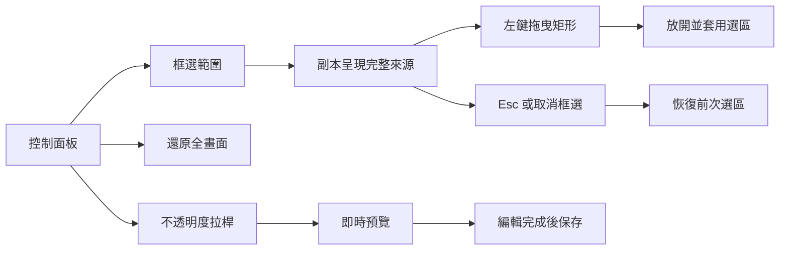
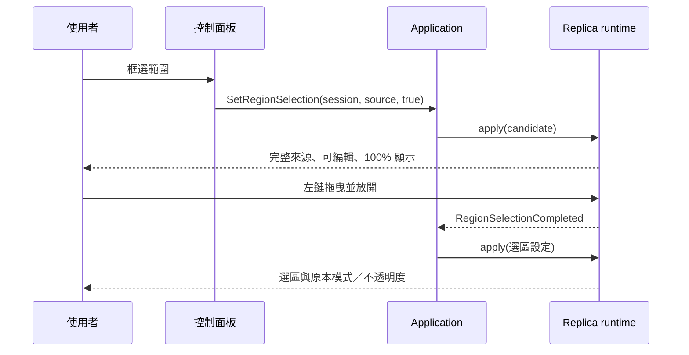
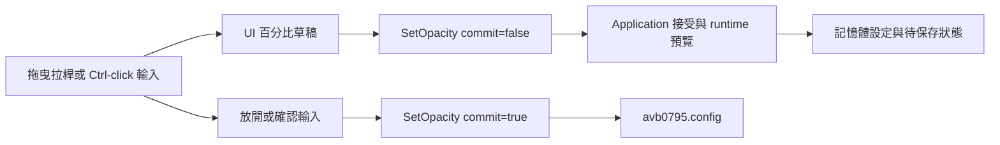

# 框選與不透明度操作

為了聚焦來源中的文字、影片或工具畫面，操作流程需要將可見影像上的矩形轉成來源像素範圍。「框選範圍」提供完整來源作為選取底圖，拖曳結果經過 session 與來源身分驗證後成為目前選區。

## 選取、取消與還原

1. 選擇來源並開始擷取，等待副本顯示畫面。
2. 按「框選範圍」，副本暫時以可編輯模式和 100% 不透明度呈現完整來源。
3. 在影像內按住左鍵拖曳；放開後套用框選矩形，並恢復期望的模式與不透明度。
4. 按 Esc 或「取消框選」恢復前次選區；按「還原全畫面」顯示完整來源。

控制面板顯示來源像素尺寸，供使用者辨識目前擷取內容。選區以 `PixelRegion{x, y, width, height}` 表示來源影像中的矩形，Application 負責來源身分、生命週期及像素範圍驗證。副本尺寸與 DPI 變化沿用同一個來源像素矩形。

## 不透明度拉桿

為了同時提供直覺調整與精確輸入，不透明度使用 0–100% 的可見拉桿。拖曳時副本即時更新；按住 Ctrl 點擊數值可以輸入整數百分比，再以 Enter 確認。

- 100%：完整顯示副本。
- 50%：副本與下方桌面混合顯示。
- 0%：副本完全透明，控制面板持續提供調整入口。

為了讓操作回饋和設定保存各自有明確時機，`SetOpacity` 的 preview 更新已接受的 runtime 設定，手勢結束的 commit 保存最後接受值。UI 草稿保留手勢開始時的 session，Application 使用目前生命週期決定命令的接受結果。這條流程也支援控制面板暫時隱藏後的編輯完成通知。

滾輪步幅的可見拉桿與預設值，見[來源欄寬與副本滾輪縮放](replica-wheel-zoom.md)。
