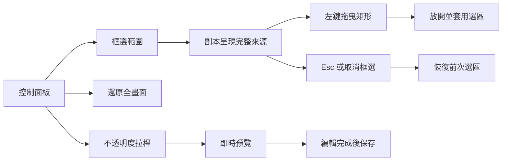
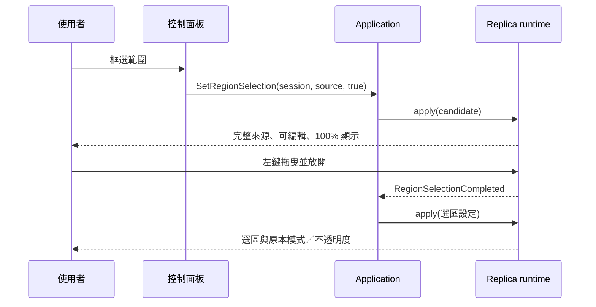
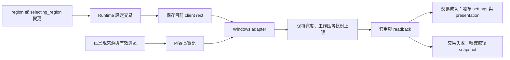
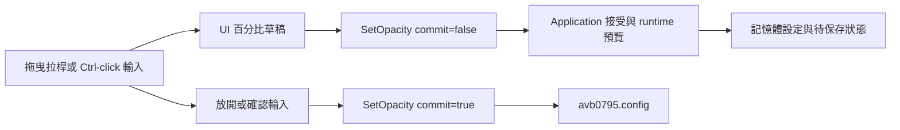

# 框選與不透明度操作



為了聚焦來源中的文字、影片或工具畫面，操作流程需要將可見影像上的矩形轉成來源像素範圍。「框選範圍」提供完整來源作為選取底圖，拖曳結果經過 session 與來源身分驗證後成為目前選區。

## 選取、取消與還原



1. 選擇來源並開始擷取，等待副本顯示畫面。
2. 按「框選範圍」，副本暫時以可編輯模式和 100% 不透明度呈現完整來源。
3. 在影像內按住左鍵拖曳；放開後套用框選矩形，並恢復期望的模式與不透明度。
4. 按 Esc 或「取消框選」恢復前次選區；按「還原全畫面」顯示完整來源。

控制面板顯示來源像素尺寸，供使用者辨識目前擷取內容。選區以 `PixelRegion{x, y, width, height}` 表示來源影像中的矩形，Application 負責來源身分、生命週期及像素範圍驗證。副本尺寸與 DPI 變化沿用同一個來源像素矩形。

## 選區切換與視窗比例



為了讓框選結果填滿副本內容區，選區切換需要同步原生視窗的長寬比。完成框選、進入完整來源框選、取消回到舊選區、還原全畫面時，runtime 以可用的已呈現內容計算有效尺寸，再交由 Windows adapter 調整副本。

- 以當下 client 寬度作為基準，依內容比例求高度。
- 工作區扣除標題列與邊框後，建立可容納的寬高上限；超出上限時等比例縮小。
- 以原 client 中心定位，靠近螢幕邊界時平移至工作區內。
- 像素尺寸經過四捨五入，各軸至少保留一個像素。

設有效內容為 `source_width × source_height`，工作區扣除外框後為 `available_width × available_height`，核心計算為：

```text
ratio = source_width / source_height
width = min(current_client_width, available_width, available_height * ratio)
height = width / ratio
```

例如目前 client 寬度為 800，框選 960×540 的內容時，目標 client 為 800×450。還原全畫面後，系統使用完整來源的比例重新求高度。這個 fit 採當下寬度與工作區上限，滾輪操作持續使用自己的 DPI 最小尺寸政策。

為了讓設定、視窗與呈現結果保持一致，幾何變更參與既有 fallible settings transaction。Adapter 完成 `SetWindowPos` 和 client readback 後，runtime 接續驗證整筆設定並發布 presentation。後續步驟失敗時，rollback 使用精確恢復政策，回到原 snapshot；原視窗跨出工作區的擺放也包含在恢復範圍內。

原生尺寸操作使用 `SWP_NOACTIVATE | SWP_NOZORDER`，焦點和堆疊順序由既有互動管理。開始框選沿用使用者命令所啟動的選區焦點流程。Opacity、FPS、滾輪步幅等一般設定更新維持當下幾何；初始視窗配置與逐幀來源尺寸觀察延續各自的責任。

為了讓極窄選區也沿用相同比例，程式主動 fit 與 restore 加上 `SWP_NOSENDCHANGING`，讓已驗證的幾何政策和 readback 管理這次尺寸提交。Windows 的 `WM_WINDOWPOSCHANGING` 預設處理會套用互動追蹤尺寸限制；一般拖曳視窗持續使用原有的互動約束。原生訊息語意見 [WM_WINDOWPOSCHANGING](https://learn.microsoft.com/en-us/windows/win32/winmsg/wm-windowposchanging) 與 [SetWindowPos flags](https://learn.microsoft.com/en-us/windows/win32/api/winuser/nf-winuser-setwindowpos)。

實作入口：[幾何政策](../../platform/windows/detail/overlay_policy.cpp)、[Windows adapter](../../platform/windows/win32_overlay_adapter.cpp)、[runtime 設定交易](../../platform/windows/windows_replica_runtime.cpp)。

## 不透明度拉桿



為了同時提供直覺調整與精確輸入，不透明度使用 0–100% 的可見拉桿。拖曳時副本即時更新；按住 Ctrl 點擊數值可以輸入整數百分比，再以 Enter 確認。

- 100%：完整顯示副本。
- 50%：副本與下方桌面混合顯示。
- 0%：副本完全透明，控制面板持續提供調整入口。

為了讓操作回饋和設定保存各自有明確時機，`SetOpacity` 的 preview 更新已接受的 runtime 設定，手勢結束的 commit 保存最後接受值。UI 草稿保留手勢開始時的 session，Application 使用目前生命週期決定命令的接受結果。這條流程也支援控制面板暫時隱藏後的編輯完成通知。

滾輪步幅的可見拉桿與預設值，見[來源欄寬與副本滾輪縮放](replica-wheel-zoom.md)。
