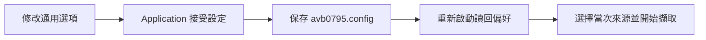
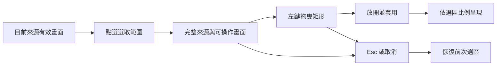
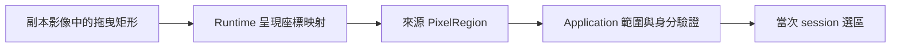
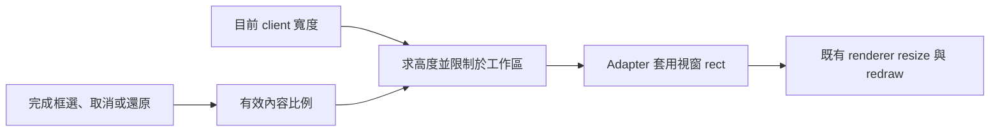
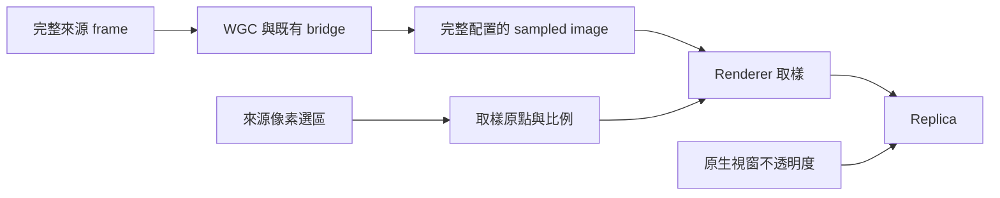

# Replica 透明度與選區操作

為了讓重點畫面融入桌面，replica 提供整體不透明度與來源選區。前者決定桌面與 replica 的混合比例，後者決定從來源影像取用哪個矩形。控制面板集中管理這兩組設定，並保留來源、模式與邊框的操作入口。

來源欄寬、可編輯副本的滾輪縮放與預設 5% 步幅，見 [來源欄寬與副本滾輪縮放](replica-wheel-zoom.md)。

## 重新啟動後的通用偏好

為了接續上次的操作習慣，設定服務會把已接受的偏好存入執行檔旁的 `avb0795.config`，內容為可閱讀的 JSON。

保存範圍如下：

- 語言選擇，包含「跟隨系統」。
- 已確認的快捷鍵。
- FPS、邊框、可編輯／穿透模式與不透明度。
- Browser capture keep-alive 與自動重新整理 checkbox。

離散選項在接受後保存，不透明度在拖曳或數值輸入完成後保存。框選中的 100% 與可編輯模式屬暫時操作畫面，設定檔維持使用者期望值；使用全域快捷鍵恢復可編輯時，期望模式也更新為可編輯。

視窗位置與大小採原有啟動配置，來源與選區由當次操作建立。設定目錄需要寫入權限；保存失敗會顯示診斷，後續設定操作可重試。

升級時，新檔缺席會讀取同目錄的 `airelinna.json`。下一次保存使用新檔名，舊檔保留原內容。新檔已存在時，讀取與格式驗證皆以新檔為準。

## 調整不透明度

拖曳「不透明度（Opacity）」的可見拉桿可即時調整畫面，也可以按住 Ctrl 點擊數值，直接輸入整數百分比，再按 Enter 確認。

| 數值 | 顯示效果 |
| --- | --- |
| 100% | Replica 完全顯示。 |
| 50% | Replica 與其下方的桌面內容混合顯示。 |
| 0% | Replica 完全透明；控制面板持續提供恢復入口。 |

不透明度作用於整個 replica 視窗。控制面板維持原本顯示，因此可以把 0% 調回 100%，也可以切換可編輯模式、停止擷取或重新選擇來源。

為了兼顧即時回饋與設定保存，拖曳中的變化先更新目前畫面；放開滑鼠或確認輸入後，Application 將最後接受值寫入設定檔。保存失敗時，畫面維持接受的數值，控制面板呈現保存診斷。

模式、邊框與不透明度分別保存其偏好。例如設定為 50% 並進入穿透模式後，切換邊框仍維持 50%；切回可編輯時也維持這個混合比例。

## 在 replica 框選來源

為了聚焦來源中的某個區域，操作流程需要先看到完整來源，再將滑鼠拖曳轉成來源像素矩形。「選取範圍」把 replica 暫時切成選區操作畫面。

1. 選擇來源並開始擷取，等待 replica 顯示有效畫面。
2. 在控制面板按「選取範圍」。Replica 暫時採可編輯與 100% 不透明度，顯示完整來源。
3. 在來源畫面內按住左鍵並拖曳，框線標示目前選區；四個拖曳方向都適用。
4. 放開滑鼠，replica 套用矩形並恢復原本模式與不透明度。
5. 再按「選取範圍」可重新框選，按「還原全畫面」可恢復完整來源。

框選的起點位於影像內容內。已開始的拖曳可以延伸到視窗外，端點會限制在影像邊界。單次點擊或零面積拖曳會保留框選狀態，供下一次拖曳使用。

Esc 或控制面板的取消操作會恢復前次選區。切換焦點、來源尺寸變動或圖形重建時，也會結束當次框選；有效畫面恢復後可以重新選取。既有偏好仍由控制面板保留。

## 來源像素與選區

為了讓選區持續對準來源內容，runtime 將副本上的拖曳矩形轉成來源像素。來源原點位於左上角，X 向右增加，Y 向下增加。Application 驗證矩形具有正面積且位於目前來源範圍內，再提交選區設定；控制面板以框選、取消與還原作為操作入口。

選區依來源像素保存；移動 replica、調整 replica 大小或更換螢幕 DPI 時，仍對應同一塊來源內容。來源本身縮小時，選區取目前來源的交集；交集為空時回到全畫面。

## 選區與視窗大小

為了讓觀看範圍和副本比例同步，完成框選、進入完整來源框選、取消及還原全畫面時，runtime 保持目前 client 寬度並依有效內容比例求高度；工作區空間不足時等比例縮小。Adapter 以原 client 中心定位，再將外框平移至目前螢幕工作區內。

例如 client 寬度為 800，選區為 960×540 時，目標 client 為 800×450。設定交易完成後，renderer 沿既有 resize 與 retained redraw 流程呈現。完整計算與 rollback 責任見[框選與不透明度操作](region-selection.md)。

選區隨目前 session 保存在記憶體。停止後再次啟動目前來源會保留選區；選擇來源或建立替代 session 則回到全畫面。不透明度屬通用偏好，會隨設定檔在下次啟動時載入。

## 擷取與呈現的工作範圍

為了沿用既有 CPU/GPU bridge，擷取端持續提供完整 frame，renderer 從這張影像取樣選定區域。選區更新時也能重繪上一張保留影像，因此靜態來源同樣能立即調整觀看範圍。

此版本的選區改善觀看範圍，完整擷取與影像傳輸維持原有工作規模。選框更新經過 FPS 排程合併，GPU 完成確認仍由主迴圈持續推進。

操作概念參考 [OnTopReplica 的框選實作](https://github.com/LorenzCK/OnTopReplica/blob/master/src/OnTopReplica/ThumbnailPanel.cs)與[選區面板](https://github.com/LorenzCK/OnTopReplica/blob/master/src/OnTopReplica/SidePanels/RegionPanel.cs)。本專案的責任分工見 [Application/UI](../architecture/application-ui.md)、[Windows runtime](../architecture/windows-runtime-overlay.md)與 [renderer](../architecture/renderer.md)。
