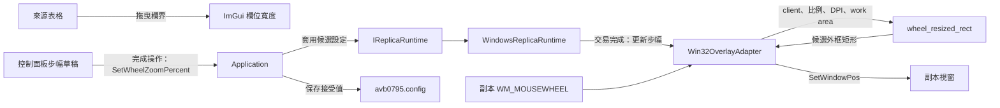
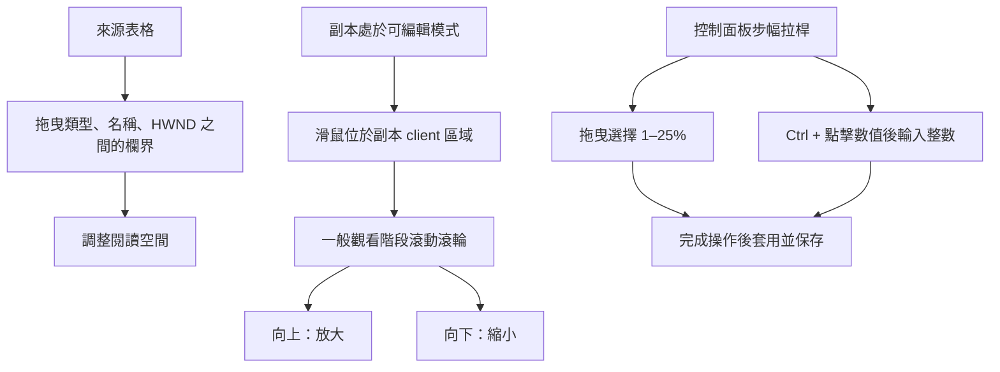
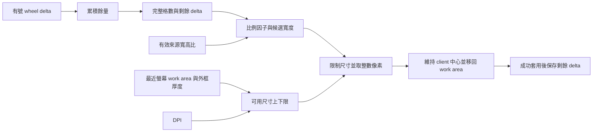
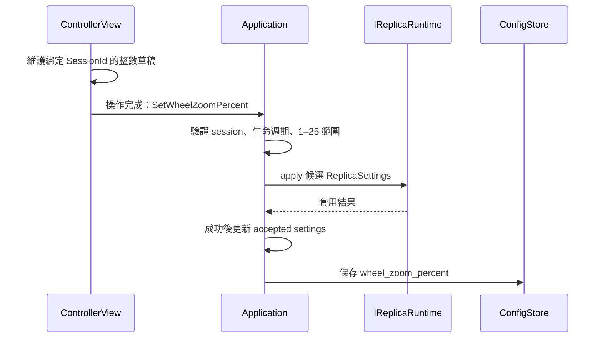

# 來源欄寬與副本滾輪縮放



為了方便閱讀來源名稱與調整副本觀看尺寸，控制面板提供可調寬的來源欄位，以及滾輪步幅設定。欄寬由 ImGui 管理；步幅沿應用程式設定交易保存；副本尺寸由 Windows adapter 根據原生輸入更新。這三種狀態各自對應自己的 owner。

## 操作方式



- 來源表格的「類型」、「名稱」、「HWND」以欄界分隔，拖曳兩條內部欄界即可分配寬度。
- 滾輪縮放預設每格 **5%**。向上乘以 `1.05`，向下除以 `1.05`；像素尺寸經過四捨五入。
- 控制面板的滾輪步幅拉桿提供 **1–25%**。按住 **Ctrl 點擊數值**可直接輸入整數，再按 Enter 完成。
- 步幅改變後，後續滾輪事件使用新百分比。副本當下的尺寸持續保留。
- 滾輪縮放適用於「可編輯」模式的一般觀看階段。穿透模式與框選階段維持當下幾何，供各自的互動流程使用。
- 縮放沿用目前有效選區的比例；全畫面觀看時沿用來源比例。有邊框與無邊框共用這項操作。

## 比例、中心與螢幕界線



為了讓精細滾輪與傳統滾輪取得一致的步進語意，adapter 保存單格內的有號餘量。每 `120` 單位形成一格；例如 `30 + 30 + 60` 形成一次縮放。整格數 `n` 可以為正或負，步幅百分比 `p` 對應：

```text
scale = (1 + p / 100)^n
ratio = source_width / source_height
candidate_width = current_client_width * scale
candidate_height = candidate_width / ratio
```

為了兼顧可讀尺寸與桌面可操作空間，幾何政策需要同時考慮 DPI、影像比例及工作區邊界。`wheel_resized_rect()` 先把 160×90 的邏輯尺寸按 `dpi / 96` 放大，建立符合影像比例的最小尺寸；最大尺寸取工作區扣除外框後容納的等比例矩形。工作區可用空間具有優先權，極端比例的短軸至少保留一個像素。

候選矩形以目前 client 中心定位，再平移至最近螢幕的工作區內。計算使用加寬整數與浮點中間值，最後轉為原生整數矩形。外框厚度獨立參與 client／outer 轉換，讓有邊框與無邊框都以畫面內容作為縮放基準。

模式改變、步幅改變及開始框選會重設滾輪餘量。完整一格的幾何成功提交後保存新餘量；原生操作失敗時保留既有狀態。`SetWindowPos` 使用 `SWP_NOACTIVATE | SWP_NOZORDER`，桌面焦點與 Z-order 由既有互動持續管理。

實作入口：[純值幾何政策](../../platform/windows/detail/overlay_policy.cpp)、[原生事件 adapter](../../platform/windows/win32_overlay_adapter.cpp)、[runtime 設定交易](../../platform/windows/windows_replica_runtime.cpp)。

## 設定草稿與保存責任



為了把連續拖曳收斂成一次設定交易，`ControllerView` 在手勢期間保存數值草稿與當次 `SessionId`。放開滑鼠或完成文字輸入後，view 送出一筆 typed command；背景 input-only frame 之後也由草稿追蹤待完成的提交。Session 或控制資格改變時，草稿跟隨目前狀態重新建立。

`Application` 驗證命令並要求 runtime 套用整份候選設定，成功後更新 accepted state 與 `avb0795.config` 的 `wheel_zoom_percent`。設定檔保存整數步幅；視窗位置、視窗大小、來源與選區依各自的 session 生命週期管理。

舊設定檔缺少這個 optional V1 欄位時使用 5。欄位型別或數值超出範圍時，載入流程將該欄位恢復為 5，並保留其他有效偏好。保存失敗時，應用程式保留已接受的步幅與待保存狀態，供後續設定操作重試。

實作入口：[ControllerView](../../src/ui/controller_view.cpp)、[Application](../../src/app/application.cpp)、[ConfigStore](../../src/app/config_store.cpp)。
