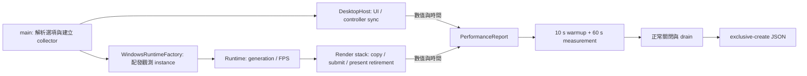
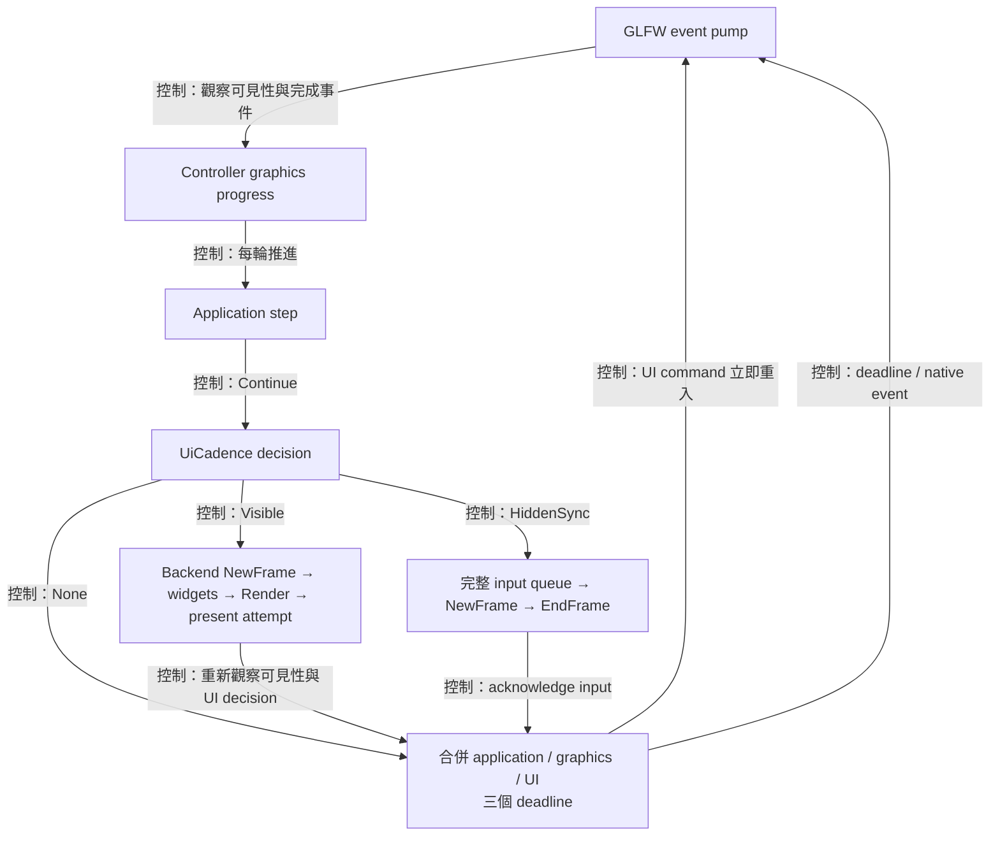
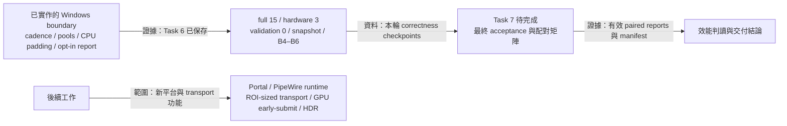

# Vulkan 效能觀測

為了比較 avb0795 在相同來源下的成本，量測需要固定工作量、明確的時間邊界，以及各個資源 owner 的計數。`--performance-report` 啟用一次程序生命週期的觀測；正常關閉後產生一份 JSON。



## 啟動與輸出

請先建立報告目錄，再從 Release 執行檔啟動。以下範例以各次執行的新檔名辨識 run。

```text
avb0795.exe --performance-report B1-01.json --performance-scope controller
avb0795.exe --performance-report B3-01.json --performance-scope replica --performance-bridge auto
avb0795.exe --performance-report B5-01.json --performance-scope replica --performance-bridge cpu
```

- `controller` 以第一個 UI frame 起算；適用尚待選擷取來源的面板閒置量測。
- `replica` 以第一個成功 present fence retirement 起算；這是預設 scope。
- `auto` 使用既有 capability probes 選擇 transport；這是預設 bridge。
- `cpu` 在本次程序套用 `ForceCpuBaseline`，沿用完整擷取、排程與繪製流程。
- Scope 與 bridge 選項搭配 report 使用；偏好設定檔維持原本的保存責任。

起算後經過 10 秒 warmup，接續收集 60 秒樣本。量測區間採 `[start, end)`，區間結束時凍結計數；使用者接著關閉程式，drain 完成後寫入 JSON。提早關閉、樣本容量溢出、量測期間 workload 改變等情況會列入 `incomplete_reasons`。

輸出採 C++23 exclusive create。目的檔已存在時，請使用另一個檔名。CLI 參數錯誤的 exit code 為 1；報告寫入錯誤為 8。寫入中途失敗時，該次新建檔案可能保留部分內容，請搭配 exit code 與 JSON 的完整性判定。Native ownership abandon 沿既有程序結束路徑處理，該次 run 由 exit code 與報告狀態辨識。

## 指標與責任

為了把「少做工作」和「相同工作更快完成」分開判讀，報告同時提供工作量、耗時與 owner-local 資源使用量。

| 指標 | 觀測邊界 |
| --- | --- |
| `ui_build` | Backend NewFrame 前至 ImGui Render 後的主執行緒耗時 |
| `hidden_syncs` | 隱藏 controller 完成一次完整 input queue 同步 |
| `graphics_only_wakes` | Host 完成 application／graphics progress，該輪 UI cadence 選擇省略 UI frame |
| `admitted` | Render stack 接受 checkout 並建立來源 copy obligation |
| `submitted` | Vulkan queue submit 成功；retained redraw 另列計數 |
| `present_retired` | 成功／suboptimal present 的 fence 已完成 |
| `intake_to_submit` | WGC intake 的 steady-clock timestamp 至新 frame 的 queue submit 成功 |
| `present_retirement_interval` | 同一觀測 runtime 中，相鄰成功 present retirement 的 host 觀測間距 |
| `d3_copy_bytes` | D3 copy 請求的有效內容矩形 bytes |
| `cpu_copy_bytes` | Staging rows 搬入 upload storage 的有效內容 bytes |
| `cpu_clear_bytes` | CPU 清零的 bytes |
| `vulkan_upload_bytes` | 記錄至 command buffer 的完整 allocation upload bytes |
| `*_created`／`*_destroyed` | 各 owner 成功建立／釋放的 command buffers、fences、semaphores |

每組 duration samples 預配置 65,536 筆。p50／p95 使用 nearest-rank：排序後取索引 `ceil(p × n) - 1`；空集合以 `null` 表達。Present interval 的第一筆區間內觀測用於建立量測期的起點，相鄰的後續觀測形成有效間距。

Controller 與 replica 的 counters、metadata、high-water marks 各自分組。Runtime identity 使用 process-local instance 與 resource generation。Bridge、content、allocation、framebuffer、FPS 或 present mode 改變時，報告記錄 workload 變動，該 run 適合用於診斷並另行重跑效能比較。

Bytes 指標描述 API 請求範圍與 CPU 寫入量；硬體實際 memory traffic 需要 GPU profiler 的計數。Intake timestamp 描述本程式接收事件；present retirement 描述 host 可見的完成證據。來源產生影像至螢幕發光的端到端時間屬另一種量測邊界。

目前 CPU 路徑逐列複製 content，並清除右側與下方 padding。令 `A = allocation.width × allocation.height × 4`，`C = content.width × content.height × 4`，應觀察 copy=`C`、clear=`A-C`、upload=`A`。完整尺寸的 content 具有 `C=A`，該幀 CPU clear 為 0；來源縮小時，新增 padding 沿本幀尺寸清零。Byte 數學與 owner 接線見 [CPU rows](../architecture/shared-vulkan-renderer.md#cpu-rows內容複製與-padding-定義)。Crop 維持來源內容座標與 shader UV 取樣，因此 crop 案例仍呈現完整 transport 成本。

## 固定比較集合

每個情境取得三次有效 run；baseline／candidate 交錯執行。各次保持 Release flags、source checksum、GPU／driver、OS build、SDR、power plan、validation 設定、FPS、實際 frame 尺寸與 replica framebuffer 一致。

| Run | Source | Bridge | Controller |
| --- | --- | --- | --- |
| B1 | 尚待選取來源 | auto | 可見閒置 |
| B2 | 固定靜態來源 | auto | 可見閒置 |
| B3 | 固定 1920×1080、60 Hz 動態來源 | auto | 最小化 |
| B4 | 同 B3 | cpu | 最小化 |
| B5 | 固定 3840×2160、60 Hz 動態來源 | cpu | 最小化 |
| B6 | 同 B5；crop `(0, 0, 960, 540)` | cpu | 最小化 |

為了保存重跑所需的環境資料，每份 `B3-01.json` 搭配同名 `B3-01.manifest.md`，記錄：

1. Commit 與 dirty-source SHA256 集合、執行檔 SHA256。
2. Fixture 程式／影片 checksum、動態來源節奏、實際 capture content／allocation 尺寸。
3. OS build、GPU、driver、power plan、validation 與完整啟動參數。
4. Replica 數量、framebuffer 尺寸、crop 數值、controller 可見狀態。
5. Exit code、report complete 狀態、drain 結果與操作異常。

Driver metadata 的 `raw:` 前綴表示 Vulkan 回報的原始 vendor-encoded driverVersion；環境 manifest 另記錄系統顯示的 driver 版本。報告中的 OS 平台名稱搭配 manifest 的完整 OS build 使用。

對照時先比較 admitted／submitted／present-retired／dropped／retained-redraw 工作量，再比較 p50／p95 與三次 run 的 median／range。Throughput 下降超過 5% 會觸發警戒；intake-to-submit p95 同時增加超過 5% 與 0.5 ms 則觸發獨立警戒。診斷開關的觀測成本以相同 workload 下的 process CPU 與 throughput 配對呈現。

## Controller 更新期限



為了讓擷取與 GPU 完成檢查各自維持進度，controller 需要獨立決定何時建立 ImGui 畫面。`DesktopHost` 使用純值 `UiCadence` 計算 UI deadline，再與 Application、graphics owner 的 deadline 合併。每輪先 pump events、推進 controller graphics 與 Application，接著以 `Visible`、`HiddenSync` 或 `None` 決定 UI 工作；已入列的 UI command 讓下一輪立即開始。

| 狀態 | UI 更新方式 |
| --- | --- |
| 初次顯示、還原 | 立即建立一幀 |
| 最近 500 ms 有輸入，或持續按鍵／編輯／popup／快捷鍵錄製 | 每次 build 完成後至少間隔 16.667 ms |
| 可見且閒置 | 每次 build 完成後間隔 100 ms |
| 最小化、framebuffer 為零 | 事件驅動的一次 input 同步；同步後由 Application／graphics deadline 與 native event 喚醒 |

Windows 最小化狀態與 framebuffer 尺寸共同決定可見性。Native input callback 先記錄 activity，再轉送 ImGui backend；backend 保存既有 callback chain。Capture wake 供 Application／graphics progress 使用。UI command 進入 queue 後，下一輪立即 pump events 與執行 Application step。

為了讓累積的游標移入事件對應當下位置，host 在 backend 處理 entry 後，透過 GLFW 取得 window-local 座標並加入 ImGui input queue。這個取樣涵蓋「移動、移出、回到相同位置」集中於兩次 UI build 之間的情形；callback 轉送與 queue 寫入共同受 host 的 exception firewall 保護。

隱藏同步暫時將 `ConfigInputTrickleEventQueue` 設為 false，讓同批 press、release、focus events 完整消化，結束後恢復原設定。可見 UI 持續使用原本的 trickling 行為。到期的 widget build 持續處理互動，native GPU capacity 決定該幀的 present admission。

為了將已接受的透明度存入偏好設定，ControllerView 的 gesture draft 保存 preview 與待 commit 狀態；還原後確認手勢結束，再透過 typed command 交給 Application 儲存 accepted state。Opacity 拉桿啟用 scoped `LiveEditOnInputScalar`，Ctrl-click 輸入時將解析後的數值寫入既有 draft，讓草稿跨越多次隱藏同步。Opacity 沿 preview 更新目前畫面，編輯結束時保存。Escape 使用 widget 的還原語意回到本次編輯起值。選區透過副本框選提交來源像素矩形。

ImGui 的 scalar widget patch 將 temporary text export 綁定至當次 active editor，讓同 ID 的文字輸入與後續拖曳各自沿用對應數值。CMake 在所有 UI 平台驗證這份 patch 的輸出雜湊；下載來源使用獨立的 Git 目錄探索邊界與 LF 格式，以固定 patch 結果。

報告的 `owners.controller.metadata.ui_policy` 保存實際 cadence 數值；replica metadata 引用 controller owner 的說明。B1／B2 的閒置 UI builds 預期接近每秒 10 次；B3–B6 的最小化穩態預期為零次週期性 widget build。輸入、恢復顯示與測試操作的額外更新由對應計數與 manifest 解釋。

## 本階段驗證範圍

以下保留 2026-09 Windows 效能工作的範圍與當時的後續設計。 其中 Portal／PipeWire 是歷史規劃；目前 Linux 已改為 direct X11，產品接線與獨立驗收狀態見 [Linux 指南](linux.md)，不以這份 Windows 量測代替 Linux 證據



為了以實際可執行範圍交付本輪成果，驗證需要分別記錄功能實作、correctness checkpoints 與最終效能比較。Task 1 已建立 opt-in report 與基線；Task 2 已接入 UI cadence 與 input continuity；Task 3 已建立 Windows shared renderer 的 source／target 邊界；Tasks 4–5 已重用 replica 與 controller 的 frame／present resources；Task 6 已依 content 與 allocation 的差集清除 CPU padding。

Task 6 提交為 `0fe7b1c`。2026-09-19 的驗證紀錄保存 full 15/15、hardware 3/3、isolated validation VUID／Validation Error 0、精確 snapshot build，以及 B4／B5／B6 的 byte-cost checkpoints。本機工作樹檔案 `docs/verification/2026-09-16-vulkan-performance-task6.md` 與 `artifacts/vulkan-perf/task6-20260919/` 保存這些 local-only 證據，沿 verification／artifacts 的未提交保存範圍管理。B5 使用有效的 retry，首次 incomplete run 仍保留原始狀態；這組單次情境資料提供 Task 7 定位依據。

Task 7 的最終 V1–V6、完整互動 acceptance，以及同環境 B1–B6 各三次的 baseline／candidate 交錯配對矩陣仍待完成。最終 throughput 與 latency 結論將以有效 paired reports、manifest、counts、median／range 與既定警戒門檻判讀。程式建置、純政策測試、互動驗收、硬體擷取測試與 benchmark 各自保存證據。

後續範圍包含 Linux Portal／PipeWire runtime、ROI-sized transport、GPU early-submit 與 HDR。本輪 Windows compile、boundary 與 hardware 證據支持目前交付範圍；crop 仍沿完整 transport 與 shader UV，GPU readiness 仍由 producer completion proof 驅動。
