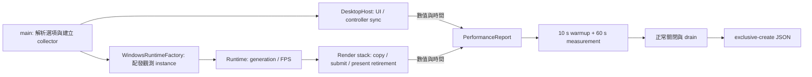

# Vulkan 效能觀測

為了比較 avb0795 在相同來源下的成本，量測需要固定工作量、明確的時間邊界，以及各個資源 owner 的計數。`--performance-report` 啟用一次程序生命週期的觀測；正常關閉後產生一份 JSON。



## 啟動與輸出

請先建立報告目錄，再從 Release 執行檔啟動。以下範例以各次執行的新檔名辨識 run。

```text
avb0795.exe --performance-report B1-01.json --performance-scope controller
avb0795.exe --performance-report B3-01.json --performance-scope replica --performance-bridge auto
avb0795.exe --performance-report B5-01.json --performance-scope replica --performance-bridge cpu
```

- `controller` 以第一個 UI frame 起算；適用尚待選擷取來源的面板閒置量測。
- `replica` 以第一個成功 present fence retirement 起算；這是預設 scope。
- `auto` 使用既有 capability probes 選擇 transport；這是預設 bridge。
- `cpu` 在本次程序套用 `ForceCpuBaseline`，沿用完整擷取、排程與繪製流程。
- Scope 與 bridge 選項搭配 report 使用；偏好設定檔維持原本的保存責任。

起算後經過 10 秒 warmup，接續收集 60 秒樣本。量測區間採 `[start, end)`，區間結束時凍結計數；使用者接著關閉程式，drain 完成後寫入 JSON。提早關閉、樣本容量溢出、量測期間 workload 改變等情況會列入 `incomplete_reasons`。

輸出採 C++23 exclusive create。目的檔已存在時，請使用另一個檔名。CLI 參數錯誤的 exit code 為 1；報告寫入錯誤為 8。寫入中途失敗時，該次新建檔案可能保留部分內容，請搭配 exit code 與 JSON 的完整性判定。Native ownership abandon 沿既有程序結束路徑處理，該次 run 由 exit code 與報告狀態辨識。

## 指標與責任

為了把「少做工作」和「相同工作更快完成」分開判讀，報告同時提供工作量、耗時與 owner-local 資源使用量。

| 指標 | 觀測邊界 |
| --- | --- |
| `ui_build` | Backend NewFrame 前至 ImGui Render 後的主執行緒耗時 |
| `admitted` | Render stack 接受 checkout 並建立來源 copy obligation |
| `submitted` | Vulkan queue submit 成功；retained redraw 另列計數 |
| `present_retired` | 成功／suboptimal present 的 fence 已完成 |
| `intake_to_submit` | WGC intake 的 steady-clock timestamp 至新 frame 的 queue submit 成功 |
| `present_retirement_interval` | 同一觀測 runtime 中，相鄰成功 present retirement 的 host 觀測間距 |
| `d3_copy_bytes` | D3 copy 請求的有效內容矩形 bytes |
| `cpu_copy_bytes` | Staging rows 搬入 upload storage 的有效內容 bytes |
| `cpu_clear_bytes` | CPU 清零的 bytes |
| `vulkan_upload_bytes` | 記錄至 command buffer 的完整 allocation upload bytes |
| `*_created`／`*_destroyed` | 各 owner 成功建立／釋放的 command buffers、fences、semaphores |

每組 duration samples 預配置 65,536 筆。p50／p95 使用 nearest-rank：排序後取索引 `ceil(p × n) - 1`；空集合以 `null` 表達。Present interval 的第一筆區間內觀測用於建立量測期的起點，相鄰的後續觀測形成有效間距。

Controller 與 replica 的 counters、metadata、high-water marks 各自分組。Runtime identity 使用 process-local instance 與 resource generation。Bridge、content、allocation、framebuffer、FPS 或 present mode 改變時，報告記錄 workload 變動，該 run 適合用於診斷並另行重跑效能比較。

Bytes 指標描述 API 請求範圍與 CPU 寫入量；硬體實際 memory traffic 需要 GPU profiler 的計數。Intake timestamp 描述本程式接收事件；present retirement 描述 host 可見的完成證據。來源產生影像至螢幕發光的端到端時間屬另一種量測邊界。

目前 CPU 路徑每幀清除完整 allocation。令 `A = allocation.width × allocation.height × 4`，`C = content.width × content.height × 4`，本階段應觀察 copy=`C`、clear=`A`、upload=`A`。後續 padding 最佳化的驗收目標是 clear=`A-C`。Crop 維持來源內容座標與 shader UV 取樣，因此 crop 案例仍呈現完整 transport 成本。

## 固定比較集合

每個情境取得三次有效 run；baseline／candidate 交錯執行。各次保持 Release flags、source checksum、GPU／driver、OS build、SDR、power plan、validation 設定、FPS、實際 frame 尺寸與 replica framebuffer 一致。

| Run | Source | Bridge | Controller |
| --- | --- | --- | --- |
| B1 | 尚待選取來源 | auto | 可見閒置 |
| B2 | 固定靜態來源 | auto | 可見閒置 |
| B3 | 固定 1920×1080、60 Hz 動態來源 | auto | 最小化 |
| B4 | 同 B3 | cpu | 最小化 |
| B5 | 固定 3840×2160、60 Hz 動態來源 | cpu | 最小化 |
| B6 | 同 B5；crop `(0, 0, 960, 540)` | cpu | 最小化 |

為了保存重跑所需的環境資料，每份 `B3-01.json` 搭配同名 `B3-01.manifest.md`，記錄：

1. Commit 與 dirty-source SHA256 集合、執行檔 SHA256。
2. Fixture 程式／影片 checksum、動態來源節奏、實際 capture content／allocation 尺寸。
3. OS build、GPU、driver、power plan、validation 與完整啟動參數。
4. Replica 數量、framebuffer 尺寸、crop 數值、controller 可見狀態。
5. Exit code、report complete 狀態、drain 結果與操作異常。

Driver metadata 的 `raw:` 前綴表示 Vulkan 回報的原始 vendor-encoded driverVersion；環境 manifest 另記錄系統顯示的 driver 版本。報告中的 OS 平台名稱搭配 manifest 的完整 OS build 使用。

對照時先比較 admitted／submitted／present-retired／dropped／retained-redraw 工作量，再比較 p50／p95 與三次 run 的 median／range。Throughput 下降超過 5% 會觸發警戒；intake-to-submit p95 同時增加超過 5% 與 0.5 ms 則觸發獨立警戒。診斷開關的觀測成本以相同 workload 下的 process CPU 與 throughput 配對呈現。

## 本階段驗證範圍

Task 1 先建立觀測工具與基線。UI cadence、同步物件重用與 CPU padding 精簡依後續 task 推進。效能比較的結論以對應的實測報告與 manifest 為依據；程式建置、純政策測試、硬體擷取測試與 benchmark 四項分別記錄。
