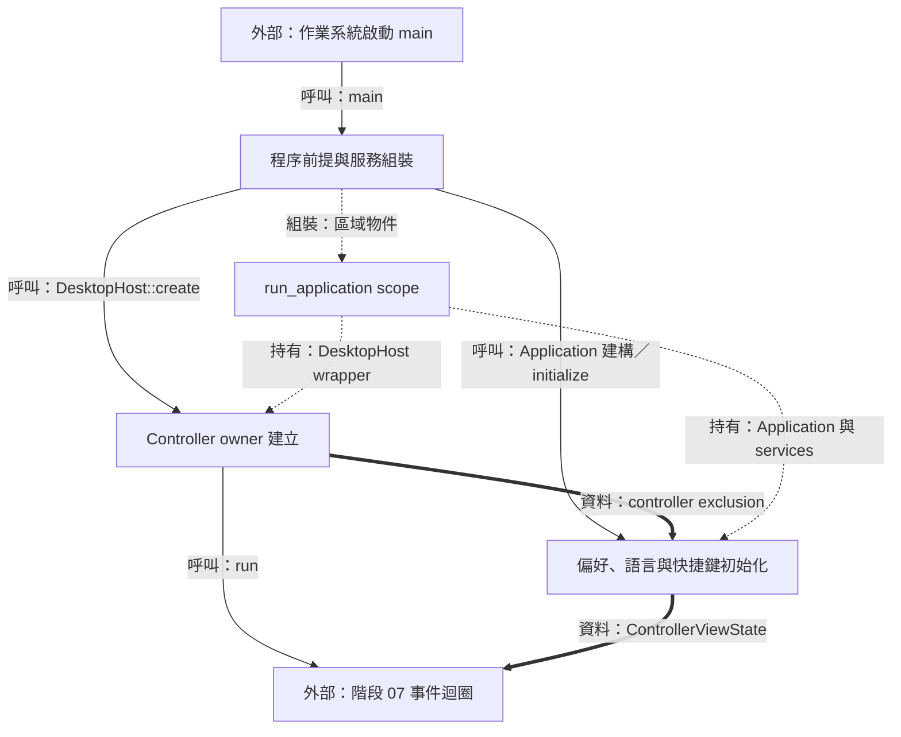
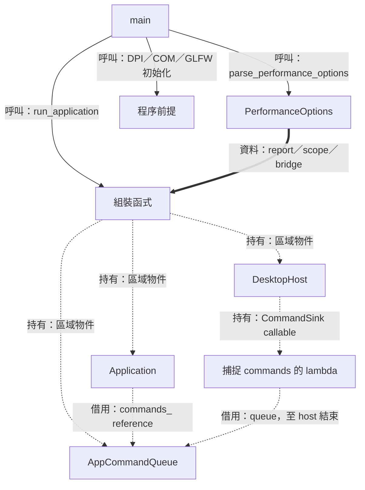
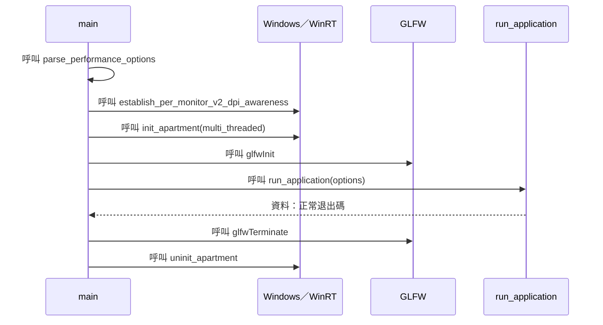
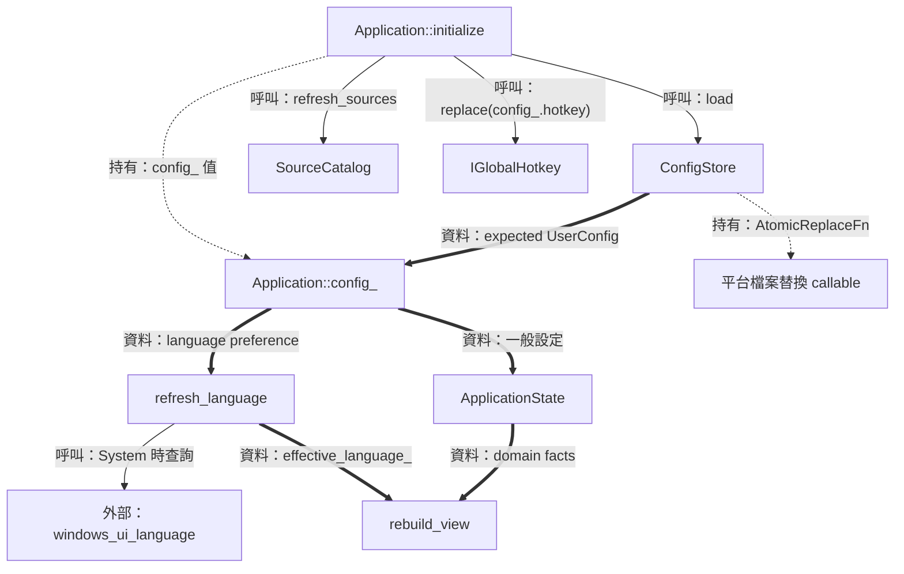
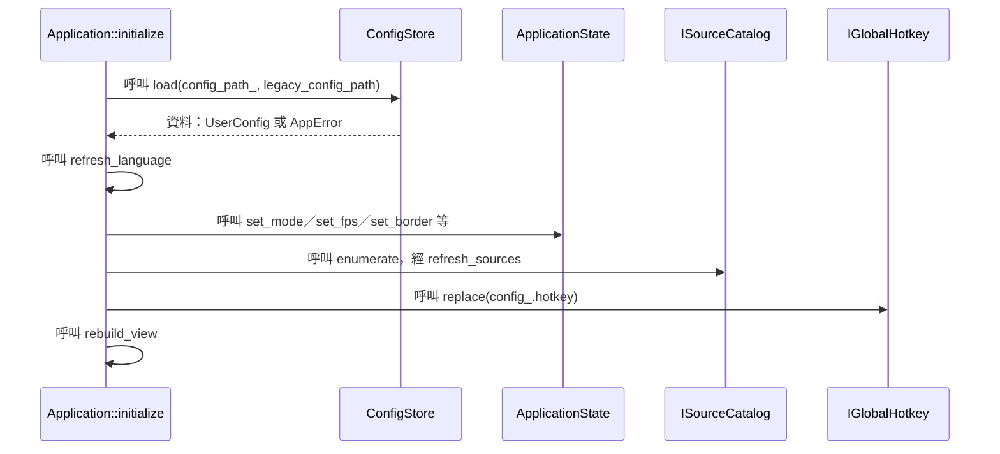
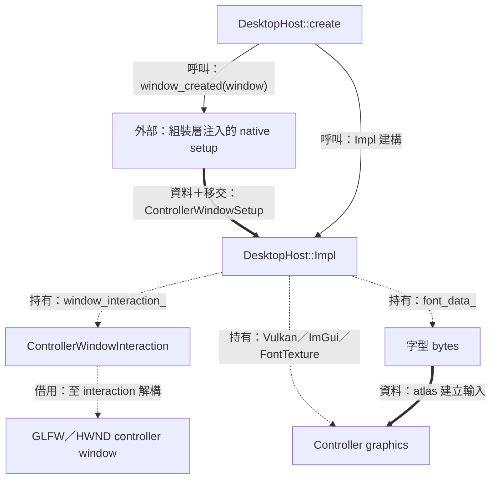
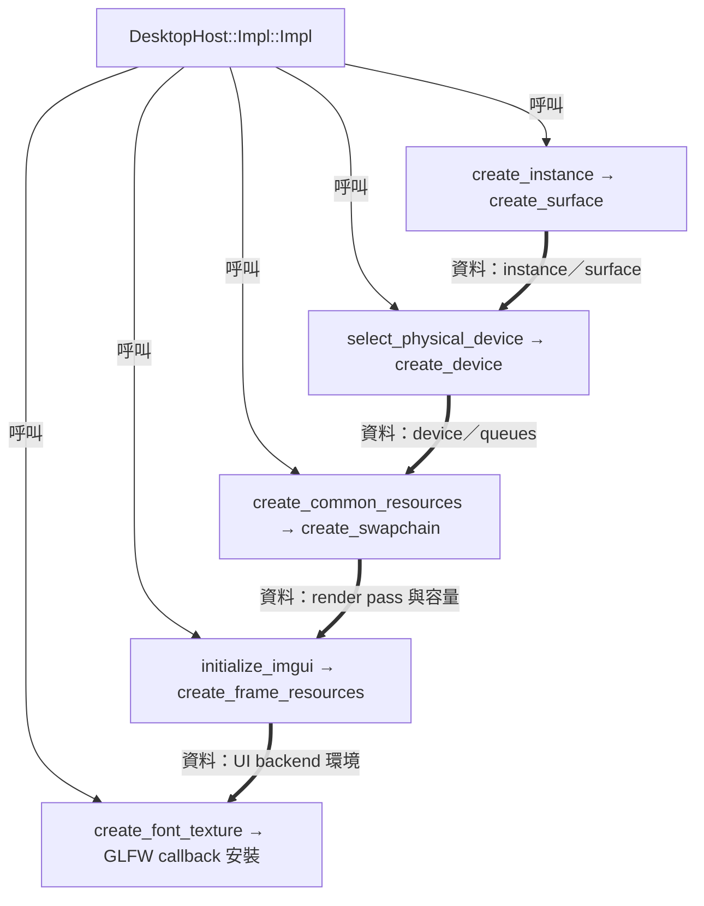

# 階段 01：啟動程序、載入偏好與建立 Controller



為了讓第一個控制面板同時具備文字、偏好與可使用的來源清單，啟動程序需要先建立視窗環境，再組裝服務與應用狀態。本階段沿 `main → run_application` 閱讀，觀察 owner 的建立順序如何保護借用參照。

[總覽](overview.md) · [下一篇：命令與 Session](02-commands-and-session.md) · [迴圈細節](07-controller-loop-and-projection.md)

| 入口／輸出 | 執行環境 | 生命週期責任 |
| --- | --- | --- |
| `main(argc, argv)` → `host.run(application)` | GLFW 主執行緒；程序已設定 DPI／COM | `run_application` 持有服務與 host；Application 借用服務 |
| 檔案偏好 → `UserConfig` → 首份 view | 同步初始化 | ConfigStore 處理 I/O，Application 保存接受的偏好 |

圖例：實線為呼叫／控制，粗線為資料，虛線標明持有、借用或移交。圖中的服務組裝順序與物件持有關係各自保留標籤。

## 程序前提與服務組裝

### 結構與流程圖



先看實線確定誰建立服務，再沿虛線判讀每個服務需要誰持續存在。`commands` 先於 host 建立，因此 host 保存的 lambda 在正常生命週期內持續有有效的 queue 可用。

### 資料結構與使用方式

為了讓一次診斷執行帶有明確選項，入口需要一個值物件保存解析結果。[`PerformanceOptions`](../../main.cpp) 把檔案位置、觀察範圍與 bridge 偏好放在一起；它的內容隨函式參數傳遞，圖形資源由後續 owner 建立。

| Member | 用途與使用者 |
| --- | --- |
| `report` | `optional<filesystem::path>`；有值時組裝 `PerformanceReport`，路徑採新檔建立規則 |
| `scope` | 選擇 Controller 或 Replica 的觀察範圍，預設 Replica |
| `bridge` | Automatic 或 ForceCpuBaseline，傳給 runtime factory，方便對照 transport |

使用示例：以下在 `main.cpp` 的匿名 namespace 語境中組裝選項，示例函式名稱用於教學。

```cpp
PerformanceOptions example_cpu_observation()
{
    PerformanceOptions options;
    options.report = std::filesystem::path{"run-observation.json"};
    options.bridge = avb::render::WindowsBridgePreference::ForceCpuBaseline;
    return options;
}
```

`optional` 讓「具有路徑」與「空值」共用同一種型別；`filesystem::path` 保存路徑值。正式入口的 parser 還會驗證選項、父目錄與目標檔案狀態，完整輸出流程見 [階段 08](08-recovery-and-shutdown.md)。

### 實作流程



節錄 [`main`](../../main.cpp)，保留成功路徑的主要呼叫；原函式的錯誤分支將啟動結果轉成固定診斷及退出碼。

```cpp
int main(const int argc, char *argv[])
{
    // ...
    const auto dpi =
        avb::platform::windows::establish_per_monitor_v2_dpi_awareness();
    // ...
    winrt::init_apartment(winrt::apartment_type::multi_threaded);
    // ...
    if (glfwInit() != GLFW_TRUE) {
        // ...
    }
    // ...
    exit_code = run_application(options);
    // ...
    glfwTerminate();
    winrt::uninit_apartment();
    return exit_code;
}
```

#### DPI、COM 與 GLFW 各解決什麼需求

為了將螢幕上的幾何座標解讀成一致單位，程序先建立 Per-Monitor V2 DPI awareness。後續視窗、滑鼠座標和像素尺寸沿此設定解讀，幾何公式見 [階段 06](06-settings-and-window-interaction.md)。

為了呼叫 Windows Runtime 的擷取物件，本執行緒先初始化 COM apartment。`multi_threaded` 指定這份執行緒環境；WGC callback 的實際執行位置由擷取池的設定決定，見 [階段 03](03-capture-and-scheduling.md)。GLFW 接著建立視窗與事件處理所需的程序環境。

#### 建立順序就是借用契約

為了讓服務回呼能安全使用 queue 與 wake target，`run_application` 依序建立 queue、host、來源 registry/catalog/factory、hotkey、ConfigStore、Application。C++ 區域物件在正常離開 scope 時反向銷毀；這種把釋放責任綁在物件生命週期上的做法稱為 RAII。

`Application` 保存服務 reference，表示呼叫權與借用關係；`unique_ptr<IReplicaRuntime>` 表示 runtime 的單一持有者。程序遇到需要保留 native owners 的退出結果時，入口採專門的 `_Exit` 路徑；該分支與正常反向析構的契約見 [階段 08](08-recovery-and-shutdown.md)。

## 偏好、語言與快捷鍵初始化

### 結構與流程圖



從 `load` 的回傳值開始，偏好在 Application 內成為可用狀態。SourceCatalog 與 hotkey 的平台效果由注入的服務執行；`rebuild_view` 收集結果供畫面使用。

### 資料結構與使用方式

為了在下次啟動恢復常用操作習慣，設定檔需要一份與畫面、來源生命週期分離的資料值。[`UserConfig`](../../include/avb/app/config_store.hpp) 保存下表偏好；`ReplicaSettings` 則保存目前 session 的實際設定，兩者透過 Application 協調。

| Member 群 | 共同用途與預設 |
| --- | --- |
| `version` | JSON schema 版本，值為 1 |
| `hotkey` | modifiers＋key 組成的 chord，預設 Ctrl＋Alt＋R |
| `fps_cap`、`mode`、`border` | 呈現上限與副本互動偏好，預設 60、Editable、Bordered |
| `opacity_percent`、`wheel_zoom_percent` | 預設 100% 與 5%，各有範圍驗證 |
| `extensions` | 額外功能選項，包含 browser capture keep-alive |
| `language`、`auto_refresh_enabled` | 保存語言選擇與自動來源重新整理開關，預設 System／false |

使用示例；型別來自 [`config_store.hpp`](../../include/avb/app/config_store.hpp)。

```cpp
avb::app::UserConfig example_preferences()
{
    avb::app::UserConfig config;
    config.opacity_percent = 80;
    config.wheel_zoom_percent = 5;
    config.language = avb::i18n::LanguagePreference::System;
    config.auto_refresh_enabled = true;
    return config;
}
```

示例展示資料的形狀。正式操作經 Application 的命令處理與原生套用後，再更新接受的設定和檔案。選取來源、crop 與位置由當次 session 管理；檔案保存範圍就是上述一般偏好。

### 實作流程



節錄 [`Application::initialize`](../../src/app/application.cpp)：

```cpp
void Application::initialize(const std::filesystem::path &legacy_config_path)
{
    const auto loaded = config_store_.load(config_path_, legacy_config_path);
    if (loaded) {
        config_ = *loaded;
    }
    else {
        config_ = UserConfig{};
        set_notice(NoticeOperation::ConfigRead, loaded.error());
    }
    refresh_language();
    // ...
    (void) state_.set_opacity(session_id, config_.opacity_percent);
    (void) state_.set_wheel_zoom_percent(session_id, config_.wheel_zoom_percent);
    refresh_sources();
    // ...
    rebuild_view();
}
```

#### Requested language 與 effective language

為了讓「跟隨系統」在保存後仍保有動態含義，需要同時記住使用者的選擇與此次解析出的語言。`config_.language` 保存 `LanguagePreference::System`，`effective_language_` 保存此次 UI 使用的 `Language`。[`refresh_language`](../../src/app/application_language.cpp) 在 System 分支呼叫注入的系統查詢，再交由 `resolve_language` 得到顯示語言。

#### 設定讀取與綁定結果

`ConfigStore::load` 依 schema 檢查讀入值；檔案缺席時供給 defaults，欄位級修復與整份預設的規則定義於其實作。設定路徑由執行檔位置決定，主檔名是 `avb0795.config`；歷史檔案路徑作載入遷移輸入。快捷鍵註冊結果另保存為 `hotkey_binding_confirmed_`，讓 UI 同時呈現「偏好的 chord」與「OS 已確認的綁定」。

## Controller owner 建立

### 結構與流程圖



圖中 native setup 透過結果值移交互動 owner。其後 host 負責 window、ImGui 與 controller graphics 的一致生命週期；副本的圖形資源另在 [階段 02](02-commands-and-session.md) 建立。

### 資料結構與使用方式

為了在可攜 host 建立後接上 Windows 標題拖曳與原生視窗設定，需要一個組裝邊界。[`ControllerWindowSetup`](../../include/avb/desktop/desktop_host.hpp) 讓入口回傳設定事實與已建立的互動 owner。

| Type／member | 用途與有效期間 |
| --- | --- |
| `ControllerWindowSetup::exclusion` | 啟動設定事實，交給 Application 投影 |
| `ControllerWindowSetup::interaction` | `unique_ptr<ControllerWindowInteraction>`，移交 host；其內借用 controller window |
| `DesktopHost::impl_` | 固定地址的 implementation owner，包裝可移動的公開 host |
| `Impl::font_data_`、`window_interaction_` | 本 unit 使用的 members：字型 bytes 與互動實作分別跟隨 host 的生命週期 |

使用示例，對應 `main.cpp` 注入函式的成功分支。前提是 `interaction` 為 `WindowsControllerWindow::create` 成功建立的 `expected<unique_ptr<WindowsControllerWindow>, AppError>`，`exclusion` 也具有成功結果：

```cpp
// ControllerWindowSetup 的 owner 移交形狀
return desktop::ControllerWindowSetup{
    *exclusion,
    std::move(*interaction)
};
```

`std::move` 讓 `unique_ptr` 的資源持有權交給回傳值，並透過衍生類別到基底介面的轉換，存入 `unique_ptr<ControllerWindowInteraction>`。`DesktopHost::Impl` 再將它移入 `window_interaction_`；原生 window 的生命週期涵蓋 interaction 的所有借用。

### 實作流程



節錄 [`DesktopHost::Impl::Impl`](../../src/desktop/desktop_host.cpp)。箭頭中的順序由同一個建構函式安排。

```cpp
DesktopHost::Impl::Impl(
    GLFWwindow *const window, CommandSink command_sink,
    ControllerWindowSetup setup, std::vector<std::byte> font_data,
    diagnostics::PerformanceReport *performance)
    : window_{window},
      performance_{performance},
      command_sink_{std::move(command_sink)},
      controller_exclusion_{setup.exclusion},
      window_interaction_{std::move(setup.interaction)},
      font_data_{std::move(font_data)}
{
    // ...
    create_instance();
    create_surface();
    select_physical_device();
    // ...
    create_device();
    create_common_resources();
    // ...
    initialize_imgui();
    create_frame_resources(backend_frame_capacity_);
    create_font_texture();
    // ...
}
```

#### 字型 bytes、atlas 與 GPU texture

為了讓中文字形在多次 UI frame 中都能取樣，host 需要先保存字型檔 bytes，交由 ImGui 建立 atlas，再將 atlas 上傳至自己的 Vulkan image。`FontTexture` 的 staging 與 sampled image 各有退休時點：staging 服務上傳工作，sampled image 服務後續 UI submissions。其 members 與完成證據在 [階段 07](07-controller-loop-and-projection.md) 展開。
