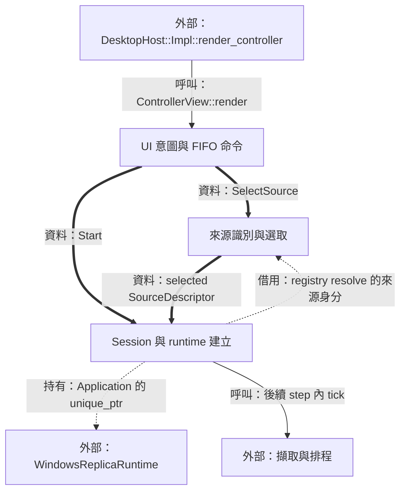
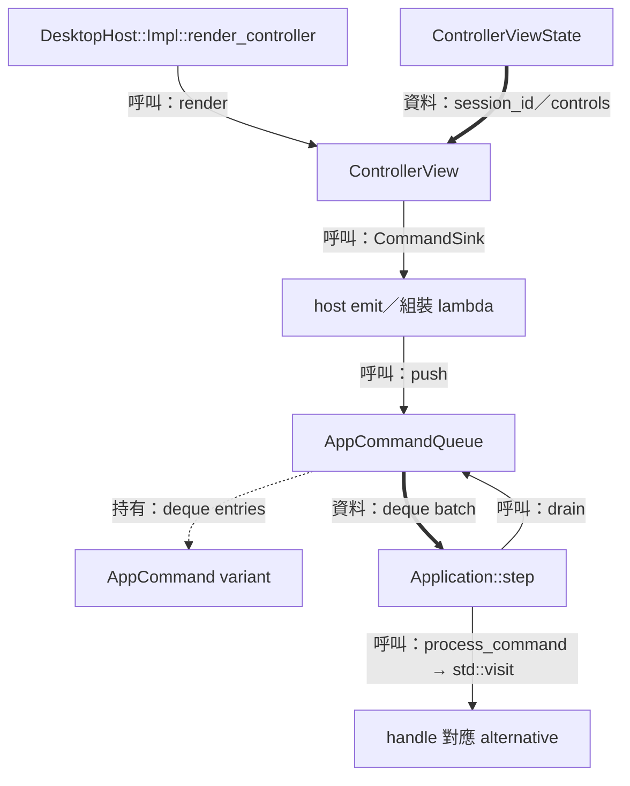
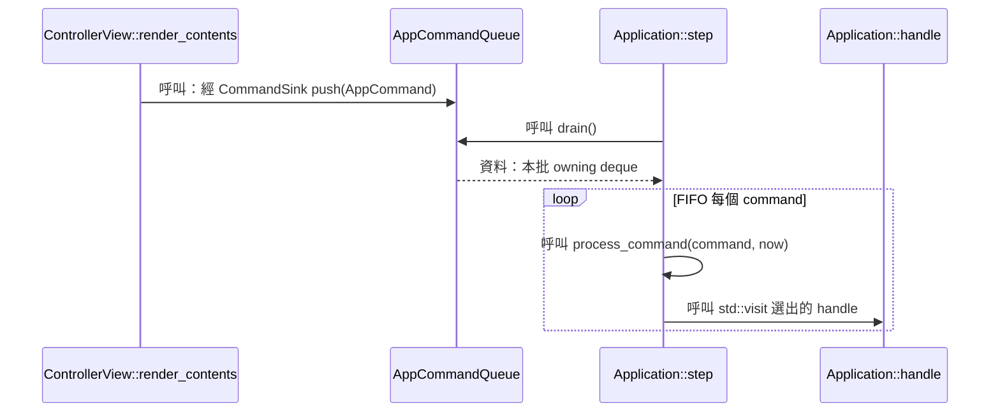
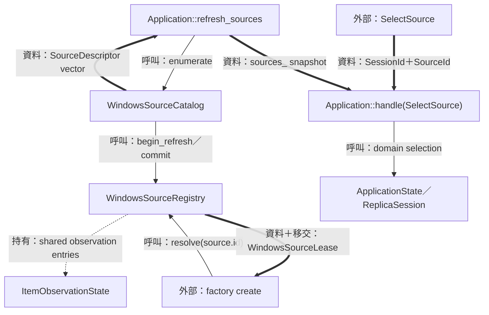
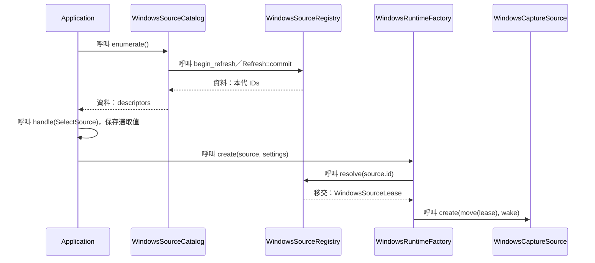
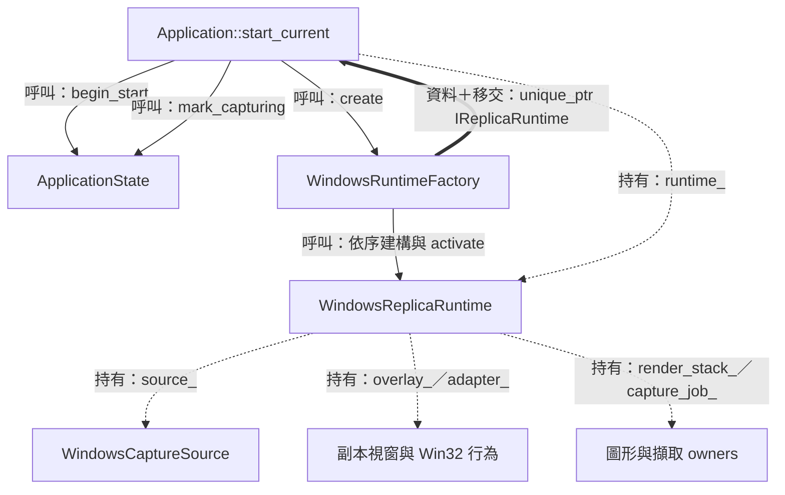
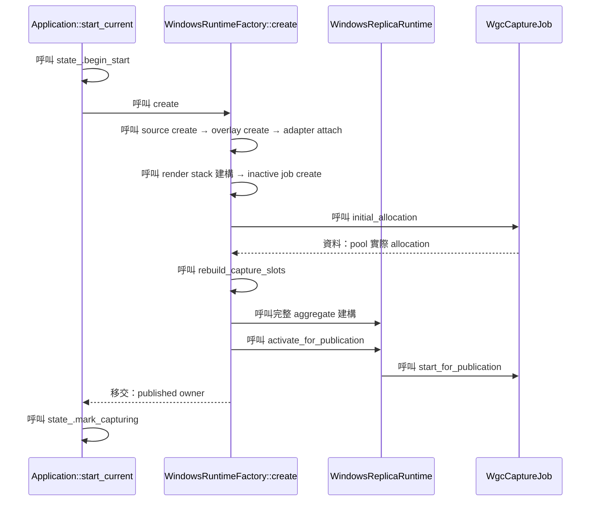

# 階段 02：從 UI 命令建立擷取 Session



為了讓「選取來源、開始、修改設定」具備可追蹤的效果，系統需要把 UI 事件轉成具有身分的意圖，再由 Application 依序驗證。本階段追蹤 `AppCommand` 如何走到完整 runtime 的發布點。

[總覽](overview.md) · [前篇：啟動](01-startup-and-preferences.md) · [後篇：擷取](03-capture-and-scheduling.md)

| 輸入 | 輸出 | Thread／owner |
| --- | --- | --- |
| `ControllerViewState`＋使用者操作 | `AppCommand` FIFO batch | UI 借用 view；queue 持有命令值；Application 在主執行緒消費 |
| `SourceDescriptor`＋`ReplicaSettings` | `unique_ptr<IReplicaRuntime>` | Factory 組裝，Application 接手 published runtime |

圖例：實線呼叫、粗線資料、虛線持有／借用／移交。圖的時序包含「本次 UI frame 產生命令」與「後續 Application step 處理命令」。

## UI 意圖與 FIFO 命令

### 結構與流程圖



為了保留使用者的操作順序，queue 儲存完整命令值。當 Application 取出 batch 後，後續新增意圖進入 queue 的下一批容器；這讓單次 `step` 的工作範圍明確。

### 資料結構與使用方式

[`AppCommand`](../../include/avb/app/commands.hpp) 使用 `std::variant`。為了在同一個 queue 保存多種意圖，需要讓每個值同時記住「是哪種命令」與「該命令的 payload」；variant 提供這個帶標籤的型別集合，`std::visit` 依目前 alternative 呼叫對應 handler。

| Type／member | 用途 |
| --- | --- |
| `Start::session_id`、`Stop::session_id` | 從 view 複製的 session 世代 token |
| `SelectSource::session_id/source_id` | 將操作同時綁到 session 與目前來源快照 |
| `SetOpacity::session_id/percent/commit` | 即時預覽數值與保存時機，細節見 [階段 06](06-settings-and-window-interaction.md) |
| `AppCommandQueue::commands_`、`closed_` | 擁有的 deque 與 admission 狀態；主執行緒使用 |

使用示例：主執行緒中的測試或組裝呼叫者以當前 view 建立命令，queue 的生命週期涵蓋此呼叫。

```cpp
bool example_enqueue_start(
    const avb::app::ControllerViewState &view,
    avb::app::AppCommandQueue &queue)
{
    return queue.push(avb::app::Start{view.session_id});
}
```

此例回傳 queue 是否接受值。操作的 domain 驗證與 native 建立結果由下一次 `Application::step` 產生，接著回到 view。

### 實作流程



節錄 [`AppCommandQueue::drain`](../../src/app/app_command_queue.cpp) 與 [`Application::process_command`](../../src/app/application.cpp)：

```cpp
std::deque<AppCommand> AppCommandQueue::drain()
{
    std::deque<AppCommand> drained;
    drained.swap(commands_);
    return drained;
}

void Application::process_command(const AppCommand &command,
                                  Clock::time_point now)
{
    std::visit(
        [this, now](const auto &value) { handle(value, now); }, command);
}
```

#### Snapshot controls 與實際 admission

為了讓操作介面反映目前能力，`ControllerControls` 為各項操作提供 `enabled`。畫面是一份時間點快照，命令之後經 Application 消費；因此 handler 會依當下的 session、lifecycle、capabilities 再作驗證。這兩次判斷分別服務 UI 呈現與狀態安全。

#### FIFO 與最新影格的時間含義

操作的次序會改變最終效果，例如 Start 接 Stop。影格則以最近觀察到的內容為顯示目標，因此 [階段 03](03-capture-and-scheduling.md) 使用單槽 latest-value mailbox。每個容器的契約都對應其資料的時間意義。

## 來源識別與選取

### 結構與流程圖



`SourceDescriptor` 負責列舉結果，registry 把該次快照的 ID 對應到實際觀察物件。UI 使用 ID 送命令，factory 取得 lease 後再組裝擷取來源。

### 資料結構與使用方式

為了在清單重新整理、同名視窗與 session 更換後維持明確身分，需要三種資訊：操作的 session、來源快照的識別，以及原生觀察的生命週期。

| Type／member | 用途與 ownership |
| --- | --- |
| [`SessionId::value`](../../include/avb/core/types.hpp) | domain 世代；命令從 `view.session_id` 複製 |
| [`SourceId::value`](../../include/avb/core/types.hpp) | 擁有的 opaque string，由 registry generation 發行 |
| `SourceDescriptor::id/kind/display_label` | ID、來源種類與擁有的顯示文字 |
| `SourceDescriptor::extent/color_support/native_handle_text` | 列舉時尺寸、色彩能力與供 UI 顯示的原生 handle 文字 |
| [`WindowsSourceLease::control_/observation_`](../../platform/windows/windows_source_registry.hpp) | 兩個 shared_ptr：registry 控制狀態與確切 observation；move-only lease 同時管理活躍借用計數 |

使用示例：前提為 `view.sources` 中存在使用者要選的 row；以下用第一列展示命令形狀。

```cpp
avb::app::SelectSource example_selection(
    const avb::app::ControllerViewState &view)
{
    return {view.session_id, view.sources.front().id};
}
```

這段建立的是值命令。`WindowsSourceLease` 由 registry 的 `resolve` 建立，將 observation 的有效生命週期延伸到 runtime 使用結束。共享持有讓 registry 與 lease 可共同保留同一筆 observation。

### 實作流程



節錄 [`WindowsRuntimeFactory::create`](../../platform/windows/windows_runtime_factory.cpp)，展示身分解析與持有權移交：

```cpp
// WindowsRuntimeFactory::create(source, settings) 內
auto lease = registry_.resolve(source.id);
if (!lease) {
    return std::unexpected{factory_error(lease.error())};
}
auto source_owner =
    WindowsCaptureSource::create(std::move(*lease), wake_main_loop_);
// ...
```

#### 兩種 generation

為了判斷命令是否指向目前的 domain，Application 驗證 `SessionId`。為了判斷來源 ID 是否仍屬於當前清單，registry 驗證它發出的 generation prefix。這兩種世代各自管理對應的時間邊界；GPU 資源另有 [階段 04](04-frame-transport.md) 的 `resource_generation`。

#### Observation 與來源關閉

Lease 保留特定 capture item 的 observation，其中的 Closed 事實會被保存供 runtime 讀取。Registry refresh 透過 guard 與活躍 lease 計數協調；新的快照建好後 commit 發行新 IDs。實際來源的開啟狀態由 observation 與 capture 操作持續回報。

## Session 與 runtime 建立

### 結構與流程圖



為了將部分建構與已發布 runtime 的責任分開，factory 負責取得完整可使用的 aggregate；Application 接手後，以 domain 狀態公開 Capturing。後續釋放 published runtime 的條件由 [階段 08](08-recovery-and-shutdown.md) 定義。

### 資料結構與使用方式

| Type／本 unit 使用的 members | 用途與持有者 |
| --- | --- |
| [`ReplicaSettings`](../../include/avb/core/types.hpp) | mode、border、fps、opacity、wheel step、region、selecting、extensions，作為 factory 建立輸入 |
| [`ReplicaSession`](../../include/avb/core/replica_session.hpp) | 保存選取來源、設定與 lifecycle；ApplicationState 提供 session token 驗證入口 |
| [`Application::runtime_`](../../include/avb/app/application.hpp) | 已發布 runtime 的 `unique_ptr<IReplicaRuntime>` |
| [`Application::pending_start_`](../../include/avb/app/application.hpp) | `PendingStart{source, settings}` 保存替換目標，銜接舊 owner 的 drain |

使用示例：以下展示 factory port 的回傳形狀，採 Application 內部語境；`created` 成功分支的移交點與正式程式一致。

```cpp
// Application::start_current 內的持有權移交
auto created = runtime_factory_.create(
    *session.selected_source(), session.settings());
// ... 檢查 expected 結果與回傳 owner ...
runtime_ = std::move(*created);
```

`expected` 保存成功值或 `AppError`；成功值又是 `unique_ptr`。兩層各自回答一個問題：「建立結果是什麼」與「誰持有建立好的物件」。示例中的解參照前提由正式 `start_current` 的結果檢查建立。

### 實作流程



節錄 [`Application::start_current`](../../src/app/application.cpp)，保留發布前後的核心狀態：

```cpp
void Application::start_current(Clock::time_point now,
                                bool after_runtime_tick)
{
    // ...
    const auto starting = state_.begin_start(session_id);
    // ...
    auto created =
        runtime_factory_.create(*session.selected_source(), session.settings());
    // ...
    runtime_ = std::move(*created);
    reset_runtime_feedback();
    stop_requested_ = false;
    const auto capturing = state_.mark_capturing(session_id);
    // ...
}
```

#### 為什麼 slot 尺寸取自 capture pool

從列舉到按下 Start 之間，來源尺寸可以改變。為了讓 producer copy 與 renderer allocation 對齊，factory 先建立 inactive job，讀取 `initial_allocation()`，再建立 capture slots。`SourceDescriptor::extent` 服務初始顯示需求，pool allocation 服務實際影格儲存需求。

#### 完整建構後啟動 capture

`activate_for_publication` 在 aggregate 已持有所有依賴後啟動 job，啟用來源 wake binding 並記錄發布狀態。這個順序讓 callback 到來時有完整的接收與退休 owner。後續 tick 將影格送到 [擷取與排程](03-capture-and-scheduling.md)，替換來源則經 [停止與 drain](08-recovery-and-shutdown.md) 銜接。
