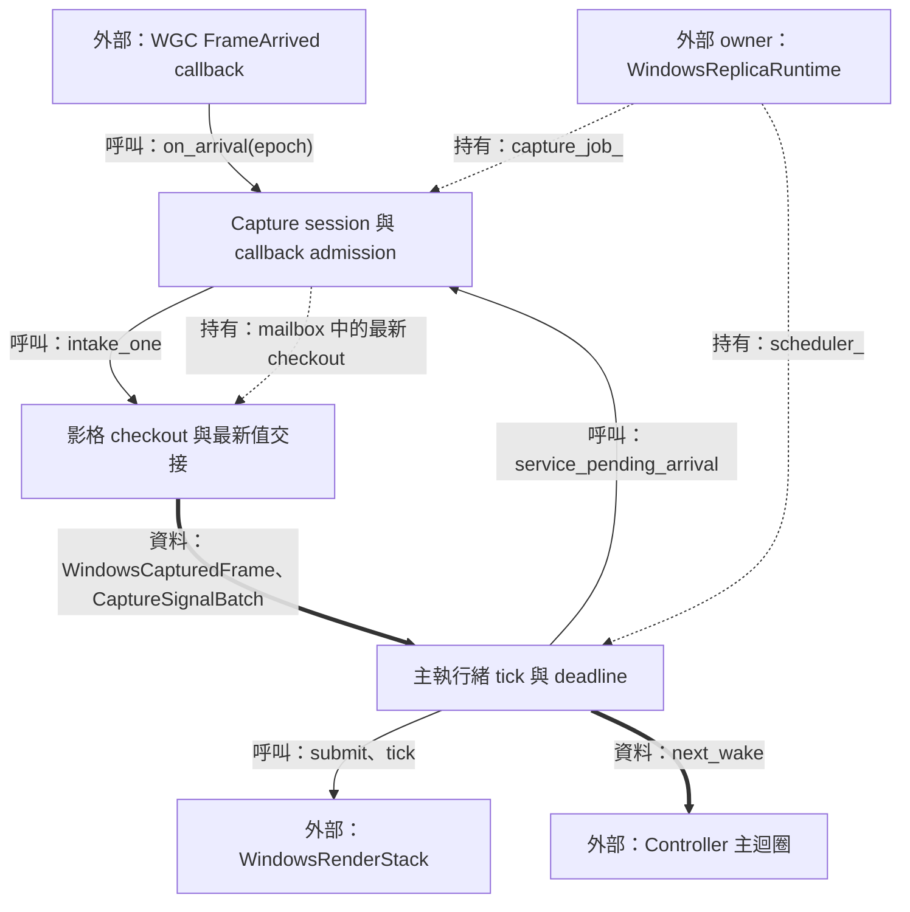
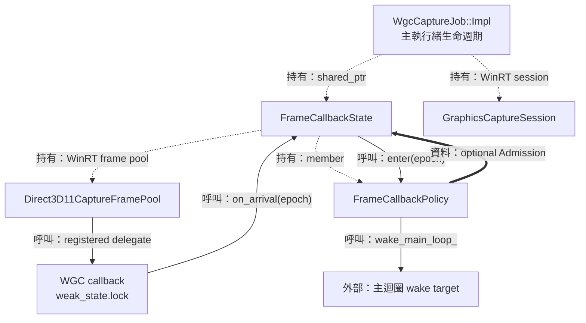
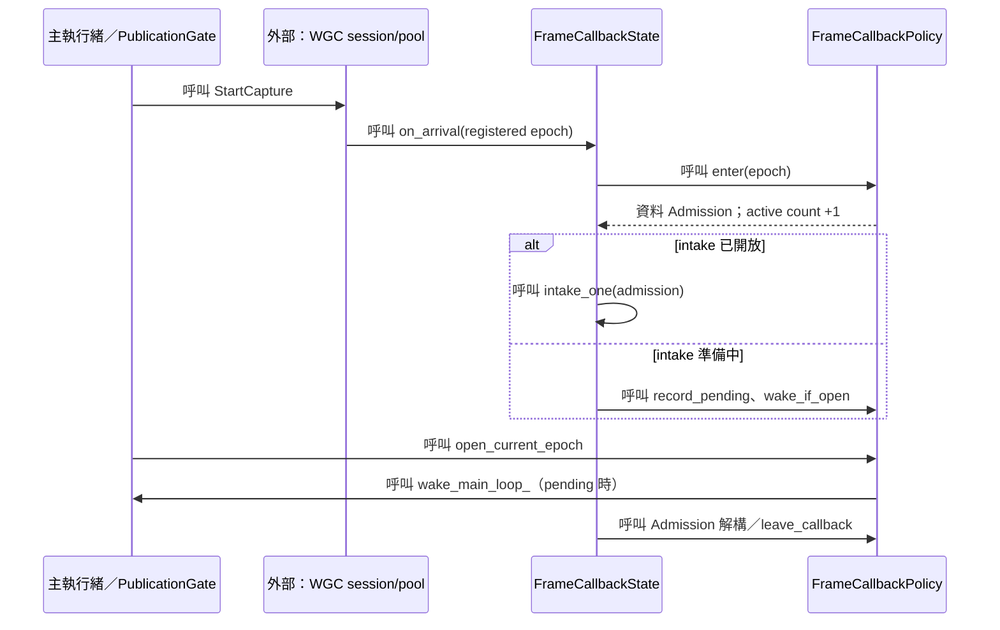
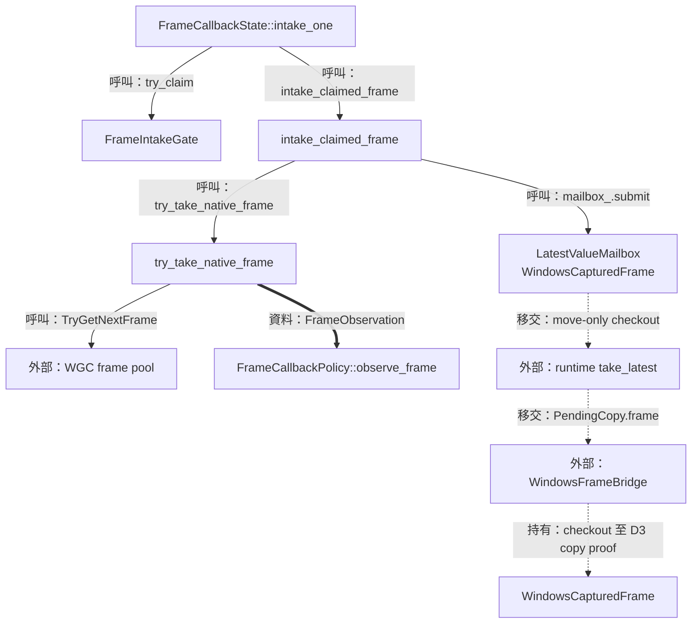
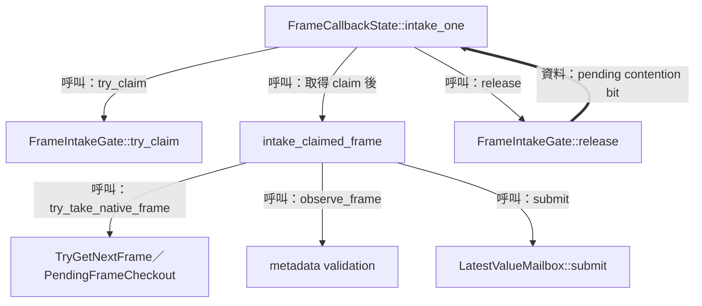
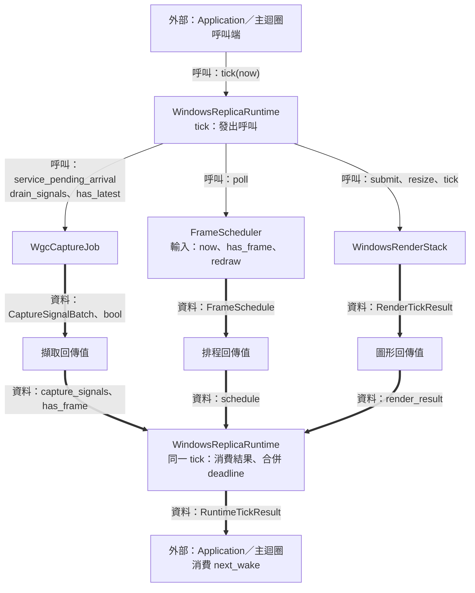
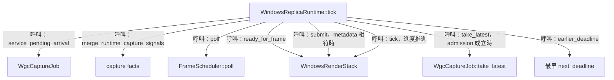

# 03：擷取影格並安排主執行緒工作



本階段把來源視窗的新畫面交給副本的圖形工作。來源可能連續送出影格，主執行緒也需要處理 UI 與 GPU 完成事件，因此擷取端保存最新 checkout，排程端合併影格與重繪需求，再以時間和 slot 容量決定提交。

前一篇 [命令與 session](02-commands-and-session.md) 建立 inactive job 與圖形 slots；本篇追蹤 publication 之後的 callback 和 tick。下一篇 [frame transport](04-frame-transport.md) 接手 checkout，完成 D3 copy 與 renderer input 交接。Resize、停止與復原的 barrier 詳見 [第 08 篇](08-recovery-and-shutdown.md)。

| 邊界 | 輸入／輸出 | 執行位置與 owner |
| --- | --- | --- |
| WGC 到擷取狀態 | native frame、epoch → checkout、signals | WGC callback；`FrameCallbackState` 持有 frame pool |
| 擷取到 runtime | `WindowsCapturedFrame`、`CaptureSignalBatch` | 主執行緒取值；`WgcCaptureJob` 持有 callback state |
| Runtime 到 render stack | checkout move、framebuffer、時間 → render facts | 主執行緒；runtime 持有 scheduler 與 render stack |

圖例：實線標示呼叫／控制，粗線標示資料值，虛線標示持有、借用或移交。`std::move` 表達 owner 移交；像素搬移由下一階段的 D3 copy 執行。

## Capture session 與 callback admission

### 結構與流程圖



由 `Impl` 的 owner 關係開始閱讀：session 與 callback state 共同維持擷取；delegate 取得 shared state 後進入 `on_arrival`。`FrameCallbackPolicy` 把 callback 的有效期間、進場資格與通知狀態集中管理，wake 將後續工作交回主迴圈。

### 資料結構與使用方式

Publication 需要讓建立中的資源先準備齊全，並讓已進場的 callback 完整退出。為此，程式分別保存「這是哪次 handler 註冊」與「這是哪次影格 allocation」：前者稱為 epoch，後者稱為 resource generation。

`FrameCallbackPolicy` 是本 unit 的主要資料 owner。下表列出本 unit 使用的 members；完整定義見 [wgc_capture_state.hpp](../../platform/windows/detail/wgc_capture_state.hpp)。

| 責任 | Members | 來源、使用方式與有效期間 |
| --- | --- | --- |
| 註冊身分 | `epoch_{1}`、`terminal_` | Handler 註冊時複製 epoch；`enter` 依當前 epoch 與 terminal 狀態決定 admission |
| 開放與補做 | `admission_open_`、`arrival_pending_`、`ever_opened_` | Publication 開放 intake；提早到達的 callback 留下 pending bit |
| 活躍使用者 | `callback_admission_lock_`、`callbacks_in_flight_` | `enter` 加一，`Admission` 解構時減一；主執行緒據此觀察 quiescence |
| 最後一次通知 | `quiescence_wake_requested_`、`final_quiescence_wake_claimed_`、`wake_main_loop_` | 讓最後一名 callback 的 wake 呼叫也涵蓋在計數內 |
| 影格契約 | `pool_buffer_count_`、`allocation_`、`resource_generation_`、`pool_format_` | 建立／重設時提供；`observe_frame` 檢查 generation、尺寸與 BGRA8 格式 |
| 通知資料 | `signal_lock_`、`fatal_`、`fatal_edge_`、`resize_`、`resize_edge_` | Fatal 保存持續事實；resize 保存最新要求；tick 消費 notification edges |

`Admission` 的 `owner_` 指向 policy，`epoch_` 保存進場時的註冊身分。它採 move ownership，解構時呼叫 `leave_callback()`。這個小型 RAII guard 使函式中的各條返回路徑都結束同一份活躍計數責任。

`PublicationGate` 的 `attempted_` 記錄啟動嘗試，`started_` 記錄 native StartCapture 成功。兩者讓建立期結果與已發布 job 的 drain 責任分別可查。[定義](../../platform/windows/detail/wgc_capture_state.hpp)

使用示例：下列為 `WgcCaptureJob::Impl` 內部語境，使用其 `source_`、`session_`、`frame_state_` 三個既有 members。節錄自 [Impl::start_for_publication](../../platform/windows/wgc_capture_job.cpp)。

```cpp
[[nodiscard]] std::expected<void, core::AppError> start_for_publication()
{
  return publication_.start_for_publication(
    [this] noexcept { return source_.is_closed(); },
    [this] { session_.StartCapture(); },
    [this] noexcept { frame_state_->open_current_epoch(); });
}
```

三個 callable 依序提供來源狀態、native 啟動、intake 開放。`expected<void, AppError>` 讓 caller 接收成功值或具型別的失敗結果，publication 成功之後進入 runtime 擁有的停止流程。

### 實作流程



#### Pool 與 session 在 publication 前準備

`WgcCaptureJob::create_inactive` 先包裝 D3 device，讀取來源 item 尺寸作為初始 allocation，再呼叫 `FramePool::CreateFreeThreaded` 與 `CreateCaptureSession`。Callback state 接手 pool、generation、buffer count 與 wake callable，最後註冊 FrameArrived handler。Free-threaded dispatch 的協作由 admission、intake gate 與 mailbox 的同步機制維持；主執行緒在 publication 成功後開放 intake。[實作](../../platform/windows/wgc_capture_job.cpp)

#### 註冊捕捉 epoch，進場取得 shared state

目的在於讓每次 delegate 使用其註冊時的身分。`register_arrival` 把 epoch 複製進 lambda，並用 `weak_ptr` 連向 callback state；呼叫期間 `weak_state.lock()` 產生的 shared owner 維持 state 生命週期。

節錄自 [FrameCallbackState::register_arrival](../../platform/windows/wgc_capture_job.cpp)：

```cpp
[[nodiscard]] winrt::event_token register_arrival()
{
  const auto epoch = policy_.current_epoch();
  const std::weak_ptr<FrameCallbackState> weak_state{shared_from_this()};
  return frame_pool_.FrameArrived(
    [weak_state, epoch](const auto &, const auto &) noexcept {
      if (const auto state = weak_state.lock()) {
        state->on_arrival(epoch);
      }
    });
}
```

`FrameCallbackPolicy::enter` 在 admission lock 內檢查 epoch，成功時增加 `callbacks_in_flight_` 並交回 guard。`Admission::is_open()` 再檢查 intake 狀態，涵蓋 stop／reconfigure 與 callback 進場交錯的時序。[實作](../../platform/windows/detail/wgc_capture_state.cpp)

#### Pending bit 與開門握手

提早到達的影格需要在 publication 開放後得到服務。Callback 採「寫 pending → 重新讀 open」，opener 採「寫 open → 讀 pending」；兩側使用 sequentially consistent atomic 操作。當兩側交錯執行時，其中一側會觀察到對方的狀態並送出 wake。

`service_pending_arrival()` 先 claim pending，再取得當前 epoch 的 admission；每輪最多呼叫 `intake_one` 達 `pool_buffer_count()` 次。這個上限把單次主執行緒服務量綁定於 frame pool 容量。[實作](../../platform/windows/wgc_capture_job.cpp)

#### Callback 完成證據涵蓋最後的 wake

關閉 epoch 後，最後一名 callback 可能需要喚醒主執行緒觀察 quiescence。`leave_callback` 先保留其計數，在 lock 外執行 `wake_noexcept()`，最後取得 lock 並減一。因此 `frame_callbacks_quiescent()` 回報零時，借用的 wake target 呼叫也已返回。[實作](../../platform/windows/detail/wgc_capture_state.cpp)

## 影格 checkout 與最新值交接

### 結構與流程圖



先看 intake gate 如何涵蓋 native pull 到 publication，再沿 checkout 的虛線閱讀 owner 交接。`observe_frame` 檢查 metadata，mailbox 保存最新值；已移交給 bridge 的 checkout 由該次 D3 copy 的完成證據決定歸還時間。

### 資料結構與使用方式

擷取需要保留影格對應的 pool storage，並攜帶可驗證的尺寸與身分。`WindowsCapturedFrame` 把 native checkout 與 metadata 綁成 move-only 值，`texture()` 提供 D3 texture 介面，checkout owner 則維持到使用者完成其排程工作。

以下是 `WindowsCapturedFrame` 的完整 member 分組，定義於 [windows_captured_frame.hpp](../../platform/windows/windows_captured_frame.hpp)。

| 責任 | Members | 來源與用途 |
| --- | --- | --- |
| 到達次序 | `sequence_`、`capture_timestamp_` | Intake 分配 sequence 與 `steady_clock::now()`，供觀察到達時序 |
| Allocation 身分 | `resource_generation_`、`allocation_extent_`、`expected_pool_format_` | 對應當次 pool；runtime／bridge 在採用前核對 |
| 有效像素 | `content_size_` | 原始 ContentSize 與 texture allocation 的逐軸交集 |
| Native checkout | `frame_` | 持有 `Direct3D11CaptureFrame`；move 移交；解構呼叫 `close_checkout` |

`FrameObservation` 保存 `resource_generation`、`allocation_extent`、原始 `content_size` 與 `surface_format`。其中原始 content 用於 resize 訊號；送往複製工作的 frame 使用 clipped content。這讓重設需求與當下可存取範圍同時保有正確數值。[定義](../../platform/windows/detail/wgc_capture_state.hpp)

`LatestValueMailbox<T>` 需要在 callback 與主執行緒之間原子地交換最新 owner。其完整 member 分組如下。[定義與實作](../../include/avb/core/latest_value_mailbox.hpp)

| 責任 | Members | 使用方式 |
| --- | --- | --- |
| 同步取放 | `mutex_`、`pending_` | Lock 內 move 值；被替換 owner 在解鎖後釋放 |
| 統計 | `counters_.submitted`、`replaced`、`taken` | 記錄接納、替換與成功取值；開放期間以差值觀察 readiness |
| 生命週期 | `closed_` | `close()` 關閉接納並釋放當前 pending owner |

使用示例：前提為 caller 已持有兩個有效 `WindowsCapturedFrame`，以 `LatestValueMailbox<WindowsCapturedFrame>` 示範最新值語意。[API 來源](../../include/avb/core/latest_value_mailbox.hpp)

```cpp
void hand_off_latest(WindowsCapturedFrame first,
                    WindowsCapturedFrame second)
{
  core::LatestValueMailbox<WindowsCapturedFrame> mailbox;
  const auto ready = mailbox.submit(std::move(first));
  const auto replaced = mailbox.submit(std::move(second));
  auto newest = mailbox.take();
  // ready 為 BecameReady；replaced 為 ReplacedPending。
  // newest 持有 second 原本負責的 checkout。
}
```

範例的 `first` checkout 在第二次 submit 完成前釋放；`second` checkout 經 `take()` 移交給 `newest`。實際程式以 `BecameReady` 觸發主迴圈 wake，連續替換則維持既有 readiness。

### 實作流程



#### 一次 claim 維持取格與發布順序

`FrameIntakeGate` 用一個 atomic `state_` 保存 `busy=1` 與 `pending=2`。Claim 成功者負責整段 native pull 和 mailbox publication；競爭者把 pending bit 併入 state，release 再一次取回該 bit，安排後續服務。[實作](../../platform/windows/detail/frame_intake_gate.hpp)

#### Allocation 與 content 各自保留用途

`try_take_native_frame` 先用 `PendingFrameCheckout` 接手 `TryGetNextFrame()` 的結果，再投影尺寸與 texture。Metadata 投影中的返回或 exception 路徑均由該 owner 收束 checkout。

節錄自 [FrameCallbackState::try_take_native_frame](../../platform/windows/wgc_capture_job.cpp)：

```cpp
[[nodiscard]] std::optional<AcquiredFrame> try_take_native_frame()
{
  // ...
  const auto sequence =
    next_sequence_.fetch_add(1, std::memory_order_relaxed);
  const auto copyable_content =
    detail::copyable_content_extent(content, observed_allocation);
  return AcquiredFrame{
    .checkout = pending.finish(sequence, generation_, observed_allocation,
                               copyable_content),
    .observation = {.resource_generation = generation_,
                    .allocation_extent = observed_allocation,
                    .content_size = content,
                    .surface_format = observed_format}};
}
```

例如 allocation 為 1000×800、WGC ContentSize 為 1200×700，checkout 的 content 為 1000×700，observation 的 content 為 1200×700。前者界定 copy box，後者要求 runtime 重建 allocation。`copyable_content_extent` 使用逐軸 `std::min`。[實作](../../platform/windows/detail/wgc_capture_state.cpp)

#### Mailbox move 與 checkout 結束

節錄自 [LatestValueMailbox::take](../../include/avb/core/latest_value_mailbox.hpp)：

```cpp
[[nodiscard]] std::optional<T> take()
{
  std::optional<T> value;
  {
    const std::lock_guard lock{mutex_};
    if (pending_) {
      value.emplace(std::move(*pending_));
      pending_.reset();
      ++counters_.taken;
    }
  }
  return value;
}
```

Move 把 frame 的責任交給 consumer，並把 mailbox 留成可接納下一個值的狀態。`WindowsCapturedFrame::close_checkout()` 以 `std::exchange(frame_, nullptr)` 取出 native frame，再呼叫 `Close()`；這使 checkout 的結束責任固定在當前 owner。[實作](../../platform/windows/windows_captured_frame.cpp)

CPU path 在 event query 證明 D3 copy 完成時 `pending.frame.reset()`；shared path 在 fence target 完成時由 `finish()` 重設 `slot.pending`。兩處都位於 [WindowsFrameBridge](../../platform/windows/windows_frame_bridge.cpp)，詳細時序接續 [第 04 篇](04-frame-transport.md)。

## 主執行緒 tick 與 deadline

### 結構與流程圖



讀圖時先跟隨 signal 消費，再看 scheduler 的 admission，最後看 render stack 的進度輪詢。Runtime 把各工作來源的 deadline 取最早值，讓主迴圈在事件或到期時間再次呼叫 tick。

### 資料結構與使用方式

影格上限需要把多次到達合併成一次 rendering admission，並提供下一個合適的喚醒時間。`FrameScheduler` 保存需求 bit 與固定時間格線；它的輸出由 runtime 搭配 slots 和 source 狀態執行。

| 結構／責任 | Members | 來源與使用方式 |
| --- | --- | --- |
| `FrameScheduler` 設定 | `fps_cap_`、`period_` | 建構時從 `FpsCap` 推導週期；設定變更時重建 scheduler |
| `FrameScheduler` 時間／需求 | `next_deadline_`、`pending_work_` | `poll` 合併 frame／redraw 訊號，推進固定 deadline 格線 |
| `FrameSchedule` 結果 | `render`、`next_wake` | `render` 授予一次 admission；`next_wake` 描述受 cap 延後的需求 |
| `CaptureSignalBatch` 訊號 | `fatal_active`、`fatal_edge`、`fatal`、`resize` | Tick 同步取出；fatal 保留狀態與 native detail，resize 帶最新 extent |

前兩種結構的 canonical 定義見 [frame_scheduler.hpp](../../include/avb/core/frame_scheduler.hpp)，擷取訊號見 [wgc_capture_job.hpp](../../platform/windows/wgc_capture_job.hpp)。Runtime 在本 unit 使用 `scheduler_`、`settings_`、`allocation_`、`resource_generation_`、`capture_job_` 與 `render_stack_`，完整 owner 定義見 [windows_replica_runtime.hpp](../../platform/windows/windows_replica_runtime.hpp)。

使用示例：以下以 `FrameScheduler::Clock` 的固定起點示範 60 FPS 格線，API 來源為 [FrameScheduler::poll](../../src/core/frame_scheduler.cpp)。

```cpp
void demonstrate_schedule()
{
  using Clock = core::FrameScheduler::Clock;
  using namespace std::chrono_literals;
  const auto t0 = Clock::time_point{};
  core::FrameScheduler scheduler{core::FpsCap::Fps60, t0};
  const auto initial = scheduler.poll(t0, true, false);
  const auto deferred = scheduler.poll(t0 + 5ms, true, false);
  const auto admitted = scheduler.poll(t0 + 20ms, false, false);
  // initial.render 與 admitted.render 為 true。
  // deferred.next_wake 指向第一個約 16.67 ms 格點。
}
```

5 ms 時的需求保存在 `pending_work_`，20 ms 時即使 frame flag 為 false，scheduler 仍接納該需求。Period 經 `duration_cast<Clock::duration>` 轉為 clock 精度，數值例子的毫秒採近似表示。

### 實作流程



#### 固定時間格線與一次需求

節錄自 [FrameScheduler::poll](../../src/core/frame_scheduler.cpp)：

```cpp
FrameSchedule FrameScheduler::poll(Clock::time_point now,
                                  bool has_new_frame,
                                  bool redraw_requested) noexcept
{
  pending_work_ = pending_work_ || has_new_frame || redraw_requested;
  // ...
  if (now < *next_deadline_) {
    return {.render = false, .next_wake = next_deadline_};
  }
  const auto missed_periods = ((now - *next_deadline_) / period_) + 1;
  *next_deadline_ += period_ * missed_periods;
  pending_work_ = false;
  return {.render = true, .next_wake = std::nullopt};
}
```

此節錄的後半段處於「已有需求且使用 capped 模式」分支。公式把 deadline 推進到 `now` 之後第一個格點；延後的 tick 消費一次合併需求。`Unlimited` 分支則立即接納 pending work，閒置狀態依新事件喚醒。

#### Runtime 驗證 checkout 後提交

節錄自 [WindowsReplicaRuntime::tick](../../platform/windows/windows_replica_runtime.cpp)：

```cpp
app::RuntimeTickResult WindowsReplicaRuntime::tick(const Clock::time_point now) noexcept
{
  // ...
  const auto schedule = scheduler_.poll(now, has_frame, redraw_available_before_progress);
  earlier_deadline(deadline, schedule.next_wake);
  bool submitted_capture{};
  if (schedule.render && has_frame && render_stack_->ready_for_frame()) {
    if (auto frame = capture_job_->take_latest()) {
      if (frame->resource_generation() == resource_generation_ &&
          frame->allocation_extent() == allocation_ &&
          !is_zero_extent(frame->content_size())) {
        render_stack_->submit(std::move(*frame));
        submitted_capture = true;
      }
    }
  }
  // ...
}
```

Generation、allocation 與正尺寸共同界定這次提交的有效條件。Slot 容量仍在使用時，checkout 留在 mailbox，後續 frame 可替換它；下一次 `has_latest()` 把當前需求再次送入 scheduler。

#### Admission 與進度各有入口

同一個 tick 會呼叫 `render_stack_->resize(framebuffer)` 與 `render_stack_->tick(framebuffer, now)`，推進 D3 copy、acquire、submission 和 presentation 證據。由進度退休新產生的 retained redraw 需求可加入 `now + 1ms` 的觀察 deadline，接著由 scheduler 接納。這讓靜態來源的裁切編輯也能透過既有圖片呈現。[實作](../../platform/windows/windows_replica_runtime.cpp)

整個 runtime 的輸出 facts 與主迴圈消費方式，接續 [第 07 篇](07-controller-loop-and-projection.md)；checkout 進入 bridge 後的成員與完成條件，接續 [第 04 篇](04-frame-transport.md)。
