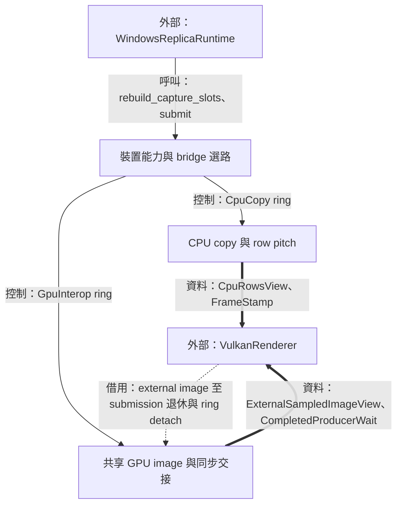
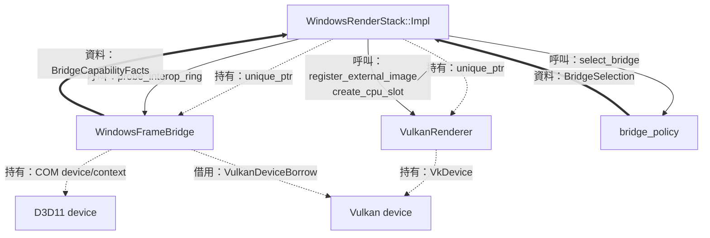
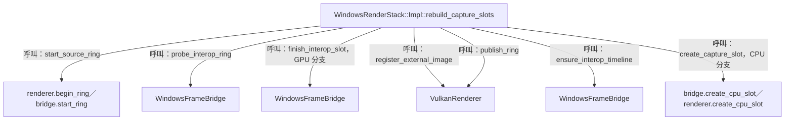
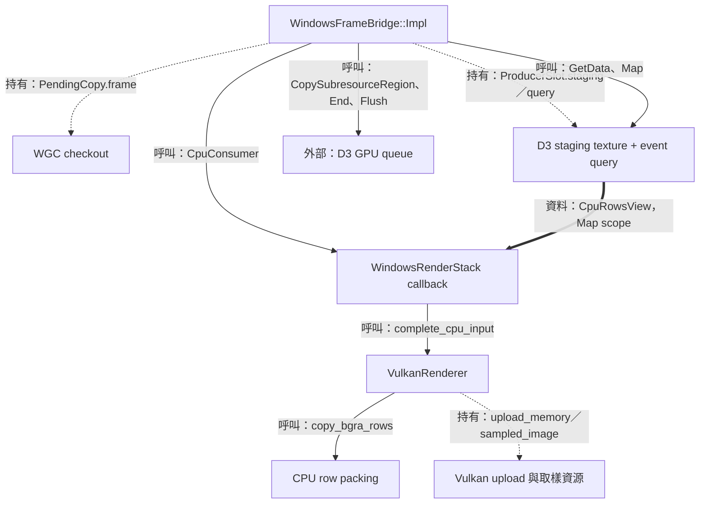
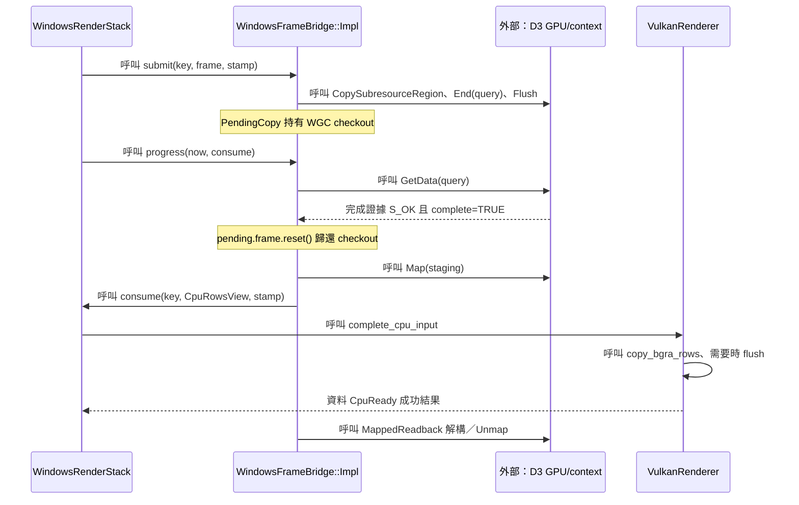
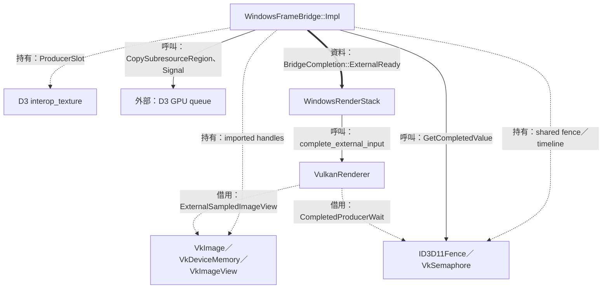
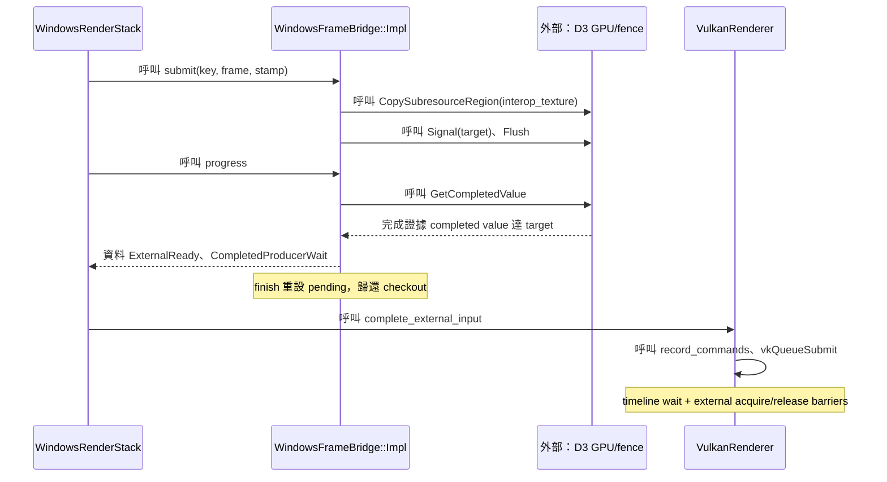

# 04：把 WGC 影格交給 Vulkan



本階段讓 WGC 擷取的 D3 texture 成為 Vulkan 可取樣的圖片。這需要相容的裝置、明確的 destination storage，以及能證明來源 copy 完成的同步資料。`WindowsRenderStack` 組合 bridge 和 renderer，選定 transport 後，以相同 `SlotKey` 協調兩邊的 slots。

前一篇 [擷取與排程](03-capture-and-scheduling.md) 將 checkout 移交至 render stack；本篇追蹤其 D3 copy、CPU rows 或 shared image 交接。[第 05 篇](05-replica-render-and-present.md) 接續 command submission 與呈現；fallback／drain 的整體流程見 [第 08 篇](08-recovery-and-shutdown.md)。

| 邊界 | 輸入／輸出 | Owner 與有效期間 |
| --- | --- | --- |
| Runtime → stack | `WindowsCapturedFrame` move | 主執行緒呼叫；bridge 採用後持有至 D3 copy proof |
| Bridge → CPU consumer | `CpuRowsView` | Staging mapping 在同步回呼期間有效 |
| Bridge → renderer | external image registration、timeline wait | Bridge 持有 native resources；renderer 借用至使用退休與 detach |
| Renderer → bridge | `VulkanDeviceBorrow` | Renderer 擁有 device；bridge 的 imports 在 device 存續期間建立和釋放 |

圖例：實線標示呼叫／控制，粗線標示資料值，虛線標示持有、借用或移交。所有 bridge 與 renderer 呼叫都由主執行緒執行，GPU 完成則由後續 tick 輪詢取得證據。

## 裝置能力與 bridge 選路

### 結構與流程圖



先看兩種 graphics owner：bridge 擁有 D3 device，renderer 擁有 Vulkan device。接著沿能力資料到選路 policy；最後由 stack 執行實際 ring 建立。Policy 的結果是 mode/reason 值，native 配置成功則由 ring publication 表達。

### 資料結構與使用方式

跨 API 共用 GPU 記憶體需要對上實體 adapter、external-memory 形式與同步功能。程式先透過 adapter LUID 比對 D3 與 Vulkan 裝置，再檢查實際建立的 NT handles 所支援的記憶體型別。LUID 是本機 adapter 的識別資料，在此用來偏好並核對同一個 graphics adapter。

`BridgeCapabilityFacts` 的所有 members 都是具體查詢的布林快照，按以下順序傳入 `select_bridge`。[定義與 policy](../../platform/windows/detail/bridge_policy.hpp)

| 順序／責任 | Members | 有效條件與來源 |
| --- | --- | --- |
| 1，裝置一致 | `adapter_luid_matches` | D3 `AdapterLuid` 等於有效的 Vulkan `deviceLUID` |
| 2，圖片匯入 | `external_image_supported` | BGRA8 external-image 能力符合共享圖片需求 |
| 3，D3 介面 | `required_d3d11_interfaces_available` | 所需 device/context 新版介面可用 |
| 4，同步裝置 | `shared_fence_or_timeline_semaphore_available` | D3 shared fence 與 Vulkan timeline 機制可用 |
| 5，同步匯入 | `timeline_fence_import_available` | 支援以 D3 fence handle 匯入 timeline semaphore |
| 6，入口函式 | `win32_import_procedure_available` | 建立的 Vulkan device 具有 Win32 import procedures |
| 7，配置相容 | `compatible_memory_type_available` | 實際 ring handles 的 memory type 相容性查詢成功 |

每個為 false 的項目對應一個 `BridgeReason`；policy 依上述順序選出第一個原因。全數成立時回傳 `GpuInterop` 與 `None`。`WindowsBridgePreference::ForceCpuBaseline` 則供 caller 指定 CPU transport。[實作](../../platform/windows/detail/bridge_policy.cpp)

跨 owner 的 slot 身分和影格觀察採用 [vulkan_input.hpp](../../render/vulkan_input.hpp) 的值型別，這裡是它們的 canonical 說明。

| 結構 | Members | 來源、使用者與有效期間 |
| --- | --- | --- |
| `SlotKey` | `ring_serial`、`index` | Renderer 每次 ring install 發出 serial；bridge／renderer 共同使用 index；操作同時檢查 serial、範圍和 slot phase |
| `FrameStamp` | `sequence`、`intake_observed_at` | Stack 使用 `captured_frames_ + 1` 和 frame timestamp 建立；成功 Pending 後增加 admitted count；retained redraw 保留同一 stamp |
| `BridgeSelection` | `mode`、`reason` | Policy 回傳並由 stack 保存；runtime 取得 mode-change 資料 |
| `InteropRingProbe` | `created_handles`、`compatible_handles`、`operation_failed` | Bridge 對實際 ring 的配置與查詢結果；成功前綴也列入計數 |

`SlotKey.ring_serial` 描述 ring 安裝，runtime 的 `resource_generation` 描述 capture allocation，`WindowsCapturedFrame::sequence()` 描述 WGC intake 次序。Render 使用的 `FrameStamp.sequence` 則描述 stack 接納次序，各項身分分別對應檢查與觀察範圍。[FrameStamp 建立點](../../platform/windows/windows_render_stack.cpp)

使用示例：在純 policy 測試或分析語境中，完整能力快照可得到 GPU 選路值。[select_bridge](../../platform/windows/detail/bridge_policy.cpp)

```cpp
render::BridgeSelection choose_supported_transport()
{
  const render::BridgeCapabilityFacts facts{
    .adapter_luid_matches = true,
    .external_image_supported = true,
    .required_d3d11_interfaces_available = true,
    .shared_fence_or_timeline_semaphore_available = true,
    .timeline_fence_import_available = true,
    .win32_import_procedure_available = true,
    .compatible_memory_type_available = true,
  };
  return render::select_bridge(facts);
}
```

此示例展示值的消費方式；正式 runtime 的 facts 由 [WindowsFrameBridge::Impl](../../platform/windows/windows_frame_bridge.cpp) 查詢硬體和實際 handles 後填入。

### 實作流程



#### 裝置借用的內容與責任

`VulkanStartupRequest` 的 `prefer_candidate`、`optional_device_extension_group`、`request_timeline_semaphore` 在建構呼叫期間提供選裝置需求。Renderer 建好 device 後，`device_borrow()` 交回 `VulkanDeviceBorrow`：`physical_device`、`device`、`memory_properties`、`limits`、`optional_extension_group_enabled`、`timeline_semaphore_enabled`。Bridge 保存此值以建立 imports；device 的銷毀由 renderer owner 收束。[型別定義](../../render/vulkan_input.hpp)

#### Ring 建立按實際資源逐步完成

節錄自 [WindowsRenderStack::Impl::rebuild_capture_slots](../../platform/windows/windows_render_stack.cpp)，處於 interop 能力、偏好與 probe 結果成立的分支：

```cpp
std::expected<void, core::AppError>
WindowsRenderStack::Impl::rebuild_capture_slots(
    const std::uint64_t generation, const core::Extent allocation,
    const DXGI_FORMAT format)
{
  // ...
  for (std::uint32_t index{}; index < source_slot_count; ++index) {
    const SlotKey key{ring_serial_, index};
    const auto finished = frame_bridge_->finish_interop_slot(key);
    if (!finished) {
      interop_operation_failed = true;
      break;
    }
    if (auto registered = renderer_->register_external_image(key, *finished);
        !registered) {
      interop_operation_failed = true;
      break;
    }
  }
  // ...
}
```

`finish_interop_slot` 由 bridge 匯入記憶體、bind image、建立 view；`register_external_image` 由 renderer 建立 descriptor 與 slot registration。CPU 分支則成對建立 D3 staging/query 與 Vulkan upload/sampled-image 資源。完成後由 `publish_ring` 發布該 ring 的 generation。

#### 接納與 fallback 的完成邊界

`WindowsRenderStack::Impl::submit` 先呼叫 `renderer_->reserve_source_slot()`，再把 checkout move 給 bridge。`BridgeSubmitResult` 的 `disposition` 指示 `Pending` 或 `SafeDiscard`，並用 `count_as_dropped`、`fallback_requested`、`d3_device_removed`、`d3_copy_bytes` 描述接納後的事實。[實作](../../platform/windows/windows_render_stack.cpp)

Setup 階段可經 construction guard 收束部分配置並建立 CPU ring；runtime fallback 則等 producer、renderer 的舊工作退休，再替換資源。這些證據由 [第 08 篇的 drain](08-recovery-and-shutdown.md) 展開。

## CPU copy 與 row pitch

### 結構與流程圖



先沿 D3 copy 到 query proof，再進入 Map 的同步區間。CPU consumer 把 mapping 中的 pixels 複製到 renderer 持有的 upload memory，回呼返回後由 bridge 執行 Unmap。後續 Vulkan upload 與 draw 使用 renderer 的 storage。

### 資料結構與使用方式

GPU readback 的每列儲存可能含 driver padding，因此 CPU 需要同時知道「有效像素寬度」與「下一列的位元組距離」。`CpuRowsView` 把這些資料連同有效 span 傳給 consumer；`copy_bgra_rows` 依 content 複製，再把 allocation 剩餘像素填成零。

`D3D11_MAPPED_SUBRESOURCE::pData` 指向 mapping，`RowPitch` 表示相鄰資料列的位元組距離，實際 pitch 可包含 padding。[Microsoft 定義](https://learn.microsoft.com/en-us/windows/win32/api/d3d11/ns-d3d11-d3d11_mapped_subresource)

| 結構／責任 | Members | 來源、使用方式與有效期間 |
| --- | --- | --- |
| `CpuRowsView` 借用 | `bytes`、`row_pitch` | `Map` 的 `pData` 與 `RowPitch`；span 在 consumer 呼叫期間可讀 |
| `CpuRowsView` 範圍 | `content`、`allocation` | content 位於 allocation 內；BGRA8 每像素 4 bytes |
| `RowCopyStats` 流量 | `copied_bytes`、`cleared_bytes` | 成功 packing 的複製／填零量，總和等於 destination allocation bytes |
| `PendingCopy` 狀態 | `frame`、`content`、`stamp`、`proof`、`external_copy`、`target` | Bridge owner 內部 record；CPU 路徑由 `QueryPending` 前進到 `CpuMapPending` |
| `ProducerSlot` CPU members | `key`、`staging`、`query`、`pending` | 同一 key 對應一個 copy destination 與完成義務 |

輸入與統計定義見 [vulkan_input.hpp](../../render/vulkan_input.hpp)、[cpu_row_copy.hpp](../../render/cpu_row_copy.hpp)；bridge 私有 record 的 canonical 定義見 [WindowsFrameBridge::Impl](../../platform/windows/windows_frame_bridge.cpp)。

使用示例：content 為 3×2、allocation 為 4×3，source pitch 為 16 bytes；已配置的兩份 array 在 `copy_bgra_rows` 呼叫期間存續。[API 來源](../../render/cpu_row_copy.cpp)

```cpp
void pack_example()
{
  std::array<std::byte, 28> source{};
  std::array<std::byte, 48> destination{};
  const render::CpuRowsView rows{
    .bytes = source, .row_pitch = 16,
    .content = {3, 2}, .allocation = {4, 3},
  };
  const auto packed = render::copy_bgra_rows(rows, destination);
  // 成功時 copied_bytes = 24，cleared_bytes = 24。
}
```

Source 有效跨度為 `(2−1)×16 + 3×4 = 28` bytes；destination 的緊密 pitch 為 `4×4 = 16` bytes，總量為 `16×3 = 48` bytes。前兩列各複製 12 bytes、填零 4 bytes，第三列填零 16 bytes。

### 實作流程



#### Copy proof 先行，Map 可以在後續 tick 重試

`submit` 在 staging texture 發出 `CopySubresourceRegion`，接著 `End(query)` 與 `Flush()`。`progress` 使用 `D3D11_ASYNC_GETDATA_DONOTFLUSH` 輪詢。Query 成功後先 `pending.frame.reset()`，再將 `proof` 設為 `CpuMapPending`，因此 readback mapping 的進度由 staging owner 繼續負責。[實作](../../platform/windows/windows_frame_bridge.cpp)

`consume_cpu` 的 Map 使用 `D3D11_MAP_FLAG_DO_NOT_WAIT`。`DXGI_ERROR_WAS_STILL_DRAWING` 保留 record 供後續 tick 服務；Map 成功則建立 `MappedReadback`，其解構函式負責 `Unmap`。

節錄自 [WindowsFrameBridge::Impl::consume_cpu](../../platform/windows/windows_frame_bridge.cpp)：

```cpp
void consume_cpu(ProducerSlot &slot, const CpuConsumer &consume,
                 BridgeProgress &result, bool &discard_remaining) noexcept
{
  // ...
  const MappedReadback unmap{*context_.Get(), *slot.staging.Get()};
  const auto &pending = *slot.pending;
  // ...
  const render::CpuRowsView rows{
    .bytes = {static_cast<const std::byte *>(mapped.pData),
              last_row * mapped.RowPitch + row_bytes},
    .row_pitch = mapped.RowPitch,
    .content = pending.content,
    .allocation = allocation_,
  };
  // ...
  consumed = consume(slot.key, rows, pending.stamp);
  // ...
}
```

#### 緊密 packing 與 CPU／GPU 可見性

`copy_bgra_rows` 先驗證 extent、乘法加法範圍、pitch 與 spans，再開始寫 destination。每列用 `row * source.row_pitch` 找 source，用 `row * destination_pitch` 找 destination。

節錄自 [copy_bgra_rows](../../render/cpu_row_copy.cpp)：

```cpp
std::expected<RowCopyStats, RowCopyError>
copy_bgra_rows(const CpuRowsView source,
               const std::span<std::byte> destination) noexcept
{
  // ...
  const auto right_padding = destination_pitch - row_bytes;
  for (std::size_t row{}; row < content_height; ++row) {
    auto *const output = destination.data() + row * destination_pitch;
    std::memcpy(output, source.bytes.data() + row * source.row_pitch, row_bytes);
    if (right_padding != 0) {
      std::memset(output + row_bytes, 0, right_padding);
    }
  }
  // ...
}
```

`VulkanRenderer::Impl::complete_cpu_input` 在 upload memory 的 `upload_coherent` 為 false 時，依 `nonCoherentAtomSize` 向上對齊 flush 範圍，再呼叫 `vkFlushMappedMemoryRanges`。成功後寫入 `content`、`stamp`，設定 `phase = CpuReady`。這些操作都在 mapped-row consumer 返回之前完成。[實作](../../render/vulkan_renderer.cpp)

## 共享 GPU image 與同步交接

### 結構與流程圖



Shared 指的是 bridge destination 的記憶體可供兩個 API 使用。D3 copy 先把 WGC pixels 寫進該 destination，host 取得 producer 完成證據後再交給 renderer。Renderer 的借用涵蓋 timeline wait、取樣與 external ownership barrier。

### 資料結構與使用方式

共享圖片需要讓「誰釋放 handle」與「誰可以使用圖片」各有清楚資料。Bridge 持有 imported image、view、memory 和 D3 texture；renderer 保存其 registration 值。同步交接另外使用已完成的 timeline target。

| 結構／責任 | Members | 來源與有效期間 |
| --- | --- | --- |
| `ExternalSampledImageView` 資源 | `image`、`view`、`format`、`allocation` | Bridge 建立，格式為 `VK_FORMAT_B8G8R8A8_UNORM`，尺寸與 ring 相符 |
| `ExternalSampledImageView` 存取 | `layout`、`external_queue_family` | 預設 `GENERAL`、`VK_QUEUE_FAMILY_EXTERNAL`；renderer acquire／release barrier 使用 |
| `CompletedProducerWait` | `semaphore`、`value` | Bridge 已在 host 觀察完成的 timeline target；借用至相關 submissions 退休 |
| `ProducerSlot` shared members | `interop_texture`、`interop_handle`、`interop_image`、`interop_memory`、`interop_view` | Bridge 擁有資源；匯入結束即關閉暫用 NT handle，GPU 資源隨 ring 生命週期維持 |
| `ProducerSlot` 建構資料 | `interop_memory_requirements`、`interop_memory_type_index`、`interop_requires_dedicated`、`interop_compatible` | 實際 handle probe 的結果，供 allocate／bind 決策 |
| `PendingCopy` shared 狀態 | `frame`、`content`、`stamp`、`proof`、`external_copy`、`target` | Copy 採用 checkout，成功 Signal 對應 `FencePending` 及遞增 target |
| `BridgeCompletion` 交接值 | `key`、`kind`、`content`、`stamp`、`external_wait`、`count_as_dropped`、`error` | 一個 key 的 producer 義務完成後發布；stack 依 kind 執行 renderer transition 與統計 |

上述輸入 views 完整定義見 [vulkan_input.hpp](../../render/vulkan_input.hpp)；`ProducerSlot` 與 `PendingCopy` 定義見 [windows_frame_bridge.cpp](../../platform/windows/windows_frame_bridge.cpp)，完成事件見 [windows_frame_bridge.hpp](../../platform/windows/windows_frame_bridge.hpp)。

使用示例：以下位於 `WindowsRenderStack::Impl::progress_d3_copy` 的 owner 內部語境；`completion` 是本輪 bridge 回傳、kind 為 `ExternalReady` 的值，renderer 仍持有其 `ProducerPending` reservation。[實際呼叫](../../platform/windows/windows_render_stack.cpp)

```cpp
const auto completed = renderer_->complete_external_input(
  completion.key, completion.content, completion.stamp,
  completion.external_wait);
```

例如 `SlotKey{7,1}` 對應第七次安裝的第二個 slot，`CompletedProducerWait{timeline,42}` 表示 host 已觀察 D3 fence target 42 完成。Renderer 以同一 key 驗證 phase，再把值存入 `producer_wait` 並轉為 `GpuReady`。

### 實作流程



#### Shared handle 建立與匯入

`query_interop_slot` 以實際 allocation 建立 D3 shared texture 和 Vulkan external image，查詢 Win32 handle properties 並選出相容 memory type。`finish_interop_slot` 使用 `VkImportMemoryWin32HandleInfoKHR`、`VK_EXTERNAL_MEMORY_HANDLE_TYPE_D3D11_TEXTURE_BIT` 匯入，接著 bind memory 和建立 image view。程式在 `vkAllocateMemory` 返回後重設 `interop_handle`；image、memory、view 的 ownership 繼續由 bridge 維持。[實作](../../platform/windows/windows_frame_bridge.cpp)

#### Producer copy 的完成 target

節錄自 [WindowsFrameBridge::Impl::submit](../../platform/windows/windows_frame_bridge.cpp)，處於已驗證 shared slot 並採用 checkout 的分支：

```cpp
std::expected<BridgeSubmitResult, core::AppError>
submit(const render::SlotKey key, WindowsCapturedFrame &&frame,
       const render::FrameStamp stamp)
{
  // ...
  pending.external_copy = true;
  pending.target = next_fence_target_++;
  pending.proof = CopyProof::FencePending;
  context_->CopySubresourceRegion(slot->interop_texture.Get(),
                                 0, 0, 0, 0, source_texture.Get(), 0,
                                 &source_box);
  // ...
  const auto signal_result =
    context4_->Signal(interop_fence_.Get(), pending.target);
  // ...
}
```

`source_box` 使用 content 的正尺寸界定 copy。Signal 成功後 `Flush()` 提交 D3 工作，後續 `progress` 以 `GetCompletedValue()` 配合 `classify_d3_completed_value` 取得 `Pending`、`Complete` 或 `DeviceRemoved` 結果。健康裝置上的 Signal failure 會追加 event query 並要求 fallback，checkout 隨 query proof 維持。[實作](../../platform/windows/windows_frame_bridge.cpp)

#### 完成事件與 checkout 釋放位置

節錄自 [WindowsFrameBridge::Impl::finish](../../platform/windows/windows_frame_bridge.cpp)：

```cpp
void finish(ProducerSlot &slot, const BridgeCompletionKind kind,
            const bool count_as_dropped, BridgeProgress &result,
            const std::optional<core::AppError> error = std::nullopt) noexcept
{
  // ...
  const auto &pending = *slot.pending;
  result.completions[result.completion_count++] = {
    .key = slot.key, .kind = kind,
    .content = pending.content, .stamp = pending.stamp,
    .external_wait = kind == BridgeCompletionKind::ExternalReady
      ? render::CompletedProducerWait{interop_timeline_, pending.target}
      : render::CompletedProducerWait{},
    .count_as_dropped = count_as_dropped, .error = error,
  };
  slot.pending.reset();
  result.made_progress = true;
}
```

事件值先帶出 content、stamp 與 wait，接著 `slot.pending.reset()` 釋放其 `frame`。Renderer 已註冊的 shared destination 繼續存續；之後的取樣使用該 destination。

`record_commands` 在 draw 前取得 external queue-family ownership，在 draw 後歸還；`try_present` 同時加入已完成的 producer timeline wait，等待 stage 為 fragment shader。Submission fence 涵蓋最後的 external release barrier，slot reuse 以該證據與 acquire proof 為前提。完整 renderer 流程接續 [第 05 篇](05-replica-render-and-present.md)。
