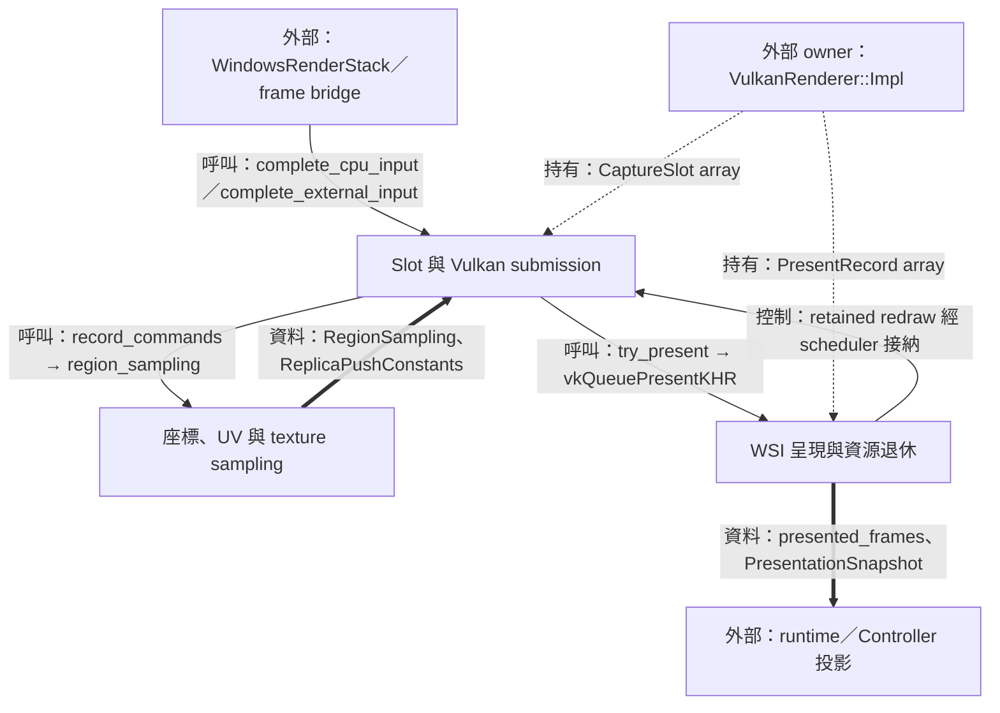
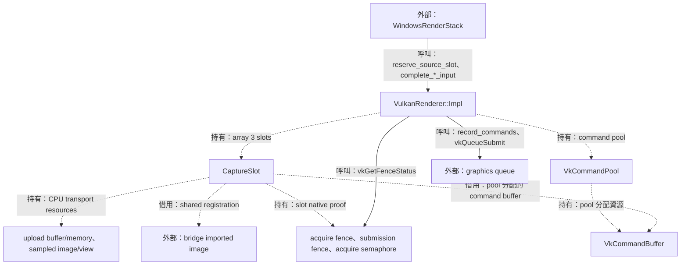
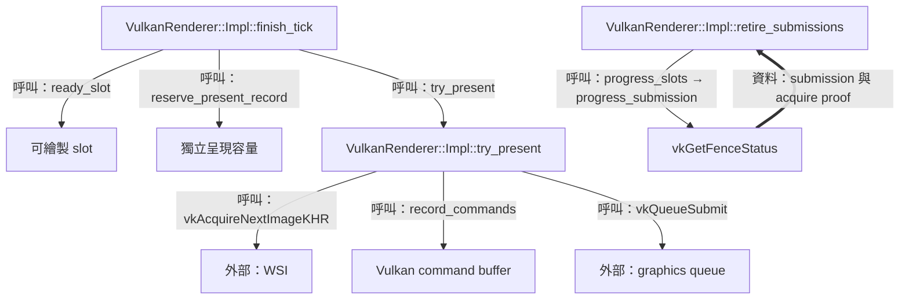
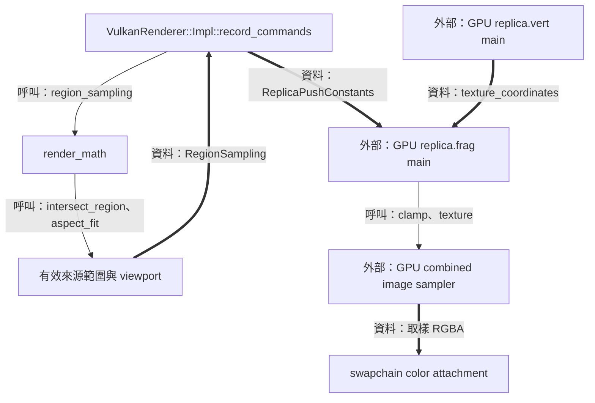
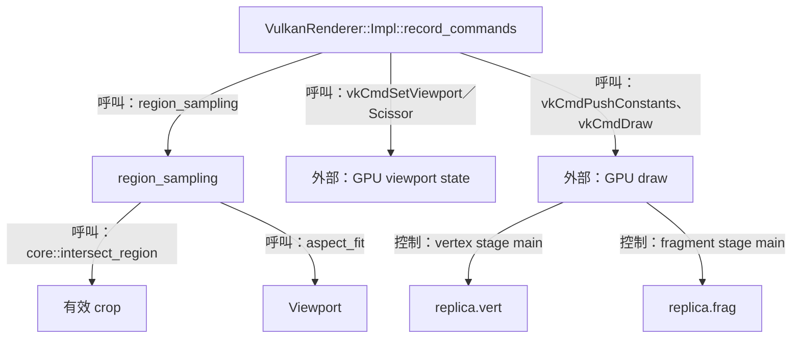
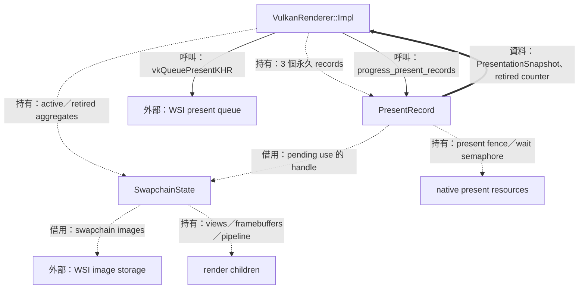
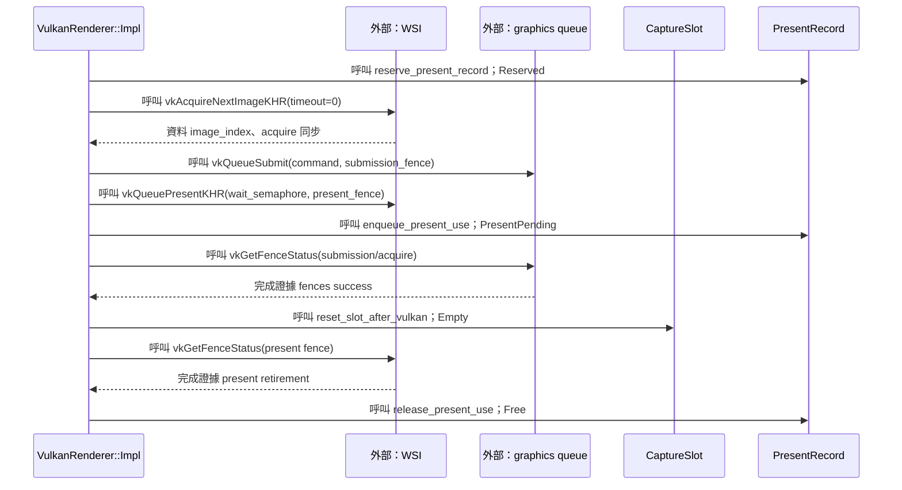

# 05：繪製副本並完成呈現



本階段把已完成 producer copy 的圖片繪製到副本視窗。工作需要可重用的 command resources、正確的裁切取樣座標，以及呈現完成後的資源回收證據。Renderer 以三個 capture slots 保存圖片和 submission 狀態，以三個獨立 present records 追蹤 WSI 呈現。

前一篇 [frame transport](04-frame-transport.md) 定義 `SlotKey`、`FrameStamp` 與 CPU/shared 輸入契約。本篇沿 input-ready、record、submit、present 到 retirement 展開。後續 [視窗互動](06-settings-and-window-interaction.md) 使用已呈現的幾何資訊，[第 08 篇](08-recovery-and-shutdown.md) 接續 resize、recovery 與 drain。

| 工作 | 輸入／輸出 | Owner 與完成證據 |
| --- | --- | --- |
| D3 producer copy | WGC checkout → renderer input | Bridge；event query／D3 fence proof 見第 04 篇 |
| Vulkan submission | Slot image → swapchain image | Renderer CaptureSlot；submission fence 與 acquire fence |
| WSI presentation | Swapchain image → 呈現退休 | Renderer PresentRecord；maintenance1 present fence |
| 畫面互動映射 | 已退休 draw → `PresentationSnapshot` | Renderer 發布值，runtime 保存供操作使用 |

圖例：實線標示呼叫／控制，粗線標示資料值，虛線標示持有、借用或移交。主執行緒發出 GPU 工作並輪詢完成證據，GPU queue 與 WSI 的實際執行各有自己的時序。

## Slot 與 Vulkan submission

### 結構與流程圖



圖中的 slot 是一次 source reservation、取樣資源與 Vulkan 使用狀態的共同索引。CPU 圖片由 renderer 持有；shared 圖片由 bridge 持有。兩種路徑共用 command submission 與 slot proof，因而可透過同一組 phase 前進。

### 資料結構與使用方式

GPU 工作在呼叫返回後持續執行，需要把會再次使用的 storage 與 completion 狀態保存在固定 owner。`CaptureSlot` 因此把身分、圖片、command buffer、acquire 與 submission 資料組在一起。三個 slots 由 `VulkanRenderer::Impl` 的固定 array 保存，frame 的每次進場以 `SlotKey` 驗證其 ring 和位置。

下表是 `CaptureSlot` 的完整 member 分組。這是本結構的 canonical 說明，定義見 [vulkan_renderer_impl.hpp](../../render/detail/vulkan_renderer_impl.hpp)。

| 責任 | Members | 來源、使用方式與生命週期 |
| --- | --- | --- |
| 身分與狀態 | `key`、`content`、`phase`、`stamp` | Ring 安裝、producer completion 填入；`find_slot` 核對 key 與 phase |
| 重繪與回復 | `restore_retained_on_cancel`、`recorded_presentation` | Reservation 前記住 retained 指定；record 時保存本次 draw 幾何 |
| CPU upload | `upload_buffer`、`upload_memory`、`mapped_upload`、`upload_allocation_size`、`upload_coherent` | Renderer 持有 buffer/memory，`mapped_upload` 借用該 mapping |
| CPU sampled image | `sampled_image`、`sampled_memory`、`sampled_view`、`sampled_image_initialized` | Renderer 建立 BGRA8 image；初始化旗標決定下次 layout transition |
| Draw binding | `descriptor`、`command_buffer` | Descriptor pool／command pool 分配；command buffer 跨 capture ring 重建保留 |
| Acquire／submit 證據 | `acquire_fence`、`submission_fence`、`acquire_semaphore` | Slot 持有同步物件；重用前觀察相應 fence |
| WSI 連結 | `present_use`、`owning_swapchain`、`acquired_image_index`、`acquired_image` | Reserve/acquire 填入；present 接手或 image release 收束 |
| Shared input | `external_image`、`producer_wait`、`gpu_copy` | 借用 bridge image/wait；submission 包含取樣與 external release |

`RenderSlotPhase` 的正常路徑為 `Empty → ProducerPending → CpuReady/GpuReady → Submitted → Empty`。`AcquireProofPending`、`PresentNotEnqueued`、`SubmitUncertain`、`ReleaseRetained` 保存各種 native 返回後仍需收束的義務。[Phase 定義與 proof policy](../../render/graphics_retry_policy.hpp)

使用示例：以下是 `VulkanRenderer::Impl` 內部語境，前提為 `key` 已通過 ring 和 `ProducerPending` 驗證，且 `rows` 的同步 packing／必要 flush 已成功。節錄自 [complete_cpu_input](../../render/vulkan_renderer.cpp)。

```cpp
// VulkanRenderer::Impl::complete_cpu_input 內部，slot 是已驗證的 CaptureSlot。
slot.content = rows.content;
slot.stamp = stamp;
slot.producer_wait = {};
slot.gpu_copy = false;
slot.restore_retained_on_cancel = false;
slot.phase = SlotPhase::CpuReady;
```

`CpuReady` 表示 upload bytes 已準備好供後續 command buffer 使用；`GpuReady` 表示 shared input 已帶著 host-observed producer wait 完成發布。`FrameStamp` 與 input views 的完整語意見 [第 04 篇](04-frame-transport.md)。

### 實作流程



#### Command buffer 把資料可見性與 draw 排在一起

Command buffer 保存 GPU 將執行的操作。`record_commands` 先 reset／begin，CPU 路徑把 sampled image 轉為 transfer destination，再將 upload buffer 複製到 image，接著轉為 shader-readable layout。Shared 路徑則取得 external queue-family ownership。兩者接著都進入 render pass、bind descriptor、設定 push constants 並 draw。

節錄自 [VulkanRenderer::Impl::record_commands](../../render/vulkan_renderer.cpp)，處於新 CPU input 的 upload 分支：

```cpp
VkResult VulkanRenderer::Impl::record_commands(
    CaptureSlot &slot, const std::uint32_t image_index) noexcept
{
  // ...
  vkCmdCopyBufferToImage(slot.command_buffer, slot.upload_buffer,
                         slot.sampled_image,
                         VK_IMAGE_LAYOUT_TRANSFER_DST_OPTIMAL, 1, &copy);
  // ...
  vkCmdPipelineBarrier(slot.command_buffer, VK_PIPELINE_STAGE_TRANSFER_BIT,
                       VK_PIPELINE_STAGE_FRAGMENT_SHADER_BIT, 0, 0, nullptr,
                       0, nullptr, 1, &before_sampling);
  // ...
}
```

`copy.imageExtent` 使用完整 `capture_allocation_`；CPU row packing 已為 padding 定義零值。Retained CPU redraw 使用已完成的 sampled image；shared redraw 重用原 `producer_wait`，並再次記錄 external acquire/release barriers。[實作](../../render/vulkan_renderer.cpp)

#### Semaphore 排 GPU 先後，fence 提供 host 證據

`try_present` 的 acquire semaphore 等待 stage 為 color attachment output，讓 swapchain image 可寫後進行輸出。Shared path 再加入 producer timeline semaphore，stage 為 fragment shader，保存 external-memory 依賴。兩者之後 signal `PresentRecord::wait_semaphore`，供 WSI 等待。

節錄自 [VulkanRenderer::Impl::try_present](../../render/vulkan_renderer.cpp)：

```cpp
void VulkanRenderer::Impl::try_present(
    CaptureSlot &slot, PresentRecord &record, VulkanTickResult &result,
    const std::chrono::steady_clock::time_point now)
{
  // ...
  const std::array wait_semaphores{slot.acquire_semaphore, slot.producer_wait.semaphore};
  const std::array<VkPipelineStageFlags, 2> wait_stages{
    VK_PIPELINE_STAGE_COLOR_ATTACHMENT_OUTPUT_BIT,
    VK_PIPELINE_STAGE_FRAGMENT_SHADER_BIT};
  // ...
  const auto submit_result =
    vkQueueSubmit(graphics_queue_, 1, &submit_info, slot.submission_fence);
  // ...
}
```

CPU submit 的 wait count 為 1，shared submit 為 2 並帶 `VkTimelineSemaphoreSubmitInfo`。`submission_fence` 涵蓋 command buffer 中的 copy、draw 與 shared release barrier；各 wait 的語意由 [第 04 篇的 producer completion](04-frame-transport.md) 接入。

#### Slot 重用與 retained image

`progress_submission` 先根據 phase 選 acquire 或 submission proof；觀察到 submission fence 成功後，也檢查 acquire fence。兩份 host proof 都成立時，`reset_slot_after_vulkan` 重設 slot、fences 與 WSI 連結。已完成的 sampled content 可由 `retained_slot_` 指向，供後續 crop 或選區重繪使用。[實作](../../render/vulkan_renderer.cpp)

Retained slot 的圖片資料持續由其原 owner 保存。下一次 source reservation 可採用該 slot，當時 `restore_retained_on_cancel` 記錄 reservation 前狀態，供採用之前的取消路徑恢復使用。

## 座標、UV 與 texture sampling

### 結構與流程圖



讀圖由 source pixels 到 destination viewport，再到 texture UV。`region_sampling` 產生兩種座標：viewport 使用實體 framebuffer pixels，texture transform 使用 allocation-normalized UV；fragment shader 把局部 UV 轉成後者再取樣。

### 資料結構與使用方式

裁切與縮放需要同時保存來源範圍、目的地位置和取樣邊界。`RegionSampling` 集中這些值，讓一次 draw 的數學結果能複製進 push constants 與 presentation snapshot。

| 結構／責任 | Members | 單位與使用方式 |
| --- | --- | --- |
| `Viewport` | `x`、`y`、`width`、`height` | 實體 framebuffer pixels；用於 Vulkan viewport／scissor |
| `RegionSampling` 來源／目的地 | `region`、`viewport` | `region` 是 source pixels，`viewport` 是 aspect-fit 結果 |
| `RegionSampling` 轉換 | `texture_offset`、`texture_scale` | 以 allocation 正規化，將 local UV 映射到 crop |
| `RegionSampling` 邊界 | `texture_min`、`texture_max` | 選區首末 texel 的中心座標 |
| `ReplicaPushConstants` | `transform`、`bounds`、`selection`、`stroke` | 四組 `vec4`，共 64 bytes；C++ `alignas(16)` 與 GLSL layout 對應 |
| `ReplicaPresentation` | `region`、`selecting_region`、`selection_preview` | Runtime 提供；選區操作顯示 full content 與 source-pixel preview |

完整定義分別見 [render_math.hpp](../../render/render_math.hpp)、[vulkan_renderer_impl.hpp](../../render/detail/vulkan_renderer_impl.hpp)、[replica_presentation.hpp](../../render/replica_presentation.hpp)。

使用示例：內容與 allocation 皆為 1000×800，要求裁切 `(100,50,400,200)`，呈現在 1000×800 framebuffer。[region_sampling](../../render/render_math.cpp)

```cpp
void crop_example()
{
  const auto sampling = render::region_sampling(
    core::PixelRegion{100, 50, 400, 200},
    core::Extent{1000, 800}, core::Extent{1000, 800},
    core::Extent{1000, 800});
  // sampling->viewport = (0, 150, 1000, 500)
  // texture_offset = (0.1, 0.0625)，texture_scale = (0.4, 0.25)
}
```

#### Aspect fit：由像素比決定 letterbox

目的是保持來源長寬比例並置中。需求是得到完全以整數 pixels 表示的 viewport。設來源為 `Ws×Hs`、目的地為 `Wd×Hd`，先比較 64-bit 交乘 `Wd×Hs` 與 `Hd×Ws`。

| 有效分支 | Width／height | 置中原點 |
| --- | --- | --- |
| `Wd×Hs ≤ Hd×Ws`，寬度限制 | `width=Wd`，`height=max(1,floor(Wd×Hs/Ws))` | `x=floor((Wd−width)/2)`，`y=floor((Hd−height)/2)` |
| 另一分支，高度限制 | `height=Hd`，`width=max(1,floor(Hd×Ws/Hs))` | 同上 |

1920×1080 放入 1000×800：兩個交乘為 1,080,000 與 1,536,000，採寬度限制；`height=floor(562.5)=562`，`y=(800−562)/2=119`，結果為 `(0,119,1000,562)`。奇數剩餘 pixel 分配至右／下側；極端比例以一 pixel 為另一軸的下限。[aspect_fit 實作](../../render/render_math.cpp)

#### UV offset、scale 與半 texel 邊界

目的是讓 local UV 的 `[0,1]²` 覆蓋選區。設 allocation 為 `Aw×Ah`，region 為 `(x,y,w,h)`，則 `offset=(x/Aw,y/Ah)`、`scale=(w/Aw,h/Ah)`，shader 計算 `uv=offset+local_uv×scale`。

取樣邊界使用首末 texel 中心：`min=((x+0.5)/Aw,(y+0.5)/Ah)`，`max=((x+w−0.5)/Aw,(y+h−0.5)/Ah)`。這裡 `0.5` 的單位是 source texel；除以 allocation 後變成 UV。

上述 1000×800 allocation 與 crop 的完整數值如下，直接對應 `region_sampling` 的回傳欄位。

| 值 | 水平 | 垂直 |
| --- | --- | --- |
| Offset | `100/1000 = 0.1` | `50/800 = 0.0625` |
| Scale | `400/1000 = 0.4` | `200/800 = 0.25` |
| Texel-center min | `100.5/1000 = 0.1005` | `50.5/800 = 0.063125` |
| Texel-center max | `499.5/1000 = 0.4995` | `249.5/800 = 0.311875` |

Shader 的 `clamp` 把邊界取樣定位在選區內的 texel 中心。一 pixel 寬的選區具有相等的水平 min/max，因而整軸取樣固定在該 texel 中心。[region_sampling](../../render/render_math.cpp)、[fragment main](../../shaders/replica.frag)

#### 雙線性取樣的四個權重

目的是在相鄰 texels 間平滑取得顏色。此 renderer 的 sampler 設定 `VK_FILTER_LINEAR`，二維取樣會結合四個相鄰 texels；這是 Vulkan 的線性過濾規則。[官方取樣規格](https://docs.vulkan.org/spec/latest/chapters/textures.html)

用 texel-center 座標計算 `p=u×Aw−0.5`、`q=v×Ah−0.5`；`i=floor(p)`、`j=floor(q)`，小數部分 `a=p−i`、`b=q−j`。以下為該規則的二維算術展開，`Cij` 是 texel 顏色，`C` 的每個 RGBA channel 分別計算。

| Texel | 權重 | `a=0.25,b=0.5` |
| --- | --- | --- |
| `C(i,j)` | `(1−a)(1−b)` | `0.75×0.5=0.375` |
| `C(i+1,j)` | `a(1−b)` | `0.25×0.5=0.125` |
| `C(i,j+1)` | `(1−a)b` | `0.75×0.5=0.375` |
| `C(i+1,j+1)` | `ab` | `0.25×0.5=0.125` |

`C=0.375C(i,j)+0.125C(i+1,j)+0.375C(i,j+1)+0.125C(i+1,j+1)`，權重總和為 1。若四個灰階值為 `0、1、0、1`，結果為 `0.25`。這個算術例子描述單次 sample 的插值；實際取樣由 GPU 執行 GLSL `texture()`。

### 實作流程



#### 交集與比例在 CPU 端求值

`region_sampling` 先把 requested crop 與 content 相交，採用有效交集；full-content 分支使用 `(0,0,content.width,content.height)`。接著將 region 尺寸交給 `aspect_fit`，並把座標轉為 double 以加入半 texel，最後轉為 push constants 使用的 float。

節錄自 [region_sampling](../../render/render_math.cpp)：

```cpp
std::optional<RegionSampling> region_sampling(
    const std::optional<core::PixelRegion> requested,
    const core::Extent content, const core::Extent allocation,
    const core::Extent framebuffer) noexcept
{
  // ...
  const core::PixelRegion full{0, 0, content.width, content.height};
  const auto region = requested
    ? core::intersect_region(*requested, content).value_or(full) : full;
  const auto viewport = aspect_fit({region.width, region.height}, framebuffer);
  // ...
}
```

框選反向映射的 `selection_region` 使用 `floor` 包住左／上、`ceil` 包住右／下，因此觸及一部分的 source pixels 也納入選區。它先 normalize 拖曳方向，再把終點 clamp 到 viewport；native client 到 framebuffer 的轉換由 runtime 執行。[實作](../../render/render_math.cpp)，互動流程見 [第 06 篇](06-settings-and-window-interaction.md)。

#### 三頂點覆蓋與 shader 取樣

Vertex shader 用 `gl_VertexIndex` 選擇 `(-1,-1)、(3,-1)、(-1,3)` 三個 clip-space 頂點，UV 對應 `(0,0)、(2,0)、(0,2)`；viewport 內的插值形成 local `[0,1]`。`record_commands` 使用正高度 viewport，texture v 與 framebuffer y 的方向對應。[vertex main](../../shaders/replica.vert)

節錄自 [replica.frag 的 main](../../shaders/replica.frag)：

```glsl
void main()
{
    vec2 uv = replica.transform.xy + texture_coordinates * replica.transform.zw;
    uv = clamp(uv, replica.bounds.xy, replica.bounds.zw);
    output_color = texture(replica_texture, uv);
    // ...
}
```

選區 preview 以另外的 `selection` 與 `stroke` 欄位繪出內側粉紅框，stroke 厚度取 `2/viewport.width` 與 `2/viewport.height`，對應兩個 framebuffer pixels。這些欄位來自 [record_commands](../../render/vulkan_renderer.cpp)。

#### Sampler、色彩與 alpha 的實際設定

`create_vulkan_common_resources` 將 min/mag filter 都設為 `LINEAR`，U/V/W address mode 設為 `CLAMP_TO_EDGE`，LOD 範圍設為 0，`unnormalizedCoordinates=VK_FALSE`，使用正規化 UV。兩個 filter 相同且 LOD 固定時，取樣集中於 base level。[程式設定](../../render/vulkan_device.cpp)、[官方 sampler 定義](https://docs.vulkan.org/spec/latest/chapters/samplers.html)

為了在 shader 中運算 8-bit channel 值，UNORM 使用正規化轉換：整數 `k` 對應 `k/(2^8−1)=k/255` 的浮點值，範圍為 `[0,1]`；例如 `128/255≈0.50196`。這個轉換定義數值尺度，接著由當前取樣與 attachment 設定處理 SDR channel。[官方正規化數值定義](https://docs.vulkan.org/spec/latest/chapters/fundamentals.html)

程式以 `B8G8R8A8_UNORM` image 和 `B8G8R8A8_UNORM + SRGB_NONLINEAR` surface pair 傳遞已編碼的 SDR channel 值。Fragment shader 直接輸出取樣 RGBA；pipeline 的 `blendEnable=VK_FALSE`，color write mask 涵蓋 RGBA；swapchain alpha 按 `OPAQUE → PRE_MULTIPLIED → POST_MULTIPLIED → INHERIT` 選第一個支援項目。Render pass 先把整個 attachment 清成 `(0,0,0,1)`，再於 aspect-fit viewport 繪圖，形成 opaque black letterbox。[format 選擇](../../render/render_math.cpp)、[pipeline／swapchain](../../render/vulkan_wsi.cpp)

## WSI 呈現與資源退休

### 結構與流程圖



先看 present record 的獨立 owner，再看其指向的 swapchain。Capture ring 可依 allocation 重建，present record 仍保存該次 WSI use；swapchain 在所有相關 native image use 與 present fence 退休後釋放其 children。

### 資料結構與使用方式

呈現需要保存 swapchain image 的 WSI 義務，以及交給 present queue 的 semaphore。`PresentRecord` 與 capture slot 分別保存生命週期，讓 command submission 完成後可重用 slot，而 WSI 繼續由自己的 record 追蹤。

以下為 `PresentRecord` 與 `SwapchainState` 的完整 member 分組，canonical 定義見 [vulkan_renderer_impl.hpp](../../render/detail/vulkan_renderer_impl.hpp)。

| 結構／責任 | Members | 使用方式與有效期間 |
| --- | --- | --- |
| `PresentRecord` 身分 | `use.phase`、`use.serial` | `Free → Reserved → PresentPending → Free`；serial 由 device owner 持續發出 |
| `PresentRecord` native 資源 | `fence`、`wait_semaphore`、`swapchain` | Fence 證明 WSI 退休；semaphore 由 graphics signal、present wait；handle 關聯舊／新 swapchain |
| `PresentRecord` 結果 | `counts_as_presented`、`confirms_recovery`、`uncertain`、`presentation` | 保存 enqueue 結果與 draw 幾何，在 fence 退休時發布統計／snapshot |
| `SwapchainState` native 身分 | `handle`、`format`、`extent`、`present_mode` | WSI 建構選定，extent 使用 framebuffer pixels |
| `SwapchainState` render children | `render_pass`、`pipeline`、`views`、`framebuffers` | Renderer 建立並於 swapchain 安全退休後釋放 |
| `SwapchainState` borrowed images | `images` | `vkGetSwapchainImagesKHR` 提供，storage 隸屬 swapchain |
| `SwapchainState` recovery | `recovery_candidate` | 成功 present retirement 確認新候選已運作 |

`PresentUseKey` 保存 `index`、`serial`，`PresentUseState` 保存 `phase`、`serial`；它們在 capture-ring 與 swapchain 重建之間維持 device 層級身分。[定義](../../render/graphics_retry_policy.hpp)

`PresentationSnapshot` 的 `content`、`framebuffer`、`viewport`、`region`、`selection_full_view`、`present_sequence` 描述已呈現 draw 的來源、目的地與順序。Snapshot 先由 `record_commands` 寫進 slot，再於 present 接納後複製到 record，成功退休時發布。[定義](../../render/replica_presentation.hpp)

使用示例：以下在 `VulkanRenderer::Impl` 內部語境中組裝已記錄幾何；`slot` 與 `record` 皆為 owner 的既有 records，執行位置是成功／suboptimal present 的分支。[try_present](../../render/vulkan_renderer.cpp)

```cpp
// VulkanRenderer::Impl::try_present 內部。
record.presentation = slot.recorded_presentation;
record.presentation->present_sequence = next_present_sequence_++;
```

此時 snapshot 隨 present record 等待 fence；`progress_present_records` 會核對當前 swapchain、有效 sequence 範圍與較新的 sequence，再賦值給 `published_presentation_`。使用者的下一次框選於是能對應已呈現的畫面。[退休實作](../../render/vulkan_wsi.cpp)

### 實作流程



#### Reserve、acquire、submit、present

`finish_tick` 先找 ready slot 和 free present record，再呼叫 `try_present`。`vkAcquireNextImageKHR` 的 timeout 為 0；需要稍後取得 image 的結果會安排 deadline。Acquire 成功時立即保存 image index 與 owning swapchain，再進行 command recording，因此後續 native 結果都有相應 owner 資料。[實作](../../render/vulkan_renderer.cpp)

呈現使用 `VkSwapchainPresentFenceInfoKHR` 或 EXT 變體把 `record.fence` 接進 `VkPresentInfoKHR::pNext`。`vkQueuePresentKHR` 的 ownership 分類為 `Enqueued` 或 `Uncertain` 時，把 record 轉為 `PresentPending`，並清除 slot 的 `present_use`。`counts_as_presented` 對應 `VK_SUCCESS` 或 `VK_SUBOPTIMAL_KHR`。[實作](../../render/vulkan_renderer.cpp)

#### Present fence 退休與統計發布

節錄自 [VulkanRenderer::Impl::progress_present_records](../../render/vulkan_wsi.cpp)，處於 present fence 已回報 `VK_SUCCESS` 的分支：

```cpp
void VulkanRenderer::Impl::progress_present_records(
    VulkanTickResult &result, const std::chrono::steady_clock::time_point now)
{
  // ...
  const auto index = static_cast<std::size_t>(&record - present_records_.data());
  if (!release_present_use(record.use, {index, record.use.serial}, index,
                           PresentUsePhase::PresentPending)) {
    throw graphics_error(core::AppErrorCode::RuntimeStateLost);
  }
  result.made_progress = true;
  if (record.counts_as_presented) {
    ++presented_frames_;
    // ...
  }
  // ...
}
```

這個完成點同時推進 present-retired 統計、首張呈現觀察、recovery 候選確認與可用 snapshot。清除 record 的 swapchain、旗標、snapshot 後重設 fence，下一次 reservation 使用新的 `PresentUseKey.serial`。

#### 舊 swapchain 的 references 與安全釋放

同一 surface 的 replacement 可以保留舊 present records。`swapchain_ownership(handle)` 掃描所有 slots 與 present records，產生 `native_image_use_pending`、`present_fence_pending`、`release_retained` 三項 facts。Retired swapchain 的銷毀條件是 image use 和 present fence 都已結束；`release_retained` 記錄的 image 隨符合條件的 swapchain 銷毀一併收束。[policy](../../render/graphics_retry_policy.hpp)

節錄自 [VulkanRenderer::Impl::progress_retired_swapchains](../../render/vulkan_wsi.cpp)：

```cpp
void VulkanRenderer::Impl::progress_retired_swapchains(VulkanTickResult &result)
{
  auto state = retired_swapchains_.begin();
  while (state != retired_swapchains_.end()) {
    const auto handle = state->handle;
    if (!retired_swapchain_destroyable(swapchain_ownership(handle))) {
      ++state;
      continue;
    }
    destroy_swapchain_state(*state);
    state = retired_swapchains_.erase(state);
    clear_release_retained_after_swapchain_destroy(handle);
    result.made_progress = true;
  }
}
```

Capture allocation 的 idle、Vulkan slot 的退休、present record 的退休與整個 stack 的 drain，分別回答相應資源可做的下一步。Resize、source recovery 與程序退出的完整收束路徑，接續 [第 08 篇](08-recovery-and-shutdown.md)。
