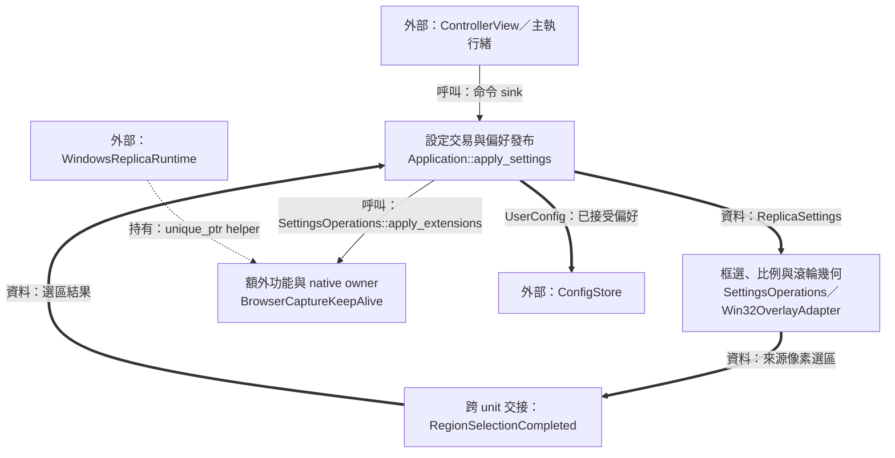
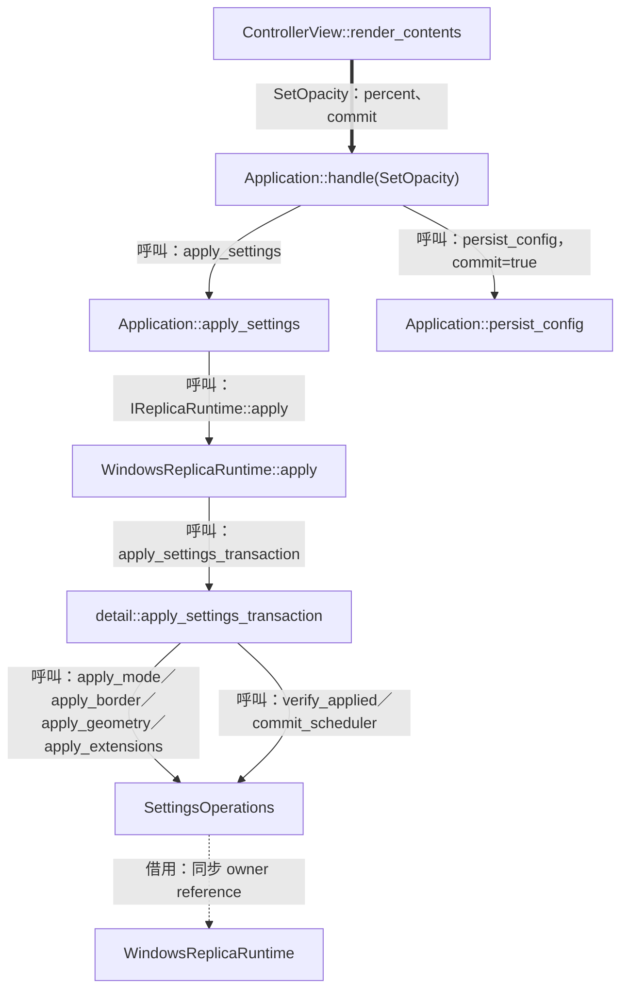
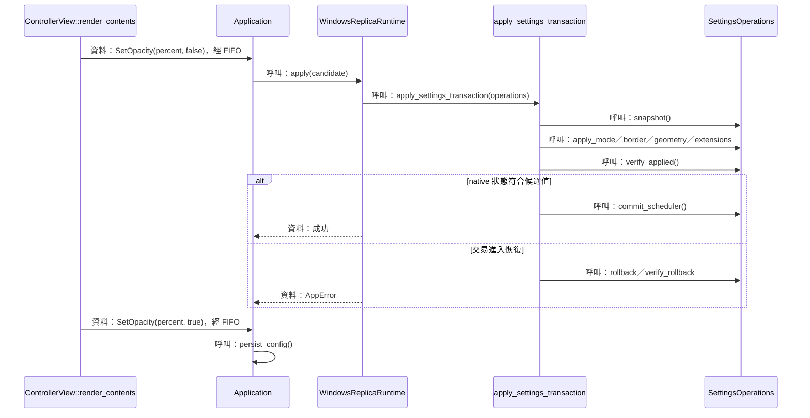
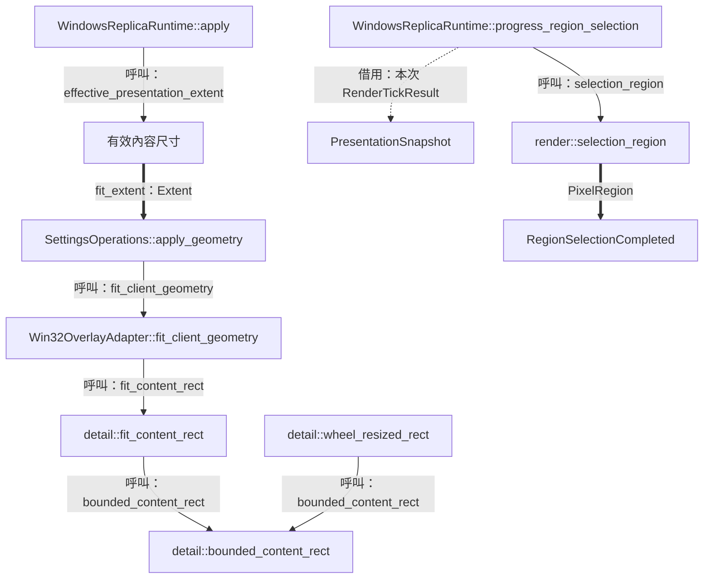
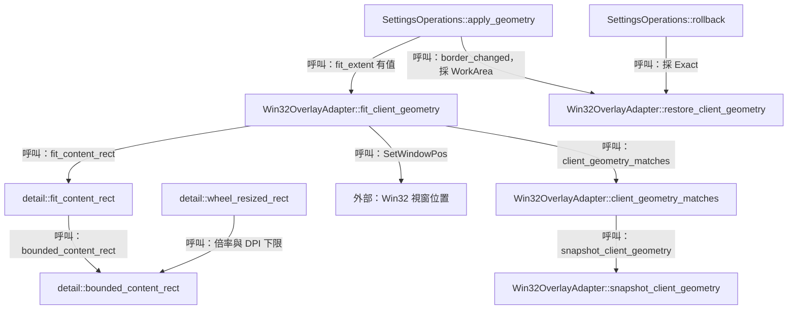
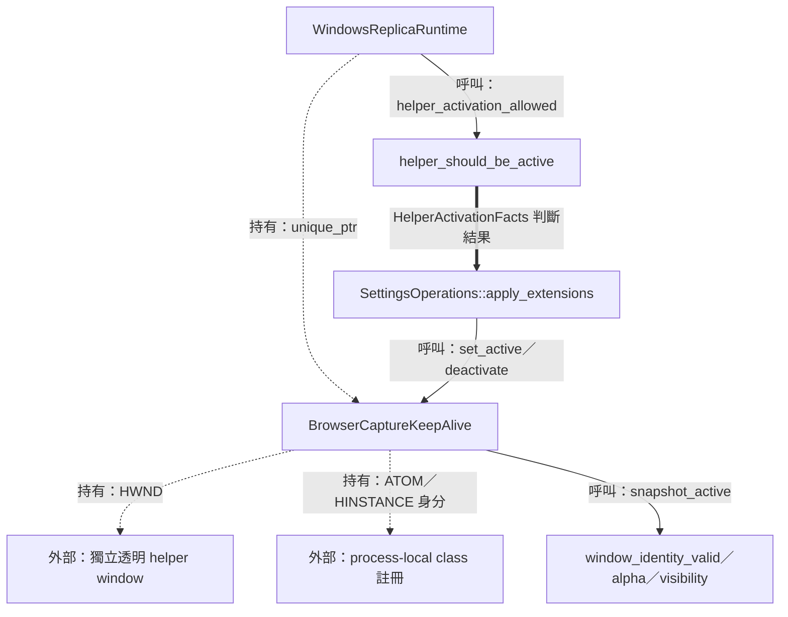
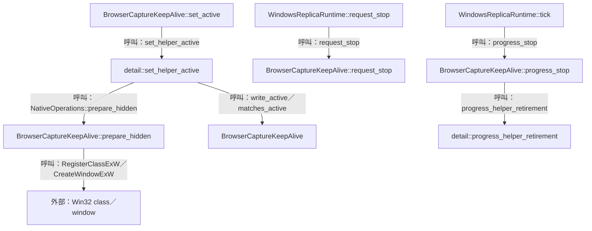

# 06 設定與視窗互動：把使用者操作落實為可驗證狀態



這一階段讓設定值、畫面效果與偏好檔形成一條可追蹤的路徑。設定同時牽涉輸入模式、整窗透明度、邊框、大小與輔助視窗，因此程式需要先觀察原狀、套用候選值、讀回 native 狀態，再發布已接受的設定。

主線由 [命令與 session](02-commands-and-session.md) 進入；框選使用 [呈現快照與座標](05-replica-render-and-present.md) 提供的映射；結果回到 [view 投影](07-controller-loop-and-projection.md)，生命週期事件接到 [復原與退出](08-recovery-and-shutdown.md)。

| 邊界 | 輸入與輸出 | 執行緒與 owner |
| --- | --- | --- |
| 設定命令 | `SetOpacity` 等命令 → `ReplicaSettings` → 已接受設定 | 主執行緒；`Application` 持有 runtime |
| Native 幾何 | client snapshot、內容比例 → 經讀回的視窗位置 | 主執行緒；runtime 持有 overlay 與 adapter |
| 框選 | client 端點 → framebuffer 端點 → `PixelRegion` | native callback 收集端點；runtime tick 完成映射 |
| 額外功能 | extension 偏好與 eligibility → helper visibility | 建立 helper 的執行緒；helper 擁有 HWND 與 class atom |

圖例：實線表示呼叫／控制，粗線表示資料，虛線表示持有、借用或移交。來源入口為 [Application](../../src/app/application.cpp)、[WindowsReplicaRuntime](../../platform/windows/windows_replica_runtime.cpp) 與 [Win32OverlayAdapter](../../platform/windows/win32_overlay_adapter.hpp)。

## 設定交易與偏好發布

### 結構與流程圖



讀圖時先追 `SetOpacity` 的兩種命令，再追候選設定進入 runtime 的交易。交易成功使 runtime 與 domain 各自發布已接受值；偏好儲存由 `Application` 在命令的 commit 階段處理。`SettingsOperations` 是同步借用具體 owners 的內部接合物件。[實作：ControllerView::render_contents](../../src/ui/controller_view.cpp)、[Application::handle](../../src/app/application.cpp)、[SettingsOperations](../../platform/windows/windows_replica_runtime.cpp)。

### 資料結構與使用方式

設定需要同時承載長期偏好與當前 session 的畫面選區。`ReplicaSettings` 以 value object 傳遞整組候選值，runtime 可用相等比較判斷變更，再由交易統一套用。下表完整列出 [ReplicaSettings](../../include/avb/core/types.hpp) 的 members。

| 責任群組 | Members | 值來源與使用者 |
| --- | --- | --- |
| 視窗呈現 | `mode`、`border`、`opacity_percent` | 偏好與 UI 命令；adapter／overlay 套用 |
| 排程 | `fps_cap` | 偏好與 UI 命令；`FrameScheduler` 使用 |
| 輸入尺度 | `wheel_zoom_percent` | 預設 5，有效值 1–25；adapter 轉換 wheel notch |
| 額外功能 | `extensions` | `ExtensionSettings::browser_capture_keep_alive` 供 helper 使用 |
| Session 選區 | `region`、`selecting_region` | 來源內容像素與暫態框選；renderer 及 runtime 使用 |

`region` 使用 `std::optional<PixelRegion>` 表達全圖／選區兩種狀態；`selecting_region=true` 時，native 效果採 `Editable` 與 `opacity_percent=100`，也就是完全顯示，畫面以完整來源供使用者框選。已接受的 `mode` 與 `opacity_percent` 仍保存在設定中，供框選結束後恢復。[effective_mode／effective_opacity](../../platform/windows/windows_replica_runtime.cpp)。

使用示例：以下位於讀取 `ControllerViewState view` 的命令產生語境；`view.session_id` 對應本次畫面所屬 session。命令欄位定義見 [SetOpacity](../../include/avb/app/commands.hpp)。

```cpp
avb::app::SetOpacity preview{view.session_id, 65, false};
avb::app::SetOpacity commit{view.session_id, 65, true};
```

第一筆 preview 讓 65% 經 native 交易接受後進入 domain 與 `config_`；第二筆 commit 讓 `config_dirty_` 指示的已接受偏好進入儲存。`commit.percent` 保留命令形狀，commit 分支的實際工作為 flush 已接受狀態。[Application::handle(SetOpacity)](../../src/app/application.cpp)。

#### 快照保存哪些狀態

回復操作需要兩個層次的快照：runtime 交易保存設定與 helper 狀態；native 呈現交易保存視窗 extended style 及 layered attributes。以下為本 unit 使用的 members，第一組屬於 `WindowsReplicaRuntime` 的 private `SettingsOperations` 內部語境。[SettingsOperations](../../platform/windows/windows_replica_runtime.cpp)、[NativeWindowState／LayeredAttributes](../../platform/windows/detail/overlay_transactions.hpp)。

| 結構／責任 | Members | 有效期間 |
| --- | --- | --- |
| `SettingsOperations::Snapshot` | `settings`、`helper_active` | 一次 settings transaction |
| `SettingsOperations` 的借用與候選 | `owner`、`requested`、`now` | `WindowsReplicaRuntime::apply` 的同步 stack scope |
| 幾何觀察 | `fit_extent`、`geometry`、`fitted_geometry` | 原 client 快照與已套用結果 |
| 操作進度 | `border_changed`、`began_selection` | 指示 rollback 需恢復的部分 |
| `NativeWindowState` | `extended_style`、`layered_attributes` | 一次 `set_native_presentation` |
| `LayeredAttributes` | `color_key`、`alpha`、`flags` | 完整 layered 狀態；供寫入與相等讀回 |

`std::expected<void, AppError>` 把成功與分類後的錯誤交回上層。`PlatformOperationFailure` 對應已驗證的原狀恢復；`RuntimeStateLost` 對應由停止流程接手的 ownership 狀態。`Application::apply_settings` 收到後者會要求 drain。[apply_settings_transaction](../../platform/windows/detail/overlay_transactions.hpp)、[Application::apply_settings](../../src/app/application.cpp)。

### 實作流程



這張順序圖的 UI → Application 資料經命令佇列交接，方法呼叫由 `Application` 主執行緒執行。交易先確認 native 結果，再切換 scheduler 與 cached settings；UI 的輸入 gesture 結束後，由 commit 處理磁碟偏好。[AppCommandQueue](../../include/avb/app/app_command_queue.hpp)、[Application](../../src/app/application.cpp)。

節錄 [ControllerView::render_contents](../../src/ui/controller_view.cpp) 的滑桿與命令發布：

```cpp
const bool opacity_changed = ImGui::SliderInt(
  widget_label(i18n::TextId::Opacity, "opacity", language).c_str(),
  &opacity, 0, 100, "%d%%", ImGuiSliderFlags_AlwaysClamp);
// ...
emit_if(opacity_changed, command_sink,
        app::SetOpacity{opacity_editing_->session_id, opacity, false});
// ...
emit_if(opacity_finished || (!opacity_active && opacity_editing_->preview_emitted), command_sink,
        app::SetOpacity{opacity_editing_->session_id, opacity, true});
```

`OpacityEditing` 保存 gesture 的 `session_id`、`percent` 與 `preview_emitted`。拖曳或直接輸入都經 `SliderInt`，`IsItemDeactivatedAfterEdit` 與 active 狀態用來收束 gesture；命令帶著起始 session token 進入 domain 驗證。[OpacityEditing](../../include/avb/ui/controller_view.hpp)。

節錄 [apply_settings_transaction](../../platform/windows/detail/overlay_transactions.hpp)：

```cpp
const auto applied = operations.apply_mode() && operations.apply_border() &&
                     operations.apply_geometry() &&
                     operations.apply_extensions() &&
                     operations.verify_applied();
if (applied) {
  operations.commit_scheduler();
  return {};
}
static_cast<void>(operations.rollback(*snapshot));
const auto recovered = operations.verify_rollback(*snapshot);
return std::unexpected{overlay_transaction_error(
  recovered ? core::AppErrorCode::PlatformOperationFailure
            : core::AppErrorCode::RuntimeStateLost)};
```

短路求值保存操作的先後依賴：presentation、border、geometry、extensions 依序執行，最後 readback 形成接受證據。例外分支也嘗試 rollback，並以 `RuntimeStateLost` 交回上層接手。[apply_settings_transaction](../../platform/windows/detail/overlay_transactions.hpp)。

#### 整窗 alpha 的具體值

`presentation_window_state` 將百分比轉成 8-bit alpha：`(opacity_percent * 255 + 50) / 100`。例如 65% 得到 166；`PassThrough` 或低於 100% 時採 layered style，讀回時比對 color key、alpha 與 flags。render texture 的 alpha 路徑詳見 [取樣與呈現](05-replica-render-and-present.md)；此處的責任為整個 native 視窗的顯示狀態。[presentation_window_state](../../platform/windows/detail/overlay_transactions.hpp)。

## 框選、比例與滾輪幾何

### 結構與流程圖



比例調整與框選各有一組座標：前者使用螢幕上的 client／outer rectangle；後者把 client 端點映射回來源內容像素。兩者共享 renderer 已呈現的內容尺寸，runtime 在幾何變動時重新建立映射。[runtime 幾何與框選](../../platform/windows/windows_replica_runtime.cpp)、[adapter](../../platform/windows/win32_overlay_adapter.cpp)。

### 資料結構與使用方式

畫面內容需要維持自己的比例，視窗邊框則由目前 DPI 與 style 決定厚度。程式把兩者拆成 `OverlayClientGeometry` 與 `FrameInsets`；所有 `NativeRect` 以實體像素表達，螢幕座標可含負值，適用於多螢幕配置。[OverlayClientGeometry](../../platform/windows/win32_overlay_adapter.hpp)、[NativeRect／FrameInsets](../../platform/windows/detail/overlay_policy.hpp)。

| 結構／責任 | Members | 使用方式 |
| --- | --- | --- |
| `OverlayClientGeometry` | `client_screen_rect` | 保存內容區域的螢幕位置 |
| `NativeRect` | `left`、`top`、`right`、`bottom` | 寬高由右減左、下減上取得 |
| `FrameInsets` | `left`、`top`、`right`、`bottom` | content 與 outer 邊緣的差值 |
| `OverlayRegionGesture` | `start`、`end` | `NativePoint{x,y}`，client 實體像素 |
| `OverlayRegionSelectionResult` | `gesture` | 有值表示完成端點；空值表示取消 |
| `WindowsReplicaRuntime` 本 unit 使用的 members | `presented_content_`、`selection_mapping_`、`selection_client_extent_`、`selection_result_pending_` | 保存來源尺寸、固定映射及 terminal result 狀態 |

最後一列是 private owner 的內部狀態；定義見 [WindowsReplicaRuntime](../../platform/windows/windows_replica_runtime.hpp)。完整 `PresentationSnapshot` 與 `PixelRegion` 映射由 [第 05 篇](05-replica-render-and-present.md) 說明。

使用示例：呼叫純值幾何函式，假設 client 為 800×450、螢幕 work area 為 1920×1040，insets 為零；400×200 的選區形成 2:1 比例。[fit_content_rect／wheel_resized_rect](../../platform/windows/detail/overlay_policy.cpp)。

```cpp
using namespace avb::platform::windows::detail;
const NativeRect client{100, 100, 900, 550};
const NativeRect work{0, 0, 1920, 1040};
const avb::core::Extent region_extent{400, 200};
const auto fitted = fit_content_rect(client, region_extent, {}, work);
const auto enlarged = wheel_resized_rect(client, region_extent, {}, work,
                                         96, 1, 5);
```

`fitted` 是 `(100,125,900,525)`，client 寬度仍為 800、高度變成 400；`enlarged` 是 `(80,115,920,535)`，寬高為 840×420。兩筆都以原 client 中心 `(500,325)` 作為定位基準。[bounded_content_rect](../../platform/windows/detail/overlay_policy.cpp)。

#### Width、aspect 與 work area

先設來源比例 `r = source.width / source.height`，單位為寬高比。可用 client 寬高由 work area 減去兩側 insets 得到 `Aw`、`Ah`。`bounded_content_rect` 以 `min(Aw, Ah*r)` 作為寬度上界，再依比例求高並四捨五入至實體像素。[bounded_content_rect](../../platform/windows/detail/overlay_policy.cpp)。

`fit_content_rect` 的倍率為 1、最小尺寸參數為零，讓開始框選、完成選區及 reset 使用現有 client 寬度調整。滾輪倍率為 `(1 + step_percent/100)^notches`，正向一格在預設 5% 時為 1.05，反向一格為 `1/1.05`。互動下限使用 `160*dpi/96` 與 `90*dpi/96`，work area 容量決定最終可容納尺寸。[fit_content_rect／wheel_resized_rect](../../platform/windows/detail/overlay_policy.cpp)。

`GeometryRestoreBounds::WorkArea` 用於正向邊框變更，把新 outer rectangle 放進最近的 monitor work area；`Exact` 用於交易 rollback，以原 client snapshot 為 readback 目標。兩種選擇分別服務使用者操作與交易恢復。[restore_client_geometry](../../platform/windows/win32_overlay_adapter.cpp)、[SettingsOperations::rollback](../../platform/windows/windows_replica_runtime.cpp)。

#### 滾輪步幅的編輯與採用

`ControllerView::render_wheel_zoom` 使用 1–25% 的 `SliderInt`，並以 `ImGuiItemFlags_LiveEditOnInputScalar` 讀取直接輸入的整數。`WheelZoomEditing` 保存 `session_id`、`percent`、`changed`，編輯器回到 inactive 時發布一筆 `SetWheelZoomPercent`；Application 在 runtime 接受後保存偏好。[render_wheel_zoom](../../src/ui/controller_view.cpp)、[Application::handle(SetWheelZoomPercent)](../../src/app/application.cpp)。

native wheel 的有效情境為 `Editable`、一般互動階段、游標位於 client 區域。`prepare_message` 累加 `wheel_remainder_` 與本次 delta，以 `WHEEL_DELTA` 算出整格 `notches`；剩餘 delta 留待後續訊息。接受新的步幅時，`set_wheel_zoom_percent` 清空這筆 remainder，下一個 gesture 使用新尺度。[prepare_message／set_wheel_zoom_percent](../../platform/windows/win32_overlay_adapter.cpp)。

### 實作流程



`fit_extent` 來自目前呈現內容與候選選區。`WindowsReplicaRuntime::apply` 要求可用內容、正常呈現狀態與選區變更，接著把 fit 要求交給交易。[WindowsReplicaRuntime::apply](../../platform/windows/windows_replica_runtime.cpp)。

節錄同函式的候選 fit 組裝：

```cpp
const bool fit_changed = region_edit || settings.selecting_region != settings_.selecting_region;
SettingsOperations operations{
  .owner = *this, .requested = settings, .now = Clock::now(),
  .fit_extent = fit_changed && fit_available
    ? std::optional{effective_presentation_extent(settings, *presented_content_)}
    : std::nullopt};
return detail::apply_settings_transaction(operations);
```

節錄 [fit_content_rect](../../platform/windows/detail/overlay_policy.cpp)：

```cpp
std::optional<NativeRect> fit_content_rect(
  const NativeRect client_screen, const core::Extent source, const FrameInsets insets,
  const NativeRect work_area) noexcept
{
  return bounded_content_rect(client_screen, source, insets, work_area, 1.0, 0.0, 0.0);
}
```

adapter 把此結果交給 `SetWindowPos`，保留 activation 與 Z order，再以 `snapshot_client_geometry` 比對期待結果。snapshot readback 成功後，`fitted_geometry` 供整筆交易的 `verify_applied` 再次確認。[fit_client_geometry](../../platform/windows/win32_overlay_adapter.cpp)、[SettingsOperations::verify_applied](../../platform/windows/windows_replica_runtime.cpp)。

#### 框選端點回到來源像素

開始框選會等待 `selection_full_view` 的呈現快照。`progress_region_selection` 保存該快照與 client 尺寸，先用 viewport 邊界的 ceil／floor 建立整數 hit-test 區域，再讓 adapter 收集手勢。來源內容或 client 幾何改變時，runtime 以取消結果收束本次 gesture。[progress_region_selection](../../platform/windows/windows_replica_runtime.cpp)。

節錄該函式的完成映射，位於 `WindowsReplicaRuntime` 內部語境：

```cpp
const auto to_framebuffer = [this](const detail::NativePoint point) noexcept {
  return render::PixelPoint{
    static_cast<double>(point.x) * selection_mapping_->framebuffer.width / selection_client_extent_->width,
    static_cast<double>(point.y) * selection_mapping_->framebuffer.height / selection_client_extent_->height};
};
const auto region = render::selection_region(selection_mapping_->content,
  selection_mapping_->viewport, to_framebuffer(terminal->gesture->start),
  to_framebuffer(terminal->gesture->end));
// ...
selection_result_pending_ = true;
candidates.region_completed = app::RegionSelectionCompleted{region};
```

client → framebuffer 的比例轉換保留浮點精度；`selection_region` 接著依 viewport 換算來源像素並求交集。結果由 `Application::process_runtime_result` 接回設定交易，完成選區或 reset 後再 fit 視窗。[selection_region](../../render/render_math.cpp)、[process_runtime_result](../../src/app/application.cpp)。

## 額外功能與 native owner

### 結構與流程圖



這個額外功能以獨立 helper 視窗提供 browser visibility workaround。helper 的具體成功證據是自有視窗的身分、alpha 與顯示狀態；browser 的影格產出則由 capture 路徑觀察。runtime 把偏好與來源生命週期組合成 activation 條件。[BrowserCaptureKeepAlive](../../platform/windows/features/browser_capture_keep_alive.hpp)、[helper_activation_allowed](../../platform/windows/windows_replica_runtime.cpp)。

### 資料結構與使用方式

helper 的可見狀態需要來源可用與 runtime 持續 tick，因此先以純值 facts 表達 eligibility，再由 thread-bound owner 管理 Win32 資源。以下表格列出 [HelperActivationFacts](../../platform/windows/features/detail/browser_capture_keep_alive_policy.hpp) 全部 members。

| 責任群組 | Members | 有效條件 |
| --- | --- | --- |
| 使用者要求 | `requested` | extension 偏好已啟用 |
| 來源型態 | `window_capture` | runtime 建有 window capture helper |
| 持續觀察 | `published_tick_ready` | 已發布且具備 tick 進度 |
| 來源生命週期 | `source_connected`、`stopping_or_terminal` | 來源已連接且 runtime 位於運作階段 |

factory 對 `SourceKind::Window` 建立 helper，所以 eligibility 的型態檢查是 window capture。功能名稱與 helper class 表達其 workaround 用途；該判定以來源 kind 與 runtime facts 實作。[WindowsRuntimeFactory](../../platform/windows/windows_runtime_factory.cpp)、[helper_should_be_active](../../platform/windows/features/detail/browser_capture_keep_alive_policy.hpp)。

使用示例：下列值模擬已發布並開始 tick 的 window capture，`helper_should_be_active` 回傳 `true`。[HelperActivationFacts](../../platform/windows/features/detail/browser_capture_keep_alive_policy.hpp)。

```cpp
using namespace avb::platform::windows::features::detail;
const HelperActivationFacts facts{
  .requested = true,
  .window_capture = true,
  .published_tick_ready = true,
  .source_connected = true,
  .stopping_or_terminal = false};
const bool active = helper_should_be_active(facts);
```

下表是 private owner `BrowserCaptureKeepAlive` 使用的 members；建立與銷毀都由 `thread_id_` 對應執行緒處理。[BrowserCaptureKeepAlive 定義](../../platform/windows/features/browser_capture_keep_alive.hpp)。

| 責任群組 | Members | 共同維持的關係 |
| --- | --- | --- |
| Native 身分 | `thread_id_`、`instance_`、`class_atom_`、`window_` | 程序、執行緒、class atom、instance 與 HWND 一致 |
| 退休歷史 | `retirement_` | `ever_shown`、`hidden_verified`、`last_hide` 保存顯示／隱藏證據 |
| 清理階段 | `stopping_`、`cleanup_uncertain_` | 終止 activation 並保留 cleanup owner |

`class_atom_` 來自此 owner 的 `RegisterClassExW`；`window_identity_valid` 同時核對 thread、process、class name、ATOM、instance、parent 與預期 styles。這些證據共同確認後續 visibility 與 destroy 操作的實際目標。[window_identity_valid](../../platform/windows/features/browser_capture_keep_alive.cpp)。

### 實作流程



`prepare_hidden` 建立 `TaskListThumbnailWnd` class 的 1×1 popup helper，extended style 指定 tool window、no-activate、layered、transparent。alpha 設成零後讀回；啟用操作透過 visibility transaction 觀察結果。[prepare_hidden／write_active](../../platform/windows/features/browser_capture_keep_alive.cpp)。

節錄 [prepare_hidden](../../platform/windows/features/browser_capture_keep_alive.cpp) 的 native owner 建立：

```cpp
WNDCLASSEXW window_class{};
window_class.cbSize = sizeof(window_class);
window_class.lpfnWndProc = DefWindowProcW;
window_class.hInstance = instance_;
window_class.lpszClassName = helper_class_name;
class_atom_ = RegisterClassExW(&window_class);
// ...
window_ = CreateWindowExW(helper_extended_style, helper_class_name, L"",
                          WS_POPUP, 0, 0, 1, 1, nullptr, nullptr, instance_, nullptr);
```

這是 owner 內部節錄；`class_atom_` 成功註冊後建立視窗。同名 class 的註冊衝突由函式回傳 native failure，owner 依其實際取得的資源處理清理。[prepare_hidden](../../platform/windows/features/browser_capture_keep_alive.cpp)。

節錄 [helper_should_be_active](../../platform/windows/features/detail/browser_capture_keep_alive_policy.hpp) 的完整判定：

```cpp
return facts.requested && facts.window_capture && facts.published_tick_ready &&
       facts.source_connected && !facts.stopping_or_terminal;
```

#### 顯示歷史與延後退休

helper 曾進入顯示操作後，退休需要 verified hidden 狀態與 250 ms grace interval。`last_hide` 保存已驗證隱藏的時點；`progress_helper_retirement` 依序 destroy HWND、unregister class，以資源數減少表示進展。實際 owner 釋放後，runtime 取得完成整體 `Stopped` 契約所需的 helper 證據。[HelperRetirementState／progress_helper_retirement](../../platform/windows/features/detail/browser_capture_keep_alive_policy.hpp)、[停止與 drain](08-recovery-and-shutdown.md)。
