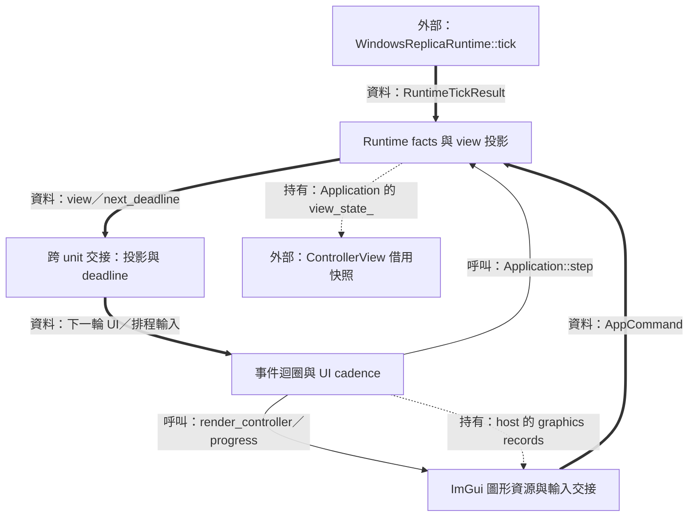
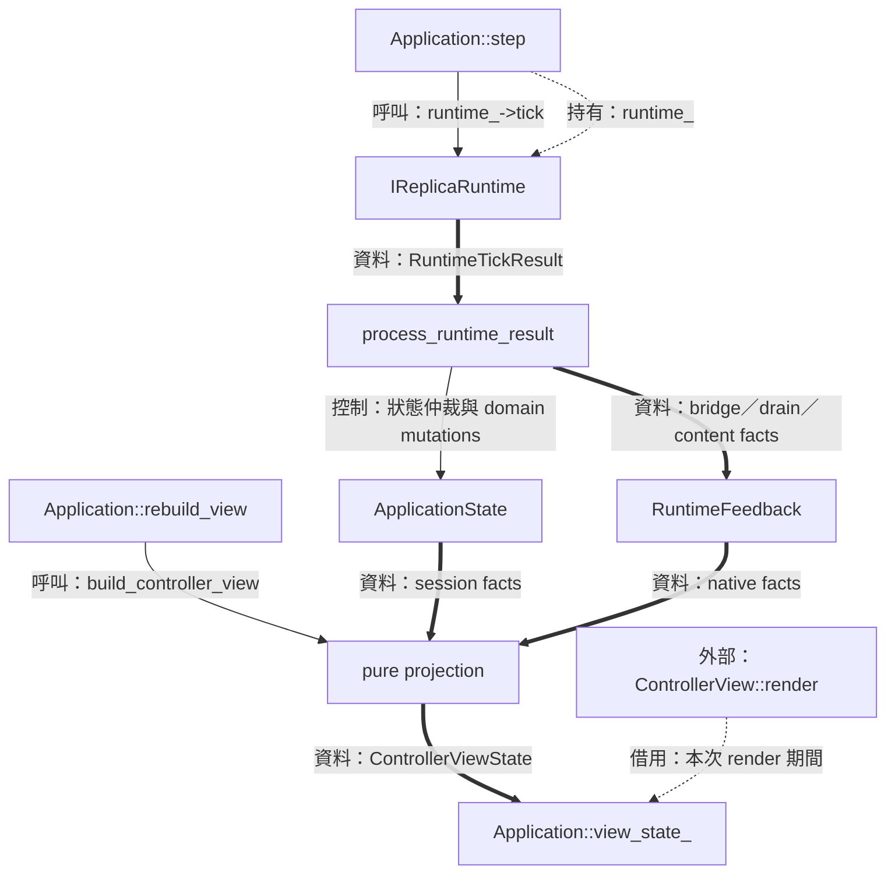
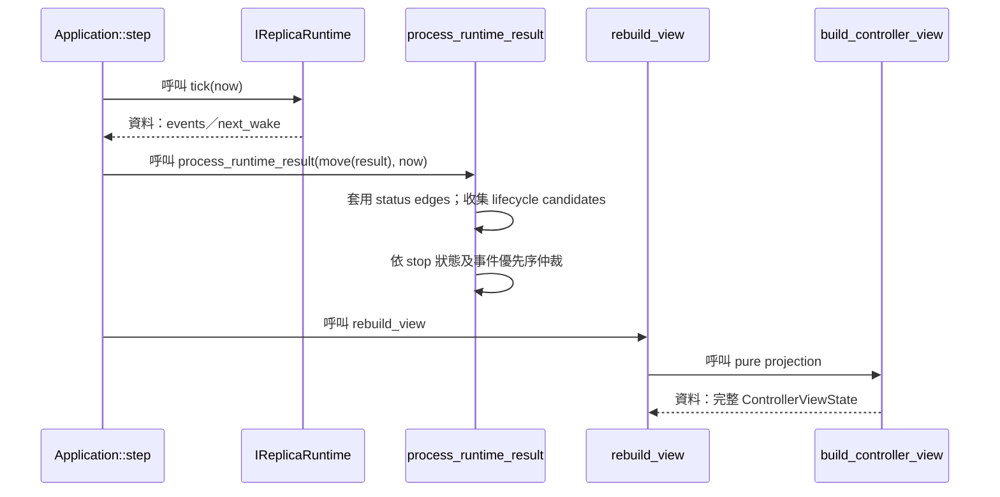
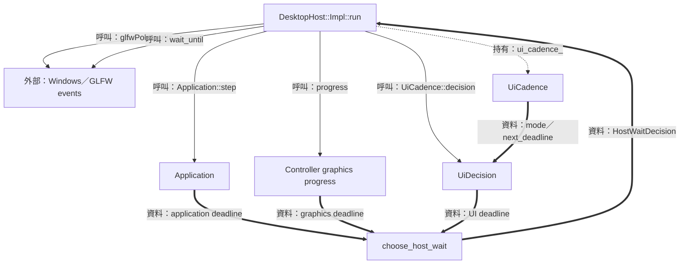
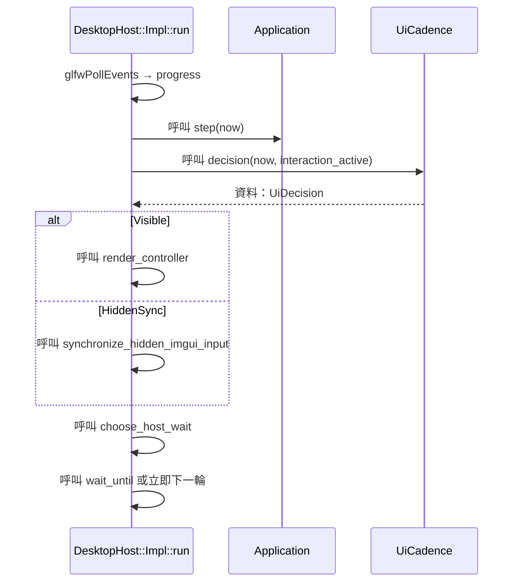
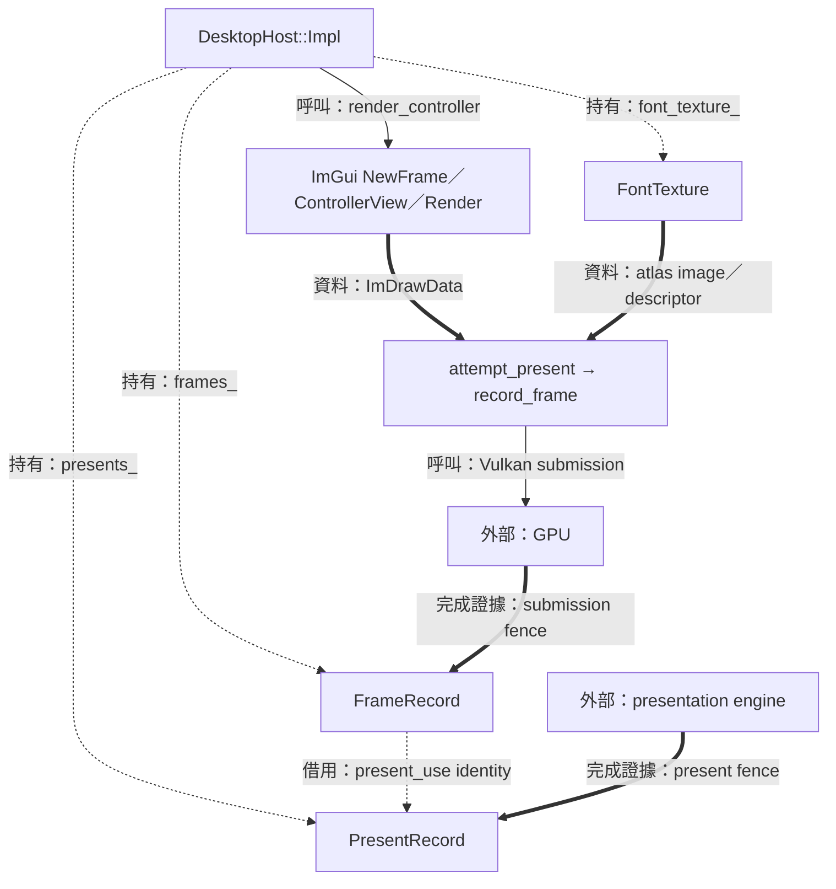
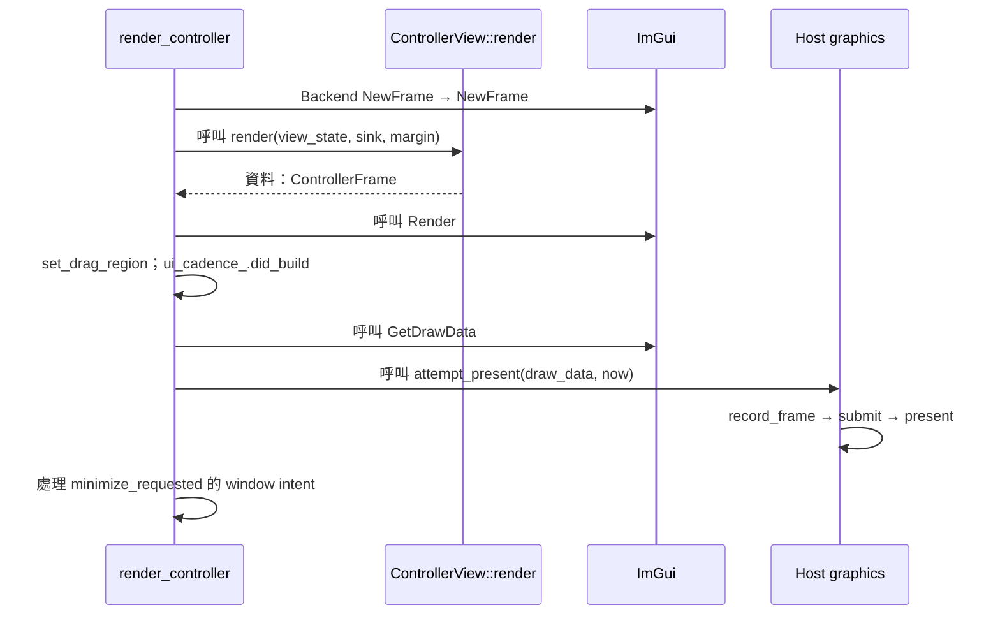

# 階段 07：回傳狀態、推進主迴圈與繪製 Controller



為了讓擷取、GPU 進度與操作介面各自保持合適節奏，主迴圈需要整合狀態、事件與多組 deadlines。本篇從 runtime 的回傳值走到 UI 呈現，再說明下一次醒來的時間如何決定。

[總覽](overview.md) · [命令入口](02-commands-and-session.md) · [副本圖形](05-replica-render-and-present.md) · [退出](08-recovery-and-shutdown.md)

| 資料／控制 | 進入點 | Owner／thread |
| --- | --- | --- |
| `RuntimeTickResult` → `ControllerViewState` | `Application::process_runtime_result/rebuild_view` | Application 持有值，主執行緒同步處理 |
| Window events／wake／deadlines | `DesktopHost::Impl::run` | Host 持有 event-loop、UI、controller graphics |
| `ImDrawData` → Vulkan submission／present | `render_controller → attempt_present` | 當前 UI frame 與 host records 協作 |

圖例：實線呼叫、粗線資料、虛線持有／借用。Controller 的圖形 owner 與副本圖形 owner 各有自己的資源與完成證據。

## Runtime facts 與 view 投影

### 結構與流程圖



為了讓 UI 一次讀到一致狀態，Application 先收集 runtime facts，再產生新的 projection。圖的左半部更新事實，右半部把事實轉為值、文字與操作能力。

### 資料結構與使用方式

[`RuntimeTickResult`](../../include/avb/app/ports.hpp) 保存一次同步 tick 的結果。為了讓狀態更新、生命週期事件與排程需求一起抵達 Application，需要下列兩個 members：

| Type／member | 用途與有效期間 |
| --- | --- |
| `RuntimeTickResult::events` | 固定容量 10 的 optional RuntimeEvent array，event 為 variant；Application 在下一次 tick 前消費這批值 |
| `RuntimeTickResult::next_wake` | runtime 要求的最早 steady-clock 時點，空值表示等待外部事件 |
| [`RuntimeFeedback`](../../include/avb/app/controller_view_state.hpp) 的 `bridge/overlay_exclusion/drain/content_extent` | 當前 published runtime 的回饋，建立／釋放 runtime 時重設 |
| `ControllerViewState::session_id/sources/settings/controls` | 下一次 UI 的操作身分、擁有的 rows、接受的設定與可用能力 |
| `ControllerViewState` 的文字欄位 | 動態 label／hotkey 字串由 view 擁有；catalog 的 `string_view` 借用靜態文字 |

使用示例：示範一份 tick 結果的資料形狀，供測試替身或 port 使用者閱讀；正式 runtime 依 native 觀察建立事件。

```cpp
avb::app::RuntimeTickResult example_content_fact()
{
    avb::app::RuntimeTickResult result;
    result.events[0] = avb::app::CaptureContentChanged{{1920, 1080}};
    return result;
}
```

`CaptureContentChanged` 的尺寸來自完成呈現的來源內容，解說見 [階段 05](05-replica-render-and-present.md)。使用示例展示 event payload 的結構，實際執行需具有相應完成證據。

### 實作流程



節錄 [`Application::step`](../../src/app/application.cpp)：

```cpp
void Application::step(Clock::time_point now) noexcept
{
    // ...
    if (runtime_) {
        auto result = runtime_->tick(now);
        runtime_deadline_ = result.next_wake;
        process_runtime_result(std::move(result), now);
    }
    // ...
    update_source_refresh(now);
    rebuild_view();
    // ...
}
```

#### 同批事件的因果與優先序

為了讓同一 tick 的多個事實形成確定結果，`process_runtime_result` 先掃描全部 event slots，更新 bridge、exclusion、drain 等 status，並收集 lifecycle candidates。Stop phase 以 `Stopped` 作安全釋放證據；正常 phase 的有效事件優先序是 Failed、overlay close、source lost，再按 started→recovered 因果順序處理 graphics recovery。

這個設計使 array 的儲存位置與生命週期仲裁各有責任。Crop 完成事件在生命週期與內容尺寸處理之後，依當前 selection 條件接續套用，詳見 [階段 06](06-settings-and-window-interaction.md)。

#### 投影的借用範圍

為了讓 UI 讀取期間有穩定輸入，host 在 `render_controller` 中借用 `application.view_state()`。下一次 Application 更新會替換 projection，因此 UI 將命令所需的 ID 與值複製到 `AppCommand`，長期資料由對應 owner 保存。

## 事件迴圈與 UI cadence

### 結構與流程圖



為了按需求更新畫面，host 分別詢問 Application、graphics 與 UI 的下次需求。`choose_host_wait` 將這些 deadline 合併，來源 callback 的 wake 和使用者事件也能喚醒等待。

### 資料結構與使用方式

[`UiCadence`](../../src/desktop/ui_cadence.hpp) 以 caller 提供的 steady clock 選擇 UI 更新頻率。它服務 widget build 的節奏；Application 與 graphics progress 在 host 的每輪迴圈各自推進。

| Member／type | 用途 |
| --- | --- |
| `UiCadence::last_build_`、`active_until_` | 最近完成 build 的時間與互動 grace 結束時間 |
| `visible_`、`first_or_restore_`、`input_dirty_` | 可繪狀態、首次／恢復需求、待同步輸入 |
| `UiDecision::mode/next_deadline` | Visible、HiddenSync 或 None，以及下次觀察時間 |
| `HostWaitDecision::immediate_reentry/deadline` | 新命令要求立即下一輪，或選定最早等待時間 |

使用示例：在主執行緒以同一單調時鐘推進 policy，宣告位於 [`ui_cadence.hpp`](../../src/desktop/ui_cadence.hpp)。

```cpp
avb::desktop::detail::UiDecision example_ui_decision()
{
    avb::desktop::detail::UiCadence cadence;
    const auto now = std::chrono::steady_clock::now();
    cadence.note_input(now);
    return cadence.decision(now, true);
}
```

這份初始 policy 會要求 Visible frame。實際 host 在成功完成 widget build 後呼叫 `did_build`，建立下一個週期的基準。

### 實作流程



節錄 [`choose_host_wait`](../../src/desktop/ui_cadence.hpp)，展示各 owner 提供 deadline、host 統一選擇的交界：

```cpp
[[nodiscard]] inline HostWaitDecision choose_host_wait(
    const bool command_emitted, const std::optional<HostTime> application,
    const std::optional<HostTime> graphics, const std::optional<HostTime> ui) noexcept
{
    if (command_emitted) return {true, std::nullopt};
    std::optional<HostTime> earliest;
    for (const auto candidate : {application, graphics, ui}) {
        if (candidate && (!earliest || *candidate < *earliest)) earliest = candidate;
    }
    return {false, earliest};
}
```

#### 互動、閒置與隱藏三種需求

為了在互動時保持回應，`active_period` 是 16,666,667 ns，事件將 activity grace 延伸 500 ms；持續編輯、按鍵或 popup facts 也能維持 active cadence。閒置且可見時 `idle_period` 是 100 ms。隱藏狀態有待處理輸入時執行一次 HiddenSync，消費後等待新事件。

#### 使用者命令的下一輪

UI 通常在本輪 `Application::step` 之後產生命令。為了讓新命令立即獲得處理機會，host 的 `command_emitted_` 轉成 `immediate_reentry=true`，重新 pump events 再進入 Application。Replica 的 FPS cap 由 [FrameScheduler](03-capture-and-scheduling.md) 管理，兩組 cadence 的用途與 owner 各自清楚。

## ImGui 圖形資源與輸入交接

### 結構與流程圖



為了讓一份 UI draw data 在 GPU 使用期間維持所需資源，host 保存 submission records。為了追蹤 presentation engine 對 swapchain 的使用，present records 另保存自己的完成證據。

### 資料結構與使用方式

下列 private records 定義於 [`DesktopHost::Impl`](../../src/desktop/desktop_host.cpp)；本表按它們維持的 invariant 分組。

| Type／members | 共同作用 |
| --- | --- |
| `FrameRecord::command_buffer/acquire_fence/submission_fence/acquire_semaphore` | 錄製工作、取得 image、提交與完成觀察的資源 |
| `FrameRecord::present_use/swapchain/image_index/phase/acquired/uploads_font` | 本次 frame 與 WSI／present／font upload 的關聯 |
| `PresentRecord::use/fence/wait_semaphore/swapchain` | PresentUse identity、present completion 與 WSI 持有關係 |
| `PresentRecord::confirms_recovery/counts_as_presented` | 復原確認與統計計數兩種退休效果 |
| `FontTexture::staging_buffer/staging_memory` | atlas upload 的來源儲存 |
| `FontTexture::image/memory/view/descriptor/width/height` | UI 取樣資源及其尺寸 |
| `FontTexture::upload_pending/upload_in_flight` | 已準備錄製與已進入提交範圍的上傳狀態 |

為了讓 UI 把標題拖曳區和最小化意圖交給 host，另有公開的 [`ControllerFrame`](../../include/avb/ui/controller_view.hpp)。使用示例顯示其值的形狀：

```cpp
avb::ui::ControllerFrame example_title_result()
{
    return {.drag_right = 420.0F,
            .drag_bottom = 28.0F,
            .minimize_requested = false};
}
```

拖曳範圍以 ImGui display units 表示，host 轉成 window interaction 的比例；`minimize_requested` 是一次 frame 的意圖，由 host 執行視窗操作。

### 實作流程



節錄 [`DesktopHost::Impl::render_controller`](../../src/desktop/desktop_host.cpp)：

```cpp
// DesktopHost::Impl::render_controller 內
ImGui_ImplVulkan_NewFrame();
ImGui_ImplGlfw_NewFrame();
ImGui::NewFrame();
// ...
const auto frame = controller_view_.render(
    application.view_state(),
    [this](app::AppCommand command) { emit(std::move(command)); },
    logical_resize_margin * std::max({1.0F, xscale, yscale}));
ImGui::Render();
// ...
ui_cadence_.did_build(std::chrono::steady_clock::now());
// ...
attempt_present(*ImGui::GetDrawData(), now);
// ...
```

#### 隱藏時把輸入 batch 消費完整

為了讓 release／focus events 在隱藏後也能到達 ImGui，host 使用 [`synchronize_hidden_imgui_input`](../../src/desktop/imgui_input_sync.hpp)。它以區域 guard 保存 `ConfigInputTrickleEventQueue`，暫時將該值設為 false，執行 backend NewFrame、ImGui NewFrame／EndFrame，離開時恢復原值。Visible 路徑負責 widgets、命令與 native presentation，HiddenSync 路徑負責這批輸入的狀態同步。

#### 退休時點與復原確認

`progress_frames` 觀察 frame submission 與 acquire 使用；`progress_presents` 觀察 present fence。成功觀察 present fence 後，`counts_as_presented` 決定計數，`confirms_recovery` 加上仍存在的 recovery episode 決定復原確認。這兩個旗標各自表達其效果；共用的退休證據連結同一筆 `PresentRecord`。

Host 的 Vulkan device、swapchain、UI atlas 由 host 釋放。Replica 使用 [階段 05](05-replica-render-and-present.md) 的另一組 records；兩邊透過共用的值型政策描述結果，各自持有原生資源。
