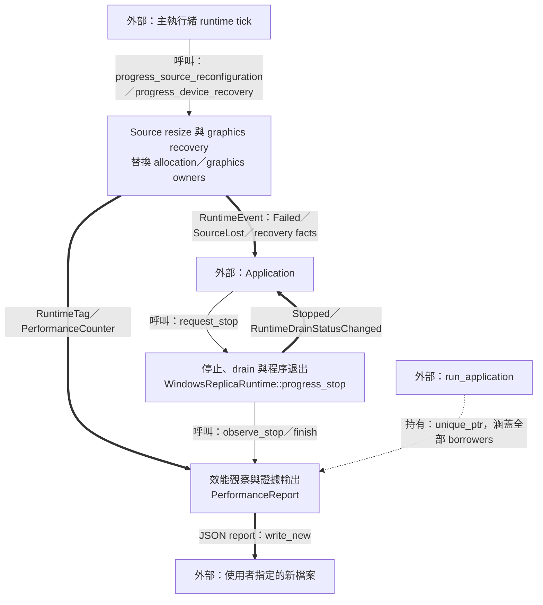
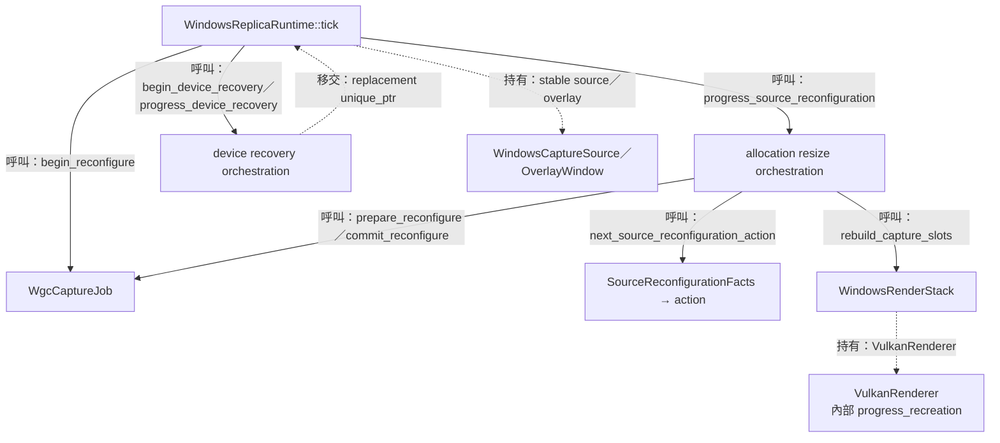
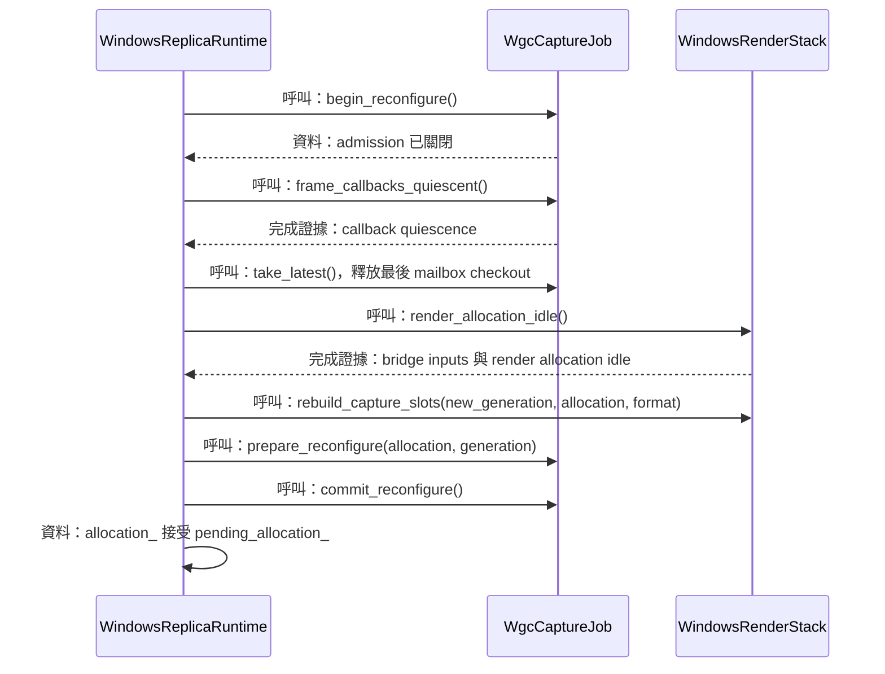
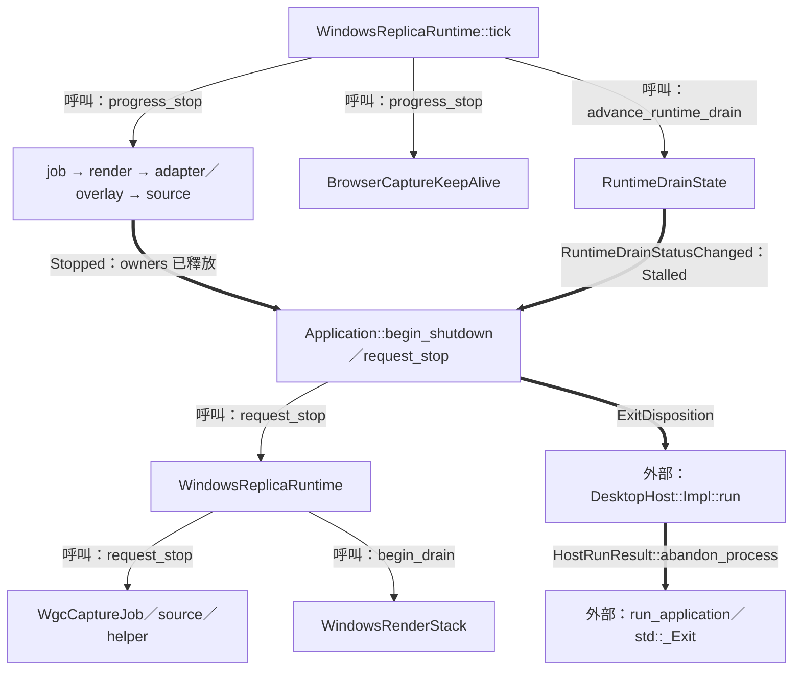
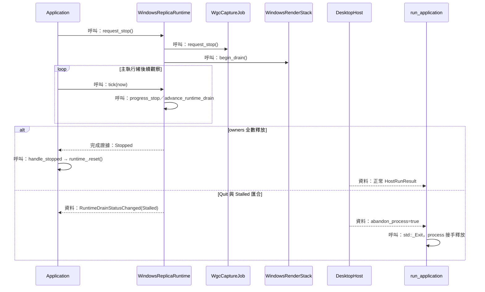
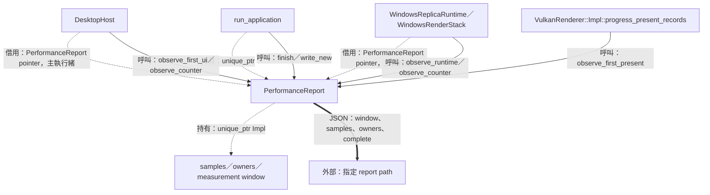
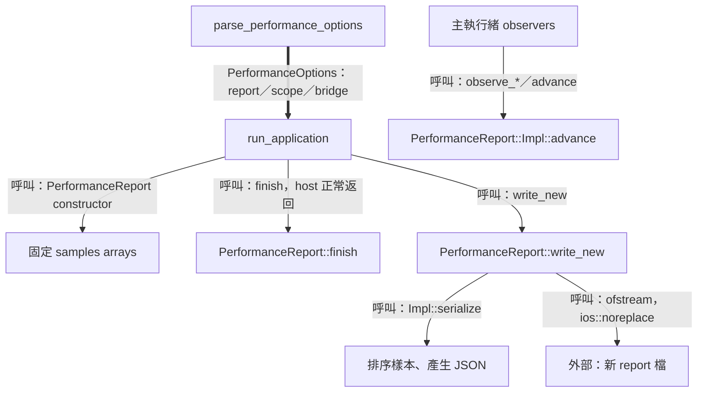

# 08 復原與退出：以完成證據推進資源生命週期



此階段讓程式在來源尺寸改變、graphics 資源更新與退出時持續掌握資源使用者。需求有兩部分：替換前取得舊工作完成證據，退出前讓每個 native owner 的釋放條件成立。runtime 以明確 phase、generation 與下一次觀察 deadline 推進這些工作。

前置知識見 [capture 與 callback](03-capture-and-scheduling.md)、[影格交接](04-frame-transport.md)、[Vulkan 與 WSI](05-replica-render-and-present.md)。上層事件裁決及 host loop 見 [controller 迴圈](07-controller-loop-and-projection.md)。

| 路徑 | 輸入 | 輸出與 owner |
| --- | --- | --- |
| Resize／recovery | capture signals、render results | runtime 替換 allocation 或 graphics 子 owner |
| 停止 | 使用者 Stop／Quit、terminal event | runtime 發布 `Stopped`；Application 決定程序 disposition |
| 效能觀察 | 主執行緒 scalar observations | process-lifetime report collector；正常退出後寫入新 JSON |

圖例：實線是呼叫／控制，粗線是資料，虛線是持有／借用／移交。本頁主要來源為 [WindowsReplicaRuntime](../../platform/windows/windows_replica_runtime.cpp)、[Application](../../src/app/application.cpp)、[PerformanceReport](../../include/avb/diagnostics/performance_report.hpp)。

## Source resize 與 graphics recovery

### 結構與流程圖



先沿 resize 支線觀察 callback 與 render retirement 的先後，再沿 device 支線觀察 replacement owners 的建立與移交。WSI 的 surface／swapchain 更新由 renderer 內部處理；runtime 保留 stable source 與 overlay 身分。[progress_source_reconfiguration／progress_device_recovery](../../platform/windows/windows_replica_runtime.cpp)、[progress_recreation](../../render/vulkan_wsi.cpp)。

### 資料結構與使用方式

來源的有效內容尺寸與承載影格的 allocation 各有自己的更新時點。runtime 需要讓 callback admission、最後一張 mailbox frame、已交出的 checkout 與 graphics allocation 依序交接，因此以 phase 和 facts 決定下一個具體動作。[SourceReconfigurationPhase／Facts](../../platform/windows/detail/windows_runtime_policy.hpp)。

| 結構／責任 | Members／值 | 使用方式 |
| --- | --- | --- |
| `SourceReconfigurationPhase` | `Inactive`、`WaitingForCallbacks`、`WaitingForRender`、`Prepared` | 從運作期推進至新 epoch 發布 |
| `SourceReconfigurationFacts` | `phase`、`callbacks_quiescent`、`render_idle` | 同步觀察 callback 與 graphics 完成證據 |
| 來源可用性 | `source_open`、`capture_failed` | 選擇繼續配置或 `Cancel` |
| runtime 本 unit 使用的 members | `pending_allocation_`、`allocation_`、`resource_generation_`、`reconfiguration_phase_` | pending 尺寸在 commit 後成為 accepted allocation |
| device episode | `device_recovery_phase_`、`device_recovery_episode_`、`device_recovery_started_at_`、`replacement_awaiting_present_` | 保存 drain、重建嘗試與後續呈現確認 |
| 裝置證據 | `vulkan_device_lost_`、`d3_device_removed_` | 各 API 的退休條件分別使用對應事實 |

runtime 列表是 [WindowsReplicaRuntime](../../platform/windows/windows_replica_runtime.hpp) 的 private members 子集。`resource_generation_` 由穩定 runtime 維護，replacement render stack 接收新的值；`DeviceRecoveryPhase` 的值為 `Inactive`、`Draining`、`WaitingToRebuild`。

使用示例：假設 callback 已收束且處於 `WaitingForCallbacks`，下一步是清掉該 epoch 的最後 mailbox frame。[next_source_reconfiguration_action](../../platform/windows/detail/windows_runtime_policy.hpp)。

```cpp
using namespace avb::platform::windows::detail;
const SourceReconfigurationFacts facts{
  .phase = SourceReconfigurationPhase::WaitingForCallbacks,
  .callbacks_quiescent = true,
  .render_idle = false,
  .source_open = true,
  .capture_failed = false};
const auto action = next_source_reconfiguration_action(facts);
// action == SourceReconfigurationAction::DiscardFinalFrame
```

這一步讓 mailbox 放棄最後 checkout；已移交 bridge 的 checkout 仍由 `render_allocation_idle` 追蹤，下一個 phase 因而等待 render retirement。[progress_source_reconfiguration](../../platform/windows/windows_replica_runtime.cpp)、[WindowsRenderStack::render_allocation_idle](../../platform/windows/windows_render_stack.cpp)。

#### 四種更新各自替換什麼

| 路徑 | 觸發與條件 | 替換範圍／generation |
| --- | --- | --- |
| Capture allocation resize | capture resize 與 `allocation_` 相異，來源仍開啟 | capture ring、frame pool epoch；`resource_generation_` 增加 |
| WSI recreation | swapchain 或 surface 的 recreation 條件 | renderer 的 swapchain／surface；capture resource generation 延續 |
| Device rebuild | `VulkanDeviceLost` 或 `D3DeviceRemoved` | capture job＋render stack；新 resource generation |
| Interop fallback | runtime interop 工作要求 CPU 替代路徑，舊工作已退休 | CPU source ring、interop 支援資源；沿用 resource generation |

表中路徑分別由 [runtime resize／device recovery](../../platform/windows/windows_replica_runtime.cpp)、[Vulkan WSI recreation](../../render/vulkan_wsi.cpp)、[WindowsRenderStack::Impl::progress_interop_fallback](../../platform/windows/windows_render_stack.cpp) 實作。ring identity 與 resource generation 的角色見 [影格交接](04-frame-transport.md)。

### 實作流程



`progress_source_reconfiguration` 每次最多折疊四個立即可前進的步驟。`Prepared` 之後的 policy 再次核對來源開啟狀態，核對成功後 `commit_reconfigure` 開放新 epoch 的 admission。[progress_source_reconfiguration](../../platform/windows/windows_replica_runtime.cpp)、[WgcCaptureJob::Impl::commit_reconfigure](../../platform/windows/wgc_capture_job.cpp)。

節錄 [WindowsReplicaRuntime::progress_source_reconfiguration](../../platform/windows/windows_replica_runtime.cpp)：

```cpp
case detail::SourceReconfigurationAction::DiscardFinalFrame:
  static_cast<void>(capture_job_->take_latest());
  reconfiguration_phase_ =
    detail::SourceReconfigurationPhase::WaitingForRender;
  progress = render::DrainProgress::TrackedRetirement;
  continue;
// ...
case detail::SourceReconfigurationAction::Commit:
  capture_job_->commit_reconfigure();
  allocation_ = *pending_allocation_;
  update_presentation_extent();
  pending_allocation_.reset();
  reconfiguration_phase_ = detail::SourceReconfigurationPhase::Inactive;
  progress = render::DrainProgress::ProvenSafeRelease;
  return;
```

#### Device replacement 的發布與呈現確認

`begin_device_recovery` 關閉相關 admission 並要求 capture stop；`progress_device_recovery` 等待 job 的 `stop_quiescent` 與 render 的 `drain_complete`，釋放兩個舊 owners 後進入 `WaitingToRebuild`。`attempt_device_rebuild` 先以區域 `unique_ptr` 建立 render、inactive job 與 slots，啟動成功後移交給 runtime。[device recovery methods](../../platform/windows/windows_replica_runtime.cpp)。

節錄 `attempt_device_rebuild` 的成功移交，位於 runtime 內部語境：

```cpp
render_stack_ = std::move(replacement_render);
capture_job_ = std::move(*replacement_job);
allocation_ = allocation;
update_presentation_extent();
last_render_result_ = {};
resource_generation_ = *decision.candidate_generation;
device_recovery_phase_ = DeviceRecoveryPhase::Inactive;
source_job_stopping_ = false;
vulkan_device_lost_ = false;
d3_device_removed_ = false;
// ...
replacement_awaiting_present_ = true;
```

replacement 發布會形成 `GraphicsRecovered` 候選事件；重試 episode 的歸零則等待 `SuccessfulPresentRetired`。`GraphicsRetryPolicy` 的三個 attempt 時點為 episode 起點後 0、100、500 ms；generation 容量與三次嘗試界線也由該 policy 檢查。[attempt_device_rebuild／tick](../../platform/windows/windows_replica_runtime.cpp)、[GraphicsRetryPolicy::evaluate](../../render/graphics_retry_policy.cpp)。

#### Interop fallback 的 drain

`request_interop_fallback` 先關閉 source admission。`progress_interop_fallback` 丟棄 ready inputs，等待 `render_allocation_idle()` 與 `presentations_in_flight == 0`，接著拆除舊 slots、以相同 generation 建立 CPU ring、釋放 interop support，再發布新 ring 與 `BridgeModeChanged` 資料。[request_interop_fallback／progress_interop_fallback](../../platform/windows/windows_render_stack.cpp)。

Vulkan loss 與 D3 removal 各自提供所屬 API 的完成／放棄條件。bridge 仍保留其 D3 copy checkout，直到 producer proof 或對應 D3 removal 事實允許釋放；renderer 依 Vulkan retirement 證據處理自己的資源。[WindowsFrameBridge::progress](../../platform/windows/windows_frame_bridge.cpp)、[WindowsRenderStack](../../platform/windows/windows_render_stack.cpp)。

## 停止、drain 與程序退出

### 結構與流程圖



停止由 request 階段開始，後續 tick 繼續收集完成證據。主路徑依 owner 的借用關係反向釋放；helper 另有自己的退休時間線。`Stopped` 表示整個 runtime aggregate 已清空；`Stalled` 表示 drain 仍由原 owners 持續承擔。[request_stop／progress_stop](../../platform/windows/windows_replica_runtime.cpp)、[advance_runtime_drain](../../platform/windows/detail/windows_runtime_policy.hpp)。

### 資料結構與使用方式

停止需要同時觀察 native 呼叫完成、callback 使用者、已交出的 frame、GPU 與 present 使用者。runtime 因此保存各 owner，直到其 release predicate 成立；再以 `RuntimeDrainState` 追蹤整體進展與下一次觀察時間。[runtime owners](../../platform/windows/windows_replica_runtime.hpp)、[RuntimeDrainState](../../platform/windows/detail/windows_runtime_policy.hpp)。

| 結構／責任 | Members／值 | 使用方式 |
| --- | --- | --- |
| `RuntimeDrainState` | `no_progress_since`、`published_status`、`ownership_uncertain` | 一條跨 native owners 的進展時鐘與證據狀態 |
| `RuntimeDrainUpdate` | `state`、`status_change`、`may_complete`、`next_deadline` | 回傳新狀態、UI edge、完成資格與 tick 時點 |
| `DrainProgress` 的進展值 | `TrackedRetirement`、`ProvenSafeRelease` | 重設進展時鐘 |
| `DrainProgress` 的觀察值 | `None`、`Poll`、`Retry`、`Warning`、`NewPending` | 保留既有進展時間基準 |
| `CaptureJobStopState` 本 unit 使用的 members | `requested_`、`native_stop_succeeded_`、`cleanup_failure_` | 保存 revoke、session Close 及其第一筆 cleanup error |

`CaptureJobStopState` 是 [capture stop policy](../../platform/windows/detail/wgc_capture_state.hpp) 的 private 狀態；其 `stop_quiescent` 以 native stop、callbacks quiescent、mailbox closed-and-empty 共同確認 job 內部收束。render 持有的 checkout 由 render／bridge 的 drain 另外提供證據。

使用示例：以 `advance_runtime_drain` 觀察仍有 owner 的情境；t0 後 10 秒且維持 `Poll`，結果發布 `Stalled`，並安排下一次觀察。[advance_runtime_drain](../../platform/windows/detail/windows_runtime_policy.hpp)、[RuntimeDrainPolicy::evaluate](../../render/graphics_retry_policy.cpp)。

```cpp
using namespace std::chrono_literals;
using namespace avb;
platform::windows::detail::RuntimeDrainState state;
const auto first = platform::windows::detail::advance_runtime_drain(
  state, true, false, render::DrainProgress::Poll, t0);
const auto later = platform::windows::detail::advance_runtime_drain(
  first.state, true, false, render::DrainProgress::Poll, t0 + 10s);
// later.state.published_status == core::RuntimeDrainStatus::Stalled
```

`RuntimeDrainPolicy` 對 retained ownership 採至多 50 ms 的觀察間隔，10 秒的進展停滯形成 `Stalled`。`ownership_uncertain` 由明確的 empty-owner 與 `ProvenSafeRelease` 觀察清除；經過時間服務診斷與排程。[advance_runtime_drain](../../platform/windows/detail/windows_runtime_policy.hpp)、[RuntimeDrainPolicy](../../render/graphics_retry_policy.cpp)。

#### Owner 與完成證據

| 釋放順序 | 完成證據 | 後續操作 |
| --- | --- | --- |
| Capture job | `stop_quiescent()` 與 render drain | `capture_job_.reset()` |
| Render stack | bridge pending inputs 清空、graphics `drain_complete` | `render_stack_.reset()` |
| Adapter／overlay | graphics owner 已釋放、subclass detach 結果 | detach；必要時在 adapter 存活時 destroy overlay |
| Stable source | overlay 已釋放且 `callbacks_quiescent()` | 釋放 source 與其 wake lease |
| Helper | `cleanup_pending=false` 且 `cleanup_uncertain=false` | 釋放 helper owner |
| Runtime aggregate | 上述 owners 全部釋放 | 發布 `Stopped` |

表中的具體條件來自 [WindowsReplicaRuntime::progress_stop](../../platform/windows/windows_replica_runtime.cpp)；helper grace 與 HWND／ATOM 證據見 [額外功能](06-settings-and-window-interaction.md)。

### 實作流程



`request_stop` 先關閉 admission；WGC stop 依序要求 frame-state terminal stop、revoke arrival、Close capture session。revoke 與 Close 各自嘗試，第一個 failure 保存在 `CaptureJobStopState`，後續 owner 持續留在 drain。[WgcCaptureJob::Impl::request_stop](../../platform/windows/wgc_capture_job.cpp)、[CaptureJobStopState::request_stop](../../platform/windows/detail/wgc_capture_state.hpp)。

節錄 [WindowsReplicaRuntime::progress_stop](../../platform/windows/windows_replica_runtime.cpp)：

```cpp
const bool job_safe = !capture_job_ || capture_job_->stop_quiescent();
const bool render_safe = !render_stack_ || render_result.drain_complete;
if (capture_job_ && job_safe && render_safe) {
  capture_job_.reset();
  source_job_stopping_ = false;
  progress = render::DrainProgress::ProvenSafeRelease;
}
if (render_stack_ && !capture_job_ && render_safe) {
  render_stack_.reset();
  progress = render::DrainProgress::ProvenSafeRelease;
}
// ...
if (!source_ && !overlay_ && !adapter_ && !render_stack_ && !capture_job_ &&
    !browser_keep_alive_) {
  stopped_ = true;
  candidates.stopped = true;
}
```

`Application::handle_stopped` 先 reset runtime，接著按 Quit、pending replacement start 或目前 lifecycle 處理上層結果。pending start 以新 `ReplicaSession` 接收已選 source 與設定，舊 session token 的命令隨世代替換交由驗證拒絕。[handle_stopped](../../src/app/application.cpp)。

#### AbandonProcess 的接手點

Quit 與 `Stalled` 匯合時，Application 保存原 owners 並回傳 `ExitDisposition::AbandonProcess`。host 轉成 `HostRunResult::abandon_process`；`run_application` 在所有 stack owners 仍存活的範圍內執行 `std::_Exit`，將最終回收交給程序結束。controller 自己的 device-loss／unexpected failure 也可形成同一出口。[begin_shutdown／process_runtime_result](../../src/app/application.cpp)、[DesktopHost::Impl::run](../../src/desktop/desktop_host.cpp)。

節錄 [run_application](../../main.cpp) 的程序出口：

```cpp
if (result.abandon_process) {
  // ...
  std::fflush(nullptr);
  std::_Exit(result.exit_code != 0 ? result.exit_code : 7);
}
```

一般返回路徑則完成 controller graphics drain 與正常解構，讓相依服務依建立順序反向釋放。下一個 unit 的 report 寫入位於這條正常返回路徑。[DesktopHost::Impl::run](../../src/desktop/desktop_host.cpp)、[run_application](../../main.cpp)。

## 效能觀察與證據輸出

### 結構與流程圖



觀察需求是把一次明確要求的 run 保存成可比較資料。`PerformanceReport` 收集主執行緒上的 scalar values，內部固定容量儲存樣本；正常收束後由 `write_new` 做排序、JSON 序列化與檔案 I/O。[PerformanceReport](../../include/avb/diagnostics/performance_report.hpp)、[run_application](../../main.cpp)。

### 資料結構與使用方式

一次 report 必須知道量測哪個 owner、何時開始，以及來源／graphics identity 是否持續一致。`PerformanceScope` 選擇開始事件，`RuntimeTag` 鎖定 instance 與 generation，metadata 與 occupancy 補足數值的解讀背景。[performance report types](../../include/avb/diagnostics/performance_report.hpp)。

| 結構／責任 | Members／值 | 有效期間與使用者 |
| --- | --- | --- |
| `RuntimeTag` | `instance`、`generation` | scope 開始時鎖定，runtime 觀察時比對 |
| `PerformanceMetadata` 的文字 | `gpu`、`driver`、`os`、`bridge`、`bridge_reason`、`present_mode`、`ui_policy`、`requested_bridge` | `string_view` 借用至一次 observation 返回；collector 複製至每欄 255 bytes 儲存 |
| `PerformanceMetadata` 的尺度 | `content_width/height`、`allocation_width/height`、`framebuffer_width/height`、`fps_cap` | 量測開始時保存；fps=0 表示 unlimited |
| `PerformanceHighWater` | `command_buffers`、`fences`、`semaphores`、`transient_bytes`、`slots`、`presents` | 量測窗口內取最高 occupancy |
| `PerformanceReport::Impl` 本 unit 使用的 members | `scope`、`samples`、`owners`、`warmup_start`、`measurement_start/end`、`frozen`、`finished`、`write_attempted` | collector 私有 scope；控制固定窗口與一次輸出 |

metadata 列中斜線形式對應原始的兩個 members，例如 `content_width`、`content_height`。`Impl` 的完整定義見 [performance_report.cpp](../../src/diagnostics/performance_report.cpp)。

使用示例：以下在一個明確的主執行緒量測語境中觀察 runtime 與已提交數量。`t0`、`sample_time` 均來自 `PerformanceReport::Clock`，後者位於量測窗口。[PerformanceReport public API](../../include/avb/diagnostics/performance_report.hpp)。

```cpp
using namespace avb::diagnostics;
PerformanceReport report{PerformanceScope::Replica};
report.observe_runtime(RuntimeTag{.instance = 1, .generation = 2}, t0);
report.observe_first_present(t0);
report.observe_counter(PerformanceOwner::Replica,
                       PerformanceCounter::Submitted, 1, sample_time);
```

`Controller` scope 由第一筆 UI build 事件開始；`Replica` scope 由第一筆 present retirement 開始。兩者各有 10 秒 warmup 與其後 60 秒半開量測窗口 `[start,end)`；反覆 begin observations 延續原窗口。[observe_first_ui／observe_first_present／Impl::start](../../src/diagnostics/performance_report.cpp)。

collector 在建構時配置三組各 65,536 筆的 nanosecond samples。`PerformanceSample::UiBuild` 保存 UI 建立時間，`IntakeToSubmit` 保存 intake 至 submission 的時間，`PresentRetirementInterval` 保存相鄰 present retirement 的間隔。窗口內第一筆 retirement interval 的前置事件可能位於 warmup，因此 collector 從下一筆 interval 開始記錄。[PerformanceReport／PerformanceSample](../../include/avb/diagnostics/performance_report.hpp)、[observe_sample](../../src/diagnostics/performance_report.cpp)。

#### Counter 是哪一段工作的證據

| `PerformanceCounter` 群組 | 所記錄的工作 | 解讀範圍 |
| --- | --- | --- |
| `UiBuilds`、`HiddenSyncs`、`GraphicsOnlyWakes` | controller UI 與事件迴圈 | `PerformanceOwner::Controller` |
| `Admitted`、`Submitted`、`PresentRetired`、`Dropped`、`RetainedRedraws` | intake、submission、present retirement 與重畫 | 各 owner 的 observations 分開保存 |
| `D3CopyBytes`、`CpuCopyBytes`、`CpuClearBytes`、`VulkanUploadBytes` | 各搬移步驟的 bytes | 依實際 observation call 累加 |
| `CommandBuffersCreated/Destroyed`、`FencesCreated/Destroyed`、`SemaphoresCreated/Destroyed` | Vulkan 物件建立與銷毀數 | 用於對照高水位與資源周轉 |

斜線列同樣代表各自的 enum 值，例如 `CommandBuffersCreated` 與 `CommandBuffersDestroyed`。bytes 計數描述各步驟的搬移量，frame 數量描述各階段的事件；對照時使用各自的單位。[PerformanceCounter](../../include/avb/diagnostics/performance_report.hpp)、[render stack observations](../../platform/windows/windows_render_stack.cpp)、[controller observations](../../src/desktop/desktop_host.cpp)。

### 實作流程



`parse_performance_options` 接受 `--performance-report`、`--performance-scope controller|replica`、`--performance-bridge auto|cpu`。report parent directory 需存在，目標路徑需為新檔案；scope 與 bridge 由本次 report 選項控制。[parse_performance_options](../../main.cpp)。

使用示例：從已建置的執行檔啟動一次 replica CPU baseline，`D:/reports` 已存在且檔名為新的 run id。[PerformanceOptions](../../main.cpp)。

```powershell
.\avb0795.exe --performance-report D:/reports/replica-cpu-01.json --performance-scope replica --performance-bridge cpu
```

節錄 [run_application](../../main.cpp) 的正常完成路徑：

```cpp
if (performance) {
  performance->finish(diagnostics::PerformanceReport::Clock::now());
  if (const auto written = performance->write_new(*options.report); !written) {
    std::fprintf(stderr, "performance report write failed (reason=%d)\n",
                 static_cast<int>(written.error()));
    return 8;
  }
}
```

`finish` 保存 drain 結果並凍結觀察。提前停止、runtime identity 改變、metadata 改變／截斷、樣本或 counter overflow 等條件會寫入 `incomplete_reasons`。`complete` 以完整窗口、已 finish 與有效 observations 作為該 run 的比較資格。[finish／Impl::serialize](../../src/diagnostics/performance_report.cpp)。

節錄 [PerformanceReport::write_new](../../src/diagnostics/performance_report.cpp)：

```cpp
impl_->write_attempted = true;
// ...
const auto serialized = impl_->serialize(path).dump(2, ' ', false,
                                                    Json::error_handler_t::replace);
stage = PerformanceWriteError::OpenFailed;
std::ofstream output{path, std::ios::out | std::ios::binary | std::ios::noreplace};
// ...
output.write(serialized.data(), static_cast<std::streamsize>(serialized.size()));
output.put('\n');
```

JSON 的 `window` 提供相對時間，`samples` 提供 count／capacity／overflow／p50／p95，`owners` 各自提供 counters、high water 與 metadata。樣本 percentile 使用整數 nearest-rank；零筆樣本或零值 `transient_bytes` 以 JSON null 表達。[Impl::serialize](../../src/diagnostics/performance_report.cpp)。

`run_application` 的 abandon 分支直接進入 `std::_Exit`；正常返回分支負責本頁的 report 寫入。`PerformanceDrainState` 提供 `NotStarted`、`Complete`、`Stalled`、`Abandoned` 表達 API 的觀察狀態，實際輸出仍依呼叫路徑判讀。[run_application](../../main.cpp)、[PerformanceDrainState](../../include/avb/diagnostics/performance_report.hpp)。
