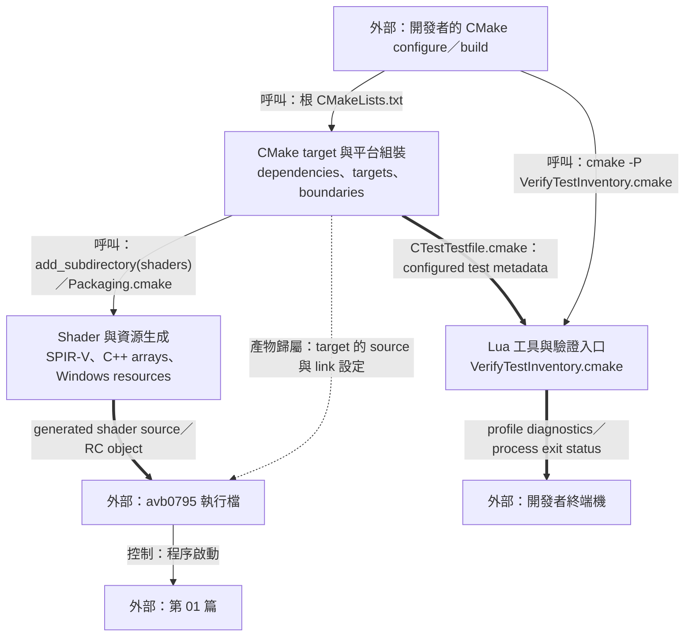
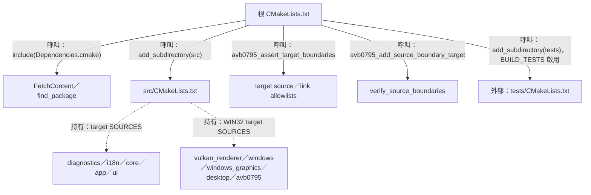
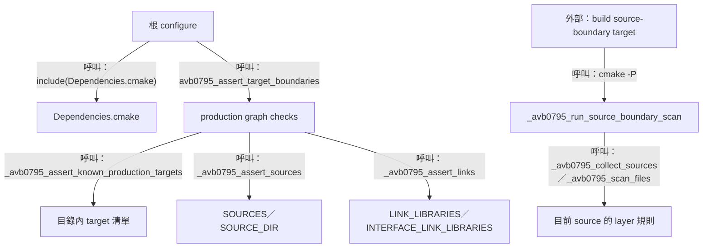
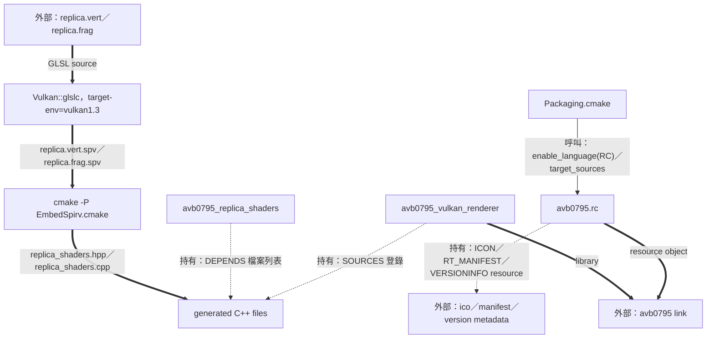
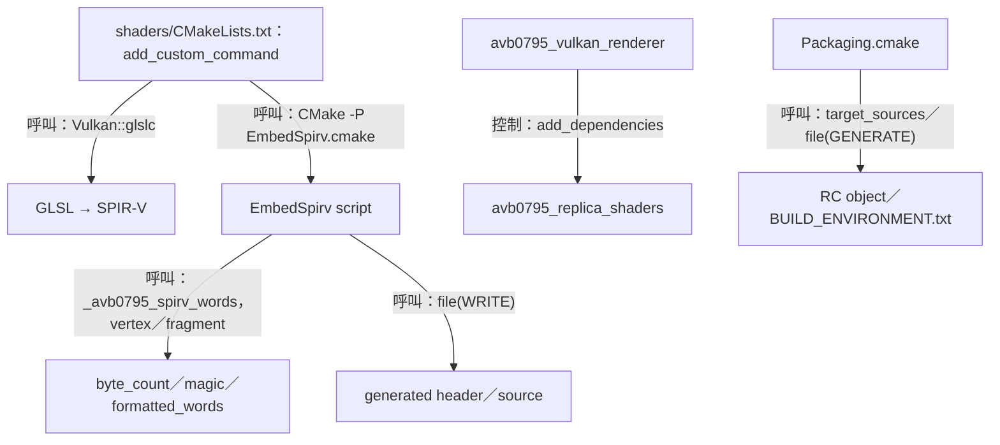
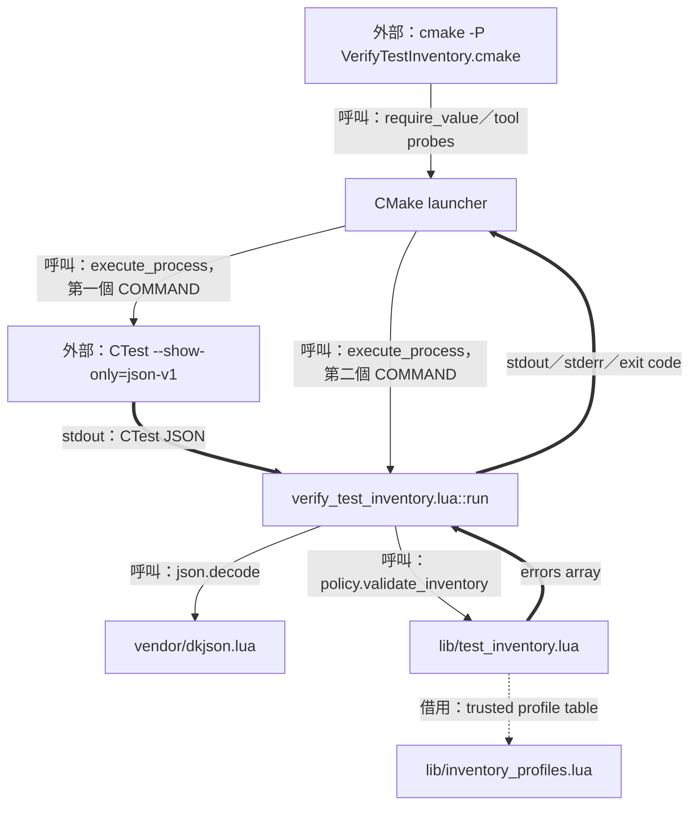
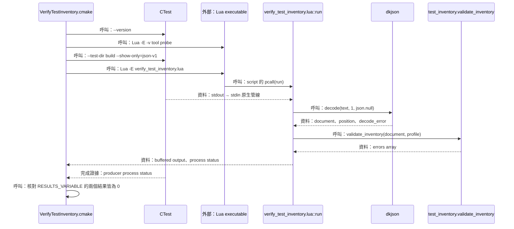

# 09 建置與工具：從來源組裝產物與驗證入口



本篇補上執行檔出現之前的流程：CMake 把來源與相依套件組成 target，shader 與 Windows 資源在 build tree 生成可連結產物，獨立的 inventory 工具則檢查指定 build tree 的測試清單。讀者可由產物名稱追到生成入口，也能辨識每項工具所提供的證據。

產物完成後由 [程序啟動](01-startup-and-preferences.md) 接手；shader 的實際取樣見 [render 與 present](05-replica-render-and-present.md)；效能 report 的 runtime 輸出見 [第 08 篇](08-recovery-and-shutdown.md)。

| 時點 | 輸入 | 產物與執行者 |
| --- | --- | --- |
| Configure | `CMakeLists.txt`、選項、toolchain、dependency sources | build graph、target properties、CTest metadata；CMake |
| Build | C++、GLSL、RC 與明確 dependencies | libraries、SPIR-V、generated C++、`avb0795`；編譯器與 linker |
| Inventory | trusted configured build tree、明確 profile | metadata 驗證結果；CTest → Lua pipeline |

圖例：實線是呼叫／控制，粗線是資料或 build artifact，虛線是 target 持有的 sources／resources 或借用的 profile。來源入口為 [根 CMakeLists.txt](../../CMakeLists.txt)、[src/CMakeLists.txt](../../src/CMakeLists.txt) 與 [VerifyTestInventory.cmake](../../cmake/VerifyTestInventory.cmake)。

## CMake target 與平台組裝

### 結構與流程圖



根檔先準備 dependency targets，再建立 production targets；target boundary 檢查位於 tests 加入之前，讓 production 的來源與 link 範圍先被確認。文字型 source scan 另有可明確執行的 target。[根 CMakeLists.txt](../../CMakeLists.txt)、[VerifySourceBoundaries.cmake](../../cmake/VerifySourceBoundaries.cmake)。

### 資料結構與使用方式

建置需要表達「哪個 target 編譯哪份來源」及「哪個 target 對消費者提供什麼依賴」。CMake 使用 target properties 保存這些關係，本 unit 以實際 properties 作為資料結構，對照 [src/CMakeLists.txt](../../src/CMakeLists.txt) 與 [boundary 檢查](../../cmake/VerifySourceBoundaries.cmake)。

| Property／變數 | 值來源 | 使用者與責任 |
| --- | --- | --- |
| `SOURCES`、`SOURCE_DIR` | `add_library`、`add_executable`、`target_sources` | `_avb0795_assert_sources` 解析絕對路徑與允許根目錄 |
| `LINK_LIBRARIES`、`INTERFACE_LINK_LIBRARIES` | `target_link_libraries` 的 `PRIVATE`／`PUBLIC` | `_avb0795_assert_links` 核對直接 link 與公開使用需求 |
| `TYPE` | library／executable／custom target 建立方式 | production known-target 檢查；packaging 核對 static GLFW／ImGui |
| `BUILDSYSTEM_TARGETS`、`SUBDIRECTORIES` | CMake directory properties | 遞迴收集第一方 production targets |
| `CMAKE_CXX_STANDARD`、`CMAKE_CXX_STANDARD_REQUIRED`、`CMAKE_CXX_EXTENSIONS` | 根檔設為 23、ON、OFF | 統一 C++ 語言需求 |
| `AVB0795_BUILD_TESTS`、`AVB0795_ENABLE_WINDOWS_INTEGRATION` | 根 options，預設 ON／OFF | tests targets 與 Windows hardware cases 的組裝條件 |

`PUBLIC` 連結同時服務 target 本身與使用它的 targets；`PRIVATE` 描述該 target 的實作依賴。boundary 檢查把 `LINK_ONLY`／`BUILD_INTERFACE` 形式正規化後，套入明確 allowlist。[target_link_libraries 使用處](../../src/CMakeLists.txt)、[_avb0795_normalize_link](../../cmake/VerifySourceBoundaries.cmake)。

使用示例：在專案 CMake configure scope 中，下面的 target property 讀取取得 `avb0795_app` 的直接依賴清單；相同 property 由 `_avb0795_assert_links` 消費。[avb0795_app](../../src/CMakeLists.txt)、[_avb0795_assert_links](../../cmake/VerifySourceBoundaries.cmake)。

```cmake
get_target_property(app_links avb0795_app LINK_LIBRARIES)
get_target_property(app_interface avb0795_app INTERFACE_LINK_LIBRARIES)
```

實際 app 連結把 `avb0795_core`、`avb0795_i18n` 設為 `PUBLIC`，把 `nlohmann_json::nlohmann_json` 設為 `PRIVATE`。UI target 消費 commands／view-state 宣告與 core／i18n／ImGui；application owner 的執行流程由 executable 與 desktop 組裝。[src/CMakeLists.txt](../../src/CMakeLists.txt)。

#### Production target 的來源責任

| Target | Sources 責任 | 主要 link 對象 |
| --- | --- | --- |
| `avb0795_diagnostics` | performance report | nlohmann/json |
| `avb0795_i18n` | catalog、language policy | 自有 portable sources |
| `avb0795_core` | domain values、session、scheduler、hotkey | 自有 portable sources |
| `avb0795_app` | command queue、application、config、view projection | core、i18n、JSON |
| `avb0795_ui` | controller view、language selector | core、i18n、ImGui |
| `avb0795_vulkan_renderer` | render sources、generated shaders | core、Vulkan、diagnostics、GLFW |
| `avb0795_windows` | capture／system adapters、browser helper | core、app、i18n、Win32／D3 libraries |
| `avb0795_windows_graphics` | bridge、render stack、overlay、runtime／factory | Windows、renderer、core／app、graphics libraries |
| `avb0795_desktop` | controller host、ImGui GLFW／Vulkan backends | app、ui、diagnostics、renderer、GLFW／Vulkan／ImGui |
| `avb0795` | `main.cpp` 與 Windows resource | app、desktop、Windows aggregates、diagnostics |

表中 graphics／Windows／desktop／product targets 由 `WIN32` 分支建立。CMake target 表達編譯與 link 責任；controller 與 replica 的 runtime graphics resources 由各自的 owner 管理。[src/CMakeLists.txt](../../src/CMakeLists.txt)、[controller graphics](07-controller-loop-and-projection.md)、[replica graphics](05-replica-render-and-present.md)。

### 實作流程



節錄 [根 CMakeLists.txt](../../CMakeLists.txt) 的順序：

```cmake
include(cmake/Dependencies.cmake)
include(cmake/VerifySourceBoundaries.cmake)
# ...
add_subdirectory(src)
# ...
avb0795_assert_target_boundaries()
avb0795_add_source_boundary_target()

if(AVB0795_BUILD_TESTS)
  enable_testing()
  add_subdirectory(tests)
endif()
```

configure 期間的 graph checks 核對明確 sources 與 links；獨立 scan 則讀取當前 production source，連同 comments 與條件編譯分支的文字一起套用規則。[VerifySourceBoundaries.cmake](../../cmake/VerifySourceBoundaries.cmake)。

節錄 [_avb0795_assert_links](../../cmake/VerifySourceBoundaries.cmake)：

```cmake
foreach(property LINK_LIBRARIES INTERFACE_LINK_LIBRARIES)
  get_target_property(links "${target}" "${property}")
  # ...
  foreach(link IN LISTS links)
    _avb0795_normalize_link(normalized "${link}")
    if(normalized IN_LIST allowed)
      continue()
    endif()
    _avb0795_boundary_failure(
      "${target} has disallowed direct link '${normalized}' in ${property}")
  endforeach()
endforeach()
```

#### 固定 dependency inputs

`Dependencies.cmake` 固定 JSON 3.12.0、Dear ImGui 1.92.9、GLFW 3.4 與 test dependency Catch2 3.8.1，archive 以 `URL_HASH SHA256` 約束。Windows 路徑使用 `find_package(Vulkan 1.3 REQUIRED COMPONENTS glslc)`，取得 linker 與 shader compiler 的 imported targets。[Dependencies.cmake](../../cmake/Dependencies.cmake)。

ImGui widgets patch 服務 active temp input；Windows 額外套用 Vulkan safe-failure patch；GLFW 套用 Win32 class-style patch。套件準備後，ImGui 改動檔案與 GLFW patched source 再做 hash 驗證，因此 local source override 也接受相同輸入核對。[Dependencies.cmake](../../cmake/Dependencies.cmake)、[avb0795_verify_glfw_patch](../../cmake/VerifyGlfwPatch.cmake)。

#### Preset 的具體用途

現有 `windows-clangd` configure preset 使用 Ninja、`clang-cl`、Release 與 `build/clangd`，產出 compilation database；`clangd-generated` build preset 的 targets 為 `avb0795_replica_shaders`。這組 preset 服務編輯器可見的 generated declarations。[CMakePresets.json](../../CMakePresets.json)。

使用示例：在具備 x64 VS developer shell、LLVM、Ninja 與 Vulkan SDK 的環境執行該 preset，其目標與路徑由 preset 原值決定。

```powershell
cmake --preset windows-clangd
cmake --build --preset clangd-generated
```

## Shader 與資源生成

### 結構與流程圖



shader 先轉成 SPIR-V bytes，再轉成 C++ static arrays。renderer 編譯 generated source 並從函式取得 span。Windows resource 走 RC 編譯管線，把 icon、manifest 與 version 資訊加入 executable。[shaders/CMakeLists.txt](../../shaders/CMakeLists.txt)、[EmbedSpirv.cmake](../../cmake/EmbedSpirv.cmake)、[Packaging.cmake](../../cmake/Packaging.cmake)。

### 資料結構與使用方式

產物需要可由 build graph 追蹤的檔名與依賴。shader CMake 把 directory、SPIR-V、header 與 source 分別保存在變數中，再用 `OUTPUT`／`DEPENDS` 建立生成關係；renderer 透過 `PARENT_SCOPE` 取得輸出路徑。[shader CMake variables](../../shaders/CMakeLists.txt)。

| 變數／Property | 實際值或意義 | 使用者 |
| --- | --- | --- |
| `avb0795_spirv_directory` | `${PROJECT_BINARY_DIR}/generated/spirv` | glslc output directory |
| `avb0795_generated_render_directory` | `${PROJECT_BINARY_DIR}/generated/avb/render` | generated C++ directory |
| `avb0795_replica_vertex_spirv`、`avb0795_replica_fragment_spirv` | `replica.vert.spv`、`replica.frag.spv` 的絕對 build 路徑 | EmbedSpirv 輸入 |
| `avb0795_replica_shader_header`、`avb0795_replica_shader_source` | `replica_shaders.hpp`、`replica_shaders.cpp` | custom target 與 renderer |
| `AVB0795_REPLICA_SHADER_HEADER`、`AVB0795_REPLICA_SHADER_SOURCE` | 輸出至 parent configure scope | `src/CMakeLists.txt` |
| RC source `OBJECT_DEPENDS` | icon 與 manifest 的完整路徑清單 | resource 重建依賴 |

`EmbedSpirv.cmake` 的 public script inputs 為 `AVB0795_VERTEX_SPIRV`、`AVB0795_FRAGMENT_SPIRV`、`AVB0795_OUTPUT_HEADER`、`AVB0795_OUTPUT_SOURCE`。內部 `_avb0795_spirv_words` 使用 `PARENT_SCOPE` 回傳 words 與 count。[EmbedSpirv.cmake](../../cmake/EmbedSpirv.cmake)。

使用示例：在 renderer source 語境中取得由 build 生成的 immutable shader words；這些 `span` 借用 generated static arrays，生命週期涵蓋程序執行。[generated API 模板](../../cmake/EmbedSpirv.cmake)。

```cpp
#include "avb/render/replica_shaders.hpp"

const auto vertex_words = avb::render::replica_vertex_shader();
const auto fragment_words = avb::render::replica_fragment_shader();
```

renderer 以 span 的 `size_bytes()` 與 `data()` 填入 `VkShaderModuleCreateInfo`；shader 模組建立後參與 graphics pipeline，位元組來自 executable 中的 arrays。[VulkanRenderer::Impl::create_swapchain_render_resources](../../render/vulkan_wsi.cpp)。

#### SPIR-V word 與 endian

SPIR-V 輸入先檢查檔案大小為四的倍數、至少一個 word，並核對 little-endian magic bytes `03 02 23 07`。`_avb0795_spirv_words` 將每四個 bytes 反序拼成 C++ 32-bit 十六進位常值；上述 magic 成為 `0x07230203u`。[_avb0795_spirv_words](../../cmake/EmbedSpirv.cmake)。

這個步驟提供指定 byte layout 的證據，GLSL 編譯由 `Vulkan::glslc` 負責；renderer 與 shader 的欄位／取樣契約由 [第 05 篇](05-replica-render-and-present.md) 對照。

### 實作流程



`add_custom_command` 把 compiler 本身與 shader source 列為 dependency，embedding 再依賴兩個 `.spv` 與 CMake script。`avb0795_replica_shaders` 為 header 與 source 的共同生成入口。[shaders/CMakeLists.txt](../../shaders/CMakeLists.txt)。

節錄該檔的 vertex compilation command：

```cmake
add_custom_command(
  OUTPUT "${avb0795_replica_vertex_spirv}"
  COMMAND "${CMAKE_COMMAND}" -E make_directory "${avb0795_spirv_directory}"
  COMMAND Vulkan::glslc
    --target-env=vulkan1.3
    -fshader-stage=vert
    -o "${avb0795_replica_vertex_spirv}"
    "${CMAKE_CURRENT_SOURCE_DIR}/replica.vert"
  DEPENDS
    "${CMAKE_CURRENT_SOURCE_DIR}/replica.vert"
    Vulkan::glslc
  # ...
)
```

節錄 [_avb0795_spirv_words](../../cmake/EmbedSpirv.cmake) 的 word 組裝與回傳：

```cmake
list(APPEND words "0x${byte_3}${byte_2}${byte_1}${byte_0}u")
# ...
string(JOIN ",\n        " formatted_words ${words})
set(${output_words} "${formatted_words}" PARENT_SCOPE)
set(${output_count} "${word_count}" PARENT_SCOPE)
```

generated source 使用 `constexpr std::array<std::uint32_t, count>` 擁有資料，兩個函式返回 `std::span<const std::uint32_t>`。target 的 generated include directory 為 `${PROJECT_BINARY_DIR}/generated`。[EmbedSpirv generated source 模板](../../cmake/EmbedSpirv.cmake)、[renderer include directories](../../src/CMakeLists.txt)。

#### Windows resource 與 package metadata

`Packaging.cmake` 啟用 RC，將 `avb0795.rc` 加入 product target；該 script 以 `GLFW_ICON` 提供 icon、resource 1 提供 manifest，並保存 1.0.0.0 的 `VERSIONINFO`。MSVC 相容 linker 參數使用 `/MANIFEST:NO`，讓 RC resource 1 承擔 manifest 的來源責任。[Packaging.cmake](../../cmake/Packaging.cmake)、[avb0795.rc](../../resources/windows/avb0795.rc)。

`file(GENERATE)` 依 configuration 產生 `package/$<CONFIG>/BUILD_ENVIRONMENT.txt`，記錄 generator、compiler、Windows SDK、CMake 與 Vulkan headers 等 configure 證據。`install` 納入 executable 與 release／third-party 資料，CPack 設定 `ZIP` 及 `SHA256`；archive 的產生由明確的 packaging 呼叫推進。[Packaging.cmake](../../cmake/Packaging.cmake)。

## Lua 工具與驗證入口

### 結構與流程圖



public 入口由 CMake 管理 native paths、工具選擇與兩個 process 的管線；Lua 管理 JSON 解碼、profile 與 schema 規則。launcher 同時核對 CTest 和 Lua 的退出結果，再輸出成功訊息。[VerifyTestInventory.cmake](../../cmake/VerifyTestInventory.cmake)、[verify_test_inventory.lua](../../tools/verify_test_inventory.lua)。

### 資料結構與使用方式

測試清單需要確認 case IDs、labels 與 command metadata 符合預期。工具以 trusted Lua profile 固定期望集合，再檢查由 decoder 保留 object／array 身分的 CTest document。[inventory_profiles.lua](../../tools/lib/inventory_profiles.lua)、[test_inventory.lua](../../tools/lib/test_inventory.lua)。

| Table／責任 | Members | 來源與使用者 |
| --- | --- | --- |
| Profile table | `name`、`ids`、`hardware`、`required_label` | 本地 module 定義；validator 同步借用 |
| CTest document | `kind`、`version`、`tests` | `json.decode` 結果；`kind='ctestInfo'` |
| `version` object | `major`、`minor` | major=1，minor 為非負整數 |
| Test object | `name`、`command`、`properties` | case name、非空參數陣列與 properties 陣列 |
| LABELS property | `name`、`value` | `name='LABELS'`，`value` 為 label 陣列 |
| Decoder metatable | `__jsontype` | 保留 `'object'`／`'array'`，包括空容器 |
| Validator result | `errors[1..n]` | 新建、按 input 與 profile 順序排列的 diagnostics |

此處的 JSON command entries 是 metadata；inventory 的成功證據為清單契約通過。測試程式的執行結果由後續 CTest test run 提供。[validate_command／validate_inventory](../../tools/lib/test_inventory.lua)、[tests/CMakeLists.txt](../../tests/CMakeLists.txt)。

| Profile | `ids` | `hardware` | 使用情境 |
| --- | --- | --- | --- |
| `windows-v1-full` | 1–15 | 13、14、15 | 預設完整 Windows 清單 |
| `windows-policy` | 1–12 | 空陣列 | Windows policy 範圍 |
| `portable-core` | 1、2、3、4、5、7 | 空陣列 | portable targets 範圍 |

三者的 `required_label` 均為 `avb0795-v1`。profile 選擇由明確的 `INVENTORY_PROFILE`／`--profile` 值決定。[inventory_profiles.lua](../../tools/lib/inventory_profiles.lua)。

使用示例：在 tools module scope 中，`document` 已由本地 dkjson 成功解碼並保留 container tags；下面呼叫借用 `windows-policy` 的規則表。[profiles 與 validate_inventory](../../tools/lib/test_inventory.lua)。

```lua
local profiles = require('inventory_profiles')
local policy = require('test_inventory')
local profile = profiles['windows-policy']
local errors = policy.validate_inventory(document, profile)
```

`validate_inventory` 讀取兩份 inputs，回傳新的 errors table。個別 test 的錯誤先按輸入順序收集，缺少的 IDs 再按 `profile.ids` 順序追加；診斷順序因此可重現。[policy.validate_inventory](../../tools/lib/test_inventory.lua)。

#### Launcher 的原生工具條件

| CMake 變數 | 用途與有效值 |
| --- | --- |
| `BUILD_DIRECTORY` | 包含 `CTestTestfile.cmake` 的 trusted configured build tree；轉成 real path |
| `CONFIGURATION` | 選用，轉成 CTest `-C` 參數 |
| `INVENTORY_PROFILE` | 選用，轉成 Lua `--profile`；預設 full |
| `LUA_EXECUTABLE` | 選用，絕對 native executable；或 PATH 首個 Lua 候選 |
| `CTEST_EXECUTABLE` | 選用，絕對 native executable；或 CMake 同目錄 CTest，再採 PATH |

launcher 探測 CTest 3.28+ 與 stock PUC Lua 5.4.x／5.5.x，Windows 工具後綴為 `.exe`／`.com`。單次 version probe 期限 5 秒，整條 inventory pipeline 期限 30 秒。trusted build tree 的前提涵蓋 CTest discovery 對其 metadata 的解讀。[VerifyTestInventory.cmake](../../cmake/VerifyTestInventory.cmake)。

### 實作流程



使用示例：已有 `build/windows-policy` 的 Release configured build tree，且 Lua／CTest 符合上述 probes 時，由 public launcher 檢查 Windows policy 清單。[VerifyTestInventory.cmake](../../cmake/VerifyTestInventory.cmake)。

```powershell
cmake -DBUILD_DIRECTORY=build/windows-policy -DCONFIGURATION=Release -DINVENTORY_PROFILE=windows-policy -P cmake/VerifyTestInventory.cmake
```

節錄 [VerifyTestInventory.cmake](../../cmake/VerifyTestInventory.cmake) 的原生 pipeline：

```cmake
execute_process(
  COMMAND "${_ctest}" --test-dir "${_build}" --show-only=json-v1 ${_configuration_args}
  COMMAND "${_lua}" -E verify_test_inventory.lua ${_profile_args}
  WORKING_DIRECTORY "${_tools}" TIMEOUT 30 RESULTS_VARIABLE _results
  OUTPUT_VARIABLE _success ERROR_VARIABLE _failure ENCODING UTF-8 COMMAND_ECHO NONE)
if(NOT "${_results}" STREQUAL "0;0")
  # ...
endif()
```

`run` 固定 `package.path='./lib/?.lua;./vendor/?.lua'` 與空的 `package.cpath`，讀取上限為 Lua 收到文字的 4 MiB。`pcall(json.decode, text, 1, json.null)` 保存 JSON null 與容器 tags，接著核對 decoder position 及其後的 whitespace。[verify_test_inventory.lua::run](../../tools/verify_test_inventory.lua)。

節錄 [policy.validate_inventory](../../tools/lib/test_inventory.lua) 的 envelope 檢查：

```lua
local version = document.version
local envelope_valid = document.kind == 'ctestInfo'
  and has_json_type(version, 'object')
  and version.major == 1
  and type(version.minor) == 'number'
  and version.minor >= 0
  and version.minor % 1 == 0
```

後續逐筆解析 `avb0795 V1 case NN: ...` 名稱、唯一 case ID、非空 command 參數與唯一 `LABELS` property。`hardware` label 依 trusted profile 的 ID 集合核對；validator 完成後，Lua exit code 0 代表該 metadata profile 通過，1 代表 input／policy 診斷，2 代表 invocation／setup／internal failure。[validate_inventory／validate_labels](../../tools/lib/test_inventory.lua)、[Lua run 與外層 pcall](../../tools/verify_test_inventory.lua)。

tests 本身透過 `catch_discover_tests(... ADD_TAGS_AS_LABELS)` 建立 CTest metadata；Windows integration targets 使用 `AVB0795_ENABLE_WINDOWS_INTEGRATION` 控制，hardware cases 配有 `SKIP_RETURN_CODE 77` 與 `TIMEOUT 90`。inventory 讀取這些已組裝的 case 資料，具體測試執行再由對應 CTest 命令完成。[tests/CMakeLists.txt](../../tests/CMakeLists.txt)。
