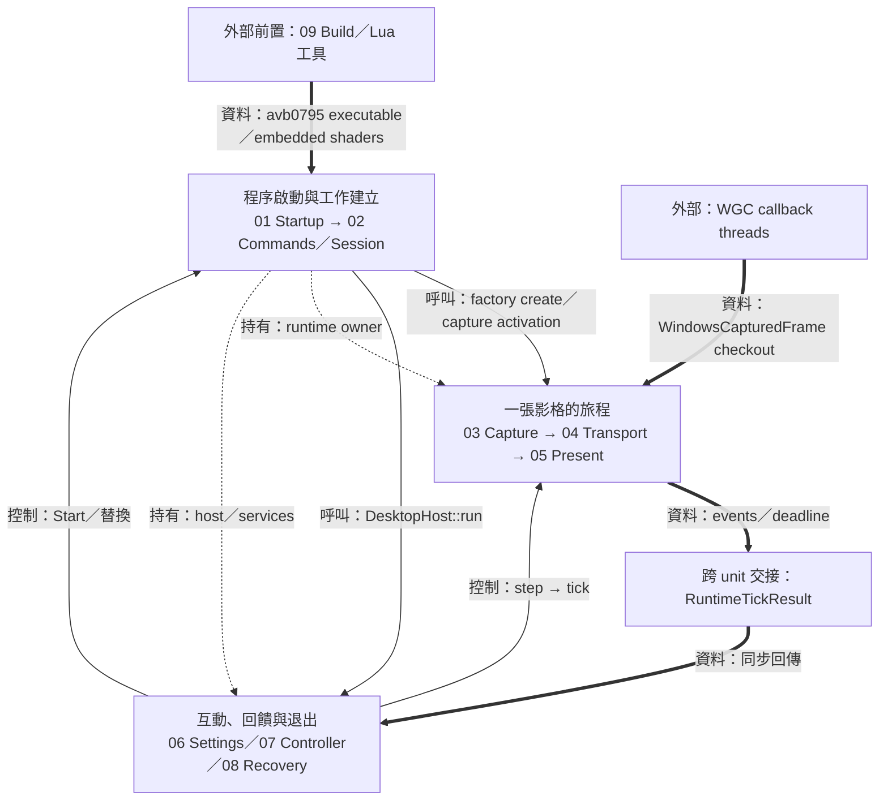
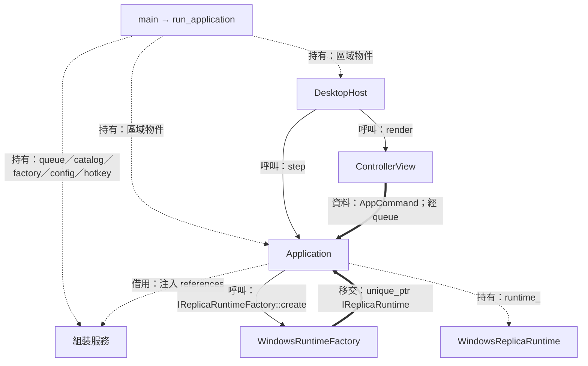
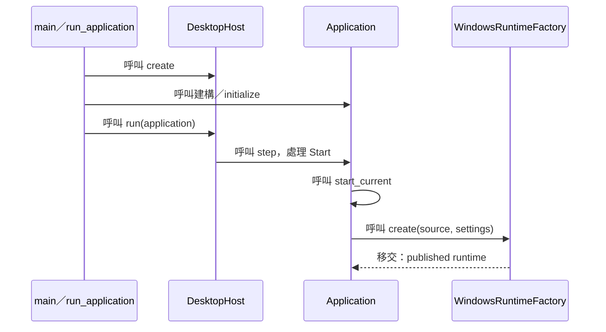
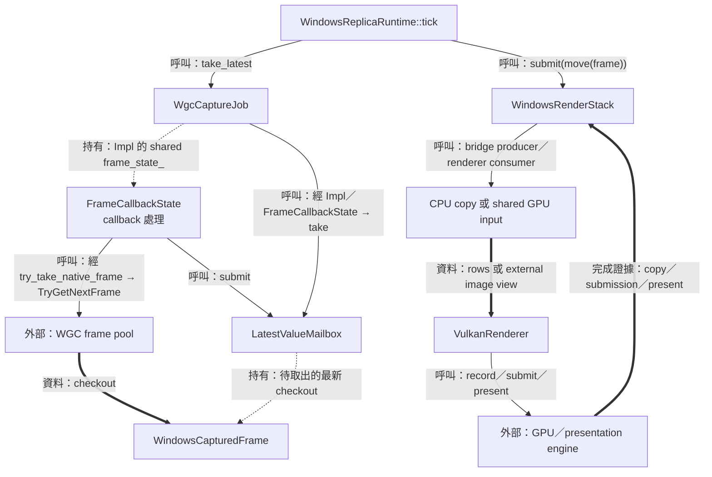
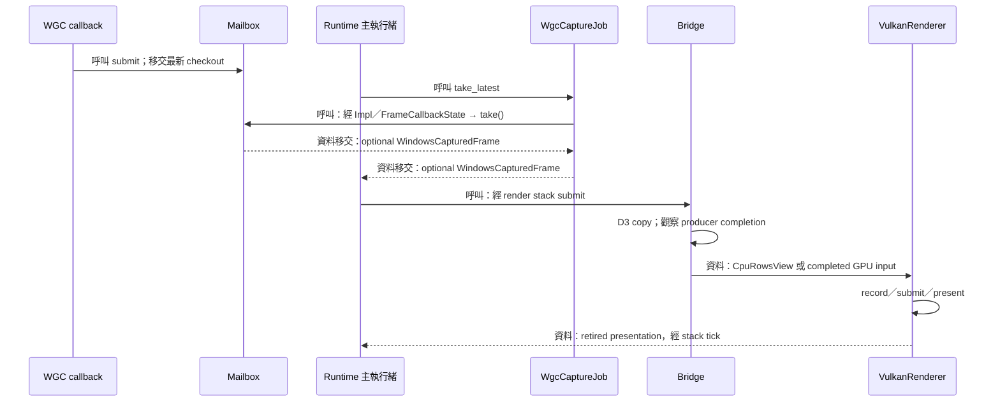
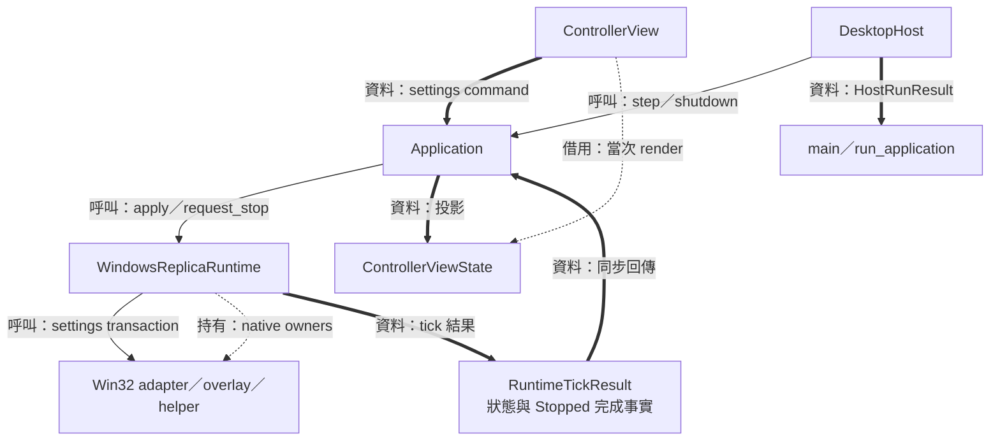
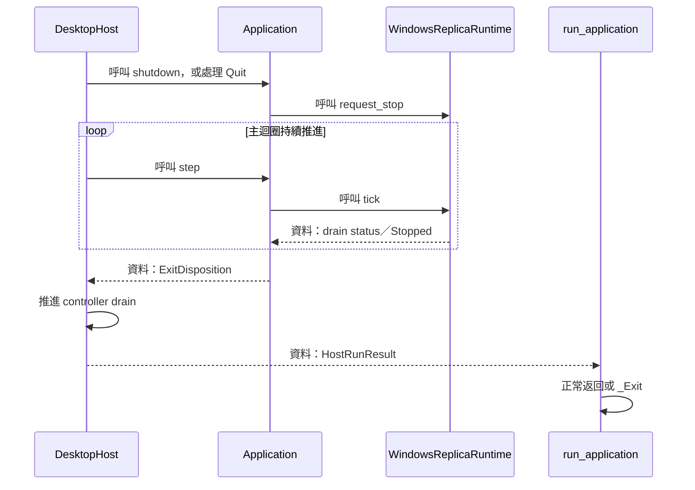

# avb0795：沿執行階段閱讀原始碼



為了理解 avb0795 如何把一個視窗或顯示器變成可操作的副本，需要把使用者意圖、來源生命週期、影格傳輸、畫面呈現與資源釋放串成同一條閱讀路線。本導讀以執行階段安排章節，每個階段再拆成三個 unit；unit 內先看結構，再看具體資料值，接著沿函式呼叫追蹤實作。

來源基準：2026-09-22 的 working tree，HEAD `a862457`，包含當前選區尺寸修正與既有工作樹實作。完整元件索引仍可由 [既有架構總覽](../architecture/README.md) 進入；本資料夾聚焦執行旅程。

| 階段 | 你會取得的理解 |
| --- | --- |
| [01：啟動與偏好](01-startup-and-preferences.md) | main、服務組裝、借用生命週期、設定／語言／快捷鍵、Controller 建立 |
| [02：命令與 Session](02-commands-and-session.md) | UI 意圖、FIFO、SessionId／SourceId、lease、factory 發布點 |
| [03：擷取與排程](03-capture-and-scheduling.md) | callback admission、checkout、mailbox、主執行緒 tick 與 deadlines |
| [04：影格 transport](04-frame-transport.md) | CPU／共享 GPU 路線、row pitch、input views、同步與移交 |
| [05：副本 render 與 present](05-replica-render-and-present.md) | slots、submission、UV／取樣數學、WSI 與 retirement |
| [06：設定與視窗互動](06-settings-and-window-interaction.md) | 設定交易、框選、比例／滾輪、原生效果與保活 owner |
| [07：Controller 迴圈與投影](07-controller-loop-and-projection.md) | runtime facts、view、UI cadence、ImGui graphics／input |
| [08：復原與退出](08-recovery-and-shutdown.md) | resize、device recovery、drain、Stopped、程序退出、效能觀察 |
| [09：建置與工具](09-build-and-tools.md) | target 關係、shader／resource 生成、Lua 與驗證入口 |

圖例：`-->` 為呼叫或控制；`==>` 為資料；`-.->` 以文字區分持有、借用與移交。Sequence diagram 的每個步驟寫出呼叫、回傳資料或完成證據。建置是前置流程，03–07 透過主迴圈反覆協作，08 是復原／退出支線。

| 執行環境 | 主要工作 | 邊界資料 |
| --- | --- | --- |
| 主執行緒 | GLFW events、Application、UI、runtime、native window 與 graphics progress | AppCommand、RuntimeTickResult、各層 deadlines |
| WGC callback threads | 接收 frame、記錄狀態、提交最新值、wake | WindowsCapturedFrame 與 capture signals |
| D3D／Vulkan GPU queues | 像素複製、上傳、取樣與 draw | texture/image、同步物件 |
| Presentation engine | 呈現 swapchain image | PresentRecord 與 present fence |

## 程序啟動與工作建立

### 結構與流程圖



為了讓 UI 操作具有集中驗證的入口，host 將命令交給 queue，Application 依序處理。為了讓平台資源具有明確的建立者，factory 組裝完整 runtime 後把 owner 交給 Application。

### 資料結構與使用方式

| 結構 | 目的與相關 members | 完整說明 |
| --- | --- | --- |
| `UserConfig` | 用 `language/hotkey/opacity_percent/wheel_zoom_percent` 等值保存一般偏好 | [01](01-startup-and-preferences.md) |
| `AppCommand` | variant 的 alternative 決定操作，`Start::session_id` 等 payload 指定目標 | [02](02-commands-and-session.md) |
| `SourceDescriptor` | `id/kind/display_label/extent` 描述目前列舉結果 | [02](02-commands-and-session.md) |
| `Application` | `runtime_` 持有 native aggregate；服務 references 建立用例邊界 | [02](02-commands-and-session.md) |

為了讓命令指向正確的 session，使用者操作需要帶上當前 view 的世代。使用示例，型別來自 [`commands.hpp`](../../include/avb/app/commands.hpp)：

```cpp
avb::app::Start example_start_intent(
    const avb::app::ControllerViewState &view)
{
    return avb::app::Start{view.session_id};
}
```

這個值交由 queue 保存。`SessionId` 的來源、SourceId 的快照世代與 native lease 的差異，在階段 02 以 registry 呼叫流程展開。

### 實作流程



節錄 [`Application::start_current`](../../src/app/application.cpp) 的發布點：

```cpp
// Application::start_current 內
auto created =
    runtime_factory_.create(*session.selected_source(), session.settings());
// ... 驗證建立結果 ...
runtime_ = std::move(*created);
reset_runtime_feedback();
stop_requested_ = false;
const auto capturing = state_.mark_capturing(session_id);
// ...
```

為了保護啟動期間的 callback，factory 先建立 source、window、adapter、graphics stack、inactive capture job 與 slots，接著建立完整 runtime 並啟動 capture。上面的 `std::move` 是 Application 接手的時點；建立細節見階段 02，後續 frame intake 見階段 03。

## 一張影格的旅程

### 結構與流程圖



這張圖的影像路線從 WGC pool 到 Vulkan 取樣。各個箭頭傳遞的對象包括原生借用、資料 view 與完成證據；每一種資料都有對應的有效期間。

### 資料結構與使用方式

為了在非同步 GPU 工作期間保留來源與目標，管線需要把像素、身分及使用中的工作分開記錄。

| 結構 | 本路徑使用的資料 | Owner／用途 |
| --- | --- | --- |
| `WindowsCapturedFrame` | checkout、generation、content／allocation、sequence | callback→mailbox→bridge producer 的移交物件 |
| `SlotKey` | `ring_serial`、`index` | 識別某次 ring 配置中的 slot reservation |
| `FrameStamp` | `sequence`、`intake_observed_at` | 保存 stack 接受的影格序號與 intake 觀察時間，跟隨 producer／renderer 工作 |
| `CpuRowsView` | borrowed bytes、row pitch 與有效尺寸 | 同步回呼期間的 CPU 複製輸入 |
| `ExternalSampledImageView` | imported Vulkan image／view 與其識別 | bridge 持有 image 資源，renderer 取得借用 registration |
| `CaptureSlot`、`PresentRecord` | submission 與 presentation records | 分別追蹤 GPU 工作及 WSI 使用的退休條件 |

使用示例：為了描述來源或目標的像素尺寸，基礎值 [`Extent`](../../include/avb/core/types.hpp) 以整數寬高表達。後續演算法會依自身前提檢查它。

```cpp
avb::core::Extent example_source_extent()
{
    return {.width = 1920, .height = 1080};
}
```

同一個 `Extent` 型別可表示來源內容、allocation 或 framebuffer；呼叫者與 member 名稱決定它的角色。階段 03/04 會說明這三種尺寸為何要各自保存。

### 實作流程



取出入口由 [`WgcCaptureJob::take_latest`](../../platform/windows/wgc_capture_job.cpp) 封裝；它經 `Impl::take_latest` 與 `FrameCallbackState::take_latest` 呼叫 [`LatestValueMailbox::take`](../../include/avb/core/latest_value_mailbox.hpp)，逐層移交 `optional<WindowsCapturedFrame>`。下方節錄 [`WindowsReplicaRuntime::tick`](../../platform/windows/windows_replica_runtime.cpp) 的移交點；原函式在這段前後驗證排程、slot、generation 與尺寸：

```cpp
// WindowsReplicaRuntime::tick 內
if (auto frame = capture_job_->take_latest()) {
    // ...
    render_stack_->submit(std::move(*frame));
    // ...
}
// ...
```

#### 三個完成時點

為了知道何時可以釋放原生物件，需要分辨三份證據：

1. D3 copy completion：producer 已完成來源讀取，可交還 WGC checkout。
2. Vulkan submission completion：此次 command buffer 的 GPU 使用完成，可推進 slot／upload 資源的重用條件。
3. Presentation completion：WSI 使用的 present fence 退休，可推進 present record 與對應 swapchain 的釋放。

每個完成時點解除各自對應的持有關係。階段 04 展開 producer 與 transport，階段 05 展開 submission／present 及實際 UV、雙線性取樣算法。

## 互動、回饋與退出

### 結構與流程圖



為了讓 crop、透明度與視窗模式保持一致，Application 把接受設定的時點接到 runtime transaction 的成功結果。為了安全退出，Application 持續推進 runtime drain，host 再整合 controller 自己的圖形退休結果。

### 資料結構與使用方式

| 結構 | 本路徑的 members／含義 | 詳解 |
| --- | --- | --- |
| `ReplicaSettings` | mode、border、opacity、region、selecting、wheel step；設定交易的候選值 | [06](06-settings-and-window-interaction.md) |
| `OverlayClientGeometry` | `client_screen_rect` 保存原生 client 的螢幕像素快照 | [06](06-settings-and-window-interaction.md) |
| `RuntimeTickResult` | `events/next_wake` 回報 native facts 與排程 | [07](07-controller-loop-and-projection.md) |
| `HostRunResult` | `exit_code/abandon_process` 同時表達退出結果與析構路徑 | [08](08-recovery-and-shutdown.md) |

使用示例：[`PixelRegion`](../../include/avb/core/types.hpp) 以來源左上角為原點，`width/height` 是像素數；此例對應來源中的 400×200 區塊。

```cpp
avb::core::PixelRegion example_crop()
{
    return {.x = 100, .y = 50, .width = 400, .height = 200};
}
```

正式 `SetRegion` 命令還帶 session 與 source ID，並用當前呈現內容尺寸驗證。Source pixels 到 viewport 的映射在階段 05，實際框選與 window fit 在階段 06。

### 實作流程



節錄 [`Application::shutdown`](../../src/app/application.cpp)：

```cpp
void Application::shutdown() noexcept
{
    begin_shutdown(Clock::now());
}
```

這個入口啟動退出協定；後續主迴圈負責觀察已開始的清理工作。`Stopped` 證明 published runtime 的資源已安全釋放。若進入需要保留 native owners 的 `AbandonProcess`，host 將此事實交回入口，程序級退出承接最終清理。兩種路徑都在階段 08 配合實際 owner 順序展開。
