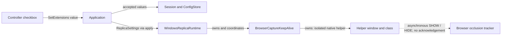
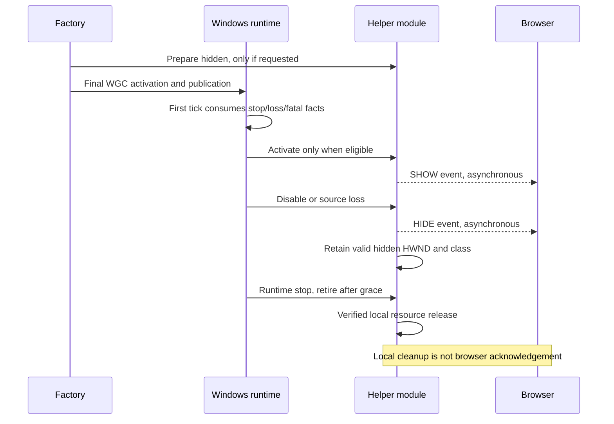

# Browser Capture Keep-Alive Implementation Plan

> **For agentic workers:** REQUIRED SUB-SKILL: Use superpowers:subagent-driven-development (recommended) or superpowers:executing-plans to implement this plan task-by-task. Steps use checkbox (`- [ ]`) syntax for tracking.

**Goal:** Add a default-off experimental controller option that attempts to keep a fully covered, non-minimized browser window rendering without changing browser settings.

**Architecture:** Carry a grouped portable preference through the existing command, session, config, and `IReplicaRuntime::apply` path. One Windows-runtime-owned feature module owns the helper window, browser-specific constants, local transactions, and delayed retirement. UI, desktop host, capture callbacks, and renderer never depend on that module.

**Tech Stack:** C++23, Win32, existing CMake/Ninja/clang-cl toolchain, Dear ImGui, nlohmann JSON, Catch2/CTest.

---

Date: 2026-09-07
Status: Tasks 1-6 implemented using subagent-driven development and passed independent per-task spec-compliance and code-quality reviews. Task 4's confirmed Medium was corrected and fresh re-review is clear. A fresh final cross-task reviewer reported Critical 0 / High 0 / Medium 0 / Low 0. An authorized Chrome mechanism experiment observed the intended OFF/ON/OFF effect and checked helper release; full Application/UI/runtime acceptance remains incomplete. See the uncommitted verification record.

## Authority and scope

- Implement the approved [feature spec](../specs/2026-09-07-browser-capture-keep-alive-design.md). Consult the [V1 design](../specs/2026-08-24-airelinna-design.md) for existing ownership rules, not for new feature scope.
- This is a built-in experiment, not a dynamic plugin system or a new capture pipeline. No browser injection, browser installation, launch flags, registry/profile edits, service, or browser restart.
- Do not change capture exclusion, source identity, WGC frame ownership, bridge, renderer, or release/package behavior.
- Do not commit or push as part of this plan. Tests, this plan, specs, `other-issue.md`, and verification records remain uncommitted. Later explicit commit permission requires a new staged-path audit; do not use `git add .`.
- Preserve pre-existing edits, especially the root `CMakeLists.txt` packaging changes. Add the feature source to `src/CMakeLists.txt`; no root CMake or preset change is needed.
- This plan does not grant permission to capture arbitrary browser windows. The initial real-browser experiment remains limited to the user's explicitly selected Chrome video window. Firefox, Brave, and Edge get separate opt-in acceptance runs only after the user identifies/authorizes their test windows.
- Do not mark a checkbox, successful Win32 call, passing policy test, or build as proof that a browser resumed rendering or consumed HIDE.

## File ownership map

| Files | Responsibility / planned change |
| --- | --- |
| `include/airelinna/core/types.hpp` | Add `ExtensionSettings`; append it to `ReplicaSettings`; add one portable capability flag. |
| `include/airelinna/core/replica_session.hpp`, `src/core/replica_session.cpp` | Store accepted extension preferences, without side effects. |
| `include/airelinna/core/application_state.hpp`, `src/core/application_state.cpp` | Generation-checked forwarding for the new value. |
| `include/airelinna/app/config_store.hpp`, `src/app/config_store.cpp` | Optional strict V1 `extensions` object; old documents retain their existing preferences. |
| `include/airelinna/app/commands.hpp`, `include/airelinna/app/application.hpp`, `src/app/application.cpp` | Typed command, capability/admission validation, transactional apply, persistence, initialization/replacement propagation. |
| `include/airelinna/app/controller_view_state.hpp`, `src/app/controller_view_state.cpp` | Project command availability and window-only scope text. |
| `src/ui/controller_view.cpp` | Checkbox and English help; emit values only. |
| `main.cpp` | Set the Windows capability in the existing composition constant; no feature calls/includes. |
| **New:** `platform/windows/features/browser_capture_keep_alive.hpp`, `.cpp` | Concrete main-thread helper owner and Win32 operations. |
| **New:** `platform/windows/features/detail/browser_capture_keep_alive_policy.hpp` | Small feature-local timing/visibility policy and recording-operation seam; no generic extension abstraction. |
| `platform/windows/windows_replica_runtime.hpp`, `.cpp` | Own helper, join settings transaction, publish-safe activation, independent retirement, complete-stop proof. |
| `platform/windows/windows_runtime_factory.cpp` | Prepare hidden helper before final WGC activation and transfer ownership into runtime. |
| `platform/windows/detail/overlay_transactions.hpp` | Add one generic settings-operation stage, without including the feature module or its constants. |
| `src/CMakeLists.txt`, `cmake/VerifySourceBoundaries.cmake` | Register source under Windows and enforce the feature's restricted consumers. |
| `tests/app/config_store_test.cpp`, `application_contract_test.cpp`, `controller_contract_test.cpp` | Extend existing cases 04, 01, and 07. |
| `tests/windows/overlay_policy_test.cpp` | Extend existing case 11 and its `RecordingSettingsOperations`; use fake helper operations, never real browser-triggering windows. |
| `docs/architecture/application-ui.md`, `windows-runtime-overlay.md` | Update existing documentation/diagrams after implementation is verified. |
| **New at acceptance time:** `docs/verification/browser-capture-keep-alive.md` | Text-only, uncommitted experiment results and unsupported/unverified cases. |

No new application port, event variant, executable, testing framework, dependency, or plugin registry is planned. `tests/CMakeLists.txt` can stay unchanged because all automated scenarios extend current translation units.



## Baseline and safe validation commands

Run from an x64 VS developer PowerShell with LLVM, Ninja, Git, and Vulkan SDK available. Use a separate build directory; do not replace `build/clangd` or an existing runtime test build.

- [x] Record the initial worktree/index and check that a reused build directory, if any, belongs to this source tree.

```powershell
git status --short
git diff --cached --name-only
git diff -- CMakeLists.txt
Test-Path build/browser-keep-alive/CMakeCache.txt
```

If a cache exists, inspect `CMAKE_HOME_DIRECTORY`, `CMAKE_GENERATOR`, and `CMAKE_CXX_COMPILER` before using it. An incompatible cache is a reason to choose another new build directory, not to delete or overwrite it.

- [x] Configure and establish the non-hardware baseline before changing implementation files.

```powershell
cmake --preset windows-clangd -B build/browser-keep-alive -DAIRELINNA_BUILD_TESTS=ON -DAIRELINNA_ENABLE_WINDOWS_INTEGRATION=OFF
cmake --build build/browser-keep-alive --target Airelinna airelinna_core_tests airelinna_windows_policy_tests verify_source_boundaries
ctest --test-dir build/browser-keep-alive -N
ctest --test-dir build/browser-keep-alive -LE hardware --output-on-failure
```

Expected: configure/build exit 0; the current 12 non-hardware CTest cases are present and pass. Catch2 `SECTION`s do not add CTest inventory entries. Record any baseline failure separately; do not attribute it to this feature or silently weaken a gate. First configure may download the project's pinned dependencies.

`cmake/VerifyTestInventory.ps1` expects the complete 15-case inventory including hardware binaries. Do not run that full-inventory gate against this deliberately non-hardware build or claim it passed. Do not run `ctest` without the hardware exclusion against another build tree.

### Execution environment note (2026-09-07)

- The user approved continuing in the existing `p4-application-release` checkout. Initial HEAD: `bb3b4ad66eb65596bc1d9b44125433e5d7f53310`; index empty. Existing root CMake packaging changes and untracked release, resource, test, and documentation files are preserved.
- Actual dedicated build directory: `build/browser-keep-alive-vs`. Substitute it for `build/browser-keep-alive` in the task commands below. The first directory contains an interrupted compiler probe and is not reused or deleted.
- Use VS CMake `4.3.1-msvc1` and its sibling CTest from `C:/Program Files/Microsoft Visual Studio/18/Community/Common7/IDE/CommonExtensions/Microsoft/CMake/CMake/bin/`, with clang-cl `22.1.6`. Import the VS `Microsoft.VisualStudio.DevShell.dll` and call `Enter-VsDevShell` for x64; the launcher PS1 is blocked by local execution policy. No execution policy was changed.
- Sandbox Ninja compiler probing stalled; the scoped configure/build and non-hardware tests succeeded outside the sandbox. For dependency population, set only the child-process Git configuration to `core.autocrlf=false` and `core.eol=lf`. ImGui's upstream `text` attributes otherwise produce CRLF and fail the existing patched-file hash check. Only the generated ImGui backend in the dedicated build cache was normalized to LF; the patch and repository/global Git settings are unchanged.
- Baseline: `Airelinna`, `airelinna_core_tests`, `airelinna_windows_policy_tests`, and `verify_source_boundaries` built successfully. CTest discovered 12 cases and passed all 12 with `-LE hardware`; no browser/UI/hardware capture was launched.

## Task 1: Portable preference and backward-compatible persistence

**Files:** Core/settings/config files in the ownership map; `tests/app/config_store_test.cpp`.

- [x] Add three focused config scenarios to case 04: legacy document preserves nondefault values with extension off; true/false round trip has only permitted keys; malformed/extra/missing nested fields recover to complete defaults. Reuse `TemporaryDirectory`, `write_text`, `read_text`, and the existing replace function.

The legacy regression belongs inside case 04, where `config_path` already exists:

```cpp
SECTION("legacy config retains preferences with the extension disabled")
{
  const ConfigStore store{replace_file};
  REQUIRE(write_text(config_path,
    R"({"version":1,"hotkey":"Ctrl+Shift+F10","fps_cap":"144","border":"borderless"})"));
  const auto loaded = store.load(config_path);
  REQUIRE(loaded);
  CHECK(loaded->fps_cap == FpsCap::Fps144);
  CHECK(loaded->border == BorderPreference::Borderless);
  CHECK(loaded->hotkey == HotkeyChord{
    HotkeyModifiers{.control = true, .shift = true}, HotkeyKey::F10});
  CHECK_FALSE(loaded->extensions.browser_capture_keep_alive);
}
```

For malformed nested values, mutate a valid document with the short fixture set `null`, `true`, `{}`, `{"browser_capture_keep_alive":1}`, and `{"browser_capture_keep_alive":true,"source_id":"forbidden"}`. Assert complete defaults, not partial acceptance. In the existing serialized-key check, the only new top-level key is `extensions`, whose only key is `browser_capture_keep_alive`.

- [x] Build/run case 04 and record the expected red result: the new preference is missing before implementation, or schema assertions fail after the declaration is added.

```powershell
cmake --build build/browser-keep-alive --target airelinna_core_tests
ctest --test-dir build/browser-keep-alive -R '^Airelinna V1 case 04:' --output-on-failure
```

- [x] Add the portable value next to `ReplicaSettings`, append `extensions` after `fps_cap`, and append the capability after the existing capability fields. Appending preserves existing positional aggregate initializers.

```cpp
struct ExtensionSettings {
  bool browser_capture_keep_alive{};
  friend bool operator==(const ExtensionSettings &,
                         const ExtensionSettings &) = default;
};

// ReplicaSettings and app::UserConfig each gain this member:
core::ExtensionSettings extensions{}; // Use ExtensionSettings inside core.

// PlatformCapabilities gains this independent backend ability:
bool browser_capture_keep_alive{};
```

- [x] Add the two setters below, with matching declarations in their headers. No lifecycle policy, persistence, or native operation belongs in either setter.

```cpp
void ReplicaSession::set_extensions(ExtensionSettings extensions) noexcept
{
  settings_.extensions = extensions;
}

std::expected<void, AppError>
ApplicationState::set_extensions(SessionId session_id,
                                 ExtensionSettings extensions) noexcept
{
  if (auto valid = validate_session(session_id); !valid) {
    return valid;
  }
  current_session_.set_extensions(extensions);
  return {};
}
```

- [x] Replace `has_exact_keys` and add `parse_extensions` in `config_store.cpp`'s anonymous namespace. Retain current version/value validation, read-error behavior, and atomic-write implementation.

```cpp
[[nodiscard]] bool has_exact_keys(const nlohmann::json &document)
{
  if (!document.is_object()) {
    return false;
  }
  const auto expected_size = document.contains("extensions") ? 5U : 4U;
  return document.size() == expected_size && document.contains("version") &&
         document.contains("hotkey") && document.contains("fps_cap") &&
         document.contains("border");
}

[[nodiscard]] std::optional<core::ExtensionSettings>
parse_extensions(const nlohmann::json &document)
{
  if (!document.contains("extensions")) {
    return core::ExtensionSettings{};
  }
  const auto &extensions = document.at("extensions");
  if (!extensions.is_object() || extensions.size() != 1 ||
      !extensions.contains("browser_capture_keep_alive") ||
      !extensions.at("browser_capture_keep_alive").is_boolean()) {
    return std::nullopt;
  }
  return core::ExtensionSettings{
    .browser_capture_keep_alive =
      extensions.at("browser_capture_keep_alive").get<bool>()};
}
```

In `parse_config`, obtain `const auto extensions = parse_extensions(document);`, include `!extensions` in its rejection condition, and append `.extensions = *extensions` to `UserConfig`. Replace serialization with the complete five-key object:

```cpp
[[nodiscard]] nlohmann::json serialize_config(const UserConfig &config)
{
  return nlohmann::json{
    {"version", config.version},
    {"hotkey", core::serialize_hotkey_chord(config.hotkey)},
    {"fps_cap", serialize_fps_cap(config.fps_cap)},
    {"border", serialize_border(config.border)},
    {"extensions", {
      {"browser_capture_keep_alive", config.extensions.browser_capture_keep_alive}
    }}
  };
}
```

- [x] Re-run case 04 and source-boundary validation. Expected: green, default off, no source/window data serialized. Update the old parser comment: V1 now accepts the optional extension object, but old binaries are not promised to read it.

Task 1 execution: the implementer observed RED from missing `ExtensionSettings` / `UserConfig::extensions` before production changes. GREEN case 04 and boundaries passed; root independently rebuilt all production/test targets and passed all 12 non-hardware cases. Formatting and `git diff --check` passed (Git emits LF/CRLF conversion warnings). Root caught and verified a malformed-fixture initializer-list trap; scalar `json(nullptr)` / `json(true)` now exercise the intended values. Fresh spec-compliance and then fresh code-quality reviewers each reported no findings. No files were staged or committed.

## Task 2: Command, application transaction, and view policy

**Files:** Application/core forwarding files, controller view-state files, `main.cpp`, application/controller contract tests.

- [x] Extend cases 01 and 07 with four focused scenarios: idle save/initialization; accepted live apply and verified rejection; stale/stopping/unsupported admission; interrupted-session replacement preserves the accepted preference. Reuse `Harness`, `RuntimeProbe`, `RecordingFactory`, and `project`; update both `all_capabilities` fixtures explicitly.

Representative live-rejection scenario inside case 01:

```cpp
SECTION("extension apply rejection preserves accepted preference and config")
{
  Harness harness;
  auto application = harness.make_application();
  const auto probe = std::make_shared<RuntimeProbe>();
  select_and_start(harness, *application, probe, now);
  const auto session_id = application->view_state().session_id;
  const auto saves_before = harness.config.replace_count;
  probe->apply_results.push_back(std::unexpected{
    AppError{AppErrorCode::PlatformOperationFailure}});
  REQUIRE(harness.queue.push(airelinna::app::SetExtensions{
    session_id, {.browser_capture_keep_alive = true}}));
  application->step(now + 1ms);
  REQUIRE(probe->apply_count == 1);
  CHECK(probe->applied[0].extensions.browser_capture_keep_alive);
  CHECK_FALSE(application->view_state().settings.extensions.browser_capture_keep_alive);
  CHECK(harness.config.replace_count == saves_before);
  CHECK(probe->request_stop_count == 0);
  check_notice(*application, AppErrorCode::PlatformOperationFailure);
}
```

Also feed `RuntimeStateLost` through the existing error branch: no preference/save commit, Error + one stop request, runtime retained until `Stopped`. For save failure after a successful apply, preserve the newly accepted checkmark and existing dirty/notice behavior; do not roll native settings back because persistence failed.

- [x] Build/run cases 01 and 07 red, then add `SetExtensions` to `commands.hpp` and the `AppCommand` variant, and declare its `Application::handle` overload.

```cpp
struct SetExtensions {
  core::SessionId session_id;
  core::ExtensionSettings extensions;
};
```

```powershell
cmake --build build/browser-keep-alive --target airelinna_core_tests
ctest --test-dir build/browser-keep-alive -R '^Airelinna V1 case (01|07):' --output-on-failure
```

- [x] Implement the handler by following the existing `SetFps` transaction ordering. Keep `AppCommandQueue` unchanged; its FIFO already carries the variant.

```cpp
void Application::handle(const SetExtensions &command, Clock::time_point now)
{
  if (!validate_session(command.session_id) || !settings_allowed() ||
      !capabilities_.browser_capture_keep_alive) {
    reject();
    return;
  }
  auto candidate = state_.current_session().settings();
  candidate.extensions = command.extensions;
  if (!apply_settings(candidate, now)) {
    return;
  }
  const auto updated = state_.set_extensions(command.session_id,
                                              command.extensions);
  if (!updated) {
    reject(updated.error());
    return;
  }
  config_.extensions = command.extensions;
  config_dirty_ = true;
  clear_notice(NoticeOperation::Command);
  persist_config();
}
```

- [x] Seed the preference in `initialize()` and retain it in `handle_stopped()`'s replacement construction. These two insertions are required even though `PendingStart::settings` already copies the entire aggregate.

```cpp
// initialize(), alongside the existing set_fps/set_border calls:
(void) state_.set_extensions(session_id, config_.extensions);

// handle_stopped(), alongside replacement.set_fps:
replacement.set_extensions(pending.settings.extensions);
```

- [x] Add `ControlState browser_capture_keep_alive;` to `ControllerControls` and `std::string_view extensions_scope_text{"Window captures only"};` to `ControllerViewState`. Populate the control with the same lifecycle/drain precedence as other settings; allow editing the saved preference while idle, interrupted, or capturing a display. Only runtime eligibility determines whether a native helper activates.

```cpp
// Final member in build_controller_view's ControllerControls initializer:
.browser_capture_keep_alive =
  control(context, settings_allowed, capabilities.browser_capture_keep_alive),

// Final member in main.cpp's existing windows_capabilities initializer:
.browser_capture_keep_alive = true,
```

The capability means this backend implements the experiment, not that every browser supports it. Unsupported backends project a disabled checkbox; application validation rejects even a forged command. Shutdown's existing closed-command admission remains authoritative.

- [x] Re-run cases 01/07 and `verify_source_boundaries`. Expected: green; a runtime failure cannot falsely commit/persist the preference; no new port or native frontend dependency.

Task 2 execution: RED observed missing `SetExtensions` and new controller fields before production implementation. GREEN cases 01/07 (2/2), boundaries, formatting and diff checks passed. Root independently rebuilt `Airelinna`/core tests/boundaries and reran both cases. Four related application scenarios and existing controller tables cover the planned policies; root compared the untracked test files with their initial contents to confirm prior coverage was preserved. Fresh spec-compliance and subsequent fresh code-quality reviewers each reported no findings. No native helper, actual checkbox, release or Git staging/commit work was included in this task.

## Task 3: Isolated helper ownership, local transactions, and retirement policy

**Create:** The three files under `platform/windows/features/` in the ownership map.
**Modify:** `src/CMakeLists.txt`; case 11 in `tests/windows/overlay_policy_test.cpp`.

Keep this component small: one concrete owner, one feature-local policy header, and a recording implementation of the same tiny operation contract in tests. Do not create `IBrowser`, an extension manager, a Win32 mocking library, or a global callback coordinator.

- [x] Add five policy scenarios to case 11: eligibility/hidden preparation; repeat visibility transitions and rollback; live-off/source-loss retention; retirement deadlines; retained ownership after local cleanup failure. Use a fixed-size operation log and explicitly supplied `steady_clock::time_point`, without sleeping or creating a real HWND.

- [x] Define the eligibility and retirement values in the feature-local policy header. The header needs `airelinna/core/types.hpp`, `<chrono>`, `<expected>`, and `<optional>`, with the project's include guard and namespace conventions.

```cpp
namespace airelinna::platform::windows::features::detail {
  using Clock = std::chrono::steady_clock;
  inline constexpr auto helper_retirement_grace = std::chrono::milliseconds{250};

  struct HelperActivationFacts {
    bool requested{};
    bool window_capture{};
    bool published_tick_ready{};
    bool source_connected{};
    bool stopping_or_terminal{};
  };

  [[nodiscard]] constexpr bool
  helper_should_be_active(HelperActivationFacts facts) noexcept
  {
    return facts.requested && facts.window_capture &&
           facts.published_tick_ready && facts.source_connected &&
           !facts.stopping_or_terminal;
  }

  struct HelperRetirementState {
    bool ever_shown{};
    bool hidden_verified{true};
    std::optional<Clock::time_point> last_hide;
  };

  [[nodiscard]] inline std::optional<Clock::time_point>
  helper_retirement_deadline(const HelperRetirementState &state) noexcept
  {
    if (!state.ever_shown || !state.last_hide) {
      return std::nullopt;
    }
    return *state.last_hide + helper_retirement_grace;
  }

  [[nodiscard]] inline bool helper_may_retire(
    const HelperRetirementState &state, Clock::time_point now) noexcept
  {
    if (!state.hidden_verified) {
      return false;
    }
    if (!state.ever_shown) {
      return true;
    }
    const auto deadline = helper_retirement_deadline(state);
    return deadline && now >= *deadline;
  }
}
```

Do not use a missing deadline to mean safe retirement when a SHOW may have happened. Before attempting SHOW, conservatively set `ever_shown = true` and invalidate hidden proof; after a successful readback, record whether the window is visible. Here `ever_shown` includes a possibly delivered SHOW, not just confirmed visibility. After an actual HIDE, update `last_hide`; repeated hide of an already-known-hidden window does not reset it. If a failed operation makes exposure uncertain, preserve that uncertainty and re-establish hidden proof conservatively before starting a fresh grace interval.

The concrete native operation must sample `Clock::now()` **after** HIDE and successful hidden/identity readback (also after conservatively re-establishing hidden proof following uncertain exposure). Never use the caller's step/tick/settings timestamp as `last_hide`: synchronous startup or native/GPU work may already have consumed more than 250 ms. Visibility and stop-request APIs therefore take no caller timestamp; only retirement/deadline evaluation takes `now`. Recording operations use a controlled native-completion timestamp instead of reading the real clock. A stale tick time may delay retirement, but cannot shorten the interval after the actual HIDE.

Example boundary regression inside case 11 (the local namespace alias refers to the new feature policy, not the existing overlay `detail`):

```cpp
SECTION("helper retirement preserves the asynchronous hide grace")
{
  namespace feature_policy =
    airelinna::platform::windows::features::detail;
  using namespace std::chrono_literals;
  const auto step_started_at = std::chrono::steady_clock::time_point{1s};
  const auto hidden_at = step_started_at + 300ms;
  feature_policy::HelperRetirementState state{
    .ever_shown = true, .hidden_verified = true, .last_hide = hidden_at};
  CHECK_FALSE(feature_policy::helper_may_retire(state, step_started_at + 250ms));
  CHECK_FALSE(feature_policy::helper_may_retire(state, hidden_at + 249ms));
  CHECK(feature_policy::helper_may_retire(state, hidden_at + 250ms));
  state.hidden_verified = false;
  CHECK_FALSE(feature_policy::helper_may_retire(state, hidden_at + 1s));
  CHECK(feature_policy::helper_may_retire({}, hidden_at));
}
```

- [x] Run case 11 red before adding the implementation, then implement the visibility transaction as a feature-local template used by both the concrete owner and the recording operations. Its operation methods are defined in the table immediately below; no method may throw.

This transaction is for a reversible live preference change while runtime activation remains eligible. Lifecycle-forced deactivation uses the one-way operation below instead; a previous active snapshot is not permission to compensate with SHOW after a known source loss or terminal event.

```cpp
template <class Operations>
[[nodiscard]] std::expected<void, core::AppError> set_helper_active(
  Operations &operations, bool active) noexcept
{
  const auto previous = operations.observe_active();
  if (!previous) {
    return std::unexpected{previous.error()};
  }
  if (active) {
    const auto prepared = operations.prepare_hidden();
    if (!prepared) {
      return std::unexpected{prepared.error()};
    }
  }
  const auto applied = operations.write_active(active);
  if (applied && operations.matches_active(active)) {
    return {};
  }
  static_cast<void>(operations.write_active(*previous));
  const bool recovered = operations.matches_active(*previous);
  return std::unexpected{core::AppError{
    .code = recovered ? core::AppErrorCode::PlatformOperationFailure
                      : core::AppErrorCode::RuntimeStateLost}};
}
```

| Module-local operation | Concrete behavior / recording equivalent |
| --- | --- |
| `observe_active() -> expected<bool, AppError>` | No allocated helper means false. Otherwise verify owned identity and read visibility. Unreadable/invalid owned state returns `RuntimeStateLost`. Fake returns its recorded state or injected error. |
| `prepare_hidden() -> expected<void, AppError>` | Idempotently register/create/configure one hidden helper. Existing valid visible helper is not hidden by this preparation call. Fake logs creation once; failure keeps enough state for checked cleanup. |
| `write_active(bool) -> expected<void, AppError>` | Change visibility only when necessary; update retirement observations from actual transitions/readback. Sample the HIDE timestamp after verified native completion, never from a caller's tick time. False with no HWND succeeds without allocation. This primitive never performs compensation of its own; false never emits SHOW, and true is rejected once module stop is latched. Fake changes its boolean or injects a local failure and supplies its controlled native-completion timestamp. |
| `matches_active(bool) -> bool` | Verify visibility plus helper identity and owned native attributes; unverified ownership cannot pass. False may match a valid retained hidden helper or a never-created helper. |

The template is a local testing seam, not a public application interface. Add a C++23 `requires` clause that checks these four signatures if needed to keep diagnostics local; do not generalize it for unrelated native resources. Recording operations and concrete operations must run this same production transaction, not duplicate its algorithm in tests.

Use the same native operations for one small, one-way deactivation sequence. It neither prepares a helper nor restores previous visibility; unsuccessful local verification returns `RuntimeStateLost`, preserves any remaining owner, and permits only later HIDE/cleanup retries. The owner records cleanup uncertainty on this error. It must not turn a failed HIDE/readback into SHOW through an inner transaction:

```cpp
template <class Operations>
[[nodiscard]] std::expected<void, core::AppError>
deactivate_helper(Operations &operations) noexcept
{
  const auto hidden = operations.write_active(false);
  if (hidden && operations.matches_active(false)) {
    return {};
  }
  return std::unexpected{core::AppError{
    .code = core::AppErrorCode::RuntimeStateLost,
    .native_detail = hidden ? std::nullopt : hidden.error().native_detail}};
}
```

Extend the existing deactivation/rollback scenario: an active helper receives forced deactivation, HIDE takes effect, and one readback fails. Both real and recording adapters use `deactivate_helper`; assert that no subsequent operation is SHOW or preparation, the owner remains tracked, and the existing safe-stop path receives `RuntimeStateLost`. A later successful HIDE/proof can progress cleanup without reactivation. Keep a separate subcheck of reversible live-disable failure while eligible, where verified restoration to active is still allowed.

Extend the existing retirement/rollback scenarios with a delayed-operation subcheck: step starts at 1 s, an attempted SHOW fails readback, and rollback HIDE completes at 1.3 s. Record the latter timestamp in the fake operation, then request stop while already hidden. Assert no new HIDE resets it and no retirement occurs before 1.55 s. This tests the local timeline without sleep; also inspect the concrete adapter to confirm its clock sample follows the successful native readback.

- [x] Implement the concrete `features::BrowserCaptureKeepAlive` API below. Use a private `NativeOperations` adapter over the owner's fields for the preceding transaction. Declare all private Win32 ownership in this Windows-only header or its implementation; never add native handles to portable values.

```cpp
class BrowserCaptureKeepAlive final {
public:
  using Clock = std::chrono::steady_clock;

  BrowserCaptureKeepAlive() noexcept;
  ~BrowserCaptureKeepAlive() noexcept;
  BrowserCaptureKeepAlive(const BrowserCaptureKeepAlive &) = delete;
  BrowserCaptureKeepAlive &operator=(const BrowserCaptureKeepAlive &) = delete;
  BrowserCaptureKeepAlive(BrowserCaptureKeepAlive &&) = delete;
  BrowserCaptureKeepAlive &operator=(BrowserCaptureKeepAlive &&) = delete;

  [[nodiscard]] std::expected<void, core::AppError> prepare_hidden() noexcept;
  [[nodiscard]] std::expected<bool, core::AppError> snapshot_active() const noexcept;
  [[nodiscard]] std::expected<void, core::AppError>
  set_active(bool active) noexcept;
  // One-way lifecycle deactivation: never compensates with SHOW.
  [[nodiscard]] std::expected<void, core::AppError> deactivate() noexcept;
  [[nodiscard]] bool matches_active(bool active) const noexcept;
  void request_stop() noexcept;
  // True means at least one tracked native resource was retired on this call.
  [[nodiscard]] bool progress_stop(Clock::time_point now) noexcept;
  [[nodiscard]] bool cleanup_pending() const noexcept;
  [[nodiscard]] bool cleanup_uncertain() const noexcept;
  [[nodiscard]] std::optional<Clock::time_point> next_wake() const noexcept;
};
```

Owner storage consists only of creating thread/module identity, one class registration atom, one HWND, retirement state, and stopping/cleanup-uncertainty flags. Initialize thread/module identity with `GetCurrentThreadId()` / `GetModuleHandleW(nullptr)`; construction itself allocates no native helper. `set_active` delegates to the reversible transaction only while module stop is not latched. `deactivate()` delegates to the one-way sequence; `request_stop()` latches stop and calls `deactivate()`, never the reversible transaction. After stop, reject `set_active(true)` with `InvalidCommand`, route inactive requests to `deactivate()`, and keep all cleanup calls idempotent. The feature receives no source pointer or lifecycle callback: runtime selects the appropriate operation. Use `DefWindowProcW` directly: the initial experiment needs no custom WndProc, `GWLP_USERDATA`, callback back-pointer, or event hook. Do not introduce a pimpl allocation solely to conceal Windows details from another Windows file.

- [x] Implement hidden preparation with a process-local `TaskListThumbnailWnd` class and a one-pixel transparent, non-activating tool window. A second browser-recognized class is not needed as an automatic fallback. Use the exact helper class, not a suffixed name that the browser will not recognize.

The native creation block, with `instance_`, `class_atom_`, and `window_` owned by this object, is:

```cpp
constexpr wchar_t helper_class_name[] = L"TaskListThumbnailWnd";
WNDCLASSEXW window_class{};
window_class.cbSize = sizeof(window_class);
window_class.lpfnWndProc = DefWindowProcW;
window_class.hInstance = instance_;
window_class.lpszClassName = helper_class_name;
class_atom_ = RegisterClassExW(&window_class);
if (class_atom_ == 0) {
  return std::unexpected{core::AppError{
    .code = core::AppErrorCode::PlatformOperationFailure,
    .native_detail = static_cast<std::int64_t>(GetLastError())}};
}
window_ = CreateWindowExW(
  WS_EX_TOOLWINDOW | WS_EX_NOACTIVATE | WS_EX_LAYERED | WS_EX_TRANSPARENT,
  helper_class_name, L"", WS_POPUP, 0, 0, 1, 1,
  nullptr, nullptr, instance_, nullptr);
if (window_ == nullptr) {
  return std::unexpected{core::AppError{
    .code = core::AppErrorCode::PlatformOperationFailure,
    .native_detail = static_cast<std::int64_t>(GetLastError())}};
}
if (SetLayeredWindowAttributes(window_, 0, 0, LWA_ALPHA) == FALSE) {
  return std::unexpected{core::AppError{
    .code = core::AppErrorCode::PlatformOperationFailure,
    .native_detail = static_cast<std::int64_t>(GetLastError())}};
}
```

Wrap this block with owner-thread checks, idempotent already-created handling, and verified native readback. On a partial preparation failure, attempt checked cleanup of never-shown resources; if resources remain, keep their ownership recorded. Do not adopt an unrelated pre-existing class on `ERROR_CLASS_ALREADY_EXISTS`, erase the registration atom before successful unregister, or report preparation success with a partially configured helper.

Use `GetWindowThreadProcessId`, `GetClassNameW`, `GetWindowLongPtrW`, `GetLayeredWindowAttributes`, and `IsWindowVisible` for identity/style/alpha/visibility readback. A null handle is harmless only if no helper is expected. `IsWindowVisible == FALSE` alone does not distinguish a hidden valid window from an invalid handle.

Visibility transitions must not steal focus. Use checked `SetWindowPos` with `SWP_SHOWWINDOW`/`SWP_HIDEWINDOW`, `SWP_NOACTIVATE | SWP_NOMOVE | SWP_NOSIZE | SWP_NOZORDER | SWP_NOOWNERZORDER`, followed by native readback. Do not treat `ShowWindow`'s boolean as success: it reports previous visibility. Do not use `ShowWindowAsync`, a message-only window, `SetForegroundWindow`, or a busy SHOW loop. Native window visibility should generate the event; do not invent a browser acknowledgement from `NotifyWinEvent`.

- [x] Implement retirement with this feature-local operation sequence over the same owner. Its three native-operation methods are `resource_count()`, `destroy_window()`, and `unregister_class()`. Count only the class and HWND (zero to two); release methods succeed idempotently when their resource is absent, and otherwise clear its field only after verified successful release. Both real and recording operations use this production sequence; do not fake success around native destruction.

```cpp
struct HelperRetirementResult {
  bool made_progress{};
  bool ownership_uncertain{};
};

template <class Operations>
[[nodiscard]] HelperRetirementResult progress_helper_retirement(
  Operations &operations, const HelperRetirementState &state,
  Clock::time_point now) noexcept
{
  if (!helper_may_retire(state, now)) {
    return {};
  }
  const auto before = operations.resource_count();
  if (!operations.destroy_window()) {
    return {.ownership_uncertain = true};
  }
  const bool class_released = operations.unregister_class();
  return {.made_progress = operations.resource_count() < before,
          .ownership_uncertain = !class_released};
}
```

The owner calls this sequence only after stop is latched, or during checked never-shown construction unwind. A no-op result before the deadline does not clear an earlier uncertainty flag. The final empty-owner readback is required to clear it. The fake records that class unregister never precedes successful window destruction, including when unregister fails after the HWND has already retired.

| Operation / state | Required result |
| --- | --- |
| Successful live `set_active(false)` while eligible | HIDE promptly; retain valid hidden window and class; no retirement deadline scheduled until runtime stop. A failed live toggle may restore the active snapshot only while eligible. |
| Source loss / fatal / other activation-ineligible state | Use `deactivate()`; HIDE promptly without any compensating SHOW, retain valid hidden ownership, and report unverified deactivation via `RuntimeStateLost`. |
| `request_stop()` | Latch stopping even on repeated calls; suppress future SHOW, attempt HIDE immediately, and preserve any failure as cleanup uncertainty. The native HIDE path samples its own completion time. |
| Stop before any SHOW | Retire without a new grace delay; there was no browser-visible activation. |
| Stop after SHOW | Retire no earlier than the latest actual HIDE + 250 ms. Hidden since an earlier toggle uses the old deadline; do not restart it on every tick. |
| `progress_stop(now)` before deadline | No resource release and no claimed progress. |
| Deadline reached and hidden state verified | `DestroyWindow` on the creating thread; then `UnregisterClassW` with the owned registration/module. Clear each owner field only after its corresponding release succeeds. |
| Destroy/unregister failure | Keep the remaining owner; expose pending/uncertain state for the existing runtime drain policy. A retry alone is not tracked retirement. |
| Resources actually gone | `cleanup_pending() == false`; uncertainty clears only with valid local empty-owner proof. This does not assert browser recovery. |

`next_wake()` exposes the pending grace deadline only during stopping. A retained but intentionally hidden helper during normal capture is not stalled cleanup. After an expired deadline with failed cleanup, use the runtime's existing drain polling instead of returning an endlessly expired deadline. Destruction of a published, still-pending helper is a contract violation; follow the project's retained-owner/fail-fast convention, not silent leakage or premature deletion. Unpublished never-shown cleanup remains checked and must not wait for browser state.

- [x] Add `${PROJECT_SOURCE_DIR}/platform/windows/features/browser_capture_keep_alive.cpp` to the existing `airelinna_windows` source list. Existing `user32`, C++23, include roots, and Windows compile definitions are sufficient; no new library or dependency is needed.

```cmake
# Inside the existing airelinna_windows source list:
${PROJECT_SOURCE_DIR}/platform/windows/features/browser_capture_keep_alive.cpp
```

- [x] Re-run case 11 and source boundaries. Expected: tests validate local sequencing/rollback and 249/250 ms boundaries without any actual helper window or browser-global event.

```powershell
cmake --build build/browser-keep-alive --target airelinna_windows_policy_tests verify_source_boundaries
ctest --test-dir build/browser-keep-alive -R '^Airelinna V1 case 11:' --output-on-failure
```

Task 3 execution: RED failed on the missing feature policy header before implementation. GREEN concrete `Airelinna` build, case 11 (1/1), source boundaries and formatting passed; root independently repeated build and case 11. Five focused policy scenarios use shared production transactions and controlled timestamps, without HWND creation. Fresh spec-compliance and subsequent fresh quality reviews each reported zero findings at all severities. Runtime integration and real browser behavior remain unverified.

## Task 4: Wire the helper into publication, settings, and complete-stop proof

**Files:** Windows factory/runtime files, `platform/windows/detail/overlay_transactions.hpp`, and case 11.

- [x] Extend the existing transaction-stage failure table with `SettingsCall::Extensions` and add a combined helper/GPU retirement-order scenario. These are the two focused additions for this task; keep publication/source-loss/fatal variants in the eligibility scenario from Task 3.

The recording-stage addition and production algorithm addition are:

```cpp
// RecordingSettingsOperations; also add Extensions to SettingsCall:
[[nodiscard]] bool apply_extensions()
{
  return run_stage(SettingsCall::Extensions);
}

// apply_settings_transaction(), replacing the existing applied expression:
const auto applied = operations.apply_mode() && operations.apply_border() &&
                     operations.apply_geometry() &&
                     operations.apply_extensions() &&
                     operations.verify_applied();
```

Verify that a failed Extensions stage rolls back, calls `verify_rollback`, and never commits scheduler/settings. Repeat with `rollback_verifies = false` and expect `RuntimeStateLost`. The unchanged success order becomes Snapshot, Mode, Border, Geometry, Extensions, VerifyApplied, CommitScheduler. This stage has no feature include and accepts no HWND.

Within the same transaction scenario, cover an active snapshot whose source becomes sticky-closed before apply/rollback: Extensions deactivates the helper, then inject `VerifyApplied` failure. Rollback must issue no SHOW, must still attempt mode/border/geometry restoration, and must return `RuntimeStateLost` with no scheduler/settings commit because the active snapshot can no longer be safely restored. Reuse Task 3's eligibility predicate with recorded facts in the existing operations fixture; do not create a second transaction algorithm or a new test executable. Include the native runtime adapter's use of the same guard in the integration inspection.

- [x] Build/run case 11 red; then give `WindowsReplicaRuntime` an exclusive `std::unique_ptr<features::BrowserCaptureKeepAlive>` owner and a `bool helper_activation_ready_{}`. Construct a module for window captures even when the preference is off, but do not allocate its native class/window until requested. Display runtimes carry a null owner for their entire lifetime.

Forward-declare the concrete feature in the runtime header; include its definition only in runtime/factory implementations. Add the unique pointer to the constructor and move it into the member. The owner is independent of the overlay/source/GPU native dependency chain and survives overlay teardown when retirement is still pending.

Factory insertion before the current final `activate_for_publication()` call:

```cpp
std::unique_ptr<features::BrowserCaptureKeepAlive> browser_keep_alive;
if (source.kind == core::SourceKind::Window) {
  browser_keep_alive = std::make_unique<features::BrowserCaptureKeepAlive>();
  if (settings.extensions.browser_capture_keep_alive) {
    const auto prepared = browser_keep_alive->prepare_hidden();
    if (!prepared) {
      return std::unexpected{factory_error(prepared.error())};
    }
  }
}
```

Transfer `std::move(browser_keep_alive)` in the same `make_unique<WindowsReplicaRuntime>` call as the other owners. Preparation must happen before `StartCapture`; there must be no SHOW and no fallible work after a successful `activate_for_publication()`. On any unpublished failure, the module has never shown its helper and can perform checked immediate retirement. Preserve the existing `FactoryOverlayAttachmentGuard` ordering.

- [x] Expand `SettingsOperations::Snapshot` from a settings alias into settings plus observed helper activity. Snapshot native activity instead of deriving it from the preference: before the first published tick the preference can be true while the helper must still be hidden.

```cpp
struct Snapshot {
  core::ReplicaSettings settings;
  bool helper_active{};
};

[[nodiscard]] std::optional<Snapshot> snapshot() const
{
  const auto active = owner.browser_keep_alive_
    ? owner.browser_keep_alive_->snapshot_active()
    : std::expected<bool, core::AppError>{false};
  if (!active) {
    throw active.error(); // Existing transaction catch maps uncertainty to safe stop.
  }
  return Snapshot{.settings = owner.settings_, .helper_active = *active};
}
```

Add two small runtime-local queries: `helper_activation_allowed()` evaluates publication/source/terminal eligibility independently of the preference; `helper_should_activate(const core::ReplicaSettings &)` additionally checks the requested value. Use Task 3's pure predicate; do not move source inspection into the feature:

```cpp
bool WindowsReplicaRuntime::helper_activation_allowed() const noexcept
{
  return features::detail::helper_should_be_active({
    .requested = true,
    .window_capture = browser_keep_alive_ != nullptr,
    .published_tick_ready = published_ && helper_activation_ready_,
    .source_connected = source_ && !source_->is_closed() && !source_disconnected_,
    .stopping_or_terminal = stop_requested_ || stopped_ ||
                            pending_failed_event_.has_value() ||
                            pending_overlay_close_event_ ||
                            (overlay_ && overlay_->close_requested())});
}

bool WindowsReplicaRuntime::helper_should_activate(
  const core::ReplicaSettings &requested) const noexcept
{
  return requested.extensions.browser_capture_keep_alive &&
         helper_activation_allowed();
}
```

Checking the source's sticky closure here also prevents a live command processed before the next tick from reactivating a source that is already known closed. Do not use the UI-selected source to decide runtime eligibility: an interrupted runtime can coexist with a newly selected replacement descriptor.

Add the native transaction stage:

```cpp
[[nodiscard]] bool apply_extensions()
{
  if (!owner.browser_keep_alive_) {
    return true;
  }
  const auto changed = owner.helper_activation_allowed()
    ? owner.browser_keep_alive_->set_active(
        requested.extensions.browser_capture_keep_alive)
    : owner.browser_keep_alive_->deactivate();
  if (!changed && changed.error().code == core::AppErrorCode::RuntimeStateLost) {
    throw changed.error();
  }
  return changed.has_value();
}
```

In `verify_applied`, combine the existing mode/border checks with `matches_active(owner.helper_should_activate(requested))` when the module exists. In `rollback`, restore the helper before the existing mode/border/geometry, but recheck current eligibility before any restoring SHOW:

```cpp
const bool activation_allowed = owner.helper_activation_allowed();
const bool restore_helper_active = snapshot.helper_active && activation_allowed;
if (owner.browser_keep_alive_) {
  const auto helper = activation_allowed
    ? owner.browser_keep_alive_->set_active(restore_helper_active)
    : owner.browser_keep_alive_->deactivate();
  restored = helper.has_value() && restored;
}
```

Attempt each mode/border/geometry restoration even if the helper restoration failed. Change existing `snapshot.mode`/`snapshot.border` references to `snapshot.settings.mode`/`snapshot.settings.border`. In `verify_rollback`, combine all existing native geometry checks with both `(!snapshot.helper_active || owner.helper_should_activate(snapshot.settings))` and `matches_active(snapshot.helper_active)` when the module exists. If the observed snapshot was active but source/stop/fatal eligibility has been lost, keep the helper hidden and report rollback as unverified; the existing transaction maps this to `RuntimeStateLost` and safe-stop. Do not return an ordinary rejection by verifying against the substituted hidden target instead of the original snapshot. `commit_scheduler` remains the last mutation of accepted `owner.settings_`.

Rollback to inactive retains a hidden helper created during the failed transaction. That is intentional local resource retention, not a leaked active browser exception or a requirement to reproduce an absent-HWND snapshot. If the snapshot had an existing helper, retain its same owned identity. A local rollback never promises an exact browser-global state restoration.

- [x] Synchronize activation near the end of `tick`, after current source/capture/render/recovery/close facts are known and before `progress_stop`. All initial SHOW decisions therefore see stop/source-loss/fatal observations first.

```cpp
if (!stop_requested_) {
  helper_activation_ready_ = true;
  if (browser_keep_alive_) {
    const bool activation_allowed = helper_activation_allowed() &&
      !candidates.failed && !candidates.source_lost && !candidates.overlay_close;
    const auto active = activation_allowed
      ? browser_keep_alive_->set_active(
          settings_.extensions.browser_capture_keep_alive)
      : browser_keep_alive_->deactivate();
    if (!active) {
      candidates.failed = runtime_state_error(active.error().native_detail);
      pending_failed_event_ = candidates.failed;
    }
  }
}
```

An activation failure in this published phase produces `Failed{RuntimeStateLost}` and Application's existing safe-stop handling. A browser that simply does not produce new frames is not a local activation error. Suppress repeated native SHOW when already active; calling this synchronization on a normal tick is not permission to reassert a browser flag unconditionally.

For prompt source-loss/fatal deactivation, do not wait through later GPU work: after consuming a close/fatal observation at the beginning of tick, call `deactivate()` immediately and preserve an error as `candidates.failed`. Apply the same rule to source loss discovered during device recovery/reconfiguration before returning the tick. All lifecycle-ineligible apply, rollback, tick, and stop paths use one-way deactivation; none may call the reversible visibility transaction, including its internal compensation. A connected graphics-recovery episode can keep the helper; an interrupted source cannot be reactivated by an accepted preference change or a settings rollback. The runtime owns these source/terminal decisions; the module only enforces the requested native operation and its own stop latch.

- [x] In `request_stop`, immediately after latching `stop_requested_`, call the helper's `request_stop()` before source/job/GPU drain. In the tick catch firewall, begin helper stop as well so exception paths cannot leave reassertion or visibility active until a later destructor.

```cpp
// request_stop(), after stop_requested_ = true:
if (browser_keep_alive_) {
  browser_keep_alive_->request_stop();
}

// tick(), before progress_stop; runs even if render drain is unfinished:
if (stop_requested_ && browser_keep_alive_) {
  if (browser_keep_alive_->progress_stop(now)) {
    progress = render::DrainProgress::TrackedRetirement;
  }
  earlier_deadline(deadline, browser_keep_alive_->next_wake());
}
```

Include `browser_keep_alive_->cleanup_uncertain()` in aggregate uncertainty. In `progress_stop`, retire the module before evaluating the final all-empty predicate:

```cpp
if (browser_keep_alive_ && !browser_keep_alive_->cleanup_pending() &&
    !browser_keep_alive_->cleanup_uncertain()) {
  browser_keep_alive_.reset();
  progress = render::DrainProgress::ProvenSafeRelease;
}
if (!source_ && !overlay_ && !adapter_ && !render_stack_ && !capture_job_ &&
    !browser_keep_alive_) {
  stopped_ = true;
  candidates.stopped = true;
}
```

A module with retained hidden ownership during normal capture is not pending drain. A module stopping after failure is pending even if capture cleanup has already finished. Keep `cleanup_pending()`'s normal-runtime path separate from the feature's raw resource count.

Existing drain status uses real retirement/proven release, not successful polling. Preserve this distinction if a helper operation fails after another owner retired in the same tick. The eventual empty-owner observation must still clear uncertainty through the existing `ProvenSafeRelease` path; no synthetic Stopped or extra runtime event slot is needed.

- [x] Run cases 01, 11, and 12 plus source boundaries. Inspect both retirement orders: helper first/GPU pending and GPU first/helper pending; neither may release runtime early. Check stop-before-first-tick and failed factory start with the recording policy plus direct factory/tick ordering review, without claiming this is a hardware WGC failure-injection test.

```powershell
cmake --build build/browser-keep-alive --target Airelinna airelinna_core_tests airelinna_windows_policy_tests verify_source_boundaries
ctest --test-dir build/browser-keep-alive -R '^Airelinna V1 case (01|11|12):' -LE hardware --output-on-failure
```

Task 4 execution: RED exposed the missing Extensions transaction stage. GREEN build and cases 01/11/12 (3/3), boundaries and formatting passed. Root confirmed monotonic retirement timestamps, preserved Geometry plus Extensions rollback coverage, and removed a tautological test assertion. Fresh spec round 1 found one confirmed Medium: begin-reconfigure failure delayed HIDE until after GPU tick. The implementer added immediate one-way deactivation; root independently rebuilt and reran all three cases. Fresh spec round 2 and subsequent fresh code-quality review each reported zero findings. Factory/first-tick/stop proof was inspected statically, not hardware failure-injected. No native helper or browser execution.

## Task 5: Controller checkbox and English help

**Modify:** `src/ui/controller_view.cpp`, case 07 in `tests/app/controller_contract_test.cpp`.

- [x] Add two focused controller checks: extend the existing lifecycle/capability table for the new control, and extend the existing headless ImGui render/log scenario for the section/label/scope text. Reuse existing `project()` and `state_in()` helpers.

```cpp
SECTION("extension control uses capabilities and existing stop precedence")
{
  ApplicationState state;
  CHECK(project(state).controls.browser_capture_keep_alive.enabled);
  auto unsupported = all_capabilities;
  unsupported.browser_capture_keep_alive = false;
  const auto disabled = project(state, {}, unsupported);
  CHECK_FALSE(disabled.controls.browser_capture_keep_alive.enabled);
  CHECK_FALSE(disabled.controls.browser_capture_keep_alive.explanation.empty());
  const auto stopping = project(state, {}, all_capabilities,
    CaptureExclusionStatus::Excluded, {}, true, true);
  CHECK_FALSE(stopping.controls.browser_capture_keep_alive.enabled);
  CHECK(stopping.controls.browser_capture_keep_alive.explanation ==
        "The current replica is stopping.");
  CHECK(disabled.extensions_scope_text == "Window captures only");
}
```

The existing ImGui context/log test can check rendered labels without a native desktop window. Do not add a UI automation framework or brittle pixel-coordinate click tests. Actual checkbox interaction and disabled-help hovering remain explicit manual acceptance steps; do not report those as automated coverage.

- [x] Build/run case 07 red, then insert the following block before the existing Hotkey section. `Extensions` is a normal section, not a browser-specific page or plugin registry.

```cpp
ImGui::SeparatorText("Extensions");
auto extensions = state.settings.extensions;
const auto &extension_control = state.controls.browser_capture_keep_alive;
ImGui::BeginDisabled(!extension_control.enabled);
const bool extension_changed = ImGui::Checkbox(
  "Browser capture keep-alive (experimental)",
  &extensions.browser_capture_keep_alive);
ImGui::EndDisabled();
ImGui::SameLine();
ImGui::TextDisabled("(?)");
if (ImGui::IsItemHovered(ImGuiHoveredFlags_DelayShort |
                         ImGuiHoveredFlags_AllowWhenDisabled)) {
  ImGui::BeginTooltip();
  ImGui::PushTextWrapPos(ImGui::GetFontSize() * 35.0F);
  ImGui::TextUnformatted(
    "Attempts to keep covered browser windows rendering during window capture. "
    "May also affect other browser windows and increase CPU/GPU usage and power "
    "consumption. Does not change browser settings. Minimized windows, inactive "
    "tabs, protected video, and locked or sleeping displays are not guaranteed. "
    "Browser recovery after disabling is best-effort. Experimental: browser "
    "updates may break this workaround.");
  ImGui::PopTextWrapPos();
  ImGui::EndTooltip();
}
disabled_explanation(extension_control);
text(state.extensions_scope_text);
emit_if(extension_changed, command_sink,
        app::SetExtensions{state.session_id, extensions});
```

The tooltip marker is outside the checkbox's disabled block, so its explanation remains reachable during drain or on an unsupported backend. Render every frame from accepted settings; do not keep a second persistent checkbox boolean in `ControllerView`. The current frame's local edit only produces an intent, and a rejected transaction restores the displayed accepted value on the next snapshot.

- [x] Run case 07 and rebuild `Airelinna`. Expected: no UI references to helper/native types, source identity, service pointers, or frame counters; native feature calls remain below the runtime port.

```powershell
cmake --build build/browser-keep-alive --target Airelinna airelinna_core_tests verify_source_boundaries
ctest --test-dir build/browser-keep-alive -R '^Airelinna V1 case 07:' --output-on-failure
```

Task 5 execution: RED failed four added rendered-label assertions; GREEN `Airelinna`/core/boundaries and case 07 (1/1), independently repeated by root. Only controller view and its existing test were edited; headless log and existing policy tables were extended. Root full-file baseline comparison found no removed controller-test lines. Fresh spec-compliance and subsequent fresh quality reviews reported zero findings. Actual clicking and enabled/disabled hover remain manual acceptance, not automated coverage.

## Task 6: Enforce isolation, document ownership, and run non-hardware gates

**Modify:** `cmake/VerifySourceBoundaries.cmake`, `docs/architecture/application-ui.md`, `docs/architecture/windows-runtime-overlay.md`.

- [x] Add a narrow feature-consumer rule inside `_airelinna_run_source_boundary_scan()`'s existing `foreach(file IN LISTS all_files)` after it reads `contents`. Existing portable/native/link checks remain unchanged.

```cmake
file(RELATIVE_PATH feature_relative "${AIRELINNA_SOURCE_ROOT}" "${file}")
string(REPLACE "\\" "/" feature_relative "${feature_relative}")
if(NOT feature_relative MATCHES "^platform/windows/features/")
  _airelinna_assert_no_match(
    "${file}" "${contents}"
    "TaskListThumbnailWnd|MultitaskingViewFrame"
    "browser workaround constants escape their feature module")
  if(NOT feature_relative MATCHES
     "^platform/windows/windows_(replica_runtime|runtime_factory)\\.(hpp|cpp)$")
    _airelinna_assert_no_match(
      "${file}" "${contents}"
      "platform/windows/features/|(^|[^A-Za-z0-9_])BrowserCaptureKeepAlive([^A-Za-z0-9_]|$)"
      "non-runtime consumer depends on the browser helper module")
  endif()
endif()
```

This allows Windows factory/runtime ownership and internal feature files, while rejecting direct use by capture callbacks, source adapters, renderer, UI, desktop, or `main.cpp`. Tests are outside this production scan and may include the policy header. Do not weaken existing allowlists to make new code pass.

- [x] Validate the new guard with a temporary, minimal source fixture under an explicitly checked task-owned directory, not by putting illegal includes into the user's production files. Run the script against that fixture: a fake `src/ui/probe.cpp` containing the feature include must fail, while the same include under `platform/windows/windows_replica_runtime.cpp` must pass. A fake `platform/windows/wgc_capture_job.cpp` consumer must fail. Remove only the created fixture after validating its exact path, or leave it as a documented temporary artifact if cleanup is not authorized by the environment.

Fixture source content for the three allowed/forbidden consumer locations:

```cpp
#include "platform/windows/features/browser_capture_keep_alive.hpp"
```

Create a unique task-owned fixture root, then use `apply_patch` to place that one-line source in three separate child roots: `ui/src/ui/probe.cpp`, `capture/platform/windows/wgc_capture_job.cpp`, and `runtime/platform/windows/windows_replica_runtime.cpp`. The command below prints the resolved path for those edits; do not copy or rewrite repository sources to prepare fixtures.

```powershell
$featureFixture = Join-Path ([System.IO.Path]::GetTempPath()) ('airelinna-feature-boundaries-' + [guid]::NewGuid().ToString('N'))
New-Item -ItemType Directory -Path $featureFixture -ErrorAction Stop
$featureFixture = (Resolve-Path -LiteralPath $featureFixture).Path
$featureFixture
```

After the three files exist, run each fixture independently:

```powershell
cmake "-DAIRELINNA_SOURCE_ROOT=$featureFixture/ui" -P cmake/VerifySourceBoundaries.cmake
# Expected: nonzero, forbidden UI dependency.
cmake "-DAIRELINNA_SOURCE_ROOT=$featureFixture/capture" -P cmake/VerifySourceBoundaries.cmake
# Expected: nonzero, forbidden capture-to-feature dependency.
cmake "-DAIRELINNA_SOURCE_ROOT=$featureFixture/runtime" -P cmake/VerifySourceBoundaries.cmake
# Expected: zero, permitted runtime dependency.
```

These are validation commands, not recursive cleanup commands. Any later cleanup must separately verify the resolved absolute fixture directory and use native PowerShell operations end-to-end. Keep this as a small validation check, not a new testing framework.

- [x] Update application/UI documentation: optional fifth JSON key, legacy default behavior, `SetExtensions`, acceptance-before-save, and unsupported/display/idle control semantics. Update the existing runtime ownership diagram with a helper-owned branch independent of overlay/GPU teardown, and document first-tick activation plus retained hidden ownership. Preserve other diagrams and unrelated text.

Use this focused sequence diagram in the runtime document:



Document the initial implementation without an automatic reassertion hook. If taskbar/Alt+Tab acceptance later demonstrates that a reassertion mechanism is necessary, record that failure and design a bounded, module-local response before adding it. Never silently turn a first experiment into a global WinEvent listener, polling loop, or browser-state service.

- [x] Format only changed first-party C++ files with the repository `.clang-format`; do not format the entire tree or third-party patches. Then run the complete dedicated non-hardware build/test gates.

```powershell
cmake --build build/browser-keep-alive --target Airelinna airelinna_core_tests airelinna_windows_policy_tests verify_source_boundaries
ctest --test-dir build/browser-keep-alive -N
ctest --test-dir build/browser-keep-alive -LE hardware --output-on-failure
git diff --check
git diff --name-only
git diff --cached --name-only
```

Expected: 12 existing CTest cases remain discoverable and pass, all changed production code builds, source isolation passes, no new staged files. If CTest inventory differs, explain the actual inventory before claiming success. Existing unrelated worktree warnings must be separated from this feature's diff.

- [x] Review the actual diff against the spec, focusing on native ownership, no frontend bypass, local rollback verification, first-tick ordering, and every `Stopped` predicate. If the user requests rolling review during implementation, use a fresh reviewer for each round, independently verify findings, and stop/release completed reviewers with the tools actually available. Do not claim that a completed thread was deleted when no close/delete tool exists.

Task 6 execution: fixture RED accepted the previously unguarded capture consumer; GREEN rejected UI/capture consumers and accepted the runtime consumer. The explicitly validated temporary fixture was removed, and root confirmed its absence. Full dedicated build, source boundaries, inventory of 12 existing CTest cases and 12/12 non-hardware tests passed, independently repeated by root. All 25 changed first-party C++ files passed clang-format dry-run. Fresh Task 6 spec and quality reviewers each reported zero findings. A separate fresh final reviewer examined all Tasks 1-6 and reported Critical 0 / High 0 / Medium 0 / Low 0; no further changes were required. Root repeated the full build/boundaries/inventory and 12/12 non-hardware tests during this final review. Architecture links resolve and Mermaid blocks were statically checked, not visually rendered. Root independently ran the WSL Lua lint smoke and full document lint, reviewed all 300 advisory warnings against their context, and verified the actual simplified-character rule L022 gives zero warnings (L001 checks line artifacts, not simplified Chinese). Existing unrelated prose style was preserved. No native UI/browser experiment, staging, commit, push, or release operation ran.

## Task 7: Authorized browser experiment and handoff

**Create at test time:** `docs/verification/browser-capture-keep-alive.md` as a text-only uncommitted record. Do not create screenshots/video or collect browser profile contents.

Partial execution (2026-09-07): the user authorized the current Chrome YouTube source and confirmed normal launch without the previous workaround. Fresh checks identified HWND `0x22067A`, PID `31880`, Chrome `152.0.7977.82`, not minimized, with an opaque window above covering its visible bounds. A disposable native WGC probe linked the unchanged production helper because there is no existing CLI for driving the real Application checkbox/runtime by HWND. One continuous OFF/ON/OFF capture measured 1 / 777 / 6 frames over approximately 15 seconds per leg; ON regional samples changed, final OFF stopped producing frames after the first second, and helper release was confirmed. This is mechanism evidence, not completion of the planned Application/UI/runtime/renderer scenario. The checklist below remains open where that fuller acceptance is still required. Details and limitations: [verification record](../../verification/browser-capture-keep-alive.md).

- [ ] Ask the user to identify the current Chrome source before capture. Titles and HWNDs from the earlier investigation are historical and can change/recycle. Confirm a currently enumerated source, browser version, an active non-protected video tab, not minimized, and permission to run the short experiment. Do not open unrelated tabs/windows or broadly inspect command lines/profile files.
- [ ] Establish an interpretable baseline: ask/check whether the chosen browser was launched with an occlusion-disabling flag or another occlusion workaround. Do not change those settings. If the baseline is already rendering while covered, report that the workaround's effect is inconclusive rather than inventing an improvement.
- [ ] Run OFF → ON → OFF with the same selected window and video fully covered, using equal short observation intervals (start with 15 seconds per leg). Ask the user to keep playback and the active tab unchanged. Inspect video motion/non-black content and, where available, existing `WindowsReplicaRuntime::diagnostics()` captured/presented counter deltas in the debugger; do not add a frontend runtime/diagnostics pointer or a permanent telemetry subsystem.
- [ ] Verify repeated toggles, taskbar previews, Alt+Tab, input focus, no visible helper artifact/taskbar entry, and the English tooltip both enabled and disabled. A taskbar/Alt+Tab loss of effect is a failed subcheck, not a successful overall experiment. Record whether another browser window is affected; do not capture it without separate permission.
- [ ] Observe the final OFF leg while capture remains active, then stop capture and close Airelinna normally. Separately record local HWND/class retirement and whether the browser returns to its original covered-window baseline. Failed/inconclusive baseline recovery cannot be marked passed because local cleanup succeeded. Recheck ordinary capture with the option off; verify the display-ineligible path through policy tests unless the user separately authorizes a real display capture.
- [ ] Keep Firefox/Brave/Edge as untested rows until the user authorizes a matching window. Repeat the same small scenario, not a new test framework. For Edge, distinguish native window occlusion from Sleeping Tabs/efficiency/discard; do not promise inactive-tab, minimized, DRM, lock-screen, or sleeping-display support.

Record results with this compact schema; leave untouched browser rows explicitly `Not run`, not checked off:

| Browser / version | Authorized source confirmed | OFF covered baseline | ON changing video | OFF baseline recovery | Taskbar / Alt+Tab | Local retirement | Result |
| --- | --- | --- | --- | --- | --- | --- | --- |
| Chrome | Not run | Not run | Not run | Not run | Not run | Not run | Not run |
| Firefox | Not authorized for this experiment | Not run | Not run | Not run | Not run | Not run | Not run |
| Brave | Not authorized for this experiment | Not run | Not run | Not run | Not run | Not run | Not run |
| Edge | Not authorized for this experiment | Not run | Not run | Not run | Not run | Not run | Not run |

`Pass` means the particular recorded scenario succeeded on the recorded browser/build, not guaranteed future compatibility. `Fail` means a required observation was contradicted. `Inconclusive` means baseline, visibility, frame motion, or recovery could not be established. Feature remains experimental/default off regardless of one passing run.

- [ ] Hand off separately: implementation/build/policy-test status, Chrome experiment result, remaining browser acceptance, and unchanged commit/publish status. Do not run release/package/signing/publish operations.

## Test budget and spec traceability

Target **16 focused added/extended scenarios**, mostly `SECTION`s or short existing tables, not 16 new executables or 100 permutations. Existing regression coverage continues to run. Group only related transitions; a count limit is not permission to omit a proven bug regression.

| Area | Budget | Spec obligations covered | Tasks |
| --- | ---: | --- | --- |
| Config | 3 | Legacy defaults preserving other preferences; strict new schema/round trip; malformed data and existing atomic-save behavior | 1 |
| Application | 4 | Initialization/replacement; idle/live/save failure; verified rejection versus safe stop; stale/drain/unsupported admission | 2 |
| Feature policies | 5 | Hidden preparation/eligibility; reversible visibility rollback/reuse versus one-way forced deactivation; retain; latest actual HIDE grace despite a stale tick timestamp; uncertain cleanup retention | 3 |
| Runtime integration | 2 | One complete settings transaction, including eligibility loss during rollback; helper/GPU cleanup order and no premature Stopped | 4 |
| Controller | 2 | Portable capability/lifecycle projection; existing headless label rendering | 5 |
| Manual acceptance | Short shared scenario, not unit-test proliferation | Real motion and recovery, tooltip/input, Alt+Tab/taskbar interference, browser compatibility | 7 |

Automated policy tests do not prove actual Win32 event delivery, WGC frame changes, cleanup acknowledgement by a browser, or Windows focus behavior. Static factory/tick review does not substitute for a real startup failure-injection run. Report these boundaries explicitly.

## Source evidence and compatibility limits

These references explain the experiment, not a supported browser API contract:

- [Chromium 152 preview-class event handling](https://github.com/chromium/chromium/blob/152.0.7977.83/ui/aura/native_window_occlusion_tracker_win.cc#L742): class-name SHOW/HIDE behavior, asynchronous handling, and a DESTROY branch that does not reset the preview boolean. Real taskbar HIDE can interfere, and the effect is not limited to Airelinna's selected source.
- [Firefox 155.0.1 tracker](https://github.com/mozilla-firefox/firefox/blob/fb95137a04eb8fe1196cb12f26b100c1e060295c/widget/windows/WinWindowOcclusionTracker.cpp#L1304): inspected source recognizes the same preview classes. This is source-level support for trying the mechanism, not verified video behavior.
- [Brave 1.94.121 Chromium pin](https://github.com/brave/brave-core/blob/e894693dad78840370a23af7dfb03cb86f7093fa/package.json#L78): Chromium 152.0.7977.83. The previous scoped patch/override audit found no direct blocker; do not claim exhaustive proof about every Brave feature/configuration.
- [Edge window occlusion policy](https://learn.microsoft.com/en-us/deployedge/microsoft-edge-policies/WindowOcclusionEnabled) and [Sleeping Tabs policy](https://learn.microsoft.com/en-us/deployedge/microsoft-edge-policies/SleepingTabsEnabled): covered-window painting and tab lifecycle are different concerns. Edge-specific full implementation was not available for source verification; runtime compatibility is still unverified.
- [WinEvent delivery](https://learn.microsoft.com/en-us/windows/win32/api/winuser/nf-winuser-setwineventhook), [ShowWindow return semantics](https://learn.microsoft.com/en-us/windows/win32/api/winuser/nf-winuser-showwindow), [CreateWindowExW ownership](https://learn.microsoft.com/en-us/windows/win32/api/winuser/nf-winuser-createwindowexw), and [DestroyWindow thread/owner behavior](https://learn.microsoft.com/en-us/windows/win32/api/winuser/nf-winuser-destroywindow): retain valid local owners, avoid treating previous visibility as success, and never depend on overlay destruction to retire the helper.

## Plan self-review checklist

These checks review the plan text only; they do not mark implementation steps or tests complete.

- [x] Every spec section maps to the tasks and traceability table above.
- [x] `ExtensionSettings`, `SetExtensions`, capability/control names, and helper method signatures are consistent across tasks.
- [x] Factory startup specifies no SHOW and no new fallible operation after final WGC activation.
- [x] First-tick activation and live application include source/stop/fatal guards.
- [x] Native snapshots are not inferred from the accepted preference; rollback includes actual helper activity and rechecks current source/terminal eligibility before restoring SHOW.
- [x] Lifecycle-forced deactivation bypasses both outer and inner active compensation, without passing source state into the feature module.
- [x] HIDE retention, a post-readback native timestamp, 250 ms limitations, cleanup uncertainty, and GPU-independent retirement are explicit.
- [x] Native callbacks, renderer, desktop, and frontend are forbidden from depending on the feature module.
- [x] Automated test budget remains small and excludes real browser-triggering events.
- [x] Real browser tests require a current authorized source and do not imply cross-browser support.
- [x] No release, commit, push, broad capture, screenshots/video retention, or unrelated worktree cleanup is included.

## Rolling review handoff (2026-09-07)

- Round 1, fresh reviewer: Critical 0 / High 0 / Medium 2 / Low 0. Independently confirmed against the current call ordering and sticky source-closure contract. Addressed the stale caller timestamp shortening HIDE grace, and outer settings rollback restoring SHOW after eligibility loss.
- Round 2, fresh reviewer: Critical 0 / High 0 / Medium 1 / Low 0. Independently confirmed that the inner visibility transaction could compensate a lifecycle-forced HIDE failure with SHOW. Added one-way `deactivate()` routing for ineligible apply/rollback/tick/stop paths, retaining source decisions in runtime and native operations in the feature.
- Regressions remain subchecks of the approximately 16 planned scenarios. These are plan changes, not implemented or executed tests. No production files, spec, index, or commits were changed by this review.
- Earlier attempts to start round 3 returned `agent thread limit reached`; after resuming, a brand-new reviewer started successfully. The available tools do not expose close/delete, so completion or interruption must not be reported as proof of thread deletion.
- Round 3, fresh reviewer: Critical 0 / High 0 / Medium 0 / Low 0. Fully reviewed the 1016-line plan snapshot (`SHA256 3043675DA448163CEADF3CD55982DF946354AAAE41A637FC70D65535D671F138`), approved spec, and relevant current application/core/UI/runtime/factory/source/transaction/drain/test/CMake contracts. Root separately checked the full plan/spec, current integration paths, and document consistency. The subsequent changes only record this verdict and status.
- The plan review gate is satisfied. No implementation step or test has been marked complete, and no browser effect or release readiness has been established. Continue to preserve the scope and commit exclusions above; future implementation review must inspect actual code and test results.
