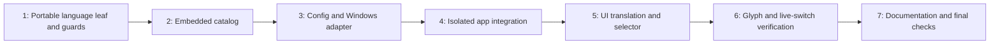

# Interface Localization Implementation Plan

> **For agentic workers:** REQUIRED SUB-SKILL: Use superpowers:subagent-driven-development (recommended) or superpowers:executing-plans to implement this plan task-by-task. Steps use checkbox (`- [ ]`) syntax for tracking.

**Goal:** Provide Traditional Chinese, English, and Japanese UI with system-language selection, persisted manual override, and live switching without restarting capture.

**Architecture:** An independent `airelinna_i18n` leaf owns language values, matching, and embedded catalogs. Dedicated app presentation and language-command files keep localization out of capture orchestration; an isolated Windows adapter reads OS preferences. UI emits commands and reads snapshots, while core/capture/overlay/renderer remain language-unaware.

**Tech Stack:** C++23, existing CMake/Ninja/clang-cl toolchain, Dear ImGui, nlohmann JSON, Win32 UI-language query, Catch2/CTest.

---

Date: 2026-09-07

Status: Implementation, documentation, and automated verification are complete. Per-task spec/quality reviews and a fresh whole-implementation review found 0 Critical / High / Medium / Low issues. Final build and source boundaries passed; discovery and CTest confirmed 12 non-hardware cases, with 29500 assertions in full case 07. Task 6 live UI acceptance remains pending, and formal zhTW lint was not run because Lua is unavailable. No app/capture manual session or commit was performed; feature acceptance is not yet complete.

## Authority, scope, and execution rules

- Implement the approved [i18n spec](../specs/2026-09-07-i18n-design.md). Its second independent review finished with Critical/High/Medium/Low all zero. The user subsequently confirmed module isolation and requested this plan.
- Consult [V1 architecture](../specs/2026-08-24-airelinna-design.md) and [application/UI ownership](../../architecture/application-ui.md). This is an application preference, not a Browser capture keep-alive extension or replica setting.
- No commits or pushes are authorized by this plan. Tests, spec, plan, `other-issue.md`, verification records, and release/publish files stay uncommitted. A later commit request requires an explicit staged-path audit; never use `git add .`.
- Preserve existing work, especially root `CMakeLists.txt` packaging edits and untracked README/resources/tests. Do not modify packaging, dependencies, presets, browser settings, capture exclusion, source identity, or native capture/render ownership.
- Use the current workspace when implementing unless a separate worktree is explicitly arranged. Untracked tests/specs are required inputs and do not appear automatically in a fresh checkout.
- Each task uses red/green checks before its checkpoint. A missing new declaration can be the first intentional red build; distinguish it from environment/configuration errors. Do not start later tasks while an unrelated baseline failure is unexplained.
- Comments should explain ownership, lifetime, fallback, and intentionally preserved behavior. Do not add commentary for obvious assignments or introduce generic plugin/service infrastructure.
- Catalog translation is an implementation content task, with the complete English source inventory in Appendix A. Keep the plan in English; do not treat illustrative names or a passing glyph test as validation of the eventual translation wording.

## File ownership map

| Files | Responsibility |
| --- | --- |
| New `include/airelinna/i18n/language.hpp`, `src/i18n/language.cpp` | Portable language values, canonical config tokens, tag matching, effective-language selection. |
| New `include/airelinna/i18n/catalog.hpp`, `src/i18n/catalog.cpp` | Text IDs and complete embedded English/Traditional Chinese/Japanese text; no core/app/OS dependency. |
| New `include/airelinna/app/localized_presentation.hpp`, `src/app/localized_presentation.cpp` | Translate typed errors, lifecycle, bridge/color/exclusion facts; no policy mutation. |
| New `src/app/application_language.cpp` | Definitions of Application's language-query and `SetLanguage` handling methods; no runtime calls. |
| `include/airelinna/app/application.hpp`, `src/app/application.cpp` | Query injection, language state, initialization/projection wiring, allocation-free emergency notices. |
| `include/airelinna/app/commands.hpp` | Add one session-agnostic value command. |
| `include/airelinna/app/config_store.hpp`, `src/app/config_store.cpp` | Optional V1 `language`, validation, serialization; keep atomic replacement. |
| `include/airelinna/app/controller_view_state.hpp`, `src/app/controller_view_state.cpp` | Requested/effective language and language-control availability; retain existing lifecycle/control policy. |
| New `platform/windows/windows_ui_language.hpp`, `platform/windows/windows_ui_language.cpp`, `platform/windows/detail/ui_language_query.hpp` | Stateless Windows query and one narrow, native-only buffer/failure test seam. |
| New `src/ui/language_selector.hpp`, `src/ui/language_selector.cpp`; `src/ui/controller_view.cpp` | Isolated selector, localized widgets, stable ImGui identities. |
| `include/airelinna/core/types.hpp`, `src/core/types.cpp` | Remove only `AppError::user_message()` after its callers migrate; retain diagnostic labels/retry policy. |
| `main.cpp` | Inject the stateless query function, without invoking it in the composition root. |
| `src/CMakeLists.txt`, `cmake/VerifySourceBoundaries.cmake` | Explicit leaf target, UTF-8 options, narrowly allowed links/includes/scans. |
| `tests/app/application_contract_test.cpp`, `tests/app/config_store_test.cpp`, `tests/app/controller_contract_test.cpp`, `tests/windows/windows_policy_test.cpp`, `tests/CMakeLists.txt` | Extend existing test cases/targets, never add a second framework or runtime introspection API. |
| `src/desktop/controller_font.hpp` | Change ranges only if full-catalog glyph verification proves a missing range. No upload/lifetime changes. |
| `README.md`, `docs/architecture/README.md`, `docs/architecture/application-ui.md`, `docs/architecture/core.md`, new `docs/architecture/localization.md` | Document the implemented feature and its ownership after verification; remove the old core-owned user-message description. |

`application.cpp` must not acquire translation tables, locale matching, or Win32 calls. `localized_presentation.cpp` must not acquire lifecycle transitions, config I/O, or command admission. The catalog must not acquire domain enums simply to shorten app mapping code.

## Sequence and test budget



Use approximately 17 added/extended scenarios, grouped under existing canonical cases: case 01 app (6), case 04 config (4), case 07 catalog/UI/font (6), case 09 Windows query (1 table-driven scenario). Reuse sections when their behavior already exists. Do not add one test per text ID, language/lifecycle combination, or helper function. Keep the existing 15-case full inventory unchanged; this local integration-OFF build discovers only cases 01-12.

## Build/test entry points

Run from an x64 VS Developer PowerShell with the existing Vulkan SDK/toolchain environment. First inspect the cache and confirm source, generator, compiler, and test flags before reusing it:

```powershell
git status --short
git diff --cached --name-only
Select-String -Path build/browser-keep-alive-vs/CMakeCache.txt -Pattern 'CMAKE_HOME_DIRECTORY:|CMAKE_GENERATOR:|CMAKE_CXX_COMPILER:|CMAKE_BUILD_TYPE:|AIRELINNA_BUILD_TESTS:|AIRELINNA_ENABLE_WINDOWS_INTEGRATION:'
$i18nCMake = 'C:/Program Files/Microsoft Visual Studio/18/Community/Common7/IDE/CommonExtensions/Microsoft/CMake/CMake/bin/cmake.exe'
$i18nCTest = 'C:/Program Files/Microsoft Visual Studio/18/Community/Common7/IDE/CommonExtensions/Microsoft/CMake/CMake/bin/ctest.exe'
& $i18nCMake --preset windows-clangd -B build/browser-keep-alive-vs -DAIRELINNA_BUILD_TESTS=ON -DAIRELINNA_ENABLE_WINDOWS_INTEGRATION=OFF
& $i18nCMake --build build/browser-keep-alive-vs --target Airelinna airelinna_core_tests airelinna_windows_policy_tests verify_source_boundaries
& $i18nCTest --test-dir build/browser-keep-alive-vs -LE hardware --output-on-failure
```

Expected preflight: this repo, Ninja, clang-cl, Release, tests ON, integration OFF; no unexpected staged files. Expected baseline: successful build and all discovered non-hardware tests pass. Stop and record tool/dependency failures separately from product regressions. Use the matching VS CMake/CTest rather than a different installation from PATH.

Execution environment note (2026-09-07): in this tool session, sandboxed Ninja stalled without child processes or progress. After stopping only the verified task-owned CMake/Ninja processes, the identical build outside the sandbox completed normally and the 12-case baseline passed. Use the tool's scoped escalation for build/test execution in this session; do not change source or build definitions to work around that environment issue.

Do not run `cmake/VerifyTestInventory.ps1` against this integration-OFF cache: its separate full-release gate requires all 15 cases, including hardware cases 13-15. Do not enable hardware tests or perform publish work merely to satisfy that gate here.

For red/green loops, the focused commands are:

```powershell
& $i18nCMake --build build/browser-keep-alive-vs --target airelinna_core_tests airelinna_windows_policy_tests verify_source_boundaries
& './build/browser-keep-alive-vs/tests/airelinna_core_tests.exe' 'Airelinna V1 case 01:*'
& './build/browser-keep-alive-vs/tests/airelinna_core_tests.exe' 'Airelinna V1 case 04:*'
& './build/browser-keep-alive-vs/tests/airelinna_core_tests.exe' 'Airelinna V1 case 07:*'
& './build/browser-keep-alive-vs/tests/airelinna_windows_policy_tests.exe' 'Airelinna V1 case 09:*'
```

Use wildcard case filters because case 04's full name contains commas meaningful to Catch2's filter parser. Check each native command's exit code; a later successful command must not hide an earlier failure.

### Task 1: Portable language leaf and boundary guards

**Files:** Create `include/airelinna/i18n/language.hpp`, `src/i18n/language.cpp`. Modify `src/CMakeLists.txt`, `cmake/VerifySourceBoundaries.cmake`, `tests/CMakeLists.txt`, `tests/app/controller_contract_test.cpp`.

- [x] Add a case 07 section for exact config tokens, case-insensitive supported tag families, unsupported/malformed tags, and first-supported ordered selection. Run the focused build and confirm the expected missing language API failure.

```cpp
SECTION("language policy uses supported families and canonical preference tokens")
{
  using namespace airelinna::i18n;
  CHECK(match_language_tag("ZH-Hant-TW") == Language::TraditionalChinese);
  CHECK(match_language_tag("ja-JP") == Language::Japanese);
  CHECK(match_language_tag("en") == Language::English);
  for (const auto tag : {"english", "ja-", "zh--TW", "fr-FR", ""}) {
    CHECK_FALSE(match_language_tag(tag).has_value());
  }
  CHECK_FALSE(parse_language_preference("ZH-TW").has_value());
  CHECK(parse_language_preference("zh-TW") == LanguagePreference::TraditionalChinese);
  CHECK(resolve_language(LanguagePreference::Japanese, Language::English) == Language::Japanese);
  CHECK(resolve_language(LanguagePreference::System, Language::TraditionalChinese) == Language::TraditionalChinese);
  const std::array<std::string_view, 3> preferred{"fr-FR", "ja-JP", "en-US"};
  auto chosen = Language::English;
  for (const auto tag : preferred) {
    if (const auto language = match_language_tag(tag)) { chosen = *language; break; }
  }
  CHECK(chosen == Language::Japanese);
}
```

- [x] Define the portable API below, with self-contained includes/guards. These names and enum spellings are shared by all subsequent tasks.

```cpp
namespace airelinna::i18n {
enum class Language { English, TraditionalChinese, Japanese };
enum class LanguagePreference { System, English, TraditionalChinese, Japanese };
std::optional<Language> match_language_tag(std::string_view tag) noexcept;
std::optional<LanguagePreference> parse_language_preference(std::string_view token) noexcept;
std::string_view language_preference_token(LanguagePreference preference) noexcept;
Language resolve_language(LanguagePreference preference, Language system_language) noexcept;
}
```

- [x] Implement canonical token parsing/serialization as exact switches/comparisons over `system`, `en`, `zh-TW`, `ja`; invalid preference serializes to an empty view and is rejected by callers. Implement `resolve_language` as a four-way switch; sanitize an invalid `system_language` or invalid preference to English, without querying the OS.

```cpp
std::optional<LanguagePreference> parse_language_preference(std::string_view token) noexcept
{
  for (const auto preference : {LanguagePreference::System, LanguagePreference::English,
                               LanguagePreference::TraditionalChinese, LanguagePreference::Japanese}) {
    if (language_preference_token(preference) == token) return preference;
  }
  return std::nullopt;
}
std::string_view language_preference_token(LanguagePreference preference) noexcept
{
  switch (preference) {
  case LanguagePreference::System: return "system";
  case LanguagePreference::English: return "en";
  case LanguagePreference::TraditionalChinese: return "zh-TW";
  case LanguagePreference::Japanese: return "ja";
  }
  return {};
}
Language resolve_language(LanguagePreference preference, Language system_language) noexcept
{
  switch (preference) {
  case LanguagePreference::English: return Language::English;
  case LanguagePreference::TraditionalChinese: return Language::TraditionalChinese;
  case LanguagePreference::Japanese: return Language::Japanese;
  case LanguagePreference::System:
    switch (system_language) {
    case Language::English: case Language::TraditionalChinese: case Language::Japanese:
      return system_language;
    }
    break;
  }
  return Language::English;
}
```

- [x] Implement the matcher as a small ASCII policy, not a general BCP-47 parser. Windows supplies valid NLS names; reject empty/oversized subtag components defensively, require a complete supported primary subtag, and do not use locale-sensitive `tolower`.

```cpp
std::optional<Language> match_language_tag(std::string_view tag) noexcept
{
  auto lower = [](char value) { return value >= 'A' && value <= 'Z' ? char(value + ('a' - 'A')) : value; };
  auto alnum = [](char value) { return (value >= 'a' && value <= 'z') ||
    (value >= 'A' && value <= 'Z') || (value >= '0' && value <= '9'); };
  if (tag.size() < 2 || (tag.size() > 2 && tag[2] != '-')) return std::nullopt;
  if (tag.size() > 2) {
    std::size_t length{};
    for (std::size_t i = 3; i < tag.size(); ++i) {
      if (tag[i] == '-') { if (length == 0) return std::nullopt; length = 0; }
      else if (!alnum(tag[i]) || ++length > 8) return std::nullopt;
    }
    if (length == 0) return std::nullopt;
  }
  const char first = lower(tag[0]), second = lower(tag[1]);
  if (first == 'e' && second == 'n') return Language::English;
  if (first == 'z' && second == 'h') return Language::TraditionalChinese;
  if (first == 'j' && second == 'a') return Language::Japanese;
  return std::nullopt;
}
```

- [x] Add the leaf target and explicit links. Catalog source is added in Task 2. `airelinna_app` and `airelinna_ui` expose language values through public headers, so their dependency is PUBLIC. Native/testing dependencies are PRIVATE. Keep UTF-8 options scoped to project targets.

```cmake
add_library(airelinna_i18n i18n/language.cpp)
target_include_directories(airelinna_i18n PUBLIC $<BUILD_INTERFACE:${PROJECT_SOURCE_DIR}/include>)
target_compile_features(airelinna_i18n PUBLIC cxx_std_23)
if(MSVC OR CMAKE_CXX_COMPILER_FRONTEND_VARIANT STREQUAL "MSVC")
  target_compile_options(airelinna_i18n PRIVATE /utf-8)
endif()
target_link_libraries(airelinna_app PUBLIC airelinna_i18n)
target_link_libraries(airelinna_ui PUBLIC airelinna_i18n)
# In tests/CMakeLists.txt, after defining each affected target:
target_link_libraries(airelinna_core_tests PRIVATE airelinna_i18n)
if(MSVC OR CMAKE_CXX_COMPILER_FRONTEND_VARIANT STREQUAL "MSVC")
  target_compile_options(airelinna_core_tests PRIVATE /utf-8)
endif()
```

- [x] Update all boundary guard surfaces, not just links: add the known target and `src/i18n` source root; zero outgoing production links; collect/scan both i18n directories; include i18n files in `all_files`; apply existing portable/native and no-ImGui checks to the new category. Forbid i18n dependencies from core/render/desktop and from Windows files other than `windows_ui_language.*` and `detail/ui_language_query.hpp`. Preserve existing UI app-header allowlists. The new leaf must reject app/core/ui/desktop/render/platform includes and filesystem I/O. Extend existing helpers rather than create a second scanning framework.

```cmake
# In airelinna_assert_target_boundaries():
if(TARGET airelinna_i18n)
  _airelinna_assert_sources(airelinna_i18n "src/i18n")
  _airelinna_assert_links(airelinna_i18n)
endif()
# In _airelinna_run_source_boundary_scan():
_airelinna_collect_sources(i18n_files "include/airelinna/i18n" "src/i18n")
_airelinna_scan_files(i18n ${i18n_files})
# In the i18n category branch of _airelinna_scan_files():
foreach(layer core app ui desktop render platform/windows)
  _airelinna_assert_layer_includes("${file}" "${contents}" "${layer}")
endforeach()
_airelinna_assert_no_match("${file}" "${contents}"
  "#[ \t]*include[ \t]*[<\"](filesystem|fstream)[>\"]"
  "i18n leaf performs filesystem I/O")
```

- [x] Reconfigure, build, run case 07 and `verify_source_boundaries`. Expected: policy assertions pass, guards remain active, no UI-to-app/native link. Inspect the diff and leave it uncommitted.

### Task 2: Embedded catalogs and complete text inventory

**Files:** Create `include/airelinna/i18n/catalog.hpp`, `src/i18n/catalog.cpp`. Modify `src/CMakeLists.txt`, `tests/app/controller_contract_test.cpp`.

- [x] Add the catalog/encoding section below and run the red build. Keep this as one catalog scenario with loops, not a test per entry.

```cpp
SECTION("all catalog entries are complete and representative UTF-8 bytes are correct")
{
  using namespace airelinna::i18n;
  for (const auto language : {Language::English, Language::TraditionalChinese, Language::Japanese}) {
    for (std::size_t index{}; index < text_count; ++index) {
      const auto value = text(static_cast<TextId>(index), language);
      CHECK_FALSE(value.empty());
      CHECK(value.find('\0') == std::string_view::npos);
    }
  }
  CHECK(text(TextId::LanguageTraditionalChinese, Language::English) ==
        "\xE7\xB9\x81\xE9\xAB\x94\xE4\xB8\xAD\xE6\x96\x87");
  CHECK(text(TextId::LanguageJapanese, Language::English) ==
        "\xE6\x97\xA5\xE6\x9C\xAC\xE8\xAA\x9E");
  CHECK(text(TextId::Start, Language::TraditionalChinese) == "\xE9\x96\x8B\xE5\xA7\x8B");
  CHECK(text(TextId::Start, Language::Japanese) == "\xE9\x96\x8B\xE5\xA7\x8B");
  CHECK(text(TextId::Start, static_cast<Language>(999)) == "Start");
  CHECK(text(static_cast<TextId>(999), Language::Japanese) == "Unknown text");
}
```

- [x] Define `enum class TextId` using every identifier in Appendix A, in that order, followed by `Count`; define `inline constexpr std::size_t text_count = static_cast<std::size_t>(TextId::Count)` and `std::string_view text(TextId id, Language language) noexcept`. Add `<cstddef>`, `<string_view>`, and the language header; include guards are required. Do not expose mutable catalogs, loaders, a language singleton, or a test-only table API.

- [x] Author the three text columns for every Appendix A entry in `catalog.cpp`. English retains existing wording except where a label is newly introduced. Use `開始` for `Start` in both Chinese and Japanese; language names remain the fixed native endonyms in every column. Translate complete messages and the complete Browser capture keep-alive tooltip, preserving every limitation and power/browser-impact warning. The content step is complete only when all inventory entries have reviewed translations, not English placeholders or empty slots.

- [x] Store named rows in one fixed, process-lifetime `constexpr std::array<Row, text_count> rows`. Author its complete initializer in the preceding content step using Appendix A, with `{TextId, English, TraditionalChinese, Japanese}` fields for every row. Each row names its ID so the compiler can check ordering. Include `<array>` in `catalog.cpp`. Keep translations out of public headers so target-local UTF-8 settings cover their compilation. Declare this row type before the array:

```cpp
struct Row {
  TextId id;
  std::string_view english;
  std::string_view traditional_chinese;
  std::string_view japanese;
};
```

After the complete array, use this lookup/check implementation:

```cpp
static_assert([] {
  for (std::size_t i{}; i < rows.size(); ++i) {
    const auto &row = rows[i];
    if (row.id != static_cast<TextId>(i) || row.english.empty() ||
        row.traditional_chinese.empty() || row.japanese.empty()) return false;
  }
  return true;
}());
std::string_view text(TextId id, Language language) noexcept
{
  const auto index = static_cast<std::size_t>(id);
  if (index >= rows.size()) return "Unknown text";
  const auto &row = rows[index];
  std::string_view result;
  switch (language) {
  case Language::English: result = row.english; break;
  case Language::TraditionalChinese: result = row.traditional_chinese; break;
  case Language::Japanese: result = row.japanese; break;
  }
  return result.empty() ? row.english : result;
}
```

All row strings must be NUL-terminated static literals without embedded NULs. Keep `###` widget IDs out of these translatable sentences. Add `i18n/catalog.cpp` to the leaf target and run case 07; independently escaped byte assertions must pass under the actual compiler, not merely in a text editor.

### Task 3: Backward-compatible preference and isolated Windows query

**Files:** Modify `include/airelinna/app/config_store.hpp`, `src/app/config_store.cpp`, `src/CMakeLists.txt`, `cmake/VerifySourceBoundaries.cmake`, `tests/app/config_store_test.cpp`, `tests/windows/windows_policy_test.cpp`, `tests/CMakeLists.txt`. Create `platform/windows/windows_ui_language.hpp`, `platform/windows/windows_ui_language.cpp`, `platform/windows/detail/ui_language_query.hpp`.

- [x] Add four case 04 sections/tables: optional fields independently absent/present; canonical token round trips; invalid language-only recovery; invalid language enum/legacy field/unknown root key preserves existing rejection policy. Run case 04 before implementation and observe the intended red result. One concrete recovery section follows:

```cpp
SECTION("invalid language preserves other valid settings")
{
  using airelinna::i18n::LanguagePreference;
  const ConfigStore store{replace_file};
  const nlohmann::json valid{{"version", 1}, {"hotkey", "Ctrl+Shift+F10"},
    {"fps_cap", "144"}, {"border", "borderless"},
    {"extensions", {{"browser_capture_keep_alive", true}}}};
  for (const auto &invalid : std::array{nlohmann::json(nullptr), nlohmann::json(true),
         nlohmann::json(42), nlohmann::json::array(), nlohmann::json::object(),
         nlohmann::json("ZH-TW"), nlohmann::json("unsupported")}) {
    auto document = valid;
    document["language"] = invalid;
    REQUIRE(write_text(config_path, document.dump()));
    const auto loaded = store.load(config_path);
    REQUIRE(loaded.has_value());
    CHECK(loaded->language == LanguagePreference::System);
    CHECK(loaded->fps_cap == FpsCap::Fps144);
    CHECK(loaded->border == BorderPreference::Borderless);
    CHECK(loaded->extensions.browser_capture_keep_alive);
    CHECK(loaded->hotkey == HotkeyChord{HotkeyModifiers{.control=true, .shift=true}, HotkeyKey::F10});
    CHECK(read_text(config_path) == document.dump());
  }
}
```

- [x] Append `i18n::LanguagePreference language{i18n::LanguagePreference::System};` to `UserConfig`. Keep version 1 and required keys unchanged. Replace only the optional-key size calculation and add language parsing/serialization as follows:

```cpp
const auto expected_size = 4U + (document.contains("extensions") ? 1U : 0U) +
                           (document.contains("language") ? 1U : 0U);
// Keep the existing is_object, size equality, and four required-key checks.

// In parse_config(), after existing legacy validation succeeds:
auto language = i18n::LanguagePreference::System;
if (document.contains("language") && document.at("language").is_string()) {
  language = i18n::parse_language_preference(
    document.at("language").get_ref<const std::string &>()).value_or(language);
}
// Append .language = language to the returned UserConfig aggregate.
// Add this pair to serialize_config()'s existing JSON object:
{"language", i18n::language_preference_token(config.language)}
// Extend ConfigStore::save()'s initial validation, before serialization or disk I/O:
if (config.version != config_version || i18n::language_preference_token(config.language).empty()) {
  return std::unexpected{core::AppError{core::AppErrorCode::InvalidValue}};
}
```

Keep the existing flush/close/native replace/temporary cleanup paths unchanged. Update both emitted-root-key assertions to include `language`; do not weaken exact key checking. Invalid language values alone recover locally, but malformed JSON/legacy fields/unrelated extra keys still default the whole document. Loading does not rewrite it.

- [x] Add one table-driven case 09 section for the native query seam. The template accepts a call-compatible callable for this single Win32 API, so tests can supply local captured state without global fakes or a generic OS service. Use a local fake with the same parameter signature:

```cpp
constexpr wchar_t preferred[] = L"fr-FR\0ja-JP\0en-US\0";
auto query = [&](DWORD flags, PULONG count, PZZWSTR buffer, PULONG size) -> BOOL {
  CHECK(flags == MUI_LANGUAGE_NAME);
  *count = 3;
  if (buffer == nullptr) { *size = static_cast<ULONG>(std::size(preferred)); return TRUE; }
  REQUIRE(*size >= std::size(preferred));
  std::copy(std::begin(preferred), std::end(preferred), buffer);
  *size = static_cast<ULONG>(std::size(preferred));
  return TRUE;
};
CHECK(airelinna::platform::windows::detail::read_ui_language(query) ==
      airelinna::i18n::Language::Japanese);
```

In this same scenario, vary the callable to return FALSE on either query, report an excessive required size, remove the double terminator, and provide unsupported names only; each must return English. Run the red build before adding the seam.

- [x] Implement the native-only seam in `detail/ui_language_query.hpp`; its includes are `<windows.h>`, `<algorithm>`, `<string>`, `<utility>`, `<vector>` and the portable language header. It contains no app include or UI command. The bounded buffer is an adapter limit; an oversized/failing query falls back rather than affecting capture.

```cpp
template<class Query>
i18n::Language read_ui_language(Query &&query) noexcept
{
  constexpr auto fallback = i18n::Language::English;
  try {
    ULONG count{}, size{};
    if (!query(MUI_LANGUAGE_NAME, &count, nullptr, &size) || size < 2 || size > 32768) return fallback;
    std::vector<wchar_t> buffer(size);
    if (!query(MUI_LANGUAGE_NAME, &count, buffer.data(), &size) ||
        size < 2 || size > buffer.size() || buffer[size-1] != L'\0' || buffer[size-2] != L'\0') return fallback;
    auto begin = buffer.cbegin();
    const auto end = begin + size;
    while (begin != end && *begin != L'\0') {
      const auto terminator = std::find(begin, end, L'\0');
      if (terminator == end) return fallback;
      std::string tag;
      bool ascii = true;
      for (auto it = begin; it != terminator; ++it) {
        if (*it > 0x7f) { ascii = false; break; }
        tag.push_back(static_cast<char>(*it));
      }
      if (ascii) {
        if (const auto language = i18n::match_language_tag(tag)) return *language;
      }
      begin = terminator + 1;
    }
  } catch (...) { return fallback; }
  return fallback;
}
```

- [x] Expose only `i18n::Language windows_ui_language() noexcept` in the public Windows adapter header; define it by calling `detail::read_ui_language(&GetUserPreferredUILanguages)` in its `.cpp`. Add the `.cpp` to `airelinna_windows`, PRIVATE-link the i18n leaf, and allow only the adapter/detail header to include that leaf among Windows sources. Add a PRIVATE leaf link to `airelinna_windows_policy_tests` for its direct use. No new library for this one adapter.

- [x] Reconfigure/build, run cases 04 and 09 plus the boundary target. Expected: four optional-field combinations accepted, invalid language cannot erase valid preferences, all native-failure fixtures fall back. Leave changes uncommitted.

### Task 4: Isolated application command and presentation integration

**Files:** Create `src/app/application_language.cpp`, `include/airelinna/app/localized_presentation.hpp`, `src/app/localized_presentation.cpp`. Modify `include/airelinna/app/commands.hpp`, `include/airelinna/app/application.hpp`, `src/app/application.cpp`, `include/airelinna/app/controller_view_state.hpp`, `src/app/controller_view_state.cpp`, `include/airelinna/core/types.hpp`, `src/core/types.cpp`, `main.cpp`, `src/CMakeLists.txt`, `tests/app/application_contract_test.cpp`, `tests/app/controller_contract_test.cpp`.

- [x] Extend the existing Harness with an injectable query, fixed to English by default. Add `SystemLanguageQuery` as Application's final constructor parameter, with no default in the production constructor so composition cannot accidentally omit it. The alias belongs in the app header and requires `<functional>` plus the portable language header.

```cpp
// Namespace airelinna::app:
using SystemLanguageQuery = std::function<i18n::Language()>;
struct SetLanguage { i18n::LanguagePreference preference; };
// Append SetLanguage to AppCommand's existing std::variant.

// Harness field; pass system_language_query as the final make_unique argument:
airelinna::app::SystemLanguageQuery system_language_query = [] {
  return airelinna::i18n::Language::English;
};
```

Do not make the tests consult the real OS by default. `select_and_start()` must compare to `i18n::text(TextId::Capturing, snapshot.effective_language)` rather than hard-coded English. Migrate `check_notice()` to `app::error_text(code, snapshot.effective_language)`. The new APIs may initially fail compilation; this is the expected red build before the next steps.

- [x] Add six focused app sections/extended scenarios with these inputs and observations. Use existing `Harness`, `ConfigFixture`, `RuntimeProbe`, `make_tick`, `select_and_start`, and `check_notice`, not new mock interfaces or private-state getters.

| Scenario | Inputs and required observations |
| --- | --- |
| Startup and query fallback | Default System + injected Japanese yields a Japanese first view and one query; pre-save manual English and reconstruct yields English with zero queries; throwing/invalid-result query falls back to English without capture error. |
| System reselection | Start with System/English, change the captured query result to Japanese, enqueue System again; next snapshot becomes Japanese, query count increments, persisted token remains System. Manual choice performs no query. |
| Failed save during capture | Select Japanese while save replacement fails: memory/view stay Japanese, ConfigWriteFailure is localized, runtime/source/hotkey counters do not change except one normal runtime tick. Later successful preference save contains the accepted language and other preferences. |
| Stopping/error/replacement | Start a retained runtime, queue an interrupted replacement then change language during its drain; pending selection/settings and session generation change only on the scripted Stopped event. Also check retained Error/drain accepts language without another apply/stop. |
| Quit ordering and invalid preference | Queue Quit then language: query/save count unchanged and queue closed; invalid enum before Quit yields localized InvalidValue without changing the preference, query, runtime, or config. |
| No-throw direct notices | Failed language save followed by shutdown produces the localized dirty-config notice without another save. Extend the existing emergency path fixture to assert localized PlatformOperationFailure and no query/save during containment. |

The failed-save scenario's concrete capture invariants are:

```cpp
SECTION("language save failure keeps capture and the accepted language")
{
  using airelinna::i18n::Language;
  using airelinna::i18n::LanguagePreference;
  Harness harness;
  auto application = harness.make_application();
  const auto probe = std::make_shared<RuntimeProbe>();
  select_and_start(harness, *application, probe, now);
  const auto before = application->view_state();
  const auto creates = harness.factory.sources.size();
  const auto applies = probe->apply_count;
  const auto stops = probe->request_stop_count;
  const auto destroyed = probe->destruction_count;
  const auto enumerations = harness.catalog.enumerate_count;
  const auto hotkeys = harness.hotkey.replacements.size();
  const auto clears = harness.hotkey.clear_count;
  const auto ticks = probe->tick_count;
  harness.config.replace_succeeds = false;
  REQUIRE(harness.queue.push(airelinna::app::SetLanguage{LanguagePreference::Japanese}));
  application->step(now + 1ms);
  const auto &after = application->view_state();
  CHECK(after.language_preference == LanguagePreference::Japanese);
  CHECK(after.effective_language == Language::Japanese);
  CHECK(after.session_id == before.session_id);
  CHECK(after.settings == before.settings);
  REQUIRE(after.sources.size() == before.sources.size());
  for (std::size_t i{}; i < after.sources.size(); ++i) {
    CHECK(after.sources[i].id == before.sources[i].id);
    CHECK(after.sources[i].label == before.sources[i].label);
    CHECK(after.sources[i].selected == before.sources[i].selected);
  }
  CHECK(harness.factory.sources.size() == creates);
  CHECK(probe->apply_count == applies);
  CHECK(probe->request_stop_count == stops);
  CHECK(probe->destruction_count == destroyed);
  CHECK(harness.catalog.enumerate_count == enumerations);
  CHECK(harness.hotkey.replacements.size() == hotkeys);
  CHECK(harness.hotkey.clear_count == clears);
  CHECK(probe->tick_count == ticks + 1);
  check_notice(*application, AppErrorCode::ConfigWriteFailure);
  harness.config.replace_succeeds = true;
  REQUIRE(harness.queue.push(airelinna::app::SetLanguage{LanguagePreference::Japanese}));
  application->step(now + 2ms);
  const auto saved = harness.config.store().load(harness.config.path());
  REQUIRE(saved.has_value());
  CHECK(saved->language == LanguagePreference::Japanese);
  application->shutdown();
  probe->ticks.push_back(make_tick({airelinna::app::Stopped{}}));
  application->step(now + 3ms);
  CHECK(application->exit_disposition() == airelinna::core::ExitDisposition::Clean);
}
```

- [x] Add the two language members and private method declarations to Application. Store the query by value in its constructor. `initialize()` calls `refresh_language()` immediately after config loading/default recovery. Define both methods below in the separate `application_language.cpp`, including only the app header, portable language types, and needed standard headers:

```cpp
// Application members/declarations:
SystemLanguageQuery system_language_query_;
i18n::Language effective_language_{i18n::Language::English};
void refresh_language() noexcept;
void handle(const SetLanguage &command, std::chrono::steady_clock::time_point now);

void Application::refresh_language() noexcept
{
  auto system_language = i18n::Language::English;
  if (config_.language == i18n::LanguagePreference::System && system_language_query_) {
    try { system_language = system_language_query_(); }
    catch (...) { system_language = i18n::Language::English; }
  }
  effective_language_ = i18n::resolve_language(config_.language, system_language);
}
void Application::handle(const SetLanguage &command, std::chrono::steady_clock::time_point)
{
  if (i18n::language_preference_token(command.preference).empty()) {
    reject(core::AppError{core::AppErrorCode::InvalidValue});
    return;
  }
  const bool changed = config_.language != command.preference;
  config_.language = command.preference;
  refresh_language();
  config_dirty_ = config_dirty_ || changed;
  if (config_dirty_) persist_config();
}
```

The existing command drain enforces Quit ordering; do not add a competing dispatcher. No session validation, `settings_allowed()`, runtime apply, start/stop, source refresh, hotkey change, frame-scheduler update, or browser-helper operation belongs in this handler. A same-preference command retries a dirty save; System reselection re-queries even when the preference is unchanged. A clean no-op need not write disk. Successful switching does not clear an unrelated notice.

- [x] Add these snapshot fields and one dedicated `ControllerControls::language`. Append `i18n::Language language = i18n::Language::English, bool language_changes_allowed = true` to `build_controller_view()` after its existing optional notice, preserving deterministic existing helper calls. Application supplies the real values; no UI or projection call queries the OS.

```cpp
// ControllerViewState, immediately after session_id:
i18n::LanguagePreference language_preference{i18n::LanguagePreference::System};
i18n::Language effective_language{i18n::Language::English};
// ControllerControls, after the existing fields:
ControlState language;
// Initialize the new snapshot fields from config.language and the language argument.
// Append this field to the existing view.controls initializer:
.language = {.enabled = language_changes_allowed,
  .explanation = language_changes_allowed ? std::string_view{} :
    i18n::text(i18n::TextId::LanguageChangesClosed, language)},
// Append these arguments in Application::rebuild_view():
effective_language_, !quit_intent_ && exit_disposition_ == core::ExitDisposition::Continue
```

All existing control availability and disable precedence remain in `controller_view_state.cpp`. Add the language to the local `ControlContext` only for translating its already-chosen explanation; do not move admission policy into the catalog.

- [x] Move the text-only lifecycle/source/bridge/color/exclusion helpers from `controller_view_state.cpp` into `localized_presentation.cpp`. Keep switch conditions and fallback outcomes unchanged; replace their English returns using the Appendix A IDs. Expose the following signatures in the app-local presentation header; forward-declare `BridgeFeedback`, and include core types, language, `<optional>`, and `<string_view>`.

```cpp
std::string_view error_text(core::AppErrorCode code, i18n::Language language) noexcept;
std::string_view lifecycle_text(core::SessionLifecycle lifecycle, i18n::Language language) noexcept;
std::string_view source_kind_text(core::SourceKind kind, i18n::Language language) noexcept;
std::string_view bridge_text(BridgeFeedback feedback, i18n::Language language) noexcept;
std::optional<std::string_view> color_warning(core::ColorSupport support, i18n::Language language) noexcept;
std::optional<std::string_view> exclusion_warning(core::CaptureExclusionStatus status,
  std::string_view unsupported, std::string_view failed) noexcept;
```

Implement `error_text` by copying the existing exhaustive `AppError::user_message()` switch into this file, changing `switch(code)` to the parameter and each English return to `i18n::text(TextId::ErrorX, language)` for the same `AppErrorCode::X`; use `ErrorUnknown` for the fallback. This is a mechanical relocation, not a new error taxonomy. For example, the complete replacement arm is:

```cpp
case core::AppErrorCode::ConfigWriteFailure:
  return i18n::text(i18n::TextId::ErrorConfigWriteFailure, language);
```

Project notices with `[language](core::AppError error) { return error_text(error.code, language); }`. Replace the source-kind call with `source_kind_text`, and pass `language` to lifecycle/bridge/color helpers. Resolve `SessionFailed`, the four control explanations, controller/overlay exclusion text, `DrainStalled`, and `ExtensionsScope` through the catalog. Assign `extensions_scope_text` explicitly; remove its English default initializer from the snapshot header. The presentation implementation includes `controller_view_state.hpp` for the complete `BridgeFeedback` definition; that header need not include the presentation header.

- [x] Extend case 07's `project()` helper by appending `const airelinna::app::UserConfig &config = {}, airelinna::i18n::Language language = airelinna::i18n::Language::English, bool language_changes_allowed = true`; forward these to `build_controller_view()` instead of its hard-coded `UserConfig{}`. Add one table-driven projection section covering all three languages with typed errors/status/source-kind/disabled reasons/bridge/color/exclusion/drain/extension text. Assert exact catalog IDs, not merely nonempty results. Extend the existing lifecycle table to check the language control remains enabled in every ordinary lifecycle and is disabled by the explicit shutdown flag. Preserve existing literal source-label and hotkey assertions, and check representative `diagnostic_label()` values remain unchanged. These are the projection and literal-preservation scenarios counted in the case 07 budget, not a cross-product test matrix.

- [x] Migrate both direct notice assignments in `begin_shutdown()`/`emergency_abandon()` and disable the language control on direct shutdown paths using static lookups. Do not query, allocate, or persist here:

```cpp
view_state_.application_notice_text = error_text(error.code, view_state_.effective_language);
view_state_.controls.language = {false,
  i18n::text(i18n::TextId::LanguageChangesClosed, view_state_.effective_language)};
```

For `emergency_abandon`, use `core::AppErrorCode::PlatformOperationFailure` directly. Use the last published snapshot language in these bypass paths so a partially completed step cannot mix its old snapshot with a new language. Ordinary successful projection publishes the new effective language atomically with all other text. Retain no-throw shutdown ordering and native-owner retention.

- [x] Remove `AppError::user_message()` declaration/definition only after all product/test callers migrate. Retain `diagnostic_label()`, `native_detail`, retry rules, and all core error enum values. Update the file comment in `src/core/types.cpp` to describe diagnostics only. `rg -n 'user_message\(' include src platform render tests` should return no matches after migration.

- [x] Add both app `.cpp` files to `airelinna_app`. In `main.cpp`, include `platform/windows/windows_ui_language.hpp` and pass `platform::windows::windows_ui_language` as the last Application constructor argument; pass the function, not its result. Run cases 01/04/07 and the boundary check. Expected: all existing orchestration assertions remain green, language changes preserve runtime ownership, and UI cannot include the new app presentation header under the existing allowlist.

### Task 5: Localized widgets and isolated language selector

**Files:** Create `src/ui/language_selector.hpp`, `src/ui/language_selector.cpp`. Modify `src/ui/controller_view.cpp`, `src/CMakeLists.txt`, `tests/app/controller_contract_test.cpp`.

- [x] Extend case 07's existing headless ImGui context/render/log section to render snapshots in all three languages. Assert translated labels are present, external source labels (including literal `##`/`###`) are unchanged, and the controller window ID stays stable. Check representative interactive IDs (Start, hotkey input, language selector) within the same window scope as well. Use the same renderer-free test setup. Keep hotkey input preservation as a named manual check in Task 6 rather than introducing a UI automation framework.

- [x] Declare `void render_language_selector(const app::ControllerViewState &, const CommandSink &);` in the private UI header, including the existing controller view header for its snapshot/sink types. Implement the selector using snapshot values and catalog strings only. It is called immediately after a successful ImGui `Begin`, outside capture-setting disabled groups.

```cpp
void render_language_selector(const app::ControllerViewState &state, const CommandSink &sink)
{
  using i18n::LanguagePreference;
  using i18n::TextId;
  const auto language = state.effective_language;
  auto caption = [language](LanguagePreference preference) {
    switch (preference) {
    case LanguagePreference::System: return i18n::text(TextId::FollowSystem, language);
    case LanguagePreference::English: return i18n::text(TextId::LanguageEnglish, language);
    case LanguagePreference::TraditionalChinese: return i18n::text(TextId::LanguageTraditionalChinese, language);
    case LanguagePreference::Japanese: return i18n::text(TextId::LanguageJapanese, language);
    }
    return i18n::text(TextId::FollowSystem, language);
  };
  ImGui::SeparatorText(i18n::text(TextId::GeneralSettings, language).data());
  const auto label = std::string(i18n::text(TextId::LanguageLabel, language)) + "###language";
  ImGui::BeginDisabled(!state.controls.language.enabled);
  if (ImGui::BeginCombo(label.c_str(), caption(state.language_preference).data())) {
    for (const auto preference : {LanguagePreference::System, LanguagePreference::English,
                                 LanguagePreference::TraditionalChinese, LanguagePreference::Japanese}) {
      ImGui::PushID(static_cast<int>(preference));
      const auto option = std::string(caption(preference)) + "###language_option";
      const bool selected = preference == state.language_preference;
      if (ImGui::Selectable(option.c_str(), selected) && sink)
        sink(app::SetLanguage{preference});
      if (selected) ImGui::SetItemDefaultFocus();
      ImGui::PopID();
    }
    ImGui::EndCombo();
  }
  ImGui::EndDisabled();
  if (state.language_preference == LanguagePreference::System) {
    const auto effective_name = language == i18n::Language::Japanese ? TextId::LanguageJapanese :
      language == i18n::Language::TraditionalChinese ? TextId::LanguageTraditionalChinese : TextId::LanguageEnglish;
    ImGui::Text("%s: %s", i18n::text(TextId::EffectiveLanguage, language).data(),
                i18n::text(effective_name, language).data());
  }
  if (!state.controls.language.enabled && !state.controls.language.explanation.empty())
    ImGui::TextWrapped("%.*s", static_cast<int>(state.controls.language.explanation.size()),
                       state.controls.language.explanation.data());
}
```

Include `<string>`, the catalog header, `<imgui.h>`, and the private selector header in the implementation. Reselecting the active System option must still emit a command. The fixed format strings above are not translated; their text arguments are. Translate the label/value nouns as complete labels, not English sentence fragments.

- [x] Add a local `widget_label` helper in `controller_view.cpp`; all translated interactive widgets, including the controller content window and hotkey input, use stable `###` identities. `##suffix` alone does not make a changing visible label's ID stable.

```cpp
std::string widget_label(i18n::TextId id, const char *identity, i18n::Language language)
{
  return std::string(i18n::text(id, language)) + "###" + identity;
}
// In render(), before Begin:
const auto language = state.effective_language;
const auto title = widget_label(i18n::TextId::ControllerTitle, "Airelinna Controller", language);
if (!ImGui::Begin(title.c_str())) { ImGui::End(); return; }
render_language_selector(state, command_sink);
// An existing action keeps its command/session data:
emit_if(button(widget_label(i18n::TextId::Start, "start", language).c_str(), state.controls.start),
        command_sink, app::Start{state.session_id});
```

Use these stable identities for existing widgets: `refresh`, `start`, `stop`, `editable`, `pass_through`, `fps_30`, `fps_60`, `fps_144`, `fps_unlimited`, `bordered`, `borderless`, `browser_keep_alive`, `desired_hotkey`, `replace_hotkey`, `quit`. The window identity retains its old English identity string to preserve saved position/size. The pinned ImGui 1.92.9 hash implementation makes `label###id` and `id` equivalent; verify that equality in the existing ID scenario instead of adding an ini migration. Keep source `PushID(source.id.value)` and the literal source-label drawing path unchanged.

- [x] Replace every UI-owned literal in Appendix A with its catalog ID. Use `diagnostic(text(LabelId, language), value)` for Status/Bridge as well as the existing optional warnings; use `TextUnformatted` for static text and fixed `%.*s`/`%s` formatting for values. Translate hotkey syntax validation and binding confirmation, not key names. Do not reset `hotkey_edit_text_` during switching or change when an accepted Replace action clears it.

- [x] Render longer disabled reasons and status values with wrapping within available width, not the existing unconditional `SameLine()` placement that can push translated messages off-screen. Keep the keep-alive help marker outside the disabled block with its existing hover flags and wrapping. Its full tooltip becomes `TextUnformatted(text(TextId::KeepAliveHelp, language).data())`. No native title or font-atlas operation is added to UI.

- [x] Add `ui/language_selector.cpp` to `airelinna_ui`. Build/run case 07 and the boundary target; audit `rg -n 'ImGui::|"' src/ui/controller_view.cpp src/ui/language_selector.cpp` for leftover visible English, distinguishing stable IDs, format strings, hotkey syntax, and external content. Expected: all catalog-specified labels translate, IDs remain stable, and no app implementation/native headers enter UI.

### Task 6: Complete glyph coverage and live-switch acceptance

**Files:** Modify `tests/app/controller_contract_test.cpp`; modify `src/desktop/controller_font.hpp` only for a verified missing range. No renderer/native lifetime files are modified.

- [x] Extend the existing case 07 installed-font section. Use the real installed font and the same production `configure_controller_font()` call/atlas bake. Keep both `font->IsGlyphInFont(codepoint)` and `baked->FindGlyphNoFallback(codepoint)` and the existing width/height `<= 4096` assertions. Decode every text ID in every language as UTF-8, skip whitespace controls such as newline, and check each resulting glyph.

```cpp
// Tests may use the pinned ImGui UTF-8 decoder from imgui_internal.h.
namespace i18n = airelinna::i18n;
for (const auto language : {i18n::Language::English, i18n::Language::TraditionalChinese, i18n::Language::Japanese}) {
  for (std::size_t index{}; index < i18n::text_count; ++index) {
    const auto value = i18n::text(static_cast<i18n::TextId>(index), language);
    const char *cursor = value.data();
    const char *end = cursor + value.size();
    while (cursor != end) {
      unsigned int codepoint{};
      const int consumed = ImTextCharFromUtf8(&codepoint, cursor, end);
      REQUIRE(consumed > 0);
      REQUIRE(codepoint != IM_UNICODE_CODEPOINT_INVALID);
      REQUIRE(codepoint <= IM_UNICODE_CODEPOINT_MAX);
      cursor += consumed;
      if (codepoint < 0x20) continue;
      CAPTURE(index, codepoint);
      CHECK(font->IsGlyphInFont(static_cast<ImWchar>(codepoint)));
      REQUIRE(baked->IsGlyphLoaded(static_cast<ImWchar>(codepoint)));
      CHECK(baked->FindGlyphNoFallback(static_cast<ImWchar>(codepoint)) != nullptr);
    }
  }
}
```

This checks the complete shipped content, including menu endonyms, rather than inferring coverage from range declarations. The pinned ImGui implementation may load a missing glyph inside `FindGlyphNoFallback()`; check `IsGlyphLoaded()` first so the test proves startup-atlas coverage without silently loading glyphs during verification. Do not replace failed glyph assertions with a fallback-glyph check. If the font has a glyph but the startup range omits it, add only the proven range. If the installed font lacks a required glyph, stop and resolve the content/font requirement before claiming acceptance; do not silently add font downloads or dynamic atlas machinery.

- [x] Run the focused case 07 build/test. Expected: actual catalog glyphs fit in the existing static atlas. Confirm the diff does not touch `desktop_host.cpp`, its dynamic-texture suppression, queue-idle behavior, upload fences, or retirement logic.

- [ ] Perform the following manual checklist only with a user-approved source window. Do not reset real user config, change Windows language packs, expose unrelated windows, or start a second app instance without checking the current app state. Manual UI checks are separate from headless tests.

| Action | Expected observation |
| --- | --- |
| Launch with System | Correct effective language is shown; unsupported system preferences use English. |
| Start a playing replica and cycle English, Traditional Chinese, Japanese | Capturing continues without recreating the source/replica, resetting mode/FPS/border, or changing Browser keep-alive state. |
| Select Follow system twice | Selection remains System; explicit reselection is admitted, not suppressed as a no-op by UI. |
| Leave an unfinished hotkey edit, switch language | Edit contents remain; only an explicit Replace follows its old clear/validation behavior. |
| Inspect long warnings, disabled reasons, tooltip, and source names | No missing shipped glyphs or inaccessible controls; wrapping/scrolling works at the existing supported controller sizes/DPI. External titles/HWND remain literal. |
| Save manual Japanese, exit cleanly, relaunch | Japanese remains selected without depending on current OS language. |
| Return to System | The persisted preference is System, not the effective catalog token. |

Do not edit Windows display-language settings merely for a test; injected results already cover those variations. Save-failure/cleanup/AbandonProcess paths remain automated fixture checks, not destructive tests against the user's live config. Restore only preferences changed during an explicitly agreed manual session.

### Task 7: Documentation, boundaries, and final verification

**Files:** Modify `README.md`, `docs/architecture/README.md`, `docs/architecture/application-ui.md`, `docs/architecture/core.md`. Create `docs/architecture/localization.md`. No release/publish document changes.

- [x] Document the implemented behavior: three languages, manual persistence, System selection/reselection, Chinese-family mapping to Traditional Chinese, English fallback, and no background watcher for OS-language changes. Keep README browser capture/minimize limitations intact. Add one link in the architecture index; explain the independent leaf, app language handler, presentation mapping, native adapter, and font ownership in the new architecture document with a Mermaid ownership/data-flow diagram. Do not claim unperformed glyph/UI validation succeeded.

- [x] Update `docs/architecture/core.md`'s error-description paragraph and Mermaid edge: core retains static diagnostic identifiers and retry policy only; user-facing error text belongs to app presentation. Replace `ET[user_message / diagnostic_label]` with `ET[diagnostic_label]` and link the paragraph to the new localization document. Run `rg -n 'user_message|localized_presentation|diagnostic_label' docs/architecture` and check that no current architecture description retains the removed user-message API or puts translations in core.

- [x] Run the full non-hardware verification and source-boundary checks using the same configured tree. Verify discovery count as well as results; no-test discovery is not success.

```powershell
& $i18nCMake --build build/browser-keep-alive-vs --target Airelinna airelinna_core_tests airelinna_windows_policy_tests verify_source_boundaries
& $i18nCTest --test-dir build/browser-keep-alive-vs --show-only=json-v1
& $i18nCTest --test-dir build/browser-keep-alive-vs -LE hardware --output-on-failure
git diff --check
git diff --stat
git diff --cached --name-only
git status --short
```

Expected: 12 non-hardware canonical cases discovered/passing, no additional test executables/top-level cases, and no accidental stage/commit. Separate failures or skipped manual/hardware checks from successful automated coverage.

- [x] Review the diff for ownership regressions: no language in `ReplicaSettings`, core domain, runtime ports/settings, capture callbacks, browser helper, overlay, or renderer; UI never includes `Application`, ConfigStore, presentation implementation, or Windows APIs. Translation content lives only in the catalog, while Application retains only the necessary initialization/dispatch/persistence/projection wiring.

- [x] Hand off with exact automated results and manual checks completed/pending. Do not mark feature acceptance complete if real font or live UI checks failed or were not run. Do not commit; plans/specs/tests/work records remain local.

## Appendix A: Complete initial text inventory

Use these IDs in this order, followed by `Count`. Entries are source/content requirements for Task 2, not extra tests. The names `LanguageTraditionalChinese` and `LanguageJapanese` render the exact native endonyms already specified in the approved spec in all three columns. Technical abbreviations such as GPU/CPU/FPS/SDR/HDR/D3D11/Win32 remain recognizable in translated messages.

| TextId | English source / required content |
| --- | --- |
| UnknownText | Unknown text |
| ControllerTitle | Airelinna Controller |
| GeneralSettings | General settings |
| LanguageLabel | Language |
| FollowSystem | Follow system |
| EffectiveLanguage | Effective language |
| LanguageEnglish | English (fixed endonym) |
| LanguageTraditionalChinese | 繁體中文 (fixed endonym in every language) |
| LanguageJapanese | 日本語 (fixed endonym in every language) |
| LanguageChangesClosed | Language changes are unavailable during shutdown. |
| StatusLabel | Status |
| SessionErrorLabel | Session error |
| NoticeLabel | Notice |
| ColorLabel | Color |
| ControllerExclusionLabel | Controller exclusion |
| OverlayExclusionLabel | Overlay exclusion |
| CleanupLabel | Cleanup |
| BridgeLabel | Bridge |
| Sources | Sources |
| Refresh | Refresh |
| Start | Start |
| Stop | Stop |
| Mode | Mode |
| Editable | Editable |
| PassThrough | Pass-through |
| FrameRate | Frame rate |
| Fps30 | 30 FPS |
| Fps60 | 60 FPS |
| Fps144 | 144 FPS |
| Unlimited | Unlimited |
| Border | Border |
| Bordered | Bordered |
| Borderless | Borderless |
| Extensions | Extensions |
| KeepAlive | Browser capture keep-alive (experimental) |
| KeepAliveHelp | The complete current tooltip from `src/ui/controller_view.cpp`, reproduced immediately below this table. |
| ExtensionsScope | Window captures only |
| Hotkey | Hotkey |
| DesiredHotkey | Desired hotkey |
| ReplaceHotkey | Replace hotkey |
| InvalidHotkey | Enter a valid hotkey chord. |
| BindingLabel | Binding |
| Confirmed | confirmed |
| Unconfirmed | unconfirmed |
| Quit | Quit |
| ControlStopping | The current replica is stopping. |
| ControlLifecycle | This action is unavailable in the current lifecycle. |
| ControlCapability | This capability is unavailable. |
| ControlMissingSource | Select a source first. |
| SourceDisplay | display |
| SourceWindow | window |
| Idle | Idle |
| Starting | Starting |
| Capturing | Capturing |
| Stopping | Stopping |
| Interrupted | Capture interrupted |
| RecoveringGraphics | Recovering graphics |
| Error | Error |
| SessionFailed | Replica session failed. |
| BridgeGpuInterop | GPU interop active. |
| BridgeCpuCopy | CPU copy bridge active. |
| BridgeAdapterMismatch | CPU copy: graphics adapters could not be matched. |
| BridgeExternalImageUnsupported | CPU copy: external images are unsupported. |
| BridgeD3d11InterfacesUnavailable | CPU copy: required D3D11 interfaces are unavailable. |
| BridgeSharedSyncUnavailable | CPU copy: shared synchronization is unavailable. |
| BridgeTimelineImportUnavailable | CPU copy: timeline fence import is unavailable. |
| BridgeWin32ImportUnavailable | CPU copy: Win32 import procedures are unavailable. |
| BridgeMemoryTypeUnavailable | CPU copy: no compatible memory type is available. |
| BridgeInteropFailure | CPU copy: a GPU interop operation failed. |
| ColorHdrUnsupported | HDR was detected but is unsupported. |
| ColorUnknownSdr | Color detection is unavailable; SDR is assumed. |
| ControllerExclusionUnsupported | Controller capture exclusion is unsupported. |
| ControllerExclusionFailed | Controller capture exclusion failed. |
| OverlayExclusionUnsupported | Overlay capture exclusion is unsupported. |
| OverlayExclusionFailed | Overlay capture exclusion failed. |
| DrainStalled | Native resource cleanup has stalled. |
| ErrorInvalidCommand | That action is not available in the current state. |
| ErrorInvalidValue | A provided value is invalid. |
| ErrorConfigReadFailure | The configuration could not be read. |
| ErrorConfigWriteFailure | The configuration could not be saved. |
| ErrorSourceCatalogFailure | Capture sources could not be listed. |
| ErrorPermissionDenied | Permission to capture the source was denied. |
| ErrorSourceUnavailable | The selected capture source is unavailable. |
| ErrorHotkeyConflict | The requested global hotkey is already in use. |
| ErrorHotkeyCleanupFailure | The previous global hotkey could not be released. |
| ErrorHotkeyRegistrationLost | The global hotkey registration was lost. |
| ErrorUnsupportedWindowClass | The window configuration is unsupported. |
| ErrorUnsupportedGraphics | The graphics configuration is unsupported. |
| ErrorRuntimeConstructionFailure | The replica could not be started. |
| ErrorPlatformOperationFailure | A platform operation failed. |
| ErrorRuntimeStateLost | The active replica can no longer continue safely. |
| ErrorUnknown | An unknown application error occurred. |

`KeepAliveHelp` English source:

> Attempts to keep covered browser windows rendering during window capture. May also affect other browser windows and increase CPU/GPU usage and power consumption. Does not change browser settings. Minimized windows, inactive tabs, protected video, and locked or sleeping displays are not guaranteed. Browser recovery after disabling is best-effort. Experimental: browser updates may break this workaround.

`error_text` maps each existing `AppErrorCode::X` to the corresponding `ErrorX` row, with `ErrorUnknown` as default. Lifecycle rows map one-to-one to the existing lifecycle enum. Bridge rows preserve the current reason switch: None chooses GPU/CPU by mode; unknown reason falls back to BridgeCpuCopy. Color/exclusion helpers preserve which statuses produce no warning. UI and app projection must not change those conditions while changing the text source.

## Author self-review and plan review gate

Current review status (2026-09-07): the earlier reviewer creation attempt failed with `agent thread limit reached`; the user's requested retry succeeded. Independent round 1 (`i18n_plan_review_retry1`) reviewed the full plan and returned Critical/High/Medium/Low all zero. The main agent separately verified a small documentation-scope omission against `docs/architecture/core.md:11` and `:20`, then added its migration to Task 7. Fresh independent round 2 (`i18n_plan_review_retry2`) reviewed the entire revised plan (SHA256 `D28F7FD5437D7BE513B9CD99EB0FDBEB860A07292A8E6C8B51E84C8A7F8E925B`) and also returned Critical/High/Medium/Low all zero. Only review-status metadata changed after that review. The main agent verified both conclusions, checked document structure/IDs/links, and confirmed 12 existing cases through CTest discovery only. The earlier build/fixture inventory is support work, not a rolling review. Both reviewers completed their turns; this session exposes no thread-close/delete tool, so completion is not a claim of thread deletion. The review gate is passed; do not start implementation until execution is authorized.

- [x] Check every i18n spec section against Tasks 1-7: ownership 1/4/5; system policy 1/3/4; config 3/4; live switching 4/5/6; catalog/encoding/errors 2/4; fonts/layout 5/6; acceptance 1-7.
- [x] Check all symbols across snippets, exact paths, constructor/query lifetime, test fixture names, and CMake/source-guard changes. Reject undefined helper names, alternate language-field spellings, and accidental native dependencies.
- [x] Scan for incomplete instructions and clarify each task's red/green outcome. The content inventory must be complete; authoring the actual translations is an explicit implementation task rather than a claim that this plan has implemented them.
- [x] After author self-review, perform the user's requested rolling review: fresh independent reviewer for the complete plan each round; verify every reported issue against source/spec, fix confirmed issues in the plan, and continue until a fresh round has no Critical/High/Medium finding. Do not reuse prior reviewers or count a partial support inventory as a review. Report tool limitations honestly if fresh spawning/cleanup is unavailable.
- [x] Keep all implementation task checkboxes unchecked until execution is explicitly started. Planning/review does not constitute implementation or test success.
