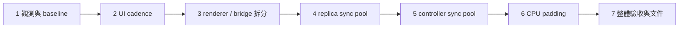

# Vulkan 共用渲染邊界與效能改善 Implementation Plan

> For agentic workers: REQUIRED SUB-SKILL: 使用 `subagent-driven-development` 或 `executing-plans` 逐項執行；以 `- [ ]` 追蹤進度，完成每項後進行全新 reviewer 的 rolling review。

Goal：建立單份 replica Vulkan renderer、明確 Windows capture/import ownership，並以可比較的資料驗證 UI cadence、同步物件重用與 CPU padding 最佳化。

Architecture：Application／UI 延續既有 ports；WindowsRenderStack 作為 concrete facade，協調 WindowsFrameBridge 與 VulkanRenderer。DesktopHost 保有獨立 controller graphics owner；diagnostics 接收 native owners 的 scalar observations。

Tech stack：C++23、CMake、GLFW 3.4、Dear ImGui 1.92.9、Vulkan 1.3 + maintenance1、WGC／D3D11、現有 nlohmann/json、Catch2、Lua test-inventory verifier。

狀態：plan rolling review 第二輪於 2026-09-16 通過，0 Critical／0 Medium。前置 gate：[spec](../specs/2026-09-15-vulkan-portability-performance-design.md) 已於第三輪完整 review 達成 0 Critical／0 Medium。本文程式區塊為目標契約、關鍵實作與驗證範例；現有方法依下列 migration map 搬移並延續原有 error handling。

## 1. 執行順序與工作樹規則



每項 task 都產生可建置的增量。Task 3 的內部搬移再按 owner／方法群分成數個可建置 commit；機械式搬移與語意改動分開，使用 `git diff --color-moved` 檢視。每個 task 完成後：新 reviewer 全面檢查 → root 查證 → 修正 → 另一位新 reviewer 重審，直到 0 Critical／0 Medium。

- [x] 讀取目前 branch／HEAD／staging 與本輪涉及檔案的 dirty diff，保存逐檔 hash 與 task 起始差異。實作基線是目前工作樹，HEAD `a955d2e` 作為其歷史定位。
- [x] 目前同一批 production 檔案含 rename、UI、crop 與 preferences 變更。使用者於 2026-09-16 授權整理既有 production 基線、硬體測試及後續驗證。依相依關係分成可建置的小階段，逐 hunk 核對內容。
- [ ] Production commit 採下方各 task allowlist，逐 hunk staging。`tests/**`、`docs/superpowers/**`、`docs/verification/**`、benchmark artifacts 維持 unstaged。一般 architecture／development 文件可隨對應 production task 提交。
- [ ] 每次 commit 前執行 `git diff --cached --name-only`、`git diff --cached --check` 與內容 review，確認 staged changes 恰好等於已驗證範圍。保留使用者既存內容與 Git branch；push 由後續指示決定。
- [ ] 每次 production commit 另執行 V7：將目前完整 index 輸出至唯一的暫存 source snapshot，tests 關閉後獨立 configure/build。V1–V6 驗證工作樹功能；V7 驗證即將提交的 production 內容。Snapshot build 缺少 rename/source 前置內容時，列出精確必要 hunks，完成上方授權／基線整理後重新驗證。

## 2. 最終檔案責任

| 檔案／target | 動作與責任 |
|---|---|
| `include/avb/diagnostics/performance_report.hpp`、`src/diagnostics/performance_report.cpp` | 新增 opt-in scalar collector、固定量測窗口與一次 JSON 輸出 |
| `src/desktop/ui_cadence.hpp` | 新增純時間／activity 政策；標準函式庫依賴 |
| `src/desktop/imgui_input_sync.hpp` | 新增可由 host／case 07 共用的 hidden input 同步 helper；ImGui public API |
| `src/desktop/desktop_host.cpp` | 修改 loop、callback observers、hidden sync、controller resource pool 與觀測點 |
| `include/avb/desktop/desktop_host.hpp` | 加入 optional diagnostics borrow；更新 loop／lifetime 註解 |
| `render/vulkan_input.hpp` | 新增 native graphics 的 SlotKey／FrameStamp／CPU rows／external image／device borrow 契約 |
| `render/replica_presentation.hpp` | 移入現有 ReplicaPresentation／PresentationSnapshot |
| `render/vulkan_renderer.hpp`、`render/vulkan_renderer.cpp` | 唯一 replica Vulkan owner 與 canonical slot transitions |
| `render/detail/vulkan_renderer_impl.hpp`、`render/vulkan_device.cpp`、`render/vulkan_wsi.cpp` | 同一 Impl 的內部定義、bootstrap 與 WSI 方法群；以 translation units 分隔責任 |
| `render/cpu_row_copy.hpp`、`render/cpu_row_copy.cpp` | Checked row packing 與 padding write；Vulkan flush 由 renderer 呼叫端處理 |
| `platform/windows/windows_render_stack.hpp/.cpp` | 由現行 `render/windows_render_stack.*` 收斂／搬移的 facade，保留 public runtime 呼叫語意 |
| `platform/windows/windows_frame_bridge.hpp/.cpp` | 新增 D3 device、source checkout、copy/map、shared texture／Win32 import owners |
| `platform/windows/detail/bridge_policy.hpp/.cpp` | 由現行 `render/bridge_policy.*` 搬入 Windows-specific capability／fallback 值政策 |
| `platform/windows/detail/windows_graphics_policy.hpp` | 移入 D3 completion／雙 API loss／Windows aggregate recovery 值政策 |
| `platform/windows/detail/graphics_construction_guard.hpp` | 新增 bootstrap／ring construction 共用的短小 rollback guard，沿用既有 operations template 模式 |
| `render/graphics_retry_policy.hpp/.cpp` | 保留共用 Vulkan WSI／retirement／drain 值政策，producer phase 採平台中立命名 |
| `platform/windows/windows_replica_runtime.hpp/.cpp`、`windows_runtime_factory.hpp/.cpp` | 修改 include、diagnostics borrow、建構與 drain 組合；runtime generation 保持原 owner |
| `main.cpp` | CLI parse、process-lifetime collector／factory preference 組合、normal exit report |
| `src/CMakeLists.txt`、`cmake/VerifySourceBoundaries.cmake` | 增設 `avb0795_diagnostics`／`avb0795_vulkan_renderer`，精確 sources／links／symbol scan |
| `tests/CMakeLists.txt` 與既有 cases 01／06／07／08 | 局部測試接線與約 14 組 SECTION；工作樹保留 |
| `docs/architecture/{README,desktop-host,renderer,windows-runtime-overlay,windows-capture,build-and-validation}.md` | 更新實際 owner、flow、lifetime、targets |
| `docs/development/vulkan-performance.md` | 新增可操作的診斷／baseline／candidate 指南 |

Shared Vulkan files 使用 `vulkan_core.h` 與 GLFW 的可攜 API；Windows headers／D3／WGC／Win32 import procedures 位於 Windows files。GLFW extensions 與 create-surface 保持 `VulkanRenderer::Impl` 的 concrete 方法，surface owner 為 renderer。

## 3. 共用驗證命令

以下命令於專案根目錄執行。現有 `build/p4-release` 是 NMake Makefiles、Release、clang-cl 的 cache。Configure 延用其 generator／offline dependency overrides。新增環境先讀取 cache，再使用相同 supported toolchain 建立 build tree。

```powershell
$avbCmake = 'C:/Program Files/Microsoft Visual Studio/18/Community/Common7/IDE/CommonExtensions/Microsoft/CMake/CMake/bin/cmake.exe'
$avbCtest = 'C:/Program Files/Microsoft Visual Studio/18/Community/Common7/IDE/CommonExtensions/Microsoft/CMake/CMake/bin/ctest.exe'

# V1: configure
cmd /d /c 'call "C:\Program Files\Microsoft Visual Studio\18\Community\Common7\Tools\VsDevCmd.bat" -arch=x64 -host_arch=x64 >nul && "C:\Program Files\Microsoft Visual Studio\18\Community\Common7\IDE\CommonExtensions\Microsoft\CMake\CMake\bin\cmake.exe" -S . -B build/p4-release -DAVB0795_BUILD_TESTS=ON -DAVB0795_ENABLE_WINDOWS_INTEGRATION=ON'

# V2: production + regression executables
cmd /d /c 'call "C:\Program Files\Microsoft Visual Studio\18\Community\Common7\Tools\VsDevCmd.bat" -arch=x64 -host_arch=x64 >nul && "C:\Program Files\Microsoft Visual Studio\18\Community\Common7\IDE\CommonExtensions\Microsoft\CMake\CMake\bin\cmake.exe" --build build/p4-release --target avb0795 avb0795_core_tests avb0795_windows_policy_tests avb0795_wgc_hardware_tests avb0795_windows_graphics_hardware_tests'

# V3: 12 non-hardware cases
& $avbCtest --test-dir build/p4-release -LE hardware --output-on-failure

# V4: source and target ownership (target check also runs during V1)
& $avbCmake -DAVB0795_SOURCE_ROOT=D:/document/MesRepo/Airelinna -P cmake/VerifySourceBoundaries.cmake

# V5: preserve 15-case inventory
& $avbCmake -DBUILD_DIRECTORY=D:/document/MesRepo/Airelinna/build/p4-release -DLUA_EXECUTABLE=C:/lua/lua.exe -DINVENTORY_PROFILE=windows-v1-full -P cmake/VerifyTestInventory.cmake

# V6: 3 hardware cases, interactive desktop and test-owned sources
& $avbCtest --test-dir build/p4-release -L hardware --output-on-failure
```

每個命令獨立確認 exit code。V3 預期 12/12，V5 預期 inventory 01–15，V6 預期 3/3 實際 pass。Hardware skipped 的 run 記為環境條件待滿足，驗收紀錄保留實際結果。CLI／controller acceptance 使用 `build/p4-release/src/avb0795.exe`；cases 14／15 的範圍是 replica graphics。

V7 為 commit 前的獨立 production build。下列 PowerShell 準備唯一目錄並匯出目前 index；index 是 HEAD 加 staged changes 的完整候選樹。Snapshot 屬於驗證 artifact，既有 checkout 保持原位置。

```powershell
$avbSnapshot = Join-Path (Get-Location) ('artifacts/vulkan-perf/index-' + [guid]::NewGuid().ToString('N'))
$avbSnapshotSource = Join-Path $avbSnapshot 'source'
New-Item -ItemType Directory -Path $avbSnapshotSource -ErrorAction Stop | Out-Null
$avbSnapshotPrefix = $avbSnapshotSource.Replace('\', '/') + '/'
git checkout-index --all "--prefix=$avbSnapshotPrefix"
if ($LASTEXITCODE -ne 0) { throw 'Index snapshot export failed' }
```

在 VS x64 developer environment 對這個 snapshot 執行：

```powershell
& $avbCmake -S $avbSnapshotSource -B (Join-Path $avbSnapshot 'build') -G 'NMake Makefiles' -DCMAKE_CXX_COMPILER=clang-cl -DCMAKE_BUILD_TYPE=Release -DAVB0795_BUILD_TESTS=OFF -DAVB0795_ENABLE_WINDOWS_INTEGRATION=OFF
if ($LASTEXITCODE -ne 0) { throw 'Staged production configure failed' }
& $avbCmake --build (Join-Path $avbSnapshot 'build') --target avb0795
if ($LASTEXITCODE -ne 0) { throw 'Staged production build failed' }
```

V7 採 snapshot 自己的 first-party 檔案與 pinned dependencies；紀錄 source snapshot hash 與 build log。當前 HEAD 的舊 targets 為 `airelinna_*`，新 include／localization 等相依目前位於 dirty tree，因此第一個 avb0795 production commit 的前置基線需經明確確認、收齊並通過 V7。後續每個 commit 重複相同 gate。

測試先執行新增行為所在的 existing case，再執行 V3。例：

```powershell
& $avbCtest --test-dir build/p4-release -R 'case 0(1|6|7|8):' --output-on-failure
```

## Task 1. Opt-in diagnostics 與效能基線

目的：先量化現況，讓後面的每個效能改動有相同觀測契約。

2026-09-16 Task 1 已完成：collector、CLI、native observations、CMake 邊界與指南通過完整 rolling review，最終 frozen reviewer 為 `task1_frozen_full_review_1`（0 Critical／0 Medium）。15/15 cases 含 3/3 hardware 通過；B1 三次、B2–B6 enabled 各三次與 B3／B4 disabled 各三次均完成。觀測成本、逐 run manifests 與 scope 限制已記錄。Production commits 為 `a15baf6`、`10f0df9`，各自 frozen snapshot build 通過。詳細證據見 [Task 1 實作驗證](../../verification/2026-09-16-vulkan-performance-task1.md)。

Files：新增 diagnostics header／cpp、development 指南；修改 `main.cpp`、desktop header／cpp、Windows factory／runtime header／cpp、現行 `render/windows_render_stack.hpp/.cpp`、`src/CMakeLists.txt`、boundary checker。Tests：`tests/render/render_policy_test.cpp` case 08 的兩組 SECTION，`tests/CMakeLists.txt` 增加 diagnostics link。

- [x] 定義 `avb::diagnostics::PerformanceReport` 的固定 scope、window 與 scalar API。`RuntimeTag {instance, generation}` 是診斷識別：factory 配發 instance ordinal、runtime rebuild 沿用 instance 並更新 generation。目前 slot 保留既有 sequence，加入 `steady_clock::time_point intake_observed_at`；Task 3A 將兩者收斂成 `FrameStamp`。Retained redraw 保持來源時間戳，另計 redraw 次數。

```cpp
enum class PerformanceScope { Controller, Replica };
enum class PerformanceOwner { Controller, Replica };
enum class PerformanceSample { UiBuild, IntakeToSubmit, PresentRetirementInterval };
enum class PerformanceCounter {
  UiBuilds, HiddenSyncs, GraphicsOnlyWakes,
  Admitted, Submitted, PresentRetired, Dropped, RetainedRedraws,
  D3CopyBytes, CpuCopyBytes, CpuClearBytes, VulkanUploadBytes,
  CommandBuffersCreated, CommandBuffersDestroyed,
  FencesCreated, FencesDestroyed, SemaphoresCreated, SemaphoresDestroyed
};
struct RuntimeTag {
  std::uint64_t instance{}, generation{};
  friend bool operator==(const RuntimeTag&, const RuntimeTag&) = default;
};
```

Header 中的 collector 接受 `observe_counter(owner, counter, value, now)`、`observe_sample(kind, duration, now)`、`observe_runtime(tag, now)`、`observe_first_present(now)`、`observe_first_ui(now)`、`advance(now)`、`write_new(path)`。Metadata 以既有 core 值轉成 scalar snapshot 後輸入；collector 相依為 std／JSON。Pimpl 保存三組 65,536 筆 sample storage；disabled 時 composition root 保持空的 optional owner。各 observation 為 main-thread、`noexcept`、無配置的索引／累加操作，JSON serialization 集中在輸出階段。

- [x] 以 fake `steady_clock::time_point` 驗證兩組 SECTION：10 秒 warmup、60 秒測量、empty percentile、overflow incomplete、measurement 後 counters freeze、tag／metadata change incomplete、early shutdown、create-new 路徑碰撞與 write failure。正常 percentile 採 nearest-rank：排序後索引 `ceil(p*n)-1`，空樣本回傳 `null`。先觀察缺少 collector 行為的測試失敗，再完成最小 collector。
- [x] 加入 CLI `--performance-report <path>`、`--performance-scope controller|replica`、`--performance-bridge auto|cpu`。完整值驗證在 native owner 建構之前完成；重複、缺值、未知 enum 值產生 usage error。Scope／bridge 診斷選項與 report 一起提供。Main 以 `std::unique_ptr<PerformanceReport>` 擁有 collector；DesktopHost／factory／runtime／render stack 接收 optional pointer，保留該 borrow 至各自 drain 結束。
- [x] 檔案 create-new 使用 C++23 `std::ios::noreplace`。CLI 啟動時核對 parent directory；報告輸出再次以 exclusive open 處理路徑競爭。寫入／flush／close failure 回傳 report error；abandon 沿用 `_Exit` 路徑，normal result 先完成 report 再離開 composition scope。

```cpp
std::ofstream output{path, std::ios::out | std::ios::binary | std::ios::noreplace};
if (!output.is_open()) {
  return std::unexpected{std::errc::io_error};
}
output << serialized_json;
output.close();
if (output.fail()) {
  return std::unexpected{std::errc::io_error};
}
return {};
```

- [x] 在既有 call sites 加入 counter：`render_controller` 的 NewFrame／Render 時間、`submit` 的 admitted/copy bytes、CPU memset／memcpy bytes、`vkCmdCopyBufferToImage` bytes、queue submit success、successful present fence retirement、現有 dropped-counter 的增量、native create/destroy。Present interval 以 observation time 定義，第一筆與 measurement-window 外的前筆分離。Runtime metadata 變更與 stop/start 由 runtime／factory 回報，collector 鎖定 scope 對應的 instance/generation。
- [x] `advance(now)` 每輪 host step 呼叫；依固定 `[measurement_start, measurement_end)` 篩選 observations。Start／end、warmup 基準、active transport、allocation/content/framebuffer、FPS／present mode、driver／OS、政策值、pool high-water 與 incomplete reasons 明列 JSON。Controller scope 用 first UI；replica scope 用 first successful replica present retirement。Metadata 在 measurement start 固定，期間 geometry／transport／identity／FPS 改變標記 incomplete。
- [x] 添加 `avb0795_diagnostics` target（std + private JSON），由 desktop／Windows graphics／executable 依實際呼叫 link。Boundary checker 加入明確 target、source roots、link allowlist；diagnostics 與 native／UI／application services 的相依保持單向 scalar 輸入。
- [x] 執行 V1–V5、replica V6 與 CLI smoke；確認一般啟動保持既有選項／config 行為，diagnostics enabled/disabled 使用同一 capture/render 路徑。一般模式對照 instrumented mode 的 process CPU／frame throughput，記錄觀測成本。
- [x] 建立唯一 benchmark artifact 目錄，保留 instrumented baseline binary、runtime 所需檔案與 manifests。相同 dirty-source hashes 識別 baseline；每個 run 的 `.manifest.md` 記錄 commit、binary SHA256、source hashes、fixture checksum、電源／validation／GPU／sizes。用 spec B1–B6 各三次收集 baseline。

```powershell
# 在唯一的 artifacts/vulkan-perf/baseline 目錄準備 executable 與其 runtime files 後執行
Set-Location artifacts/vulkan-perf/baseline
.\avb0795.exe --performance-report B1-01.json --performance-scope controller
.\avb0795.exe --performance-report B3-01.json --performance-scope replica --performance-bridge auto
.\avb0795.exe --performance-report B5-01.json --performance-scope replica --performance-bridge cpu
```

每次程序分開操作並關閉；B3/B5 選固定測試來源後，完成 10+60 秒窗口，再正常關閉。B2 使用 static source；B4 使用 1080p60 CPU；B6 使用 4K60 CPU 與精確 `(0,0,width/4,height/4)` crop。Fixture 使用固定 checksum 的本機媒體與固定大小播放視窗，實際 WGC metadata 核對 1920×1080 或 3840×2160。每個 run 的 viewport、crop、動態 source 與 controller visibility 由 manifest 一併記錄。

- [x] Rolling review 至 0/0。Production commits 分成 `feat(diagnostics): add bounded performance report` 與 `feat(app): wire capture performance observations`；一般使用指南隨 wiring commit。Tests／benchmark資料／spec／plan／review records 保留工作樹。

## Task 2. UI cadence 與 input continuity

目的：讓 application／retirement 按原期限前進，UI 依互動需求更新。

2026-09-16 已完成。Production commits：`656bc3b`、`8804a84`、`01c32d6`；全新 reviewer `task2_full_review_6` 收斂至 0 Critical／0 Medium。15/15 tests、hardware 3/3、獨立 snapshot build 與 native 15/15 acceptance 通過。B1／B2 各三次正式候選與 Task 1 baseline 的數據見 [Task 2 報告](../../../artifacts/vulkan-perf/task2-20260916/README.md)。

Files：新增 `src/desktop/ui_cadence.hpp`；修改 DesktopHost header／cpp。Tests：case 07 三組 SECTION、case 01 一組 SECTION；`tests/CMakeLists.txt` 將 core tests 的 project-root private include 移到共同分支，讓純 cadence header 在 portable case 07 可用。

- [x] 寫 fake-clock cadence tests：graphics 每 2 ms wake、active 約 16.667 ms／idle 100 ms deadline、skip missed ticks、restore immediate、hidden event sync。將 policy 與 application deadlines 合併後驗證最早值；case 01 驗證 UI emitted command 的下一次 step 位於 wait 前。
- [x] 定義標準函式庫值政策，`UiCadence` 保存 last-build／active-until／first-or-restore／hidden-input-dirty。Event observer 呼叫 `note_input(now)`；visible build 完成後呼叫 `did_build(now)`；mode/extent 轉換呼叫 `set_visible(visible, now)`。`decision(now, interaction_active)` 回傳 `UiTickMode {None, Visible, HiddenSync}` 與 optional next deadline。

```cpp
constexpr auto active_period = std::chrono::nanoseconds{16'666'667};
constexpr auto idle_period = std::chrono::milliseconds{100};
constexpr auto activity_grace = std::chrono::milliseconds{500};

// decision 的可見分支；last_build 存在時依這段期限選擇。
const auto period = interaction_active || now < active_until
  ? active_period : std::chrono::duration_cast<std::chrono::nanoseconds>(idle_period);
const auto due = last_build + period;
return UiDecision{now >= due ? UiTickMode::Visible : UiTickMode::None, due};
```

First/restore 回傳 immediate visible；hidden 且 dirty 回傳 HiddenSync，完成後清 dirty／停用 deadline。Native resize／DPI／refresh 啟動 activity，正常可見更新沿用 rate cap。UI 保有焦點但滑鼠靜止時，editing／popup／recorder facts 維持 active cadence。

- [x] 在同一 std-only header 定義 `HostWaitDecision` 與 `choose_host_wait`。Production `run` 在 UI 結束後呼叫這個政策；case 01 的第四組 cadence SECTION 呼叫相同函式，驗證 command reentry 與三種 deadline。這個函式直接承擔 host 的 wait/reentry 決策。

```cpp
using HostTime = std::chrono::steady_clock::time_point;
struct HostWaitDecision {
  bool immediate_reentry{};
  std::optional<HostTime> deadline;
};
[[nodiscard]] inline HostWaitDecision choose_host_wait(
  bool command_emitted, std::optional<HostTime> application,
  std::optional<HostTime> graphics, std::optional<HostTime> ui) noexcept
{
  if (command_emitted) { return {true, std::nullopt}; }
  std::optional<HostTime> earliest;
  for (const auto candidate : {application, graphics, ui}) {
    if (candidate && (!earliest || *candidate < *earliest)) {
      earliest = candidate;
    }
  }
  return {false, earliest};
}
```

`run` 將 `std::exchange(command_emitted_, false)` 與當輪 deadlines 交給 `choose_host_wait`；`immediate_reentry` 為 true 時 `continue`，其餘情況以回傳 deadline 呼叫現有 `wait_until`。Case 01 加入 `CHECK(choose_host_wait(true, {}, {}, {}).immediate_reentry)`，以及 graphics 2 ms／UI 100 ms／application 50 ms 取 2 ms 的測試。正常 loop 與 shutdown loop 每輪都保持 event pump。

- [x] 將 `application.step(now)` 從 `render_controller` 移入 `run` 的每輪固定部分。每輪最前加入 `glfwPollEvents()`，包含 immediate-command reentry 與 overdue-deadline 情形。保持現有 fatal firewall／shutdown 分支與 independent application drain。

```text
glfwPollEvents
graphics progress
application step
cadence decision
  Visible: backend NewFrame -> ImGui NewFrame -> ControllerView -> Render -> one present attempt
  HiddenSync: backend NewFrame -> ImGui NewFrame -> EndFrame
command emitted: next iteration
wait min(application deadline, graphics deadline, ui deadline)
```

- [x] 沿用 ImGui backend 初始化後的 wrapper 模式，key／char／mouse／scroll／cursor／focus 各轉送一次 backend callback。額外 framebuffer/content-scale/refresh/iconify hooks 保存與還原 prior callback。Focus loss 同步取消 recorder，`try_record_hotkey` 成功接受 chord 也標記 activity。`host.wake()` 保留純 wake 語意。
- [x] Hidden sync 暫存並還原 trickling setting，依規格執行完整 queue 同步。Case 07 使用真實 ImGui context 驗證以下序列；test header 可讀 `imgui_internal.h` 檢查 queue，production 使用 public API。

```cpp
io.AddKeyEvent(ImGuiKey_A, true);
io.AddKeyEvent(ImGuiKey_A, false);
io.AddFocusEvent(false);
const bool previous_trickling = io.ConfigInputTrickleEventQueue;
io.ConfigInputTrickleEventQueue = false;
ImGui::NewFrame();
ImGui::EndFrame();
io.ConfigInputTrickleEventQueue = previous_trickling;
CHECK_FALSE(ImGui::IsKeyDown(ImGuiKey_A));
CHECK(ImGui::GetCurrentContext()->InputEventsQueue.empty());
CHECK(io.ConfigInputTrickleEventQueue == previous_trickling);
```

在現有 context/font setup 中放入此 SECTION；production hidden helper 的同一段 code 被該 test 呼叫。同步 helper 放 `src/desktop/imgui_input_sync.hpp`，依賴 ImGui public header。Cadence header 維持 std-only。

- [x] V1–V5、controller 真實互動 acceptance：drag／double-click 數值編輯／hotkey recorder／同批 focus loss/regain／auto-refresh／minimize 後 replica 與 Quit／restore/DPI。Native GPU pool 滿時，到期 NewFrame 仍處理互動，record/present 由 capacity gate 決定。
- [x] 重跑 B1/B2，核對 UI builds 降至設計頻率、graphics deadlines 與顯示更新維持正確；發生輸入退化時以本 task 的 callback／cadence 差異定位。
- [x] Rolling review 至 0/0。分成 `refactor(desktop): separate UI cadence from progress`、`fix(desktop): preserve input continuity across visibility changes` 兩個可建置 commit；tests 維持 unstaged。

## Task 3. Windows frame bridge 與 shared Vulkan renderer

目的：用資源 owner 與 typed handshake 建立平台擷取／Vulkan 繪製邊界。

Files：檔案責任表中的 `render/*`、Windows render facade／frame bridge／detail policies、runtime／factory include、`src/CMakeLists.txt`、boundary checker。Tests：case 08 四組 SECTION：key、partial construction、retained detach、independent API loss。

### 3A. 邊界值與 policy 分類

2026-09-16：邊界分類 `bbbc3c8`、FrameStamp／identity primitives `c017a40`、producer `e6266a0` 與 imports `a547a49` 各自通過全新 review 0/0、完整 15/15 與精確 staged snapshot build。使用者續作核准後，bridge 已進入 production 路徑；typed renderer handoff 與完整 shared renderer 拆分在 3C 接續。詳細狀態見 [Task 3 驗證](../../verification/2026-09-16-vulkan-performance-task3.md)。

- [x] 移出 presentation structs，新增 `vulkan_input.hpp`。為量測傳遞 FrameStamp；沿用固定 BGRA8。下面型別使用明確的 borrowed handles，cpp resource owners 執行實際 create/destroy。

```cpp
struct SlotKey {
  std::uint64_t ring_serial{};
  std::uint32_t index{};
  friend bool operator==(const SlotKey&, const SlotKey&) = default;
};
struct FrameStamp {
  std::uint64_t sequence{};
  std::chrono::steady_clock::time_point intake_observed_at{};
};
struct CpuRowsView {
  std::span<const std::byte> bytes;
  std::size_t row_pitch{};
  core::Extent content{}, allocation{};
};
struct ExternalSampledImageView {
  VkImage image{VK_NULL_HANDLE};
  VkImageView view{VK_NULL_HANDLE};
  VkFormat format{VK_FORMAT_B8G8R8A8_UNORM};
  core::Extent allocation{};
  VkImageLayout layout{VK_IMAGE_LAYOUT_GENERAL};
  std::uint32_t external_queue_family{VK_QUEUE_FAMILY_EXTERNAL};
};
struct CompletedProducerWait {
  VkSemaphore semaphore{VK_NULL_HANDLE};
  std::uint64_t value{};
};
```

- [x] 共用 `RenderSlotPhase::D3CopyPending` 改為 `ProducerPending`；`DeviceLossKind`、D3 completion classifier、Windows aggregate recovery scope／slot loss disposition 移至 `platform/windows/detail/windows_graphics_policy.hpp`。`bridge_policy.*` 搬入 Windows detail；其現有 namespace／public facade 語意可保留，include 指向具體 owner 位置。
- [x] 加入 production-used key validation／transition 檢查：`ring_serial` 相符、index < 3、phase 符合操作前提。每次 ring install 取得新 serial，overflow 回傳 terminal error。Case 08 的 stale-key SECTION 以同 generation serial 7→8、舊 completion/discard/detach 操作，確認新 ring 狀態保持一致。Cases 14/15 補上實際 ring 與 completion 的檢查。
- [x] V1–V5；已由 `c017a40` 與 `e56a8d3` 分段提交 frame input／typed ownership contracts。

### 3B. 抽出 Windows producer／import owner

續作授權：使用者明確回覆「ok繼續」，核准 native ownership 搬移。先接線 D3 producer owner 與既有 renderer-role caller，再遷移 external import owner；每段以完整建置與既有 hardware cases 驗證。

Producer increment 已提交 `e6266a0`，import increment 已提交 `a547a49`；兩段各自完成 fresh review 0/0、15/15 tests、hardware 3/3、精確 staged snapshot build。Bridge 已接管 source checkout／staging／query proof、shared texture／shared fence／Vulkan import；neutral startup request 與 device borrow 已供 renderer-role caller 使用。

- [x] 從現有 Impl 抽出 D3 device/context、source checkout、staging texture、copy query/fence 為 `WindowsFrameBridge`。第一個 migration increment 由現有 render Impl 作為 renderer-role caller，保留 canonical slot phase；bridge records 保存 `SlotKey` 與 D3 obligations。
- [x] 抽出以下方法群，沿用原生 API 判定與錯誤分支。Bridge header 以私有 Impl 隔離 COM storage；Windows facade 接收 captured frame 仍採既有 move-only 介面。

| 現有方法／區塊 | Bridge 部分 | Renderer-role caller 部分 |
|---|---|---|
| `create_d3_device` | 完整搬入 | Candidate preference 為短命 `bool(VkPhysicalDevice)` callable |
| `submit` | Validation、checkout adoption、CopySubresourceRegion、Signal/query、Flush | Reservation、sequence／stamp、admitted accounting |
| `progress_d3_copy` | D3 proof、source release、Map/Unmap | CPU row copy/flush 或 external ready transition |
| `create_capture_slot` | Staging texture／query | Vulkan upload／image／sync |
| `collect_bridge_capabilities`、`create_interop_timeline` | Device-level probes、Win32 functions、shared fence/timeline owner | Enabled optional features／device borrow |
| `query_interop_slot`、`finish_interop_slot` | 實際尺寸 D3 shared texture、Vk external image/memory import、view | Slot descriptor registration |
| `destroy_interop_slot` | Import view→image→memory→D3 texture | Prior detach／retired borrow proof |

- [x] 為 CPU rows 提供 synchronous consume callback，型別為 `std::function<std::expected<void, core::AppError>(SlotKey, CpuRowsView, FrameStamp)>`，由 facade 在同次 `progress` 呼叫傳入。Bridge Map 成功後建立 rows view，呼叫 consumer，再以局部 RAII Unmap；renderer 在 return 前完成 memcpy/flush。Callback borrow 限於這次 call，避免保存 renderer 指標進來源 callback。
- [x] Bridge producer completion 使用固定最多三筆的 local batch；GPU completion 帶 key/content/stamp/completed wait，CPU consumer error 與 safe discard 帶具型別結果。Copy issued 後 Signal failure 改走原有 query proof；D3 removal sentinel 使用原 classifier。Facade 在 producer proof 後完成／discard canonical reservation。
- [x] 先以 `refactor(windows): isolate capture producer ownership` 提交 D3 source／copy 群；接著以 `refactor(windows): isolate Vulkan import ownership` 提交 shared handle／import 群。每個 increment 執行 V1–V5 與 cases 14/15；採既有 hardware test-owned sources。

### 3C. 抽出 renderer 與檔案／target 邊界

Task 3 已完成。Typed handoff `e56a8d3`、shared owner/facade `3b68ede`、device TU `972c804` 與 WSI TU `e27448f` 已分段提交。各段皆通過 fresh review、完整 regression 與獨立 staged-snapshot build；最後 `task3c_wsi_full_review` 完整審查 Task 3，0 Critical／0 Medium。Acquire fence 的獨立退休證據已補入 replica 與 controller；SDK 1.4.357.0 隔離 validation run 通過。B2/B3/B4 完成 checkpoint，延遲警戒交由 Task 7 的交錯對照繼續定位，詳見 Task 3 驗證紀錄。

- [x] 建立 `VulkanRenderer`，將 renderer-role caller 的 canonical slots／device／draw／WSI 所有權完整移入。使用 Pimpl；私有 Impl 定義放 `render/detail/vulkan_renderer_impl.hpp`，方法依下表分成 translation units。既有邏輯按群機械式搬移，與 UI／pool／copy 最佳化保持獨立差異。

| 檔案 | 移入的現有方法群 |
|---|---|
| `vulkan_device.cpp` | instance、GLFW surface、physical-device selection、logical device、memory-type helpers、common pipeline/sampler/descriptor resources |
| `vulkan_wsi.cpp` | create/destroy/retire swapchain、render resources、present-record progress、release acquired image、surface/retry episode |
| `vulkan_renderer.cpp` | CPU allocation、image registration、canonical slot transitions、ready selection、retained draw、record/submit、submission progress、drain facts |

Native startup request 為 `VulkanStartupRequest`，包含 synchronous candidate preference、optional extension-group strings、timeline request。`VulkanDeviceBorrow` 包含 physical/logical device、memory properties/limits、實際 enabled facts。Renderer 在 constructor 內消化 startup request，Windows procedure resolution 由 bridge 在 attach 階段執行。

- [x] 將 typed transitions 固定在 renderer，public graphics API 如下。`reserve_source_slot` 回傳空值代表容量；其他 error 回傳 core AppError。`detach_ring(expected_ring_serial)` 先驗證 installation identity 與 image-user proof，再撤銷 retained／descriptor references。Serial mismatch 回傳 stale-key error，當前 ring 保持原狀。

```cpp
[[nodiscard]] std::optional<SlotKey> reserve_source_slot() noexcept;
[[nodiscard]] std::expected<void, core::AppError>
cancel_source_reservation(SlotKey key) noexcept;
[[nodiscard]] std::expected<void, core::AppError>
register_external_image(SlotKey key, ExternalSampledImageView image) noexcept;
[[nodiscard]] std::expected<void, core::AppError>
complete_cpu_input(SlotKey key, CpuRowsView rows, FrameStamp stamp) noexcept;
[[nodiscard]] std::expected<void, core::AppError>
complete_external_input(SlotKey key, core::Extent content,
                        FrameStamp stamp, CompletedProducerWait wait) noexcept;
[[nodiscard]] std::expected<void, core::AppError>
discard_completed_source(SlotKey key) noexcept;
[[nodiscard]] std::expected<void, core::AppError>
detach_ring(std::uint64_t expected_ring_serial) noexcept;
```

Ring installation 先建立 slot identities，bridge 以 installation keys 註冊每個 image，再發布完整 ring admission；installation failure 走 detached partial-resource rollback。CPU/GPU ready publication 驗證目前 key 和 ProducerPending，host-observed producer completion 是 external complete 的 precondition。Ring serial 保持 renderer 的私有安裝序號；runtime generation 沿原 owner 傳遞。

為了延續現行 invalid-source redraw 行為，reservation 以單一 `restore_retained_on_cancel` marker 保存舊 retained 身分；同時保留舊 content／stamp／wait。Preadoption validation／projection failure 走 cancel，在健康與開放狀態恢復仍符合 selection 的 retained pointer。成功 adoption 的 SafeDiscard 與已發出 copy 的 discard 消費 marker，沿用既有內容淘汰語意。CPU completion 直接驗證交付的 rows／stamp 與 reservation／allocation 契約，成功 copy／flush 後提交 metadata 與 CpuReady；sequence 的發行權維持在 facade。

- [x] Facade 保持 `capture_device`、`submit`、`tick`、`rebuild_capture_slots`、`begin_drain`、`begin_device_recovery_drain`、redraw／presentation／bridge-result 對外方法；內部合併兩個 owners 的 errors、progress、deadline 與 loss facts。Renderer tick 回傳 Vulkan-only facts；`RenderTickResult` 的 D3 aggregate 位於 Windows facade header。
- [x] 拆分後的 constructor／cleanup 依序實作如下，case 08 驗證每個 partial-stage 的逆序 release 及 retained detach，case 14/15 驗證真實 owner 路徑：

```text
bridge D3 device
renderer instance / surface / physical+logical device
bridge attach / procedure resolve / capability prefix
inactive WGC -> authoritative initial allocation
ring identities -> actual-sized imported or CPU resources -> registrations
complete aggregate -> StartCapture

close admission -> callback/producer/Vulkan proofs
renderer detach -> bridge imported resources and D3 owners
renderer device/instance -> overlay/window
```

Facade owner 成員使用明確 destructor body 控制 detach→bridge reset→renderer reset。Published aggregate 的 unsafe work 沿原 fail-closed invariant；partial constructor 的每個 owner 使用局部 RAII。Source allocation-idle 與 full drain 的呼叫點保留原意，present records 保存自己的 WSI references。
- [x] 以實際呼叫點的 transition policy 驗證四組 ownership SECTIONs。Partial rollback 採既有 `FactoryOverlayAttachmentGuard<Operations>` 的短小 template 模式，在 `graphics_construction_guard.hpp` 建 `GraphicsConstructionGuard<Operations>`。Guard 保存 borrowed operations、預設 armed、成功後 `disarm()`；destructor 固定依序呼叫 `detach_renderer_references()` → `release_bridge_resources()` → `release_renderer_resources()`，detach proof error 走現有 terminate invariant。

```cpp
template<class Operations>
class GraphicsConstructionGuard final {
public:
  explicit GraphicsConstructionGuard(Operations& operations) noexcept : operations_{operations} {}
  GraphicsConstructionGuard(const GraphicsConstructionGuard&) = delete;
  GraphicsConstructionGuard& operator=(const GraphicsConstructionGuard&) = delete;
  ~GraphicsConstructionGuard() noexcept {
    if (!armed_) { return; }
    if (!operations_.detach_renderer_references()) { std::terminate(); }
    operations_.release_bridge_resources();
    operations_.release_renderer_resources();
  }
  void disarm() noexcept { armed_ = false; }
private:
  Operations& operations_;
  bool armed_{true};
};
```

Bootstrap operations 在 facade constructor body 的第一個 fallible step 前建立，操作 renderer／bridge 的實際 owner pointers：已存在的 installation 以其預期 serial detach，接著 bridge reset、renderer reset。Bridge constructor 內的 D3-only partial resources 與 renderer constructor 內的 Vulkan-only partial resources，仍由各自 RAII 管理。

Ring-install operations 使用同一 guard，scope 為當次 installing serial：detach 該 installation、清除 bridge 的 partial ring imports/staging、清除 renderer 的 partial ring allocations；兩個 devices 與先前 independent present records 保留。Slot identities 在第一個 ring allocation 前發布至 private installing state，供 rollback 定位；完整 ring admission 於 transaction 成功後發布。這個 scope 在 WGC job 持有 D3 device 時保持 device lifetime。

Case 08 的 ledger 是上述 production guard 的 `Operations` 測試替身：對 device attach、各 slot import、registration 成功前綴提供已建立資源旗標，在 guard scope 內注入建構失敗，驗證 renderer references 先消除、bridge import release 時 device 仍存活、device release 位於最後，以及 `disarm()` 的 ownership transfer。Native operations adapter 在 production constructor／ring transaction 使用；真實 handle create/destroy／validation 由 cases 14/15 的可達路徑與 code review 另行查核。此 SECTION 驗證 production guard 的 ordering 與 scope contract。
- [x] 新增 `avb0795_vulkan_renderer` target，收納以上 shared sources、`render_math.cpp`、`graphics_retry_policy.cpp`、`cpu_row_copy.cpp`（Task 6 建立時加入）與 generated replica shader source；links 為 core、Vulkan、GLFW、diagnostics。Windows graphics links renderer 與 Windows/D3 native deps；desktop links renderer 中的共用值政策與自身原有 deps。
- [x] Boundary checker 註冊新 target/source roots/link allowlist，移除 shared render 對 Windows headers 的舊例外，新增 shared source/header 的 Windows／D3／WGC symbol scan。Header 正向 compile check 使用 renderer target 的正常 build；反向 dependency 由 configure-time allowlist 驗證。
- [x] 依 shared owner、device methods、presentation methods 分段提交（實際 subjects／hashes 見上方）。每個可建置 increment 都執行 V1–V5；對真實 owner 完成遷移的 increment 加 cases 14/15。更新 include 路徑後，以 `rg` 確認呼叫端皆使用新 facade，舊 render facade 路徑隨遷移完成移除。
- [x] 整個 Task 3 執行 V1–V6、B2/B3/B4 與 source resize／loss／fallback／crop redraw acceptance。全新 reviewer 完整審查 ownership、boundary 與 error paths，rolling 至 0/0。Cases 14/15 覆蓋真實正常、resize、crop／retained 與 drain；loss／fallback 的不可達硬體條件依既有 policy trace 與 code review 驗證，實體裝置故障注入另列後續範圍。

## Task 4. Replica present resources 重用

目的：讓穩定來源／尺寸下的 native allocation 保持平坦，保留每種同步 proof 的獨立責任。

2026-09-16 已完成，commit `4338103`。全新 reviewer `task4_replica_pool_review_1` 為 0 Critical／0 Medium；15/15 tests、hardware 3/3、SDK 1.4.357.0 validation VUID 0、精確 snapshot build 通過。B3／B4 各一次固定量測，warmup 後六項 native allocation create／destroy counters 均為 0；詳細數字與窗口邊界見 [Task 4 驗證](../../verification/2026-09-16-vulkan-performance-task4.md)。

Files：`render/detail/vulkan_renderer_impl.hpp`、`render/vulkan_renderer.cpp`、`render/vulkan_wsi.cpp`、共用 `graphics_retry_policy.hpp` 的必要值政策。Tests：case 08 的第五組 ownership SECTION。

- [x] 擴充既有 classifier trace，驗證「submission complete／present pending」仍保留 wait semaphore，以及 known-not-enqueued 路徑選擇安全替換 signal。測試資料使用現有 classifier 的真實 enum，保持欄位與 native branch 對應。

```cpp
const auto enqueued = avb::render::classify_present_result(VK_SUCCESS);
CHECK(enqueued.ownership == avb::render::PresentOwnership::Enqueued);
const auto rejected = avb::render::classify_present_result(VK_ERROR_OUT_OF_HOST_MEMORY);
CHECK(rejected.ownership == avb::render::PresentOwnership::NotEnqueued);
const auto released = avb::render::classify_release_result(VK_SUCCESS);
const auto cleanup = avb::render::plan_slot_release(
  avb::render::RenderSlotPhase::PresentNotEnqueued, released);
CHECK(cleanup.destroy_render_finished_semaphore);
```

同 SECTION 的實際 pool state assertions 檢查 free/reserved/present-pending 的容量守恆、retained/uncertain branch 與 stale record identity。新增的值政策由 `try_present`／present retirement 使用，native allocation counters 驗證真的執行重用。
- [x] 以三個 permanent present records 擁有 semaphore＋fence；free record 在 acquire/submit admission 前 reserve，submit success 後將 record 的 semaphore 綁到 present。Record 從 Reserved → PresentPending → Free，或依既有 error classification 進入 submission-only／uncertain retirement。Frame slot 保存 record index 與使用身份直到 ownership transfer 完成。
- [x] Normal present fence proof 完成後 reset fence、保留 semaphore；原有每幀 destroy/recreate 路徑改為 free record。已完成但仍待 consumption 的 signal 依原 release policy destroy/recreate。Resize/fallback/drain 保持三槽與三個 present record 總上限，retired swapchain 繼續借用對應 record。
- [x] V1–V6，B3/B4 驗證 warmup 後 semaphore／fence allocation 增量為 0，並確認 submitted/present-retired/drop counters 與 latency 警戒。使用 validation correctness run 檢查 semaphore reuse 與 resize。
- [x] Rolling review 至 0/0；提交 `perf(render): reuse retired replica presentation resources`，附 renderer ownership 文件更新。Tests／reports 保留工作樹。

## Task 5. Controller frame／present resources 重用

目的：以 DesktopHost 自己的 retirement evidence 管理 controller 的 command/sync resources。

2026-09-16 完成，分成5A `5317b18` 與5B `6643827` 兩個可建置commit。全新完整Task5 reviewer 0 Critical／0 Medium；full15／hardware3、nativeUI15、20次真實3↔4 capacity migration、isolatedvalidation VUID0與精確snapshot通過。B1/B2 warmup後controller六項native create/destroy均0。詳見 [Task5驗證](../../verification/2026-09-16-vulkan-performance-task5.md)。使用者要求本輪於Task5完成後停止；[交接](../../verification/2026-09-16-vulkan-performance-handoff.md)記錄Task6 prepared changes與待辦。

Files：`src/desktop/desktop_host.cpp`；沿用 Task 4 的值政策。Tests：在同一第五組 ownership SECTION 加 controller capacity 的表格資料。

- [x] 依 `backend_frame_capacity_` 建 bounded frame resources（command buffer、acquire/submission fence、acquire semaphore）與 bounded present resources（render-finished semaphore、present fence）。將 `create_frame_record`、`attempt_present`、`progress_frames`／`progress_presents` 的 create/destroy 與 record allocation 分離。
- [x] 每次 native record 前保留 frame＋present record；frame resources 依 acquire／submission proof 回收，present record 依 present proof 回收。ImGui `RenderDrawData` 的 GPU buffer rotation 保持既有 in-flight capacity 保護。Frame／present／acquire／retired WSI 的所有 active records 皆進入 bounded accounting。
- [x] Backend capacity／swapchain image count 改變時，先取得舊 ImGui buffer 與 frame users 的 retirement proof，再重建對應 pool；舊 present records 保留原 swapchain identity 至退休。既有 font upload、release-retained、device-loss firewall 與 ownership-uncertain cleanup 沿原路徑。
- [x] 一次 acquire/present exception 依現有 signal/release policy 更換對應 semaphore；normal resize／steady frames 維持正確 reset/reuse。Pool 滿時 UI build 與 application step 依 Task 2 繼續。
- [x] V1–V5、真實 executable 的持續輸入／resize／minimize／restore／Quit。B1/B2 比較 controller native allocation curve；特別記錄 controller counters，與 replica V6 的證據分開。
- [x] Rolling review 至 0/0；提交 `perf(desktop): reuse controller frame and present resources`，附 desktop-host 文件更新。

## Task 6. CPU row packing 與 padding clear

目的：維持 allocation-sized upload 的正確 pixel 定義，減少逐幀重複清除。

2026-09-19 完成，commit `0fe7b1c`。Full 15/15、hardware 3/3、隔離 SDK 1.4.357.0 validation 2/2 且 VUID 0、精確 staged snapshot build 與 B4／B5／B6 各一次正式量測通過；fresh spec 與 quality review 0/0。首次 B5 incomplete 保留紀錄，重試完成；延遲警戒與最終配對比較持續列於 Task7。詳見 [Task6驗證](../../verification/2026-09-16-vulkan-performance-task6.md)。

Files：新增 `render/cpu_row_copy.hpp/.cpp`，修改 renderer CPU input completion 與 CMake source list。Tests：cases 06／08 三組 SECTION，覆蓋 tight extent、padding/shrink、invalid pitch/span/overflow。

- [x] 定義 `RowCopyStats {copied_bytes, cleared_bytes}`、`RowCopyError {InvalidExtent, InvalidPitch, InvalidSpan, Overflow}` 與 `copy_bgra_rows(CpuRowsView, span<byte> destination)`。Destination 為 tight allocation pitch `allocation.width*4`，Map source pitch 使用 `CpuRowsView::row_pitch`。
- [x] 先寫精確字節測試：2×2 content→2×2 allocation，copy 16/clear 0；2×1 content→3×2 allocation，copy 8/clear 16；前一幀 full content、下一幀縮小後檢查全部新 padding 為 0。Source rows 加 guard bytes，destination 前後加 canary；驗證 source span 下限為 `(content.height-1)*source_pitch + content.width*4`，並測可表示性邊界。
- [x] 實作 checked extent/pitch/span 計算。逐項 checked multiply/add 成功後進入下面 copy 核心；destination byte 數等於 allocation width×height×4。Error return 發生於任何 destination 寫入之前。

```cpp
const std::size_t row_bytes = content_width * 4;
const std::size_t destination_pitch = allocation_width * 4;
for (std::size_t y = 0; y < content_height; ++y) {
  auto* row = destination.data() + y * destination_pitch;
  std::memcpy(row, source.data() + y * source_pitch, row_bytes);
  std::memset(row + row_bytes, 0, destination_pitch - row_bytes);
}
const auto lower_offset = content_height * destination_pitch;
std::memset(destination.data() + lower_offset, 0,
            allocation_bytes - lower_offset);
return RowCopyStats{content_height * row_bytes,
                    allocation_bytes - content_height * row_bytes};
```

`CpuRowsView` 的 source bytes 有效期由同步 bridge Map consumer 保證。Renderer 在 copy 成功後，沿用其 mapped Vulkan memory 的 noncoherent flush／atom-aligned 範圍；flush failure 走既有 typed graphics error 與 safe reservation discard。Descriptor／shader sampling、allocation extent upload 與 crop 幾何保持原算法。
- [x] 移除現行整個 upload allocation 的 memset 呼叫，改由 `copy_bgra_rows` 的 stats 計數；Vulkan upload bytes 維持 `A`。在 retained redraw 路徑沿用跳過 CPU re-upload 的既有行為。
- [x] V1–V6、B4/B5/B6；驗證 bytes 為 copy=`C`、clear=`A-C`、upload=`A`，含來源尺寸縮小後的 padding。比對 pixel／crop／retained redraw 與 latency/throughput 警戒，紀錄小 crop 目前仍採完整 transport 的事實。
- [x] Rolling review 至 0/0；提交 `perf(render): clear CPU upload padding selectively`，附 renderer／performance 指南的 byte-cost 解釋。

## Task 7. 整體驗收、文件與交付

2026-09-19 進行中：四份架構／效能文件已更新，最終 B1–B6 三次交錯矩陣與 native acceptance 仍待完成。使用者要求保留桌面滑鼠／鍵盤操作；既有會改變焦點或注入輸入的 acceptance fixture 暫停執行，後續採程式自有視窗與非干擾驗證，相關限制各自記錄。

目的：以最終 owner graph、實際輸出與固定環境資料確認本輪交付範圍。

Files：前述 architecture／development 文件；`docs/verification/2026-09-15-vulkan-portability-performance-implementation.md` 與 `artifacts/vulkan-perf/` 保留工作樹。

- [ ] 完整 V1–V6，保存 exit codes、case inventory、hardware skip/pass、GPU／driver／validation 設定與 executable SHA256。Source／target boundary scan 需覆蓋 shared headers、Windows facades 與所有新增 targets。
- [ ] 真實 controller acceptance：連續拖曳與數值編輯、快捷鍵 recorder／focus loss/regain、auto-refresh、最小化後 replica 持續更新／Quit drain、DPI／resize／restore。Replica acceptance：source resize／close、crop selection／reset、opacity、retained redraw、CPU／Auto transport。
- [ ] Final candidate 與 Task 1 baseline 使用相同 B1–B6、每項三次、10 秒 warmup + 60 秒 measurement；以 baseline/candidate 交錯順序取得最終對照。每次開機狀態／fixture／電源／window size／validation 保持相同；run metadata 變更或 incomplete 另列原因，重新執行該配對。
- [ ] 將每個 run 的 counts、p50/p95 與三次結果的 median/range 放入簡短對照表。Throughput 下降 >5%，或 intake-to-submit p95 同時增加 >5% 與 >0.5 ms，各自觸發定位；減少 workload／提升 drop 的 run 搭配實際 admitted/submitted/present-retired counts 解讀。
- [ ] 更新 Mermaid owner／資料／控制流，明列 D3 proof、submission proof、present proof 與 detach 次序；文件使用中文、目的→需求→結構的正向說明。C++ headers 以 Doxygen 說明借用、preconditions、失敗後 obligation 與原因。
- [ ] 文件清楚標示完成項：Windows shared renderer boundary、cadence、pools、CPU padding、opt-in report；後續項：Linux Portal/PipeWire runtime、ROI-sized transport、GPU early-submit、HDR。以本輪 Windows compile／boundary／hardware 證據描述實際範圍。
- [ ] 新 reviewer 對整個本輪成果做完整 review；root 查證 findings，rolling 至 0 Critical／0 Medium。已完成 reviewers 保持 inactive，每次使用全新 agent identity。
- [ ] 提交 `docs: explain shared Vulkan ownership and performance workflow`，allowlist 為本節 architecture／development 文件；test／spec／plan／verification／artifacts 維持 unstaged。交付列出實際 commits、測試、baseline/candidate 報告、環境限制與後續入口。

## 4. Spec coverage 與測試預算

| Spec | 實作 task | 驗證 |
|---|---|---|
| §1–3 單份 Vulkan／分層 | 3、7 | Target/source scan、owner graph、完整 review |
| §4 輸入／建構／borrow | 3 | Key/rollback/retained 三組 SECTION、cases 14/15 |
| §5 recovery／safe progress | 2–5 | Independent loss SECTION、既有 cases 08/13–15、minimized drain |
| §6 cadence／input | 2 | 四組 SECTION、真實 controller acceptance、B1/B2 |
| §7.1 sync reuse | 4、5 | 一組 ownership SECTION 共用資料表、allocation counters、validation |
| §7.2 CPU padding | 6 | 三組 SECTION、cases 14/15、B4–B6 |
| §8 Linux boundary | 3、7 | Native symbol scan、單向 targets、後續 Linux 契約文件 |
| §9 measurement | 1、7 | 兩組 diagnostics SECTION、B1–B6、paired manifests |
| §10–11 tests／review／Git | 全部 | 15-case inventory、約 14 組新增 SECTION、每 task review／staged allowlist |

新增 SECTION 預算為 cadence 4 + ownership 5 + CPU rows 3 + diagnostics 2 = 14。同一 SECTION 以小型表格展開其必要邊界值；每個資料列皆對應具體 production invariant。現有 case ID 維持 01–15，portable-core profile 維持 01/02/03/04/05/07。

## 5. Plan 自我檢查與 review gate

- [x] Spec coverage 表逐節核對。
- [x] API／型別／檔案名稱一致；計畫為所有新 production targets 安排 source/link checker 接線。
- [x] 每個 task 的 build／測試／人工驗收命令與預期結果明確；歷史結果與後續實作執行分別記錄。
- [x] Samples、buffer spans、slot keys、present records 與 partial teardown 均有界且有 owner。
- [x] Production commits 按階段與依賴拆分，test／spec／plan 維持工作樹。
- [x] 全新 plan reviewer 完整 review，root 查證、修正、再次全新 reviewer，第二輪達成 0 Critical／0 Medium。

Review 紀錄：[本輪文件驗證](../../verification/2026-09-15-vulkan-portability-performance-planning.md)。
