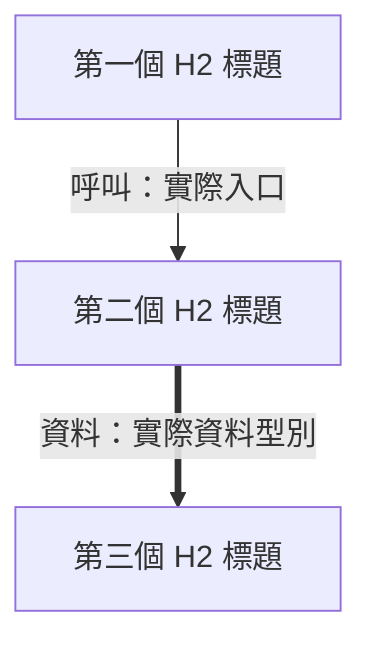

# 執行階段導讀 Implementation Plan

> **For agentic workers:** Use executing-plans for the documentation sequence and dispatching-parallel-agents for isolated chapter drafting/source audits. Steps use checkbox tracking. User has authorized spec review → plan review → direct writing. Review identities are fresh for each rolling round.

**Goal:** 交付 `docs/execution-guide/overview.md` 與九份階段導讀，使讀者能由目的、結構、members 與範例追蹤到真實函式、資料與 ownership。

**Architecture:** 導讀依目前 working tree 的執行階段組織。每頁三個 H2 units，首圖對應該三個 unit，各 unit 使用三個同層 H3：圖、資料結構與使用方式、實作流程。所有權與呼叫圖分開標籤，程式片段附真實來源。

**Tech Stack:** Traditional Chinese Markdown、Mermaid、C++23／GLSL／CMake／Lua source excerpts；本機 Node 檢查器與獨立 headless Chrome Mermaid render。產品 source、既有文件、tests 與 index 保持起始狀態。

**Spec:** `docs/superpowers/specs/2026-09-22-execution-guide-design.md`。Fresh reviewer `execution_guide_spec_review_r1`：0 Critical／0 Medium；三處字形已於 root 自查修正。

---

## Task 1：保護範圍與教材共用格式

**Files:**

- Create: `build/execution-guide-validation/check-guide.mjs`、`baseline.json`（本機工具與產物）。
- Create later: `docs/verification/2026-09-22-execution-guide.md`。
- Read: spec、`main.cpp`、現有 `docs/architecture/README.md`（用於既有索引與交叉連結）。

- [x] 核對 HEAD `a862457` 與六個既有 staged 路徑。已取得 index SHA256 `D07D53BBA95CAE4BA5414E04A874F7C91DD5A8D6586B22F43D0DCB06DB33BEB5`；既有 tracked/source/docs/tools 的 SHA256 快照保存為 baseline，偏好檔以既有保護資料為準。
- [x] 建立唯一新增正式文件目錄 `docs/execution-guide/`。所有 link 以該目錄為起點：程式連結 `../../...`、同目錄章節連結 `NN-name.md`、舊元件文件 `../architecture/name.md`。
- [x] 共用 unit 格式採下列實際標題；第一張 flowchart 定義 `U1`、`U2`、`U3`，三者 label 包含相應 H2 標題。外部節點以 `外部：` 標記。

````markdown
# 階段名稱



目的、需求、責任；前後篇連結；輸入／輸出／thread／owner。

## 第一個 H2 標題

### 結構與流程圖

Mermaid 圖與讀圖說明。

### 資料結構與使用方式

用途、需求、member 分組表、使用示例與 source link。

### 實作流程

真實 call graph、具名函式節錄、逐步解釋；必要背景放 H4。
````

此區塊定義排版 schema；正式教材填入各 task 指定的實際結構與呼叫。

## Task 2：啟動、使用者命令與主迴圈

**Create:** `01-startup-and-preferences.md`、`02-commands-and-session.md`、`07-controller-loop-and-projection.md`。

- [x] 01：依 `main.cpp`、`Application::initialize`、`ConfigStore::load`、`refresh_language`、`DesktopHost::create/Impl` 核對三個 H2「程序前提與服務組裝」「偏好、語言與快捷鍵初始化」「Controller owner 建立」。說明 RAII/reference/unique_ptr、`UserConfig` members、`ControllerWindowSetup`、font lifetime、初始服務建立順序。圖中標出主執行緒與 host/replica 獨立 owner。
- [x] 02：依 `ControllerView::render`、AppCommandQueue、`Application::process_command/handle(Start)/start_current`、SourceId/SessionId、source catalog/registry、factory 核對 H2「UI 意圖與 FIFO 命令」「來源識別與選取」「Session 與 runtime 建立」。範例使用實際 `SelectSource`、`Start` 與當前 view token；factory 順序以 source→overlay→adapter→render stack→inactive job→slots→publication 呈現。
- [x] 07：依 `Application::rebuild_view/process_runtime_result`、view-state types、`DesktopHost::Impl::run/render_controller/progress_presents`、ui cadence/input sync 核對 H2「Runtime facts 與 view 投影」「事件迴圈與 UI cadence」「ImGui 圖形資源與輸入交接」。寫出 `RuntimeTickResult`、`ControllerViewState`、host 的 FrameRecord/PresentRecord 與 CommandSink 的有效期間；區分 draw-intent、accepted command、retired present。
- [x] 每 unit 核對至少一段使用示例與一段真實函式節錄；對照定義 members、可見性與呼叫前提。以 H4 解釋新概念的目的及需要它的具體問題。

## Task 3：影格擷取、transport 與副本呈現

**Create:** `03-capture-and-scheduling.md`、`04-frame-transport.md`、`05-replica-render-and-present.md`。

- [x] 03 三個 H2：「Capture session 與 callback admission」「影格 checkout 與最新值交接」「主執行緒 tick 與 deadline」。來源為 `wgc_capture_job.*`、capture state/gate、`WindowsCapturedFrame`、LatestValueMailbox、FrameScheduler、runtime tick。列清 epoch、pending、active callbacks、allocation/content、generation、sequence；圖中分 WGC callback 與主執行緒，寫明 mailbox 交接與 D3 copy 之間的 frame checkout lifetime。
- [x] 04 三個 H2：「裝置能力與 bridge 選路」「CPU copy 與 row pitch」「共享 GPU image 與同步交接」。來源為 `WindowsFrameBridge`、`WindowsRenderStack`、bridge policy、`vulkan_input.hpp`、cpu row copy、renderer input completion。說明 LUID、SlotKey/FrameStamp、CpuRowsView、ExternalSampledImageView、CompletedProducerWait 的 members／borrowed scope。CPU 和 shared path 各給具名流程與實際 producer-completion 釋放點；fallback 與 drain 連至 08。
- [x] 05 三個 H2：「Slot 與 Vulkan submission」「座標、UV 與 texture sampling」「WSI 呈現與資源退休」。來源為 renderer Impl/CaptureSlot/PresentRecord/SwapchainState、record/submit、render_math、shaders、WSI。分清 copy、submission、presentation 三種完成證據，acquire/semaphore/fence 與 slot reuse 的關係。使用程式設定的 sampler／UNORM／alpha 規則解說取樣。
- [x] 覆算三組例子：1920×1080→1000×800 的 `aspect_fit` 得到 `(0,119,1000,562)`；allocation1000×800，crop `(100,50,400,200)` 的 offset `(0.1,0.0625)`、scale `(0.4,0.25)`、texel-center min/max；雙線性 `a=0.25,b=0.5` 四權重 `0.375,0.125,0.375,0.125`。說明 floor／ceil／單位與一像素邊界。
- [x] 明確解說共享 texture 的 D3 GPU copy、匯入 image 的 bridge ownership、renderer 的 borrowed registration，以及 CPU Map rows 回呼有效期間。

## Task 4：互動、復原、退出與工具

**Create:** `06-settings-and-window-interaction.md`、`08-recovery-and-shutdown.md`、`09-build-and-tools.md`。

- [x] 06 三個 H2：「設定交易與偏好發布」「框選、比例與滾輪幾何」「額外功能與 native owner」。來源為 Application settings handlers、runtime SettingsOperations、overlay_transactions、Win32 adapter/policy、browser keep-alive。對照新的 opacity SliderInt preview/commit、selection/reset 自動 fit、GeometryRestoreBounds Exact/WorkArea、wheel5%預設與 typedstep設定。說明設定快照／rollback/readback、幾何座標單位、helper window/class ownership。以實際 helper eligibility/type 呈現保活行為。
- [x] 08 三個 H2：「Source resize 與 graphics recovery」「停止、drain 與程序退出」「效能觀察與證據輸出」。來源為 runtime reconfiguration/recovery/drain、job stop、bridge/runtime cleanup、Application handle_stopped、host exit、diagnostics report。說明 allocation resize／WSI recreate／device rebuild 的觸發與owner；Stopped 與 AbandonProcess 的完成契約；報告 enum/counters 使用者、範圍與輸出路徑。
- [x] 09 三個 H2：「CMake target 與平台組裝」「Shader 與資源生成」「Lua 工具與驗證入口」。來源為 root/src CMake、Dependencies、VerifySourceBoundaries、EmbedSpirv、shader/resource CMake、Lua launcher/profiles/validator。CMake/Lua unit 用實際 target properties／table members 表達相同結構契約；提供具名 function/table 節錄。前置階段圖明示其 artifact→執行檔關係。

## Task 5：Overview 與文件整合

**Create:** `overview.md`。

- [x] Overview 三個 H2：「程序啟動與工作建立」「一張影格的旅程」「互動、回饋與退出」。首圖三個 unit 作骨幹，各 unit 節點包含所涵蓋階段編號；build 是外部前置，callback、主迴圈與 recovery 用實際分支表達。
- [x] 在第一張圖後放九篇閱讀表格；每篇三個 H2標題與首圖對齊。Overview 的三組 H3仍含跨階段 structures與短例，細節連往各章。
- [x] 建立跨篇 canonical 導覽：01 UserConfig/Host setup；02 SourceId/SessionId/AppCommand；03 WindowsCapturedFrame/FrameScheduler；04 SlotKey/FrameStamp/input views；05 CaptureSlot/PresentRecord/RegionSampling；06 geometry snapshot/ReplicaSettings；07 ControllerViewState/host records；08 recovery/drain/report；09 targets/Lua tables。
- [x] 逐頁核對 first-use 解釋與借用有效期間，移除重複的完整定義，保留本 unit 的 member 子集與短例。

## Task 6：結構、來源、Mermaid 與最後 rolling review

**Create:** 本機 `build/execution-guide-validation/check-guide.mjs`、`render-guide.mjs` 與圖像產物；`docs/verification/2026-09-22-execution-guide.md`。

- [x] 使用小型 Node checker，一次檢查固定十檔、每頁一H1／三H2／每H2三個指定H3、首張Mermaid三個U節點與H2文字相符、各unit兩張圖以上、member表、使用示例與具名實作code、fence閉合、local links存在、肯定式 prose 候選掃描。使用 `node build/execution-guide-validation/check-guide.mjs`；預期 exit0及文件/units/diagram/link計數。故意的缺H3／壞link／缺unit圖 fixture於記憶體中驗證checker會拒絕。
- [x] 將已有 `build/architecture-handbook-validation/render-docs.mjs` 作為本機 renderer 的起點，以 apply_patch 建立新副本：root依新路徑計算；scope限定execution-guide；輸出限定execution-guide-validation；assets使用目前安裝bundle；Chrome維持headless／新profile／loopback／windowsHide／finally收束。原helper保持原貌。
- [x] 執行 `node build/execution-guide-validation/render-guide.mjs --all`。預期每張圖皆產生SVG/PNG/report，strict DOM成功；逐頁檢視contact sheet，密集圖以原尺寸檢視，核對文字尺寸、bounds/viewBox與可讀性。調整過密圖後重繪該頁。此步使用背景headless實例與專用profile。
- [x] Root核對Start、frame delivery、CPU/shared同步、retirement、crop/reset、Stop/recovery各路徑；每個unit的code片段比對具名source。公式用Node算術重算；正向句型掃描涵蓋prose/Mermaid，operator和實際identifier按語意保留。
- [x] 全新 reviewer 對全套文件作完整來源／ownership／背景／結構review。root逐項核實finding，修正真實Critical/Medium後由全新identity重審，直到0C/0M。已完成agent結束turn，按可用工具的生命週期能力管理名額。
- [x] 再執行checker與 `git diff --check -- docs/execution-guide`，核對受保護檔案/index/HEAD雜湊。newdocs採工作樹交付，保持先前尺寸修正的staged集合；spec/plan/verification/tools/artifacts同樣保留本機。
- [x] 驗證紀錄列出review identities、findings核實、圖表/links/units計數、來源/公式抽查、圖像檢視與範圍保護結果。最終回覆給Overview入口、篇數與已驗證事項。

## 執行分工與邊界

Root負責Task1、01/02/07、Overview、最後整合與驗證。可平行委派一名writer負責03/04/05，另一名writer負責06/08/09；每名writer只修改各自新章節。各writer在寫作前親自核對相應source，將疑點連同source證據回報root。Spec／plan reviewer保持read-only；author與最後reviewer採不同identity。

每次review gate通過後再前進。篇幅以每unit完整解釋一個操作群為準；多個子操作透過H4與小圖展開。對現有程式的問題觀察寫入本機驗證備註，正式教材以當前事實及有效前提表達。
