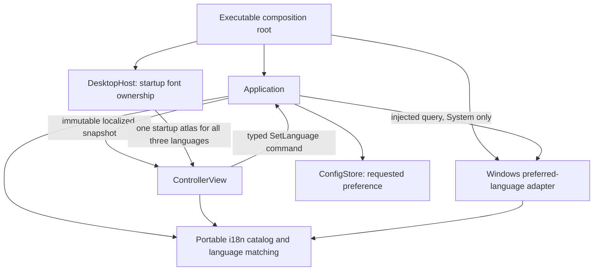

# Airelinna Interface Localization Design

**Date:** 2026-09-07

**Status:** Design direction approved; written spec awaiting user review

**Scope:** Traditional Chinese, English, and Japanese controller UI

## 1. Outcome and scope

Airelinna starts in the user's preferred supported Windows display language and lets the user switch languages without restarting the application or restarting capture. A manual choice survives subsequent launches.

The language selector belongs to general application settings, not the experimental Extensions section. It offers:

- Follow system, translated into the currently displayed language.
- English, always written as `English`.
- Traditional Chinese, always written as `繁體中文`.
- Japanese, always written as `日本語`.

The fixed native names make the menu usable even after choosing an unfamiliar language. The UI also shows the effective language when Follow system is selected.

Translate Airelinna-owned controller text: window content title, section headings, buttons, options, source-kind labels, lifecycle/status text, user-facing errors and notices, disabled reasons, warnings, hotkey validation feedback, and tooltips, including Browser capture keep-alive explanations.

Do not translate external source labels/window titles, HWND values, key-chord syntax, configuration keys/tokens, product names, diagnostic labels, or numeric native error details. Native OS window titles remain the stable product identifiers `Airelinna` and `Airelinna Replica`; the visible ImGui controller title is translated separately.

Non-goals are external language packs, browser/content translation, additional languages, locale-sensitive number/date formatting, plural-rule engines, translated pre-controller startup stderr output, or new capture/renderer behavior. This work does not perform release or publish operations.

## 2. Design choice

Use one small embedded UTF-8 catalog with stable text identifiers. All three languages ship with the executable and are available offline.

External JSON catalogs would add file discovery, packaging, parsing, and failure policy for three fixed languages. A general localization framework would add machinery for features the current UI does not need. Neither is justified here.

Separate the requested preference from the effective language:

- `LanguagePreference`: System, English, Traditional Chinese, Japanese.
- `Language`: English, Traditional Chinese, Japanese.
- `TextId`: a stable semantic identifier, independent of translated spelling.

These are portable presentation values. They do not become replica settings, runtime feedback, source capabilities, or extension settings.

## 3. Ownership and dependencies

Arrows describe use/data flow; the native query is supplied by the composition root, not constructed by Application. This adds no UI path to Win32 or the capture stack.

| Unit | Responsibility | Forbidden responsibility |
| --- | --- | --- |
| `i18n` leaf | Language values, stable text IDs, static translations, pure language-tag matching | OS queries, configuration I/O, ImGui, core domain state, GPU resources |
| Windows adapter | Read the ordered Windows preferred UI-language names and resolve them through the portable matcher | Own the user's preference, save config, refresh sources, alter browser settings |
| `Application` | Load/save the preference, resolve System, admit language commands, publish one effective language per snapshot | Include Windows APIs, alter a replica because of language, own font resources |
| App presentation mapping | Map typed lifecycle/error/feedback facts to catalog text | Change domain transitions or classify errors by translated strings |
| `ControllerView` | Render the snapshot and emit the language command | Query the OS, read/write config, directly call Application methods or native services |
| `DesktopHost` | Keep font data and the startup atlas alive through existing rendering lifetimes | Apply language preferences or rebuild GPU textures for a language change |

Add the shared leaf under `include/airelinna/i18n/` and `src/i18n/`, with the target `airelinna_i18n`. It has no other production-target dependency. App and UI may depend on it; core, capture, overlay, and replica rendering remain language-unaware.

The Windows language adapter uses the same leaf, through a narrowly allowed native dependency. Update the explicit production-target, source-root, link, and include guards in `cmake/VerifySourceBoundaries.cmake`. Do not broadly relax those guards or add a UI link to the app implementation or Windows targets.

Use a small injected callable for the system-language query, following the existing function-injection style. Application stores the callable by value; production composition supplies a stateless native query, not a closure borrowing a temporary adapter. Its result is a portable `Language`, never a native locale handle or a view into a destroyed API buffer. Do not introduce an `ILocalizationService`, locale event bus, service locator, or mutable process-global language. Application owns its preference/effective-language pair.

## 4. System-language policy

Use Windows preferred **UI/display languages**, not keyboard layout, regional date/number settings, geolocation, or a locale environment variable. The native adapter reads the ordered names from `GetUserPreferredUILanguages` with `MUI_LANGUAGE_NAME`.

For each returned name in order, match its primary language subtag case-insensitively:

| Name family | Effective catalog |
| --- | --- |
| `en`, `en-*` | `en` |
| `zh`, `zh-*` | `zh-TW` |
| `ja`, `ja-*` | `ja` |
| Unsupported or malformed name | Continue to the next preferred name |

The first supported family wins. All Chinese preferences map to Traditional Chinese because this version ships only that Chinese catalog; it does not claim Simplified Chinese support. Matching requires a complete primary subtag, not a loose prefix such as `english`.

If the query fails, yields no usable name, or finds no supported family, use English. This fallback must not prevent startup, change capture state, or produce a capture error. Native API buffer handling and failure containment stay in the adapter; the portable matcher receives ordinary string values/views.

Resolve System after loading config and before the first controller snapshot. Resolve it again whenever the user explicitly selects Follow system, including reselecting it when already selected. A manual language does not require an OS query.

There is no background OS-language watcher. An external Windows language change takes effect on the next launch or when the user selects Follow system again. The UI's language selection itself always takes effect live.

## 5. Persistence and compatibility

Add optional top-level `language` to V1 config. Keep `version: 1` and the existing required fields. `extensions` remains independently optional.

| Stored `language` | Requested preference |
| --- | --- |
| `"system"` | System |
| `"en"` | English |
| `"zh-TW"` | Traditional Chinese |
| `"ja"` | Japanese |
| Missing, unknown string, or wrong JSON value type | System |

Recover an invalid language field locally: preserve otherwise valid hotkey, FPS, border, and extension settings. This is an intentional exception for this optional preference, not a general relaxation of config validation. Invalid legacy fields, malformed JSON, unsupported versions, and unrelated extra keys retain the current default-recovery policy.

Accept old documents with neither optional field, either optional field alone, or both. Serialize the requested preference, never the resolved system language. Serialized tokens stay canonical and case-sensitive; OS tag matching and config-token parsing are separate policies.

New saves include the language field through the existing full-snapshot atomic replacement. Invalid in-memory language enum values are rejected before writing. Reading an older document does not itself trigger a rewrite. Older binaries are not promised forward compatibility with the additional V1 field, matching the existing Extensions compatibility policy.

On save failure, keep the accepted choice active in memory, retain the existing dirty-config policy, and show the config-write notice in the newly selected language. Do not roll back the UI, interrupt capture, add a background retry loop, or claim persistence succeeded. A later successful preference save persists the full current snapshot.

## 6. Live switching contract

Add session-agnostic `SetLanguage{LanguagePreference}` to the existing app command variant. It is an application preference command, not a `SetExtensions` or replica-settings transaction.

The handler validates the preference, resolves the effective language if needed, updates application preferences, and uses existing persistence. The next published snapshot contains both the requested and effective values, with all projected text using that same effective language.

Language selection is available while the app is accepting commands, including Starting, Capturing, Stopping, Interrupted, RecoveringGraphics, and Error. Do not reuse the replica `settings_allowed()` gate. Once shutdown closes command admission, language changes follow the existing quit/abandon ordering and are not processed.

A language command must not call runtime creation, settings application, stop, source refresh, hotkey replacement, or browser keep-alive operations. It must preserve source selection, session identity, pending replacement, replica mode/settings, and runtime ownership. Ordinary runtime ticks and events continue independently; localization does not reset the frame scheduler or add waits to capture callbacks.

Keep ordinary preference persistence on the existing path; this is not a new zero-latency disk-I/O guarantee. Do not add thread machinery solely for language changes.

All translated ImGui controls and the translated controller content title use stable nontranslated widget identities. Changing visible text must not create a different window/control identity, clear unfinished hotkey edits, alter source selection, or reset controller position/size. Continue rendering external titles as literal text with source IDs separate from visible labels.

Text in the UI and app projection comes from one snapshot language, not independent mutable locale settings. Tooltips and notices already on screen retranslate on the next frame. Switching successfully must not clear an unrelated application notice; existing operation-specific notice ownership remains intact.

## 7. Catalog and error presentation

Use a fixed catalog shape shared by all three languages, with static storage and allocation-free, nonthrowing lookup returning `std::string_view`. Require complete, nonempty entries for every shipped `TextId`, with compile-time shape checks and focused catalog validation.

Catalog source files and compiled narrow-string bytes must both use UTF-8, independently of the build machine's Windows code page. Configure the catalog target with `/utf-8` on the MSVC-compatible toolchain path, and an explicit equivalent where another toolchain requires it. Apply the same encoding contract to project test sources containing non-ASCII literals; do not change the process locale or impose compiler flags on third-party targets. A source-file BOM alone does not establish the execution encoding of ordinary narrow literals. Validate representative Traditional Chinese and Japanese catalog entries against independently specified UTF-8 bytes (ASCII hexadecimal escapes), not against another non-ASCII literal compiled under the same potentially incorrect settings. This extends the existing catalog-validation scenario rather than adding a separate test matrix.

English is the defensive fallback for an invalid language or absent localized entry. An invalid text ID returns a fixed safe fallback rather than indexing outside the catalog. Fallback behavior is not permission to ship untranslated entries in the three supported catalogs.

Keep IDs semantic, for example a status or disabled reason, not derived from the English sentence. Use complete phrases where word order differs; do not build translated sentences by joining English-ordered fragments. Do not introduce a message-format DSL. Catalog strings are data, never printf-style format strings; dynamic values are rendered through fixed formatting or unformatted text.

Map `core::AppErrorCode` to translated user explanations in the app presentation layer. Move the user-facing responsibility out of `AppError::user_message()` and remove that method after its callers/tests are migrated. Keep `AppError`'s fixed-size typed payload, retry policy, and stable `diagnostic_label()` independent of language; do not put the catalog in core or use localized text for logging identifiers.

Cover both ordinary `build_controller_view()` projection and the direct notice assignments in `Application::begin_shutdown()` and `emergency_abandon()`. Those no-throw containment paths must still use allocation-free lookup and must never query the OS, format dynamic messages, or perform config I/O to obtain translated text.

Validation performed in UI, such as invalid hotkey syntax, also uses the catalog. Canonical key names and accepted hotkey syntax remain unchanged. Early failures before the controller/Application exists continue to use the existing diagnostic output; translating startup infrastructure is outside this feature.

## 8. Font and layout contract

Keep the existing startup font ownership: the Windows loader supplies font bytes, DesktopHost owns their lifetime, and the controller font helper builds the atlas before ordinary UI rendering. Retain the current installed `msjh.ttc` font path and font-load failure behavior; do not bundle fonts or introduce a runtime font download/fallback service in this feature.

The startup atlas must cover every character used by all three shipped catalogs and language-menu names, regardless of the first selected language. Verify actual glyph presence in the loaded font as well as the configured ranges. A CJK range declaration or a test of a few Chinese characters alone does not establish Japanese coverage.

Language switching reuses this atlas. Preserve the existing ImGui/Vulkan upload and retirement policy, including the intentional suppression of dynamic backend texture uploads. Do not rebuild the atlas, enable a different texture path, or wait for GPU idleness on a language command.

Missing glyphs in shipped translations or an atlas exceeding the existing size budget block acceptance; replacement-glyph rendering is not a successful localization result. This feature does not promise arbitrary Unicode/emoji coverage for external window titles.

Use normal text wrapping and available-width sizing for longer Japanese/Chinese labels, reasons, and tooltips. At the existing supported controller size and DPI settings, each language must retain access to all controls, including through existing scrolling. No unrelated window-layout redesign is required.

## 9. Verification and acceptance

Extend existing contract tests where practical. Keep additions focused, approximately 10-20 scenarios in total rather than a language-by-lifecycle-by-GPU matrix. Table-driven input checks and static catalog validation can cover repetitive cases without dozens of separate tests.

Acceptance covers:

1. Ordered language matching, all three families, case/subtags, unsupported names, and query-failure English fallback. Windows API adaptation is checked separately from the pure matcher.
2. Existing V1 config with neither/either/both optional fields; language round trips; invalid language-only recovery preserving other preferences; unrelated invalid config still follows existing policy.
3. Startup respects System/manual selection, persists the preference rather than effective language, and produces a consistently localized first snapshot.
4. Live switching and explicit System reselection update the next snapshot; save failure keeps the new language and dirty state and displays the localized persistence notice.
5. Active/stopping/error-state switching preserves runtime/settings/source/session ownership, does not invoke native control operations, and obeys command admission after Quit.
6. Catalog completeness, independently checked UTF-8 bytes for representative Chinese/Japanese entries, and localized error/status/disabled-reason/extension-tooltip coverage, including direct shutdown/emergency notices without weakening no-throw behavior.
7. Stable UI identities and preserved unfinished hotkey input; unchanged literal source labels, HWND, hotkey syntax, and diagnostic codes.
8. Actual glyph coverage for every shipped catalog/menu character using the installed font, within the current atlas budget. This remains a startup/font test, not a new GPU integration suite.

Run the existing relevant app/UI contracts and source-boundary verification during implementation. Manually cycle all three languages and System while a replica is playing, verify capture continues, inspect wrapping/tooltips at supported DPI, and relaunch to verify a manual choice persists. OS-language variations can be covered with injected query results rather than requiring the user to change Windows settings repeatedly.

This document does not assert implementation, build success, glyph coverage, or manual validation; those are implementation acceptance gates.

## 10. References and workflow

- [V1 architecture rules](2026-08-24-airelinna-design.md): frontend commands, application sequencing, native ownership, and bounded abstractions remain authoritative. This spec adds a presentation-only leaf, not a new hardware-control path.
- [Current application/UI architecture](../../architecture/application-ui.md).
- [Windows preferred UI-language API](https://learn.microsoft.com/en-us/windows/win32/api/winnls/nf-winnls-getuserpreferreduilanguages): source of ordered user display-language names.
- [Microsoft JhengHei font information](https://learn.microsoft.com/en-us/typography/font-list/microsoft-jhenghei): font context only; local glyph verification remains required.
- [Microsoft source and execution UTF-8 option](https://learn.microsoft.com/en-us/cpp/build/reference/utf-8-set-source-and-executable-character-sets-to-utf-8): encoding must be explicit rather than inherited from the build machine's code page.

After the user reviews this written spec, create a separate implementation plan. Tests, spec, plan, work-record Markdown, and release/publish artifacts remain excluded from commits unless the user explicitly changes that scope. This spec-writing step performs no commit.
