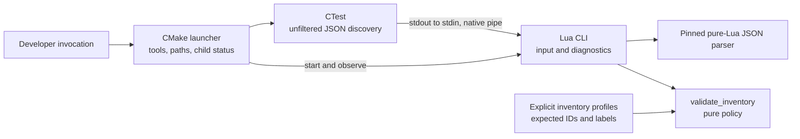

# Airelinna Portable Lua Tooling Design

**Date:** 2026-09-08

**Status:** Two fresh-agent review rounds complete; no unresolved critical/high/medium findings. Written spec awaiting user approval before implementation planning.

**Scope:** Replace the first-party PowerShell CTest inventory gate with shared Lua validation and a thin CMake launcher. No application implementation or publish operation.

## 1. Outcome and existing behavior

Developers can inspect an Airelinna CTest inventory without requiring PowerShell. Windows, Linux, and macOS use the same launcher and Lua policy code. Lua remains a development-tool dependency, not an Airelinna executable dependency.

The current first-party script inventory contains one PowerShell file, `cmake/VerifyTestInventory.ps1`. It resolves an existing build directory, invokes unfiltered `ctest --show-only=json-v1`, and checks 15 canonical cases, commands, and labels. It has no Win32, capture, GPU, registry, or browser operation. Current callers are manual documentation examples, not a CMake target or CI workflow. Several historical plans also contain PowerShell examples; those are not additional scripts to port.

Preserve the complete Windows gate: exactly IDs 01-15, each with `airelinna-v1`, and the `hardware` label on exactly 13-15. A successful inventory check is not evidence that test bodies passed, their commands are executable, or native capture works.

This tooling portability does not implement Linux/macOS capture or promise that the entire application builds on those hosts. Existing tests are local, uncommitted working-tree content; publishing this tool later would not by itself make those tests available in a clean checkout.

## 2. Chosen approach and non-goals

Use CMake for host process/path handling and Lua for parsing, inventory policy, and diagnostics. CMake is already a project prerequisite. This avoids a new native Lua process module or handwritten Windows/POSIX shell-command quoting.

Alternatives considered:

- A standalone Lua orchestrator would offer a single `lua ...` command, but Lua's standard process APIs involve shell/platform behavior. A native process library or OS-specific runner would add dependencies and maintenance for one small gate.
- A pure CMake validator would avoid adding Lua but place the substantial data-validation policy back in CMake. It does not provide the requested shared Lua policy interface.

Do not add a general task engine, plugin loader, service locator, Lua embedding, OS class hierarchy, LuaRocks dependency, background service, or new production target. Do not migrate existing `.cmake` helpers, shader generation, dependency fetching, compiler-environment setup, or release automation as part of this work. Do not rewrite third-party or generated scripts.

## 3. Ownership and file boundaries



Arrows show invocation/data flow, not application runtime dependencies. Neither the tooling nor its JSON parser is linked, loaded, or called by `main`, `core`, `app`, UI, i18n, desktop hosting, or native capture/rendering code.

| Proposed file | Owns | Must not own |
| --- | --- | --- |
| `cmake/VerifyTestInventory.cmake` | CLI variables, tool discovery, path validation, child processes, aggregate exit status | JSON parsing, case IDs, label rules, application configuration, hardware consent |
| `tools/verify_test_inventory.lua` | Lua CLI admission, stdin, parser invocation, selecting a named profile, user diagnostics | Starting processes, OS detection, filesystem discovery, native APIs |
| `tools/lib/test_inventory.lua` | Pure `validate_inventory(document, profile)` returning an ordered array of diagnostic strings | Printing, file/process I/O, environment variables, application state |
| `tools/lib/inventory_profiles.lua` | Fixed data tables identifying the expected inventory | Executable paths, OS probing, deriving expectations from actual discovery |
| `tools/vendor/dkjson.lua` | Unmodified pinned third-party JSON implementation | Project policy or native extensions |

The validator accepts the decoded JSON value representation described in section 6 and a trusted built-in profile. It does not mutate either input. An empty diagnostic array means the supplied document satisfies that profile; the CLI owns translating that result into an exit status.

These are concrete modules, not interchangeable services. Keep parsing orchestration in the CLI and validation helpers together in the policy module; do not create an interface for each field or validation rule.

## 4. Supported entry point and process contract

The public gate is the script-mode CMake launcher, usable without configuring this source checkout or finding C++/graphics dependencies first. CMake and CTest must be 3.28 or newer. Use only facilities available at the project's existing CMake 3.28 floor.

| Input | Contract |
| --- | --- |
| `BUILD_DIRECTORY` | Required, nonblank existing directory containing a generated `CTestTestfile.cmake`. Resolve relative paths against the invoking working directory before changing child working directories. |
| `CONFIGURATION` | Optional, nonblank when supplied; forward as one `-C` argument. Multi-config callers must supply the intended configuration. No guessed `Release`. |
| `LUA_EXECUTABLE` | Optional absolute path to a real Lua executable. Otherwise discover `lua`, `lua5.5`, or `lua5.4` on the host PATH and fail clearly if the discovered interpreter is unsupported. |
| `CTEST_EXECUTABLE` | Optional absolute path to a real CTest executable. Otherwise prefer the CTest beside the running CMake, then the host PATH. Verify its supported version. |
| `INVENTORY_PROFILE` | Optional, exact built-in name; omission selects `windows-v1-full`. An empty or unknown supplied name is an error, not a fallback. |

Example full Windows invocation, as a single line that requires no PowerShell syntax:

```text
cmake -DBUILD_DIRECTORY=build/windows-full -DCONFIGURATION=Release -DLUA_EXECUTABLE=C:/lua/lua.exe -P cmake/VerifyTestInventory.cmake
```

Example invocation for an existing non-Windows core-test build:

```text
cmake -DBUILD_DIRECTORY=build/core -DINVENTORY_PROFILE=portable-core -P cmake/VerifyTestInventory.cmake
```

The examples name illustrative build directories; they do not assert those builds currently exist. Quote an entire `-DNAME=value` argument using the invoking shell's rules when the value contains spaces or shell metacharacters such as `&`; native child launching cannot recover arguments already split or expanded by the caller's shell. `C:/lua/lua.exe` is an explicit local override, never a repository-wide default or a change to PATH. Do not search the registry, download Lua, or modify a developer's Visual Studio environment. On Windows accept native executables, not `.ps1`, `.bat`, or `.cmd` substitutes.

The launcher uses CMake's native `execute_process` pipeline with two commands: the selected CTest with `--test-dir <absolute build> --show-only=json-v1` and optional `-C`, followed by the selected Lua interpreter with `-E verify_test_inventory.lua` and the optional profile argument. There are no test-name/label filters, shell redirections, shell command strings, or CMake-to-Lua `-e` interpolation of paths or JSON. Do not use `find_package(Lua)` to introduce a Lua library/link requirement.

Set the pipeline working directory explicitly to the repository's `tools/` directory, resolved relative to `CMAKE_CURRENT_LIST_DIR`. Launch the Lua script and load its own modules using ASCII relative names there. The public entry point therefore works from another current directory and does not require stock Windows Lua to open a non-ASCII absolute script path. Lua receives inventory bytes over stdin, not through an absolute JSON filename. Preserve spaces, non-ASCII characters, and shell metacharacters such as `&` in paths as single arguments. For this first version, reject semicolons and CR/LF in path/configuration inputs with an explicit error; do not silently split or normalize them into different arguments.

Capture final stdout separately from combined child stderr, with explicit UTF-8 output handling. The native pipe carries CTest JSON bytes directly to Lua without a PowerShell encoding conversion. There are no persisted inventory snapshots or temporary-file cleanup operations.

Apply a fixed 30-second timeout to inventory collection/validation and finite 5-second tool-version probes. Inspect `RESULTS_VARIABLE` for both pipeline children: success requires two normal zero exits. A missing result, launch error, signal, timeout, or any nonzero exit fails the gate. Checking only the final child's exit code is forbidden. Buffer the Lua success text and publish it only after aggregate success; never print an inventory-success banner when CTest failed. Report child identities/statuses and available diagnostic stderr on failure without dumping the full JSON or command arrays.

Build directories and tool executables are developer-trusted inputs. `--show-only` does not execute test bodies, but CTest still interprets generated CMake metadata and may perform discovery configured by that build. This tool is not a sandbox for arbitrary downloaded build trees. It never supplies capture-consent environment variables or starts Airelinna itself.

## 5. Host platform versus inventory profile

The host platform determines executable/path mechanics, already handled by CMake. A profile describes the expected target/build inventory; it is deliberately independent of the host platform and is never inferred from how many tests were discovered.

| Profile | Exact case IDs | Hardware IDs | Intended existing build contract |
| --- | --- | --- | --- |
| `windows-v1-full` (default) | 01-15 | 13, 14, 15 | Windows tests ON, Windows integration ON |
| `windows-policy` | 01-12 | None | Windows tests ON, Windows integration OFF |
| `portable-core` | 01, 02, 03, 04, 05, 07 | None | Non-Windows core-test target |

These sets follow the current `tests/CMakeLists.txt` branches and corresponding `TEST_CASE` declarations, not a live discovery result. Every profile requires `airelinna-v1` on every test. Store the sets in one Lua data module; derive their expected counts from those sets, not from input data. Do not duplicate them in the CMake launcher.

Profiles are selected explicitly by the caller, except for the preserved strict full-gate default. A 12-case inventory must fail under the default profile even on Linux; a full 15-case fixture can be validated on any host. A fresh tests-OFF build with no generated inventory, or an empty inventory, cannot pass any profile. A successful smaller-profile check must name that profile and is not a substitute for the full Windows gate in V1 acceptance.

The gate validates discovered metadata, not its freshness or the current CMake options. Reconfiguring a reused build tree from tests ON to OFF may leave old CTest files and binaries that still satisfy a profile; this gate can accept that retained inventory. The same limitation applies to other stale configuration results. Developers must use a separate freshly configured build tree for the intended acceptance configuration. Do not infer that tests are currently enabled from a success banner, delete old build files, or add a cache/freshness subsystem to this migration. CMake's [test-file generation path](https://raw.githubusercontent.com/Kitware/CMake/v3.28.0/Source/cmLocalGenerator.cxx) returns without regenerating test files when testing is disabled.

Do not create `platform/windows.lua`, `platform/linux.lua`, or `platform/macos.lua` placeholders now. If future tooling truly needs native operations, introduce a narrow operation boundary at that time, keep its configuration outside the pure policies, and share an implementation across hosts when behavior is identical. No prospective adapter may reach into the application's runtime services.

## 6. Lua, JSON, and validation contract

Support stock PUC Lua 5.4.x and 5.5.x using their shared language/library subset. Reject other interpreter families/versions rather than claiming untested compatibility. The local `C:/lua` installation currently reports Lua 5.5.1; that is not evidence of a Linux/macOS run.

Vendor dkjson 2.11 unchanged under `tools/vendor/dkjson.lua`, retaining its embedded license. Pin the official source URL and SHA-256 in a short adjacent `README.md`; verify the exact bytes when vendoring and record the dependency as development-only in `THIRD_PARTY_NOTICES.md` during implementation. The official file is `https://dkolf.de/dkjson-lua/dkjson-2.11.lua`, SHA-256 `197cb50834c642f84b4cf99fe724932c50e6d9c92faec7ad89aa25e91df4d481`. Use its pure-Lua decoder only, without LPeg, binary modules, runtime downloads, or a handwritten JSON parser.

The launcher starts Lua with `-E`, ignoring Lua initialization/path environment overrides. The CLI sets module lookup to its own `lib/` and `vendor/` locations and does not fall back to globally installed replacement modules. This is deterministic tool loading, not a general Lua security sandbox.

The internal CLI accepts only an optional `--profile <name>` or standalone `--help`; duplicate, unknown, incomplete, or empty arguments fail clearly. With no profile argument it selects `windows-v1-full`. A direct CLI invocation reads an already supplied document from stdin; it cannot attest that CTest succeeded, so the CMake launcher remains the documented end-to-end gate.

Read at most 4 MiB plus one byte of text as delivered by Lua stdin and reject an oversized document. Require a nonblank input and one decoded root object. Keep JSON `null` as an explicit sentinel, and retain dkjson's array/object type metadata so `{}`, `[]`, `null`, and sparse/null-containing input do not collapse into the same Lua-table interpretation. Contain decoder exceptions, check its returned error and ending position, and reject trailing non-whitespace data in that delivered text. Only ASCII JSON whitespace is accepted after the decoded document. This is a CTest-schema gate, not a general strict-JSON conformance tool; dkjson's existing decoding extensions are not reimplemented or promoted into a new configuration format.

These limits do not attest to raw OS-pipe bytes. Stock Windows Lua reads stdin through CRT text mode, which can translate CRLF to LF and treat a raw Ctrl+Z as EOF. The intended producer is trusted CTest JSON, whose string control characters are escaped; arbitrary binary producers are outside this contract. Document this stream limitation rather than adding a native binary-mode module, platform backend, or transport rewrite. See [Lua's stdio reader](https://www.lua.org/source/5.4/liolib.c.html#read_chars) and [Windows CRT translation](https://learn.microsoft.com/en-us/cpp/c-runtime-library/file-translation-constants?view=msvc-170).

The policy validates:

1. Root `kind` is `ctestInfo`; `version` is an object with major 1 and a nonnegative integer minor. Unknown supplemental fields are allowed. Unsupported major versions fail with a format diagnostic.
2. `tests` is a JSON array of exactly the profile's expected count, with object entries. No filtering of foreign tests, missing entries, or malformed records before the count check.
3. Each `name` is a nonblank string in the form `Airelinna V1 case NN: <nonempty description>`, with two ASCII digits and an ID in the expected set. Preserve the old script's case-insensitive ASCII prefix comparison; suffix wording is not a second hard-coded inventory. Detect duplicate and missing IDs independently of order.
4. Each `command` is a nonempty JSON array of nonblank strings. Treat it as opaque metadata: do not execute it, resolve command paths, or rewrite Windows paths when validation runs on another host.
5. Each `properties` is a JSON array of objects and contains exactly one property whose `name` is case-sensitively `LABELS`. Its `value` is a JSON array of nonblank strings containing exactly spelled `airelinna-v1`. Other labels and unrelated properties may exist.
6. The set of IDs carrying the exact `hardware` label equals the selected profile's hardware set. Extra hardware labels on nonhardware cases, missing required labels, or profile mismatch fail.

Nonblank means the string contains a character other than ASCII space, tab, CR, LF, form feed, or vertical tab; no process-global locale changes or Unicode-normalization layer are introduced. Input strings remain UTF-8 data, never format strings or Lua code. Collect structural/policy diagnostics in input order, followed by missing IDs in numeric order; malformed structures produce diagnostics rather than unchecked field indexing. Stop descending into a malformed field after identifying its shape error.

The migration intentionally strengthens malformed-input handling: the old PowerShell implementation wraps several scalar values into arrays and does not validate the CTest kind/version envelope. The new gate requires the documented CTest JSON shapes. Existing project-generated inventories retain their expected results; permissive acceptance of malformed JSON shapes is not a compatibility requirement. Lowercase/mixed-case labels do not satisfy the exact required labels.

ASCII-only nonblank is another intentional migration difference, not a claim of complete PowerShell equivalence. The old `String.IsNullOrWhiteSpace` rejects strings made solely of Unicode whitespace, including U+00A0 and U+3000; the new rule treats those UTF-8 bytes as nonblank. Such an opaque command argument or extra label is allowed, but it cannot replace any required case-name prefix or exact label. Cover this difference in the existing command/label table-driven scenarios rather than adding a Unicode classification library.

Lua CLI exit codes are 0 for accepted inventory/help, 1 for rejected input/schema/policy, and 2 for usage, unsupported interpreter, missing module, I/O, or unexpected internal failure. Every failure is nonzero. Keep ordinary diagnostics English and nonlocalized; do not depend on application i18n. The CMake public contract is simply zero success/nonzero failure, not numeric forwarding of Lua's status. Preserve the old full-profile success line; smaller-profile success lines identify their profile, case count, and absence of hardware cases.

## 7. Migration and documentation

Implement the new tool alongside the old script, compare their outcome on representative valid inventories, and exercise the intentional malformed-input differences explicitly. Remove `cmake/VerifyTestInventory.ps1` only after the replacement passes its acceptance checks; do not leave a PowerShell wrapper as a hidden dependency. No other existing source or user data is removed.

Update the active gate reference/diagram in `docs/architecture/build-and-validation.md` and add usage, prerequisites, profiles, path limitations, and failure interpretation in `docs/development/lua-tooling.md`. Historical plans/specs remain historical records and are not bulk-rewritten to erase PowerShell mentions. Do not claim that Visual Studio environment setup or platform-specific build prerequisites have disappeared.

Do not add a mandatory Lua lookup to top-level CMake configuration or normal production builds, including tests-OFF/clangd workflows. The gate is a separately invoked developer utility. Leave source/link boundary allowlists unchanged; this work does not need an exception connecting Lua tooling to C++ production layers.

Tests, specs, plans, `other-issue.md`, and similar work records stay out of commits. This spec-writing/review task stages or commits nothing. Later implementation does not imply permission to commit or publish; any authorized commit must use explicit file selection and preserve unrelated working-tree changes.

## 8. Verification and acceptance

Keep approximately 10-15 focused scenarios total, table-driven where useful. They belong to a separate tooling harness under `tests/tooling/`, not additional Catch2 cases or registrations in the inventory being validated. Do not create a native mock hierarchy, production test hooks, or a language-by-OS-by-profile Cartesian test matrix.

The bounded scenario groups are:

1. Accepted shuffled full inventory; exact existing success message; extra unrelated metadata/labels remain allowed.
2. Both smaller profiles accept their exact sets; omitted profile remains full; wrong profile, fresh tests-OFF/no-metadata, and empty inventory fail. A retained valid inventory remains acceptable after tests are disabled in its reused build tree, documenting the freshness non-guarantee.
3. Missing, duplicate, unexpected, and out-of-range case IDs, including the noncontiguous portable set.
4. Name shape and ASCII prefix case compatibility; malformed test entries produce diagnostics.
5. Empty/malformed/trailing/oversized JSON and unsupported envelope; parser exceptions fail without a success banner.
6. Arrays versus objects/scalars/null, including null entries that must not disappear during decoding.
7. Missing/empty/malformed command arrays and opaque non-ASCII/path content, including the deliberate acceptance of a Unicode-whitespace-only argument.
8. Missing/duplicate LABELS properties, bad value types, exact label spelling, incorrect hardware placement, and an allowed extra Unicode-whitespace label that does not replace a required label.
9. CLI usage, unsupported Lua, deterministic local module lookup, and Lua environment overrides ignored by the public launcher.
10. Launcher prerequisites, relative build paths resolved before the child working-directory change, optional configuration forwarded exactly, and execution from outside the repo root.
11. Real two-child pipeline failure handling: upstream failure even if its consumer succeeds, downstream failure, launch failure, and timeout never report success.
12. Paths with spaces, Traditional Chinese/Japanese, and `&`; explicitly rejected semicolons/CR/LF; UTF-8 input/diagnostics through the native pipe.

Reuse a small synthetic CTest build tree for launcher checks; inventory inspection must not run its test bodies. Use the real launcher and Lua CLI for integration evidence rather than a duplicated implementation of their argument/status policy. Test helpers are local fixtures, not new runtime ports. Verify the vendored source hash and license before use.

During implementation, run the policy/CLI harness on local Lua 5.5.1, then the same shared harness on Lua 5.4 and at least one Linux host. Run the launcher against the available Windows nonhardware inventory with `windows-policy`; inspect the full inventory if that build is available, without running hardware cases. Full-profile synthetic coverage remains required even if no full build exists. Linux checks can use a synthetic CTest tree without building the Windows application. macOS must be reported as unverified until its same harness/launcher smoke check actually runs; lack of a host is not evidence of success or a reason to add an unused backend.

Acceptance requires the new gate to preserve full-profile strictness, all confirmed critical/high/medium review findings resolved, no new runtime dependency or boundary exception, and current documentation to distinguish inventory validation from test execution. Report actual OS/interpreter coverage and any unavailable environment separately. This spec review is not build, test, hardware, or cross-platform execution evidence.

## 9. References and workflow

- [V1 architecture rules](2026-08-24-airelinna-design.md), especially canonical ownership and abstractions requiring real boundaries.
- [Current build and validation architecture](../../architecture/build-and-validation.md), [current inventory gate](../../../cmake/VerifyTestInventory.ps1), and [test target declarations](../../../tests/CMakeLists.txt).
- [CMake execute_process](https://cmake.org/cmake/help/latest/command/execute_process.html): native pipelines, per-child results, timeout, and output encoding. The selected facilities predate the project's CMake 3.28 floor; newer environment-modification options are not required.
- [CTest JSON object model](https://cmake.org/cmake/help/latest/manual/ctest.1.html#show-as-json-object-model): inventory format, not test-execution results.
- [Lua 5.5 manual](https://www.lua.org/manual/5.5/manual.html): standard-library/process limits and standalone interpreter options.
- [dkjson source](https://dkolf.de/dkjson-lua/dkjson-2.11.lua) and [upstream hashes](https://dkolf.de/downloads): dependency version, pure-Lua behavior, license, and reproducible source identity.

After this document is written and self-reviewed, perform rolling review with a fresh reviewer each round. Verify each finding against this spec, the current sources, and authoritative tool contracts before editing. Repeat after confirmed fixes until a fresh full review reports no unresolved critical/high/medium finding. Do not reuse a previous reviewer as the next round. Close completed reviewers if the environment exposes that operation; otherwise report the limitation rather than claiming that a stopped/completed thread was deleted.

Then return the reviewed spec to the user. A detailed implementation plan and code changes are separate, subsequent work after approval of the written spec.

## 10. Rolling review result (2026-09-08)

- Round 1, `lua_tooling_spec_review_r1`: Critical 0 / High 0 / Medium 1 / Low 1. Independently confirmed and corrected the tests-OFF/freshness overclaim and the undocumented Unicode-whitespace compatibility difference. Also clarified caller-side shell quoting during local review.
- Round 2, fresh reviewer `lua_tooling_spec_review_r2`: Critical 0 / High 0 / Medium 0 / Low 0 after a complete review of the revised spec and its source contracts, including rechecking the prior fixes. Ready for the user's written-spec approval and a subsequent implementation plan.

Both reviewers finished their work. The current tool interface has no thread-delete/close operation; stopping or completing an agent is not recorded as deletion or confirmed quota release. No code, tests, dependency vendoring, build, capture, staging, or commit was performed by this spec-writing/review task. Platform/interpreter execution acceptance remains future implementation work.
