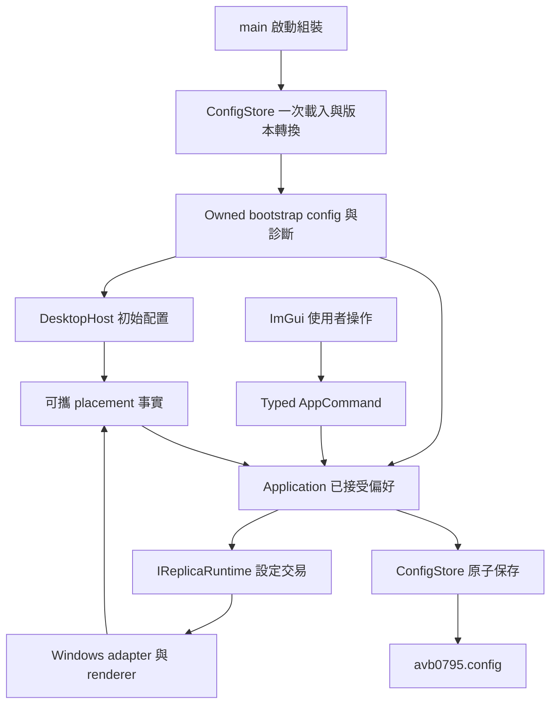

# 使用者設定保存：下一階段準備稿

狀態：歷史準備稿。2026-09-15 使用者將範圍收斂為通用偏好；正式規格見 [通用偏好保存](2026-09-15-general-preferences-design.md)。以下保留先前方案盤點供查閱，實作以正式規格為準。

## 目的與需求

為了在重新啟動後接續上次的使用習慣，程式需要保存已接受的選項，並在啟動與建立 replica 時載入。設定保存沿用既有 `UserConfig`、`ConfigStore` 與 Application 的接受流程，讓畫面、runtime 與磁碟中的值維持明確的先後關係。

這個需求分成三組：

- 通用偏好：語言、快捷鍵、FPS、邊框、穿透模式、browser keep-alive、不透明度、自動更新來源清單。
- 視窗配置：控制面板與 replica 的位置、client 大小，以及還原時需要的 DPI／螢幕資訊。
- 最近使用內容：來源候選與已套用選區；來源還原互動由下方的產品選項決定。

正在拖曳的矩形、XYWH 草稿、快捷鍵錄製與 selection 的 Editable／100% 暫時呈現維持在當次互動生命週期。保存對象採用使用者已接受的偏好。

## 已有能力與擴充範圍

| 設定 | 目前行為 | 下一階段方向 |
| --- | --- | --- |
| 語言、快捷鍵、FPS、邊框、browser keep-alive | `UserConfig` V1 已保存 | 延續既有驗證與 runtime 接受流程 |
| 不透明度 | 已保存；拖曳結束時提交 | 延續 preview／commit |
| 自動更新來源清單 | Application 本次執行值 | 加入通用偏好，啟動時恢復勾選狀態 |
| Editable／PassThrough | 本次 session 的期望模式 | 保存期望模式，建立 replica 時經 capability 與原生交易套用 |
| 控制面板位置／大小 | 啟動為 520×720 | 加入可攜 placement 值與原生回報 |
| Replica 位置／大小 | 建立時依來源計算 | 加入 placement，與選區的來源像素分開建模 |
| 已套用選區 | 同一選定來源的 Stop→Start 可沿用 | 依來源還原選項保存，使用實際呈現尺寸驗證 |
| 選定來源 | 目前 catalog 的 `SourceId` | 保存來源描述，重新列舉後建立候選 |

盤點依據：`include/avb/app/config_store.hpp`、`src/app/config_store.cpp`、`src/app/application.cpp`、`main.cpp`、`src/desktop/desktop_host.cpp`、`platform/windows/windows_runtime_factory.cpp`。

## 檔案位置與相容性

為了讓設定檔跟隨可攜式執行檔，提案採用執行檔旁的 **`avb0795.config`**，內容維持可閱讀的 JSON。既有設定檔目前為同位置的 `airelinna.json`；舊檔讀取能力納入升級流程。

1. 查詢執行檔所在目錄，建立固定的新舊設定路徑。
2. 新檔存在時讀取新檔；內容驗證診斷與欄位預設規則也以新檔為準。
3. 新檔缺席時，讀取舊檔並在記憶體轉成新結構。
4. 下一次成功保存寫入新檔，舊檔維持原內容供使用者復原。
5. 新增欄位使用具體型別與個別驗證；有效的其他欄位持續保留。未知 schema 版本顯示診斷並啟用寫入保護，保留檔案供後續版本處理。

完整擴充採 V2 schema；V1 的語言、快捷鍵等原值透過明確轉換帶入。讀取來源、格式版本與診斷由一次載入結果攜帶，供啟動組裝與 Application 共用。

設定目錄的寫入權限沿用目前可攜式程式的需求。保存錯誤顯示在控制面板，記憶體維持已接受值，後續保存時機可重試。

## 責任歸屬與資料流

為了在首次顯示時使用正確配置，啟動需要提早取得設定。`main` 將檔案解析放在 host 建立之前，載入結果以 owned value 傳給 host 與 Application；目前 command queue、host 與借用 wake callback 的服務之建構順序仍保持原有生命週期關係。

- UI 負責互動與命令值。
- Application 負責偏好接受、保存時機、dirty 狀態與診斷。
- ConfigStore 負責 schema、JSON 轉換與檔案交易。
- DesktopHost／runtime 負責原生視窗位置的觀察與套用，對外傳遞可攜值。
- Windows adapter 負責螢幕工作區、DPI 與 HWND 操作。

為了維持既有停止期限，正常操作過程就完成保存：離散選項於接受後保存，拉桿於 gesture 結束保存，移動／縮放於完成事件保存；多個短時間配置事實可以使用現有主迴圈 deadline 合併。關閉流程延續現有 bounded drain。

## 視窗配置的座標契約

為了讓跨 DPI 與螢幕配置改變後仍有可操作的視窗，placement 需要攜帶正常顯示狀態的螢幕位置、client 大小與保存時 DPI。螢幕座標支援負值，client 大小採正值，數值讀入時檢查範圍。

還原時由 native owner 根據目前螢幕工作區調整位置，套用目前 DPI 所需的尺寸，讓標題與操作區落在可見範圍。最小化狀態保存對應的正常顯示矩形。控制面板與 replica 各有一筆配置，縮放 replica 的長寬比持續由實際選區決定。

目前 ImGui 的 ini 保存已由 host 關閉；Controller 每幀填滿 host viewport。這個需求使用原生 placement 資料介面來銜接設定服務。

## 來源與選區的還原選項

為了將上次內容對應到新一輪來源列舉，保存資料需要可解釋的來源描述。視窗候選可使用程式與標題提示，顯示器候選則使用平台可提供的顯示器識別。重新列舉產生當次 `SourceId`，HWND 保持原生執行期 handle 的角色。

建議方案：啟動時帶回上次來源候選與選區，使用者確認來源並按「開始擷取」。來源尺寸在有效呈現後取得，選區再依實際內容做交集驗證；空交集使用完整來源。多個候選並列供使用者選擇。

目前待選擇的三種行為：

- 帶回上次來源候選與選區，由使用者按開始擷取（建議）。
- 明確匹配上次來源後自動開始擷取；多候選時顯示選擇介面。
- 先保存通用偏好與視窗配置，來源與選區在每次使用時重新選擇。

來源描述中的程式路徑與視窗標題屬使用者資料，保存在本機設定檔；診斷使用固定錯誤標籤。操作文件應說明這些欄位，方便分享設定檔前檢查。

## 後續實作切片與驗證

來源還原選項確認後，計畫依下列切片定稿；每片保持可建置、可驗證與獨立 review 的範圍。

1. Schema／新舊路徑／一次啟動載入，以及自動更新、模式等通用偏好。
2. Controller／replica placement 事實與初始化套用。
3. 依選定方案加入來源候選、已接受選區的保存與恢復。

驗證沿用現有 case inventory，集中在 V1→V2、欄位個別復原、原子寫入失敗、命令接受後保存、啟動載入次數、負螢幕座標與 DPI 邊界、來源多候選與選區驗證等必要情境。實際 native placement 以測試自建視窗驗證。

Spec 與 plan 各自完成全新 reviewer 的 rolling review 後進入實作。Tests、spec、plan 保留工作樹；提交範圍另依既有 dirty baseline 的整理選擇決定。

## 準備稿 review 紀錄

2026-09-15：全新 reviewer 對照 live config、Application、啟動組裝與 native source／placement 路徑，結果為 0 Critical / 0 Medium。來源還原選項、placement 精確單位與 DPI 換算、配置事件合併時機列入正式 spec／plan 定稿項目。
