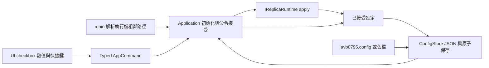

# 通用偏好保存規格

## 目的與範圍

為了在重新啟動後接續使用者的操作習慣，Application 需要將已接受的通用偏好保存至執行檔旁的 `avb0795.config`，並於初始化讀回。

2026-09-15 使用者確認的保存範圍：

- 語言偏好，包含「跟隨系統」。
- 已成功註冊的快捷鍵。
- FPS 上限、邊框、Editable／PassThrough 期望模式。
- Browser capture keep-alive 與來源清單自動重新整理 checkbox。
- 不透明度百分比。

視窗位置與大小、來源選擇、擷取範圍、XYWH 草稿、快捷鍵錄製及框選中的暫時呈現留在當次執行狀態。每次啟動仍由使用者選擇來源並開始擷取。

本規格取代 `2026-09-15-config-persistence-preparation.md` 的廣範圍提案；產品行為以本次收斂後的範圍為準。

## 方案選擇

為了讓此次修改聚焦在通用偏好，需要沿用現有欄位型別與保存時機。三種方案的取捨如下：

| 方案 | 特性 | 決定 |
| --- | --- | --- |
| 延伸現有 V1 JSON | 新增兩個 optional 欄位，沿用 ConfigStore 與原子寫入 | 採用 |
| V2 與 bootstrap 結構 | 適合連同視窗配置與來源恢復一起擴充 | 保留為較大範圍需求的選項 |
| ImGui ini 自訂 section | 保存責任需連接 UI 序列化回呼 | 現有 Application 設定服務繼續承擔此責任 |

## 分層與資料流



UI 持續傳送 typed command。Application 擁有已接受偏好、dirty 狀態與保存時機；ConfigStore 擁有 JSON 與檔案交易。Main 提供新舊路徑，原生 runtime 持續擁有視窗設定交易。DesktopHost 的初始化順序保持原有 callback 生命週期。

## 格式與舊檔相容

內容沿用 V1 JSON，新增 `mode` 與 `auto_refresh_enabled`：

```json
{
  "version": 1,
  "hotkey": "Ctrl+Alt+R",
  "fps_cap": "60",
  "border": "bordered",
  "extensions": { "browser_capture_keep_alive": false },
  "language": "system",
  "opacity_percent": 100,
  "mode": "editable",
  "auto_refresh_enabled": false
}
```

- `mode` 接受 `editable` 與 `pass_through`；缺漏或格式錯誤時，這一欄採 Editable。
- `auto_refresh_enabled` 接受 JSON boolean；缺漏或格式錯誤時，這一欄採 false。
- 兩個新增欄位各自復原，其他有效欄位繼續保留。Language／opacity 的局部復原與現有必要欄位、extensions、未知版本的整份預設復原契約維持原狀。
- Save 驗證新增 mode enum，非法值在檔案 I/O 前回傳 `InvalidValue`。
- Serializer 產生以上九個 root keys；來源、裁切與配置保持各自的執行期 ownership。

為了讓更名後仍能帶回現有偏好，ConfigStore 接受一個明確的 optional legacy 路徑。啟動規則：

1. `main` 提供 `avb0795.config` 與相鄰的 `airelinna.json`。
2. 新檔存在時，以新檔讀取／驗證結果為準。
3. 新檔缺席時讀取舊檔；兩檔皆缺席時使用預設。
4. 路徑檢查／讀取失敗回報 `ConfigReadFailure`。
5. Load 維持讀取操作；後續已接受設定的保存目的地固定為新檔。
6. 舊檔保持原內容供升級復原。新檔語法錯誤或未知版本沿用既有預設復原規則。

Application 於既有 initialize 位置載入一次；legacy 路徑供初始化借用，持續保存使用新路徑。

## 接受、還原與保存

自動重新整理以 `UserConfig.auto_refresh_enabled` 作為期望值；deadline 仍屬本次執行的排程狀態。初始化讀回勾選狀態，第一次 step 安排五秒間隔。選取來源／擷取期間的自動刷新暫停規則沿用現有行為。

`SetAutoRefresh` 在接受值變更後標 dirty 並保存；相同值命令可重試既有 dirty 保存。`SetMode` 在 runtime 與 domain 接受後更新 `UserConfig.mode` 並保存；stale、非法 enum、平台能力限制或 apply 失敗維持先前偏好。

初始化依平台 pass-through capability 套用儲存模式；能力缺席時 session 使用 Editable，config 保留使用者期望值。來源切換與 session replacement 透過既有 settings 複製保留已接受模式。

恢復 Editable 的全域快捷鍵也代表使用者明確操作；runtime 接受後同步保存 Editable。框選期間原生 Editable／100% 屬暫時 override，持久化對象維持使用者期望模式與不透明度。

保存時機沿用目前互動契約：離散選項接受後保存，不透明度在 drag／numeric gesture 完成後保存；Stop 與進入框選可提交既有 dirty。Quit 保持 bounded drain，正常互動負責完成磁碟保存。

原子寫入維持同目錄 temporary、flush／close、平台 replacement。保存失敗保留已接受記憶體值、dirty 與可見診斷；下一個適當保存命令可重試。

## 驗收與工作樹

驗證沿用現有 case 01／04，新增約 6–8 組精確 SECTION，涵蓋：

- 舊欄位保留、新欄位預設／局部復原、九個 root keys round-trip。
- 新舊檔優先序、讀取失敗、Load 保留檔案、保存目的地。
- 重建 Application 後 checkbox／模式還原，來源／crop 保持啟動預設。
- Runtime 拒絕／stale／非法 mode 的保存邊界。
- 全域快捷鍵恢復與框選 override 的期望值保存。
- 保存失敗後重試，及自動刷新恢復後的五秒 deadline。

Release build、非硬體 CTest、source boundaries 與 inventory 通過後完成驗收。此變更沿用既有原生 transaction，硬體渲染程式保持現況。

Spec、plan 與每個 implementation task 皆採全新 reviewer rolling review 至 0 Critical / 0 Medium。Tests、spec、plan 保留工作樹；現有 rename／UX／opacity／crop dirty baseline 維持原樣，提交整理方式待使用者確認。

## Spec review

2026-09-15 round 1：全新 reviewer 對照 live schema、Application 命令、刷新 deadline 與框選 override，0 Critical / 0 Medium。
