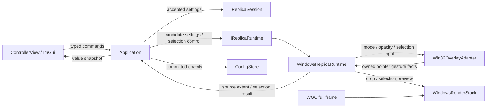

# avb0795 透明度與來源選區設計

## 目的與範圍

使用者希望把 replica 融入桌面，並放大來源中的重點畫面。介面需要即時透明度調整、滑鼠框選、來源像素座標微調與全畫面還原。本版沿用既有 controller、Windows runtime、Vulkan renderer，提供兩項完整功能。

本文件、實作 plan、tests 保留於工作樹。程式與使用文件依實作階段整理；現有 rename、icon、UX 等修改保持原狀。Benchmark 維持擱置。Relative 邊距與命名選區預設列入後續範圍。

## 使用行為

### 透明度

- 標籤採不透明度（Opacity），整數 0–100，100 代表完全顯示，0 代表完全透明，預設 100。
- ImGui DragInt 提供拖曳即時調整、雙擊與 Ctrl+click 輸入、鍵盤確認。UI 與 Application 各自約束 0–100。
- 調整對象為 replica 整個視窗；controller 維持其原本顯示。
- 每次值變更傳送 preview command；結束編輯再送 commit command。Application 保存最後接受值，commit 時寫設定檔。中途 Stop 或開始框選會結束該次 preview 並保存；Quit 沿用既有安全關閉政策，已接受但尚待保存的值留在記憶體與診斷。
- 原生套用成功後接受設定；普通失敗恢復舊狀態並顯示錯誤。RuntimeStateLost 走既有安全停止流程。設定檔保存失敗保留已接受值與診斷。
- Border、OverlayMode、Opacity 是獨立偏好。穿透切換使用目前 opacity；邊框切換保留 opacity 與 mode。
- config V1 增加可選 opacity_percent 整數欄位；既有檔案採 100。格式或範圍異常時，opacity 欄位回復 100，其餘有效偏好維持原值。

### 選區

- Capturing 狀態且目前 runtime 已呈現目前來源的有效畫面時，啟用選取、套用座標與還原全畫面。所有來源專屬命令一併驗證 SessionId、SourceId、Capturing 以及有效呈現尺寸。Windows 與 Display 來源共用同一流程。
- Source loss、改選來源、替代 runtime、source resize 或 graphics recovery 立即使選區操作的尺寸事實失效；重新呈現目前來源的有效畫面後恢復操作。Interrupted 保留的舊 runtime 與新的 selected source 透過這項 admission 保持隔離。取消框選與安全停止維持可達。
- 進入框選後 replica 顯示完整來源、清楚可見的畫面與十字游標，滑鼠在 replica 內拖曳矩形。此期間採暫時 Editable 與 100% opacity，使用者偏好保持原值。
- 左鍵按下以畫面內容為起點，拖曳呈現彩色框線；反向拖曳亦形成矩形。滑鼠捕獲涵蓋拖曳離開視窗的情形；座標限制於內容邊界。起點落在 letterbox 留白時等待下一次內容內按下。
- 左鍵放開即套用選區並退出框選。有效區域至少 1×1 像素；點擊或零面積拖曳維持框選，等待新拖曳。
- Esc、取消按鈕、失去焦點或滑鼠捕獲、source resize / loss / graphics recovery 取消當次框選並恢復前次選區與使用者偏好。Stop / close / Quit 清理互動狀態並沿用安全 drain。
- 選區以來源影像左上角為原點，保存整數 X/Y/Width/Height，採半開區間 [x,x+w) × [y,y+h)。這組數值跨 replica 移動、縮放、DPI 變更維持来源像素語意。
- 控制面板提供座標草稿與「套用範圍」、重新框選、還原全畫面。完整四元組經一次驗證與套用；草稿綁定 SessionId、SourceId 與來源尺寸，任一改變便以目前設定重建。選區命令攜帶 SourceId，Application 驗證目前來源相符後接受。有效條件為正寬高、起點位於來源、寬高位於剩餘邊界內。
- 裁切畫面以選區寬高比 aspect-fit 到現有 client 區域；使用者縮放 replica 時採相同選區比例約束。自動改變視窗位置或面積列入後續 UX。
- 選區跟隨目前 session；停止後再次啟動目前來源保留選區，選擇來源或建立替代 session 時回到全畫面。設定檔保存通用偏好，選區留於 session 記憶體。
- 來源尺寸更新時，renderer 對每張 frame 的 content extent 取交集；Application 收到可用尺寸事實後同步接受交集。交集為空時回到全畫面。畫面尺寸與 allocation extent 各自保持原有責任。
- 套用/取消/微調/還原與框線變更皆要求重繪 retained frame，靜態來源也呈現新狀態。沿用 bounded GPU slots、同步與安全回收。

## 分層與資料流

- core 負責 PixelRegion、ReplicaSettings 與純座標有效性/交集計算；來源與目的像素空間透過型別與文件清楚區分。
- Application 負責 session token、生命週期 admission、設定接受、選區開關與結果、config 保存。事件先依既有 lifecycle precedence 仲裁，再接受有效選區結果。
- UI 負責 ImGui draft/gesture 與 command emission，讀取 ControllerViewState 的設定、來源尺寸與可用狀態。
- WindowsReplicaRuntime 組合 adapter 與 renderer；同步 tick 讀取 bounded selection facts，傳回來源像素選區結果。callback 將值交付給 runtime，Application 於主迴圈接受結果。
- Win32OverlayAdapter 持有唯一 native alpha/input-style transaction，統一計算目前有效 mode/opacity；保留同次操作完整 rollback snapshot 與既有 callback/detach 安全契約。框選期間 client hit-test 接收拖曳；離開後恢復原 hit-test 與 input style。
- renderer 負責 aspect-fit、frame 內容尺寸與 allocation padding 的 UV 換算、選框 shader、retained redraw。選區 metadata 於 command recording 時複製，既有 in-flight draw 保持其 recording 快照。
- 新增值型資料與少量明確方法；沿用現有 command、settings transaction、runtime events，避免額外全域 service 或通用互動框架。

## 顯示算法與成本

設 content 尺寸為 C、allocation 尺寸為 A、選區原點為 O、選區尺寸為 S。取樣範圍為 offset = O/A、scale = S/A；shader 使用 uv = offset + local_uv × scale。取樣邊界限制於選區 texel centers，讓線性過濾與 allocation padding 維持正確邊界。

來源像素與 replica client 像素透過實際 framebuffer/client 比例及 aspect-fit 留白換算；左上取 floor、右下取 ceil，再取來源範圍交集。選框以 frame-local UV 或來源像素座標畫出，線寬換算到目的像素。

WGC 仍提供完整 frame；CPU/GPU bridge 沿用現有路徑。此版效益為聚焦畫面與可操作性，完整擷取/傳輸成本維持現有規模。新增拖曳工作採每次主迴圈最新狀態與 bounded redraw；相同 FPS cap 的設定更新保留既有排程節奏。

## 驗證與完成條件

以現有測試群組擴充約 10–20 個精確情境，涵蓋：opacity config 相容與錯值、preview/commit 與 stale token、native alpha/mode/border round-trip 及失敗 rollback、座標交集與反向拖曳/letterbox、選區取消/resize/lifecycle precedence、靜態 retained redraw 與 UI command emission。保持既有 inventory gate 的案例群組策略。

Release build、既有非硬體 CTest、boundary/inventory checks 全部驗證；硬體驗證採明確自有測試視窗，涵蓋 CPU/GPU bridge 與 retained crop draw。人工 UX 驗證紀錄涵蓋雙擊輸入、透明度 0 的 controller 恢復、穿透/邊框組合、框選/取消/重設、來源 resize、跨 DPI。自動化與人工結果分別報告。

## Review 記錄

Spec self-review：需求、座標、生命週期、持久化、rollback 與範圍已逐項檢查。新 subagent 的 rolling review 結果依序追加於此。

Round 1：0 Critical / 1 Medium。已查證 ApplicationState::select_source 保留 SessionId；補入 SourceId draft key 與 command admission，涵蓋同尺寸來源切換。

Round 2：0 Critical / 1 Medium。已查證 Interrupted 時可改選來源且舊 runtime 保留至 drain；補入所有 region commands 的 Capturing + 當前來源有效呈現尺寸 admission，並列出尺寸失效/重新發布時機。

Round 3：全新 reviewer 完整核對目前 spec 與程式分層，0 Critical / 0 Medium，spec gate 通過。
